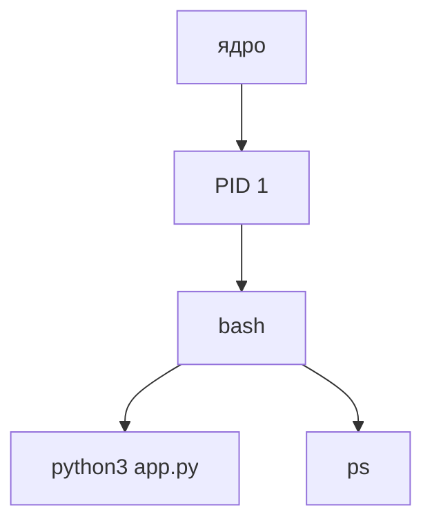
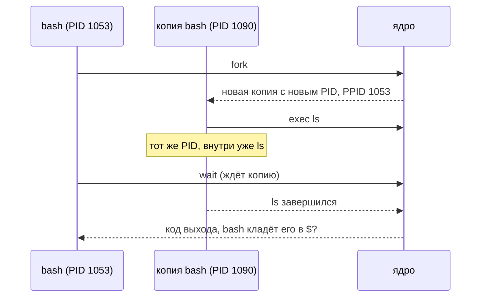
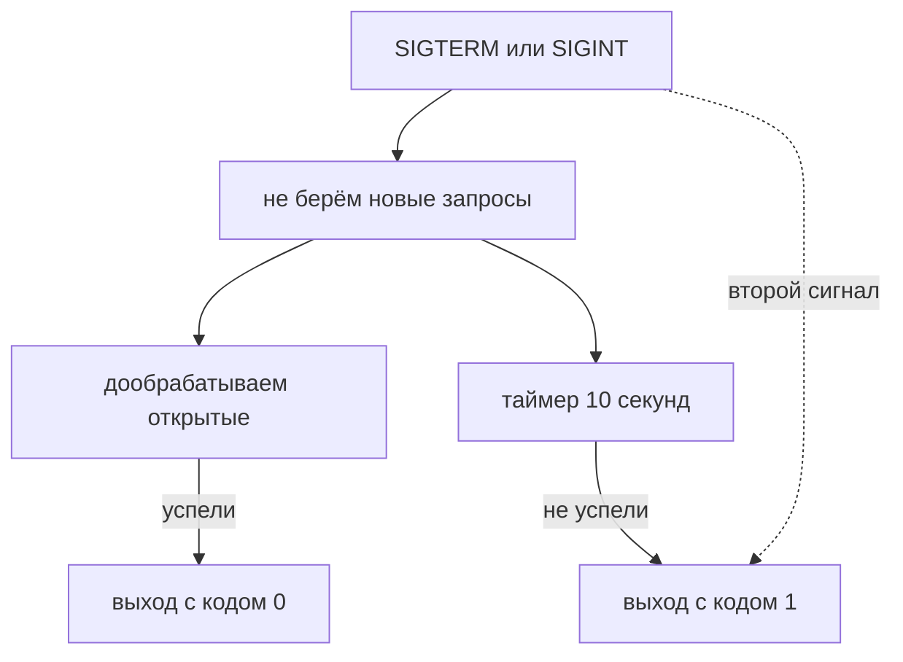

## Зачем это нужно

На дежурстве часто звучит одна и та же фраза: «сервис завис, `kill` не помогает». Ты пишешь `kill 4412`, процесс на месте. Пишешь `kill -9 4412`, и он всё равно торчит в списке. Дальше человек перезагружает сервер «на удачу».

Часто причина в том, что непонятно, что именно ты посылаешь процессу. Процесс (process) это запущенная программа. `kill` не «убивает», а кладёт в процесс короткую «записку» (сигнал), и процесс сам решает, что с ней делать. Одну записку, SIGKILL, процесс прочитать не может: её исполняет само ядро. Но и она не сработает, пока процесс сидит внутри ядра и ждёт диск.

```text
kill -TERM 4412   ->  записка №15 в ящик процесса 4412: «закругляйся»
kill -9 4412      ->  записка №9: исполняет ядро, процесса не спрашивают
```

После урока ты скажешь, что именно послал процессу и почему он не ушёл. А код 137 в описании упавшего контейнера (так заканчивает процесс, которого убили сигналом SIGKILL) расшифруешь сам.

Шаг проекта: «Заметки» v2 превращаются в v2.1. Программа `app.py` научится ловить SIGTERM и SIGINT, дорабатывать открытые запросы и выходить с кодом 0, а не обрываться посреди записи.

## Что нужно знать

- [Урок 1.1: терминал и файловая система](01-first-server-shell.md): команды `man` и `--help` (справка), `/proc` как обычный каталог (каталог, через который ядро показывает данные о процессах; подробно про файловую систему в [уроке 1.5](05-disk-memory-cpu.md)), запуск `python3 app.py`, редактор `nano`.
- [Урок 1.2: потоки и конвейеры](02-text-pipes.md): `2>&1`, `|`, `grep`, `awk`. Ими мы будем разбирать вывод `ps` и `ss`.
- [Урок 1.3: пользователи и права](03-users-permissions.md): владелец процесса, `sudo`, почему чужой процесс без `sudo` не остановить.

## Картина целиком

Представь большой офис. Каждый сотрудник - это процесс: у него есть табельный номер, начальник, кто его нанял, и рабочее место. На вахте сидит ядро Linux (главная программа системы, которая раздаёт процессор и память, подробно в [уроке 1.5](05-disk-memory-cpu.md)): оно решает, кому сейчас дать процессор, и передаёт сотрудникам записки. Записка - это сигнал: «закругляйся» (SIGTERM), «немедленно на выход» (SIGKILL), «подожди» (SIGSTOP). Когда сотрудник уходит, он оставляет начальнику отчёт о причине ухода (код выхода). Пока начальник отчёт не прочитал, запись о сотруднике висит в журнале: это зомби (процесс, который уже не работает и не занимает память, но ещё числится в списке, потому что родитель не забрал его код выхода).

В офисе сотрудников нанимает отдел кадров, а процессы создаёт сам процесс-родитель, копируя себя. Поэтому у процессов есть дерево родства с одним корнем. Поток (thread) это ещё один «рабочий» внутри одного процесса: как второй сотрудник в том же кабинете, с общими бумагами. Процесс один, а дел он делает сразу несколько.



Как читать схему: стрелка значит «предок» (напрямую или через цепочку промежуточных процессов, например `sshd`). Ядро запускает PID 1 (у нас это systemd), а всё остальное растёт от него. `bash` это твоя оболочка, и всё, что ты запускаешь командой, становится её ребёнком: `python3 app.py` живёт долго, `ps` живёт долю секунды. Записка (сигнал) приходит процессу от ядра по его номеру, а код выхода при смерти уходит родителю, то есть `bash`.

Дальше по порядку: что такое процесс и как его разглядеть (задание 1), какие бывают состояния и сигналы (задание 2), почему остаются зомби и как считается нагрузка (задание 3), кто занимает порт (задание 4) и как правильно остановить «Заметки» (задание 5).

## Теория

### Программа и процесс

Файл на диске, например `/usr/bin/python3`, сам ничего не делает: это просто набор байтов. Чтобы что-то произошло, ядро должно загрузить программу в память, выделить ей время процессора и вести учёт: сколько памяти она заняла, какие файлы открыла, от чьего имени работает. Единица такого учёта и есть процесс (process). Без неё нельзя было бы запустить две копии одной программы, ограничить их по правам или остановить одну из них.

Программа - это должностная инструкция в папке. Процесс - это сотрудник, который сейчас работает по ней, со своим столом, своими бумагами и своим табельным номером. По одной инструкции могут работать сразу трое, и они друг другу не мешают. Процесс к тому же умеет «раздвоиться» и отправить копию заниматься другим делом: создание дочернего процесса называют fork.

У каждого процесса ядро хранит короткий паспорт из трёх полей:

1. **PID** (process id) - уникальный номер процесса, пока он жив. Номера выдаются по возрастанию, начиная с 1. Когда процесс умер, его номер со временем может достаться новому.
2. **PPID** (parent process id) - номер родителя, то есть процесса, который создал этот. Родитель есть у всех, кроме самого первого (PID 1, о нём в теме про systemd, [урок 1.8](08-systemd-editors.md)).
3. **UID** - номер владельца (пользователя, из [урока 1.3](03-users-permissions.md)). От него зависит, к каким файлам процесс получит доступ.

Кроме паспорта у процесса есть «трубки» к файлам и соединениям. Они называются файловыми дескрипторами (file descriptor, fd): пронумерованные трубки, через которые процесс читает и пишет. Трубка 0 это stdin (ввод), 1 это stdout (вывод), 2 это stderr (сообщения об ошибках), то же самое, что ты видел в [уроке 1.2](02-text-pipes.md). Остальные номера (3, 4 и так далее) это файлы и соединения, которые процесс открыл сам.

Всё это ядро показывает как обычные файлы в каталоге `/proc/<PID>/` (каталог `/proc` из [урока 1.1](01-first-server-shell.md) не хранится на диске, ядро выдумывает его содержимое в момент чтения). Внутри:

| Путь | Что там |
|---|---|
| `/proc/PID/cmdline` | командная строка, аргументы разделены нулевым байтом, а не пробелом |
| `/proc/PID/status` | имя, состояние, PID, PPID, число потоков, сигналы |
| `/proc/PID/fd/` | по ссылке на каждый открытый дескриптор |
| `/proc/PID/cwd` | ссылка на текущий каталог процесса (откуда он запущен) |
| `/proc/PID/exe` | ссылка на запущенный файл программы (полный путь) |

Команды `ps`, `top`, `pgrep`, `lsof` ничего особенного не умеют: они читают `/proc` и красиво оформляют результат.

Мы запустим «Заметки» и получим, например, PID 179 (у тебя число будет другим). В `/proc/179/status` строка `PPid: 178` говорит, что родитель это процесс 178, то есть твоя оболочка bash. Ссылка `/proc/179/exe` ведёт в `/usr/bin/python3.12`: это настоящий файл, который исполняется, хотя в командной строке написано просто `python3`. Дескриптор 2 (stderr) смотрит в `/home/ubuntu/notes/app.log`, потому что мы перенаправим туда ошибки. Дескриптор 3 - сокет (socket): особая «розетка» для сетевого соединения, в которую входят клиенты. Так процесс держит открытый порт.

Одна деталь понадобится позже. Если файл удалить, пока процесс держит его открытым, в каталоге он исчезнет, но место на диске не освободится, а в `ls -l /proc/PID/fd` рядом появится пометка `(deleted)`. Диск заполнен, а `du` показывает мало: типичная загадка ([урок 1.5](05-disk-memory-cpu.md)).

> **Прикинь сам:** ты запустил `python3 app.py` три раза в разных терминалах (на разных портах). Сколько будет процессов и сколько разных PID?
{: .predict}

Три процесса и три разных PID, хотя программа одна. У них одинаковы файл `/usr/bin/python3` и, скорее всего, владелец.

Осторожно: Процесс не равен программе: одну программу можно запустить десять раз, получится десять процессов с разными PID. И процесс не равен потоку. Поток (thread) - это «второй сотрудник в том же кабинете» внутри одного и того же процесса, он работает с тем же паспортом и общей памятью. У «Заметок» на `ThreadingHTTPServer` один процесс и обычно один поток, а на каждый запрос создаётся ещё один поток на время ответа.

> **Главное:** программа это файл, процесс это запущенная программа с паспортом из PID, PPID, UID и открытых дескрипторов, а ядро показывает его в `/proc/PID/`.
{: .key}

Паспорт у процесса есть. Откуда берётся сам процесс и кто его родитель?

### Откуда берутся процессы: fork, exec и PID 1

Кто-то должен запустить самый первый процесс, и кто-то должен запускать все остальные. В Linux сделали простую схему: новый процесс всегда создаёт уже существующий, копируя себя.

Ксерокс с последующей заменой содержимого. Ты делаешь копию бланка (это fork), а затем в копии стираешь всё и пишешь другой текст (это exec). При этом у копии остаются те же открытые «трубки» (дескрипторы), что и у оригинала.

Когда ты пишешь в bash `ls -l`, происходит четыре шага:

1. bash делает **fork**: ядро создаёт копию bash с новым PID. PPID у копии равен PID оригинала.
2. Копия вызывает **exec** и заменяет себя программой `ls`. PID остаётся тем же, но внутри уже другая программа.
3. Оригинал (bash) ждёт окончания копии системным вызовом **wait**. Системный вызов (system call) - это просьба программы к ядру что-то сделать за неё, например создать процесс или открыть файл.
4. `ls` завершается, ядро передаёт bash число, код выхода (exit code), и bash кладёт его в `$?`.



Так растёт дерево. Корень дерева, PID 1, ядро запускает само при загрузке. Обычно это systemd (менеджер сервисов, [урок 1.8](08-systemd-editors.md)). У PID 1 есть особая работа: если родитель умер раньше потомков, этих «сирот» усыновляет PID 1 и вызывает для них `wait`.

В нашем дереве из «Картины целиком» `python3 app.py` это ребёнок bash, поэтому его PPID равен PID bash. Если закрыть bash «неаккуратно», процесс не исчезнет: его PPID станет обычно 1 (или ближайшего subreaper, процесса, который взял на себя роль PID 1), его усыновили. В контейнерах (тема 4) PID 1 - это уже твоя программа, и она сама должна уметь эту работу: разберём в конце теории.

> **Прикинь сам:** ты ввёл в bash `ls -l`. Сколько раз за это время появится новый PID и что будет с ним после `exec`?
{: .predict}

Один раз: `fork` создаёт копию bash с новым PID, а `exec` заменяет в ней программу на `ls`. PID при этом не меняется.

Осторожно: Фразу «запустить программу» представляют как одно действие. На деле это связка fork плюс exec. Из-за неё у процесса всегда есть родитель, а значит, «Заметки», запущенные из bash, зависят от bash: закроешь терминал, и они получат сигнал (об этом ниже).

> **Главное:** любой запуск это `fork` плюс `exec`, поэтому у каждого процесса есть родитель, а корнем дерева служит PID 1.
{: .key}

> **Проверь понимание:** у процесса PPID равен 1. Что это может значить?

<details markdown="1">
<summary>Ответ</summary>

Либо его запустил напрямую менеджер сервисов (так стартуют службы), либо его настоящий родитель уже умер и процесс усыновил PID 1. Чтобы отличить, смотрят на командную строку и на то, как он запускался: службу systemd можно найти в `systemctl status`, а «сирота» - это обычно забытый процесс, оставшийся после закрытого терминала или аварии.

</details>

Процесс родился. Какие состояния у него бывают, пока он живёт?

### Состояния процесса: R, S, D, Z, T

Процесс не всегда работает: он может ждать ответа из сети, ждать диска, быть остановленным или уже умереть. Чтобы понять, что происходит с сервисом, нужно знать, в каком он состоянии, а `ps` показывает его одной буквой.

Сотрудник в офисе: работает за столом прямо сейчас (R), ждёт звонка и готов отвлечься (S), стоит у окошка архива и ждёт выдачи папки, отвлекаться нельзя (D), поставлен на паузу начальником (T), уволен, но не сдал дела (Z).
Состояние видно в колонке `STAT` команды `ps` и в строке `State:` файла `/proc/PID/status`:

| Код | Название | Что значит | Сигналы |
|---|---|---|---|
| R | running | выполняется на процессоре или стоит в очереди на него | действуют |
| S | sleeping | ждёт события: запрос, таймер, данные из сети | действуют |
| D | uninterruptible sleep | ждёт ответа от диска или другого устройства внутри ядра | обычно не действуют, пока ядро не вернётся |
| T | stopped | остановлен сигналом или `Ctrl+Z` | ждут до SIGCONT; сразу действуют только SIGKILL и SIGCONT |
| Z | zombie | уже завершился, но родитель ещё не прочитал его код выхода | процесса нет, слать нечего |

После главной буквы могут стоять дополнительные знаки: `l` значит многопоточный, `+` значит процесс работает в «переднем плане» терминала, `N` значит пониженный приоритет (об этом дальше), `s` значит лидер сеанса.

Вот настоящая строка `ps` для «Заметок»: `179 178 ubuntu S 00:02 python3 app.py`. Буква `S`: процесс спит и ждёт, когда придёт запрос по порту 8080. Никаких дополнительных знаков нет: поток один (`l` нет), а запущен в фоне (`+` нет). Через секунду после запроса процесс на мгновение становится R, а потом снова S. Больше 99% жизни сервис проводит в S, и это нормально: сервис, который постоянно в R, жжёт процессор.

> **Прикинь сам:** `ps` показывает у процесса состояние `D`, и `kill -9` не помогает. Почему?
{: .predict}

Процесс сидит внутри ядра в системном вызове (обычно ждёт диск или сеть). Сигнал дойдёт только после выхода из него, поэтому проблему ищут в хранилище, а не в `kill`.

Осторожно: Состояние D принимают за «зависший процесс, который надо убить». Чаще всего убить его нельзя, это не баг `kill`: процесс сидит внутри ядра, в системном вызове, и ядро не прервёт ожидание, пока операция не завершится (например, диск ответит; редкое исключение: «убиваемые» ожидания, например у сетевой файловой системы NFS, они тоже видны как D, но SIGKILL их прерывает). Обычно D-состояние длится миллисекунды. Если оно затянулось, проблема не в программе, а в диске, сетевой файловой системе или драйвере.

> **Главное:** `R` работает, `S` спит и ждёт, `D` ждёт диск или сеть и не прерывается, `T` остановлен, `Z` мёртв, но не убран.
{: .key}

> **Проверь понимание:** `ps` показывает `Ssl` для процесса. Расшифруй все три буквы.

<details markdown="1">
<summary>Ответ</summary>

`S`: ждёт события, сигналы действуют. `s`: процесс лидер сеанса (первый процесс в группе, которую создал терминал или менеджер служб). `l`: у процесса несколько потоков.

</details>

Состояния видны в `ps` и `top`. Научимся читать их колонки без догадок.

### Как читать `ps` и `top`: колонки без догадок

`ps` и `top` показывают одни и те же процессы, но в разных обликах, и у новичка теряется время на вопрос «что значит эта колонка». Разберём один раз по настоящему выводу.

Список сотрудников в разных формах: для отдела кадров (кто чей начальник и кем оформлен), для бухгалтерии (сколько ресурсов ест) и для охраны (где сейчас сидит). Данные одни, отбор колонок разный: у `ps` нет «правильной» формы, колонки выбираешь сам ключом `-o`.

У `ps` две устоявшиеся «раскладки». `ps aux` (стиль BSD, без дефиса) даёт колонки для оценки ресурсов; `ps -ef` (стиль UNIX, с дефисом) даёт родство: колонку PPID. Ключ `-e` (или `a` вместе с `x`) означает «все процессы, а не только мои в этом терминале». Ключ `--forest` рисует дерево родства линиями `\_`. Когда нужны конкретные колонки, пишут `ps -o pid,ppid,stat,cmd -p PID` (так мы делали в заданиях). `top` показывает то же в живом режиме с обновлением; для скриптов `top -b -n 2` печатает два кадра: проценты считаются между кадрами, поэтому смотреть надо второй.

Начни с четырёх колонок, остальные можно открыть в справке ниже:

| Колонка | Что это | Как читать |
|---|---|---|
| `PID` | номер процесса | по нему шлют сигналы |
| `STAT` | состояние из прошлого раздела | `S` спит, `R` работает, `D` ждёт ядро, `Z` зомби |
| `RSS` | сколько памяти реально занято, в килобайтах | это число и смотрят |
| `COMMAND` | имя программы и аргументы | в `[скобках]` потоки ядра |

Настоящие строки `ps aux` на нашем стенде (`?` в колонке `TTY` значит «терминала нет», это служба):

```text
USER         PID %CPU %MEM    VSZ   RSS TTY      STAT START   TIME COMMAND
root           1  0.0  0.1  20752 11468 ?        Ss   11:52   0:00 /sbin/init
root          24  0.0  0.1  50148 15416 ?        S<s  11:52   0:00 /usr/lib/systemd/systemd-journald
```

У первого процесса `RSS` 11468 КБ, то есть около 11 МБ. У второго `STAT` равен `S<s`, где `<` значит повышенный приоритет (у `systemd-journald` он специально выше, чтобы не терять записи журнала).

<details markdown="1">
<summary>Справка: остальные колонки ps и top</summary>

`USER` владелец. `%CPU` и `%MEM` доля процессора и оперативной памяти. `VSZ` (virtual size) весь адресный объём, который процесс запросил, в килобайтах: он часто огромен и почти ничего не значит. `TTY` терминал. `START` время запуска, `TIME` сколько процессорного времени процесс потратил (не путай с временем жизни).

В `top -b -n 2` шапка строкой `%Cpu(s): 0.0 us, 0.0 sy, ... 99.4 id` разбирает процессор на доли: `us` (user) программы пользователя, `sy` (system) работа ядра, `wa` (wait) ожидание диска, `id` (idle) простой. Ниже колонки `PR` и `NI` (приоритет), `VIRT`, `RES`, `SHR` (память), `S` состояние, `%CPU`, `TIME+`. Когда сервер «тормозит», сначала смотрят `id` и `wa`.

</details>

> **Прикинь сам:** в `ps aux` у процесса `VSZ` 2000000, а `RSS` 30000. Сколько памяти он реально занимает?
{: .predict}

Около 30 МБ: `RSS` 30000 КБ это память, которая реально выделена. `VSZ` это всего лишь зарезервированный адресный объём.

Осторожно. Часто думают, что `%CPU` в `ps` и в `top` одно и то же. Нет: в `ps` это доля за всё время жизни процесса, а в `top` доля за последний интервал между кадрами (поэтому в скриптах берут второй кадр, `top -b -n 2`). Процесс, который только что «взбесился», `ps` покажет скромным числом, а `top` сто процентами. И ещё: процесс с `%CPU` 100 на многоядерной машине занимает одно ядро целиком, а не «всю машину».

> **Главное:** `ps aux` показывает ресурсы (`%CPU`, `%MEM`, `RSS`), `ps -ef` родство (`PPID`), а `top` обновляется и считает `%CPU` за последний интервал.
{: .key}

Как `VSZ` и `RSS` связаны с нехваткой памяти, разберём в [уроке 1.5](05-disk-memory-cpu.md).

Мы научились смотреть на процессы. Теперь научимся с ними разговаривать: сигналами.

### Сигналы: короткие записки процессу

Как сказать работающей программе «остановись»? Закрыть её окно нельзя, окна нет. Нужен способ послать процессу короткое уведомление, которое ядро доставит вне зависимости от того, чем он занят. Это сигнал (signal): число, которое ядро кладёт в «почтовый ящик» процесса.

Записка, воткнутая в дверь кабинета. Сотрудник видит её при первой возможности и решает: выполнить, проигнорировать или сделать по-своему. Но есть два вида записок, которые не читаются, а исполняются силой: «стоп» и «уволен» (SIGSTOP и SIGKILL). Их выполняет само ядро, процесса не спрашивают.

Отправляет сигнал команда `kill -СИГНАЛ PID` (название обманывает: она не «убивает», а шлёт сигнал; убивает только тот сигнал, который так задуман). Когда сигнал прилетел, у процесса три варианта: сделать действие по умолчанию (обычно умереть), поймать сигнал своим обработчиком (handler, кусок кода на этот случай) или проигнорировать. Пункт «поймать» появляется только у программ, которые для этого написаны. Выбор сигналов:

| Сигнал | Номер | Можно поймать | Смысл |
|---|---|---|---|
| SIGHUP | 1 | да | «терминал закрыт» (hangup, повесили трубку); у служб принято понимать как «перечитай конфиг» |
| SIGINT | 2 | да | то же, что `Ctrl+C` (interrupt, прерывание) |
| SIGQUIT | 3 | да | `Ctrl+\`: завершиться и оставить дамп памяти (core dump) для разбора; у Java выводит стеки потоков |
| SIGKILL | 9 | нет | ядро убирает процесс само, программа ничего не узнает |
| SIGUSR1, SIGUSR2 | 10, 12 | да | «сигналы для своих нужд»: что они значат, решает программа (например, переоткрыть лог-файл) |
| SIGSEGV | 11 | да | процесс обратился к чужой памяти; шлёт его ядро само, а не `kill`, обычно это сбой программы |
| SIGTERM | 15 | да | «пожалуйста, завершайся» (terminate); `kill PID` без ключа шлёт именно его |
| SIGSTOP | 19 | нет | заморозить процесс (в `ps` станет T) |
| SIGCONT | 18 | да | продолжить замороженный (continue) |

Полный список даёт `kill -l`. Номера удобно знать наизусть только четыре: 1, 2, 9, 15.

Есть особый «сигнал 0»: `kill -0 PID` ничего процессу не посылает, но проверяет, что такой процесс существует и ты можешь ему писать. Это быстрая проверка, а не доказательство: номер PID может уже принадлежать другой программе, а чужому живому процессу `kill -0` ответит `Operation not permitted`. Как следить за сервисом надёжнее, разберёт [урок 1.7](07-bash-in-ops.md).

**Разобранный пример: почему порядок TERM, пауза, KILL.** Допустим, «Заметки» в момент остановки записывают новую заметку в файл. При SIGTERM программа может дописать строку и выйти чисто. При SIGKILL её выбросят из памяти посреди `write`: в файле может остаться половина строки, а PID-файлы, блокировки и временные файлы, которые программа собиралась убрать, останутся на диске. Порт при этом освободит ядро, но целостность данных не гарантируется. Поэтому порядок такой: сначала `kill -TERM`, подождать 10-30 секунд, и только если процесс не ушёл, `kill -KILL`, а потом выяснить, почему он не завершался сам.

**Кому можно слать сигналы.** Своим процессам можно, чужим нельзя: ядро сравнивает твой UID с UID владельца процесса, и при несовпадении отвечает `Operation not permitted` (исключение: root, поэтому `sudo kill`). Это защита от ситуации, когда один пользователь останавливает работу другого. Отсюда практическое правило: сервис под пользователем `notes` ([урок 1.3](03-users-permissions.md)) ты остановишь только через `sudo`, а не от своей учётной записи. Поэтому код 1 от `kill -0` ещё не значит «процесса нет»: прочитай сообщение.

> **Прикинь сам:** ты отправил `kill -9 PID` программе, которая писала в файл. Успеет ли она дописать строку?
{: .predict}

Нет: SIGKILL нельзя поймать, процесс умирает сразу. Поэтому сначала шлют SIGTERM, ждут и только потом при необходимости SIGKILL.

Осторожно: Ошибка номер один: «SIGKILL надёжнее, всегда буду использовать его». Он действительно надёжнее и одновременно опаснее. Ошибка номер два: думать, что `kill` посылает сигнал именно «убить». `kill -HUP` и `kill -STOP` процесс не убивают вовсе. И ещё: без прав нельзя послать сигнал чужому процессу (`Operation not permitted`), нужен `sudo` ([урок 1.3](03-users-permissions.md)).

> **Главное:** `kill` шлёт сигналы: SIGTERM (15) просит завершиться, SIGINT (2) это `Ctrl+C`, SIGHUP (1) закрытие терминала, SIGKILL (9) убивает без шансов.
{: .key}

Процесс умер или завершился сам. Как он сообщает, чем закончил?

### Код выхода: как процесс сообщает, чем закончил

Родителю нужно знать, удалась ли работа: скрипт запустил программу, а дальше что? Для этого у каждого процесса есть код выхода (exit code): число от 0 до 255, которое ядро передаёт родителю при завершении. Ноль значит «успех», всё остальное «что-то пошло не так». Без него ни `systemd`, ни Docker, ни скрипты не узнали бы, стоит ли перезапускать сервис.

Отчёт, который уходящий сотрудник оставляет на столе начальника: «0» - сдал всё в порядке, любое другое число - причина ухода. У процесса нет слов, только число, и его смысл договорной.

Если программа завершилась сама, число выбирает она: `sys.exit(0)` в Python, `exit 1` в bash. Если процесс убит сигналом, кода у программы нет, потому что она не успела ничего сказать. Тогда оболочка вычисляет число сама: **128 плюс номер сигнала**. Значение последней команды лежит в переменной `$?` (bash подставляет её значение, когда встречает знак `$`).

| Код | Как получился | Что значит |
|---|---|---|
| 0 | сама завершилась | успех |
| 1 | сама завершилась | общая ошибка (так Python выходит при необработанном исключении) |
| 126 | сама завершилась (так выходит bash) | файл найден, но не исполняемый (нет бита `x`) |
| 127 | сама завершилась (так выходит bash) | команда не найдена: опечатка или не стоит пакет |
| 129 | 128 + 1 | убит сигналом SIGHUP |
| 130 | 128 + 2 | прерван `Ctrl+C` (SIGINT) |
| 134 | 128 + 6 | SIGABRT: программа сама прервала себя (`abort()`, сбой проверки) |
| 137 | 128 + 9 | убит SIGKILL (или ядром при нехватке памяти, [урок 1.5](05-disk-memory-cpu.md)) |
| 139 | 128 + 11 | SIGSEGV: обращение к чужой памяти, сбой программы |
| 141 | 128 + 13 | SIGPIPE: писали в конвейер, а читатель уже закрыт (например, `yes \| head`) |
| 143 | 128 + 15 | получил SIGTERM и не обработал его |

В задании 2 мы запустим `sleep 300 &` и пошлём `kill -TERM $!`. Сразу после этого `echo $?` покажет `0`: это код самой команды `kill` (она успешно отправила сигнал), а не процесса `sleep`. Настоящий код процесса вернёт `wait $!` (команда bash: «дождись этого фонового процесса и выдай его код»): там будет `143`, ведь 128 плюс 15 равно 143.

Код выхода управляет и самим bash. Знак `&&` значит «выполни следующую команду, только если предыдущая вернула 0», а `||` наоборот, «только если вернула не 0». Поэтому `grep 8080 файл || echo "нет"` печатает «нет», когда `grep` ничего не нашёл (он тогда возвращает 1). Так же читают коды выхода `systemd` и Docker: 0 значит «остановился нормально, перезапускать не надо», другое число означает сбой ([урок 1.7](07-bash-in-ops.md) разбирает это в скриптах).

> **Прикинь сам:** чему равны коды выхода процесса, убитого SIGTERM и SIGKILL?
{: .predict}

143 и 137: к 128 добавляют номер сигнала, то есть 128 + 15 и 128 + 9.

Осторожно. Часто читают `$?` не там, где надо (как в примере выше), и думают, что процесс завершился успешно. Ещё путают 137 и 143. 143 значит «попросили завершиться, а программа не умеет», 137 значит «убили насильно» (либо ждать не стали, либо программа не отреагировала, либо ядро убило её за память).

> **Главное:** код выхода 0 значит успех, другое число ошибку, а 128 плюс номер сигнала значит, что процесс убит сигналом.
{: .key}

> **Проверь понимание:** контейнер завершился с кодом 137. Что произошло?

<details markdown="1">
<summary>Ответ</summary>

137 = 128 + 9: процесс убит сигналом SIGKILL. Либо ему послали SIGTERM, он не завершился за отпущенное время, и его убили насильно (так делает `docker stop`, тема 4), либо его убило ядро из-за нехватки памяти (OOM killer, [урок 1.5](05-disk-memory-cpu.md)). Код 143 означал бы, что процесс получил SIGTERM и не обработал его.

</details>

До сих пор процесс занимал наше окно. Как запускать его в фоне и что будет при закрытии терминала?

### Фон, задания и закрытие терминала

Когда ты запускаешь `python3 app.py` в терминале, он «занимает» окно: пока сервис работает, командную строку не вернуть. Нужен способ отправить программу «жить отдельно» и продолжать работать. И нужно понимать, что произойдёт с ней, когда ты закроешь терминал.

Фоновая программа остаётся ребёнком твоей оболочки (её родитель - bash), поэтому закрытие терминала заденет и её.

Знак `&` в конце команды запускает её в фоне (background): bash не ждёт её завершения и сразу возвращает приглашение. Каждому фоновому запуску bash даёт номер задания (job) вида `[1]` и печатает PID. Полезные вещи:

- `$!` - переменная с PID последнего запущенного в фоне процесса;
- `jobs` - список заданий этой оболочки;
- `Ctrl+Z` - остановить текущее задание (терминал посылает ему сигнал SIGTSTP, похожий на SIGSTOP, состояние T);
- `bg` - продолжить остановленное задание в фоне, `fg` - вернуть в передний план;
- `wait PID` - дождаться конца фонового процесса и получить его код выхода.

Когда закрывается терминал, ядро посылает оболочке SIGHUP, а она передаёт его своим заданиям. Обработчика нет, поэтому они умирают (код 129). Команда `nohup КОМАНДА &` запускает программу так, что SIGHUP она игнорирует.

Команда `NOTES_DATA=/tmp/notes-demo.txt python3 app.py 2>> app.log &` разбирается слева направо. `NOTES_DATA=/tmp/notes-demo.txt` перед командой задаёт переменную окружения только для этого запуска ([урок 1.1](01-first-server-shell.md)). `python3 app.py` это сама программа. `2>> app.log` направляет поток ошибок (2) в файл `app.log`, причём `>>` дописывает в конец, а не затирает. `&` уходит в фон. Ответ bash выглядит так: `[1] 179`, где `[1]` номер задания, `179` PID.

Вывод `jobs` читается так: `[1]+  Running   NOTES_DATA=/tmp/notes-demo.txt python3 app.py 2>> app.log &`. В скобках номер задания, знак `+` значит «текущее задание» (к нему относятся `fg` и `bg` без номера; предыдущее помечается `-`), затем состояние (`Running` работает, `Stopped` остановлено `Ctrl+Z`, `Done` завершилось успешно, `Exit 1` завершилось с кодом 1, `Terminated` убито SIGTERM) и сама команда. Номер задания с процентом (`kill %1`) работает только в этой оболочке, а PID работает везде.

**`nohup`, `setsid`, `disown`, `tmux`: когда что.** `nohup` защищает от SIGHUP при запуске. `disown` убирает уже запущенное задание из списка оболочки, и закрытие терминала его не заденет. `setsid` запускает программу в новом сеансе, у неё вообще нет связи с терминалом. `tmux` (или `screen`) держит целый терминал живым на сервере: вернулся по SSH и продолжил с того же места, это основной способ для интерактивной работы. Для настоящего сервиса всё это временные меры, постоянный запуск отдаёт systemd ([урок 1.8](08-systemd-editors.md)).

> **Прикинь сам:** ты запустил `python3 app.py &`, закрыл терминал, и сервис пропал. Почему и выживет ли он с `nohup`?
{: .predict}

Закрытие терминала посылает SIGHUP оболочке, она передаёт его заданиям, и сервис без обработчика умирает. С `nohup` он закрытие переживёт, но не переживёт перезагрузку: для этого нужен менеджер служб.

Осторожно: `nohup` и `&` принимают за способ запустить сервис «навсегда». Они переживут закрытие терминала, но не переживут перезагрузку сервера и не запустятся заново после падения. Для постоянных сервисов нужен менеджер сервисов, [урок 1.8](08-systemd-editors.md). SIGHUP у служб имеет второй смысл, который ты встретишь в теме про nginx и Prometheus: они не умирают по нему, а перечитывают конфигурацию без остановки.

> **Главное:** `&` запускает в фоне, `$!` хранит PID последнего фонового процесса, а `nohup` защищает только от закрытия терминала.
{: .key}

Кто получает `Ctrl+C` и почему его получают не все процессы? Всё дело в группах.

### Терминал, группа процессов и кому достаётся `Ctrl+C`

Когда ты нажимаешь `Ctrl+C`, сигнал получает не «то, что на экране» и не только одна программа. Чтобы остановить целую цепочку, например `python3 app.py | tee log`, ядру нужно понятие «эти процессы работают вместе». Оно называется группой процессов (process group). А чтобы знать, кому закрывать терминал, есть сеанс (session).

Рабочая бригада и смена. Бригада (группа) это все, кто занят одним заданием: бригадиру достаточно крикнуть «стоп», чтобы услышали все. Смена (сеанс) это все бригады, пришедшие с одного входа, то есть из одного терминала. Когда вход закрывают, смену отпускают целиком. Бригады ты не собираешь: их создаёт оболочка сама.

Вот как это устроено:

1. Терминал (окно с командной строкой) привязан к сеансу. Первый процесс сеанса, обычно твоя bash, называется лидером сеанса (в `STAT` у него `s`).
2. Каждую команду или конвейер bash помещает в отдельную группу. Группа, которая сейчас «на переднем плане», получает ввод с клавиатуры. В `STAT` у таких процессов знак `+`.
3. Нажатие `Ctrl+C` терминал переводит в SIGINT и посылает его всей группе переднего плана, `Ctrl+Z` в SIGTSTP. Фоновые задания не получают эти сигналы.
4. Закрытие терминала посылает SIGHUP лидеру сеанса (bash), а он передаёт его всем своим заданиям, и переднего, и заднего плана.

```text
  терминал (окно)  <-->  сеанс
                          |
        bash (лидер сеанса, STAT: Ss)
         |-- группа A (передний план, STAT: R+)   <- Ctrl+C приходит сюда
         |      python3 app.py | tee log
         \-- группа B (фон, STAT: S)              <- Ctrl+C её не касается
                sleep 300 &                          закрыли терминал: SIGHUP придёт и сюда
```

В задании 2 мы запустим `sleep 300` без `&` и нажмём `Ctrl+C`: `sleep` в группе переднего плана, получает SIGINT и умирает с кодом 130. А если то же самое запустить с `&`, `Ctrl+C` ему не страшен, зато закрытие окна терминала убьёт его по SIGHUP (код 129).

> **Прикинь сам:** в терминале работает `sleep 300 &`, а ты нажал `Ctrl+C` в пустом приглашении. Остановится ли `sleep`?
{: .predict}

Нет: `Ctrl+C` посылает SIGINT только группе переднего плана, а `sleep` в фоновой группе. Остановить его можно `kill %1` или `kill $!`.

Осторожно. Часто думают, что `Ctrl+C` «убивает» программу. Нет: он отправляет SIGINT, а решает программа: Python по умолчанию превратит его в исключение `KeyboardInterrupt`, а другая программа может проигнорировать. Ещё путают `Ctrl+C` и `Ctrl+D`: второе не сигнал, а «конец ввода».

> **Главное:** терминал посылает `Ctrl+C` и `Ctrl+Z` только группе переднего плана, а SIGHUP при закрытии получают все задания сеанса.
{: .key}

Теперь о самом частом вопросе дежурного: кто занял порт и как найти нужный процесс?

### Как найти процесс и порт

На сервере работают сотни процессов. Чтобы остановить нужный, нужно его найти, и чаще всего ищут по вопросу «кто занял этот порт».

Порт - это номер окошка в многоэтажном здании (адрес это здание, порт это окошко). В одном окошке может сидеть только один клерк. Если окошко 8080 занято, второй клерк с тем же номером не сядет. Процесс, который «слушает» порт, это клерк, который сидит в окошке и ждёт посетителей.

Порт это число от 1 до 65535, по которому сетевая программа принимает соединения на адресе. Чтобы занять порт, программа делает системный вызов `bind` (привязаться к адресу и порту) и `listen` (начать слушать). Ядро разрешает `bind` на занятый порт только один раз, второй получит ошибку `EADDRINUSE` («address already in use»). Подробно про порты и TCP в [уроке 2.2](../02-network/02-ports-tcp-ssh.md); сейчас достаточно этого.

Инструменты для поиска:

- `pgrep -af ШАБЛОН` ищет процессы по имени или командной строке. Ключ `-f` значит «искать во всей командной строке, а не только в имени программы», `-a` значит «показывать полную командную строку», `-l` показывает только имя.
- `pkill -f ШАБЛОН` шлёт сигнал (по умолчанию SIGTERM) всем найденным. Осторожно: шаблон может совпасть с чужими процессами.
- `ss -tlnp` показывает слушающие сетевые сокеты. Ключи: `t` - TCP, `l` - только слушающие (listening), `n` - порты числами, `p` - какой процесс. Программа `ss` из пакета iproute2.
- `lsof -iTCP:8080 -sTCP:LISTEN` (list open files, «список открытых файлов»: в Linux и сокет это файл) показывает, кто именно слушает порт 8080 (без `-sTCP:LISTEN` в список попадут и клиенты, которые просто подключены к порту). Ключ `-t` выводит только PID, удобно для скриптов. Короче через `ss`: `ss -ltnp 'sport = :8080'`.

Чужие процессы без `sudo` не видны: колонка с процессом будет пустой, потому что ядро не раскрывает их обычному пользователю.

Вывод `ss -tlnp | grep 8080` на нашем стенде:
`LISTEN 0 5 127.0.0.1:8080 0.0.0.0:* users:(("python3",pid=179,fd=3))`. Читаем: состояние `LISTEN`, очередь ожидающих соединений пять (это число заложено в стандартном `http.server`), адрес и порт `127.0.0.1:8080`, то есть сервис слушает только собственный компьютер (не соседние машины), и в конце процесс: `python3`, PID 179, дескриптор 3 (тот самый сокет).

> **Прикинь сам:** `ss -tlnp | grep 8080` показал `users:(("python3",pid=179,fd=3))`. Какой командой остановишь сервис мягко?
{: .predict}

`kill 179`: она шлёт SIGTERM. Если процесс не завершится за разумное время, проверяют состояние и только потом шлют `kill -9`.

Осторожно: `pgrep app.py` без `-f` ничего не найдёт: по умолчанию `pgrep` смотрит только на имя программы, а имя здесь `python3`. Так что `pgrep -l python3` найдёт, а `pgrep app.py` нет. Второй момент: при `pgrep -f` слишком общий шаблон совпадёт с самим `pgrep` или с оболочкой, где ты его написал (мы увидим это в задании 4).

> **Главное:** порт занят значит, что его слушает процесс; найти его можно через `ss -tlnp`, `lsof -iTCP:ПОРТ -sTCP:LISTEN` или `pgrep -af`.
{: .key}

> **Проверь понимание:** `ss -tlnp` показывает `127.0.0.1:8080`, но колонка `users:` пуста. Почему?

<details markdown="1">
<summary>Ответ</summary>

Процесс принадлежит другому пользователю (например, `notes`, [урок 1.3](03-users-permissions.md)), а `ss` запущен без `sudo`. Ядро знает всё, но чужие процессы обычному пользователю не раскрывает. Повтори `sudo ss -tlnp`.

</details>

Процесс нашли. Теперь о том, как он делит процессор с другими и что показывает load average.

### Приоритет и load average: кому достаётся процессор

Ядер меньше, чем процессов. Планировщик ядра (scheduler) решает, кто и на сколько миллисекунд получит ядро процессора. Иногда нужно попросить, чтобы тяжёлая фоновая задача уступала важным. А администратору нужно одно число, по которому видно, что машина «задыхается».

Очередь в кассу. Ядро процессора - это касса. Приоритет - это то, насколько вежливо ты пропускаешь других вперёд. Load average - это средняя длина очереди за последнюю минуту, пять и пятнадцать минут. Только стоят в этой очереди не одни лишь за процессором, но и за диском, и load average считает обе.

**nice: кто уступает.** Значение nice - число от -20 до 19: чем оно выше, тем «вежливее» процесс и тем меньше процессорного времени получает, когда есть конкуренты. Обычный процесс имеет 0. Простой пользователь может только повышать значение (делать вежливее); понизить его, даже вернуть обратно к 0, без root нельзя. `nice -n 10 КОМАНДА` запускает с nice 10, `renice -n 15 -p PID` меняет у уже работающего.

Мы запустим два вечных процесса `yes`, оба привяжем к одному ядру (`taskset -c 0`), один с nice 0, другой с nice 10. Они делят одно ядро в пропорции, которую вычисляет планировщик: у первого будет около 91%, у второго около 9%. Больше nice ни на что не влияет: он только решает, кому достанется ядро, когда ядер не хватает.

**load average: длина очереди.** Load average (среднее число процессов, готовых работать или ждущих диска) ядро считает в трёх окнах: за 1, 5 и 15 минут. Его печатают `uptime`, `top` и файл `/proc/loadavg`. Само по себе число ничего не значит, его надо делить на число ядер (`nproc`): load 4 на четырёх ядрах означает «все заняты, очереди нет», load 8 на четырёх значит «желающих вдвое больше, чем ядер». Вот как выглядит «8 на четырёх ядрах».

<div class="viz" data-viz="linux-load-average" data-cores="4" data-load="8"></div>

Сравни линию нагрузки с числом ядер: когда она выше, процессы стоят в очереди, а сервер отвечает медленно.

Как читать цифры на трёх примерах. Машина с 4 ядрами, `load average: 0.50, 0.40, 0.30`: очередь почти пустая (0,5 на 4 ядра, это 12% загрузки), всё спокойно. Та же машина, `load average: 4.00`: каждое ядро занято, но никто не ждёт, это «под завязку», а не авария. `load average: 12.00, 6.00, 2.00`: очередь втрое длиннее числа ядер, и растёт (первое число, за минуту, больше третьего, за пятнадцать минут), значит, перегрузка началась недавно и усиливается. Обратная картина, `2.00, 6.00, 12.00`, значит, худшее позади. Поэтому смотри не на одно число, а на три и на их порядок.

Оговорка: в контейнере `uptime` и `/proc/loadavg` показывают load всего хоста, а не контейнера.

Почему именно 1, 5 и 15 минут? Одна минута быстро реагирует и показывает «что творится сейчас», но может дёрнуться от случайного всплеска. Пятнадцать минут сглажены и показывают «что было в последнее время». Сравнение коротких окон с длинным отвечает на вопрос, который чаще всего задают на дежурстве: «становится хуже или лучше». Если после перезапуска сервиса первое число упало, а третье ещё высокое, ты видишь последствия недавней проблемы, а не саму проблему.

В задании 3 ты увидишь, как load растёт от двух `yes` на твоём числе ядер.

> **Прикинь сам:** на машине 4 ядра, `load average: 12.00, 6.00, 2.00`. Что это значит?
{: .predict}

В среднем за минуту 12 процессов хотят работать при 4 ядрах: очередь втрое длиннее. А число за минуту больше числа за 15 минут, значит, нагрузка растёт.

Осторожно. Часто думают, что «load average 8 значит 800% нагрузки». Нет, это очередь, а не проценты. Второе: высокий load не обязательно про процессор. Процессы в состоянии D (ждут диск) тоже считаются, так что load может быть высоким при пустом процессоре. Отличить можно по `top`: если в строке `%Cpu(s)` почти всё `id` (idle, «свободно»), а load большой, проблема в диске или сетевой файловой системе, а не в вычислениях.

> **Главное:** load average это длина очереди за 1, 5 и 15 минут; его делят на число ядер, и процессы в состоянии D тоже в нём.
{: .key}

> **Проверь понимание:** load average 8.0 на машине с двумя ядрами, `top` показывает `99 id`. Что делать в первую очередь?

<details markdown="1">
<summary>Ответ</summary>

Смотреть, нет ли процессов в состоянии D (`ps -eo pid,stat,cmd | awk '$2 ~ /^D/'`): очередь есть, а процессор простаивает, значит, процессы ждут диск или сеть. Искать проблему в хранилище, а не в том, «какая программа жрёт CPU».

</details>

Остался странный гость в списке процессов: зомби.

### Зомби: умер, но запись осталась

После смерти процесса родитель должен узнать, как он закончил (код выхода). Пока родитель не прочитает, ядро обязано хранить этот код где-то. Это «где-то» - маленькая запись в таблице процессов. Она и называется зомби (zombie): процесс уже мёртв, память и файлы освобождены, осталась только запись «PID плюс код выхода».

Личное дело уволенного сотрудника, лежащее у начальника на столе, пока тот его не подпишет. Самого сотрудника уже нет, а дело занимает место в картотеке. В отличие от живого сотрудника, зомби не занимает ни рабочее место, ни зарплату, только строку в списке и номер PID.

Вот что происходит по шагам:

1. Родитель создаёт потомка (`fork`).
2. Потомок завершается. Ядро освобождает его память, файлы и ставит в записи состояние Z.
3. Ядро посылает родителю сигнал SIGCHLD («потомок изменился»).
4. Если родитель вызовет `wait`, он получит код выхода, и запись исчезнет.
5. Если родитель `wait` не вызывает (ошибка в его коде), запись остаётся, пока не умрёт родитель. Тогда зомби усыновляет PID 1 (или ближайший subreaper, процесс, который взял на себя эту роль) и сразу убирает.

Поэтому «убить зомби» бессмысленно: он и так мёртв, `kill -9` по нему проходит молча и ничего не меняет. Лечится через родителя: завершить его (`kill PID_родителя`) или перезапустить сервис, и зомби усыновит PID 1. Настоящая починка это исправить код родителя, чтобы он вызывал `wait`.

В задании 3 мы запустим маленькую программу: она делает `fork`, потомок сразу выходит, а родитель засыпает и `wait` не вызывает. В `ps` мы увидим `218 217 Z [python3] <defunct>`: PID потомка 218, PPID (родитель) 217, состояние Z. Квадратные скобки вокруг `python3` и слово `<defunct>` («несуществующий») ставит `ps` сам, потому что у мёртвого процесса нет командной строки. После `kill` родителя зомби исчезнет при следующем запуске `ps`.

> **Прикинь сам:** `ps` показывает три зомби с одним PPID 2200. Кого надо остановить?
{: .predict}

Не зомби: они уже мертвы. Смотри на родителя 2200 (`ps -o pid,stat,cmd -p 2200`): он не вызывает `wait`. Его чинят или перезапускают, и PID 1 заберёт зомби.

Осторожно: Зомби не ест CPU и не занимает память, из-за них не «тормозит система». Единственная реальная проблема: запись держит PID, а число PID ограничено, и при тысячах зомби новые процессы не смогут стартовать. Один-два зомби, пока родитель работает, чаще всего просто признак того, что родитель ещё не успел вызвать `wait`.

> **Главное:** зомби это мёртвый процесс, у которого родитель не прочитал код выхода; убить его нельзя, лечится только через родителя.
{: .key}

Теперь соберём всё это в главное умение: остановить сервис так, чтобы никто ничего не заметил.

### Корректная остановка: graceful shutdown

Сервис должен уметь остановиться так, чтобы клиент не заметил. Если убить процесс в момент обработки запроса, клиент получает обрыв соединения, а данные, которые сервис писал, оказываются недописанными. Хорошее поведение называется graceful shutdown (аккуратное завершение): поймать сигнал, перестать принимать новые запросы, дообработать текущие, выйти с кодом 0.

Кафе закрывается на ночь. Плохой вариант - выключить свет посреди заказа. Хороший - повесить табличку «закрыто», не пускать новых посетителей, обслужить тех, кто уже за столиками, и только потом запереть дверь. Но кафе закрывается по расписанию, а сервис останавливают внезапно, поэтому нужен ещё и предельный срок ожидания.

**Как это устроено, четыре шага (как в кафе).** Обработчик в Python вешается так: `signal.signal(signal.SIGTERM, on_signal)` говорит «когда придёт SIGTERM, вызови функцию `on_signal`», то же для SIGINT (`Ctrl+C`). Одна тонкость: `server.shutdown()` ждёт, пока выйдет цикл `serve_forever()`, а обработчик выполняется в том же потоке, где этот цикл крутится. Если вызвать `shutdown()` прямо из обработчика, оба будут ждать друг друга (взаимная блокировка, deadlock). Поэтому `shutdown()` запускают в отдельном потоке.

1. Повесить табличку «закрыто»: поймать сигнал обработчиком.
2. Не пускать новых: перестать принимать новые соединения.
3. Обслужить тех, кто уже за столиками: дождаться открытых запросов.
4. Запереть дверь: выйти с кодом 0 (`sys.exit(0)`).

Ждать вечно нельзя: клиент может зависнуть и не закончить запрос. Поэтому рядом тикает сторожевой таймер (watchdog): через 10 секунд процесс выходит принудительно с кодом 1. Второй сигнал во время остановки тоже завершает процесс сразу с кодом 1: значит, человек сильно торопится.

<details markdown="1">
<summary>Для любопытных: что внутри обработчика</summary>

- После `serve_forever()` вызывают `server_close()`. Он ждёт завершения потоков-обработчиков запросов, но только если у сервера стоит `daemon_threads = False`. Значение `True` (по умолчанию в `ThreadingHTTPServer`) значит «эти потоки можно бросить при выходе», и тогда открытый запрос оборвётся.
- Сторожевой таймер это `threading.Timer(10, ...)`, который вызывает `os._exit(1)`: жёсткий выход без уборки.

</details>



Мы отправим на «Заметки» очень медленный запрос: тело `{"text":"slow note"}` передаётся со скоростью 5 байт в секунду (`curl --limit-rate 5`), то есть около четырёх секунд. Через секунду шлём SIGTERM. У v2 (без обработчика) процесс умирает сразу, curl получает `Empty reply from server`, код выхода 143, заметка не записана. У v2.1 сервер прекращает принимать новые соединения, дожидается конца нашего запроса, записывает заметку, отвечает `HTTP 201` и выходит с кодом 0 примерно через 2 секунды после сигнала (время зависит от скорости).

**Почему запись в файл не рвётся.** В `app.py` из [урока 1.3](03-users-permissions.md) есть блокировка `LOCK`: записи в файл заметок идут по одной, чтобы две заметки не перемешались. Запрос, который успел взять блокировку, дописывает строку целиком. Поэтому при остановке нужно дать ему закончить: если процесс исчезнет в середине, в файле останется обрезанная строка, а при следующем чтении заметки она сломает разбор. Обработчик сигнала и `server_close()` как раз и нужны, чтобы запись не оборвалась, а сервер ушёл только после неё.

Осторожно. Часто думают, что «поймать SIGTERM» значит «игнорировать». Нет, игнорировать нельзя: если сервис никогда не завершается по SIGTERM, менеджер (`docker stop`, Kubernetes, systemd) через положенное время пришлёт SIGKILL, и вся аккуратность будет зря. И SIGKILL поймать нельзя вообще, поэтому программа, которая умирает от `kill -9` посреди записи, должна выдерживать такие смерти на уровне данных (проверки при старте, атомарные записи, об этом [урок 1.7](07-bash-in-ops.md)).

> **Главное:** graceful shutdown: поймать SIGTERM, перестать принимать новые запросы, дообработать текущие и выйти с кодом 0, а на случай зависания держать сторожевой таймер.
{: .key}

> **Проверь понимание:** зачем в v2.1 нужен таймер на 10 секунд, если можно просто дождаться клиентов?

<details markdown="1">
<summary>Ответ</summary>

Клиент может зависнуть или вообще не закончить запрос, тогда ожидание не кончится никогда, и менеджер всё равно убьёт сервис через SIGKILL. Таймер гарантирует, что программа завершится сама в разумный срок, пусть и с кодом 1 (то есть «не всё удалось доделать»).

</details>

Тот же приём понадобится везде, где процессами управляет кто-то другой.

### Где это встретится дальше

Две вещи из этого урока вернутся в следующих темах. Сейчас достаточно знать, что они существуют.

- **PID 1 в контейнере.** В контейнере ([тема 4](../04-docker/01-containers-idea.md)) твоя программа становится PID 1, и у неё особые правила (ниже).
- **Права процесса.** Кроме владельца (UID) у процесса есть набор «привилегий» (capabilities): например, право занимать порты ниже 1024 без root. Это ещё один слой к идее «сервис под своим пользователем» из [урока 1.3](03-users-permissions.md); в темах про Docker и Kubernetes к нему вернёмся.

**Чем PID 1 отличается от других процессов.**

В контейнере твоя программа получает PID 1. Ядро не применяет к PID 1 действия по умолчанию: если у программы нет обработчика SIGTERM, сигнал ничего не сделает, `docker stop` подождёт 10 секунд и пришлёт SIGKILL (код 137). Как запускать программу в контейнере, чтобы сигналы до неё доходили, разберёт тема 4.

### Одна схема остановки для systemd, Docker и Kubernetes

Везде, где есть менеджер процессов, схема одна: SIGTERM, ожидание, SIGKILL. Разница только в том, кто держит часы:

| Менеджер | Срок до SIGKILL | Где задаётся |
|---|---|---|
| systemd | 90 секунд | `TimeoutStopSec` |
| Docker | 10 секунд | `docker stop -t` |
| Kubernetes | 30 секунд | `terminationGracePeriodSeconds` |

Если программа успела, она выходит с кодом 0 (как v2.1). Если не успела, менеджер шлёт SIGKILL, и код будет 137; если она SIGTERM вообще не ловит, как v2, код 143. Отсюда правило для всех следующих тем: у сервиса должен быть обработчик SIGTERM, а время его работы должно укладываться в срок ожидания менеджера. v2.1 выдерживает запросы короче 10 секунд (столько ждёт его сторожевой таймер): с обычными короткими запросами он остановится за секунды.

В Kubernetes есть тонкость: SIGTERM и удаление пода из списка адресов сервиса (endpoints) идут параллельно, поэтому новые запросы могут прилетать уже после сигнала. Поэтому сервис при SIGTERM сначала начинает отвечать на `/readyz` кодом 503 («меня больше нет в балансировке»), выдерживает паузу 5-10 секунд, и только потом закрывает порт; то же часто делают командой `preStop` с `sleep`. Подробности в [теме 5](../05-kubernetes/07-probes-resources-rollouts.md). В задании 5 мы сделаем только часть: поймаем SIGTERM и аккуратно закроемся. `/readyz` с 503 и паузу ты увидишь в теме 5.

> **Прикинь сам:** что произойдёт при `docker stop`, если у программы в контейнере нет обработчика SIGTERM?
{: .predict}

Docker подождёт 10 секунд, пришлёт SIGKILL, и процесс завершится с кодом 137: у PID 1 нет действия по умолчанию для SIGTERM.

> **Главное:** systemd, Docker и Kubernetes останавливают процесс одинаково: SIGTERM, ожидание, SIGKILL; сервис должен уложиться в срок ожидания.
{: .key}

Теория закончена. В практике ты найдёшь процесс «Заметок», пошлёшь сигналы и научишь сервис останавливаться аккуратно.

## Практика

Среда: Ubuntu 26.04 LTS или 24.04. Нужные программы: `procps` (`ps`, `top`, `pgrep`, `pkill`), `iproute2` (`ss`), `lsof`. Обычно они уже есть; если нет:

```bash
sudo apt update
sudo apt install -y lsof procps iproute2
```

Значения PID, время и номера inode в выводах ниже взяты из настоящего прогона. У тебя они будут другими, важна форма вывода.

### Задание 1. Найти процесс «Заметок» и его порт

**Цель:** по имени найти процесс, его владельца, родителя и порт, а потом заглянуть в `/proc`.

**Предскажи:** сколько процессов покажет `pgrep -af app.py` при одном запущенном сервисе и какой у него PPID? Что в `/proc/<PID>/cmdline` окажется между словами вместо пробелов?

<details markdown="1">
<summary>Ответ</summary>

Один процесс: сервер на `ThreadingHTTPServer` использует потоки внутри процесса, а не отдельные процессы. Его родитель это твоя оболочка. Аргументы в `cmdline` разделены нулевыми байтами, а не пробелами, поэтому их печатают через `tr '\0' ' '`.

</details>

**Шаги.**

1. Запусти сервис в фоне. Часть команды уже разобрана выше (переменная перед командой, `2>>`, `&`); `echo "PID сервиса: $!"` печатает PID последнего фонового процесса.

```bash
cd ~/notes
NOTES_DATA=/tmp/notes-demo.txt python3 app.py 2>> app.log &
echo "PID сервиса: $!"
```

2. Найди процесс и его родителя. Разбор второй команды: `ps` показывает процессы; `-o pid,ppid,user,stat,etime,cmd` выбирает колонки (номер, номер родителя, владелец, состояние, сколько времени работает, команда); `-p ...` ограничивает список нужным PID; `$(...)` подставляет вместо себя вывод вложенной команды, то есть `pgrep -f 'python3 app.py'` выдаёт PID, и он становится значением `-p`.

```bash
pgrep -af app.py
ps -o pid,ppid,user,stat,etime,cmd -p "$(pgrep -f 'python3 app.py')"
```

3. Найди порт двумя способами. Разбор: `ss -tlnp` разобран в теории (TCP, слушающие, числа, процессы); `| grep 8080` оставляет только строки с 8080 (конвейер из [урока 1.2](02-text-pipes.md)); `lsof -iTCP:8080 -sTCP:LISTEN` показывает открытые файлы-сокеты, которые слушают порт 8080.

```bash
ss -tlnp | grep 8080
lsof -iTCP:8080 -sTCP:LISTEN
```

4. Загляни внутрь процесса. Каждая строка объяснена комментарием в блоке:

```bash
PID=$(pgrep -f 'python3 app.py')                        # $(...) кладёт найденный номер в переменную
tr '\0' ' ' < /proc/$PID/cmdline; echo                  # нулевые байты в пробелы; echo переводит строку
grep -E 'Name|State|PPid|Threads' /proc/$PID/status     # -E: символ | значит «или», выбираем 4 строки
ls -l /proc/$PID/fd | awk 'NR>1 {print $9, $10, $11}'   # NR>1 пропускает строку total 0; берём имя, стрелку, цель
readlink /proc/$PID/cwd                                 # на что указывает ссылка: текущий каталог
readlink /proc/$PID/exe                                 # какой файл программы исполняется
```

**Что должно получиться:**

```text
[1] 179
PID сервиса: 179
179 python3 app.py
    PID    PPID USER     STAT     ELAPSED CMD
    179     178 ubuntu   S          00:02 python3 app.py
LISTEN 0      5          127.0.0.1:8080      0.0.0.0:*    users:(("python3",pid=179,fd=3))
COMMAND PID    USER   FD   TYPE DEVICE SIZE/OFF NODE NAME
python3 179 ubuntu     3u  IPv4  66737      0t0  TCP localhost:http-alt (LISTEN)
python3 app.py 
Name:	python3
State:	S (sleeping)
PPid:	178
Threads:	1
0 -> /dev/pts/0
1 -> /dev/pts/0
2 -> /home/ubuntu/notes/app.log
3 -> socket:[66737]
/home/ubuntu/notes
/usr/bin/python3.12
```

**Как читать вывод:**

- `[1] 179`: bash сообщает «задание номер 1, PID 179». Следующая строка это наш `echo`.
- В `ps` колонка `PPID` (178) это PID твоей оболочки. `STAT` равен `S`: процесс спит и ждёт запросов. Знака `l` нет, потому что поток один, знака `+` нет, потому что процесс в фоне. `ETIME` (`00:02`) показывает, сколько секунд он работает.
- В `ss` порт `127.0.0.1:8080` и `users:(("python3",pid=179,fd=3))` говорят, кто слушает и какой дескриптор держит сокет. `lsof` показывает то же самое другими словами (в строке `lsof` ключ `-sTCP:LISTEN` отсёк лишние соединения): `3u` значит дескриптор 3 открыт на чтение и запись, `localhost:http-alt` это `127.0.0.1:8080` (у 8080 есть имя в списке известных портов).
- `cmdline` печатает `python3 app.py ` с пробелом на конце: последний нулевой байт превратился в пробел.
- Дескрипторы: 0 и 1 смотрят в терминал (`/dev/pts/0`), потому что мы ничего не перенаправляли; 2 ведёт в `app.log`, потому что мы перенаправили `2>>`; 3 это сокет. На Ubuntu 26.04 у `ls -l` в этой строке появится ещё знак `+` после прав, это дополнительные права, они нам не мешают.

**Типичные ошибки:**

- `bash: pgrep: command not found`: не стоит пакет procps: `sudo apt install -y procps`.
- Столбец `users:` пуст в выводе `ss`: процесс чужой, а `sudo` не указан: `sudo ss -tlnp`.
- `lsof` выводит и строки с `ESTABLISHED`, если ключ `-sTCP:LISTEN` не указан: это клиенты порта, а не его хозяин.
- `pgrep app.py` без `-f` ничего не печатает (код 1): без `-f` шаблон сравнивается с именем программы (`python3`), а не с аргументами.
- `pgrep -f app.py` находит лишние строки, если шаблон слишком общий: делай его точнее, например `'python3 app.py'`.
- `ls: cannot read symbolic link` или пустой `fd` у чужого процесса: чужие дескрипторы читает только root, используй `sudo`.

Сервис пусть работает, он понадобится в задании 4.

> Не понимаешь строку из `ps` или `top`? Скопируй её нейросети вместе с заголовком колонок и спроси по каждой колонке, что она значит. Потом проверь ответ: колонку в `man ps`, а число сверь с `/proc/PID/status`.
{: .ai}

### Задание 2. Сигналы и коды выхода

**Цель:** отправить процессу разные сигналы и увидеть, как меняются его состояние и код выхода. Подопытным будет `sleep 300`: он просто ждёт пять минут.

**Предскажи:** какой код выхода даст `sleep`, если послать ему `kill -TERM`, и что покажет `echo $?` сразу после самой команды `kill`?

<details markdown="1">
<summary>Ответ</summary>

У `sleep` будет 143 (128 + 15), но сразу после `kill` `echo $?` покажет 0: это код самой команды `kill`, она отправила сигнал без ошибки. Настоящий код процесса получают через `wait`.

</details>

**Шаги.** Задания 2 и 3 выполняй во втором терминале (в первом работает сервис из задания 1, его не трогай); все команды задания в одном терминале, по одной.

1. Запусти `sleep` в фоне и посмотри состояние. Разбор: `ps -o pid,stat,cmd -p $!` показывает три колонки только для PID из `$!`.

```bash
sleep 300 &
ps -o pid,stat,cmd -p $!
```

2. Заморозь и разморозь: `kill -STOP` и `kill -CONT` (сигналы 19 и 18).

```bash
kill -STOP $!
ps -o pid,stat,cmd -p $!
kill -CONT $!
ps -o pid,stat,cmd -p $!
```

3. Проверь «живость» сигналом 0, потом останови процесс мягко и получи настоящий код выхода. Разбор: `wait $!` ждёт фоновый процесс и возвращает его код; `;` разделяет команды на одной строке.

```bash
kill -0 $!; echo "kill -0 вернул $?"
kill -TERM $!; echo "код самой kill: $?"
wait $!; echo "код выхода sleep: $?"
```

4. То же для SIGKILL и SIGHUP. Каждую пару выполняй по очереди.

```bash
sleep 300 & kill -KILL $!; wait $!; echo "после SIGKILL: $?"
sleep 300 & kill -HUP $!; wait $!; echo "после SIGHUP: $?"
```

5. Проверь, что процесса после смерти нет, и как `kill -0` это показывает:

```bash
sleep 300 & PID=$!
kill $PID; wait $PID; echo "код: $?"
kill -0 $PID; echo "kill -0 вернул $?"
```

6. `Ctrl+C` в переднем плане. Запусти `sleep 300` без `&`, нажми `Ctrl+C` и посмотри код:

```bash
sleep 300
echo "код выхода: $?"
```

7. Поймай сигнал в самой оболочке. `trap 'КОМАНДА' СИГНАЛ` в bash говорит «когда придёт этот сигнал, выполни команду»; `$$` это PID самой оболочки. Обработчик в bash это то же самое, что `signal.signal` в Python (подробнее про `trap` в [уроке 1.7](07-bash-in-ops.md)).

```bash
trap 'echo поймал TERM' TERM
kill -TERM $$
trap - TERM
```

Последняя строка снимает ловушку.

**Что должно получиться:**

```text
[1] 197
    PID STAT CMD
    197 S    sleep 300
[1]+  Stopped                 sleep 300
    PID STAT CMD
    197 T    sleep 300
    PID STAT CMD
    197 S    sleep 300
kill -0 вернул 0
код самой kill: 0
[1]+  Terminated              sleep 300
код выхода sleep: 143
[1]+  Killed                  sleep 300
после SIGKILL: 137
[1]+  Hangup                  sleep 300
после SIGHUP: 129
код: 143
bash: kill: (204) - No such process
kill -0 вернул 1
^C
код выхода: 130
поймал TERM
```

Точная позиция строк вроде `[1]+  Stopped` может отличаться: bash печатает их между командами, когда замечает смену состояния.

**Как читать вывод:**

- `S` меняется на `T` после `kill -STOP` и возвращается в `S` после `kill -CONT`. Процесс не умирал: его просто не планировали на процессор.
- `kill -0` возвращает 0, пока процесс существует и тебе можно ему слать сигналы. После смерти вместо 0 приходит ошибка `No such process` и код 1.
- Три кода в задании: 143, 137, 129, ровно как в таблице кодов из теории (128 плюс 15, 9, 1).
- `Terminated`, `Killed`, `Hangup`: так bash называет причину смерти задания.
- `^C` это то, что терминал печатает на нажатие `Ctrl+C`, а `130` это 128 плюс 2 (SIGINT).
- Ловушка в конце показывает, что сигнал SIGTERM можно поймать: оболочка напечатала фразу и осталась жива. То же самое сделает v2.1 для сервиса.

**Типичные ошибки:**

- `bash: kill: (204) - No such process`: процесс уже завершился, PID устарел. Повтори запуск.
- `bash: kill: %1: no such job`: номер задания неверный, посмотри `jobs`.
- `bash: wait: pid 204 is not a child of this shell`: `wait` работает только для заданий этой же оболочки. Не открывай для `wait` другой терминал.
- Строки `поймал TERM` нет: `trap` не был поставлен перед `kill` (выполняй строки по порядку, в одном терминале) или в имени сигнала опечатка.
- `kill: Operation not permitted`: процесс чужой, нужен `sudo` ([урок 1.3](03-users-permissions.md)).

### Задание 3. Зомби, приоритет и нагрузка

**Цель:** своими руками получить зомби и убрать его, потом увидеть, как `nice` делит процессор, и прочитать load average.

**Предскажи:** что будет с зомби, если по нему выстрелить `kill -9`? А если остановить его родителя?

<details markdown="1">
<summary>Ответ</summary>

По зомби `kill -9` проходит молча и ничего не меняет: он уже мёртв. Если завершить родителя (`kill` без ключа), зомби усыновит PID 1, немедленно вызовет `wait`, и запись исчезнет.

</details>

**Шаги.** Это тоже второй терминал: в нём номера заданий начинаются с [1].

1. Создай «плохого родителя». Мы кладём Python-код в файл (так `ps` покажет читаемую команду). Разбор heredoc: `cat > файл <<'EOF' ... EOF` записывает всё до строки `EOF` в файл, кавычки вокруг `EOF` отключают подстановки. Сам код: `os.fork()` создаёт копию процесса; в копии (`pid == 0`) вызываем `os._exit(0)`, то есть потомок сразу завершается; родитель печатает PID-ы и засыпает на 600 секунд, ни разу не вызвав `wait`.

```bash
cat > /tmp/zombie.py <<'EOF'
import os, time
pid = os.fork()
if pid == 0:
    os._exit(0)          # потомок сразу завершается
print("родитель", os.getpid(), "потомок", pid, flush=True)
time.sleep(600)          # родитель спит и не вызывает wait()
EOF
python3 /tmp/zombie.py &
PARENT=$!
sleep 1
ps -o pid,ppid,stat,cmd --ppid "$PARENT"
```

`PARENT=$!` запоминает PID родителя, `--ppid "$PARENT"` выбирает процессы, у которых родитель равен ему.

2. Найди всех зомби в системе одной командой. Разбор: `ps -eo pid,ppid,stat,cmd` выводит все процессы (`-e`) в выбранных колонках; `awk '$3 ~ /^Z/'` печатает строки, где третье поле (STAT) начинается на `Z` (`~` значит «соответствует шаблону», `^` начало строки). Строка заголовка отфильтруется.

```bash
ps -eo pid,ppid,stat,cmd | awk '$3 ~ /^Z/'
```

3. Выстрели в зомби, а затем заверши родителя (`kill "$PARENT"`, его PID мы запомнили в шаге 1). PID зомби берём среди детей нашего родителя (`ps -o pid=,stat= --ppid "$PARENT"`, знак `=` убирает заголовок колонки), чтобы не зацепить чужих зомби в системе. `sleep 1` даёт PID 1 время всё убрать.

```bash
ZOMBIE=$(ps -o pid=,stat= --ppid "$PARENT" | awk '$2 ~ /^Z/ {print $1}')
kill -9 "$ZOMBIE"; sleep 1; ps -o pid,stat,cmd -p "$ZOMBIE"
kill "$PARENT"; sleep 1; ps -o pid,stat,cmd -p "$ZOMBIE"
```

4. Приоритет. Запусти два вечных процесса `yes` (он бесконечно печатает `y`; вывод уходит в `/dev/null`, то есть «в никуда») и привяжи оба к нулевому ядру: `taskset -c 0` (ограничить процесс одним ядром). Второй пусть будет вежливым: `nice -n 10`. Каждый PID запоминаем в переменную (`P1`, `P2`), а `jobs` показывает, что оба задания живы. `ps` смотрит на `%CPU`; `top -b -n 2 -p` печатает «фотографию» вместо живого экрана (`-b` пакетный режим для скриптов, `-n 2` два кадра: проценты считаются между кадрами, поэтому нужен второй, а `tail -3` оставляет заголовок и две строки).

```bash
taskset -c 0 yes > /dev/null &
P1=$!
taskset -c 0 nice -n 10 yes > /dev/null &
P2=$!
jobs
sleep 3
ps -o pid,ni,pcpu,stat,cmd -p "$P1,$P2"
top -b -n 2 -p "$P1,$P2" | tail -3
kill "$P1" "$P2"
```

5. Посмотри нагрузку и число ядер. `nproc` печатает число ядер, `/proc/loadavg` хранит те же числа, что `uptime`, плюс счётчики процессов.

```bash
uptime
nproc
cat /proc/loadavg
```

6. Проверь права на `nice` и поменяй приоритет своей оболочки. `renice -n 15 -p $$` делает оболочку вежливее. Вернуть оболочке nice 0 без root нельзя, поэтому после задания 3 можно закрыть этот терминал или вернуться в первый.

```bash
nice
nice -n 5 nice
nice -n -5 sleep 1
renice -n 15 -p $$
```

**Что должно получиться:**

```text
[1] 217
родитель 217 потомок 218
    PID    PPID STAT CMD
    218     217 Z    [python3] <defunct>
    218     217 Z    [python3] <defunct>
    PID STAT CMD
    218 Z    [python3] <defunct>
    PID STAT CMD
[2]-  Running                 taskset -c 0 yes > /dev/null &
[3]+  Running                 taskset -c 0 nice -n 10 yes > /dev/null &
    PID    NI %CPU STAT CMD
   1093   0 91.3 R    yes
   1094  10  9.5 RN   yes
    PID USER      PR  NI    VIRT    RES    SHR S  %CPU  %MEM     TIME+ COMMAND
   1093 ubuntu    20   0    2656   1512   1424 R 100.0   0.0   0:04.66 yes
   1094 ubuntu    30  10    2656   1512   1424 R  10.0   0.0   0:00.43 yes
 11:54:21 up 26 min,  0 user,  load average: 1.30, 0.55, 0.21
15
1.30 0.55 0.21 3/738 235
0
5
nice: cannot set niceness: Permission denied
216 (process ID) old priority 0, new priority 15
```

(Строки `родитель ...` и `[1] 217` могут появиться в другом порядке. Числа PID, нагрузка и время у тебя другие. Значения `%CPU` могут колебаться, но соотношение примерно 9:1 сохранится. Кусок про два `yes` запускался отдельно от зомби, отсюда другие PID и номера заданий в строках `jobs`.)

**Как читать вывод:**

- У потомка `Z` и в `CMD` `[python3] <defunct>`: квадратные скобки `ps` ставит вместо командной строки у процессов, у которых её уже нет. PPID 217 указывает на виноватого.
- Вторая находка та же самая (мы искали `awk`-ом). После `kill -9 218` зомби остался, `kill` ничего не сообщил: сигнал зомби не нужен. После остановки родителя в `ps -p` остался только заголовок: PID 1 забрал запись.
- `NI` 10 и состояние `RN`: R значит «готов к работе», N значит «приоритет ниже обычного». Оба процесса хотят одно ядро, поэтому у вежливого около 9% против 91% у обычного. В `top` `PR` (внутренняя очередь планировщика) выросло с 20 до 30 при `NI` 10.
- `load average: 1.30, 0.55, 0.21`: за минуту очередь в среднем 1,3, за пять 0,55, за пятнадцать 0,21, то есть нагрузка растёт. Делим на `nproc` (в примере снято на стенде с 15 ядрами, у тебя число своё; на 4 ядрах два `yes` дали бы load около 2, то есть половину): здесь машина не перегружена. В `/proc/loadavg` первые три числа те же, четвёртое `3/738` значит «3 задачи (процессы и потоки) сейчас готовы к работе из 738 существующих в системе», последнее число это PID, выданный последним.
- `nice` без аргументов печатает текущее значение (0), `nice -n 5 nice` показывает 5, а `nice -n -5` без root заблокирован.
- `renice` печатает старое и новое значения приоритета для процесса с PID оболочки.

**Типичные ошибки:**

- `bash: kill: (218) - No such process`: зомби уже убран, PID устарел.
- `bash: kill: (1093) - No such process` на `kill "$P1" "$P2"`: `yes` уже остановлен, посмотри `jobs`. Для запасного варианта подойдёт `pkill -x yes` (точное имя, чужие процессы не заденет).
- `nice: cannot set niceness: Permission denied`: понижать значение (в том числе возвращать к 0) может только root; обычному пользователю можно только повышать.
- `taskset: command not found`: пакет `util-linux`, `sudo apt install -y util-linux`.
- `python3 -c '...'` вместо файла: в `ps` вместо аккуратной команды будет длинный кусок кода, поэтому мы кладём его в `/tmp/zombie.py`.

> Сервис не стартует и пишет, что порт занят? Дай нейросети вывод `ss -tlnp` и `ps -o pid,user,args -p <PID>`. Пусть она назовёт, чей это процесс и как его остановить без `kill -9`. Но сначала проверь, не твой ли это прошлый запуск.
{: .ai}

### Задание 4. Порт занят: `Address already in use`

**Цель:** воспроизвести самую частую ошибку запуска сервиса, найти виновника и остановить его правильно.

**Предскажи:** запустится ли вторая копия `app.py` на том же порту? Что напишет и с каким кодом завершится?

<details markdown="1">
<summary>Ответ</summary>

Нет. `bind` на занятый порт вернёт ошибку `EADDRINUSE`, Python выбросит `OSError: [Errno 98] Address already in use` и завершится с кодом 1.

</details>

**Шаги.** Это задание выполняй в первом терминале, где ты запускал сервис в задании 1: строки вроде `Terminated` печатает та оболочка, которая запустила задание, в другом терминале их не будет.

1. Сервис из задания 1 всё ещё работает (проверь `pgrep -af app.py`; если нет, запусти его снова). Запусти второй экземпляр на том же порту. `$?` сразу после команды содержит её код выхода.

```bash
cd ~/notes
NOTES_DATA=/tmp/notes-demo2.txt python3 app.py
echo "код выхода: $?"
```

2. Найди виновника, убедись, что это он, и останови его мягко. Разбор: `lsof -t -iTCP:8080 -sTCP:LISTEN` печатает только PID того, кто именно слушает порт (клиентов порта в списке нет; для своих процессов `sudo` не нужен); `ps -p ... -o pid,cmd` показывает, что это за процесс, до того как ты пошлёшь ему сигнал; `sleep 1` ждёт освобождения порта; `||` выполняет правую часть, только если левая завершилась ошибкой (`grep` ничего не нашёл).

```bash
PID=$(lsof -t -iTCP:8080 -sTCP:LISTEN)
ps -p "$PID" -o pid,cmd
kill -TERM "$PID"
sleep 1
ss -tlnp | grep 8080 || echo "порт свободен"
```

Если `lsof` не установлен, тот же PID даст `ss -ltnp 'sport = :8080'`.

3. Запусти второй экземпляр ещё раз: теперь он поднимется. Останови его `Ctrl+C` и посмотри код (`echo $?`). Это пока версия v2, дальше починим.

4. Пара ловушек. Ошибки порта и шаблона:

```bash
PORT=abc python3 app.py; echo "код: $?"
bash -c 'pkill -f "python3 app.py"; echo "после pkill"'; echo "код: $?"
```

Первая команда покажет ошибку из самого `app.py` (мы там проверяли `PORT`). Вторая показывает подвох `pkill -f`: шаблон совпал с командной строкой самой оболочки `bash -c '...'` (в ней тоже написано `python3 app.py`), и она убила себя.

**Что должно получиться:**

```text
Notes vdev слушает 127.0.0.1:8080, данные /tmp/notes-demo2.txt
Traceback (most recent call last):
  File "/home/ubuntu/notes/app.py", line 101, in <module>
    ThreadingHTTPServer((HOST, PORT), Handler).serve_forever()
    ...
OSError: [Errno 98] Address already in use
код выхода: 1
    PID CMD
    179 python3 app.py
[1]+  Terminated              NOTES_DATA=/tmp/notes-demo.txt python3 app.py 2>> app.log
порт свободен
ошибка: PORT должен быть числом
код: 2
Terminated
код: 143
```

Между `serve_forever()` и `OSError` Python печатает несколько внутренних строк (в выводе выше они опущены, на их месте `...`), а в Python 3.14 (Ubuntu 26.04) добавятся значки `~~~^^^` под строками кода и могут поменяться номера строк. Важна последняя строка.

Шаг 3 в выводе не показан: после `Ctrl+C` на v2 будет трассировка с `KeyboardInterrupt` и код 130 (v2 не ловит SIGINT, v2.1 научится).

**Как читать вывод:**

- Traceback читают снизу вверх: последняя строка `OSError: [Errno 98] Address already in use` это причина, выше путь по коду. `Errno 98` это номер ошибки ядра (`EADDRINUSE`).
- Код 1 при необработанном исключении Python выдаёт сам. Первая строка `Notes vdev слушает ...` напечатана до попытки `bind`: программа заявляет «слушаю», а на деле не получилось. Это ошибка v2, которую мы поправим в задании 5.
- `179` в таблице `ps` это PID владельца порта, который отдал `lsof -t`, а `python3 app.py` подтверждает, что мы целимся в нужный процесс. После `kill -TERM` оболочка, запустившая сервис (первый терминал), пишет `Terminated` для фонового задания. Пустой вывод `grep` и сообщение `порт свободен` означают, что порт освободился.
- `код: 2` после `PORT=abc`: `app.py` сам выходит с кодом 2 при неверном `PORT`.
- Последний пример: `Terminated` и код 143 показывают, что процесс, выполнявший `pkill`, убил сам себя.

**Типичные ошибки:**

- `OSError: [Errno 98] Address already in use`: порт занят. Найди процесс (`lsof -iTCP:8080 -sTCP:LISTEN`) и останови.
- `PermissionError: [Errno 13] Permission denied`: попытка занять порт ниже 1024 без прав (например, `PORT=80`). На Ubuntu из ядра стоит порог 1024, в контейнерах Docker он может быть 0 и ошибки не будет. Наш порт 8080, значит, кто-то изменил переменную `PORT`.
- `bash: lsof: command not found`: `sudo apt install -y lsof`.
- `pkill -f` убил лишнее: слишком общий шаблон. Проверь `pgrep -af ШАБЛОН` до `pkill`.

### Задание 5. Шаг проекта: «Заметки» v2.1 корректно завершаются по SIGTERM

**Цель:** увидеть, как v2 умирает от SIGTERM (код 143, обрыв запроса), внести правки в `app.py`, получить код выхода 0 и убедиться, что файл совпадает с эталоном.

**Предскажи:** какой код выхода будет у v2 после `kill -TERM`, и какой у v2.1? Что случится с медленным запросом, который идёт в момент сигнала?

<details markdown="1">
<summary>Ответ</summary>

У v2 код 143 (128 + 15): Python не перехватывает SIGTERM и умирает сразу, медленный запрос обрывается. У v2.1 код 0: обработчик останавливает сервер, а открытый запрос дорабатывается.

</details>

**Шаги.**

1. Убедись, что порт свободен (`ss -tlnp | grep 8080` пусто). Посмотри на v2. Разбор: `APP=$!` запоминает PID; `wait "$APP"` ждёт завершения; `tail -n 3 app.log` показывает последние 3 строки лога.

```bash
cd ~/notes
rm -f /tmp/notes-demo.txt app.log
NOTES_DATA=/tmp/notes-demo.txt python3 app.py 2>> app.log &
APP=$!
sleep 1
kill -TERM "$APP"
wait "$APP"
echo "код выхода v2: $?"
cat app.log
```

2. Медленный запрос к v2. Разбор `curl`: `-sS` тихий режим, но с ошибками; `--limit-rate 5` ограничивает скорость до 5 байт в секунду, поэтому тело из ~20 байт уходит около четырёх секунд; `-X POST -d '...'` отправляет POST с телом; `-w '\nHTTP %{http_code}\n'` печатает код ответа; `&` в конце уводит curl в фон, чтобы мы успели послать сигнал.

```bash
NOTES_DATA=/tmp/notes-demo.txt python3 app.py 2>> app.log &
APP=$!
sleep 1
curl -sS --limit-rate 5 -X POST -d '{"text":"slow note"}' -w '\nHTTP %{http_code}\n' http://127.0.0.1:8080/notes &
sleep 1
kill -TERM "$APP"
wait "$APP"; echo "код выхода v2: $?"
```

3. Внеси четыре правки в `app.py` (открой `nano app.py`, редактор из [урока 1.1](01-first-server-shell.md); номер строки можно указать при открытии: `nano +99 app.py`). Нужно, чтобы файл стал в точности версией v2.1.

Правка 1. Вторая строка файла (docstring, строка описания в тройных кавычках) должна стать такой:

```python
"""Заметки v2.1: файловое хранилище и корректная остановка по сигналам."""
```

Правка 2. Между `import json` и `import os` добавь две строки (именно сюда, порядок как в эталоне):

```python
import logging
import signal
```

Правка 3. Сразу после блока `try/except` про `PORT` (после строки `sys.exit(2)` и пустой строки) и перед строкой `LOCK = ...` вставь настройку логов. Что здесь происходит: `LOG_LEVEL` берётся из переменной окружения (по умолчанию `info`) и приводится к верхнему регистру; `logging.basicConfig` задаёт, что сообщения идут в stderr (тот самый `app.log`), с уровнем из `LOG_LEVEL` (если название неизвестное, берётся INFO) и форматом «время УРОВЕНЬ текст»; `log` это именованный логгер.

```python
LOG_LEVEL = os.environ.get("LOG_LEVEL", "info").upper()
logging.basicConfig(
    stream=sys.stderr,
    level=getattr(logging, LOG_LEVEL, logging.INFO),
    format="%(asctime)s %(levelname)s %(message)s",
)
log = logging.getLogger("notes")

```

Правка 4. В самом конце файла удали три последние строки: `if __name__ == "__main__":`, `print(f"Notes v{VERSION} ...")` и `ThreadingHTTPServer(...).serve_forever()`. На их место вставь целиком:

```python
STOP_TIMEOUT = 10  # секунд на дорабатывание открытых запросов


def main():
    server = ThreadingHTTPServer((HOST, PORT), Handler)
    server.daemon_threads = False  # server_close() ждёт обработчики запросов
    stopping = threading.Event()

    def on_signal(signum, frame):
        # второй сигнал во время остановки: выходим немедленно, код 1
        if stopping.is_set():
            os._exit(1)
        stopping.set()
        logging.info("shutting down")
        # shutdown() ждёт выхода из serve_forever(), поэтому вызываем его
        # из отдельного потока, а не из обработчика сигнала
        threading.Thread(target=server.shutdown, daemon=True).start()

    signal.signal(signal.SIGTERM, on_signal)
    signal.signal(signal.SIGINT, on_signal)

    logging.info("started host=%s port=%s", HOST, PORT)
    server.serve_forever()

    # сюда попадаем после shutdown(): ждём открытые запросы не дольше STOP_TIMEOUT
    watchdog = threading.Timer(STOP_TIMEOUT, lambda: os._exit(1))
    watchdog.daemon = True
    watchdog.start()
    server.server_close()  # дожидается потоков обработчиков
    watchdog.cancel()
    logging.info("stopped")
    sys.exit(0)


if __name__ == "__main__":
    main()
```

Каждый шаг этого блока уже разобран в теории про graceful shutdown: обработчик `on_signal`, отдельный поток для `shutdown()`, `server_close()`, сторожевой таймер на `STOP_TIMEOUT` секунд и выход с кодом 0. Последние две строки стандартный приём Python: запустить `main()`, только если файл запущен напрямую.

Сохрани файл (`Ctrl+O`, Enter, `Ctrl+X`).

4а. Проверь, что файл совпадает с эталоном. Разбор: `curl -fsSL` скачивает файл (`-f` считать HTTP-ошибку ошибкой, `-s` без индикатора, `-S` показывать ошибки, `-L` следовать перенаправлениям); `diff - app.py` сравнивает поток из stdin (`-`) с твоим файлом; `&&` выполнит `echo` только при успехе, то есть если различий нет.

```bash
python3 -m py_compile app.py && echo "синтаксис ok"
curl -fsSL https://raw.githubusercontent.com/distinguished-sre/learning/main/devops/project/notes/versions/v2.1.py | diff - app.py && echo "совпадает с эталоном"
grep -n 'signal.signal' app.py
```

Если сети нет, сравни контрольную сумму: `sha256sum app.py` должна дать `625fcc0a7024155990fc316aa3b8f89e033370eedafa75e5afc016e4f0bdb6f2`. Если `curl` ответил `curl: (22) The requested URL returned error: 404`, эталон ещё не опубликован или в адресе опечатка: проверь адрес в ссылке «Эталон» в конце задания и пользуйся контрольной суммой.

5. Запусти v2.1 и останови её. Значение `APP_VERSION` в файле не трогаем.

```bash
rm -f /tmp/notes-demo.txt app.log
NOTES_DATA=/tmp/notes-demo.txt python3 app.py 2>> app.log &
APP=$!
sleep 1
curl -s -o /dev/null -w "%{http_code}\n" http://127.0.0.1:8080/healthz
kill -TERM "$APP"
wait "$APP"
echo "код выхода v2.1: $?"
cat app.log
```

6. Медленный запрос к v2.1, как в шаге 2:

```bash
rm -f /tmp/notes-demo.txt app.log
NOTES_DATA=/tmp/notes-demo.txt python3 app.py 2>> app.log &
APP=$!
sleep 1
curl -sS --limit-rate 5 -X POST -d '{"text":"slow note"}' -w '\nHTTP %{http_code}\n' http://127.0.0.1:8080/notes &
sleep 1
kill -TERM "$APP"
wait "$APP"; echo "код выхода v2.1: $?"
cat /tmp/notes-demo.txt
cat app.log
```

7. Для сравнения: SIGKILL. Обработчик тут бессилен.

```bash
NOTES_DATA=/tmp/notes-demo.txt python3 app.py 2>> app.log &
APP=$!; sleep 1
kill -KILL "$APP"; wait "$APP"; echo "код выхода при SIGKILL: $?"
```

**Что должно получиться:**

```text
код выхода v2: 143
Notes vdev слушает 127.0.0.1:8080, данные /tmp/notes-demo.txt
curl: (52) Empty reply from server

HTTP 000
код выхода v2: 143
синтаксис ok
совпадает с эталоном
127:    signal.signal(signal.SIGTERM, on_signal)
128:    signal.signal(signal.SIGINT, on_signal)
200
код выхода v2.1: 0
2026-09-30 11:55:38,433 INFO started host=127.0.0.1 port=8080
2026-09-30 11:55:39,420 INFO shutting down
2026-09-30 11:55:39,926 INFO stopped
{"id": 1}
HTTP 201
код выхода v2.1: 0
{"id": 1, "text": "slow note", "created_at": "2026-09-30T12:11:50+00:00"}
... INFO shutting down
127.0.0.1 "POST /notes HTTP/1.1" 201 -
... INFO stopped
код выхода при SIGKILL: 137
```

Строки лога начинаются с даты и времени, у тебя они будут своими. Проверка эталона через `curl` работает, когда файл опубликован в репозитории курса; если сети нет, сравни с копией эталона из репозитория курса (`diff путь/к/v2.1.py app.py`) или просто проверь три признака: `py_compile`, `grep` и код выхода. В файле `/tmp/notes-demo.txt` хранится одна JSON-строка на заметку, время `created_at` у тебя будет своё.

**Как читать вывод:**

- Первый блок показывает v2: SIGTERM убил процесс (143), в логе только строка старта, а медленный запрос закончился обрывом `Empty reply from server` (код 52 у curl, `HTTP 000` значит «ответа не было»). Заметка не записана: файла `/tmp/notes-demo.txt` нет.
- `grep` показывает номера строк с `signal.signal`; у эталона это 127 и 128. Если у тебя другие, проверь, что вставки сделаны.
- `200` от `/healthz`: сервис жив. Затем код 0 и три строки лога: `started`, `shutting down`, `stopped`. Между `shutting down` и `stopped` полсекунды: `serve_forever()` выходит по 0,5-секундному опросу.
- Медленный запрос в v2.1: `{"id": 1}` и `HTTP 201`, код 0, а в логе `shutting down` идёт раньше строки о запросе, `stopped` позже: остановка началась при живом запросе и дождалась его.
- SIGKILL: 137 и только строка `started` в логе, обработчик не сработал.

**Типичные ошибки:**

- `NameError: name 'signal' is not defined`: не добавлены импорты `logging` и `signal` (правка 2).
- `NameError: name 'log' is not defined` или `logging` не настроен, `INFO` строки не выводятся: пропущена правка 3.
- В диффе видны отличия только в строке `import`: порядок импортов другой. В эталоне `logging` и `signal` стоят сразу после `import json`, до `import os` (не по алфавиту): сделай так же.
- `wait: pid 4400 is not a child of this shell`: `wait` работает только для процессов, запущенных этой же оболочкой через `&`.
- Код 143 после правки: файл не сохранён или запущена старая копия. Проверь `pgrep -af app.py` и `grep -n 'signal.signal' app.py`.
- Код 130 при `Ctrl+C` вместо 0: остался запущенным старый процесс; найди его `pgrep -af app.py`.
- Открытый запрос всё равно оборвался: пропущена строка `server.daemon_threads = False`.

Итог задания: в `~/notes` лежит v2.1 (обработчик SIGTERM/SIGINT, `shutting down`, выход с кодом 0, логи с уровнем). Долг остался один: сервис по-прежнему запускается руками и не поднимется сам после падения. Его закроет [урок 1.8](08-systemd-editors.md). Эталон: [project/notes/versions/v2.1.py](https://github.com/distinguished-sre/learning/tree/main/devops/project/notes/versions/v2.1.py).

## Сломай и почини

Скрипт `break.sh` создаёт три поломки. Что он делает: сценарий 1 запускает лишнюю копию сервиса, которая держит порт 8080; сценарий 2 кладёт PID-файл от несуществующего процесса; сценарий 3 создаёт файл-образ диска, монтирует его в `/mnt/notes-break`, запускает там три процесса, которые пишут время, и замораживает запись командой `fsfreeze`. Диагностируй последствия сам, но перед запуском можно пролистать исходник (`less /tmp/break-1.4.sh` после скачивания; [исходник на GitHub](https://github.com/distinguished-sre/learning/tree/main/devops/project/notes/break/1.4/break.sh)).

Запускай только на учебной виртуальной машине, не на рабочей машине: скрипт монтирует файловую систему и замораживает её. Если виртуальной машины нет, сценарий 3 пропусти: остальной курс он не блокирует (сценарии 1 и 2 безопасны и на обычном компьютере). Не делай `cd` в `/mnt/notes-break`: оболочка, стоящая в замороженном каталоге, сама зависнет. Нужен `sudo` (третий сценарий монтирует), сервис запускается от твоего пользователя. Перед этим должен быть пройден урок 1.3 и в `~/notes` должен лежать `app.py` (лучше версии v2.1 из задания 5, но подойдёт и v2):

```bash
curl -fsSL -o /tmp/break-1.4.sh https://raw.githubusercontent.com/distinguished-sre/learning/main/devops/project/notes/break/1.4/break.sh
sudo bash /tmp/break-1.4.sh 1
```

Разбор: `curl -fsSL -o ФАЙЛ АДРЕС` скачивает адрес в файл (ключи `-fsSL` разобраны в задании 5), `sudo bash файл 1` запускает скрипт с аргументом «сценарий 1». Остальные сценарии запускаются с номерами `2` и `3`, а `fix` возвращает исходное состояние: `sudo bash /tmp/break-1.4.sh fix`. Между сценариями всегда делай `fix`: сценарии не рассчитаны на запуск друг поверх друга. Перед стартом убедись, что твой сервис из заданий остановлен и порт 8080 свободен: скрипт проверит это и откажется, если порт занят.

### Симптом

- Сценарий 1: `cd ~/notes && python3 app.py` падает при старте с `OSError: [Errno 98] Address already in use`, хотя ты ничего не менял. Сервис недоступен.
- Сценарий 2: после аварийного `kill -9` скрипт запуска `bash /tmp/notes-start.sh` отвечает, что сервис «уже запущен», а `curl` на 8080 не отвечает.
- Сценарий 3: в `ps` висит процесс (три процесса) со статусом `D`, `kill -9` их не убирает, load average растёт при нулевой загрузке процессора. Запись в каталог `/mnt/notes-break` зависает, чтение работает.

### Гипотезы

1. Порт занят другим процессом (возможно, старой копией сервиса).
2. Остался PID-файл от процесса, которого уже нет, и скрипт верит файлу, а не реальности.
3. Процессы ждут ввода-вывода в ядре: сигналы до них не доходят, пока операция не завершится.

### Проверки

```bash
ss -tlnp | grep 8080                 # кто слушает порт
lsof -iTCP:8080 -sTCP:LISTEN
cat /tmp/notes.pid                   # что записано в PID-файле
ps -p "$(cat /tmp/notes.pid)" -o pid,cmd   # жив ли такой PID и что за программа
kill -0 "$(cat /tmp/notes.pid)"; echo $?   # быстрая проверка: 0 есть процесс, 1 нет (или чужой)
sudo ps -eo pid,ppid,stat,wchan:22,cmd | awk '$3 ~ /^D/'   # процессы в D и что они ждут
uptime                               # load average
findmnt /mnt/notes-break             # чем смонтирован каталог
```

Разбор новых частей: `wchan:22` добавляет колонку «где процесс ждёт внутри ядра» (wait channel), шириной 22 символа; `awk '$3 ~ /^D/'` оставляет строки, где третье поле (STAT) начинается с `D`; `findmnt` показывает, какое устройство и как подключено к каталогу. Для `wchan` нужен `sudo`: обычному пользователю ядро показывает там `-`.

### Исправление

<details markdown="1">
<summary>Разбор трёх сценариев</summary>

**Сценарий 1 (висящий процесс держит порт).** `ss -tlnp` или `lsof -iTCP:8080 -sTCP:LISTEN` показывает лишний `python3 app.py` (его данные лежат в `/tmp/notes-break-stray.txt`, это подсказка, что запуск был не твой). Останови его `kill -TERM <PID>`, подожди пару секунд, проверь, что порт свободен, и только при зависании `kill -KILL <PID>`. Запусти сервис заново. Причина: предыдущий запуск не был остановлен, а новый пытается занять тот же порт. Это то же самое, что в задании 4.

**Сценарий 2 (устаревший PID-файл).** `cat /tmp/notes.pid` показывает число, а `ps -p` и `kill -0` сообщают, что такого процесса нет: сервис убит `kill -9` и не успел удалить файл. Удали файл (`rm /tmp/notes.pid`) и запусти снова. Урок: PID-файл нельзя считать доказательством жизни процесса. Быстрая проверка (эвристика): `kill -0 <PID>` (сигнал 0 только проверяет существование); но PID мог достаться другой программе, поэтому надёжнее сверить командную строку (`pgrep -F /tmp/notes.pid -f app.py`) или проверить порт. Именно поэтому менеджер сервисов (systemd, [урок 1.8](08-systemd-editors.md)) следит за процессом сам, без PID-файлов. Заодно вспомни: SIGKILL нельзя поймать, поэтому программа не смогла убрать за собой (теория про сигналы).

**Сценарий 3 (состояние D).** Скрипт создаёт небольшой образ диска, монтирует его в `/mnt/notes-break`, запускает три процесса, которые раз в секунду пишут туда время, и «замораживает» файловую систему командой `fsfreeze -f`. Этот сценарий проверен только на контейнерном ядре, не на виртуальной машине с настоящим ядром, поэтому запускай его строго на учебной ВМ. Замороженная файловая система принимает чтение, но каждая запись ждёт «разморозки». Процессы записи стоят в ядре и показывают `Ds`, а в `wchan` видно имя ожидания (`percpu_rwsem_wait`, то есть «жду блокировку файловой системы»). Стек вызовов процесса можно посмотреть так: `sudo cat /proc/<PID>/stack` (увидишь `percpu_rwsem_wait`, `vfs_write`). Без `sudo` `kill -9` даёт `Operation not permitted` (процессы запущены от root), а с `sudo` сигнал доставляется, но остаётся в ожидании: процесс не может обработать его, пока не вернётся из ядра. Чинить процессы не нужно, нужно устранить причину: разморозить файловую систему `sudo fsfreeze -u /mnt/notes-break`. После этого записи завершатся, а SIGKILL, ждавший своей очереди, доработает. Скрипт сам не размораживает: сценарий сам не закончится, нужен `fix` или эта команда. Вывод для эксплуатации: высокий load average при пустом процессоре (`top` показывает `99 id`) это процессы в D, то есть проблема с диском, а не с процессором. В реальной жизни такое происходит, когда система резервного копирования или снапшотов заморозила файловую систему и не разморозила её обратно.

**Мини-ранбук на состояние D:**

1. Найти процессы в D и что они ждут: `ps -eo state,pid,wchan:30,cmd | awk '$1=="D"'`.
2. Посмотреть, жалуется ли ядро: `dmesg -T | grep -i 'blocked for more than'`.
3. Проверить сетевые тома: `mount | grep nfs`.
4. Посмотреть, отвечает ли диск: `iostat -x 1 3` (пакет `sysstat`).
5. Если хранилище сетевое или принадлежит другой команде, зови его владельца: `kill` не поможет, а перезапуск не освободит зависший том.

</details>

Не забудь вернуть всё в исходное состояние:

```bash
sudo bash /tmp/break-1.4.sh fix
```

## ИИ в помощь

Нейросеть быстро расшифровывает колонки `ps` и `top` и подсказывает сигналы, но не видит твою машину: какой процесс завис и кто его родитель, она узнаёт только из того, что ты покажешь. Общие правила работы с ней: [ИИ-помощник](../../load-tester/ai.md).

**Задача:** разобрать вывод `ps` или `top`.

```text
Я на Ubuntu 24.04. Вот вывод ps aux и uptime (nproc = <число ядер>):
<вставь 10-15 строк и uptime>.
Объясни по колонкам, какие процессы подозрительны, и что значит load average
относительно числа ядер. Какие проверки сделать дальше, ничего не убивая?
```
{: .wrap}

**Проверь ответ:** сверь колонки с `man ps` и посмотри состояния процессов сам. Типичная ошибка: нейросеть читает load average как проценты или винит процессор, хотя причина в процессах в состоянии `D`.

**Задача:** выбрать сигнал для остановки.

```text
Процесс <имя> (PID <номер>) не отвечает на kill. ps показывает состояние <буква>.
Объясни, чем SIGTERM, SIGINT, SIGHUP и SIGKILL отличаются, и предложи порядок действий,
который не потеряет данные. Скажи, когда kill -9 бессмысленен.
```
{: .wrap}

**Проверь ответ:** проверь состояние процесса в `/proc/PID/status` до и после сигнала. Типичная ошибка: совет сразу `kill -9` или попытка убить зомби.

**Задача:** разобрать, кто занял порт и что делать.

```text
Сервис не стартует: Address already in use на порту <порт>.
Вот вывод: ss -tlnp: <вывод>; ps -o pid,ppid,user,args -p <PID>: <вывод>.
Скажи, чей это процесс, не мой ли это прошлый запуск, и как остановить его аккуратно.
```
{: .wrap}

**Проверь ответ:** убедись, что PID из совета есть в выводе `ss`, прежде чем остановить его. Типичная ошибка: `pkill -f` с широким шаблоном, который заденет чужие процессы.

## Словарик урока

| Термин | Простыми словами |
|---|---|
| Процесс (process) | запущенная программа: запись в таблице ядра с номером, владельцем, памятью и открытыми файлами |
| PID | номер процесса, уникальный, пока процесс жив |
| PPID | номер родителя, то есть процесса, который создал этот |
| PID 1 | самый первый процесс системы (у нас systemd); усыновляет сирот и убирает зомби |
| fork, exec | создать копию процесса и заменить в копии программу на другую: так запускается любая команда |
| Поток (thread) | «второй исполнитель» внутри процесса, делит с ним память и дескрипторы |
| Файловый дескриптор (fd) | номер «трубки» процесса к файлу или соединению: 0 ввод, 1 вывод, 2 ошибки |
| Сокет (socket) | «трубка» для сетевого соединения; слушающий сокет ждёт входящих клиентов |
| Порт (port) | число от 1 до 65535, по которому сетевая программа принимает соединения |
| `/proc` | каталог, в котором ядро показывает состояние процессов как файлы |
| Состояние R, S, D, Z, T | работает, спит, ждёт ядро (сигналы не действуют), зомби, остановлен |
| Сигнал (signal) | короткое уведомление процессу от ядра или другого процесса |
| SIGTERM (15) | «завершись сам»: можно поймать; шлёт `kill` без ключей |
| SIGKILL (9) | «умри немедленно»: ядро убивает процесс, поймать нельзя |
| SIGINT (2) | то же, что `Ctrl+C` |
| SIGHUP (1) | «терминал закрыт» или «перечитай конфиг» |
| SIGSTOP / SIGCONT | заморозить процесс / продолжить |
| Обработчик сигнала (handler) | код программы, который выполняется, когда пришёл нужный сигнал |
| Код выхода (exit code) | число, с которым процесс завершился: 0 успех, иначе ошибка; убитый сигналом получает 128 + номер |
| `$?` | переменная bash с кодом выхода последней команды |
| Фоновое задание (job) | процесс, запущенный с `&`, оболочка не ждёт его завершения |
| `nohup` | запуск, при котором процесс игнорирует SIGHUP |
| Зомби (zombie, `<defunct>`) | завершившийся процесс, код выхода которого родитель ещё не прочитал; держит только PID |
| `wait` | вызов, которым родитель забирает код выхода потомка (в bash так называется и команда) |
| `nice` | число от -20 до 19: чем больше, тем вежливее процесс к остальным |
| Load average | средняя длина очереди на процессор и диск за 1, 5 и 15 минут; сравнивают с `nproc` |
| Graceful shutdown | аккуратная остановка: поймать сигнал, дообработать открытые запросы, выйти с кодом 0 |
| `fsfreeze` | команда, которая замораживает запись в файловую систему (используют при снапшотах) |

## Вопросы с собеседований

Раздел для повторения: ответь вслух, потом открой ответ. Короткие вопросы с пометкой `[на скорость]` тренируй на время: ответ за 30 секунд.



## Проверено на версиях

Прогонялось в контейнерах Docker (aarch64), сценарии поломок в контейнере с systemd в привилегированном режиме:

- Ubuntu 24.04.5 LTS: Python 3.12.3, procps-ng 4.0.4 (`ps`, `top`, `pgrep`, `pkill`, `renice`), lsof 4.95.0, bash 5.2.21, curl 8.5, ядро 6.12 (Docker Desktop). Прогонялись все задания 1-5 (интерактивные части через псевдотерминал, чтобы получить настоящие строки `[1]+  Terminated` и `^C`), скрипт `break.sh` (сценарии 1, 2, 3 и `fix`, включая повторный `fix`).
- Ubuntu 26.04 (образ без systemd): Python 3.14.4, procps-ng 4.0.4, lsof 4.99.4, bash 5.3.9, curl 8.18.0, iproute2 6.19.0. Задания 1-5 прогонялись; отличия только в формате Traceback (значки `~~~^^^`), знаке `+` в `ls -l /proc/PID/fd` и в больших номерах PID.
- Проверка эталона: `app.py` из правок урока собран автоматически и совпадает с `project/notes/versions/v2.1.py` байт в байт.
- Медленный запрос через `curl --limit-rate 5` прогонялся на curl 8.5 и 8.18 (около четырёх секунд на тело в 20 байт); на другой версии curl результат может отличаться.
- Не прогонялось: `PermissionError` на `PORT=80` в чистом виде (в Docker порог непривилегированных портов равен 0, ошибка воспроизведена только после `sysctl -w net.ipv4.ip_unprivileged_port_start=1024`; на стенде в чистом виде не воспроизводилась); команда `curl ... | diff - app.py` для эталона на GitHub (путь в репозитории проверен, публикация не проверялась); скрипт `break.sh` проверен `shellcheck`, но сценарий 3 (`fsfreeze`) не прогонялся на виртуальной машине с обычным ядром, только в контейнере Docker.

## Итог урока: ты умеешь

- [ ] умею находить процесс по имени и порту (`pgrep`, `ss -tlnp`, `lsof -iTCP:ПОРТ -sTCP:LISTEN`)
- [ ] умею читать PID, PPID, владельца и состояние (R, S, D, Z, T) в `ps`
- [ ] умею останавливать процесс правильно: TERM, пауза, только потом KILL
- [ ] умею по коду выхода понять причину: 143, 137, 130, 129
- [ ] умею находить зомби и его родителя и объяснять, почему `kill` по зомби не работает
- [ ] умею читать `/proc/<PID>/` (`cmdline`, `status`, `fd`, `cwd`)
- [ ] умею быстро проверять «жив ли процесс» через `kill -0` и понимать его пределы: PID-файлу верить нельзя
- [ ] умею читать load average и отличать очередь на процессор от процессов в состоянии D
- [ ] умею объяснять, почему `app.py` v2.1 завершается с кодом 0, и показать это на `kill -TERM`

**Дальше:** [Урок 1.5: Диск, память и процессор: где кончаются ресурсы](05-disk-memory-cpu.md)
