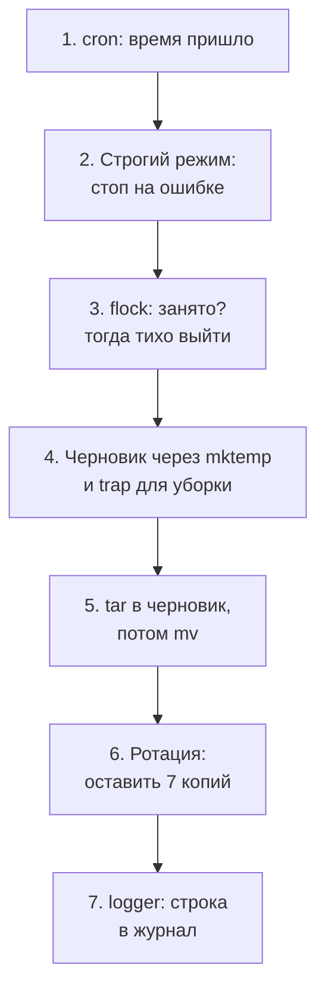
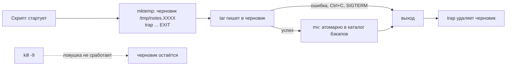
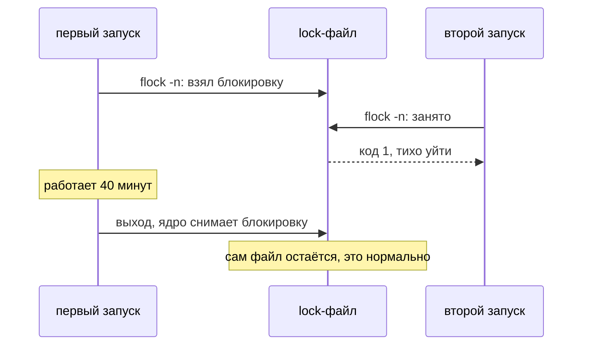
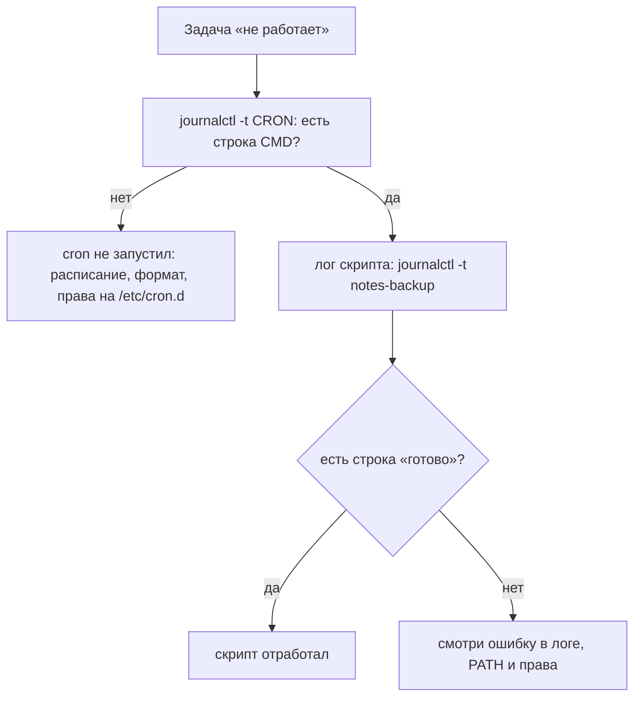

## Зачем это нужно

Многие ночные сбои начинаются со скрипта, который «работал руками», а по расписанию сломался. Вот как это выглядит утром, когда смотришь папку с резервными копиями:

```text
notes-2026-10-24.db.gz   180 КБ
notes-2026-10-25.db.gz   0 байт
```

Вчерашняя копия данных нормальная, сегодняшняя пустая: скрипт запустился ночью сам, что-то пошло не так, и никто этого не заметил. Здесь разберём, из чего складывается скрипт, которому можно доверить расписание.

Скрипт из [урока 1.6](06-bash-basics.md) работает, пока ты сидишь рядом и смотришь на экран. Если что-то пошло не так, ты видишь красный текст и реагируешь. На сервере всё иначе: скрипт запускает планировщик (программа, которая по расписанию сама запускает команды; в Linux это **cron**, разберём ниже) в три часа ночи, рядом никого нет, и никто не читает его вывод. Ошибка посреди такого скрипта означает «бэкап (backup, резервная копия данных на случай потери оригинала) есть, но он пустой» или «удалили не тот каталог». Ещё хуже, если предыдущий запуск не закончился, а следующий уже стартовал, и оба пишут в один файл.

Надёжный скрипт, который крутится на сервере без присмотра, делает четыре вещи:

1. **Падает громко**: при первой же ошибке останавливается и возвращает ненулевой код, а не идёт дальше как ни в чём не бывало.
2. **Убирает за собой**: временные файлы удаляются при любом исходе, даже при ошибке.
3. **Не запускается дважды одновременно**: второй запуск видит, что занято, и уходит.
4. **Оставляет след**: пишет в журнал, что сделал, чтобы утром можно было разобраться.

Эти четыре привычки отличают «скрипт на коленке» от того, что не стыдно поставить в расписание на боевом сервере. Я сам начинаю разбор любого ночного сбоя с вопроса «а скрипт вообще падал громко?». Вопрос «бэкап в cron работает, но архивы пустые, что делаешь?» встречается и на собеседованиях, а в конце урока мы вернёмся к той самой пустой копии `0 байт` и увидим, как она получается.

Шаг проекта: в «Заметках» появятся `notes-backup.sh` (бэкап данных с хранением 7 копий), `notes-healthcheck.sh` (проверка `/healthz`: адрес, по которому «Заметки» отвечают «я жив», разберём в [уроке 2.8](../02-network/08-request-path-troubleshooting.md)) и файл `/etc/cron.d/notes`, который запускает их по расписанию. Версия `app.py` не меняется (v2.2).

## Что нужно знать

- [Урок 1.2: текст, потоки и конвейеры](02-text-pipes.md): у программы есть два потока вывода, stdout (обычный) и stderr (ошибки); `>>` дописывает в файл, `2>&1` соединяет потоки, `|` передаёт вывод одной команды другой.
- [Урок 1.3: пользователи и права](03-users-permissions.md): каталог `/var/lib/notes` принадлежит пользователю `notes` и закрыт режимом 750, поэтому читать его может только `notes` и root.
- [Урок 1.4: процессы и сигналы](04-processes-signals.md): у каждой команды после завершения есть код выхода (0 значит успех); SIGTERM просит процесс завершиться, SIGKILL убивает мгновенно; код `128 + номер сигнала` (143 для SIGTERM, 137 для SIGKILL).
- [Урок 1.5: диск, память и процессор](05-disk-memory-cpu.md): `df` и `du`; полный диск, на котором недописанный архив превращается в проблему.
- [Урок 1.6: основы bash и Make](06-bash-basics.md): переменные, кавычки, `if`, `for`, функции, `$(...)` и `$?`.
- [Урок 1.8: systemd и редакторы](08-systemd-editors.md) идёт следом: там подробно про systemd и `journalctl`, которым мы здесь только начнём пользоваться.

## Картина целиком

Представь ночного сторожа-робота на складе. Его включает будильник, а человека рядом нет. Чтобы ему можно было доверять, ему нужны четыре вещи:

- **аварийная кнопка**: заметил поломку, остановился и загорелась лампа, а не продолжил работу с бракованной деталью;
- **привычка убирать инструмент** на место, что бы ни случилось: закончил смену, упал, отключили питание;
- **табличка «занято»** на двери: если предыдущая смена не закончила, вторая не заходит;
- **рабочий журнал**, куда записано, что и когда сделано.

В скрипте этим вещам соответствуют строгий режим, временные файлы с уборкой, блокировка и запись в журнал; каждую разберём по порядку. А будильник, который запускает робота по расписанию, называется **cron**: служба Linux, которая читает файл с расписанием и в нужное время запускает команды. Вот как всё это идёт по шагам в бэкапе «Заметок»:



За урок ты разберёшь каждый шаг схемы: почему bash по умолчанию «упрямо идёт дальше», как правильно обращаться с пробелами в именах файлов, как работают временные файлы и блокировки, что такое cron и чем его окружение отличается от твоего терминала, где искать следы работы скрипта. В конце соберёшь всё это в настоящий бэкап и проверку здоровья «Заметок».

## Теория

### Код выхода и строгий режим: `set -euo pipefail`

Скрипт это обычный текстовый файл с командами, которые bash выполняет сверху вниз ([урок 1.6](06-bash-basics.md)). Когда ты запускаешь его руками, ошибка видна сразу. Ночью её никто не видит, поэтому скрипт должен сам решить, что делать при ошибке. По умолчанию bash решает плохо: он **идёт дальше**. Команда не нашлась, файл не открылся, каталога нет, а следующая строка выполняется так, будто всё в порядке.

Строгий режим (strict mode) это та самая аварийная кнопка из «Картины целиком»: первая же поломка останавливает скрипт.

Каждая команда после завершения возвращает число, **код выхода** (exit code, [урок 1.4](04-processes-signals.md)). Ноль означает «успешно», любое другое число означает ошибку. Код последней команды хранит специальная переменная `$?`. Именно по этому коду работают `if`, `&&` и `||`. Строгий режим включается командой `set`, которая меняет настройки самого bash на время работы скрипта. Три флага:

| Флаг | Полное имя | Что делает | Что ловит |
|---|---|---|---|
| `-e` | errexit | скрипт завершается, как только команда вернула не 0 | упавший `cp`, `tar`, `cd` |
| `-u` | nounset | обращение к переменной, которой не давали значения, это ошибка | опечатка `$BACKUP_DRI` вместо `$BACKUP_DIR` |
| `-o pipefail` | pipefail | код всего конвейера (`a \| b \| c`) берётся от последней (самой правой) команды с ненулевым кодом | `curl ... \| tar ...`, где упал только `curl` |

Запись `set -euo pipefail` это те же три флага, склеенные вместе: `-e`, `-u` и `-o pipefail`. Ставят её второй строкой скрипта, сразу после `#!/usr/bin/env bash`.

Зачем нужен `pipefail`. **Конвейер** (pipeline) это команды, соединённые знаком `|`: вывод левой идёт на вход правой. Без `pipefail` код конвейера равен коду **последней** команды. Поэтому `false | true` (первая всегда падает, вторая всегда успешна) даёт код 0: ошибка левой части теряется.

Два скрипта отличаются одной строкой `set -euo pipefail`. Оба идут в каталог, которого нет, а потом печатают, где находятся:

```text
loose.sh:                                strict.sh:
  cd /no-such-dir                          set -euo pipefail
  echo "работаем в: $(pwd)"                cd /no-such-dir
  echo "конец"                             echo "работаем в: $(pwd)"
                                           echo "конец"
```

Что происходит в `loose.sh`, шаг за шагом:

1. `cd /no-such-dir` не находит каталог, печатает ошибку и возвращает код 1.
2. Bash не реагирует: строгого режима нет, идём дальше.
3. `pwd` печатает текущий каталог, то есть тот, где скрипт стоял до `cd`. Он не менялся.
4. `echo "конец"` возвращает 0, и скрипт завершается с кодом **0**: «всё хорошо».

Скрипт «успешно» сделал не то, что нужно. Теперь представь, что вместо `echo` стоит `rm -rf ./*` («удалить всё в текущем каталоге»): скрипт не перешёл в нужный каталог и удалил всё там, где стоял. В `strict.sh` то же самое обрывается сразу после ошибки `cd`, код выхода 1.

Так же работает `-u`. Пусть в скрипте есть переменная `DIR`, а внизу написано `rm -rf "$DIR/"*`. Если переменная пуста или не задана (опечатка, забыли передать), bash подставит пустую строку, и получится:

```text
rm -rf "$DIR/"*   при DIR=""   превращается в   rm -rf /*      (удалить всё на диске)
```

С флагом `-u` bash остановится на слове `$DIR` с сообщением `unbound variable` («несвязанная переменная», то есть без значения) и ничего не удалит. Но от `DIR=/` флаг не спасёт: значение непустое, и `rm -rf "$DIR/"*` доберётся до корня. Поэтому перед удалением проверяй, что путь лежит там, где ты ждёшь. А усиленную запись `${DIR:?сообщение}`, которая останавливает скрипт и на пустой переменной, ты попробуешь в задании 1.

> **Прикинь сам:** в скрипте с `set -e` есть строка `grep -q ERROR app.log`, и в логе нет слова ERROR. Что сделает скрипт?
{: .predict}

Остановится: `grep` без совпадений вернёт 1, а `-e` считает это ошибкой. Если «не нашёл» допустимо, пиши `grep -q ERROR app.log || true`.

Осторожно: строгий режим не «ловит любую ошибку». Команда, стоящая **в условии**, не останавливает скрипт: `if cmd; then`, `while cmd`, левая часть `&&` и `||`, команда после `!`. Там ненулевой код это не «авария», а ответ на вопрос. Поэтому `cmd || true` означает «мне всё равно, упадёт или нет», а ожидаемый ненулевой код надо обрабатывать самому: `if grep -q ...; then`. Про исключения для функций и `local x=$(cmd)` ты прочитаешь в разборе задания 1.

> **Главное:** `set -euo pipefail` останавливает скрипт на ошибке (`-e`), на неизвестной переменной (`-u`) и на сбое внутри конвейера (`pipefail`), но у `-e` есть исключения.
{: .key}

> **Проверь понимание:** что напечатает `set -e; false | true; echo живой` и почему? Изменится ли результат, если добавить `-o pipefail`?

<details markdown="1">
<summary>Ответ</summary>

Напечатает `живой`: код конвейера это код последней команды (`true`, 0), и `-e` не срабатывает. С `-o pipefail` код конвейера станет 1 (от `false`), и `-e` остановит скрипт до `echo`.

</details>

Скрипт научился падать громко. Теперь научим его не ломаться на именах файлов.

### Слова, кавычки и безопасные циклы

Главная причина странных багов в скриптах: имена с пробелами. Файл `мои заметки.txt` для человека одно имя, а для bash без кавычек два слова. Если скрипт удаляет, копирует или архивирует по таким именам, он делает не то, что задумано.

Пусть `f="my notes.txt"` (файл с пробелом). Посмотри, сколько аргументов получит команда, если напечатать каждый аргумент в скобках:

```text
printf '[%s]\n' $f          ->  [my]
                                [notes.txt]        два аргумента: разрезали по пробелу
printf '[%s]\n' "$f"        ->  [my notes.txt]     один аргумент: как и задумано
```

Всё дело в том, что bash режет подстановку без кавычек по пробелам. Поэтому `rm $f` не удалит файл `my notes.txt`, а попытается удалить два несуществующих файла `my` и `notes.txt`. А если бы такие файлы существовали, удалились бы чужие. Отсюда правило: **переменные всегда в двойных кавычках**, `"$f"`, `"$@"` (`$@` это все аргументы скрипта, каждый как одно слово). Кавычки же отключают и раскрытие шаблонов вроде `*.txt` внутри значения.

<details markdown="1">
<summary>Для любопытных: что bash делает со строкой, по шагам</summary>

Перед запуском bash делает по порядку: (1) подставляет переменные и команды (`$file`, `$(cmd)`); (2) **режет на слова** (word splitting) всё подставленное, что не в кавычках, по символам из служебной переменной `IFS` (Internal Field Separator, «внутренний разделитель полей»; по умолчанию пробел, таб и перевод строки); (3) **раскрывает шаблоны** (globbing, «глоб»): слова со знаками `*`, `?`, `[...]` заменяются на список подходящих имён файлов, `*.txt` превращается в `a.txt b.txt c.txt`; (4) запускает команду, слова становятся её аргументами. Двойные кавычки отключают шаги 2 и 3.

</details>

Отсюда же главная ловушка `for f in $(ls)`. Команда `ls` печатает имена по одному на строку, но `$(...)` без кавычек режется по **любым** пробелам. Файл `last one.txt` рассыпется на `last` и `one.txt`. Правильные способы перебрать файлы:

```bash
# 1. Глоб: bash сам раскрывает шаблон в список имён, пробелы в именах не страшны
for f in /var/backups/notes/*.tar.gz; do
  echo "файл: $f"
done

```

Основной способ это шаблон с `*`, его называют **глобом**. Если нужны ещё и подкаталоги, используй готовую заготовку с `find`, она безопасна для любых имён:

```bash
find /var/backups/notes -name '*.tar.gz' -print0 |
  while IFS= read -r -d '' f; do
    echo "файл: $f"
  done
```

В заготовке `find -print0` разделяет имена **нулевым байтом** (символом с кодом 0): в имени файла его быть не может, в отличие от пробела. `read -d ''` читает до такого байта, `-r` отключает особую обработку обратной косой черты, `IFS=` не даёт обрезать пробелы по краям имени.

> **Прикинь сам:** в каталоге нет ни одного `.tar.gz`, а в скрипте `for f in *.tar.gz; do rm "$f"; done`. Что произойдёт?
{: .predict}

Bash оставит шаблон как текст, и цикл выполнится один раз с `f='*.tar.gz'`: `rm` скажет, что такого файла нет. Защита: `shopt -s nullglob` или проверка `[[ -e "$f" ]] || continue`.

Осторожно: имя файла может начинаться с `-`, и тогда `rm` примет его за флаг. Пиши `rm -f -- "$f"`: `--` означает «дальше только имена, не флаги». Та же история с шаблоном в самой команде: в пустом каталоге `ls *.log` напишет `ls: cannot access '*.log': No such file or directory`, потому что `ls` получил буквальную звёздочку, а не список.

> **Главное:** безопасный цикл это `for f in *.log` с `"$f"` в кавычках, а не `$(ls)`; пустое совпадение шаблона нужно обработать отдельно.
{: .key}

> **Проверь понимание:** почему `rm $file` при `file="a b"` опасен, а `rm "$file"` безопасен?

<details markdown="1">
<summary>Ответ</summary>

Без кавычек оболочка делит значение по пробелу на два слова, и `rm` получает два имени: `a` и `b`, а не один файл `a b`. В кавычках значение остаётся одним словом.

</details>

Имена файлов обработаны. Теперь о черновиках: как не оставить мусор при падении.

### Уборка за собой: `mktemp`, `trap` и атомарная запись

Скрипту часто нужны временные файлы: черновик архива, промежуточный результат. Проблемы две. Первая: файл должен исчезнуть при любом исходе (успех, ошибка, Ctrl+C), иначе мусор копится, а в худшем случае забивает диск ([урок 1.5](05-disk-memory-cpu.md)). Вторая: если скрипт упал на середине записи, в каталоге не должно остаться полуготового файла с «настоящим» именем, который следующий скрипт примет за целый.

Начнём с `mktemp`. Команда создаёт пустой файл с уникальным случайным именем и печатает это имя: `tmp=$(mktemp)` сохранит его в переменную. Права на файл 600: читать и писать может только владелец. Если дать шаблон, `mktemp /tmp/lab17-XXXXXX.tmp`, то `XXXXXX` заменится случайными символами. Почему не `/tmp/backup.tmp`? Имя предсказуемо: два запуска перетрут друг друга, а чужой пользователь может заранее подложить там ссылку на важный файл, и скрипт его перезапишет. Случайное имя решает обе проблемы. Ключ `mktemp -d` создаёт временный **каталог**.

Теперь уборка. `trap 'команда' СОБЫТИЕ` («ловушка») говорит bash: когда наступит событие, выполни команду. Событие `EXIT` наступает при **любом** завершении скрипта: нормальный конец, `exit`, ошибка под `set -e`, и получение сигнала SIGTERM или SIGINT ([урок 1.4](04-processes-signals.md); SIGINT это Ctrl+C). Команду в `trap` берут в **одинарные** кавычки, чтобы `$tmp` подставился в момент срабатывания ловушки, а не в момент её объявления.

```bash
tmp=$(mktemp)              # безопасное уникальное имя, права 600
trap 'rm -f "$tmp"' EXIT   # при любом завершении скрипта удалить файл
```

Есть одно исключение, которое нельзя обойти: **SIGKILL** (`kill -9`) поймать невозможно, ядро убивает процесс мгновенно, и ловушка не успевает выполниться. После него мусор остаётся. Поэтому временные файлы кладут туда, где их найдёт и почистит следующий запуск или отдельная задача, а итоговый результат создают атомарно.

И наконец атомарная запись. Слово «атомарно» значит «целиком или никак, без промежуточного состояния». Схема такая: пишем во временный файл в **том же каталоге**, а когда всё готово, переименовываем командой `mv`:

```text
tar -czf .notes-a1B2c3.tmp ...     пишем, это может идти минуту; в каталоге лежит только .tmp
        |
   успех? да -> mv .notes-a1B2c3.tmp notes-20260930-1213.tar.gz    переименование мгновенное
        |
   нет  -> trap удаляет .tmp, «настоящего» имени не появилось
```

Почему переименование безопасно, а запись сразу в итоговое имя нет? **Файловая система** это способ, которым диск разбит на файлы и каталоги: у неё есть «оглавление» с именами. `mv` внутри одной файловой системы меняет только запись в оглавлении, содержимое не копируется, и это происходит за один шаг. Наблюдатель видит либо старое состояние, либо готовый файл, но не половину. Поэтому черновик кладут рядом с итогом: `/tmp` может быть другой файловой системой, а перенос между ними это копирование и удаление, уже не атомарное.

Все четыре исхода (успех, ошибку, SIGTERM и SIGKILL) ты прогонишь руками в задании 3.

> **Прикинь сам:** скрипт создал `mktemp`-файл, и ты нажал в терминале `Ctrl+C`. Сработает ли `trap ... EXIT`?
{: .predict}

Да: `Ctrl+C` посылает SIGINT, его перехватить можно, и `EXIT` отработает. Так же на обычную ошибку и на SIGTERM. Не отработает он только на SIGKILL.

Осторожно: ловушку часто вешают только на `INT` (Ctrl+C), и тогда при обычной ошибке под `set -e` или при нормальном завершении черновик остаётся лежать в `/tmp`. Начинай с `EXIT`: он срабатывает и на Ctrl+C, и на SIGTERM. Отдельная ловушка на них нужна, только если хочешь сделать что-то особенное, например вернуть определённый код.



> **Главное:** `mktemp` даёт безопасный временный файл, `trap 'rm -f "$TMP"' EXIT` удаляет его при любом выходе, а готовый файл кладут через `mv` одним действием.
{: .key}

> **Проверь понимание:** зачем `mv` временного архива в итоговое имя, а не сразу `tar -czf итоговое.tar.gz`?

<details markdown="1">
<summary>Ответ</summary>

`mv` в пределах одной файловой системы переименовывает файл атомарно: читатель видит либо старый архив, либо целый новый. Если `tar` пишет прямо в итоговое имя и падает посередине, на месте бэкапа остаётся обрезанный файл, который выглядит как настоящий.

</details>

Мусор убран. А что будет, если скрипт запустится дважды одновременно?

### Блокировка: `flock` и защита от двойного запуска

Если бэкап идёт дольше интервала cron (пришло много данных, тормозит диск), стартует второй экземпляр. Два `tar` пишут одновременно, оба грузят диск, а ротация одного может удалить файл, который ещё пишет другой. Ситуация, когда результат зависит от того, кто успел раньше, называется **гонкой** (race condition). Нужна защита: второй экземпляр должен увидеть «занято» и уйти.

Представь замок на двери комнаты. Пока кто-то внутри, замок закрыт, и остальные ждут или уходят. Если человек вышел или упал, замок открывается сам: его держит не человек, а система.

Самое очевидное решение, «создам файл `/tmp/lock`, а перед стартом проверю, есть ли он», плохо в двух местах. Проверка «есть ли файл, если нет, создать» не атомарна: два процесса могут проверить одновременно, оба увидят «нет» и оба войдут. И после `kill -9` файл останется навсегда, а скрипт больше никогда не запустится. Правильный инструмент: `flock` из пакета util-linux, блокировка, которую держит **ядро** ([урок 1.5](05-disk-memory-cpu.md): главная часть системы, управляющая всем).

В cron `flock` пишут обёрткой: `flock -n файл команда` берёт блокировку на время работы команды, а если занято, сразу выходит с кодом 1 (`-n` значит «не ждать»).

```bash
flock -n /run/lock/notes-backup.lock /usr/local/bin/notes-backup.sh
```

Вот что видно, если запустить две копии подряд (в одном окне долгая, во втором короткая):

```text
$ flock -n /tmp/demo.lock sleep 30 &
$ flock -n /tmp/demo.lock echo "второй запуск"; echo "код: $?"
код: 1
```

Второй запуск ничего не сделал и вернул 1: замок занят. Когда `sleep` закончится или его убьют, ядро снимет блокировку само, поэтому «вечно застрявшего» замка от умершего процесса не бывает (если только его не унаследовал живой дочерний процесс, см. ниже про `9>&-`). Файл `/tmp/demo.lock` при этом остаётся лежать, и это нормально: блокировка не в самом файле, а в том, что кто-то держит его открытым.

В скрипте проекта блокировка берётся иначе, прямо внутри скрипта, двумя строками с номером 9 и словом `exec`. Идея такая: скрипт открывает lock-файл под номером 9, просит у ядра занять его командой `flock -n 9`, а если не вышло, тихо выходит с кодом 0. Номер 9 ничего не значит, это просто свободный номер, как кабинка №9 в раздевалке: открыл файл «в кабинке 9» и держишь, пока скрипт жив. Такой номер называется файловым дескриптором. Строки целиком, наследование дескриптора потомком и команду `fuser` я оставил в блоке ниже: в задании 4 ты увидишь всё это руками.

У такого тихого выхода есть цена. Если предыдущий запуск завис на часы, cron молчит, а новых бэкапов нет. Поэтому `exit 0` при занятости оправдан только вместе с проверкой свежести результата: тревогу строят на возрасте последнего успешного архива или метки, а не на факте запуска. Как это делается, показывает бэкап в конце урока.

<details markdown="1">
<summary>Для любопытных: замок внутри скрипта, номер 9 и потомок, который держит блокировку</summary>

Скрипт проекта берёт блокировку так:

```bash
exec 9>/run/lock/notes-backup.lock   # открыли файл под номером 9 (создастся, если нет)
flock -n 9 || { logger -t notes-backup "уже запущен, выхожу" 9>&-; exit 0; }   # -n: не ждать, а выйти
```

Сначала о номере. **Файловый дескриптор** (file descriptor) это номер, под которым процесс держит открытый файл. Ты уже встречал такие номера: 0 это stdin (ввод), 1 это stdout, 2 это stderr ([урок 1.2](02-text-pipes.md)). Свободные номера 3-9 можно занять для своих файлов, для блокировки традиционно берут 9.

`exec 9>файл` без команды не запускает ничего нового, а открывает файл под номером 9 для текущей оболочки, и он остаётся открытым до конца скрипта. `flock -n 9` просит ядро заблокировать именно этот открытый файл. Если занято, срабатывает `||`: в фигурных скобках `{ ...; }` две команды, `logger` пишет сообщение в журнал (разберём ниже), и `exit 0` выходит без ошибки, потому что «занято» не поломка, а нормальный ответ. Про `9>&-` в `logger` сказано в конце.

Образ такой: табличка «занято» висит на открытой двери, а не на файле. Пока дверь открыта хоть у кого-то, замок закрыт, а снимается он, когда дверь закрыл последний.

Теперь о потомке. Дочерние процессы **наследуют** открытые дескрипторы родителя. Если скрипт запустил `sleep 20`, а потом скрипт убили командой `kill -9`, то `sleep` унаследовал дескриптор 9 и держит блокировку, пока сам не завершится. Новый запуск получит «уже запущен», хотя скрипта давно нет. Владельца видно командой `fuser -v /tmp/lab17.lock` (в задании 4 так и сделаем).

Лечится закрытием дескриптора для дочерней команды: `sleep 20 9>&-` (`9>&-` значит «закрой дескриптор 9 для этой команды»). В реальном бэкапе роль `sleep` играет `tar` или `curl`, поэтому в скрипте проекта `tar` и `logger` запускаются с `9>&-`.

</details>

> **Прикинь сам:** бэкап в cron идёт 40 минут, а запускается каждые 30. Что случится без блокировки?
{: .predict}

Второй экземпляр стартует, пока первый работает, и они начнут писать в одни и те же файлы. С `flock -n` второй увидит занятость и тихо уйдёт.

Осторожно: lock-файл не удаляют «чтобы снять блокировку» и не кладут на NFS (там `flock` ведёт себя иначе). И `flock` защищает только тех, кто сам просит блокировку: скрипт, который его не вызывает, зайдёт свободно.



> **Главное:** `flock -n` берёт блокировку на файл, а не создаёт файл-флаг: пока кто-то держит его открытым, второй не войдёт, а lock-файл удалять не нужно.
{: .key}

> **Проверь понимание:** чем `flock` надёжнее проверки «есть ли файл `/tmp/lock`»?

<details markdown="1">
<summary>Ответ</summary>

Проверка файла не атомарна (два процесса могут проверить одновременно) и не снимается при аварии: после `kill -9` файл остаётся, и скрипт больше никогда не запустится. `flock` атомарен, а ядро снимает блокировку, когда закрывается последний дескриптор, в том числе при смерти процесса. Но помни про потомка: он держит блокировку, пока жив сам.

</details>

Блокировка есть. Теперь о том, кто запускает скрипт ночью: о cron.

### cron: расписание и почти пустое окружение

Бэкап нужен каждую ночь, проверка здоровья каждую минуту. Сидеть и запускать руками невозможно. Для этого в Linux есть планировщик: **cron**. Это **демон** (daemon, программа, которая постоянно работает в фоне без окна и без участия человека, как ssh-сервер или systemd). Раз в минуту он смотрит в таблицы расписаний и запускает то, что подошло по времени.

Одна строка таблицы описывает одну задачу. Сначала **пять полей времени**, потом команда:

```text
минута  час  день_месяца  месяц  день_недели   команда
 0-59  0-23     1-31      1-12     0-7*        что запускать
                                      * 0 и 7 это воскресенье, 1 это понедельник
```

В каждом поле можно писать: число (`3`), `*` (любое значение), `*/30` (каждое 30-е: 0, 30), список `1,15` и диапазон `1-5`. Чем строка читается:

```text
*/30 * * * *   каждые 30 минут (в :00 и :30 каждого часа)
0 3 * * *      каждый день в 03:00
* * * * *      каждую минуту
0 4 * * 1      по понедельникам в 04:00
15 2 1 * *     первого числа каждого месяца в 02:15
```

Время cron считает по часовому поясу сервера. Серверы обычно держат в **UTC** (всемирное время без летнего перевода): так у всех машин в разных городах одно и то же время, и логи сходятся. Проверь командой `date`. Москва это UTC + 3, поэтому `0 3 * * *` на сервере в UTC запустится в 03:00 UTC, то есть в 06:00 по МСК, и ночное окно сдвигается на три часа.

Таблицы бывают двух видов:

- **Личная** (`crontab -e`): у каждого пользователя своя, в строке нет имени пользователя, задача идёт от его имени.
- **Системная**: файлы в каталоге `/etc/cron.d/`. В таких файлах в строке появляется **шестое поле, имя пользователя**, от которого запустится команда: `*/30 * * * * root /usr/local/bin/notes-backup.sh`. Мы будем использовать этот вид: его удобно держать в репозитории и раскладывать одним файлом.

К файлам в `/etc/cron.d/` cron строг, и о нарушениях сообщает в журнал (мы проверим это в практике, тексты настоящие):

| Что не так | Что cron пишет в журнал |
|---|---|
| в имени файла есть точка | ничего: такой файл тихо пропускается |
| файл доступен на запись группе или всем (например, 664) | `INSECURE MODE (group/other writable)`, задачи не запускаются |
| последняя строка без перевода строки в конце | `Missing newline before EOF, this crontab file will be ignored` |
| нет поля с именем пользователя | `bad username`, `Syntax error, this crontab file will be ignored` |

Файл должен принадлежать root и иметь права 644. Новые и изменённые файлы cron подхватывает сам, перезапускать его не надо.

Теперь про окружение. Главная ловушка cron: **он запускает задачу в почти пустом окружении**. Окружение это набор переменных, которые получает каждая запущенная программа ([урок 1.6](06-bash-basics.md)). Когда ты запускаешь скрипт из терминала, у него есть всё, что настроено в твоей сессии: `PATH` (список каталогов, где искать команды), переменные из `~/.bashrc`, текущий каталог. Cron не читает ни `.bashrc`, ни `.profile`. Вот что реально увидит задача от root (вывод `env` внутри cron-задачи на Ubuntu 24.04):

```text
HOME=/root
LANG=C.UTF-8
LOGNAME=root
PATH=/usr/local/sbin:/usr/local/bin:/usr/sbin:/usr/bin:/sbin:/bin:/usr/games:/usr/local/games:/snap/bin
PWD=/root
SHELL=/bin/sh
```

Разберём. `PWD=/root`: задача стартует в **домашнем каталоге** пользователя, а не там, где лежит скрипт, поэтому относительные пути (`./data`) ломаются. `SHELL=/bin/sh`: команду в строке исполняет не bash, а `sh`. На Ubuntu это упрощённая оболочка `dash`, которая не знает `[[ ... ]]`, `<(...)`, `{a,b}` и других возможностей bash. Поэтому строка, которая в терминале работает, в cron может упасть с `[[: not found`. И `PATH`: здесь он широкий, потому что Ubuntu берёт его из `/etc/environment`, но по документации cron по умолчанию даёт только `/usr/bin:/bin`, а на других системах (RHEL, Alpine, минимальные образы) так и есть. Что с `~/.local/bin` или каталогами из `.bashrc`: их в cron не будет нигде.

Отсюда три правила для cron-задач: полные пути к командам и файлам, `PATH=` и `SHELL=/bin/bash` в начале таблицы (строки `ИМЯ=значение` вне расписания задают переменные для всех задач файла, и явный `PATH` всегда побеждает), и вывод задачи в лог.

> **Прикинь сам:** скрипт руками работает, а из cron пишет `command not found`. Что проверишь первым?
{: .predict}

`PATH`: в cron он задан иначе, чем в терминале. На минимальных образах и RHEL это `/usr/bin:/bin`, на Ubuntu шире, но без `~/.local/bin` и каталогов из `.bashrc`. Пиши в скрипте полные пути или задай `PATH=...` в начале файла.

Осторожно: Во-первых, знак `%`. В строке cron `%` означает «конец строки», всё после него уходит команде на ввод. Команда `echo "$(date +%Y)"` превратится в `echo "$(date +`, и получится ошибка. Выход: экранировать, `date +\%Y`. Во-вторых, куда девается вывод задачи. Cron отправляет всё, что задача напечатала (stdout и stderr), **письмом** пользователю. Если почтовой программы (MTA) нет, вывод просто выбрасывается, а в журнал попадает строка `(CRON) info (No MTA installed, discarding output)`. Эта строка бывает полезной подсказкой: она значит, что задача что-то напечатала, хотя ты этого не видишь. Как видеть, показывает следующий раздел.

Помнишь пустой бэкап из начала урока? Так он выглядит в журнале cron и в папке:

```text
$ sudo journalctl -t CRON --since "2026-10-25 02:59" --no-pager | tail -n 2
Oct 25 03:00:01 notes CRON[2214]: (root) CMD (/opt/notes/backup.sh)
Oct 25 03:00:01 notes CRON[2214]: (CRON) info (No MTA installed, discarding output)
$ ls -l /var/backups/notes/
-rw-r--r-- 1 root root 184320 Oct 24 03:00 notes-2026-10-24.db.gz
-rw-r--r-- 1 root root      0 Oct 25 03:00 notes-2026-10-25.db.gz
```

Планировщик честно запустил `backup.sh` в 03:00 (строка `CMD`), а вывод скрипта выброшен (`discarding output`): никто не прочитал сообщение об ошибке. Результат виден в размерах файлов (пятая колонка `ls -l`): вчерашний бэкап весит 180 КБ, сегодняшний 0 байт.

> **Главное:** cron запускает команды с почти пустым окружением, а `%` в его строке значит «конец команды» и требует экранирования `\%`.
{: .key}

> **Проверь понимание:** скрипт в cron пишет `curl: command not found`, хотя руками `curl` работает. Что проверишь?

<details markdown="1">
<summary>Ответ</summary>

`PATH` в cron другой: на минимальных образах и RHEL короткий (`/usr/bin:/bin`), на Ubuntu шире, но без каталогов из твоего `.bashrc` и `~/.local/bin`. Задай `PATH=/usr/local/bin:/usr/bin:/bin` в таблице или используй полный путь `/usr/bin/curl`. И убедись, что вывод cron вообще попадает куда-то, где его можно прочитать (`>> файл 2>&1` в строке или `logger`), иначе ошибки не видно.

</details>

Cron запустил скрипт. Но где потом искать, что тот делал?

### Логи скриптов, журнал systemd и logrotate

Утром надо узнать, что делал ночной скрипт: запустился ли, успешно ли закончил, что сломалось. Ответ должен лежать в предсказуемом месте. Раз вывод cron теряется, скрипт сам должен оставлять след.

У скрипта два места для записей.

1. **Системный журнал** (journal). Его ведёт служба **journald**, часть systemd: она принимает сообщения от программ, добавляет время и имя источника и хранит в едином месте. Читают его командой `journalctl` ([урок 1.8](08-systemd-editors.md) разберёт её подробнее). Самый простой способ записать в журнал из скрипта: `logger -t имя "сообщение"`. Здесь `-t` (tag) задаёт метку, по которой потом ищут. Читать: `journalctl -t имя`. Остальные ключи `journalctl` (по времени, по важности) разобраны таблицей в [уроке 1.8](08-systemd-editors.md), здесь они не нужны.
2. **Обычный файл**: `>> /var/log/notes-health.log`. Знак `>>` дописывает в конец файла (в отличие от `>`, который затирает). Чтобы в файл попали и ошибки, добавляют `2>&1`: «поток 2 (ошибки) направь туда же, куда поток 1» ([урок 1.2](02-text-pipes.md)). Ошибки в скриптах принято печатать в stderr (`echo "..." >&2`): и cron, и журнал умеют разделять потоки, а обычный вывод не засоряется.

Файл растёт вечно. Чтобы он не съел диск ([урок 1.5](05-disk-memory-cpu.md)), есть **logrotate**: программа, которая по расписанию сжимает и удаляет старые логи по правилам из файлов в `/etc/logrotate.d/`. Правила пишут блоком «путь к логу и его настройки в фигурных скобках»:

```text
/var/log/notes-health.log {
    # ротировать раз в неделю
    weekly
    # хранить 4 старые копии, более старые удалять
    rotate 4
    # сжимать старые копии (gzip)
    compress
    # нет файла? не ругаться
    missingok
    # пустой файл не ротировать
    notifempty
}
```

Комментарий в logrotate пишут только на отдельной строке, после директивы его ставить нельзя: `rotate 4  # ...` даст `bad rotation count`.

При ротации `notes-health.log` переименовывается в `notes-health.log.1` (и сжимается в `.1.gz`), предыдущий `.1.gz` становится `.2.gz`, и так по цепочке, а самый старый удаляется. Как это выглядит у системных пакетов, посмотри в `cat /etc/logrotate.d/apt`.

Отлаживать скрипты помогают два инструмента:

- `bash -x скрипт.sh` (трассировка): bash печатает каждую команду с уже подставленными значениями, перед ней знак `+`. Видно, что реально выполнялось и что оказалось в переменных. Внутри скрипта то же включает `set -x`.
- `shellcheck` (статический анализатор): читает скрипт **без запуска** и находит типичные ловушки, вроде незакавыченных переменных и `for f in $(ls)`. Каждое замечание имеет код вида `SC2086` и ссылку на пояснение. У замечаний четыре уровня серьёзности (error, warning, info, style), и `shellcheck` возвращает ненулевой код при любом из них, даже при info и style.

`bash -x` для трёхстрочного скрипта:

```text
+ NAME=notes                              присвоили переменную
++ ls /etc/cron.d                         два плюса: команда внутри $(...)
++ wc -l
+ COUNT=2                                 результат подстановки
+ [[ 2 -gt 0 ]]                          условие с подставленным значением
+ echo 'notes: файлов 2'                 команда и её итоговые аргументы
notes: файлов 2                           а это уже обычный вывод самой команды
```

> **Прикинь сам:** в `journalctl -t CRON` есть строка `CMD (...)`. Значит ли это, что бэкап прошёл?
{: .predict}

Нет: запись говорит только, что cron скрипт запустил. Что скрипт делал дальше, видно только в его собственном логе.

Поэтому диагностика идёт в два шага: сначала «cron запустил?», потом «что сказал скрипт?».



> **Главное:** диагностика идёт в два шага: сначала проверить запуск (`journalctl -t CRON`), потом лог скрипта (`logger`, файл, `journalctl -t notes-backup`).
{: .key}

> **Проверь понимание:** где искать вывод ночного cron-задания и как отличить ошибку скрипта от того, что cron его не запустил вообще?

<details markdown="1">
<summary>Ответ</summary>

Сначала смотрю, есть ли строка `CMD` от cron в `journalctl -t CRON` на нужное время. Её нет: cron не запускал (расписание, пользователь, демон). Строка есть, а результата нет: запускал, и причину ищу в логе самого скрипта (`logger`, файл, `journalctl -t notes-backup`).

</details>

Логи на месте. Теперь о самом файле скрипта: права и окружение.

### Скрипт как программа: shebang, права и переменные окружения

Файл с командами сам по себе ничего не делает: это текст. Чтобы cron или ты могли его «запустить», система должна понять две вещи: чем его выполнять (bash? python?) и разрешено ли его вообще выполнять. Обе вещи задаются прямо в файле и в его правах. А чтобы один и тот же скрипт работал на разных путях и серверах, его настройки выносят наружу, в переменные.

1. **Shebang** (от «sharp» и «bang», то есть `#` и `!`) это первая строка скрипта вида `#!/usr/bin/env bash`. Когда ты запускаешь `./script.sh`, ядро читает первые два символа файла. Если это `#!`, оно берёт остаток строки как путь к программе-интерпретатору и запускает её, передав ей файл. Строка `#!/usr/bin/env bash` просит `env` найти `bash` в `PATH`, а не жёстко прописывает `/bin/bash`: так скрипт работает и там, где bash лежит в другом месте (на macOS или в контейнере). Для остального bash строка `#!...` это просто комментарий, потому что `#` начинает комментарий.
2. **Бит исполнения.** У каждого файла есть права: чтение (r), запись (w) и исполнение (x) для владельца, группы и остальных ([урок 1.3](03-users-permissions.md)). Без x запуск `./script.sh` даёт `Permission denied`. `chmod +x файл` добавляет бит. Обойти можно, запустив интерпретатор явно: `bash script.sh`: тогда файл лишь читается как текст, и бит не нужен, а shebang игнорируется.
3. **Переменные и окружение.** Обычная переменная `NAME=значение` живёт только внутри текущей оболочки. Программа, которую ты запускаешь из скрипта (`tar`, `curl`), её не увидит. Чтобы значение попало к дочернему процессу, переменную **экспортируют**: `export NAME=значение`. Экспортированные переменные образуют **окружение** (environment) процесса: при запуске каждый процесс получает копию окружения родителя. Копию: изменения в дочернем процессе родителя не касаются.
4. **Переопределяемые умолчания.** Запись `${ИМЯ:-значение}` значит «возьми `ИМЯ`, а если она не задана или пуста, подставь значение». Так делают все настройки наших скриптов: `DATA_DIR="${NOTES_DATA_DIR:-/var/lib/notes}"`. Обычный запуск использует путь по умолчанию, а для проверки на копии данных достаточно задать переменную для одного запуска: `NOTES_DATA_DIR=/tmp/copy ./notes-backup.sh`. Тогда не нужно править сам скрипт.

Разница между обычной и экспортированной переменной видна за три строки:

```text
$ MSG=привет
$ bash -c 'echo "в дочернем: [$MSG]"'
в дочернем: []                     дочерний bash переменную не получил

$ export MSG=привет
$ bash -c 'echo "в дочернем: [$MSG]"'
в дочернем: [привет]               экспортированная попала в окружение ребёнка

$ MSG=другое bash -c 'echo "[$MSG]"'
[другое]                           значение только на один запуск, в оболочке MSG не изменилась
```

Теперь про cron: у него окружение пустое не потому, что он «забыл», а потому что cron это демон, запущенный при загрузке системы, задолго до твоей сессии. Твои `export` из терминала или `.bashrc` к нему никогда не доходили. Все нужные переменные для cron-задач нужно задавать в самой таблице (`PATH=...`) или прямо в скрипте, и это ещё одна причина писать в скриптах умолчания через `${ИМЯ:-значение}`.

> **Прикинь сам:** ты запускаешь `sudo ./notes-backup.sh`, а переменная `NOTES_DATA_DIR` в терминале была задана. Увидит ли её скрипт?
{: .predict}

Нет: `sudo` по умолчанию чистит окружение. Передай значение так: `sudo NOTES_DATA_DIR=/tmp/copy ./notes-backup.sh` (тогда переменную задаёт сам `sudo`) или `sudo env NAME=значение команда`, как при запуске приложения от пользователя `notes`.

Осторожно: `bash script.sh` и `./script.sh` не одно и то же: в первом случае shebang не участвует и бит x не нужен, а во втором нужно и то и другое. Если в shebang написано `bash`, а запустить `sh script.sh`, скрипт выполнит `sh`, и bash-возможности вроде `[[ ]]` пропадут.

> **Главное:** скрипт это программа: у него shebang, бит исполнения и своё окружение, которое `sudo` и cron не копируют из терминала.
{: .key}

> **Проверь понимание:** скрипт лежит в `/usr/local/bin/x.sh`, в нём есть shebang, но `./x.sh` пишет `Permission denied`. `bash x.sh` при этом работает. Почему?

<details markdown="1">
<summary>Ответ</summary>

У файла нет бита исполнения. Для `./x.sh` ядро проверяет бит `x` и только потом читает shebang. `bash x.sh` просто читает файл как данные, бит не нужен. Лечится `chmod +x x.sh`.

</details>

Скрипт настроен. Теперь научимся читать его коды выхода подробнее.

### Коды выхода подробнее: `&&`, `||` и свои коды

Код выхода это единственный способ, которым команда сообщает «получилось или нет». Cron, мониторинг, `if` и `set -e` реагируют только на него: текст ошибки они не читают. Поэтому свои скрипты нужно учить возвращать правильный код, а чужие проверять именно по коду.

Каждая команда после завершения оставляет число от 0 до 255. Что в них зашито по договорённости:

| Код | Обычный смысл |
|---|---|
| 0 | успех |
| 1 | общая ошибка (или «ничего не нашёл» у `grep`) |
| 2 | неверные аргументы, ошибка использования |
| 22 | у `curl -f`: сервер ответил кодом 4xx или 5xx |
| 126 | файл найден, но не исполняемый (нет бита x) |
| 127 | команда не найдена |
| 128+N | процесс убит сигналом номер N (137 для SIGKILL, 143 для SIGTERM) |

Операторы `&&` и `||` работают по этим кодам. `A && B` запускает `B`, только если `A` вернула 0. `A || B` запускает `B`, только если `A` вернула не 0. Оператор `;` ничего не проверяет: следующая команда идёт в любом случае. Собственный код скрипт возвращает командой `exit N`; без неё скрипт завершается с кодом **последней выполненной команды**. Это частая причина «скрипт вроде отработал»: если последняя команда была безобидным `echo`, код будет 0, что бы ни случилось раньше (в строгом режиме такого не случится, потому что скрипт остановился бы раньше).

Три способа проверить одно и то же (есть ли в файле слово):

```text
grep -q "ok" /etc/hostname
echo $?                              код 1: слова нет, это ответ «нет», а не авария

grep -q "ok" /etc/hostname && echo "есть"      ничего не напечатает
grep -q "ok" /etc/hostname || echo "нет"       напечатает «нет»

if grep -q "ok" /etc/hostname; then echo "есть"; else echo "нет"; fi     то же, но читается легче
```

Что происходит: `-q` (quiet) просит `grep` ничего не печатать, только вернуть код. Найдено, значит 0, не найдено, значит 1. Для `if` код и есть условие: «если команда вернула 0». Ещё один пример из практики: `check || echo "функция вернула ошибку"` в задании 1 напечатал бы сообщение, только если бы функция вернула не 0. А поскольку последней её командой был `echo`, код оказался 0. Отсюда правило: у функции код это код её **последней** команды, и он не всегда отражает то, что упало по пути.

> **Прикинь сам:** `set -e` включён, а в скрипте стоит `command-which-does-not-exist`. Какой код вернёт скрипт?
{: .predict}

127: так bash отвечает на «команда не найдена». Скрипт остановится и вернёт именно это число, если не задан свой `exit`.

Осторожно: `$?` хранит код только **последней** команды и затирается каждой следующей. Если написать `grep -q ok файл; echo "найдено"; echo $?`, то выведется 0 от `echo`, а не код `grep`. Нужен код дальше по скрипту, сохрани его сразу: `grep -q ok файл; rc=$?`.

> **Главное:** `&&` выполняет следующее при успехе, `||` при неудаче, а свои коды (0, 1, 2, 3) договариваются заранее, чтобы по ним понимать причину.
{: .key}

Коды разобраны. Теперь о бэкапе: как проверить архив, а не только создать.

### Как читать и восстанавливать архив: `tar` и проверка бэкапа

Бэкап нужен ради дня, когда данные потерялись. Если в этот день выясняется, что архив пустой, битый или без нужных файлов, бэкапа фактически не было. Поэтому надо понимать, что лежит в архиве, и уметь достать оттуда нужное. Тем более команда `tar` встретится тебе везде: в бэкапах, в установке программ, в образах контейнеров.

Название `tar` это «tape archive», «архив для ленты», историческое, теперь просто «склеить много файлов в один». Сам по себе `tar` не сжимает: он записывает подряд файлы вместе с их именами, правами и владельцами. Сжимает отдельная программа, `gzip`, которую `tar` вызывает по флагу `-z`. Главные режимы задаёт первая буква:

| Флаг | Значит | Пример |
|---|---|---|
| `-c` | create, создать архив | `tar -czf a.tar.gz каталог` |
| `-t` | list, показать содержимое, ничего не распаковывая | `tar -tzf a.tar.gz` |
| `-x` | extract, распаковать | `tar -xzf a.tar.gz -C /куда` |
| `-z` | пропустить через gzip | в паре с `-c`, `-t`, `-x` |
| `-f` | следующий аргумент это имя файла архива | всегда с именем сразу за ним |
| `-v` | verbose, печатать подробности | `tar -tzvf` даёт права, владельца и размер |
| `-C` | сначала перейти в каталог | `-C /var/lib notes` |

Проверка бэкапа, который сделал скрипт из практики. Порядок такой:

1. Смотрим, что внутри, ничего не распаковывая: `sudo tar -tzf /var/backups/notes/notes-20260930-1213.tar.gz`. Ожидаем строки `notes/` и `notes/notes.txt`. Если пусто или ошибка `Unexpected EOF`, архив битый.
2. Распаковываем в отдельный временный каталог, а не поверх боевых данных: `d=$(mktemp -d); sudo tar -xzf ... -C "$d"; sudo ls -l "$d/notes"`. Из-за `-C` в скрипте бэкапа пути в архиве относительные (`notes/notes.txt`), и распаковка кладёт файлы внутрь `$d`, а не в `/var/lib`. Если бы архив содержал абсолютные пути, распаковка могла бы затереть живые данные.
3. Сравниваем с оригиналом: `sudo diff -r /var/lib/notes "$d/notes" && echo "совпадает"`. `diff -r` (recursive) сравнивает каталоги, а `&&` печатает «совпадает», только если различий нет (код 0).
4. Убираем за собой: `rm -rf "$d"`.

Размер архива тоже говорит многое: пустой архив (архив без файлов) весит около 45 байт, а нормальный с одной заметкой около двух сотен. Если размер выглядит подозрительно, открой его через `-t`.

> **Прикинь сам:** чем отличаются `tar -czf a.tar.gz dir` и `tar -cfz a.tar.gz dir`?
{: .predict}

Во втором `-f` берёт следующий аргумент как имя файла, то есть `z`: получится архив `z`, а `a.tar.gz` станет каталогом для упаковки. Первая запись верная.

Осторожно: `tar` печатает предупреждения (`Removing leading '/' from member names`, когда пути абсолютные) в stderr, но код выхода 0. Настоящую ошибку (нет файла, нет прав) он сообщает кодом 2 (у GNU tar: «фатальная ошибка»), и только по нему и по `set -e` скрипт узнает, что беда. Есть и промежуточный код 1: «файл изменился, пока я его читал». Архив при этом получился, но часть файла могла записаться наполовину. На живой базе это обычное дело, и под `set -e` такой код остановил бы бэкап. Как с этим жить, покажет скрипт проекта ниже.

> **Главное:** архив считается бэкапом, только когда его проверили: `tar -tzf` читает содержимое, а восстановление пробуют на копии.
{: .key}

> **Проверь понимание:** зачем распаковывать проверочный архив во временный каталог, а не «сразу на место»?

<details markdown="1">
<summary>Ответ</summary>

Проверка не должна ничего портить. Распаковка на место перезапишет живые файлы, и если архив битый или неполный, ты испортишь рабочие данные. Во временном каталоге можно сравнить результат с оригиналом и безболезненно удалить.

</details>

Архив есть. Теперь о времени: часовые пояса и частота запуска.

### Время и расписание: часовой пояс и «раз в N»

Про пояс и UTC выше уже сказано. Здесь о другом: ошибка в поле cron превращает «раз в 30 минут» в «каждую минуту» или «раз в год», и такие ошибки не видны, пока не наступит момент запуска. Ещё одна частая ловушка: если заданы и день месяца, и день недели (оба не `*`), cron запускает задачу, когда совпадает **любое** из них, а не оба сразу.

Как читать выражения и где их ошибаются:

```text
*/30 * * * *     минуты 0 и 30 каждого часа: каждые 30 минут
30 * * * *       только минута 30: раз в час (не «каждые 30 минут»!)
*/45 * * * *     минуты 0 и 45: в 12:00, 12:45, 13:00, 13:45... (интервалы неравные)
0 3 * * 1-5      03:00 с понедельника по пятницу
0 0 1 * 1        00:00 1-го числа ЛИБО по понедельникам: сработает в оба случая
0 0 1 * *        00:00 только 1-го числа (день недели `*`, правило «любое из двух» не действует)
```

Предпоследняя строка запускается, например, 1 октября (четверг) и ещё в каждый понедельник месяца, то есть примерно в пять раз чаще, чем ждёт новичок. Хочешь «первый понедельник месяца», cron одной строкой этого не умеет: ставь `0 0 * * 1` и проверяй дату внутри скрипта.

Шаг `*/N` считает от начала диапазона, а не от момента, когда ты добавил задачу. Поэтому `*/45` не даёт «каждые 45 минут», а даёт минуты 0 и 45 каждого часа. Интервалы, которые не делят час нацело, cron не умеет. Для «каждые 45 минут» возьми таймер systemd с `OnUnitActiveSec=45min` ([урок 1.8](08-systemd-editors.md), раздел про таймеры) или запускай задачу каждую минуту и проверяй метку времени в самом скрипте.

> **Прикинь сам:** сервер был выключен в 3:00, когда cron должен был запустить задачу. Выполнится ли она после включения?
{: .predict}

Нет: cron не догоняет пропущенное. Для такого нужен таймер systemd с `Persistent=true` (урок 1.8). Есть ещё `anacron`, но он догоняет только задачи из `/etc/cron.daily`, `weekly` и `monthly`, а строки из `/etc/cron.d` не трогает.

Осторожно: время в `journalctl` идёт по поясу сервера и может отличаться от часов твоего ноутбука. Сверяй `date` на сервере, прежде чем решать, что «задача не запустилась».

> **Главное:** cron работает по времени сервера и не догоняет пропуски, а «раз в N минут» пишут как `*/N`, не как «каждые N».
{: .key}

Расписание ясно. Теперь о том, что записывать в лог, чтобы утром было понятно.

### Что писать в лог, чтобы утром было понятно

Лог пишут не для себя сегодняшнего, а для человека, который откроет его в шесть утра после ночного сбоя и ничего не помнит. Запись «ошибка» не помогает, запись «FAIL http://127.0.0.1:8080/healthz» помогает сразу.

В хорошей записи лога есть четыре вещи: когда (время в ISO-формате `2026-09-30T12:13:50+00:00`, по нему удобно искать и сортировать), кто (метка или имя скрипта), что случилось (одно предложение) и над чем (URL, имя файла, число). Ещё два правила. Первое: пиши об **исходах**, а не о шагах. Строка «готово: notes-20260930-1213.tar.gz» нужна, а строки «начинаю», «продолжаю», «почти закончил» это шум. Второе: успех и провал не должны выглядеть одинаково. Нормальный запуск можно вообще не логировать (как в healthcheck), а провал записывают с пометкой `FAIL` или уровнем `err`, чтобы поиск по слову находил только проблемы.

Сравни две записи об одном и том же событии:

```text
плохо:   error
хорошо:  2026-09-30T12:13:50+00:00 FAIL http://127.0.0.1:8080/healthz
```

Во второй видно время (можно сопоставить с другими событиями), слово `FAIL` (по нему ищут `grep FAIL`) и адрес (понятно, что именно проверяли). Для проверки, что случилось за ночь, хватит `grep -c FAIL /var/log/notes-health.log`: `-c` вместо строк печатает их число.

> **Прикинь сам:** скрипт пишет в лог `ошибка`. Хватит ли этого утром, когда ты откроешь журнал?
{: .predict}

Нет: не видно, где, когда и с чем. В строке нужны время, имя скрипта, что делалось и результат. Пароли в лог не пишут.

Осторожно: Логи не место для секретов: пароль, токен или ключ в логе окажутся у всех, кто читает журнал. Пиши, что операция сделана, но не с какими секретами. И ещё: лог, в который скрипт пишет от root, потом не сможет прочитать обычный пользователь, если права файла не настроены. Проверяй `ls -l` файла лога.

> **Главное:** хороший лог отвечает на «что, когда, чем кончилось» и не содержит секретов; пишут его через `logger -t имя`.
{: .key}

Все части разобраны. Соберём их в настоящие скрипты проекта: бэкап и проверку здоровья.

### Бэкап и проверка здоровья: как устроены скрипты проекта

Оба скрипта проекта собирают вместе всё, что описано выше. Осталось понять несколько приёмов, которые встретятся в их коде.

Начнём с хранения копий. Бэкап это копия данных, из которой можно восстановиться. Копии копятся, поэтому нужна **ротация**: хранить только несколько последних (у нас 7) и удалять остальные. Простой способ дать скрипту понять, какие копии старые, положить дату в имя: `notes-20260930-1213.tar.gz` (год, месяц, день, час, минута). Тогда алфавитный порядок имён совпадает с хронологическим, и bash даёт нужный порядок бесплатно: шаблон `notes-*.tar.gz` раскрывается по алфавиту.

Как это делает скрипт: `backups=("$BACKUP_DIR"/notes-*.tar.gz)` создаёт **массив**, то есть переменную, в которой лежит список значений (по одному на каждый найденный архив). `${#backups[@]}` это число элементов, `${backups[@]:0:extra}` это срез: `extra` элементов с самого начала. Считаем на реальном примере: в каталоге 9 старых архивов, один сегодняшний, и скрипт только что создал ещё один. Итого 11. `extra = 11 - 7 = 4`. Срез `0:4` это четыре самых старых (по алфавиту первых), и `rm -f --` их удаляет:

```text
до ротации (11):   notes-20260101-0000 ... notes-20260109-0000, notes-20260930-1213, notes-20260930-1215
extra = 11 - 7 = 4  -> удалить первые четыре: 20260101, 20260102, 20260103, 20260104
после (7):         notes-20260105-0000 ... notes-20260109-0000 (5 штук), 20260930-1213, 20260930-1215
```

`(( extra > 0 ))` в скрипте нужна, чтобы не удалять ничего, если копий пока меньше семи. Конструкция `$(( ... ))` считает арифметику. Схема имён с минутами даёт одну особенность: два запуска в одну и ту же минуту дают одно имя, и второй затрёт первый (`mv` заменит файл). Для бэкапа раз в 30 минут это неважно.

Теперь о доверии. Скрипт, который отработал без ошибок, ещё не значит «бэкап есть». Надёжность складывается из четырёх вещей: скрипт падает громко и пишет атомарно (это в уроке), архив не пустой (проверять размер и содержимое: `tar -tzf`), копия хранится не на том же диске, что данные, и **восстановление проверяли**. Бэкап, из которого ни разу не восстанавливались, считается непроверенным. Права на архив: у нас файл получается `-rw-------` (только root), потому что `mktemp` создаёт файлы с правами 600. Для бэкапа с пользовательскими данными это правильно.

Живую базу простым `tar` не копируют: пока идёт запись, файл меняется, и `tar` отвечает кодом 1 («file changed as we read it»). В скрипте проекта это обработано так: `tar ... || [ $? -eq 1 ]`. Код 1 принимается (архив есть, предупреждение остаётся в stderr), а код 2 и любой другой по-прежнему останавливает скрипт. Для настоящей базы данных берут её собственный дамп (для PostgreSQL это `pg_dump` или `pg_basebackup`) или снимок диска (snapshot LVM или ZFS): бэкап делают с согласованной копии, а не с файлов, которые меняются на ходу.

Запуск и результат это не одно и то же: cron мониторить бессмысленно, он запустит скрипт и сообщит `CMD`, даже если архив пустой. В конце успешного бэкапа скрипт проекта обновляет метку `.last_ok` в каталоге копий (`touch`). Алерт строится на возрасте метки: «метка старше 26 часов» (сутки и два часа запаса) означает, что бэкап не отработал, хотя бы cron и запускал его исправно. Проверка файловой метки одной командой: `find /var/backups/notes/.last_ok -mmin +1560` печатает имя, только если метке больше 26 часов (1560 минут). Как кормить такой проверкой настоящий алерт, разберём в теме про наблюдаемость, а на проде к бэкапу добавят ещё копию на другой хост и регулярную проверку восстановления.

Вторая часть проекта, проверка здоровья сервиса. «Проверка здоровья» (health check) это маленький запрос, ответ на который означает «сервис жив». У «Заметок» это `GET /healthz`, который возвращает `ok`. Скрипт вызывает его командой `curl -fsS --max-time 2 -o /dev/null URL`:

| Ключ | Что делает |
|---|---|
| `-f` (fail) | при HTTP-коде 400 и выше возвращает код 22, а не 0; без него ответ 500 считался бы успехом |
| `-sS` | `-s` (silent) выключает индикатор загрузки, `-S` возвращает показ ошибок: «тихо, но об ошибках сообщай» |
| `--max-time 2` | не ждать дольше двух секунд |
| `-o /dev/null` | тело ответа выбросить; `/dev/null` это «чёрная дыра», всё, что записано туда, исчезает |

Скрипт молчит, когда всё хорошо, и пишет строку в лог только при отказе. Молчание нужно потому, что cron запускает проверку каждую минуту: строка при каждом успешном запуске за месяц дала бы 43 000 записей шума, в котором отказ не разглядеть. Настоящий алёрт (сообщение дежурному) появится в теме про наблюдаемость: этот скрипт лишь оставляет след и правильный код выхода.

> **Прикинь сам:** ты сначала запустил бэкап руками без `sudo`, а потом cron запустил его от root. Что может сломаться?
{: .predict}

Lock-файл мог создаться под твоим именем, и root в одних сценариях упрётся в права, а в других пройдёт. Права, окружение и лок-файлы у ручного запуска и cron разные.

Осторожно: ручной запуск под своим пользователем и запуск из cron от root не одно и то же, у них разные права, окружение и даже лок-файлы. Например, если сначала запустить бэкап без `sudo`, он успеет создать lock-файл под твоим именем, и запуск от root после этого падает с `Permission denied` (так ядро защищает общие каталоги вроде `/run/lock` от подмены файлов). Причину разберём среди типичных ошибок задания 7.

> **Главное:** скрипты проекта соединяют строгий режим, `trap`, `flock`, атомарную запись архива, ротацию 7 копий и `logger`, а запускает их cron от нужного пользователя.
{: .key}

> **Проверь понимание:** в каталоге 12 архивов, `KEEP=7`. Сколько элементов удалит ротация и какие?

<details markdown="1">
<summary>Ответ</summary>

`extra = 12 - 7 = 5`. Срез `${backups[@]:0:5}` берёт пять первых по алфавиту имён, то есть пять самых старых архивов (благодаря дате в имени). Останутся семь самых свежих.

</details>

Теория закончена. В практике ты соберёшь надёжный скрипт по частям и поставишь его в расписание.

## Практика

Все задания выполняются на твоей Ubuntu (ВМ или WSL2). Работай в каталоге `~/notes`, где лежит проект из уроков 1.3-1.6. Для последнего задания нужны пользователь `notes`, каталоги `/opt/notes` и `/var/lib/notes` из [урока 1.3](03-users-permissions.md) и версия `app.py` v2.2.

Перед началом поставь четыре пакета: `shellcheck` (проверка скриптов), `cron` (планировщик), `logrotate` (ротация логов) и `psmisc` (в нём команда `fuser`, она понадобится в задании 4). Файлы правь любым редактором; в `nano` сохраняют так: Ctrl+O, Enter, потом Ctrl+X (подробнее в [уроке 1.8](08-systemd-editors.md)). Разберём команды. `sudo apt-get update` обновляет список пакетов, `sudo apt-get install -y ...` ставит их (`-y` заранее отвечает «да» на вопросы). `systemctl enable --now cron` просто включает cron при загрузке и запускает его сейчас: что такое systemd и эта команда, ты узнаешь в [уроке 1.8](08-systemd-editors.md), пока это заклинание на одну строку. `systemctl is-active cron` печатает состояние.

Практика длинная, рассчитывай на два подхода. Точка остановки посередине: после задания 4 (строгий режим, кавычки, уборка, замок). Задания 5-7 (cron, журнал, бэкап по расписанию) можно сделать в другой день.

```bash
sudo apt-get update
sudo apt-get install -y shellcheck cron logrotate psmisc
sudo systemctl enable --now cron
systemctl is-active cron
shellcheck --version | head -2
```

Ожидаемый результат (последние строки; версии у тебя могут быть другие):

```text
active
ShellCheck - shell script analysis tool
version: 0.9.0
```

Если вместо `active` видишь `inactive` или `Failed to connect to bus`, у тебя нет systemd (так бывает в WSL2 без настройки), и часть заданий с cron и журналом не заработает как описано. Лучше использовать ВМ; если у тебя WSL2, открой блок ниже.

<details markdown="1">
<summary>Если у тебя WSL2: как включить systemd</summary>

Добавь в `/etc/wsl.conf` две строки `[boot]` и `systemd=true`. Файл принадлежит root, поэтому правь его через `sudo`, например `sudo nano /etc/wsl.conf` (в `nano` сохраняют Ctrl+O, Enter, выходят Ctrl+X). Затем выполни `wsl --shutdown` в PowerShell и снова открой Ubuntu.

</details>

### Задание 1. Строгий режим: скрипт, который не врёт

**Цель:** увидеть, как три флага превращают молчаливую ошибку в остановку с понятным кодом, и узнать, где `-e` не срабатывает.

**Предскажи:** сколько строк напечатает каждый из двух скриптов ниже, если каталога `/no-such-dir` не существует? И какой код выхода получит каждый?

<details markdown="1">
<summary>Ответ</summary>

Нестрогий напечатает ошибку `cd`, затем «работаем в:» и «конец», код 0: он «успешно» сделал не то. Строгий остановится сразу после ошибки `cd`, «конец» не выведет, код 1.

</details>

**Шаги**

1. Создай два скрипта. Разбор команды: `mkdir -p ~/lab17` создаёт каталог (`-p`: без ошибки, если уже есть), `cd` переходит в него. Блок `cat > файл <<'SCRIPT' ... SCRIPT` записывает всё между строками `<<'SCRIPT'` и `SCRIPT` в файл (кавычки вокруг `SCRIPT` не дают bash подставлять переменные внутри). `chmod +x` делает файлы исполняемыми ([урок 1.3](03-users-permissions.md)).

```bash
mkdir -p ~/lab17 && cd ~/lab17

cat > loose.sh <<'SCRIPT'
#!/usr/bin/env bash
cd /no-such-dir
echo "работаем в: $(pwd)"
echo "конец"
SCRIPT

cat > strict.sh <<'SCRIPT'
#!/usr/bin/env bash
set -euo pipefail
cd /no-such-dir
echo "работаем в: $(pwd)"
echo "конец"
SCRIPT
chmod +x loose.sh strict.sh
```

2. Запусти оба и сразу проверь код выхода (`;` разделяет команды, `$?` это код предыдущей):

```bash
./loose.sh; echo "код=$?"
./strict.sh; echo "код=$?"
```

3. Проверь `-u`: скрипт с опечаткой в имени переменной (`DRI` вместо `DIR`).

```bash
cat > typo.sh <<'SCRIPT'
#!/usr/bin/env bash
set -u
DIR=/tmp/lab17-work
echo "работаю в $DRI"
echo "эта строка не выполнится"
SCRIPT
bash typo.sh; echo "код=$?"
```

4. Проверь `pipefail`. Флаг `-c` у `bash` значит «выполни команду из кавычек»:

```bash
bash -c 'false | true; echo "код без pipefail=$?"'
bash -c 'set -o pipefail; false | true; echo "код с pipefail=$?"'
```

5. Посмотри, где `-e` не срабатывает (это важнее, чем кажется):

```bash
cat > exceptions.sh <<'SCRIPT'
#!/usr/bin/env bash
set -euo pipefail

false || echo "1) после || скрипт жив"

if false; then echo "не выведется"; fi
echo "2) после if скрипт жив"

false && echo "не выведется"
echo "3) после && скрипт жив"

check() {
  false
  echo "4) эта строка внутри функции выполнилась, хотя false выше"
}
check || echo "   функция вернула ошибку"

grep -q "нет-такого-слова" /etc/hostname || echo "5) grep ничего не нашёл (код 1), я это обработал сам"

false
echo "6) до сюда скрипт не дойдёт"
SCRIPT
bash exceptions.sh; echo "код=$?"
```

6. Защита от пустой переменной: усиленная запись `${WORK_DIR:?сообщение}` останавливает скрипт, если переменная пуста (а не только не задана), и печатает твоё сообщение.

```bash
cat > guard.sh <<'SCRIPT'
#!/usr/bin/env bash
set -euo pipefail
: "${WORK_DIR:?переменная WORK_DIR не задана}"
echo "чищу $WORK_DIR/"
SCRIPT
bash guard.sh; echo "код=$?"
WORK_DIR=/tmp/lab17-work bash guard.sh; echo "код=$?"
```

Строка `: "${WORK_DIR:?...}"` использует команду `:` (двоеточие, «ничего не делать, вернуть успех»): нам важна не она, а проверка переменной внутри. Запись `WORK_DIR=... bash guard.sh` задаёт переменную только для этого запуска.

**Что должно получиться**

```text
./loose.sh: line 2: cd: /no-such-dir: No such file or directory
работаем в: /home/ubuntu/lab17
конец
код=0
./strict.sh: line 3: cd: /no-such-dir: No such file or directory
код=1
typo.sh: line 4: DRI: unbound variable
код=1
код без pipefail=0
код с pipefail=1
1) после || скрипт жив
2) после if скрипт жив
3) после && скрипт жив
4) эта строка внутри функции выполнилась, хотя false выше
5) grep ничего не нашёл (код 1), я это обработал сам
код=1
guard.sh: line 3: WORK_DIR: переменная WORK_DIR не задана
код=1
чищу /tmp/lab17-work/
код=0
```

Путь `/home/ubuntu/lab17` у тебя будет свой (там твой домашний каталог).

**Как читать вывод:**

- `./loose.sh: line 2: cd: ...`: ошибка пришла от команды `cd` со второй строки скрипта; bash добавляет к ошибке имя скрипта и номер строки, это первое, что надо читать.
- `работаем в: /home/ubuntu/lab17`: `pwd` напечатал каталог, где ты стоишь, потому что `cd` не сработал. Это и есть «скрипт работает не там».
- `код=0` у `loose.sh` и `код=1` у `strict.sh`: одна строка `set -euo pipefail` изменила итог.
- `unbound variable` это сообщение `-u`. Обрати внимание, что код 1 (при запуске из файла).
- В `exceptions.sh` пункты 1-5 напечатались, а 6 нет: только последний `false`, стоящий сам по себе, остановил скрипт. Пункт 4 самый коварный: `check` не остановилась на `false`, потому что её вызвали через `||`. И «функция вернула ошибку» не напечатана: последняя команда функции `echo` вернула 0. Отсюда два правила для функций: внутри функции, вызванной в условии (`check || echo ...`), `-e` отключён, а присваивание `local x=$(cmd)` скрывает код `cmd`, потому что код самой `local` всегда 0. Пиши отдельно `local x`, потом `x=$(cmd)`.
- `код=1` для guard без переменной: скрипт остановлен твоим сообщением.

**Объясни себе**

- Почему `loose.sh` завершился с кодом 0, хотя ничего полезного не сделал?
- Что было бы, если бы вместо `echo` в скрипте стоял `rm -rf ./*`?
- Почему `pipefail` нужен отдельным флагом, а не входит в `-e`?
- Почему пункт 4 в `exceptions.sh` напечатался?

**Типичные ошибки**

- `bash: ./strict.sh: Permission denied`: у файла нет бита исполнения: `chmod +x strict.sh`.
- `bash: ./strict.sh: cannot execute: required file not found` или `/usr/bin/env: 'bash\r': No such file or directory`: в файле Windows-переводы строк (CRLF): `sed -i 's/\r$//' strict.sh` (GNU-вариант; на macOS `sed -i ''`).
- Скрипт с `set -e` не остановился после `cmd || echo`: `||` отменяет действие `-e` для `cmd`, это ожидаемо.
- Через `bash -c '...'` unbound variable даёт код 127, а не 1: у режима `-c` такая особенность. Проверяй `-u` в скрипте из файла, как в шаге 3.

> Хочешь проверить свой скрипт? Дай нейросети текст целиком и попроси найти места, где значение без кавычек, где нет проверки на пустое и где команда может удалить лишнее. Потом проверь `shellcheck` и прогони на каталоге с пробелами в именах.
{: .ai}

### Задание 2. Кавычки и безопасные циклы

**Цель:** увидеть, как имя с пробелом ломает цикл `for f in $(ls)`, и получить безопасные варианты.

**Предскажи:** в каталоге три файла: `my notes.txt`, `last one.txt` и `plain.txt`. Сколько итераций сделает `for f in $(ls)`?

<details markdown="1">
<summary>Ответ</summary>

Пять: имена с пробелами рассыпаются на слова, `last`, `one.txt`, `my`, `notes.txt`, плюс `plain.txt`.

</details>

**Шаги**

1. Создай каталог с тремя файлами и плохой цикл:

```bash
cd ~/lab17 && mkdir -p data
echo aaa > "data/my notes.txt"; echo bbb > data/plain.txt; echo ccc > "data/last one.txt"

cat > bad-loop.sh <<'SCRIPT'
#!/usr/bin/env bash
cd ~/lab17/data
for f in $(ls); do
  echo "файл: [$f]"
done
SCRIPT
bash bad-loop.sh
```

2. Пусть `shellcheck` найдёт проблему без запуска:

```bash
shellcheck bad-loop.sh
```

3. Правильные циклы, глоб и `find -print0`:

```bash
cat > good-loop.sh <<'SCRIPT'
#!/usr/bin/env bash
set -euo pipefail
cd ~/lab17/data
echo "-- глоб"
for f in *.txt; do
  echo "файл: [$f]"
done
echo "-- find"
find . -name '*.txt' -print0 |
  while IFS= read -r -d '' f; do
    echo "файл: [$f]"
  done
SCRIPT
bash good-loop.sh
shellcheck good-loop.sh && echo "shellcheck: чисто"
```

4. Пустой глоб и `nullglob`. В пустом каталоге нет ни одного `.gz`:

```bash
mkdir -p /tmp/lab17-empty && cd /tmp/lab17-empty
for f in *.gz; do echo "файл: [$f]"; done
bash -c 'shopt -s nullglob; for f in *.gz; do echo "файл: [$f]"; done; echo "цикл пуст, конец"'
cd ~/lab17
```

**Что должно получиться**

```text
файл: [last]
файл: [one.txt]
файл: [my]
файл: [notes.txt]
файл: [plain.txt]

In bad-loop.sh line 2:
cd ~/lab17/data
^-------------^ SC2164 (warning): Use 'cd ... || exit' or 'cd ... || return' in case cd fails.

Did you mean: 
cd ~/lab17/data || exit


In bad-loop.sh line 3:
for f in $(ls); do
         ^---^ SC2045 (error): Iterating over ls output is fragile. Use globs.

For more information:
  https://www.shellcheck.net/wiki/SC2045 -- Iterating over ls output is fragi...
  https://www.shellcheck.net/wiki/SC2164 -- Use 'cd ... || exit' or 'cd ... |...
-- глоб
файл: [last one.txt]
файл: [my notes.txt]
файл: [plain.txt]
-- find
файл: [./last one.txt]
файл: [./plain.txt]
файл: [./my notes.txt]
shellcheck: чисто
файл: [*.gz]
цикл пуст, конец
```

Порядок имён в `find` у тебя может быть другой: `find` отдаёт файлы в порядке каталога, а не по алфавиту.

**Как читать вывод:**

- В скобках `[...]` мы печатаем значение, чтобы границы слова были видны. `[last]` и `[one.txt]` вместо `[last one.txt]` это доказательство, что имя рассыпалось.
- Замечание `shellcheck`: строка `In bad-loop.sh line 3:` указывает файл и строку, стрелки `^---^` подчёркивают проблемное место, `SC2045` это код (его можно найти на shellcheck.net/wiki/SC2045), в скобках уровень (`error`, `warning`). Строка `Did you mean:` предлагает исправление. `SC2164` про то, что `cd` может не сработать: в строгом режиме `set -e` это уже проверено.
- `файл: [*.gz]`: в пустом каталоге шаблон остался буквальным текстом (ловушка пустого глоба), а с `nullglob` цикл не выполнился ни разу.

**Объясни себе**

- На каком шаге bash режет `$(ls)` на слова, до раскрытия шаблонов или после?
- Почему у `find -print0` разделитель нулевой байт, а не пробел или перевод строки?
- Что произойдёт с `rm $f`, если `f="my notes.txt"`?

**Типичные ошибки**

- `bash: shellcheck: command not found`: пакет не установлен, `sudo apt-get install -y shellcheck`.
- Цикл `while ... read` печатает пустую строку или падает на первом файле: забыл `-d ''` или `-print0`, они работают только в паре.
- `rm: cannot remove '*.gz': No such file or directory` после цикла без `nullglob`: это ловушка пустого глоба, добавь `shopt -s nullglob` или проверку `[[ -e "$f" ]] || continue`.

### Задание 3. Уборка за собой: `mktemp` и `trap`

**Цель:** убедиться, что ловушка `EXIT` убирает временный файл при успехе, ошибке и `SIGTERM`, но не при `SIGKILL`.

**Предскажи:** временный файл создан скриптом. При каком из завершений он останется в `/tmp`: нормальный конец, ошибка `false`, `kill -TERM`, `kill -KILL`?

<details markdown="1">
<summary>Ответ</summary>

Только при `kill -KILL`: ядро убивает процесс мгновенно, и ловушка не выполняется.

</details>

**Шаги**

1. Посмотри, что делает `mktemp`. `mktemp -d` делает каталог, шаблон с `XXXXXX` даёт имя со случайной частью; `ls -l` покажет права:

```bash
mktemp
mktemp -d
mktemp /tmp/lab17-XXXXXX.tmp
ls -l "$(mktemp)"
```

2. Скрипт с ловушкой. Его аргумент решает, как он завершится:

```bash
cd ~/lab17
cat > trap.sh <<'SCRIPT'
#!/usr/bin/env bash
set -euo pipefail

tmp=$(mktemp /tmp/lab17-XXXXXX.tmp)
trap 'echo "уборка: удаляю $tmp"; rm -f "$tmp"' EXIT   # одинарные кавычки: $tmp подставится при срабатывании
echo "рабочий файл: $tmp"
echo данные > "$tmp"

case "${1:-ok}" in
  fail) false ;;       # ошибка под set -e
  wait) sleep 30 ;;    # ждём, чтобы успеть послать сигнал
esac
echo "дошли до конца"
SCRIPT
chmod +x trap.sh
```

Конструкция `case "${1:-ok}" in ... esac` выбирает ветку по первому аргументу скрипта: `${1:-ok}` значит «первый аргумент, а если его нет, то `ok`»; `;;` завершает ветку.

3. Прогони четыре исхода. `&` запускает скрипт в фоне, `$!` это PID последнего фонового процесса ([урок 1.4](04-processes-signals.md)), `wait` ждёт его завершения и отдаёт код:

```bash
./trap.sh;      echo "код=$?"; ls /tmp/lab17-*.tmp 2>&1
./trap.sh fail; echo "код=$?"; ls /tmp/lab17-*.tmp 2>&1

./trap.sh wait & sleep 1; kill -TERM $!; wait $!; echo "код=$?"; ls /tmp/lab17-*.tmp 2>&1
./trap.sh wait & sleep 1; kill -KILL $!; wait $!; echo "код=$?"; ls /tmp/lab17-*.tmp 2>&1
```

4. Убери остатки: `rm -f /tmp/lab17-*.tmp`. Если после `kill -KILL` остался осиротевший `sleep`, найди его командой `ps -o pid,ppid,etime,cmd -C sleep`: осиротевший `sleep` имеет родителя PID 1 (на ВМ с пользовательским systemd это может быть `systemd --user`), а `etime` покажет, что он запущен только что. Убей его по PID. Командой `pkill -x sleep` не пользуйся: она убьёт все `sleep` в системе, в том числе чужие.

**Что должно получиться**

```text
/tmp/tmp.6Qp0WkGytS
/tmp/tmp.IWMk9nuIlt
/tmp/lab17-3dS2tw.tmp
-rw------- 1 ubuntu ubuntu 0 Sep 30 11:59 /tmp/tmp.e04Dii0iUk
рабочий файл: /tmp/lab17-xLV1fU.tmp
дошли до конца
уборка: удаляю /tmp/lab17-xLV1fU.tmp
код=0
ls: cannot access '/tmp/lab17-*.tmp': No such file or directory
рабочий файл: /tmp/lab17-smiLbl.tmp
уборка: удаляю /tmp/lab17-smiLbl.tmp
код=1
ls: cannot access '/tmp/lab17-*.tmp': No such file or directory
рабочий файл: /tmp/lab17-MpxYi7.tmp
уборка: удаляю /tmp/lab17-MpxYi7.tmp
код=143
ls: cannot access '/tmp/lab17-*.tmp': No such file or directory
рабочий файл: /tmp/lab17-Lyaess.tmp
код=137
/tmp/lab17-Lyaess.tmp
```

Случайные части имён у тебя будут другие. К пункту 1: мы создали три файла и каталог, они остались в `/tmp`; их удалит шаг 4 (`/tmp/lab17-*.tmp`) и перезагрузка. Остальные `tmp.*` сначала посмотри: `find /tmp -maxdepth 1 -name 'tmp.*' -user "$USER" -mmin -30 -print` покажет только твои, созданные за последние полчаса. Если список верный, добавь `-exec rm -rf {} +` в конец той же команды.

**Как читать вывод:**

- Первая половина: `mktemp` печатает имя. Права `-rw-------` (600): читает и пишет только владелец.
- В первом прогоне «уборка» печатается **после** «дошли до конца»: ловушка `EXIT` срабатывает в самом конце. В третьем прогоне «дошли до конца» нет, зато уборка есть.
- `код=1` у `fail`: `false` остановил скрипт, а ловушка всё равно выполнилась.
- `код=143` это 128 + 15: скрипт завершён сигналом SIGTERM. Уборка есть.
- `код=137` это 128 + 9: SIGKILL. Строки «уборка» нет, и `ls` показывает оставшийся файл.

**Объясни себе**

- Зачем в `trap` одинарные кавычки?
- Почему при `kill -KILL` файл остался, и как бы ты чистил такие остатки?
- Почему временный файл создаётся `mktemp`, а не по фиксированному имени `/tmp/lab17.tmp`?

**Типичные ошибки**

- `mktemp: too few X's in template '/tmp/lab17-XX.tmp'`: в шаблоне должно быть минимум три `X` подряд в последней части имени (для случайности ставь шесть, как в уроке: `XXXXXX`).
- Уборка не срабатывает вообще: `trap` объявлен после команды, которая упала (ловушку ставь сразу после `mktemp`) или в кавычках лишний `$`: `trap 'rm -f $tmp' EXIT` без кавычек вокруг `$tmp` ломается на именах с пробелами.
- `kill: (1234) - No such process`: скрипт уже завершился, проверь `sleep 1` перед `kill`.

### Задание 4. Не запускаться дважды: `flock`

**Цель:** убедиться, что второй экземпляр скрипта не стартует, пока идёт первый, и понять, кто на самом деле держит блокировку.

**Предскажи:** второй запуск скрипта, пока первый спит, выйдет сразу или подождёт? А если убить первый через `kill -9`, сможет ли третий запуск стартовать сразу?

<details markdown="1">
<summary>Ответ</summary>

С флагом `-n` второй выйдет сразу с сообщением. Про третий запуск многие отвечают «да, ядро снимет блокировку». Проверим на практике: ответ окажется другим.

</details>

**Шаги**

Напомню идею из теории: скрипт открывает lock-файл «в кабинке №9» (`exec 9>файл`), просит у ядра занять его (`flock -n 9`) и тихо уходит, если занято.

1. Скрипт с блокировкой. Переменная `LOCK` берёт путь из `LOCK_FILE` или, если её нет, `/tmp/lab17.lock` (запись `${ИМЯ:-значение}`):

```bash
cd ~/lab17
cat > locked.sh <<'SCRIPT'
#!/usr/bin/env bash
set -euo pipefail

LOCK="${LOCK_FILE:-/tmp/lab17.lock}"
exec 9>"$LOCK"                       # дескриптор 9 держит блокировку до конца скрипта
if ! flock -n 9; then
  echo "уже запущен, выхожу" >&2
  exit 0
fi

echo "старт, pid=$$"
sleep 20
echo "готово"
SCRIPT
chmod +x locked.sh
```

`$$` это PID самого скрипта.

2. Запусти первый экземпляр в фоне и сразу второй:

```bash
./locked.sh &
sleep 1
./locked.sh; echo "код=$?"
```

3. Убей первый экземпляр жёстко и попробуй запустить снова. `$!` это PID фонового процесса из шага 2; посмотри, кто держит lock-файл (`fuser -v` показывает процессы, открывшие файл):

```bash
kill -9 $!
sleep 0.5
./locked.sh; echo "код=$?"
fuser -v /tmp/lab17.lock
```

4. Подожди 20 секунд (пока `sleep` закончится сам) или убей того, кто держит файл: `fuser -k /tmp/lab17.lock` посылает сигнал только процессам, открывшим этот файл, а не всем `sleep` подряд. Теперь блокировка свободна:

```bash
fuser -k /tmp/lab17.lock
./locked.sh &
sleep 1; kill $!; fuser -k /tmp/lab17.lock
```

5. Исправь скрипт: закрой дескриптор 9 для команды `sleep` (`9>&-`) и повтори эксперимент шага 3:

```bash
sed -i 's/^sleep 20$/sleep 20 9>\&-        # ребёнок не наследует дескриптор 9/' locked.sh
grep -n sleep locked.sh
./locked.sh &
sleep 1; kill -9 $!; sleep 0.5
./locked.sh &
sleep 1; kill $!; fuser -k /tmp/lab17.lock
```

Разбор `sed`: `s/старое/новое/` заменяет текст, `^sleep 20$` означает «строка целиком из `sleep 20`», а `\&` это буквальный знак `&` (в `sed` голый `&` значит «найденный текст»).

**Что должно получиться**

```text
старт, pid=1417
уже запущен, выхожу
код=0
1417 Killed                  ./locked.sh
уже запущен, выхожу
код=0
                     USER        PID ACCESS COMMAND
/tmp/lab17.lock:     ubuntu     1420 F.... sleep
старт, pid=1430
12:sleep 20 9>&-        # ребёнок не наследует дескриптор 9
старт, pid=1437
1437 Killed                  ./locked.sh
старт, pid=1442
```

PID у тебя будут другие. Строки вроде `[1] 1417` и `Killed` появляются в зависимости от оболочки.

**Как читать вывод:**

- `уже запущен, выхожу` и `код=0`: второй экземпляр увидел блокировку и вышел без ошибки.
- После `kill -9` первого `Killed`, но **третий запуск всё равно «уже запущен»**. Причина в таблице `fuser`: `ACCESS F....` означает «файл открыт», а `COMMAND sleep`: блокировку держит не скрипт, а его потомок `sleep`, который унаследовал дескриптор 9.
- После исправления `sleep 20 9>&-` потомок дескриптор не получает, и после `kill -9` скрипта следующий запуск стартует сразу (`старт, pid=1442`).

**Объясни себе**

- Почему код выхода при «уже запущен» равен 0, а не 1? Когда правильнее 1?
- Почему lock-файл остался на диске, а блокировки нет?
- Что произойдёт, если убрать `-n`?
- В реальном бэкапе на месте `sleep` стоит `tar`. Что случится, если убить только скрипт, а `tar` продолжит работать?

**Типичные ошибки**

- `fuser: command not found`: не установлен пакет `psmisc`, поставь `sudo apt-get install -y psmisc`. Запасной вариант без него: `for p in /proc/[0-9]*; do sudo ls -l $p/fd 2>/dev/null | grep -q lab17.lock && echo ${p#/proc/}; done` напечатает PID каждого процесса, у которого открыта ссылка на этот файл.
- `flock: 9: Bad file descriptor`: перед `flock` не было `exec 9>файл`, сначала открой дескриптор.
- `./locked.sh: line 5: /run/lock/x.lock: Permission denied`: файл уже создан другим пользователем (ядро не даёт root открыть чужой файл в `/run/lock`: параметр `fs.protected_regular`, см. задание 7) или путь лежит в каталоге без права записи. Обычному пользователю `/run/lock` на Ubuntu доступен.
- Блокировка «не работает»: два скрипта используют разные lock-файлы; имя файла должно совпадать.

> Не получается расписание? Дай нейросети строку cron и попроси расшифровать её по полям. Потом проверь `crontab -l`, `journalctl -t CRON` и запусти команду с пустым окружением: `env -i`.
{: .ai}

### Задание 5. cron изнутри: окружение и синтаксис

**Цель:** увидеть глазами окружение cron и две ловушки: `%` и `sh` вместо `bash`.

**Предскажи:** что напечатает `pwd` в задаче cron, и сработает ли строка `[[ 1 -eq 1 ]] && echo ok` без строки `SHELL=/bin/bash`?

<details markdown="1">
<summary>Ответ</summary>

`pwd` покажет домашний каталог пользователя, от которого идёт задача (для root это `/root`). Строка с `[[` не сработает: cron использует `/bin/sh`, а там `[[` нет.

</details>

**Шаги**

1. Создай системную таблицу с тремя задачами (тестовый файл `lab17`, потом удалим). Каждая пишет результат в файл `/tmp/lab17-*.txt`, потому что вывод cron иначе теряется. Первая сохраняет окружение, вторая использует `%`, третья bash-синтаксис. Я использую английские слова в выводе, чтобы журнал одинаково читался на любой локали:

```bash
sudo tee /etc/cron.d/lab17 >/dev/null <<'CRON'
* * * * * root env | sort > /tmp/lab17-cron-env.txt
* * * * * root echo "year: $(date +%Y)" >> /tmp/lab17-percent.txt
* * * * * root [[ 1 -eq 1 ]] && echo "bash syntax ok" >> /tmp/lab17-shell.txt
CRON
sudo chmod 644 /etc/cron.d/lab17
```

Команда `sudo tee файл` записывает то, что пришло на вход, в файл от имени root (а `>/dev/null` прячет её эхо); так делают, потому что `sudo cat > файл` не работает: перенаправление `>` выполняет твой пользователь, а не root.

2. Подожди минуту и посмотри результаты и журнал:

```bash
sleep 70
cat /tmp/lab17-cron-env.txt
cat /tmp/lab17-percent.txt /tmp/lab17-shell.txt
sudo journalctl -t CRON --since "2 minutes ago" --no-pager | grep -v pam_
```

Разбор: `journalctl -t CRON` показывает записи с меткой `CRON` (это сообщения cron о запусках задач), `--since "2 minutes ago"` ограничивает время, `grep -v pam_` выбрасывает строки про открытие и закрытие сессий, они только мешают.

3. Исправь обе ловушки: `SHELL=/bin/bash` и `\%`:

```bash
sudo tee /etc/cron.d/lab17 >/dev/null <<'CRON'
SHELL=/bin/bash
* * * * * root echo "year: $(date +\%Y)" >> /tmp/lab17-percent.txt
* * * * * root [[ 1 -eq 1 ]] && echo "bash syntax ok" >> /tmp/lab17-shell.txt
CRON
sleep 70
cat /tmp/lab17-percent.txt /tmp/lab17-shell.txt
```

4. Проверь, как cron реагирует на неправильный файл. Три файла с ошибками (без пользователя, с точкой в имени, права 664):

```bash
printf '* * * * * echo nouser\n' | sudo tee /etc/cron.d/nouser >/dev/null
printf '* * * * * root echo dot >> /tmp/lab17-dot.txt\n' | sudo tee /etc/cron.d/dot.test >/dev/null
printf '* * * * * root echo m664 >> /tmp/lab17-m664.txt\n' | sudo tee /etc/cron.d/m664 >/dev/null
sudo chmod 644 /etc/cron.d/nouser /etc/cron.d/dot.test; sudo chmod 664 /etc/cron.d/m664
sleep 70
ls /tmp/lab17-*.txt
sudo journalctl -u cron --since "2 minutes ago" --no-pager | grep -i 'error\|insecure'
```

5. Убери за собой:

```bash
sudo rm -f /etc/cron.d/lab17 /etc/cron.d/nouser /etc/cron.d/dot.test /etc/cron.d/m664 /tmp/lab17-*.txt
```

**Что должно получиться**

Шаг 2 (`cat` окружения и результат, журнал):

```text
HOME=/root
LANG=C.UTF-8
LOGNAME=root
PATH=/usr/local/sbin:/usr/local/bin:/usr/sbin:/usr/bin:/sbin:/bin:/usr/games:/usr/local/games:/snap/bin
PWD=/root
SHELL=/bin/sh
cat: /tmp/lab17-percent.txt: No such file or directory
cat: /tmp/lab17-shell.txt: No such file or directory
Sep 30 12:09:01 host CRON[1339]: (root) CMD ([[ 1 -eq 1 ]] && echo "bash syntax ok" >> /tmp/lab17-shell.txt)
Sep 30 12:09:01 host CRON[1340]: (root) CMD (env | sort > /tmp/lab17-cron-env.txt)
Sep 30 12:09:01 host CRON[1342]: (root) CMD (echo "year: $(date +)
Sep 30 12:09:01 host CRON[1336]: (CRON) info (No MTA installed, discarding output)
Sep 30 12:09:01 host CRON[1337]: (CRON) info (No MTA installed, discarding output)
```

Шаг 3:

```text
year: 2026
bash syntax ok
```

Шаг 4 (в `ls` остались только файлы предыдущих шагов, `lab17-dot.txt` и `lab17-m664.txt` нет):

```text
Sep 30 12:11:01 host cron[428]: (*system*m664) INSECURE MODE (group/other writable) (/etc/cron.d/m664)
Sep 30 12:11:01 host cron[428]: Error: bad username; while reading /etc/cron.d/nouser
Sep 30 12:11:01 host cron[428]: (*system*nouser) ERROR (Syntax error, this crontab file will be ignored)
```

Время, PID (числа в `CRON[1339]`) и имя хоста у тебя будут другими. Если на твоей машине установлен почтовый агент, строки `No MTA installed` не будет, а вывод уйдёт письмом root.

**Как читать вывод:**

- `PWD=/root`, `SHELL=/bin/sh`: задача стартует в домашнем каталоге root и через `sh`, а не в твоём каталоге и не через bash. Список `PATH` может отличаться: на Ubuntu он широкий, в других системах короткий.
- Файлов `lab17-percent.txt` и `lab17-shell.txt` нет: обе задачи не отработали. Но в журнале для каждой есть строка `CMD (...)`: cron запустил и ту и другую. Строки с `%` видно, что команда обрезана: `echo "year: $(date +` (всё после `%` cron отдал на ввод).
- Две строки `(CRON) info (No MTA installed, discarding output)`: две задачи напечатали ошибки (`date`: невозможный формат и `sh`: `[[: not found`), а показать их некому. Это признак «задача что-то печатала».
- `CRON[1339]:` число в скобках это PID процесса cron для этой задачи; `(root)` пользователь.
- Записи про файлы с ошибками пишет сам демон под именем `cron` (строчными), а задачи под `CRON`.
- Файл с точкой в имени в журнале не упомянут: его тихо пропустили.

**Объясни себе**

- Почему строка работала бы в твоём терминале, но не в cron?
- Как увидеть ошибки `sh`, если письма нет? (Подсказка: `>> /tmp/файл 2>&1` в конце строки.)
- Почему правило «`PATH` и `SHELL` в начале таблицы» полезно, даже если `PATH` у тебя и так широкий?

**Типичные ошибки**

- Задача не стартует, а в журнале `ERROR (Missing newline before EOF, this crontab file will be ignored)`: в конце файла нет перевода строки, добавь пустую строку.
- `(*system*lab17) INSECURE MODE (group/other writable)`: права на файл шире 644: `sudo chmod 644 /etc/cron.d/lab17`.
- `sudo: unable to resolve host` в WSL2 или контейнере: не мешает заданию, добавь имя хоста в `/etc/hosts`.

### Задание 6. Журнал, отладка и ротация логов

**Цель:** записать сообщения в журнал из скрипта, прочитать их разными фильтрами, посмотреть трассировку и увидеть ротацию файла.

**Предскажи:** запись `logger -t lab17 -p user.err "..."` попадёт под фильтр `journalctl -p err`? А запись без `-p`?

<details markdown="1">
<summary>Ответ</summary>

Первая попадёт: уровень `err` совпадает. Вторая нет: по умолчанию у `logger` уровень `notice`, он менее серьёзный, чем `err`.

</details>

**Шаги**

1. Запиши два сообщения (обычное и ошибку) и прочитай журнал разными способами:

```bash
logger -t lab17 "тест из терминала"
logger -t lab17 -p user.err "а это ошибка"
sudo journalctl -t lab17 --no-pager
sudo journalctl -t lab17 -p err --no-pager
sudo journalctl -t lab17 -o cat --no-pager
sudo journalctl -t lab17 --since "1 hour ago" --no-pager | wc -l
```

Разбор: `logger -p user.err` ставит записи уровень «ошибка», `journalctl -p err` показывает только ошибки и хуже, `-o cat` печатает один текст без даты и хоста, `--since "1 hour ago"` ограничивает время («за последний час»), `--no-pager` не открывает постраничный просмотрщик. `wc -l` считает строки (число записей за час, не считая служебной первой строки, если она есть).

2. Трассировка: скрипт из трёх команд, запущенный с `bash -x`:

```bash
cd ~/lab17
cat > xdemo.sh <<'SCRIPT'
#!/usr/bin/env bash
NAME="notes"
COUNT=$(ls /etc/cron.d | wc -l)
if [[ $COUNT -gt 0 ]]; then
  echo "$NAME: файлов $COUNT"
fi
SCRIPT
bash -x xdemo.sh
```

3. Ротация лога. Создай лог и конфиг logrotate для него (в конфиге не работает `$HOME`, поэтому мы просим bash подставить домашний каталог заранее: у `<<CFG` без кавычек подстановки работают):

```bash
mkdir -p logs; echo "первая строка" > logs/demo.log
cat > logrotate-demo.conf <<CFG
$HOME/lab17/logs/demo.log {
    rotate 3
    compress
    missingok
    notifempty
}
CFG
logrotate -s ~/lab17/logrotate.state -f ~/lab17/logrotate-demo.conf
ls -l logs
echo "вторая" > logs/demo.log
logrotate -s ~/lab17/logrotate.state -f ~/lab17/logrotate-demo.conf
ls -l logs
zcat logs/demo.log.1.gz logs/demo.log.2.gz
```

Разбор: `-s файл` задаёт файл состояния (где logrotate помнит, когда что ротировал; системный ему сейчас не нужен), `-f` (force) заставляет ротировать немедленно, не дожидаясь срока. `zcat` печатает содержимое `.gz`-файла без распаковки на диск.

**Что должно получиться**

```text
Sep 30 12:00:35 host lab17[960]: тест из терминала
Sep 30 12:00:35 host lab17[961]: а это ошибка
Sep 30 12:00:35 host lab17[961]: а это ошибка
тест из терминала
а это ошибка
2
+ NAME=notes
++ ls /etc/cron.d
++ wc -l
+ COUNT=2
+ [[ 2 -gt 0 ]]
+ echo 'notes: файлов 2'
notes: файлов 2
total 4
-rw-r--r-- 1 ubuntu ubuntu 47 Sep 30 12:12 demo.log.1.gz
total 8
-rw-r--r-- 1 ubuntu ubuntu 34 Sep 30 12:12 demo.log.1.gz
-rw-r--r-- 1 ubuntu ubuntu 47 Sep 30 12:12 demo.log.2.gz
вторая
первая строка
```

Дата, имя хоста, PID и число файлов в `/etc/cron.d` у тебя будут другими. Если `journalctl` пишет `No journal files were opened due to insufficient permissions` без `sudo`, значит, твой пользователь не в группе `adm` или `systemd-journal`: с `sudo` всё работает.

**Как читать вывод:**

- В записи журнала: время, имя хоста, метка (`lab17`) и PID в квадратных скобках, затем текст. `-p err` оставил только вторую запись. `-o cat` убрал всё кроме текста.
- В трассировке `+` это команда верхнего уровня, `++` команда внутри `$(...)`. Видно, что `COUNT` стал `2` и условие приняло вид `[[ 2 -gt 0 ]]`. Это «зрение» скрипта: что реально подставилось.
- После первой ротации остался только `demo.log.1.gz`: исходный `demo.log` переименован и сжат, а нового пустого файла нет (без настройки `create` logrotate его не создаёт, его создаст программа при следующей записи). После второй появился `.2.gz`, а прежний `.1.gz` сдвинулся. `zcat` показывает: в `.1.gz` свежая копия («вторая»), в `.2.gz` более старая («первая строка»).

**Объясни себе**

- Почему сообщения об ошибках скрипта пишут в stderr и в журнал с уровнем `err`, а не в обычный вывод?
- Чем `bash -x` отличается от `shellcheck`: что каждый видит, а что нет?
- Что произойдёт с `.3.gz` при третьей ротации с настройкой `rotate 3`?

**Типичные ошибки**

- `journalctl -t lab17` ничего не показывает: метка написана иначе (регистр важен) или ты сравниваешь с временем до записи; убери `--since`.
- `logrotate: error: ... skipping "..." because parent directory has insecure permissions`: так ругается logrotate от root, если каталог с логом доступен на запись группе; в системных логах сделай `su` (см. `man logrotate`), в этом задании ты работаешь от себя.
- `error: destination ... already exists, skipping rotation`: остался `.1` без `.gz` от прошлой попытки; удали лишние файлы в `logs/`.

### Задание 7. Шаг проекта: бэкап и healthcheck «Заметок» по расписанию

**Цель:** установить два эксплуатационных скрипта проекта и запись cron, проверить каждый по отдельности и убедиться, что расписание работает.

**Предскажи:** какой код выхода вернёт `notes-healthcheck.sh`, если приложение остановлено, и что окажется в `/var/log/notes-health.log`?

<details markdown="1">
<summary>Ответ</summary>

Код 1, а в лог допишется строка вида `2026-09-30T12:13:50+00:00 FAIL http://127.0.0.1:8080/healthz`. При работающем приложении скрипт молчит и возвращает 0.

</details>

**Шаги**

1. Создай каталог скриптов в репозитории проекта и файл бэкапа. Скрипт большой, читай его комментарии: они разбирают каждую часть. После блока идёт текстовый разбор.

```bash
mkdir -p ~/notes/scripts
cat > ~/notes/scripts/notes-backup.sh <<'SCRIPT'
#!/usr/bin/env bash
# Бэкап данных «Заметок»: tar.gz, хранение 7 последних копий.
set -euo pipefail

DATA_DIR="${NOTES_DATA_DIR:-/var/lib/notes}"
BACKUP_DIR="${NOTES_BACKUP_DIR:-/var/backups/notes}"
LOCK_FILE="${NOTES_LOCK_FILE:-/run/lock/notes-backup.lock}"
KEEP=7

# не запускаться дважды одновременно
exec 9>"$LOCK_FILE"
if ! flock -n 9; then
  logger -t notes-backup "уже запущен, выхожу" 9>&-
  exit 0
fi

mkdir -p "$BACKUP_DIR"

# пишем во временный файл, чтобы не оставить битый архив с настоящим именем
tmp=$(mktemp "$BACKUP_DIR/.notes-XXXXXX.tmp")
trap 'rm -f "$tmp"' EXIT

stamp=$(date +%Y%m%d-%H%M)
# код 1 у tar значит «файл менялся во время чтения»: архив есть, это не авария
# 9>&-: потомок не наследует замок (см. раздел про flock)
tar -czf "$tmp" -C "$(dirname "$DATA_DIR")" "$(basename "$DATA_DIR")" 9>&- || [ $? -eq 1 ]
mv "$tmp" "$BACKUP_DIR/notes-$stamp.tar.gz"

# ротация: оставляем KEEP самых новых
# bash раскрывает шаблон в алфавитном порядке, а в имени дата, значит, старые идут первыми
backups=("$BACKUP_DIR"/notes-*.tar.gz)
extra=$(( ${#backups[@]} - KEEP ))
if (( extra > 0 )); then
  rm -f -- "${backups[@]:0:extra}"
fi

# метка успеха: алерт строят на её возрасте (старше 26 часов), а не на факте запуска
touch "$BACKUP_DIR/.last_ok"
logger -t notes-backup "готово: notes-$stamp.tar.gz" 9>&-
SCRIPT
```

Разбор скрипта. Три строки `DATA_DIR`, `BACKUP_DIR`, `LOCK_FILE` берут значение из переменной окружения или, если её нет, подставляют умолчание (`${ИМЯ:-значение}`): так скрипт удобно проверять на других путях. `exec 9>...` и `flock -n 9` это блокировка из теории. `mktemp` создаёт черновик в каталоге бэкапов, `trap` его убирает. `date +%Y%m%d-%H%M` печатает дату и время в виде `20260930-1213`. Команда `tar` разобрана ниже, `9>&-` у неё и у `logger` закрывает дескриптор блокировки для потомков. `mv` атомарно ставит готовый архив на место. Дальше ротация с массивом, метка успеха `.last_ok` и `logger`, который пишет итог в журнал.

Разбор `tar -czf "$tmp" -C "$(dirname "$DATA_DIR")" "$(basename "$DATA_DIR")"`: `tar` собирает файлы в один архив. Флаги: `-c` создать, `-z` сжать gzip, `-f "$tmp"` имя архива. `-C каталог` говорит «перейди в этот каталог перед работой»; `$(dirname "$DATA_DIR")` это родитель данных (`/var/lib`), `$(basename "$DATA_DIR")` последняя часть (`notes`). Итог: в архиве лежит `notes/notes.txt`, а не абсолютный путь `/var/lib/notes/...`. Так архив можно распаковать куда угодно. Хвост `|| [ $? -eq 1 ]` пропускает только код 1 (файл менялся во время чтения), любой другой код по-прежнему останавливает скрипт благодаря `set -e`.

2. Файл healthcheck:

```bash
cat > ~/notes/scripts/notes-healthcheck.sh <<'SCRIPT'
#!/usr/bin/env bash
# Проверка /healthz «Заметок»: при отказе строка в лог и код выхода 1.
set -euo pipefail

URL="${NOTES_HEALTH_URL:-http://127.0.0.1:8080/healthz}"
LOG="${NOTES_HEALTH_LOG:-/var/log/notes-health.log}"

if curl -fsS --max-time 2 -o /dev/null "$URL" 2>/dev/null; then
  exit 0
fi

echo "$(date -Is) FAIL $URL" >> "$LOG"
exit 1
SCRIPT
```

Здесь `2>/dev/null` выбрасывает текст ошибок `curl`: в лог пишем свою короткую строку. `date -Is` печатает время в формате ISO (`2026-09-30T12:13:50+00:00`), по такой записи удобно искать и сортировать.

3. Проверь скрипты линтером и установи их в `/usr/local/bin/` (владелец root, чтобы сервисный пользователь не мог их подменить). Команда `install -m 755 -o root -g root` копирует файлы и сразу ставит режим и владельца:

```bash
cd ~/notes
shellcheck scripts/notes-backup.sh scripts/notes-healthcheck.sh && echo "shellcheck: чисто"
sudo install -m 755 -o root -g root scripts/notes-backup.sh scripts/notes-healthcheck.sh /usr/local/bin/
ls -l /usr/local/bin/notes-*.sh
```

4. Запусти приложение как в [уроке 1.3](03-users-permissions.md) в **отдельном терминале** и оставь работать (Ctrl+C остановит):

```bash
sudo -u notes env NOTES_DATA=/var/lib/notes/notes.txt python3 /opt/notes/app.py
```

5. Добавь заметку, чтобы в данных было что архивировать, и запусти бэкап от root (данные закрыты режимом 750). Тело заметки это JSON, как в уроке 1.3. Последняя команда показывает содержимое архива: `-t` (list) вместо `-c`, `-v` печатает подробно:

```bash
curl -fsS -X POST -d '{"text":"проверка бэкапа"}' http://127.0.0.1:8080/notes
sudo /usr/local/bin/notes-backup.sh; echo "код=$?"
sudo ls -l /var/backups/notes/
sudo tar -tzvf "$(sudo ls -1 /var/backups/notes/notes-*.tar.gz | tail -1)"
sudo journalctl -t notes-backup --no-pager | tail -2
sudo find /var/backups/notes/.last_ok -mmin +1560; echo "старше 26 ч: ничего не напечатано, значит метка свежая"
```

Команда `find ... -mmin +1560` напечатает путь, только если метке больше 26 часов; сразу после бэкапа она промолчит. На проде этим условием кормят алерт. Разбор `tar -tzvf`: `sudo ls -1 .../notes-*.tar.gz | tail -1` печатает имена по одному в строке и берёт последнее (самое свежее); `$( ... )` подставляет его как аргумент `-f`-файла. Здесь `ls` допустим: имена сделаны скриптом, без пробелов, и мы не удаляем по ним.

6. Проверь healthcheck при живом и остановленном приложении. Для остановки нажми Ctrl+C в терминале приложения:

```bash
/usr/local/bin/notes-healthcheck.sh; echo "код=$?"
# останови приложение (Ctrl+C во втором терминале), затем:
sudo /usr/local/bin/notes-healthcheck.sh; echo "код=$?"
sudo tail -1 /var/log/notes-health.log
```

7. Запусти приложение снова (команда из шага 4) и установи расписание. Разбор файла: `#` начинает комментарий, `SHELL=` и `PATH=` заданы явно (правила cron из теории), 5 полей времени, затем `root` (пользователь) и команда с **полным путём**. Бэкап каждые 30 минут, проверка каждую минуту:

```bash
sudo tee /etc/cron.d/notes >/dev/null <<'CRON'
# Расписание «Заметок» (урок 1.7)
SHELL=/bin/bash
PATH=/usr/local/bin:/usr/bin:/bin

*/30 * * * * root /usr/local/bin/notes-backup.sh
* * * * * root /usr/local/bin/notes-healthcheck.sh
CRON
sudo chmod 644 /etc/cron.d/notes
ls -l /etc/cron.d/notes
```

8. Подожди 1-2 минуты и найди запуски в журнале. `grep 'CMD.*notes'` оставляет строки, где есть и `CMD`, и `notes`, `tail -3` берёт последние три:

```bash
sleep 90
sudo journalctl -t CRON --since "3 minutes ago" --no-pager | grep 'CMD.*notes' | tail -3
```

9. Проверь ротацию: создай девять старых пустых файлов с датами в именах и запусти бэкап, должно остаться 7 файлов. Имена вида `notes-20260101-0000.tar.gz` по алфавиту раньше сегодняшних, поэтому скрипт считает их самыми старыми:

```bash
for i in 1 2 3 4 5 6 7 8 9; do
  sudo touch "/var/backups/notes/notes-2026010$i-0000.tar.gz"
done
sudo ls -1 /var/backups/notes/ | wc -l
sudo /usr/local/bin/notes-backup.sh
sudo ls -1 /var/backups/notes/
sudo ls -1 /var/backups/notes/ | wc -l
```

10. Чтобы лог healthcheck не рос вечно, добавь для него ротацию (правило из теории) и проверь синтаксис флагом `-d` (debug: ничего не делает, только показывает план):

```bash
sudo tee /etc/logrotate.d/notes >/dev/null <<'CFG'
/var/log/notes-health.log {
    weekly
    rotate 4
    compress
    missingok
    notifempty
    su root syslog
}
CFG
sudo logrotate -d /etc/logrotate.d/notes 2>&1 | grep -iE 'error|reading config'
```

**Что должно получиться**

```text
shellcheck: чисто
-rwxr-xr-x 1 root root 1290 Sep 30 12:13 /usr/local/bin/notes-backup.sh
-rwxr-xr-x 1 root root  390 Sep 30 12:13 /usr/local/bin/notes-healthcheck.sh
{"id": 1}
код=0
total 4
-rw------- 1 root root 245 Sep 30 12:13 notes-20260930-1213.tar.gz
drwxr-x--- notes/notes       0 2026-09-30 12:13 notes/
-rw-rw-r-- notes/notes      94 2026-09-30 12:13 notes/notes.txt
Sep 30 12:13:49 host notes-backup[480]: готово: notes-20260930-1213.tar.gz
старше 26 ч: ничего не напечатано, значит метка свежая
код=0
код=1
2026-09-30T12:13:50+00:00 FAIL http://127.0.0.1:8080/healthz
-rw-r--r-- 1 root root 208 Sep 30 12:13 /etc/cron.d/notes
Sep 30 12:14:01 host CRON[521]: (root) CMD (/usr/local/bin/notes-healthcheck.sh)
Sep 30 12:15:01 host CRON[525]: (root) CMD (/usr/local/bin/notes-healthcheck.sh)
10
notes-20260105-0000.tar.gz
notes-20260106-0000.tar.gz
notes-20260107-0000.tar.gz
notes-20260108-0000.tar.gz
notes-20260109-0000.tar.gz
notes-20260930-1213.tar.gz
notes-20260930-1215.tar.gz
7
reading config file /etc/logrotate.d/notes
```

Размеры, даты, PID и содержимое `id` у тебя будут другие. Важно, что в архиве лежит `notes/notes.txt`, код healthcheck сначала 0, потом 1, а после ротации остаётся 7 файлов. Число файлов до запуска бэкапа у тебя может быть другим: к девяти пустым файлам прибавь архив из шага 5 и те, что успел сделать cron. В журнале cron про бэкап ты увидишь `CMD (... notes-backup.sh)` только на :00 и :30 каждого часа.

**Как читать вывод:**

- `-rwxr-xr-x 1 root root`: скрипты принадлежат root, выполнять их могут все, менять только root ([урок 1.3](03-users-permissions.md)).
- В `ls -l /var/backups/notes/` права архива `-rw-------` и владелец root: `mktemp` создаёт файлы с правами 600, и они сохраняются при `mv`. Архив с данными пользователей видит только root.
- Строка `drwxr-x--- notes/notes ... notes/`: это содержимое архива. Первая колонка права, вторая `владелец/группа` (сохранены из исходных файлов), затем размер, дата и путь. Пути относительные (`notes/notes.txt`): благодаря `-C`.
- `код=0`, затем `код=1` у healthcheck: живой сервис молчит, отказ пишет строку и возвращает 1.
- `(root) CMD (...)` это запись cron: пользователь и команда, которую он запустил. `CRON[521]` PID.
- `reading config file ...`: logrotate прочитал правило. Любая строка с `error:` значит проблему с правилом (синтаксис или права), читай её текст. Строка `su root syslog` в правиле нужна на Ubuntu: без неё logrotate откажется трогать лог в `/var/log` (см. «Если не работает»).
- После ротации семь файлов: пять пустых «старых» (`0105`-`0109`) и два настоящих. Четыре самых старых, `0101`-`0104`, удалены, потому что 11 - 7 = 4.

**Объясни себе**

- Почему бэкап запускается от root, а не от `notes`, и что тогда надо сделать с правами на `/var/backups/notes`?
- Что случится с ротацией, если `tar` упадёт на середине?
- Почему healthcheck пишет в лог только при отказе, а не при каждом запуске?
- Чем окружение cron отличается от терминала (`PATH`, `HOME`, рабочий каталог) и как это учтено в `/etc/cron.d/notes`?

**Типичные ошибки**

- `/usr/local/bin/notes-backup.sh: line 11: /run/lock/notes-backup.lock: Permission denied` при запуске через `sudo`: раньше ты запустил бэкап без `sudo`, он создал lock-файл под твоим именем, а ядро не даёт root открывать чужие файлы в общих каталогах вроде `/run/lock`. Эта защита называется `fs.protected_regular` (параметр ядра; значение смотри командой `sysctl fs.protected_regular`, на Ubuntu это 2). Удали файл: `sudo rm /run/lock/notes-backup.lock`.
- `error: skipping "/var/log/notes-health.log" because parent directory has insecure permissions (It's world writable or writable by group which is not "root") Set "su" directive in config file to tell logrotate which user/group should be used for rotation.`: на Ubuntu каталог `/var/log` принадлежит группе `syslog` и открыт ей на запись, поэтому logrotate от root отказывается трогать лог в нём без директивы `su`. Если ты убрал из правила строку `su root syslog` (пользователь и группа, от имени которых ротировать), верни её и повтори проверку.
- `mkdir: cannot create directory '/var/backups/notes': Permission denied`: скрипт запущен не от root. Запускай через `sudo` или из `/etc/cron.d` с пользователем `root`.
- `tar: /var/lib/notes: Cannot open: Permission denied`: каталог закрыт режимом 750, нужен root.
- `{"error": "нужен JSON {\"text\": \"...\"}"}` на POST: тело заметки должно быть JSON, а не просто текст.
- `curl: (7) Failed to connect to 127.0.0.1 port 8080 after 0 ms: Couldn't connect to server`: приложение не запущено, старт из шага 4. На Ubuntu 26.04 текст другой: `Could not connect to server`, смысл тот же (в подробном режиме `-v` увидишь `Connection refused`).
- Ничего не запускается по расписанию: в `/etc/cron.d/notes` нет перевода строки в конце, лишняя точка в имени или права не 644 root. Причину подскажет `sudo journalctl -u cron`.

Состояние проекта: `app.py` v2.2, скрипты `/usr/local/bin/notes-backup.sh` и `notes-healthcheck.sh`, расписание `/etc/cron.d/notes`, бэкапы в `/var/backups/notes`, ротация лога в `/etc/logrotate.d/notes`. Приложение пока запускается руками; сервисом оно станет в [уроке 1.8](08-systemd-editors.md).

## Сломай и почини

Скрипт поломок ломает только скрипт бэкапа `/usr/local/bin/notes-backup.sh` и расписание `/etc/cron.d/notes` (оригиналы он сохраняет в `/var/lib/notes-break-1.7`). Для него нужно, чтобы задание 7 было выполнено. Скачай его, но до починки не читай: в тексте скрипта написано, что именно он ломает, то есть готовый ответ. Почему это допустимо: на настоящем сервере скачанное вслепую не запускают (сначала читают целиком через `less файл`, сверяют контрольную сумму с опубликованной и только потом запускают через `sudo bash файл`). Здесь ВМ учебная, скрипт ломает только файлы этого урока, а контрольную сумму мы сверим до запуска (в таком виде её публикует автор скрипта). Хочешь убедиться, что в нём нет лишнего, прочитай его после починки через `less`: так заодно учатся видеть, что делает чужой скрипт.

Осторожно: только для учебной ВМ.

```bash
curl -fsSL -o /tmp/break-1.7.sh https://raw.githubusercontent.com/distinguished-sre/learning/main/devops/project/notes/break/1.7/break.sh
echo "3a4d4d9e6a8801d1910dd968819b4be35b618ca0113e0b28d27ebe9ba50293f9  /tmp/break-1.7.sh" | sha256sum -c -
```

Запускай следующую команду, только если предыдущая напечатала `OK`; если там `FAILED`, файл не тот, и от root его запускать нельзя:

```bash
sudo bash /tmp/break-1.7.sh 1     # сценарии 1, 2, 3 или 4; вернуть всё: sudo bash /tmp/break-1.7.sh fix
```

Сценарии не накладываются: каждый запуск сначала возвращает оригиналы. Когда закончишь, выполни `fix` и удали `/tmp/break-1.7.sh`.

### Симптом

После запуска сценария у тебя один из четырёх симптомов:

1. Скрипт бэкапа «отработал», код выхода 0, но в каталоге лежит пустой или неверный архив.
2. Скрипт бэкапа падает при уборке старых копий на файле с пробелом в имени.
3. Из терминала скрипт работает, а из cron нет: `notes-healthcheck.sh` при остановленном приложении не пишет строки в лог.
4. Бэкапы идут одновременно, в списке процессов их несколько, архивы бьются.

### Гипотезы

Запиши 2-3 гипотезы для своего симптома: что скрипт делает после ошибки, как bash режет слова, чем окружение cron отличается от терминала, что мешает второму экземпляру стартовать.

### Проверки

`bash -x скрипт.sh` показывает, что шло после ошибки; `shellcheck` подсвечивает кавычки и `for f in $(ls)`; `sudo journalctl -t CRON --since "10 minutes ago"` показывает, что видел cron (и строку `No MTA installed, discarding output`, если задача что-то печатала); `pgrep -af notes-backup` показывает одновременные экземпляры; `sudo ls -l /var/backups/notes` показывает размеры архивов (пустой архив весит десятки байт).

### Исправление

<details markdown="1">
<summary>Разбор всех сценариев</summary>

**Сценарий 1: нет `set -e`.** В скрипте нет строгого режима, а путь к данным с опечаткой (`/var/lib/note`). `tar` пишет `Cannot stat: No such file or directory`, но скрипт идёт дальше: `mv` кладёт пустой архив (около 45 байт) под настоящим именем, `logger` пишет «готово», код 0. Проверка: `bash -x` показывает, что после ошибки `tar` выполняются `mv` и `logger`; `ls -l` показывает крошечный архив. Исправление: в начало скрипта `set -euo pipefail` (тогда скрипт остановится на `tar` с ненулевым кодом) и правильный путь `/var/lib/notes`. Ожидаемые ненулевые коды обрабатывай явно (`|| true` или `if`).

**Сценарий 2: пробел в имени.** Уборка написана как `for f in $(ls ...); do rm $f; done`. Файл `notes-old copy.tar.gz` режется на два слова, и `rm` получает несуществующее имя `notes-old`: `rm: cannot remove '/var/backups/notes/notes-old': No such file or directory`, скрипт останавливается с кодом 1. Проверка: `shellcheck /usr/local/bin/notes-backup.sh` пишет SC2012 (`Use find instead of ls`) и SC2086 (`Double quote to prevent globbing and word splitting`). Исправление: ротация через массив и глоб, как в задании 7, или `for f in ...; do rm -f -- "$f"; done` с кавычками.

**Сценарий 3: cron запускает не bash.** В таблице нет `SHELL=/bin/bash`, а строка использует `[[ ... ]]`. Cron запускает её через `/bin/sh` (в Ubuntu это `dash`), получает `[[: not found`, а вывод теряется. Проверка: `journalctl -t CRON` показывает `CMD (...)` (запуск был) и рядом `(CRON) info (No MTA installed, discarding output)` (задача что-то напечатала). Чтобы увидеть ошибку, допиши в строку `>> /tmp/cron-debug.log 2>&1`: там будет `/bin/sh: 1: [[: not found`. Исправление: `SHELL=/bin/bash` в начало таблицы или POSIX-вариант `[ -x файл ]`. Общий урок: проверяй вывод cron-задачи, а не факт запуска.

**Сценарий 4: двойной запуск.** В скрипте нет блокировки, «данных много» (`sleep 90` имитирует медленный `tar`), а cron запускает его каждую минуту: одновременно работают два-три экземпляра. Проверка: `pgrep -af notes-backup` показывает несколько процессов, в `journalctl -t CRON` каждую минуту новый `CMD`. Исправление: `exec 9>lock; flock -n 9 || exit 0`, как в задании 7, и расписание по времени выполнения (не чаще, чем идёт бэкап).

Общий вывод: все четыре поломки лечатся привычками из этого урока, и все четыре находятся за пару минут, если сначала посмотреть трассировку и журнал, а не гадать.

</details>

## ИИ в помощь

Нейросеть хорошо проверяет скрипт на опасные места и расшифровывает расписание cron, но не знает окружения твоего сервера и права файлов. Общие правила работы с ней описаны на странице [ИИ-помощник](../../load-tester/ai.md) (она общая для сайта, правила те же и для этого курса).

**Задача:** проверить скрипт на надёжность.

```text
Вот bash-скрипт для cron: <вставь текст>. Проверь по пунктам: падает ли он при первой ошибке,
убирает ли временные файлы, защищён ли от двойного запуска, пишет ли понятный лог.
Укажи места, где значение без кавычек. Не меняй логику, только покажи замечания.
```
{: .wrap}

**Проверь ответ:** прогони скрипт через `shellcheck` и `bash -n`, а каждое замечание воспроизведи на тестовой копии данных. Типичная ошибка: совет добавить `set -e`, не предупреждая про исключения вроде `grep` без совпадений.

**Задача:** расшифровать строку cron и найти, почему она не работает.

```text
Строка cron: <вставь>. Расшифруй по полям, когда она запускается. Почему команда может падать
только из cron: PATH, символ %, пользователь, рабочий каталог? Предложи проверки без изменений.
```
{: .wrap}

**Проверь ответ:** сравни с `man 5 crontab` и запусти команду под `env -i`. Типичная ошибка: нейросеть путает формат `/etc/cron.d` (с полем пользователя) и `crontab -e` (без него).

**Задача:** придумать строку лога и проверку бэкапа.

```text
Мой скрипт делает бэкап каталога /var/lib/notes в tar.gz и хранит 7 копий. Предложи формат одной
строки лога (время, что сделано, размер, результат) без секретов и команды, которыми проверить,
что архив целый и читается.
```
{: .wrap}

**Проверь ответ:** выполни `tar -tzf` на настоящем архиве и убедись, что команды работают. Типичная ошибка: проверяется только наличие файла, а не его содержимое.

## Словарик урока

| Термин | Простыми словами |
|---|---|
| Строгий режим (strict mode) | `set -euo pipefail`: bash останавливается на первой ошибке, ругается на несуществующие переменные и учитывает ошибки внутри конвейера |
| Код выхода (exit code) | число, которое возвращает команда: 0 успех, остальное ошибка; лежит в `$?` |
| Конвейер (pipeline) | команды, соединённые `\|`: вывод левой идёт на вход правой |
| Разбиение на слова (word splitting) | шаг, на котором bash режет незакавыченное значение по пробелам, табам и переводам строки |
| Глоб (glob) | шаблон с `*`, `?`, `[...]`, который bash заменяет на список подходящих файлов |
| Нулевой байт (NUL) | символ с кодом 0, которого не бывает в именах файлов (как и `/`); служит надёжным разделителем в `find -print0` |
| `mktemp` | создаёт временный файл или каталог со случайным именем и правами 600 |
| `trap` | «ловушка»: команда, которую bash выполнит при событии, например `EXIT` (любое завершение скрипта) |
| Атомарная запись | пишем во временный файл и переименовываем; наблюдатель видит либо старое, либо целое новое |
| Файловая система | способ, которым диск разбит на файлы и каталоги; переименование внутри одной такой системы происходит за один шаг |
| Файловый дескриптор | номер, под которым процесс держит открытый файл (0, 1, 2 занятые, дальше свободные) |
| `flock` | блокировка на файл, которую держит ядро: пока файл открыт, второй `flock -n` получает отказ |
| Гонка (race condition) | ситуация, когда результат зависит от того, какой из процессов успел первым |
| Демон (daemon) | программа, которая постоянно работает в фоне без окна: cron, ssh-сервер |
| cron | демон-планировщик: по таблице запускает команды по времени |
| Таблица cron / `/etc/cron.d/` | файл расписания; в системных файлах строка содержит шестое поле, пользователя |
| Окружение (environment) | набор переменных (`PATH`, `HOME`), который получает каждая запущенная программа; у cron он почти пустой |
| `PATH` | список каталогов, где оболочка ищет команды |
| MTA | почтовая программа; cron отправляет ей вывод задачи, без неё вывод выбрасывается |
| journald / `journalctl` | служба systemd, которая хранит системный журнал, и команда для его чтения |
| `logger` | команда, записывающая сообщение в журнал; `-t` задаёт метку |
| logrotate | программа, которая по расписанию сжимает и удаляет старые логи по правилам из `/etc/logrotate.d/` |
| Ротация бэкапов | хранение только нескольких последних копий, остальные удаляются |
| Массив (bash) | переменная со списком значений: `arr=(a b c)`, `${#arr[@]}` число элементов |
| UTC | всемирное время без летнего перевода; на серверах стоит чаще всего, московское время на 3 часа больше |
| `fuser` | команда из пакета `psmisc`: показывает, какие процессы держат файл открытым (`fuser -v файл`) |
| Healthcheck | маленький запрос к сервису, ответ на который означает «жив» (у «Заметок» `/healthz`) |
| `bash -x` | режим трассировки: печатает каждую команду с подставленными значениями |
| `shellcheck` | программа, которая читает скрипт без запуска и находит типичные ловушки |

## Вопросы с собеседований

Раздел для повторения: ответь вслух, потом открой ответ. Короткие вопросы с пометкой `[на скорость]` тренируй на время: ответ за 30 секунд.



## Проверено на версиях

Прогонялось в Docker-образе `devops-lab:24.04` (Ubuntu 24.04.5 LTS, systemd, `aarch64`) от пользователя с `sudo`:

- bash 5.2.21, util-linux (`flock`) 2.39.3, cron 3.0pl1-184ubuntu2, shellcheck 0.9.0, logrotate 3.21.0, `app.py` v2.2 (Python 3.12.3).
- Команда `fuser` из пакета `psmisc`; обработка кода 1 у `tar` и замена `pkill` на `fuser -k` проверены на стенде вместе с заданиями 1-4 (все коды выхода и тексты ошибок), задание 5 (окружение cron, `%`, `sh` вместо bash, файлы с ошибками), задание 6, задание 7 целиком (бэкап, healthcheck, расписание, ротация, ошибка `Permission denied` на lock-файле), скрипт `break/1.7/break.sh` со сценариями 1-4 и `fix`.
- Ubuntu 26.04.1 LTS (образ без systemd): bash 5.3.9, util-linux 2.41.3, shellcheck 0.11.0, curl 8.18.0, `mktemp` из uutils coreutils 0.8.0. Проверены части, не требующие systemd: строгий режим, `unbound variable`, `SC2045`, `flock` и наследование дескриптора, `mktemp` с шаблоном, `tar`, `date -Is`. Результаты те же. Не прогонялось на 26.04: cron, journald, logrotate, `break.sh` (без systemd их не запустить).
- Не проверялось: WSL2 без systemd (задания 5-7 в нём требуют включённого systemd), почтовый агент вместо `No MTA installed`, ошибка logrotate про `su` и каталог `/var/log` с группой `syslog` (на стенде права каталога другие, текст ошибки взят из документации logrotate).

## Итог урока: ты умеешь

- [ ] начать скрипт со строгого режима и объяснить каждый из трёх флагов и его исключения
- [ ] безопасно перебирать файлы с пробелами в именах (глоб и `find -print0`) и объяснить, почему `$(ls)` ломается
- [ ] убирать временные файлы через `mktemp` и `trap ... EXIT` и объяснить, почему SIGKILL не ловится
- [ ] писать результат атомарно: во временный файл и `mv`
- [ ] защитить скрипт от двойного запуска через `flock -n` и объяснить, что потомок скрипта может унаследовать дескриптор и держать замок
- [ ] написать запись в `/etc/cron.d` и объяснить пустое окружение cron, `%` и `sh`
- [ ] найти запуск и вывод cron-задачи в `journalctl` и писать в журнал через `logger`
- [ ] проверить скрипт через `shellcheck` и `bash -x`
- [ ] поставить бэкап и healthcheck «Заметок» по расписанию, настроить ротацию и проверить их работу
- [ ] объяснить, что на проде бэкапу нужны копия на другой хост и проверка восстановления, и зачем метка успеха `.last_ok` и алерт «бэкапа нет больше 26 часов»

**Дальше:** [Урок 1.8: systemd и редакторы](08-systemd-editors.md)
