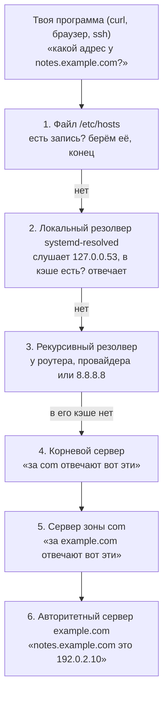
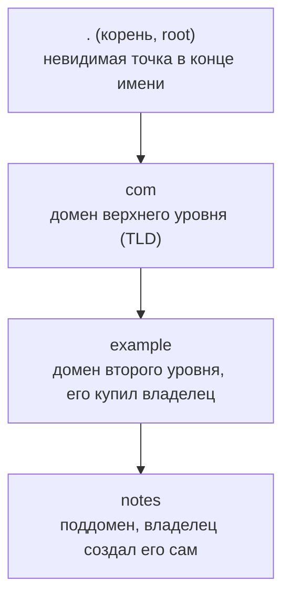
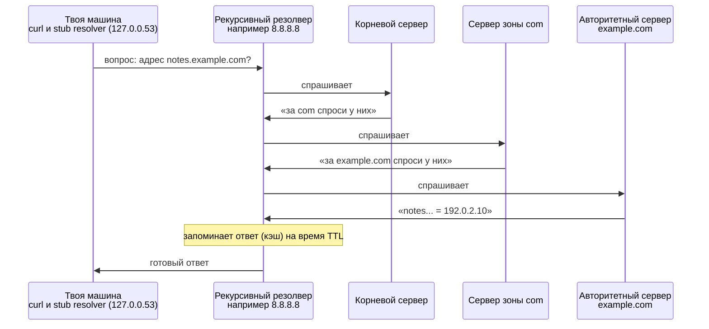
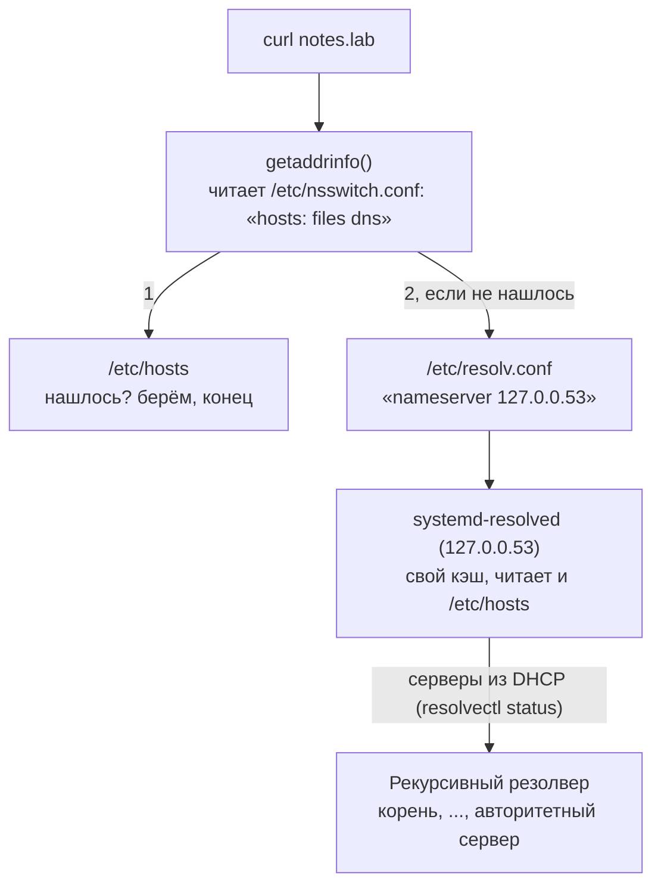

## Зачем это нужно

Ты открываешь `http://192.0.2.10/`, и сайт отвечает. Пишешь `http://notes.example.com/` и получаешь ошибку, что такого имени нет. Сеть цела, сервер жив, сломан один шаг: превращение имени в адрес. Этим занимается DNS (Domain Name System, «система доменных имён»), и странные отказы часто оказываются именно им.

DNS сопоставляет имени записи с адресами, у каждой записи есть срок годности (TTL), и ответы запоминаются на каждом уровне. Ты знаешь имя `notes.example.com`, а сети нужен IP-адрес вроде `192.0.2.10` (что такое IP-адрес, мы разбирали в [уроке 2.1](01-addresses-routes.md)). Так же с камерой наблюдения: в настройках видеорегистратора удобнее написать имя `cam-lobby.example.com`, чем `192.168.1.64`, и при замене камеры поправить одну запись, а не настройки у всех клиентов. **Домен** (domain) это и есть такое имя: `example.com`, `notes.example.com`. Читается справа налево: `com` это «верхний уровень», `example` это имя, которое кто-то зарегистрировал, а `notes` это его поддомен, отдельное имя внутри домена. Без DNS пришлось бы помнить и вводить числа вместо имён и менять их у всех клиентов при каждом переезде сервера.

На работе про DNS вспоминают, когда:

- сервис переехал на новый IP, а часть клиентов всё ещё ходит на старый;
- приложение пишет `Temporary failure in name resolution`, и никто не понимает, что это значит.

Вот как выглядит последний случай глазами человека, который просто проверяет сервис:

```text
$ ping notes.example.com
ping: notes.example.com: Temporary failure in name resolution
```

Адрес машине так и не достался: ошибка случилась на шаге «имя в адрес», до самой сети дело не дошло. Этот шаг мы и разберём по частям. Проверяется он за пару команд, если знаешь, какую запустить и как прочитать ответ.

В этом уроке ты научишься читать ответ программы `dig` (она задаёт DNS вопросы и показывает ответы), понимать, кто именно отвечает на вопрос, и отличать три разные беды: «такого имени нет», «DNS-сервер молчит» и «ответ просто устарел».

Шаг проекта: имя `notes.lab` в файле `/etc/hosts` на клиенте и на сервере, и «Заметки» открываются по имени, а не по адресу. Код `app.py` не меняется, остаётся версия v2.2.

## Что нужно знать

- [Урок 2.1: адреса и маршруты](01-addresses-routes.md) - IP-адрес, шлюз и подсеть. DNS отдаёт именно адреса, а дойдёт ли до них пакет, решает маршрут. Адрес `127.0.0.1` и сеть `lo` (loopback) тоже оттуда.
- [Урок 2.2: порты, TCP и SSH](02-ports-tcp-ssh.md) - порт, разница между TCP и UDP, ошибки `Connection refused` и `timed out`. Они случаются уже после DNS, и здесь ты научишься отличать их от ошибок имени.
- [Урок 1.2: текст, потоки и конвейеры](../01-linux/02-text-pipes.md) - `grep`, `awk`, `head` и `|` нужны, чтобы разбирать вывод `dig`.
- [Урок 1.8: systemd и редакторы](../01-linux/08-systemd-editors.md) - «Заметки» работают как сервис `notes`, а сама система разрешения имён на Ubuntu тоже сервис, `systemd-resolved`, который смотрим через `systemctl`.

## Картина целиком

DNS сопоставляет имени записи с TTL, и каждый уровень запоминает ответ, чтобы не спрашивать снова. Запомненный ответ со временем устаревает, поэтому у записи есть срок годности.

Представь адресную книгу в телефоне: ты называешь контакт «Камера в холле», а не набираешь длинный номер. Если номер сменили, а в книге остался старый, звонок уйдёт не туда, пока запись не обновишь. С DNS так же: имя это название контакта, адрес это номер, а срок годности записи подсказывает, когда пора перепроверить номер.

В системе это выглядит так:

- сначала смотрится файл `/etc/hosts` на твоей машине (обычный текстовый файл, в котором каждая строка связывает адрес с именем; подробно ниже);
- дальше вопрос уходит **рекурсивному резолверу** (recursive resolver): серверу, которому твоя машина задаёт вопрос «какой адрес у этого имени?»;
- он сам обходит цепочку серверов: корневые, потом «зоны верхнего уровня» (`com`, `ru`), потом сервер самого домена. **Зона** это участок имён, за который отвечает один владелец, а **запись** (record) это одна строка в его справочнике вида «имя такое-то, адрес такой-то». Подробно о зонах и записях ниже;
- запомненный ответ это **кэш** (cache), который живёт ограниченное время, **TTL** (time to live, «время жизни»: число секунд, сколько ответ можно считать верным, не спрашивая заново). Кэш нужен, чтобы не гонять один и тот же вопрос по всему интернету; минус в том, что после смены адреса часть клиентов какое-то время видит старый.



Шаги 1 и 2 происходят на твоей машине, шаг 3 у провайдера или публичного резолвера, шаги 4-6 это обход цепочки, который резолвер делает за тебя.

За урок ты разберёшь каждый шаг этой схемы: как устроено имя, кто отвечает на каждом шаге, какие бывают записи и что такое TTL, как читать ответ `dig`, как операционная система решает, куда идти первым, и какие ошибки что означают.

## Теория

### Зачем нужен DNS и что было до него

Компьютеры находят друг друга по IP-адресам. Запомнить `140.82.121.4` вместо `github.com` человеку трудно. Хуже другое: адрес сервера меняется. Компания переехала в другой ЦОД (центр обработки данных, здание с серверами), купила новый сервер, перенесла сайт, и адрес стал другим. Если бы все ходили по адресам, каждому пользователю пришлось бы сообщать новый. Имя даёт слой косвенности: имя остаётся, а адрес за ним можно менять.

Раньше все соответствия имён и адресов были одним файлом `HOSTS.TXT`, который люди скачивали с одного компьютера. Когда сеть выросла, единый файл перестал работать: его невозможно обновлять для миллионов имён и раздавать миллионам машин. DNS заменил его распределённой базой: каждый владелец имени сам хранит его записи на своих серверах, а найти нужный сервер помогает иерархия. Файл `/etc/hosts` до сих пор существует как маленький локальный остаток той эпохи.

Программа не ходит по цепочке сама: она спрашивает одного помощника, резолвера, и получает готовый адрес. Всё остальное происходит без неё. DNS-вопросы и ответы идут по сети как обычные пакеты: чаще всего по **UDP** на порт **53** (вспомни [урок 2.2](02-ports-tcp-ssh.md): UDP это отправка без рукопожатия, для короткого вопроса и короткого ответа этого хватает). Если ответ не помещается в один пакет или UDP не проходит, DNS переключается на TCP, тоже на порт 53.

Осторожно: DNS не проверяет, жив ли сервер. Он лишь говорит «у этого имени записан вот такой адрес». Работает ли сервер по этому адресу, слушает ли он нужный порт, дойдёт ли до него пакет, DNS не знает и знать не должен. Поэтому после успешного DNS всё равно бывают `Connection refused` и `timed out`.

> **Прикинь сам:** Сервер переехал на новый адрес. Если бы не было DNS, что пришлось бы сделать каждому, кто ходит на сайт?
{: .predict}

Узнать новый адрес и поменять его у себя везде, где он записан. Имя в DNS решает это одной правкой записи у владельца.

> **Главное:** DNS превращает имя в адрес, но ничего не проверяет: после успешного ответа всё ещё возможны `Connection refused` и `timed out`.
{: .key}

> **Проверь понимание:** DNS вернул адрес, а `curl` пишет `curl: (7) Failed to connect ... Couldn't connect to server` (так пишет curl 8.5 из Ubuntu 24.04; с curl 8.9 и на Ubuntu 26.04 текст `Could not connect to server`; смысл и код выхода `7` те же, а строка `Connection refused` бывает у `nc` и в `curl -v`). Ошибка в DNS?

<details markdown="1">
<summary>Ответ</summary>

Нет. Раз адрес получен, DNS свою работу сделал. Код ошибки curl `7` (не смог соединиться) это уже следующий шаг: пакет дошёл до машины, но на этом адресе и порту никто не слушает (урок 2.2). Искать надо на сервере: работает ли сервис и на каком адресе он слушает.

</details>

Мы увидели, зачем нужен DNS и как он вырос из одного файла. Теперь разберём, как устроено само имя: именно его структура позволяет поделить работу между многими серверами.

### Имя домена: как оно читается и кто за что отвечает

Плоский список имён («notes», «shop», «mail») на весь мир невозможен: имена бы совпадали, а хранить список пришлось бы в одном месте. Поэтому имена организованы деревом: каждый уровень принадлежит тому, кто им управляет, и может сам раздавать имена внутри себя.

Имя в DNS читается **справа налево**: сначала самая крупная часть, потом всё мельче.

Возьмём имя `notes.example.com.` и разберём его.



Имя `notes.example.com.` читается справа налево: корень, потом `com`, потом `example`, потом `notes`.

- В конце имени стоит точка. Она обычно не пишется, но она есть: это **корень** (root), вершина всего дерева. Имя, записанное вместе с этой точкой, называется **полным** (FQDN, fully qualified domain name): `notes.example.com.`. Программа `dig` всегда показывает имена именно так, с точкой на конце.
- `com` это **домен верхнего уровня** (TLD, top-level domain). Бывают `com`, `org`, `ru`, `рф` и другие. Каждым TLD управляет своя организация.
- `example` это домен второго уровня. Его ты (или твоя компания) покупаешь у **регистратора** (registrar): компании, которая от твоего имени записывает в базу «`example.com` принадлежит такому-то, а его записи хранят вот эти серверы».
- `notes` это поддомен. Его владелец `example.com` создаёт сам, бесплатно и без всяких регистраторов.

Слово **зона** (zone) означает кусок дерева, за который отвечает один владелец. Владелец зоны `example.com` решает, какие в ней записи, и хранит их на своих серверах. Он может отдать поддомен другому: например, `cloud.example.com` может вести отдельная команда со своими серверами. Такая передача называется **делегированием** (delegation): в родительской зоне пишется «за `cloud.example.com` отвечают вот эти серверы».

Проверим на нашем имени: чей это адрес, `notes.example.com.`? Идём справа налево:

1. Корень знает, кто ведёт `com`.
2. Серверы `com` знают, кто ведёт `example.com`.
3. Серверы `example.com` знают, какой адрес у `notes.example.com`.

Никто из них не хранит всего дерева, каждый знает только свой уровень и к кому отправить дальше. Ниже, в разделе про трёх участников, это будет с настоящими именами серверов.

Осторожно: домен это не сайт. `example.com` это имя в дереве. У одного имени может быть сайт, почта, ничего или всё сразу: что именно, определяют записи, о них ниже. И второе: точка в конце не опечатка. `notes.example.com` (без точки) программа при некоторых настройках может достроить, о чём мы поговорим в разделе про `resolv.conf`, а `notes.example.com.` (с точкой) всегда значит именно это имя целиком.

> **Прикинь сам:** В имени `notes.example.com.` какая часть самая крупная, если читать по правилам DNS?
{: .predict}

Корень, невидимая точка в конце. Дальше идут `com`, потом `example`, потом `notes`: читать имя нужно справа налево.

> **Главное:** имя это дерево: корень, домен верхнего уровня (`com`), домен второго уровня (`example`) и поддомен (`notes`); каждый уровень принадлежит тому, кто им управляет.
{: .key}

> **Проверь понимание:** прочитай имя `api.shop.example.co.uk` справа налево. Какой у него домен верхнего уровня и что в нём зарегистрировал владелец?

<details markdown="1">
<summary>Ответ</summary>

Читаем имя справа налево: `uk`, потом `co`, потом `example`, потом `shop`, потом `api`. Домен верхнего уровня `uk`. Про `co.uk` запомни одно: это уровень, на котором организации регистрируют имена (такие суффиксы собраны в публичный список суффиксов, public suffix list). Поэтому владелец зарегистрировал `example.co.uk`, а `shop` и `api` его поддомены.

</details>

Имя делится на уровни, и за каждый уровень кто-то отвечает. Теперь посмотрим, какие серверы за это отвечают и как вопрос доходит до нужного.

### Три роли серверов: корневые, авторитетные и рекурсивные

Нужно, чтобы вопрос «какой адрес у имени?» можно было задать любому серверу и получить ответ, при этом чтобы никто не хранил всё. Для этого работа разделена на три роли, и путаница между ними частая причина недопонимания.

Разберём роли по одной, в том порядке, в каком по ним идёт вопрос.

**Корневые серверы** (root servers) стоят первыми. Они знают только, кто отвечает за `com`, `ru`, `org` и другие домены верхнего уровня (последняя часть имени). Их 13 имён (от `a.root-servers.net` до `m.root-servers.net`), но за ними стоят около двух тысяч серверов по всему миру: один адрес обслуживают много машин (технология anycast). Адреса корневых серверов «зашиты» во все резолверы.

Дальше вопрос доходит до **авторитетных серверов** (authoritative servers). Они хранят настоящие записи зоны (своей части имён) и отвечают «это моё, вот ответ». «Авторитетный» значит «главный источник по этой зоне». Их имена записаны в записях `NS` (name server, «сервер имён») зоны.

Но сам ты по этой цепочке не ходишь. За тебя её проходит **рекурсивный резолвер** (recursive resolver), та машина, которую ты спрашиваешь. Он обходит цепочку от корня до авторитетного сервера, возвращает готовый ответ и запоминает его на время TTL. Слово «рекурсивный» здесь значит «доведёт до конца сам». Это может быть твой домашний роутер, DNS провайдера, публичные `8.8.8.8` (Google) или `1.1.1.1` (Cloudflare) или корпоративный сервер.

Есть и ещё один участник, у тебя на машине: **stub resolver** («заглушка»). Это маленький кусочек операционной системы, который принимает вопрос от программы и отправляет его рекурсивному резолверу из настроек. Сам по цепочке он не ходит. На Ubuntu его роль играет `systemd-resolved`, о нём ниже.



Твоя машина задаёт один вопрос и получает готовый ответ, а весь обход делает рекурсивный резолвер.

Весь обход можно увидеть своими глазами. Вот настоящий результат `dig +trace example.com A`: команда сама проходит цепочку и показывает каждый шаг (запуск и разбор в практике, задание 2). Ниже сокращённо, с настоящими значениями:

```text
.                  4502    IN  NS  a.root-servers.net.         <- шаг 0: список корневых серверов
;; Received 239 bytes from 127.0.0.53#53(127.0.0.53) in 3 ms

com.               172800  IN  NS  a.gtld-servers.net.         <- шаг 1: корень ответил, кто ведёт com
;; Received 836 bytes from 192.203.230.10#53(e.root-servers.net) in 259 ms

example.com.       172800  IN  NS  hera.ns.cloudflare.com.     <- шаг 2: com ответил, кто ведёт example.com
example.com.       172800  IN  NS  elliott.ns.cloudflare.com.
;; Received 359 bytes from 192.54.112.30#53(h.gtld-servers.net) in 247 ms

example.com.       300     IN  A   104.20.23.154               <- шаг 3: сам авторитетный сервер ответил
example.com.       300     IN  A   172.66.147.243
;; Received 72 bytes from 108.162.195.228#53(elliott.ns.cloudflare.com) in 235 ms
```

Читаем сверху вниз. Строка `Received ... from` говорит, кто дал именно этот блок. Сначала у локального резолвера (`127.0.0.53`) взят список корневых серверов. Затем один из них, `e.root-servers.net`, на вопрос про `example.com` не ответил адресом, а сказал: «за `com` отвечают серверы `*.gtld-servers.net`». Дальше `h.gtld-servers.net` сказал: «за `example.com` отвечают `hera` и `elliott` у Cloudflare». И только эти серверы дали настоящий ответ: два адреса. На каждом шаге спрашивают следующего, пока не дойдут до того, кто знает ответ сам. Числа `172800` и `300` это TTL в секундах, о нём чуть ниже. Число в первой строке (`4502`) пока не важно: у тебя оно будет другим.

Адреса и имена серверов у тебя будут другие: владелец `example.com` может сменить хостинг DNS, и тогда вместо Cloudflare здесь будет другая компания.

Осторожно: авторитетный сервер и рекурсивный резолвер это не одно и то же. Авторитетный хранит записи только своих зон и на чужие вопросы отвечает «не знаю» (или вообще не отвечает на рекурсивные вопросы). Рекурсивный сам ничего не хранит навсегда: он ищет и запоминает на время. В настройках сети ты всегда указываешь **рекурсивный** резолвер.

> **Прикинь сам:** Сколько серверов нужно спросить твоей программе, чтобы узнать адрес `notes.example.com`, если рядом есть рекурсивный резолвер?
{: .predict}

Один: резолвер. Обход корня, зоны `com` и авторитетного сервера он делает сам и возвращает готовый ответ.

> **Главное:** корневые серверы знают, кто ведёт `com` и другие зоны верхнего уровня, авторитетные хранят настоящие записи, а рекурсивный резолвер ходит по цепочке за тебя и запоминает ответ.
{: .key}

> **Проверь понимание:** ты хочешь узнать, что записано у самого владельца домена, минуя чужие кэши. К какому серверу нужно обратиться?

<details markdown="1">
<summary>Ответ</summary>

К авторитетному серверу зоны. Его имя видно в записях `NS` домена, а спросить его напрямую можно командой `dig @имя_сервера имя_домена`. Рекурсивный резолвер может отвечать из кэша, то есть показать устаревшее.

</details>

Мы знаем, кто отвечает на вопрос. Теперь выясним, что именно лежит под именем и какие бывают типы записей.

### Записи и их типы: что можно хранить под именем

Под одним именем нужно хранить разное: адрес сервера, куда доставлять почту, подтверждение владения доменом. Поэтому запись в DNS имеет **тип**.

У одного имени может быть несколько значений одного типа (два адреса у `example.com`), и это нормально.

Запись (resource record) это строка из пяти частей: `имя  TTL  класс  тип  значение`. Например, `example.com. 300 IN A 104.20.23.154`: имя `example.com.`, время жизни 300 секунд, класс `IN` (Internet, единственный, который ты будешь встречать, просто пропускай), тип `A`, значение это адрес. Шесть главных типов (ещё два, `SOA` и `PTR`, смотри в «Для любопытных» ниже):

| Тип | Что значит | Пример |
|---|---|---|
| `A` | имя в IPv4-адрес | `notes.example.com -> 192.0.2.10` |
| `AAAA` | имя в IPv6-адрес (то же, но для нового протокола, урок 2.1) | `notes.example.com -> 2001:db8::10` |
| `CNAME` | имя-псевдоним: «это то же самое, что другое имя» | `www.github.com -> github.com` |
| `MX` | куда доставлять почту домена (число это приоритет, меньше значит важнее) | `10 mail.example.com` |
| `TXT` | произвольный текст: подтверждение владения, защита почты (SPF) | `"v=spf1 -all"` |
| `NS` | какие серверы авторитетны для зоны | `hera.ns.cloudflare.com.` |

Каждый тип можно запросить отдельно. Всё это настоящие ответы, полученные при подготовке урока:

```text
$ dig +noall +answer www.github.com A
www.github.com.   4435  IN  CNAME  github.com.
github.com.       15    IN  A      140.82.121.4
```

Резолвер сначала вернул `CNAME`: «`www.github.com` это всего лишь другое имя для `github.com`», а затем сразу адрес для настоящего имени. Поэтому у `CNAME` есть цена: лишний шаг при поиске.

```text
$ dig +short example.com MX
0 .

$ dig +short example.com TXT
"v=spf1 -all"
```

У `example.com` в `MX` записано `0 .`: точка вместо имени сервера значит «почту сюда не принимают». А `v=spf1 -all` в `TXT` это SPF: «с этого домена не отправляет почту никто». Так почтовые серверы отсекают подделку писем от твоего имени.

<details markdown="1">
<summary>Для любопытных: SOA, PTR и подписи DNSSEC</summary>

**SOA** (start of authority) это служебная запись зоны, одна на зону. Настоящий ответ:

```text
$ dig +noall +answer example.com SOA
example.com.  1874  IN  SOA  elliott.ns.cloudflare.com. dns.cloudflare.com. 2415949263 10000 2400 604800 1800
```

По порядку: главный сервер зоны; контакт администратора (`dns.cloudflare.com.` значит адрес `dns@cloudflare.com`, точка вместо `@`); серийный номер (растёт при каждой правке зоны, по нему серверы понимают, что появилась новая версия); четыре таймера в секундах. Из таймеров пока важно последнее число, `1800`: оно определяет, как долго запоминается ответ «такого имени нет» (об этом в разделе про TTL).

**PTR** это обратная запись: адрес в имя. Флаг `-x` спрашивает «чьё это имя»:

```text
$ dig +noall +answer -x 8.8.8.8
8.8.8.8.in-addr.arpa.  4502  IN  PTR  dns.google.
```

Адрес записывается наоборот и к нему добавляется `.in-addr.arpa.`, получается обычное имя, у которого есть `PTR`.

**DNSSEC** это цифровая подпись записей: она позволяет проверить, что ответ не подменили. Подписи лежат в записях `RRSIG`, а `DS` в родительской зоне хранит отпечаток ключа дочерней, так строится цепочка доверия сверху вниз. Подписи `RRSIG` видны в ответе `dig +dnssec example.com A`, а `DS` показывает `dig DS example.com`; в этом уроке их можно пропускать.

</details>

Осторожно: `CNAME` нельзя ставить на «корень» домена (`example.com` без поддомена). На корне уже лежат `SOA` и `NS`, а `CNAME` означает «у этого имени нет своих записей, всё как у другого имени», и соседей терпеть не может. Поэтому «голый» домен обычно получает `A`, а `CNAME` ставят только на поддомены (`www`, `shop`). Вторая путаница: `CNAME` указывает на **имя**, а не на адрес. Если написать `CNAME` на `192.0.2.10`, получится ошибка, для адреса нужен `A`.

> **Прикинь сам:** Какую запись нужно создать, чтобы `www.example.com` вёл туда же, куда `example.com`, а сам `example.com` получил адрес?
{: .predict}

Для `example.com` запись `A` с адресом, для `www` запись `CNAME` на `example.com`. На корень домена `CNAME` ставить нельзя.

> **Главное:** запись это `имя TTL класс тип значение`; `A` это адрес, `CNAME` псевдоним на другое имя, `MX` почта, `TXT` текст, `NS` серверы зоны.
{: .key}

> **Проверь понимание:** у `example.com` два адреса в `A`. Это ошибка или так и задумано?

<details markdown="1">
<summary>Ответ</summary>

Так задумано. У имени может быть несколько записей одного типа. Резолвер отдаёт их все, а клиент обычно пробует по порядку. Так владельцы распределяют нагрузку между несколькими серверами (за одним именем стоят разные машины). Но это не настоящая балансировка: DNS не проверяет, жив ли сервер по каждому адресу (подробнее в вопросах для собеседований).

</details>

Записи хранятся не вечно: у каждой есть срок жизни. Дальше разберём, как он вместе с кэшем определяет, почему изменение появляется не сразу.

### TTL и кэш: почему запись меняется не сразу

Если бы каждая программа при каждом запросе шла от корня до авторитетного сервера, корневые серверы утонули бы в запросах, а открытие сайта занимало бы десятки миллисекунд лишних на каждый шаг. Поэтому любой ответ запоминается (кэшируется), и повторный вопрос получает ответ мгновенно. Но запомненное устаревает: адрес поменяли, а кэш ещё помнит старый. Чтобы это было управляемо, у каждой записи есть срок годности: **TTL** (time to live, «время жизни») в секундах.

Пошагово это выглядит так:

1. Резолвер получает от авторитетного сервера запись с TTL 300 и запоминает: «адрес такой, годен 300 секунд».
2. Пока идут эти секунды, на каждый вопрос он отвечает из памяти. Число TTL в ответе **уменьшается**: через 100 секунд он скажет 200, потому что рассказывает, сколько осталось.
3. Когда TTL дошёл до нуля, запись выбрасывается, и следующий вопрос снова уходит выше.

Кэши стоят на каждом шаге: в браузере, в приложении, в `systemd-resolved`, в рекурсивном резолвере провайдера. Они независимы, у каждого свои часы.

Пример 1, TTL вживую. Настоящие ответы `dig +noall +answer example.com A` с паузой 5 секунд между запросами:

```text
example.com.   171  IN  A  172.66.147.243      <- первый запрос: осталось 171 секунда
example.com.   166  IN  A  104.20.23.154       <- через 5 секунд: 171 - 5 = 166
```

А тот же вопрос авторитетному серверу напрямую всегда даёт полный TTL:

```text
example.com.   300  IN  A  104.20.23.154        <- у источника всегда 300
```

Значит, локальный кэш получил запись где-то 129 секунд назад (300 - 171 = 129), и ещё 171 секунду будет отвечать из памяти, даже если владелец уже поменял адрес.

Помнишь жалобу «сервис переехал, а часть клиентов ходит на старый адрес»? Вот как она выглядит в `dig`: первый вопрос ушёл публичному резолверу `8.8.8.8`, второй авторитетному серверу домена (`@имя` значит «спроси именно его»):

```text
$ dig +noall +answer notes.example.com @8.8.8.8
notes.example.com.   240   IN   A   192.0.2.10
$ dig +noall +answer notes.example.com @ns1.example.com
notes.example.com.   300   IN   A   192.0.2.55
```

Сервис переехал на `192.0.2.55`, и первоисточник отвечает правильно. Резолвер ещё помнит старый `192.0.2.10`: число `240` это секунды, сколько он будет его отдавать. Пока они не истекут, часть пользователей ходит на старый сервер.

Пример 2, переезд сервиса. У записи TTL 3600 (час). Ты хочешь в 14:00 переключить её на новый сервер, и чтобы почти никто не заметил.

- Если поменять запись в 14:00 и ничего больше не делать: клиент, спросивший в 13:59, запомнил старый адрес до 14:59. Почти час часть пользователей ходит на старый сервер.
- Правильно: заранее, скажем в 12:00 (за время, не меньшее старого TTL), снизить TTL записи до 300. К 13:00 все кэши со старым TTL 3600 истекли и получили запись с TTL 300. В 14:00 меняешь адрес: худший случай это 5 минут, пока последний кэш не обновится. После переезда TTL возвращают обратно.

Именно поэтому в вопросе «когда снижать TTL?» правильный ответ «заранее, а не в момент переезда».

**Ещё один кэш: отрицательный.** Резолвер запоминает и ответ «такого имени нет» (об этом ответе ниже, `NXDOMAIN`). Срок хранения задаёт последнее число в `SOA` (в примере из «Для любопытных» выше это `1800`, то есть полчаса). Поэтому бывает так: ты создал запись, а клиент, который спрашивал имя минуту назад, ещё полчаса получает «нет такого». Это не сбой, а чужой кэш.

Осторожно: поменять запись у владельца не значит поменять её у всех сразу. Поменялся только источник. Клиенты увидят изменение не раньше, чем истечёт TTL в каждом кэше по цепочке. И обратное: «TTL 0 значит, что кэша нет» не совсем так, многие резолверы всё равно держат запись несколько секунд.

> **Прикинь сам:** TTL записи 3600, а переехать нужно в 14:00 почти без простоя. Когда снижать TTL?
{: .predict}

Заранее, не позже чем за старый TTL до переезда: в 12:00 снизить до 300, к 13:00 все кэши получат короткий срок, а в 14:00 менять адрес. После переезда TTL возвращают.

> **Главное:** ответ живёт в каждом кэше по цепочке до конца своего TTL, и число TTL в ответе уменьшается; поменять запись у источника значит не поменять её у всех сразу.
{: .key}

> **Проверь понимание:** ты сменил A-запись, TTL был 3600. Через 10 минут коллега всё ещё попадает на старый сервер. Ошибка в записи?

<details markdown="1">
<summary>Ответ</summary>

Скорее всего нет. Его рекурсивный резолвер (или система, или браузер) хранит старый ответ до конца TTL, то есть до часа. Сначала проверь авторитетный сервер напрямую (`dig @сервер имя`): если там новый адрес, запись верна. Тогда остаётся ждать или сбросить кэш на клиенте.

</details>

Когда понятны записи и TTL, нужен инструмент, который показывает всё это в ответе. Это `dig`.

### Как читать ответ dig

`dig` (domain information groper) это инструмент для DNS, как `ping` для доступности. Он спрашивает сервер и печатает ответ целиком, поэтому по нему видно, что именно ответил DNS, а не что «додумала» твоя программа. Умение читать этот вывод главный навык урока.

Общий вид команды: `dig [@сервер] имя [тип] [+опции]`. Если сервер не указан, берётся из `/etc/resolv.conf`. Если тип не указан, это `A`. Опции с плюсом меняют вывод: `+short` печатает только значения, `+noall +answer` показывает только строки ответа, `+trace` проходит цепочку от корня.

Вот главное из вывода `dig example.com A`. Четыре места, на которые смотришь всегда, помечены стрелками:

```text
;; ->>HEADER<<- opcode: QUERY, status: NOERROR, id: 18928   <- 1. status: чем кончился вопрос
;; ANSWER SECTION:
example.com.		172	IN	A	104.20.23.154                   <- 2. ANSWER: сам ответ, 3. TTL (172 с)
example.com.		172	IN	A	172.66.147.243
;; SERVER: 127.0.0.53#53(127.0.0.53) (UDP)                  <- 4. SERVER: кто ответил
```

<details markdown="1">
<summary>Полный вывод со всеми служебными строками</summary>

```text
; <<>> DiG 9.18.39-0ubuntu0.24.04.7-Ubuntu <<>> example.com A
;; global options: +cmd
;; Got answer:
;; ->>HEADER<<- opcode: QUERY, status: NOERROR, id: 18928
;; flags: qr rd ra; QUERY: 1, ANSWER: 2, AUTHORITY: 0, ADDITIONAL: 1

;; OPT PSEUDOSECTION:
; EDNS: version: 0, flags:; udp: 65494
;; QUESTION SECTION:
;example.com.			IN	A

;; ANSWER SECTION:
example.com.		172	IN	A	104.20.23.154
example.com.		172	IN	A	172.66.147.243

;; Query time: 77 msec
;; SERVER: 127.0.0.53#53(127.0.0.53) (UDP)
;; WHEN: Wed Sep 30 12:00:37 UTC 2026
;; MSG SIZE  rcvd: 72
```

</details>

Разбор по строкам:

- Первая строка: версия `dig` и то, что ты спросил (`example.com A`). Строки, начинающиеся с `;`, это комментарии, часть из них служебные.
- **`status: NOERROR`**: главная строка. Это код результата: `NOERROR` значит «вопрос понятен и обработан». Другие значения (`NXDOMAIN`, `SERVFAIL`) разберём в разделе про ошибки.
- **`flags: qr rd ra`**: флаги ответа. `qr` (query response) значит «это ответ». `rd` (recursion desired) значит «клиент просил довести поиск до конца». `ra` (recursion available) значит «сервер умеет доводить поиск до конца», то есть это рекурсивный резолвер. Ещё бывает `aa` (authoritative answer): «ответил сам авторитетный сервер, не из кэша». Ты увидишь его в задании 2.
- `QUERY: 1, ANSWER: 2, AUTHORITY: 0, ADDITIONAL: 1`: сколько записей в каждом разделе ниже. Ответа две записи, поэтому `ANSWER: 2`.
- **`QUESTION SECTION`**: что спрашивали: имя `example.com.`, класс `IN`, тип `A`.
- **`ANSWER SECTION`**: ответ, по одной записи на строку: имя, **TTL** (здесь 172 секунды осталось), класс, тип, значение. Два адреса значит две строки.
- `Query time: 77 msec`: сколько ушло на вопрос. Первый раз 77 миллисекунд, потому что запрос шёл по сети, повторный придёт из кэша за 0.
- **`SERVER: 127.0.0.53#53(127.0.0.53) (UDP)`**: кто ответил. Формат `адрес#порт`, в скобках протокол. Здесь отвечал локальный `systemd-resolved`, а не резолвер провайдера. Это тоже часть диагностики: если ты думал, что спрашиваешь `8.8.8.8`, а тут `127.0.0.53`, вывод про другой сервер.
- Остальное (`opcode`, `id`, `OPT PSEUDOSECTION`, `WHEN`, `MSG SIZE`) служебное, для диагностики можно пропускать; расшифровка в «Для любопытных» в разделе про `getaddrinfo` ниже.

Осторожно: ответ `dig` нельзя читать без строки `SERVER` и флагов. Одно и то же имя может давать разные ответы у разных серверов, и только `SERVER` говорит, чьё мнение ты видишь. И второе: пустой `ANSWER` не всегда ошибка, это зависит от `status` (см. ниже).

> **Прикинь сам:** В выводе `dig` строка `SERVER: 127.0.0.53#53`. Кто ответил на вопрос, провайдер или твоя машина?
{: .predict}

Твоя машина: это локальный `systemd-resolved`. Если ты думал, что спрашиваешь `8.8.8.8`, вывод относится к другому серверу.

> **Главное:** в выводе `dig` смотри `status` (результат), `flags` (кто ответил и как), `ANSWER SECTION` (записи с TTL) и `SERVER` (чьё это мнение).
{: .key}

> **Проверь понимание:** в ответе `status: NOERROR`, `flags: qr aa rd`, TTL равен 300, и это же число ты видишь при каждом повторе через минуту. Что это говорит о том, кто ответил?

<details markdown="1">
<summary>Ответ</summary>

Флаг `aa` значит, что ответил авторитетный сервер, то есть первоисточник, а не кэш. У источника TTL всегда полный (300), он не убывает. Отсутствие флага `ra` тут тоже нормально: авторитетный сервер не занимается рекурсией для чужих.

</details>

`dig` спрашивает DNS напрямую, но обычные программы ходят другим путём. Разберём, как система сама превращает имя в адрес.

### Как система превращает имя в адрес: hosts, nsswitch, resolv.conf

Программы не спрашивают DNS сами. `curl`, `ssh`, браузер и Python вызывают системную функцию `getaddrinfo()` («дай адрес для этого имени»), и порядок поиска у них один на всех:

```text
программа -> getaddrinfo() -> /etc/hosts -> DNS
```

Путь имени в системе определяют три файла:

1. **`/etc/nsswitch.conf`** (name service switch, «переключатель служб имён») задаёт порядок источников. Нас интересует строка `hosts:`. Значение `files dns` значит: сначала `files`, то есть файл `/etc/hosts`, и только потом `dns`, то есть DNS-запрос.
2. **`/etc/hosts`**: простой текстовый файл, где на каждой строке адрес и одно или несколько имён: `127.0.0.1 notes.lab`. Он локальный: действует только на этой машине.
3. **`/etc/resolv.conf`**: говорит, куда слать DNS-запрос, если файл `hosts` не помог. Строка `nameserver 127.0.0.53` значит «к серверу на этом адресе». Другие строки: `search` это список суффиксов, которые система дописывает к короткому имени (при `search corp.local` запрос `ssh db` превратится в `db.corp.local`; подробнее в разделе ниже), `options` это дополнительные настройки.

На Ubuntu `nameserver 127.0.0.53` это не настоящий DNS-сервер провайдера, а адрес программы `systemd-resolved` на твоей же машине (помнишь `127.0.0.0/8`, loopback? Это он). Он принимает вопросы, кэширует ответы и уже сам ходит к настоящим серверам, которые получил при подключении к сети. Эти серверы обычно выдаёт сама сеть по протоколу **DHCP** (он раздаёт машинам адрес, шлюз и адреса DNS-серверов, [урок 2.1](01-addresses-routes.md)).



Здесь видно, почему `curl` находит имя из `/etc/hosts`, а `dig @8.8.8.8` нет: `dig` сразу идёт в DNS и первый шаг пропускает.

```text
$ grep '^hosts' /etc/nsswitch.conf
hosts:          files dns
```

**Главная ловушка урока: «dig работает, а curl нет».** `dig` не читает `/etc/hosts` и `nsswitch.conf`, он просто отправляет DNS-запрос. А программы проходят все шаги сверху, и запись в `/etc/hosts` для них главнее DNS. Поэтому `dig` может говорить одно, а `curl` открывать другое. Команда, которая честно показывает то, что увидит приложение, это **`getent hosts имя`** (`getent` от get entries, «получить записи» из баз имён системы; она берёт имена из тех же источников и в том же порядке, что и приложения). Если `dig` и `getent hosts` дают разное, разбираться нужно именно с этим.

Есть нюанс: на Ubuntu `systemd-resolved` сам умеет отвечать по `/etc/hosts`. Поэтому `dig notes.lab` (он идёт к `127.0.0.53`) иногда покажет адрес из этого файла, а `dig @8.8.8.8 notes.lab` нет: публичный сервер файла не видит. Чтобы проверять «есть ли имя в настоящем DNS», спрашивай конкретный внешний сервер.

<details markdown="1">
<summary>Для любопытных: libc, симлинк resolv.conf, getent ahosts, служебные поля dig и ndots</summary>

**libc.** Функция `getaddrinfo()` живёт в общей библиотеке операционной системы `libc` (**библиотека** это набор готовых функций, которые подключают к себе все программы). Поэтому у всех программ одинаковые представления о мире. Исключения есть: программы на Go и браузеры иногда ходят в DNS своим кодом, и тогда `getent` может и не совпасть с ними.

**Симлинк.** Файл `/etc/resolv.conf` на Ubuntu это не обычный файл, а **симлинк** (символическая ссылка, «ярлык» на другой файл):

```text
$ ls -l /etc/resolv.conf
lrwxrwxrwx 1 root root 39 Sep 30 11:52 /etc/resolv.conf -> ../run/systemd/resolve/stub-resolv.conf
```

Первая буква `l` значит симлинк, а после стрелки `->` указано, куда он ведёт. Содержимое без комментариев:

```text
nameserver 127.0.0.53
options edns0 trust-ad
search .
```

`nameserver 127.0.0.53` это stub `systemd-resolved`. `options edns0 trust-ad` технические настройки протокола, они тебе не понадобятся. `search .` значит «суффиксов нет».

**getent ahosts.** Ровно путь `getaddrinfo()` с порядком адресов, который увидит программа, показывает `getent ahosts имя`; `getent hosts имя` короче и обычно этого хватает.

**Служебные поля dig.** `opcode: QUERY` обычный вопрос, других значений ты почти не увидишь. `id` случайный номер вопроса, чтобы клиент сопоставил ответ с вопросом. `OPT PSEUDOSECTION` это расширение протокола EDNS: оно позволяет клиенту сказать «мой UDP-пакет принимает ответы побольше» и нести флаги вроде DNSSEC. `WHEN` время запроса. `MSG SIZE rcvd` размер ответа в байтах: если он близок к границе в 1200 байт, жди флаг `tc` и повтор по TCP.

**ndots и Kubernetes.** Опция `ndots` (по умолчанию 1) относится к списку `search` (суффиксов, которые система дописывает к коротким именам; подробно в разделе про короткие имена ниже). Она говорит: имя, в котором точек меньше этого числа, сначала пробуют с суффиксами из `search`, и только потом как есть. В Kubernetes внутри пода `/etc/resolv.conf` выглядит примерно так (имена и адрес зависят от кластера):

```text
search notes.svc.cluster.local svc.cluster.local cluster.local
nameserver 10.96.0.10
options ndots:5
```

Из-за `ndots:5` обычное внешнее имя `example.com` (одна точка) сначала перебирает все три суффикса и только потом уходит как есть. Каждая попытка это пара запросов, `A` и `AAAA`. Лекарство: имя с точкой на конце (`example.com.`) или `options ndots:2` в настройках пода.

Задержки «ровно по 5 секунд» бывают из-за потери одного из двух UDP-пакетов на нагруженном узле (известная гонка в таблице соединений ядра, conntrack): клиент ждёт свой таймаут по умолчанию, 5 секунд, и повторяет. Помогает локальный кэш на каждом узле (NodeLocal DNSCache). Подробности и практика в [уроке 5.3](../05-kubernetes/03-services-dns.md).

</details>

Осторожно: `/etc/hosts` это не DNS. Это отдельный локальный источник, у него нет TTL, иерархии и записей типа `MX`. Он действует только на той машине, где лежит, и никто другой о нём не узнает. И вторая путаница: «`dig` показывает то, что видит приложение». Нет, по причинам выше.

> **Прикинь сам:** В `nsswitch.conf` стоит `hosts: files dns`. Что проверит `curl` первым: `/etc/hosts` или DNS?
{: .predict}

`/etc/hosts`: `files` стоит первым. DNS-запрос уйдёт, только если там имени не нашлось.

> **Главное:** программы идут через `getaddrinfo()`: сначала `/etc/hosts`, потом DNS по `resolv.conf`; `dig` берёт только DNS, поэтому «что видит приложение» проверяй через `getent hosts`.
{: .key}

> **Проверь понимание:** в `/etc/hosts` записано `127.0.0.1 notes.lab`, а `dig @8.8.8.8 notes.lab` возвращает `NXDOMAIN`. `curl notes.lab` при этом работает. Почему так?

<details markdown="1">
<summary>Ответ</summary>

`curl` идёт через `getaddrinfo()`, где по `nsswitch.conf` первым стоит `files`, и находит запись в `/etc/hosts`. Публичный сервер `8.8.8.8` о твоём локальном файле не знает и честно отвечает, что имени нет (`NXDOMAIN`). Проверять «что видит приложение» нужно через `getent hosts`.

</details>

Теперь известен весь путь от программы до ответа. Пора понять, как он ломается и чем различаются типичные ошибки.

### Ошибки DNS: NXDOMAIN, SERVFAIL, тишина и как их отличать

DNS ломается по-разному, и чинится каждый вариант в своём месте. Если не различать их, будешь менять адрес там, где сломан резолвер, и наоборот. Разделить их можно за одну команду.

Случаев пять, и в `dig` первые четыре видны в строке `status:` заголовка, а тишина видна только как `timed out`:

| Что видишь | Что значит | Где искать |
|---|---|---|
| `NOERROR` и в `ANSWER` есть записи | всё хорошо | нигде |
| `NOERROR` и `ANSWER: 0` | имя существует, но записи **такого типа** нет | запросил не тот тип (например, `AAAA` у имени только с IPv4) |
| `NXDOMAIN` | такого имени не существует | опечатка, запись не создана, не та зона |
| `SERVFAIL` | сервер не смог получить ответ | сломана зона, не отвечают её серверы, сломана подпись DNSSEC |
| `connection timed out; no servers could be reached` | резолвер вообще не отвечает | сеть, файрвол, неверный `nameserver` в `resolv.conf` |

Про `SERVFAIL`. Причин у него несколько: сломана подпись DNSSEC, не отвечают серверы зоны (`NS`), делегирование ведёт на сервер, который зону не знает (lame delegation), или сервер отказывается отвечать (`REFUSED`). **DNSSEC** это цифровая подпись записей: проверяющий резолвер (например, `8.8.8.8`) вместо подделанного ответа возвращает `SERVFAIL`. Чтобы понять, виновата ли подпись, повтори запрос с `+cd` (checking disabled, «проверку подписи выключить»): `dig +cd dnssec-failed.org` отвечает, а без `+cd` тот же вопрос даёт `SERVFAIL`. Если с `+cd` тоже `SERVFAIL`, спроси каждый сервер зоны отдельно (`dig @каждый_NS example.com SOA`) и сравни серийные номера в ответе, а потом пройди цепочку через `dig +trace`: так видно, на каком шаге она обрывается.

А сама программа, которая пытается открыть имя, сообщает об этом своими словами. Настоящие тексты ошибок:

```text
$ curl -sS http://nonexistent-abc123.example.com/
curl: (6) Could not resolve host: nonexistent-abc123.example.com

$ ping -c 1 example.com                       # при недоступном резолвере
ping: example.com: Temporary failure in name resolution

$ ping -c 1 example.com                       # если имя не нашли ни в одном источнике
ping: example.com: Name or service not known
```

`Could not resolve host` (curl, код выхода 6) значит «не смог превратить имя в адрес», причину curl не уточняет. `Temporary failure in name resolution` значит временную неудачу: резолвер не ответил вовсе либо ответил ошибкой (например, `SERVFAIL`); какой из случаев, покажет `dig`. А `Name or service not known` значит «источники ответили или пропустили: такого имени нет». Точную причину всё равно устанавливают через `dig`.

Три класса в одной проверке выглядят так. Настоящие ответы:

```text
$ dig no-such-host.invalid | grep status
;; ->>HEADER<<- opcode: QUERY, status: NXDOMAIN, id: 61126

$ dig @8.8.8.8 dnssec-failed.org | grep status       # домен со специально сломанной подписью
;; ->>HEADER<<- opcode: QUERY, status: SERVFAIL, id: 50077

$ dig @192.0.2.53 +time=2 +tries=1 example.com       # такого сервера нет
;; communications error to 192.0.2.53#53: timed out
;; no servers could be reached
```

Первый: резолвер работает, просто имени `no-such-host.invalid` нет (домен `.invalid` зарезервирован под «заведомо несуществующие» имена). Второй: резолвер работает, но не смог довести поиск. Третий: ответа нет вообще, потому что по адресу `192.0.2.53` никто не слушает (этот диапазон отведён под примеры в документации). Флаги `+time=2 +tries=1` говорят `dig` ждать две секунды и пробовать один раз, иначе он ждёт пятнадцать секунд.

Как понять, что виновата именно DNS, а не сеть или сервис. Задай один вопрос напрямую: `dig +short shop.example.com`. Если адрес пришёл, а `curl` всё равно не открывает сайт, проблема не в DNS: ищи дальше по цепочке, в порте, файрволе или самом сервисе. Если `dig` молчит, отвечает `NXDOMAIN` или `SERVFAIL`, а `curl` по IP-адресу (`curl http://192.0.2.10/`) работает, значит, сеть цела, а ломается именно разрешение имени.

Осторожно: `NXDOMAIN` не значит «DNS не работает». Он как раз означает, что DNS **работает** и честно ответил. Сломан DNS в случае тишины (`timed out`) или `SERVFAIL`. И ещё: пустой `ANSWER` при `NOERROR` не ошибка, это «нет записи такого типа».

> **Прикинь сам:** `dig` вернул `status: NOERROR`, но раздел `ANSWER` пуст. Ошибка ли это?
{: .predict}

Нет: имя существует, но записи запрошенного типа у него нет (например, спросили `AAAA` у имени только с IPv4).

> **Главное:** `NXDOMAIN` значит «имени нет» (DNS работает), `SERVFAIL` значит «сервер не смог довести поиск», а `timed out` значит «резолвер молчит»; лечатся они в разных местах.
{: .key}

> **Проверь понимание:** `curl` пишет `Could not resolve host: shop.example.com`. Какие два принципиально разных случая надо разделить первой же командой?

<details markdown="1">
<summary>Ответ</summary>

Резолвер отвечает, но имени нет (`NXDOMAIN`, проблема с записью), либо резолвер не отвечает вовсе (проблема с сетью или с `resolv.conf`). Различает их `dig shop.example.com`: в первом случае увидишь `status: NXDOMAIN`, во втором `timed out`.

</details>

Ошибки различать научились. Теперь применим знания к проекту: дадим «Заметкам» своё имя без настоящего домена.

### Имя для учебного проекта: /etc/hosts и домен notes.lab

Настоящий домен стоит денег, а регистрация занимает время. Для учёбы и для проверки на своей машине нужно имя, которое работает только у тебя. Для этого и нужен `/etc/hosts`: вписал строку, и имя работает на этой машине.

Строка в `/etc/hosts`: адрес, пробел, имя (можно несколько имён через пробел). Например, `127.0.0.1 notes.lab`. Правка файла видна сразу всем программам, которые ходят через `getaddrinfo()`, то есть `getent` и `curl`: `nsswitch` с источником `files` читает файл при каждом запросе. Только вопросы к `127.0.0.53` (например, `dig` без `@`) идут через `systemd-resolved`, и он может отстать на пару секунд.

Почему домен `.lab`, а не любой:

- `.local` нельзя: он зарезервирован под mDNS (multicast DNS, поиск соседей в локальной сети без DNS-сервера), и на нём резолвер может вести себя непредсказуемо;
- `.lab` в настоящем DNS не существует: `dig @8.8.8.8 notes.lab` возвращает `NXDOMAIN`, поэтому запросы не улетают в интернет и не попадают к чужим владельцам;
- для настоящих внутренних имён используй `.internal` (его зарезервировали в 2024 году) или поддомен своего домена. `.lab` не зарезервирован, когда-нибудь им может завладеть кто-то другой, и подходит он только для учебного стенда. Для примеров и тестов есть `.test` (RFC 6761). В курсе остаётся `notes.lab`, чтобы имя везде совпадало в уроках и скриптах.

Клиент и сервер могут быть разными машинами. Пусть сервер с «Заметками» имеет адрес `192.168.64.5`, а ты работаешь с ноутбука.

- На ноутбуке строка `192.168.64.5 notes.lab` (клиенту нужен настоящий адрес сервера).
- На самом сервере строка `127.0.0.1 notes.lab` (сервер обращается к самому себе, и сервис слушает `127.0.0.1`, урок 2.1).

Имя одно, а адрес зависит от того, откуда смотришь. В настоящем DNS такого «зависит от того, кто спрашивает» обычно нет: там одно имя даёт один и тот же ответ всем. Это одно из отличий `/etc/hosts` от DNS.

Про порт: имя даёт только адрес. Порт `8080` по имени не определяется, поэтому пока перед «Заметками» нет nginx (он появится в [уроке 2.5](05-nginx.md) на порту 80, который браузер подставляет сам), адрес пишется с портом: `http://notes.lab:8080/`.

Осторожно: запись в `/etc/hosts` не регистрирует домен, она работает только на этой машине. Если её забыть и через месяц адрес сервера изменится, будет тихая поломка: DNS уже знает новый адрес, а машина упорно ходит по старому, потому что файл побеждает DNS. Такие записи «залипают» надолго, и в сломай-и-почини ты с этим встретишься.

> **Прикинь сам:** Сервер «Заметок» имеет адрес `192.168.64.5`. Какую строку для `notes.lab` написать на ноутбуке, а какую на самом сервере?
{: .predict}

На ноутбуке `192.168.64.5 notes.lab`, на сервере `127.0.0.1 notes.lab`: имя одно, а адрес зависит от того, откуда смотришь.

Запись на ноутбуке нужна, чтобы имя вело на адрес ВМ. `curl` с ноутбука пока получит отказ (`refused`), и это правильно: имя уже превращается в адрес, а сервис слушает только `127.0.0.1` (урок 2.1) и снаружи не откликается. В курсе дальше работаем на самой ВМ.

> **Главное:** `/etc/hosts` даёт имя только этой машине и без порта (`http://notes.lab:8080/`); домен `.lab` не существует в настоящем DNS, поэтому запросы никуда не улетают.
{: .key}

> **Проверь понимание:** ты вписал `10.0.0.5 notes.lab` в `/etc/hosts` на своём ноутбуке. Увидит ли это имя коллега на своём?

<details markdown="1">
<summary>Ответ</summary>

Нет. Файл `/etc/hosts` работает только на той машине, где лежит. Коллеге нужна такая же запись у него или настоящая запись в DNS, которую видят все.

</details>

Имя для проекта мы задали локально. Теперь вернёмся к настоящему DNS и посмотрим, по какому транспорту ходит его вопрос.

### Как DNS-вопрос едет по сети: UDP, TCP и порт 53

Вопрос «какой адрес у имени?» короткий, ответ тоже. Устанавливать TCP-соединение (тройное рукопожатие из [урока 2.2](02-ports-tcp-ssh.md)) ради одного вопроса дорого: три пакета только на знакомство, потом сам вопрос. Поэтому DNS по умолчанию использует **UDP**: клиент отправляет один пакет с вопросом и ждёт один пакет с ответом.

Обмен идёт в несколько шагов.

1. Клиент выбирает случайный порт отправителя и шлёт UDP-пакет на порт `53` резолвера.
2. Если ответ не пришёл за несколько секунд, клиент повторяет вопрос, а после нескольких попыток пробует следующий `nameserver` из списка. Именно поэтому при неверном адресе в `resolv.conf` всё «висит» секунд десять и только потом падает.
3. Если ответ не влез в один UDP-пакет, сервер ставит в ответ флаг `tc` (truncated, «обрезан»). Клиент видит его и повторяет вопрос по **TCP** на тот же порт `53`. Так же бывает с большими ответами: например, с длинным списком записей или с подписями DNSSEC.
4. Через TCP ходят и переносы зон между серверами, и `dig +tcp` (опция, которая заставляет `dig` ходить по TCP).

Всё это видно в выводе `dig`. В строке `SERVER: 127.0.0.53#53(127.0.0.53) (UDP)` из вывода `dig` три части: кто ответил (`127.0.0.53`), порт (`53`) и протокол в скобках (`UDP`). С опцией `+tcp` в конце будет `(TCP)`. Размер ответа тоже виден: `MSG SIZE rcvd: 72` значит, что пришло 72 байта, а это сильно меньше границы, после которой сервер обрежет ответ (порядка 1200 байт при современных настройках).

Осторожно: DNS ходит не только по UDP. TCP тоже нужен, и если файрвол ([урок 2.7](07-firewall.md)) закрыл TCP на порту 53, всё будет работать на коротких ответах и вдруг сломается на длинных. Такие поломки трудно ловить, потому что «иногда работает».

> **Прикинь сам:** Ответ DNS не помещается в один UDP-пакет. Что сделает клиент?
{: .predict}

Увидит флаг `tc` (обрезано) и повторит вопрос по TCP на тот же порт 53.

> **Главное:** DNS обычно идёт по UDP на порт 53, а по TCP на тот же порт ходят большие ответы и переносы зон; закрыть TCP/53 значит получить поломку «иногда работает».
{: .key}

> **Проверь понимание:** файрвол пропускает только UDP на порту 53. Какие запросы начнут падать и по какому признаку это заметишь?

<details markdown="1">
<summary>Ответ</summary>

Те, где ответ большой и не влезает в один UDP-пакет: клиент получает обрезанный ответ, пытается повторить по TCP и не может. `dig` покажет `;; Truncated, retrying in TCP mode` и потом таймаут. Короткие ответы будут идти как обычно.

</details>

Транспорт ясен. Остался бытовой приём, из-за которого короткое имя вдруг превращается в полное: список `search`.

### Короткие имена и search: как ssh db становится db.corp.local

Внутри компании десятки серверов с именами вроде `db.corp.local`, `app1.corp.local`. Печатать `.corp.local` каждый раз неудобно. Поэтому система умеет дописывать суффикс сама.

В `/etc/resolv.conf` строка `search corp.local` задаёт список суффиксов. Когда ты просишь имя без точек (`db`), система пробует по очереди:

1. `db.corp.local` (имя плюс суффикс из `search`);
2. если не нашлось, `db` как есть.

Число точек в имени тоже влияет (опция `ndots`), подробности в блоке «Для любопытных» про `libc`, `resolv.conf` и `ndots` выше.

Посмотрим на стенд. В нашем лабораторном `resolv.conf` стоит `search .`: суффиксов нет. Поэтому короткое имя `notes` не превратится ни во что, и `getent hosts notes` ничего не найдёт, в то время как `getent hosts notes.lab` найдёт запись из `/etc/hosts`. Если бы у тебя на работе было `search corp.local`, `ssh db` дошло бы до `db.corp.local`.

Осторожно: короткое имя система вправе достроить, а имя с точкой в конце нет. `db.` (с точкой) она никогда не дополняет суффиксами, это уже полное имя от корня.

> **Прикинь сам:** В `resolv.conf` стоит `search corp.local`. Во что превратится `db` и что будет с `db.` (с точкой)?
{: .predict}

`db` система сначала попробует как `db.corp.local`, потом как есть. `db.` с точкой в конце это уже полное имя, его суффиксами не дополняют.

> **Главное:** `search` дописывает суффикс к коротким именам; точка в конце имени отключает дописывание.
{: .key}

> **Проверь понимание:** в `resolv.conf` `search corp.local`. Ты пишешь `ping db`, а пинг идёт на неожиданный адрес. Что проверишь?

<details markdown="1">
<summary>Ответ</summary>

Что вернёт `getent hosts db.corp.local`: скорее всего, именно это имя и получилось из `db`. Если такая запись есть, ping пошёл туда. Чтобы обратиться к другому имени `db`, пиши его полностью с точкой на конце.

</details>

Теперь картина DNS собрана. Осталось увидеть, где она пригодится в следующих уроках.

### Где DNS встретится дальше

- В **Docker Compose** контейнеры находят друг друга по имени сервиса (`db`, `notes`): внутри Docker есть свой маленький DNS ([тема 4](../04-docker/03-storage-networks.md)).
- В **Kubernetes** у каждого сервиса появляется DNS-имя, а вопросы обслуживает внутрикластерный DNS-сервер CoreDNS ([урок 5.3](../05-kubernetes/03-services-dns.md)). Там же работает `search` из `resolv.conf`, а `ndots:5` даёт лишние запросы (блок «Для любопытных» выше).
- Для **TLS-сертификатов** ([урок 2.6](06-tls.md)) имя решает всё: сертификат выдаётся на имя, а не на адрес.
- В **диагностике «сайт не открывается»** ([урок 2.8](08-request-path-troubleshooting.md)) DNS проверяется первым слоем: сначала имя, потом адрес, потом порт.

## Практика

Все задания выполняются на твоей учебной ВМ (или на компьютере) с Ubuntu 26.04 LTS или 24.04 LTS из [урока 1.1](../01-linux/01-first-server-shell.md) и доступом в интернет. Если ты работаешь в контейнере или очень урезанном образе, `systemd-resolved` может отсутствовать: тогда задания 3 и 4 читай как справку.

Если `dig` зависает и пишет `timed out`, хотя интернет открыт, добавляй к `dig` опцию `+tcp`: возможно, UDP наружу закрыт (причина в разделе про UDP, TCP и порт 53).

Сначала проверь, что `systemd-resolved` работает: `systemctl is-active systemd-resolved` должен ответить `active`. Если пакета нет (на Ubuntu 26.04 он ставится отдельно), поставь и включи его:

```bash
systemctl is-active systemd-resolved
sudo apt-get install -y systemd-resolved
sudo systemctl enable --now systemd-resolved
```

Потом убедись, что `/etc/resolv.conf` это симлинк на stub: `ls -l /etc/resolv.conf` покажет стрелку `->` на `../run/systemd/resolve/stub-resolv.conf`. Если там обычный файл, сохрани его копию (`sudo cp /etc/resolv.conf ~/resolv.conf.bak`) и верни симлинк: `sudo ln -sf ../run/systemd/resolve/stub-resolv.conf /etc/resolv.conf`.

Установим `dig`. Пакет `dnsutils` содержит `dig`, `nslookup` и `host`. `apt-get install -y` ставит пакет без вопроса «продолжить?», а `-y` от «yes»:

```bash
sudo apt-get update
sudo apt-get install -y dnsutils
dig -v
```

**Как читать вывод:** `dig -v` печатает версию. На Ubuntu 24.04 у нас получилось `DiG 9.18.39-0ubuntu0.24.04.7-Ubuntu`, у тебя номер сборки может отличаться.

```text
DiG 9.18.39-0ubuntu0.24.04.7-Ubuntu
```

Если `dig` виснет и пишет `communications error ... timed out`, твоя сеть режет UDP на порт 53 (в некоторых офисах и облаках так бывает). Добавь опцию `+tcp`: `dig` пойдёт по TCP, содержимое ответа будет то же.

### Задание 1. Разбери ответ dig по строкам

**Цель:** научиться читать вывод `dig` и находить в нём статус, TTL, тип записи и сервер, который ответил.

**Предскажи:** сколько секунд TTL будет у записи `example.com` при втором запросе через 5 секунд: такой же, как в первом, или меньше? Ответь до запуска.

<details markdown="1">
<summary>Ответ</summary>

Меньше, примерно на 5. Второй ответ придёт из кэша локального резолвера, а TTL в кэше убывает с течением времени. Так виден кэш в действии.

</details>

**Шаги:**

1. Задай запрос типа A с полным выводом. Команда `dig example.com A` значит «спроси у системного резолвера, какие у имени `example.com` записи типа `A`»:

   ```bash
   dig example.com A
   ```

2. Теперь только строки ответа, дважды с паузой. Опции: `+noall` выключает все разделы вывода, `+answer` включает обратно только раздел ANSWER. `sleep 5` ждёт 5 секунд:

   ```bash
   dig +noall +answer example.com A
   sleep 5
   dig +noall +answer example.com A
   ```

3. Оставь только адреса, как это нужно скриптам. Опция `+short` печатает только значения записей:

   ```bash
   dig +short example.com A
   ```

4. Покажи TTL в привычных единицах, `+ttlunits`:

   ```bash
   dig +noall +answer +ttlunits example.com A
   ```

**Что должно получиться:** у первой команды вывод из раздела теории «Как читать ответ dig» (здесь сокращённый: убраны служебные строки; числа и время у тебя другие):

```text
;; ->>HEADER<<- opcode: QUERY, status: NOERROR, id: 18928
;; flags: qr rd ra; QUERY: 1, ANSWER: 2, AUTHORITY: 0, ADDITIONAL: 1

;; QUESTION SECTION:
;example.com.			IN	A

;; ANSWER SECTION:
example.com.		172	IN	A	104.20.23.154
example.com.		172	IN	A	172.66.147.243

;; Query time: 77 msec
;; SERVER: 127.0.0.53#53(127.0.0.53) (UDP)
```

Второй и третий шаги:

```text
example.com.		171	IN	A	172.66.147.243
example.com.		171	IN	A	104.20.23.154
example.com.		166	IN	A	104.20.23.154
example.com.		166	IN	A	172.66.147.243
```

```text
172.66.147.243
104.20.23.154
```

```text
example.com.		2m46s	IN	A	104.20.23.154
example.com.		2m46s	IN	A	172.66.147.243
```

**Как читать вывод:**

- Первый блок расшифрован строка за строкой выше, в теории. Первым делом смотри на `status` и `SERVER`.
- В шаге 2 между запросами прошло 5 секунд, и TTL стал меньше на 5 (171 и 166): ответ пришёл из кэша `systemd-resolved`, и он честно показывает, сколько осталось. Если у тебя между двумя запросами TTL вырос, а не упал, значит, кэш обновился: срок истёк, и резолвер запросил запись заново.
- Порядок адресов между запросами может меняться (в шаге 3 он другой, чем в шаге 1): DNS не обещает порядок, и клиентам нельзя на него полагаться.
- `2m46s` это те же 166 секунд: 2 × 60 + 46 = 166.
- Адреса и TTL у тебя будут другие, а само имя `example.com` может смотреть на других серверов: у него два адреса, потому что за именем стоит несколько машин.

**Объясни себе:**

- Что означают флаги `qr rd ra`, и какого флага не хватает, чтобы понять, что ответил сам авторитетный сервер?
- Почему у `example.com` два адреса, и какой из них выберет `curl`? (Подсказка: обычно первый работающий по списку, но порядок непостоянный.)
- Что бы изменилось, если бы `SERVER` был `8.8.8.8`, а не `127.0.0.53`?

**Типичные ошибки:**

- `bash: dig: command not found`: не установлен пакет; поставь `sudo apt-get install -y dnsutils`.
- `;; communications error to 127.0.0.53#53: timed out`: `systemd-resolved` не работает или в сети нет доступа; смотри `systemctl status systemd-resolved` и задание 3.
- TTL при втором запросе не уменьшился (всегда полный, например 300): ответ пришёл не из кэша, например если ты добавил `@сервер` и спросил авторитетный сервер напрямую, там TTL всегда полный и не убывает. Это нормально.

### Задание 2. Пройди цепочку от корня и спроси авторитетный сервер

**Цель:** увидеть иерархию DNS своими глазами: корень, зона `com`, авторитетные серверы домена. И отличить ответ авторитетного сервера от кэшированного.

**Предскажи:** в какой последовательности появятся серверы в выводе `dig +trace example.com`: сначала `example.com`, потом `com`, потом корень, или наоборот?

<details markdown="1">
<summary>Ответ</summary>

От корня к домену: сначала корневые серверы (`.`), потом `com.`, потом авторитетные серверы `example.com.`. Каждый отвечает не итогом, а «спроси вот у них», кроме последнего.

</details>

**Шаги:**

1. Пройди цепочку целиком. `+trace` заставляет `dig` не спрашивать резолвер, а самому пройти шаги от корня. `+nodnssec` прячет подписи, которые здесь только мешают:

   ```bash
   dig +trace +nodnssec example.com A
   ```

2. Спроси записи других типов и сравни. Тут `+short` (только значения), а тип идёт последним словом:

   ```bash
   dig +short example.com NS
   dig +short example.com MX
   dig +short example.com TXT
   ```

3. Спроси авторитетный сервер напрямую, минуя кэш. Разберём команду по частям. `NS=$(...)` запускает команду внутри скобок и записывает её вывод в переменную `NS` (в терминале это переменная оболочки, ты работал с ними в теме 1). `dig +short example.com NS` даёт список серверов имён, `| head -n 1` оставляет из него первую строку. Потом `@"$NS"` говорит `dig`: «спрашивай не системный резолвер, а вот этот сервер»:

   ```bash
   NS=$(dig +short example.com NS | head -n 1)
   echo "$NS"
   dig +noall +answer @"$NS" example.com A
   dig @"$NS" example.com A
   ```

**Что должно получиться:** в trace три блока, каждый заканчивается строкой `;; Received ... bytes from ...`. У нас пример получился такой (строки корневых серверов и серверов `com` сокращены: в полном выводе trace печатаются все 13 корней и все серверы `com`):

```text
; <<>> DiG 9.18.39-0ubuntu0.24.04.7-Ubuntu <<>> +trace +nodnssec example.com A
;; global options: +cmd
.			4502	IN	NS	a.root-servers.net.
.			4502	IN	NS	b.root-servers.net.
 ... (ещё 11 строк с корневыми серверами)
;; Received 239 bytes from 127.0.0.53#53(127.0.0.53) in 3 ms

com.			172800	IN	NS	a.gtld-servers.net.
com.			172800	IN	NS	b.gtld-servers.net.
 ... (ещё 11 строк с серверами com)
;; Received 836 bytes from 192.203.230.10#53(e.root-servers.net) in 259 ms

example.com.		172800	IN	NS	hera.ns.cloudflare.com.
example.com.		172800	IN	NS	elliott.ns.cloudflare.com.
;; Received 359 bytes from 192.54.112.30#53(h.gtld-servers.net) in 247 ms

example.com.		300	IN	A	104.20.23.154
example.com.		300	IN	A	172.66.147.243
;; Received 72 bytes from 108.162.195.228#53(elliott.ns.cloudflare.com) in 235 ms
```

Записи разных типов:

```text
hera.ns.cloudflare.com.
elliott.ns.cloudflare.com.
0 .
"v=spf1 -all"
"_k2n1y4vw3qtb4skdx9e7dxt97qrmmq9"
```

Прямой вопрос авторитетному серверу:

```text
hera.ns.cloudflare.com.
example.com.		300	IN	A	104.20.23.154
example.com.		300	IN	A	172.66.147.243
```

А полный вывод последней команды:

```text
; <<>> DiG 9.18.39-0ubuntu0.24.04.7-Ubuntu <<>> @hera.ns.cloudflare.com. example.com A
; (3 servers found)
;; global options: +cmd
;; Got answer:
;; ->>HEADER<<- opcode: QUERY, status: NOERROR, id: 64204
;; flags: qr aa rd; QUERY: 1, ANSWER: 2, AUTHORITY: 0, ADDITIONAL: 1
;; WARNING: recursion requested but not available

;; OPT PSEUDOSECTION:
; EDNS: version: 0, flags:; udp: 65535
;; QUESTION SECTION:
;example.com.			IN	A

;; ANSWER SECTION:
example.com.		300	IN	A	104.20.23.154
example.com.		300	IN	A	172.66.147.243

;; Query time: 228 msec
;; SERVER: 172.64.32.162#53(hera.ns.cloudflare.com.) (TCP)
;; WHEN: Wed Sep 30 12:00:43 UTC 2026
;; MSG SIZE  rcvd: 72
```

На нашем стенде UDP наружу был закрыт, поэтому эти листинги сняты с `+tcp` (отсюда `(TCP)` в строке `SERVER`). У тебя команды без `+tcp`, и там будет `(UDP)`; остальное совпадает, кроме времени ответа и `id`.

**Как читать вывод:**

- В trace ищи строки `;; Received ... from ...`: они показывают, какой сервер дал блок над ней. Три шага (`.`, `com.`, `example.com.`) это те самые три уровня цепочки из теории. Не удивляйся, если у тебя будут другие серверы `NS`, у `example.com` может смениться хостинг DNS.
- TTL корня и `com` большие (`172800` это 48 часов): эти данные почти не меняются, и их можно держать в кэше сутками. У итогового адреса TTL короткий (`300`, 5 минут): адреса меняют, и держать их долго опасно.
- В последнем выводе в `flags` есть `aa`: ответил авторитетный сервер. Строку `WARNING` можно пропустить. `SERVER` в конце показывает, что отвечал сервер Cloudflare, а не твой локальный. И TTL 300 полный, не убывает.
- `MX` вернул `0 .`: у `example.com` нет почты. Так выглядит намеренное «почту не принимаем» (записей нет вообще было бы просто пустым выводом).

**Объясни себе:**

- Почему у корня и `com` TTL двое суток, а у итоговой A-записи пять минут?
- Зачем ходить к авторитетному серверу напрямую, когда есть резолвер? (Подсказка: чтобы отличить «запись в источнике неверна» от «кэш устарел».)
- Чем `+trace` отличается от обычного `dig`: кто ходит по цепочке?

**Типичные ошибки:**

- `;; communications error to ...#53: timed out` и в конце `;; no servers could be reached`: сеть блокирует UDP на порт 53 наружу; попробуй `dig +tcp +trace example.com` или другую сеть.
- Пустой вывод на `MX` или `AAAA`: у домена нет такой записи. Это нормально, `dig` при этом пишет `NOERROR` с пустым ответом.
- `dig: couldn't get address for '': no address`: переменная `NS` пуста, `dig +short example.com NS` ничего не вернул. Проверь сам запрос отдельно.

> Нейросеть не видит твой DNS и легко придумает «типичный» ответ `dig`. Вставляй ей настоящий вывод целиком, а выводы проверяй своей командой: `dig` и `getent hosts` могут дать разные ответы.
{: .ai}

### Задание 3. Кто мой резолвер, и что видит приложение

**Цель:** отличать то, что говорит DNS, от того, что видит программа, и понимать путь запроса на своей машине.

**Предскажи:** `resolvectl status` покажет `127.0.0.53` как DNS-сервер? Ответь до запуска.

<details markdown="1">
<summary>Ответ</summary>

Нет. `127.0.0.53` это локальный stub, его видно в `/etc/resolv.conf`. А `resolvectl status` показывает настоящие серверы, которые выдал DHCP или которые прописаны вручную.

</details>

**Шаги:**

1. Посмотри, что лежит в `resolv.conf` и куда он ведёт. `ls -l` покажет, симлинк ли это. `grep -v '^#'` печатает все строки, **кроме** тех, что начинаются с `#` (комментарии): `-v` значит «инвертировать», а `^` в шаблоне значит «начало строки»:

   ```bash
   ls -l /etc/resolv.conf
   grep -v '^#' /etc/resolv.conf
   ```

2. Узнай настоящие серверы. `resolvectl status` (клиент к `systemd-resolved`) рассказывает о его настройках, а `head -n 12` оставляет первые 12 строк:

   ```bash
   resolvectl status | head -n 12
   ```

3. Посмотри порядок источников имён:

   ```bash
   grep '^hosts' /etc/nsswitch.conf
   ```

4. Сравни ответ системного резолвера, публичного резолвера и «что видит приложение». `getent hosts` (не `dig`) идёт путём приложения, а `dig @8.8.8.8` спрашивает Google напрямую:

   ```bash
   dig +noall +answer example.com A
   dig +noall +answer @8.8.8.8 example.com A
   getent hosts example.com
   ```

5. Спроси систему как она сама: `resolvectl query` показывает, откуда `systemd-resolved` взял ответ:

   ```bash
   resolvectl query example.com
   ```

**Что должно получиться:**

```text
lrwxrwxrwx 1 root root 39 Sep 30 11:52 /etc/resolv.conf -> ../run/systemd/resolve/stub-resolv.conf

nameserver 127.0.0.53
options edns0 trust-ad
search .
```

Вывод `resolvectl status` ниже снят в лабораторном контейнере, у тебя на ВМ он будет другим: серверы стоят под `Link N (ens3)`, адреса выдал DHCP. Схема для ВМ (адреса условные):

```text
Global
         Protocols: -LLMNR -mDNS -DNSOverTLS DNSSEC=no/unsupported
  resolv.conf mode: stub

Link 2 (ens3)
Current DNS Server: <адрес от DHCP>
       DNS Servers: <адрес от DHCP>
```

А это настоящий вывод из лабораторного контейнера, он нужен для сравнения, адреса и интерфейсы на ВМ будут другими:

```text
Global
         Protocols: -LLMNR -mDNS -DNSOverTLS DNSSEC=no/unsupported
  resolv.conf mode: stub
Current DNS Server: 192.168.65.7
       DNS Servers: 192.168.65.7

Link 2 (tunl0)
    Current Scopes: none
         Protocols: -DefaultRoute -LLMNR -mDNS -DNSOverTLS DNSSEC=no/unsupported
```

```text
hosts:          files dns
```

```text
example.com.		372	IN	A	104.20.23.154
example.com.		372	IN	A	172.66.147.243
example.com.		300	IN	A	104.20.23.154
example.com.		300	IN	A	172.66.147.243
104.20.23.154   example.com
172.66.147.243  example.com
```

TTL никогда не бывает больше исходного (300). Здесь `372` потому, что в контейнере между нами и DNS стоит ещё один кэш со своим отсчётом; на ВМ первое число будет не больше 300. Запрос к `@8.8.8.8` на стенде снят с `+tcp` (UDP наружу закрыт), у тебя без `+tcp` будет UDP.

```text
example.com: 104.20.23.154
             172.66.147.243

-- Information acquired via protocol DNS in 733us.
-- Data is authenticated: no; Data was acquired via local or encrypted transport: no
-- Data from: cache network
```

**Как читать вывод:**

- В `resolv.conf` (пустая строка перед `nameserver` это то, что осталось от вырезанных комментариев) `nameserver 127.0.0.53` значит: все DNS-вопросы идут в локальный `systemd-resolved`, а не напрямую наружу.
- `resolvectl status`: строка `resolv.conf mode: stub` подтверждает, что `resolv.conf` указывает на stub. `Current DNS Server` и `DNS Servers` это настоящие сервера, куда `systemd-resolved` отправляет вопросы дальше.
- В четвёртом блоке первые две строки это ответ системного резолвера, TTL `372` (подробнее под листингом). Следующие две строки это ответ Google, TTL `300`. Здесь показан именно такой случай: адреса одинаковые, а TTL нет. `getent hosts` печатает адрес и имя в другом формате (без TTL), потому что это уже итог для приложения: в формате «адрес имя», как в `/etc/hosts`.
- `resolvectl query`: строка `Data from: cache network` (в первый раз `network`, потом `cache`) показывает, из кэша ответ или свежий. Есть и вариант `synthetic`: ответ собрала сама система, например из `/etc/hosts` (в задании 5 это можно проверить командой `resolvectl query notes.lab`).

**Объясни себе:**

- Почему в `nameserver` стоит `127.0.0.53`, а не адрес роутера, и кто стоит за этим адресом?
- Что именно означает `files dns` в `hosts:`?
- В каких случаях `dig` и `getent` дадут разные ответы?

**Типичные ошибки:**

- `resolvectl: command not found` или `Failed to get global data: Unit dbus-org.freedesktop.resolve1.service not found`: `systemd-resolved` не установлен или не запущен (минимальный образ, контейнер); смотри `cat /etc/resolv.conf` напрямую, а на обычной ВМ включи `sudo systemctl enable --now systemd-resolved`.
- `resolv.conf mode: foreign` вместо `stub`: `/etc/resolv.conf` перестали быть симлинком на stub, кто-то (или что-то) записал туда обычный файл. Так выглядит поломка из раздела «Сломай и почини».

### Задание 4. TTL и кэш вживую

**Цель:** увидеть, как кэш ускоряет и одновременно прячет изменения, и сбросить его.

**Предскажи:** после `resolvectl flush-caches` первый запрос быстрее или медленнее второго? Сколько это примерно в миллисекундах?

<details markdown="1">
<summary>Ответ</summary>

Медленнее: локальный кэш пуст, и запрос уходит выше по сети, десятки миллисекунд. Повторный придёт из кэша за 0-1 мс. Но если и вышестоящий резолвер уже держит имя в кэше, разница будет меньше: кэши независимы и стоят по цепочке.

</details>

**Шаги:**

1. Посмотри счётчики кэша `systemd-resolved`. Команда с `sudo` (на части систем без него будет отказ в доступе). `grep -E 'Cache (Hits|Misses)'` выбирает две строки: `-E` включает расширенные регулярные выражения, скобки с `|` значат «или»:

   ```bash
   sudo resolvectl statistics | grep -E 'Cache (Hits|Misses)'
   ```

2. Сбрось кэш и посмотри, как изменились счётчики. `flush-caches` очищает кэш `systemd-resolved` (это не удаляет никаких файлов):

   ```bash
   sudo resolvectl flush-caches
   dig www.iana.org A | grep 'Query time'
   dig www.iana.org A | grep 'Query time'
   sudo resolvectl statistics | grep -E 'Cache (Hits|Misses)'
   ```

3. Сравни разные кэши: запросы к локальному резолверу и напрямую к Google (`+noall +answer` из задания 1):

   ```bash
   dig +noall +answer example.com A | head -n 1
   dig +noall +answer @8.8.8.8 example.com A | head -n 1
   ```

**Что должно получиться:** у нас на первой команде и после сброса вышло:

```text
                                 Cache Hits:  50
                               Cache Misses:  56
```

```text
;; Query time: 74 msec
;; Query time: 0 msec
```

```text
                                 Cache Hits:  55
                               Cache Misses:  59
```

```text
example.com.		365	IN	A	104.20.23.154
example.com.		300	IN	A	104.20.23.154
```

То же правило: TTL не бывает больше исходного 300, а `365` вышло из-за промежуточного кэша лабораторного контейнера; на ВМ будет не больше 300. Вторая строка (`@8.8.8.8`) снята с `+tcp`, у тебя без `+tcp` будет UDP.

**Как читать вывод:**

- `Cache Hits` это сколько раз ответ взят из кэша, `Cache Misses` сколько раз в кэше ничего не нашлось и пришлось идти дальше. После твоих запросов счётчики растут: сравни числа до и после. Точный прирост зависит от фоновых запросов системы, поэтому «ровно на один» не жди. Главное видно во времени: первый запрос `www.iana.org` шёл по сети (у нас `74 msec`), второй пришёл из кэша (`0 msec`).
- Если после сброса первый запрос всё равно быстрый (единицы миллисекунд), значит, имя уже лежит в кэше выше: у роутера или провайдера. Это как раз пример «кэшей несколько». Для честного эксперимента возьми имя, которое ты давно не спрашивал.
- Последний блок: у локального резолвера TTL 365, а Google говорит 300. У двух серверов разные кэши, поэтому числа различаются.

**Объясни себе:**

- Какие ещё кэши, кроме `systemd-resolved`, могут держать старый ответ (браузер, приложение, Java с собственным кэшем)?
- Почему при переезде TTL снижают заранее, а не в день переезда?
- Что нужно сделать клиенту, чтобы увидеть новый адрес немедленно, не дожидаясь конца TTL?

**Типичные ошибки:**

- `Failed to get statistics: Access denied` при `resolvectl statistics`: в некоторых системах статистику читают только с `sudo` (не проверено на 24.04: если команда работает без `sudo`, его можно не писать).
- `sudo: systemd-resolve: command not found`: старое имя команды (устаревший псевдоним, в новых системах его нет); используй `resolvectl`.
- После `flush-caches` число `Cache Hits` не сбросилось в ноль: сбрасывается содержимое кэша, а счётчики накопительные, они растут до перезапуска службы.

### Задание 5. Шаг проекта: notes.lab в /etc/hosts

**Цель:** дать «Заметкам» имя `notes.lab` на клиенте и на сервере и открыть их по имени.

**Предскажи:** `curl` по имени `notes.lab` без записи в `/etc/hosts` сработает? А `dig @8.8.8.8 notes.lab` вернёт адрес?

<details markdown="1">
<summary>Ответ</summary>

Нет и нет. `curl` не найдёт имя ни в `/etc/hosts`, ни в DNS и напишет `Could not resolve host`. Публичный DNS не знает про `.lab` и вернёт `NXDOMAIN`. После правки файла `curl` начнёт работать, а публичный DNS по-прежнему будет отвечать `NXDOMAIN`.

</details>

**Шаги:**

1. Убедись, что «Заметки» запущены (как сервис из [урока 1.8](../01-linux/08-systemd-editors.md)) и слушают порт 8080. `systemctl is-active notes` печатает `active`, если сервис работает. Затем `curl` проверяет, что приложение отвечает. Флаг `-S` показывает ошибку, `-s` убирает индикатор загрузки:

   ```bash
   systemctl is-active notes
   curl -sS http://127.0.0.1:8080/healthz
   ```

2. Проверь, что имени ещё нет (это «до»):

   ```bash
   getent hosts notes.lab; echo "код выхода: $?"
   curl -sS http://notes.lab:8080/healthz
   ```

3. Добавь имя. Если клиент и сервер это одна машина, адрес `127.0.0.1`. Если сервер это ВМ, а ты работаешь с ноутбука, на ноутбуке пиши адрес ВМ (посмотреть его можно командой `ip -4 addr`, [урок 2.1](01-addresses-routes.md)), а на самом сервере `127.0.0.1`. Но с ноутбука сервис не ответит, пока `HOST=127.0.0.1` (урок 2.1); проверяй `curl` на самой ВМ. Разберём команду: `echo '...'` печатает строку, `|` передаёт её следующей команде, `sudo tee -a /etc/hosts` дописывает (`-a` это append, «добавить в конец») эту строку в файл и заодно выводит на экран. `tee` здесь нужен потому, что `sudo echo ... >> /etc/hosts` не сработает: перенаправление `>>` выполняет твоя обычная оболочка, а не `sudo`, и ей писать в `/etc/hosts` нельзя.

   ```bash
   echo '127.0.0.1 notes.lab' | sudo tee -a /etc/hosts
   ```

4. Проверь разными способами. `getent` и `curl` видят правку сразу. Если ты захочешь проверить через `dig notes.lab` без `@` (он идёт к `127.0.0.53`) и адрес не появился, подожди пару секунд: `systemd-resolved` мог не успеть перечитать файл:

   ```bash
   getent hosts notes.lab
   dig @8.8.8.8 notes.lab | grep -E 'status|SERVER'
   curl -sS http://notes.lab:8080/healthz
   ```

5. Останови сервис и посмотри, как выглядит ошибка после успешного DNS. Потом запусти обратно:

   ```bash
   sudo systemctl stop notes
   curl -sS http://notes.lab:8080/healthz
   sudo systemctl start notes
   ```

6. Если ты в WSL2: `/etc/hosts` там пересоздаётся при каждом запуске, и твоя запись пропадёт. Добавь в `/etc/wsl.conf` блок и перезапусти WSL командой `wsl --shutdown` из PowerShell. Этот шаг не проверен на WSL2 и написан по документации WSL (файл `/etc/wsl.conf`); если не сработало, смотри документацию WSL:

   ```ini
   [network]
   generateHosts = false
   ```

**Что должно получиться:**

```text
active
ok
```

```text
код выхода: 2
curl: (6) Could not resolve host: notes.lab
```

```text
127.0.0.1 notes.lab
```

```text
127.0.0.1       notes.lab
;; ->>HEADER<<- opcode: QUERY, status: NXDOMAIN, id: 51598
;; SERVER: 8.8.8.8#53(8.8.8.8) (TCP)
ok
```

```text
curl: (7) Failed to connect to notes.lab port 8080 after 0 ms: Couldn't connect to server
```

**Как читать вывод:**

- Шаг 1: `active` (сервис работает) и `ok` (ответ `/healthz`, без перевода строки, поэтому следующий текст может «прилипнуть»).
- Шаг 2: `getent` ничего не напечатал, а код выхода `2` значит «не найдено». `curl: (6)` это ошибка имени, ещё до соединения.
- Шаг 3: `tee` эхом печатает добавленную строку.
- Шаг 4: `getent hosts` показывает адрес из файла. В `dig` статус `NXDOMAIN` и сервер `8.8.8.8` (на стенде снято с `+tcp`, поэтому `(TCP)`; у тебя без него будет `(UDP)`): публичный DNS про `notes.lab` ничего не знает, как мы и предсказывали. И `curl` даёт `ok`: приложение получило адрес из `/etc/hosts`. Эти три строки вместе и есть «dig говорит одно, curl делает другое».
- Шаг 5: главное отличие ошибок. Раньше было `Could not resolve host` (имени нет). Теперь `curl: (7) Failed to connect ... Couldn't connect to server` (код `7`): имя превратилось в адрес, а по этому адресу и порту никто не слушает. Так пишет curl 8.5 из Ubuntu 24.04; в curl 8.9 и новее (8.18 в Ubuntu 26.04) текст `Could not connect to server`, смысл и код выхода `7` те же. Это ошибка следующего слоя ([урок 2.2](02-ports-tcp-ssh.md)), и чинится она не в DNS.
- Если ты запустишь `dig +short notes.lab` без `@8.8.8.8`, на Ubuntu можно увидеть адрес: локальный `systemd-resolved` сам читает `/etc/hosts` (ответ с `Data from: synthetic` в `resolvectl query`). Это не ошибка: спрашивай внешний сервер, если хочешь знать, что в настоящем DNS.

Файлы проекта в `~/notes` не менялись, версия `app.py` остаётся v2.2.

**Объясни себе:**

- Почему пришлось указывать порт `:8080`, ведь имя уже есть? (Имя даёт только адрес, порт это отдельная часть, nginx на порту 80 появится в [уроке 2.5](05-nginx.md).)
- Чем плохо держать в `/etc/hosts` десятки записей на реальном проекте?
- Что произойдёт, если через месяц адрес сервера изменится, а запись останется?

**Типичные ошибки:**

- `curl: (6) Could not resolve host: notes.lab`: записи нет или опечатка; проверь `getent hosts notes.lab` и `grep notes /etc/hosts`.
- `curl: (7) Failed to connect to notes.lab port 8080 after 0 ms: Couldn't connect to server`: имя разрешилось, но сервис не слушает или адрес не тот; смотри `sudo ss -tlnp | grep 8080` ([урок 2.2](02-ports-tcp-ssh.md)).
- `bash: /etc/hosts: Permission denied`: ты написал `sudo echo '...' >> /etc/hosts`; `sudo` относится только к `echo`, а запись файла делает оболочка без прав. Используй `| sudo tee -a`.
- Имя работает на сервере, а на ноутбуке нет: запись нужна на каждой машине отдельно. Если имя разрешается, но `curl` даёт `Connection refused`, сервис слушает только `127.0.0.1` (урок 2.1).

## Сломай и почини

Вчера «Заметки» открывались по имени `notes.lab`, а сегодня после чьей-то правки сети одни программы имя не находят, а `dig` при этом исправно отвечает. Три сценария ниже воспроизводят три такие поломки. Диагностика и есть упражнение, поэтому ищи причину по симптомам. Скрипт меняет `/etc/resolv.conf`, `/etc/hosts` и `/etc/nsswitch.conf`, поэтому запускай его только на своей учебной ВМ и перед запуском сделай снимок ВМ (зачем, объяснено в [уроке 2.1](01-addresses-routes.md)). Это учебный скрипт курса, а на работе чужой скрипт перед запуском под `sudo` читают целиком (`less /tmp/break-2.3.sh`). Здесь его целиком не читают только потому, что это упражнение на одноразовой ВМ со снимком; шапку (`head -5`) посмотри. Команда `fix` возвращает исходное состояние. Для работы нужна запись `notes.lab` из задания 5.

Скачай скрипт. У curl флаг `-f` означает «при ошибке сервера не сохраняй страницу с ошибкой», `-L` разрешает переходить по перенаправлениям, `-o` задаёт имя файла:

```bash
curl -fsSL -o /tmp/break-2.3.sh https://raw.githubusercontent.com/distinguished-sre/learning/main/devops/project/notes/break/2.3/break.sh
head -5 /tmp/break-2.3.sh
sudo bash /tmp/break-2.3.sh 1
```

Сценарии: `1`, `2` и `3`. Проходи по одному: запусти, найди причину, почини сам или командой `sudo bash /tmp/break-2.3.sh fix`, потом бери следующий. В конце выполни `fix` и удали скрипт: `rm /tmp/break-2.3.sh`.

### Симптом

- **Сценарий 1.** `dig example.com` долго висит и заканчивается `;; no servers could be reached`, `ping example.com` пишет `Temporary failure in name resolution`, а `ping -c 3 8.8.8.8` при этом проходит. Странность: `curl http://notes.lab:8080/healthz` работает.
- **Сценарий 2.** Сервис активен, `curl http://127.0.0.1:8080/healthz` отвечает `ok`, а `curl http://notes.lab:8080/healthz` пишет `Failed to connect ... Couldn't connect to server`. Хотя запись в `/etc/hosts` вроде бы есть.
- **Сценарий 3.** `dig +short example.com` возвращает адреса, а `curl http://example.com/` пишет `Could not resolve host: example.com`. Сеть работает, `notes.lab` открывается.

### Гипотезы

Перед проверками выпиши минимум три причины. Подсказка по слоям: что читает `getaddrinfo()` и в каком порядке, куда смотрит `resolv.conf`, какой файл побеждает DNS, какой кэш держит ответ. Подумай, чем «имя не найдено» отличается от «имя найдено, но ошибка при соединении». Таблица ошибок из теории подскажет.

### Проверки

Иди от простого к сложному, каждая команда отсекает целый класс причин:

```bash
getent hosts notes.lab                 # что видит приложение
grep notes /etc/hosts                  # нет ли лишних и старых записей
ls -l /etc/resolv.conf                 # симлинк на stub или обычный файл
grep -v '^#' /etc/resolv.conf          # куда уходят DNS-запросы
resolvectl status | head -n 6          # настоящие серверы и режим resolv.conf
grep '^hosts' /etc/nsswitch.conf       # порядок источников имён
dig +time=2 +tries=1 example.com       # отвечает ли DNS вообще
dig +short @8.8.8.8 example.com        # то же в обход системных настроек
getent hosts example.com               # то же глазами приложения
```

<details markdown="1">
<summary>Разбор и исправление</summary>

**Сценарий 1: неверный `resolv.conf`.** `ls -l /etc/resolv.conf` показывает обычный файл (`-rw-r--r--`), а не симлинк, в нём одна строка `nameserver 192.0.2.53`, и `resolvectl status` пишет `resolv.conf mode: foreign`. Запросы уходят на несуществующий сервер. Вот настоящий вывод:

```text
$ dig +time=2 +tries=1 example.com
;; communications error to 192.0.2.53#53: timed out

; <<>> DiG 9.18.39-0ubuntu0.24.04.7-Ubuntu <<>> +time=2 +tries=1 example.com
;; global options: +cmd
;; no servers could be reached

$ ping -c 1 -W 3 example.com
ping: example.com: Temporary failure in name resolution

$ curl -sS http://example.com/
curl: (6) Could not resolve host: example.com        # после примерно 10 секунд ожидания
```

Значит, сеть есть, сломан именно резолвер: `dig +short @8.8.8.8 example.com` отвечает. Почему `notes.lab` работает? Потому что он записан в `/etc/hosts`, а `files` стоит раньше `dns`, и до сломанного резолвера дело не доходит. Починка: вернуть симлинк и перезапустить службу.

```bash
sudo ln -sf ../run/systemd/resolve/stub-resolv.conf /etc/resolv.conf
sudo systemctl restart systemd-resolved
```

**Сценарий 2: старая запись в `/etc/hosts`.** `getent hosts notes.lab` даёт `127.0.0.2`, а не `127.0.0.1`, и `grep notes /etc/hosts` показывает строку `127.0.0.2 notes.lab # старый сервер`. Сервис слушает `127.0.0.1` (урок 2.1), а адрес `127.0.0.2` это другой адрес loopback, на нём никто не слушает, поэтому быстрый отказ, а не тишина. Вот вывод:

```text
$ getent hosts notes.lab
127.0.0.2       notes.lab

$ curl -sS --max-time 3 http://notes.lab:8080/healthz
curl: (7) Failed to connect to notes.lab port 8080 after 0 ms: Couldn't connect to server

$ curl -sS http://127.0.0.1:8080/healthz
ok
```

Имя разрешилось, но в неверный адрес. Так выглядит забытая запись после переезда сервера. Урок: `/etc/hosts` побеждает DNS, поэтому забытая запись «залипает» навсегда, и в настоящем DNS ты этого не увидишь (`dig @8.8.8.8` тут бессилен). Починка: править или удалить строку. Например, заменить адрес:

```bash
sudo sed -i 's/^127\.0\.0\.2 notes\.lab.*/127.0.0.1 notes.lab/' /etc/hosts
```

Разбор `sed`: `-i` правит файл на месте, `s/шаблон/замена/` заменяет, `^` привязывает к началу строки, обратная косая перед точкой значит «именно точка» (без неё точка означала бы «любой символ»), `.*` в конце шаблона это «до конца строки».

**Сценарий 3: сломан `nsswitch.conf`.** В `grep '^hosts' /etc/nsswitch.conf` стоит `hosts: files`, слова `dns` нет. Значит, `getaddrinfo()` ищет имена только в `/etc/hosts` и никогда не спрашивает DNS. `dig` при этом работает, потому что ходит в DNS сам, а не через `getaddrinfo()`. Вот вывод:

```text
$ dig +short example.com
104.20.23.154
172.66.147.243

$ curl -sS --max-time 5 http://example.com/
curl: (6) Could not resolve host: example.com

$ getent hosts example.com; echo "код выхода: $?"
код выхода: 2

$ ping -c1 -W2 example.com
ping: example.com: Name or service not known
```

Это та самая «главная ловушка»: `dig` говорит «всё есть», а приложения не находят имя. Именно поэтому в диагностике второй командой после `dig` идёт `getent hosts`. Починка: вернуть `dns` в строку.

```bash
sudo sed -i 's/^hosts:.*/hosts:          files dns/' /etc/nsswitch.conf
```

**Правило для дежурного:**

- `dig` работает, а программа нет: сравни `dig` и `getent hosts`; расхождение ищи в `/etc/hosts` и `/etc/nsswitch.conf`.
- `dig` тоже молчит (`timed out`): проверь `resolv.conf` и `resolvectl status`, потом `dig @8.8.8.8`; если он отвечает, виноват адрес резолвера.
- Имя есть, но соединения нет: это уже не DNS, а порт, сервис или файрвол ([урок 2.2](02-ports-tcp-ssh.md)).
- Ответ устарел (адрес поменяли, а клиент видит старый): сравни TTL и ответ авторитетного сервера, подожди срок жизни или сбрось кэш (`sudo resolvectl flush-caches`).

</details>

## ИИ в помощь

Нейросеть хорошо объясняет вывод `dig` построчно, но не видит твой резолвер и кэши, а в сроках TTL и в разнице между `dig` и приложением часто ошибается. Общие правила работы с ней: [ИИ-помощник](../../load-tester/ai.md).

**Задача:** разобрать вывод `dig`.

```text
Я учу DNS. Вот полный вывод dig с моей Ubuntu-машины:
<вставь вывод целиком>.
Объясни по строкам: status, flags, секции, TTL, кто ответил (SERVER).
Скажи, это ответ из кэша или от авторитетного сервера, и откуда ты это знаешь.
```
{: .wrap}

**Проверь ответ:** сверь с разбором строк в теме про `dig`: по флагу `aa` и по тому, что TTL не уменьшается, видно авторитетный ответ. Типичная ошибка нейросети: путает `NXDOMAIN` с `SERVFAIL` или говорит, что пустой `ANSWER` при `NOERROR` это ошибка.

**Задача:** найти, почему имя «то работает, то нет».

```text
У меня curl не может открыть <имя сайта>: Could not resolve host.
Вот вывод: dig <имя>: <вставь>; getent hosts <имя>: <вставь>; cat /etc/resolv.conf: <вставь>.
Предложи план проверки по шагам, от самого вероятного, и для каждого шага команду.
Ничего не меняй, только предлагай проверки.
```
{: .wrap}

**Проверь ответ:** убедись, что в плане есть разделение «резолвер отвечает» против «резолвер молчит» и что проверка идёт через `getent hosts`, а не только `dig`. Типичная ошибка: советует перезапустить службы или поменять `resolv.conf` вручную, хотя файл на Ubuntu управляется `systemd-resolved`.

**Задача:** спланировать переезд сервиса на новый IP.

```text
Мой сервис живёт на <IP>, TTL записи A сейчас <число> секунд. Нужно переехать в <время> с минимальным простоем.
Распиши по часам, когда менять TTL, когда адрес и когда вернуть TTL, и как проверить каждый шаг через dig.
```
{: .wrap}

**Проверь ответ:** сверь с разобранным примером про переезд: снижать TTL надо заранее, не позже чем за старый TTL. Типичная ошибка: предлагает менять запись и TTL одновременно.

## Словарик урока

| Термин | Простыми словами |
|---|---|
| DNS (Domain Name System) | Распределённая система, которая превращает имя в записи с адресами и TTL; ответы кэшируются на каждом уровне |
| Домен, зона | Часть дерева имён и кусок дерева, за который отвечает один владелец |
| TLD | Домен верхнего уровня: `com`, `ru`, `org` |
| Корень (root) | Вершина дерева имён, невидимая точка в конце имени |
| FQDN | Полное имя с точкой на конце: `notes.example.com.` |
| Поддомен | Имя, созданное владельцем внутри своего домена: `notes` в `notes.example.com` |
| Регистратор | Компания, через которую ты покупаешь домен |
| Делегирование | Передача поддомена другим серверам: «за него отвечают вот эти» |
| Корневые серверы | Серверы, которые знают, кто отвечает за каждый TLD |
| Авторитетный сервер | Сервер, хранящий настоящие записи зоны; первоисточник |
| Рекурсивный резолвер | Сервер, который сам обходит цепочку от корня и возвращает готовый ответ |
| Stub resolver | Маленький посредник на твоей машине, передающий вопрос рекурсивному резолверу |
| `systemd-resolved` | Служба Ubuntu: stub на `127.0.0.53` с кэшем |
| Запись (resource record) | Строка DNS: имя, TTL, класс, тип, значение |
| A, AAAA | Имя в IPv4-адрес, имя в IPv6-адрес |
| CNAME | Псевдоним: «это то же, что другое имя»; нельзя на корне зоны |
| MX | Куда доставлять почту домена |
| TXT | Текстовая запись: подтверждения, SPF |
| NS | Какие серверы авторитетны для зоны |
| SOA | Служебная запись зоны: серийный номер, таймеры |
| PTR | Обратная запись: адрес в имя |
| TTL | Сколько секунд ответ можно хранить в кэше; в кэше он убывает |
| Кэш | Запомненный ответ, чтобы не спрашивать снова |
| Отрицательный кэш | Запомненный ответ «такого имени нет»; срок задаёт последнее число `SOA` |
| DNSSEC | Цифровые подписи DNS-ответов, чтобы их нельзя было подменить |
| `getaddrinfo()` | Функция системы, которой пользуются программы, чтобы получить адрес по имени |
| `/etc/nsswitch.conf` | Файл с порядком источников имён (строка `hosts:`) |
| `/etc/hosts` | Локальный файл «адрес имя», главнее DNS, действует только на этой машине |
| `/etc/resolv.conf` | Файл, где указано, куда слать DNS-вопросы (`nameserver`) |
| Симлинк | Файл-ссылка на другой файл, «ярлык» |
| DHCP | Служба сети, которая выдаёт машине адрес, шлюз и адреса DNS-серверов |
| `dig` | Программа, которая задаёт DNS вопросы и показывает ответ целиком |
| `getent hosts` | Показывает, какой адрес получит приложение (по тем же источникам из `nsswitch.conf`) |
| `NOERROR`, `NXDOMAIN`, `SERVFAIL` | Коды результата: всё хорошо; имени нет; сервер не смог получить ответ |
| `search`-домен | Суффикс, который система дописывает к короткому имени |
| `.lab` | Учебный домен курса: в настоящем DNS не существует, описан в `/etc/hosts` |

## Вопросы с собеседований

Раздел для повторения: ответь вслух, потом открой ответ. Короткие вопросы с пометкой `[на скорость]` тренируй на время: ответ за 30 секунд.



## Проверено на версиях

- Ubuntu 24.04 LTS (лабораторный контейнер с systemd, не ВМ): `dig` 9.18, `resolvectl` из systemd 255, curl 8.5.0; задания 1-5 и три сценария прогнаны. На ВМ с DHCP не прогонялись `resolvectl status` и TTL в кэше. Из-за закрытого UDP запросы с `+trace`, к авторитетному серверу и к `@8.8.8.8` на стенде снимались с `+tcp`; в этих листингах в `SERVER` стоит `(TCP)`, у читателя без `+tcp` будет `(UDP)`.
- Ubuntu 26.04 LTS: проверены только `dig` 9.20, curl 8.18 и строка `hosts: files dns`. `RRSIG` и `DS`, `/etc/wsl.conf` и `resolvectl` на ВМ написаны по документации: проверь на своей. Имена серверов и адреса `example.com` могут смениться.

## Итог урока: ты умеешь

- [ ] назвать цепочку от приложения до авторитетного сервера и роль каждого звена: stub, рекурсивный резолвер, корень, TLD, авторитетный сервер
- [ ] разобрать имя `notes.example.com.` по уровням и объяснить, что такое зона и делегирование
- [ ] прочитать ответ `dig`: `status`, `flags`, `ANSWER`, TTL, `SERVER`
- [ ] пройти цепочку `dig +trace` и спросить авторитетный сервер напрямую
- [ ] объяснить, для чего каждый тип записи (`A`, `AAAA`, `CNAME`, `MX`, `TXT`, `NS`) и почему `CNAME` нельзя на корне
- [ ] рассчитать, когда снижать TTL перед переездом, и объяснить, почему запись меняется не сразу
- [ ] отличить `NXDOMAIN` от `SERVFAIL` и от недоступного резолвера
- [ ] показать, что видит приложение: `getent hosts`, а не `dig`, и объяснить, почему они расходятся
- [ ] найти настоящие DNS-серверы (`resolvectl status`) и сбросить кэш
- [ ] дать проекту имя `notes.lab` через `/etc/hosts` и проверить его

**Дальше:** [Урок 2.4: HTTP: запросы, заголовки, коды ответов, curl](04-http.md)
