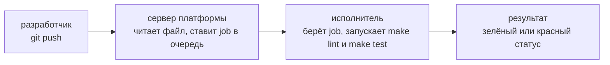
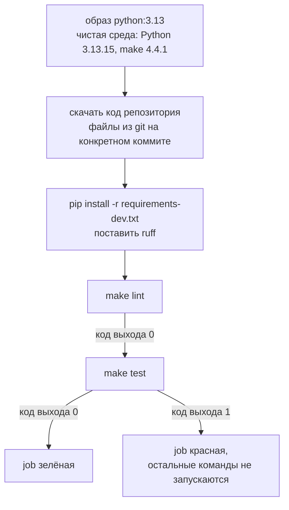
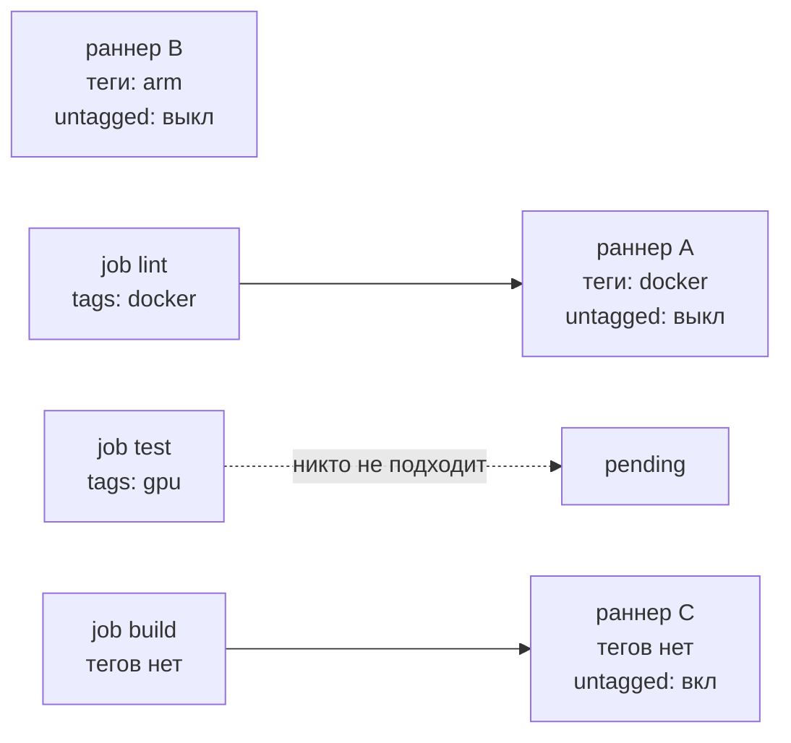
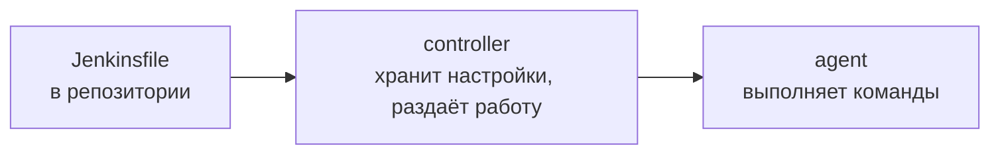
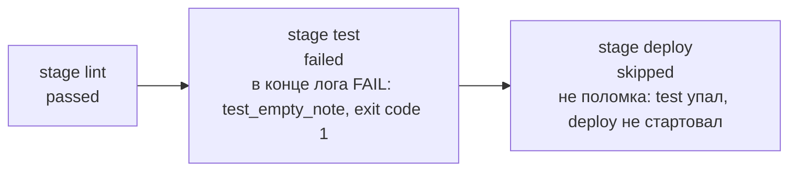
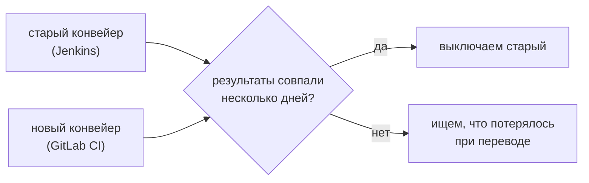

## Зачем это нужно

На собеседовании на DevOps-позицию нередко просят: «перенеси конвейер с Jenkins на GitLab». Звучит страшно, но конвейеры везде одинаковые: по событию взять чистую машину, скачать код, выполнить команды и показать зелёный или красный результат. Меняются только файл и слова.

В [уроке 3.3](03-actions-ci.md) ты настроил на GitHub Actions **конвейер** (pipeline): цепочку автоматических проверок, которая запускается при каждом изменении кода. Называют его так потому, что изменение едет по ленте, как деталь на заводе, и на каждой остановке его проверяет своя «станция». Но в вакансиях чаще встречаются три платформы:

- **GitHub Actions**: живёт внутри GitHub, обслуживает его сам GitHub.
- **GitLab CI**: живёт внутри GitLab, который часто ставят на собственный сервер компании; обслуживает его команда компании.
- **Jenkins**: отдельная программа-сервер, ей больше двадцати лет; её ставят и обслуживают сами.

Команды, которые прогоняет конвейер из прошлого урока, на любой из них одни и те же:

```text
$ make lint
...
All checks passed!
lint: ок
$ make test
...
Ran 6 tests in 0.658s
OK
```

Если обе цели зелёные, проверка прошла. В этом уроке ты перенесёшь тот же конвейер «Заметок» на GitLab CI, поднимешь собственный исполнитель (runner), запустишь Jenkins в Docker и опишешь конвейер в `Jenkinsfile`. Все эти слова разберём в теории. Основным местом жизни проекта останется GitHub.

Читать чужой `Jenkinsfile` инженеру нужно, даже если новые проекты он начинает на другой платформе: за годы вокруг Jenkins накопились сотни сборок и плагинов, переписать их все дорого и рискованно.

Шаг проекта: в `~/notes` появятся `.gitlab-ci.yml` и `Jenkinsfile`. Оба вызывают те же цели `make lint` и `make test` из `Makefile` ([урок 1.6](../01-linux/06-bash-basics.md): файл, где длинные команды получили короткие имена). Логика проверок живёт в одном месте, а платформы только зовут её. Код `app.py` не меняется.

## Что нужно знать

- [Урок 1.6: bash и Make](../01-linux/06-bash-basics.md): цели `make lint` и `make test` из твоего `Makefile` и код выхода команды (0 значит успех). Теперь их запускает не ты, а робот.
- [Урок 3.1: основы Git](01-git-basics.md): коммит, ветка, `git switch`.
- [Урок 3.2: удалённые репозитории](02-remotes-workflow.md): `remote`, `push`, Pull Request (запрос на слияние ветки).
- [Урок 3.3: CI в GitHub Actions](03-actions-ci.md): job (задание: набор команд, который выполняется на чистой машине), runner (машина-исполнитель), кэш (сохранённые между запусками скачанные файлы, чтобы не качать заново). Это эталон, с которым мы сравниваем.
- [Урок 3.4: качество и безопасность в CI](04-quality-security-ci.md): почему секреты нельзя хранить в репозитории.
- [Урок 3.5: релизы](05-release-flow.md): тег как повод запустить конвейер.

Docker в этом уроке нужен для практики. Установка и проверка вынесены в начало практики, шаг «Подготовка: Docker». Что такое образ и контейнер, объясняется прямо ниже, в теории.

## Картина целиком

В конвейере CI четыре роли:

- **Чертёж**: файл в репозитории (`ci.yml`, `.gitlab-ci.yml` или `Jenkinsfile`), в нём написано, что и в каком порядке делать.
- **Диспетчер**: сервер платформы (GitHub, GitLab или Jenkins). Он получает заказ, читает чертёж и раздаёт задания.
- **Рабочий**: исполнитель (runner или agent), программа на машине, которая забирает задание у диспетчера и выполняет его.
- **Цех**: контейнер, то есть чистая изолированная мини-система, которая создаётся на время задания и потом выбрасывается. Поэтому «у меня на машине работает» здесь не проходит.



За урок ты разберёшь каждый кусок схемы: формат YAML, на котором пишут конвейеры; GitLab CI с этапами, jobs и правилами запуска; runner и причину, по которой job висит в очереди; Jenkins с его `Jenkinsfile` на языке Groovy (это язык программирования, поэтому там есть переменные и условия); и принцип «все платформы зовут одни и те же `make`». Потом сделаешь всё руками. Слово «merge request» дальше в уроке это запрос на слияние ветки в GitLab, тот же Pull Request из [урока 3.2](02-remotes-workflow.md).

## Теория

### Что общего у любой CI-платформы

Без CI проверка кода зависит от человека: разработчик должен вспомнить прогнать тесты, а его машина отличается от машины коллеги. Когда проверки исполняет робот на чистой машине при каждом изменении, «работает у меня» превращается в проверяемый факт: работает или нет там, где никто ничего не подправлял руками.

GitLab это сервис хранения кода, такой же, как GitHub, но его часто ставят на собственный сервер компании, где хозяин сам отвечает за работу и безопасность. У GitLab свои встроенные конвейеры, GitLab CI. Jenkins это отдельная программа-сервер автоматизации, она запускает любые скрипты по событиям. Три платформы этого урока делают одну и ту же последовательность:

1. Что-то происходит с репозиторием: пришёл `push` (отправка коммитов), открыт merge request (в GitLab так называется запрос на слияние ветки, то же, что Pull Request на GitHub) или поставлен тег.
2. Сервер платформы находит в репозитории файл конвейера и читает его.
3. Файл описывает **jobs** (задания): «в такой среде выполни такие команды». Сервер ставит их в очередь.
4. Свободный **исполнитель** забирает job. Он создаёт чистую среду, скачивает код репозитория и по очереди выполняет команды.
5. Если каждая команда вернула код выхода 0 (урок 1.6), job зелёная. Любой ненулевой код останавливает job, и она красная. Платформа показывает результат рядом с коммитом.

Чистую среду почти всегда делают из **образа** (image) Docker. Образ это готовый набор файлов: система, Python, нужные программы, упакованные в один архив. **Контейнер** (container) это запущенная из образа изолированная мини-система: у неё свои файлы и процессы, она не видит остальную машину и исчезает после работы. Сама тема образов и контейнеров разобрана в [теме 4](../04-docker/01-containers-idea.md), сейчас нужны только эти два слова.

Возьмём наши две проверки. Что бы ни была за платформа, работа одинакова:



> **Прикинь сам:** GitLab CI, Jenkins и GitHub Actions выглядят по-разному. Что у них одинаково?
{: .predict}

Схема: событие, чтение файла конвейера, раздача job исполнителям, чистая среда, команды, код выхода и статус. Различаются слова и синтаксис.

> **Главное:** любая CI-платформа делает одно: по событию читает файл конвейера, раздаёт job исполнителям и показывает результат по коду выхода.
{: .key}

> **Проверь понимание:** конвейер состоит из одной job с командой `echo "проверка"`. Каким будет результат и о чём это говорит?

<details markdown="1">
<summary>Ответ</summary>

Зелёным: `echo` всегда возвращает код 0. Это показывает главное свойство CI: он верит кодам выхода, а не смыслу. Конвейер, в котором нет настоящих проверок, всегда зелёный и бесполезен.

</details>

Принцип общий, а файлы у всех на YAML (кроме Jenkins). Разберём язык.

### YAML: на каком языке пишут конвейеры

Конвейер должен быть файлом в репозитории, который читают и человек, и программа. Обычный текст читает только человек, а форматы вроде JSON неудобны для глаз (много скобок и кавычек). **YAML** это формат для настроек: структура задаётся не скобками, а отступами, поэтому файл выглядит почти как список дел. В нём написаны `ci.yml` (урок 3.3) и `.gitlab-ci.yml`.

Всего три конструкции:

1. **Ключ и значение** (словарь, mapping): `stage: lint`. Двоеточие и пробел после него обязательны.
2. **Список** (list): строки с дефисом. Каждый пункт это отдельный элемент.
3. **Вложенность**: если строки сдвинуты вправо на два пробела относительно ключа, они принадлежат этому ключу. Табуляции запрещены, только пробелы.

Комментарий начинается с `#`. Список можно записать в одну строку в квадратных скобках: `tags: [docker]` это то же самое, что `tags:` и на следующей строке `  - docker`.

Кусок из нашего конвейера и его перевод на человеческий язык:

```yaml
lint:                      # ключ верхнего уровня: имя job
  stage: lint              # у job есть свойство stage со значением lint
  script:                  # у job есть свойство script, значение это список
    - pip install -r requirements-dev.txt   # первый элемент списка
    - make lint                              # второй элемент
```

Читается так: «существует job `lint`; она относится к этапу `lint`; её команды: сначала `pip install ...`, потом `make lint`». Сдвинуть `script` влево на два пробела значит объявить его как отдельную job, и GitLab ответит ошибкой, что у job нет команд. Все отступы в курсе по два пробела.

> **Прикинь сам:** в `.gitlab-ci.yml` перепутаны отступы у `script:`. Чем это грозит?
{: .predict}

Файл прочтётся иначе или вообще не разберётся: вложенность в YAML задают отступы, и команды окажутся не там, где нужно.

Есть две ловушки. Первая: двоеточие внутри значения. Строка `- echo "итог: ok"` сломает разбор, если её не взять в кавычки целиком: YAML увидит `итог:` с пробелом и решит, что это новый ключ. Правильно `- 'echo "итог: ok"'`. Вторая: многострочные команды. Знак `|` после ключа говорит «дальше идёт текст как есть, со всеми переводами строк», так делают, когда нужно несколько команд в один шаг. Ты встретишь это позже в `Jenkinsfile`, где у того же приёма другой синтаксис (тройные кавычки).

> **Главное:** в YAML смысл задают отступы, и один и тот же синтаксис используют GitLab CI и GitHub Actions.
{: .key}

> **Проверь понимание:** чем отличаются `tags: [docker]` и `tags: docker`?

<details markdown="1">
<summary>Ответ</summary>

Первое это список из одного элемента `docker`, второе просто строка. GitLab ждёт для `tags` именно список, поэтому вторая запись даст ошибку валидации (проверки формата). Общее правило: если в документации ключ принимает несколько значений, пиши список.

</details>

Язык общий, а слова разные. Сравним три платформы.

### Три платформы, три словаря

Одни и те же вещи на трёх платформах названы по-разному. Таблица нужна для одного: переводить знакомое с одной платформы на другую. Со словарём в руках перенос конвейера сводится к переводу.

| Идея | GitHub Actions | GitLab CI | Jenkins |
|---|---|---|---|
| Файл конвейера | `.github/workflows/ci.yml` (файлов может быть много) | `.gitlab-ci.yml` (один, в корне) | `Jenkinsfile` (в корне, путь настраивается) |
| Весь конвейер | workflow | pipeline | Pipeline |
| Единица работы | job | job | stage (внутри неё `steps`) |
| Кто исполняет | runner (GitHub-hosted или свой) | runner (общий или свой) | agent (узел, подключённый к controller) |
| Когда запускать | `on:` | `rules:` | `when {}` и триггеры в настройках job |

Полный словарь с остальными строками (порядок, среда, файлы между jobs, кэш, секреты) лежит в конце теории как шпаргалка. Слово `executor` значит «способ запуска команд на раннере» (например, в контейнере `docker`), а `controller` и `stage` разбираются в разделе про Jenkins.

Переведём кусок из `ci.yml` урока 3.3 на язык GitLab. Там было: job `lint` с `runs-on: ubuntu-24.04` и шагом `run: make lint`. В GitLab «шаг `run`» превращается в элемент списка `script`, а `runs-on` (какая машина) заменяется на `image` (в каком образе). Получается job с `image: python:3.13` и `script: [make lint]` (плюс установка зависимостей перед ним). Всю разницу составляют названия ключей.

> **Прикинь сам:** как называются у GitLab CI и Jenkins то, что GitHub Actions называет `job` и `runner`?
{: .predict}

У GitLab job остаётся job, а runner тот же. У Jenkins этап это `stage`, а исполнитель `agent`. Понятия те же, слова другие.

Слово job в Jenkins значит другое. Там «job» (или «item») это вся настроенная сборка целиком, а то, что в GitHub и GitLab называется job, называется stage. Читая чужую документацию, проверяй, о какой платформе речь.

> **Главное:** слова разные, а понятия те же: событие, файл конвейера, job или stage, исполнитель, код выхода.
{: .key}

> **Проверь понимание:** как в GitLab CI выразить то, что в Actions делает `needs: lint`?

<details markdown="1">
<summary>Ответ</summary>

Два способа. Обычный: положить jobs в разные `stages`, тогда этап `test` начнётся только после успеха всех jobs этапа `lint`. Точный: ключ `needs: [lint]` в job, тогда она стартует сразу после `lint`, не дожидаясь остальных jobs этапа.

</details>

Начнём с GitLab CI: stages, jobs и правила.

### GitLab CI: stages, jobs, порядок и правила

Проверки нужно упорядочить: нет смысла гонять тесты, если код даже не запускается, а дешёвые проверки должны идти раньше дорогих. Ещё нужно управлять запуском: не тратить машины на каждую ветку-черновик.

Весь конвейер лежит в одном файле `.gitlab-ci.yml` в корне репозитория. Верхний уровень файла состоит из четырёх видов ключей:

- `stages` (этапы): список названий в порядке выполнения;
- общие настройки: `default` (значения для всех job: `image`, `cache` и другие) и `variables` (переменные);
- jobs: любой ключ верхнего уровня, внутри которого есть `script`. Имя job это просто твой ключ (`lint`, `test`), а не зарезервированное слово;
- служебные ключи вроде `workflow` и `include` (подключить чужой файл), их мы сейчас не трогаем.

Правила порядка:

1. Этапы идут строго друг за другом по списку `stages`.
2. Все jobs одного этапа стартуют параллельно (если хватает исполнителей).
3. Если хоть одна job этапа красная, следующие этапы не запускаются, а их jobs остаются серыми (skipped, «не запускалась»).
4. Job без ключа `stage` попадает в этап `test`. Если `stages` не задан, набор по умолчанию такой: `.pre`, `build`, `test`, `deploy`, `.post`.

Главные ключи внутри job:

| Ключ | Что делает |
|---|---|
| `stage` | в каком этапе идёт job |
| `image` | образ Docker, в котором выполняется `script` |
| `script` | список команд; ненулевой код выхода любой команды делает job красной |
| `rules` | условия запуска (когда job создавать) |
| `tags` | какой исполнитель может взять job (разобрано в следующем разделе) |

**Правила запуска (`rules`).** Без них GitLab создаёт конвейер на каждый `push` в любую ветку. С `rules` ты описываешь условия списком; GitLab читает их сверху вниз и берёт первое подошедшее. Условие пишется как `if:` с выражением на переменных GitLab. Нужные нам переменные GitLab подставляет сам (их называют предопределёнными). Две из них:

| Переменная | Значение (пример) |
|---|---|
| `CI_PIPELINE_SOURCE` | откуда взялся конвейер: `push`, `merge_request_event`, `schedule`... |
| `CI_COMMIT_BRANCH` | имя ветки, для которой идёт конвейер: `ci/gitlab` |

Ещё две GitLab подставляет так же: `CI_DEFAULT_BRANCH` (ветка проекта по умолчанию, у нас `main`) и `CI_PROJECT_DIR` (папка внутри контейнера, куда скачан код; она понадобится в разделе про кэш).

Если ни одно правило не подошло, job в конвейер не попадает; если не подошло ни одной job, конвейера нет вообще.

Правила из нашего файла:

```yaml
rules:
  - if: $CI_PIPELINE_SOURCE == "merge_request_event"   # (1)
  - if: $CI_COMMIT_BRANCH == $CI_DEFAULT_BRANCH        # (2)
```

Три ситуации:

- push в ветку `ci/gitlab`, merge request ещё нет: (1) source = `push`, а не `merge_request_event`, не подошло; (2) `ci/gitlab` не равна `main`, не подошло. Job не создаются, конвейера нет, минуты исполнителей не тратятся;
- тот же push, но merge request открыт: (1) source = `merge_request_event`, подошло, конвейер идёт;
- push в `main`: (2) `main` равна `main`, подошло, конвейер идёт.

> **Прикинь сам:** push в ветку без открытого merge request при правилах `merge_request_event` и `main`. Создастся ли конвейер?
{: .predict}

Нет: ни одно правило не подошло, job не создаются, минуты исполнителей не тратятся. После открытия merge request конвейер пойдёт.

Правила `rules` заменили старые ключи `only` и `except`, они устарели, поэтому в новых файлах пишут `rules`. Кроме этапов в GitLab есть ключ `needs`: он строит точечные зависимости между job в обход этапов, мы его не используем.

> **Главное:** stages задают порядок, jobs внутри одного этапа идут параллельно, а правила решают, создавать ли job.
{: .key}

> **Проверь понимание:** в конвейере две job без `stage:`, и `stages:` не задан. Сколько этапов и как они пойдут?

<details markdown="1">
<summary>Ответ</summary>

Обе job попадут в этап `test` по умолчанию и пойдут параллельно, если исполнителей хватает. Один этап, порядка между ними нет. Поэтому явное `stages:` в проекте лучше писать: читателю сразу видно порядок.

</details>

Конвейер идёт, но долго ставить пакеты. Как ускорить и что передать? Кэш и переменные.

### Кэш и переменные в GitLab CI

Каждая job стартует в новом контейнере, где ничего нет. Если каждый раз скачивать из интернета все пакеты Python, конвейер будет медленным и будет зависеть от чужих серверов. **Кэш** (cache) это папка, которую GitLab сохраняет после job и подкладывает в следующую. **Переменные** (variables) нужны, чтобы настройки не копировать по файлу.

Программа `pip` (установщик библиотек Python) сама хранит скачанные пакеты в папке кэша. Через переменную `PIP_CACHE_DIR` можно указать, где эта папка. GitLab умеет кэшировать только пути внутри папки проекта (`$CI_PROJECT_DIR`), а домашний каталог пользователя внутри контейнера он не видит. Поэтому мы кладём кэш pip в `.cache/pip` внутри проекта, а в блоке `cache:` просим GitLab сохранить именно этот путь.

`key` это имя кэша: пока ключ прежний, кэш подкладывается, а разные ключи дают разные кэши.

Мы считаем ключ по файлу `requirements-dev.txt` (`key: files:`): изменились зависимости, значит, файл другой, ключ новый, и кэш начинается заново, а старые пакеты не копятся.

Кусок нашего файла:

```yaml
variables:
  PIP_CACHE_DIR: "$CI_PROJECT_DIR/.cache/pip"    # (1) где pip хранит скачанное
default:
  cache:
    key:
      files:
        - requirements-dev.txt                   # (2) имя кэша считается по хешу этого файла
    paths:
      - .cache/pip                               # (3) что сохранить и вернуть
```

Первый запуск: `.cache/pip` пуст, pip скачивает `ruff` из интернета (около 10 МБ) и пишет в кэш; после job GitLab упаковывает папку. Второй запуск: GitLab распаковывает кэш до начала `script`, pip находит `ruff` в кэше и не скачивает. Значение переменной `$CI_PROJECT_DIR` подставляется в строку автоматически, в контейнере это, например, `/builds/anna/notes`.

> **Прикинь сам:** кэш пакетов не сработал. Сломается ли конвейер?
{: .predict}

Нет: пакеты скачаются заново, конвейер станет дольше, но результат тот же.

Не путай кэш и артефакт. Кэш это оптимизация: его можно потерять, и конвейер обязан пройти без него. Артефакт (`artifacts`) это результат job, который нужен людям или следующим job (отчёт, собранный архив). Если положить в кэш то, без чего следующий этап не работает, однажды кэш пропадёт, и конвейер сломается.

> **Главное:** кэш ускоряет, переменные задают настройки, а секреты хранят в защищённых переменных, а не в файле.
{: .key}

**Что ещё встретишь на работе.** Кэши веток разных уровней доверия не смешивают: код из чужого merge request не должен подложить свои пакеты в кэш `main`. Поэтому в настройках проекта (Settings, CI/CD) есть пункт про отдельные кэши для защищённых (protected) веток; на боевом проекте проверь, что он включён.

> **Проверь понимание:** зачем `PIP_CACHE_DIR` внутри `$CI_PROJECT_DIR`, а не в `~/.cache/pip`?

<details markdown="1">
<summary>Ответ</summary>

GitLab сохраняет в кэш только пути внутри папки проекта. Стандартный `~/.cache/pip` лежит вне проекта, поэтому он исчезал бы вместе с контейнером после каждой job, и кэш был бы бесполезен.

</details>

Кто выполняет job? Разберём runner и executor.

### Runner и executor: кто на самом деле выполняет job

Сервер GitLab только хранит код и раздаёт задания, сам команды он не выполняет. Если бы выполнял, один тяжёлый конвейер положил бы весь сервер, а чужой код в конвейере получил бы доступ к серверу с кодом всей компании. Поэтому исполнителей выносят отдельно: это программа **GitLab Runner** (раннер), которая ставится на любую машину.

GitLab раздаёт задания, а раннер сам берёт подходящее по тегам. Если подходящего раннера нет, job ждёт.

Важная деталь: **runner сам приходит к серверу**, а не сервер к runner. Раннер каждые несколько секунд спрашивает у GitLab «есть работа для меня?». Поэтому раннер можно поставить за домашним роутером или файрволом компании, входящих подключений ему не нужно. Порядок:

1. Ты создаёшь раннер в интерфейсе GitLab и получаешь **токен** (token) вида `glrt-...`. Токен это длинный секретный пароль: по нему сервер понимает, что это твой раннер. Показывается один раз.
2. На своей машине ты запускаешь программу runner и **регистрируешь** её: сообщаешь адрес GitLab и токен. Настройки сохраняются в файле `config.toml`.
3. Раннер опрашивает GitLab. Появилась подходящая job, раннер забирает её.
4. Способ исполнения определяет **executor** (исполнитель в узком смысле): как именно запускать команды. Вариантов несколько: `docker` (на каждую job создаётся новый контейнер из `image` из файла, самый частый вариант), `shell` (команды выполняются прямо в системе раннера, без изоляции), `kubernetes` (под на job, тема 5).
5. Команды выполнены, раннер отправляет в GitLab лог и статус.

**Как раннер выбирает job: теги.** Раннер может быть **общим** (shared: его предоставляет платформа, им пользуются все проекты) или **своим** (project или group runner: он привязан к твоему проекту). У раннера есть **теги** (tags): метки вроде `docker`, `arm`, `gpu`. У job тоже может быть `tags:`. Правило простое:

| У job | Что произойдёт |
|---|---|
| есть `tags: [docker]` | job возьмёт только раннер, у которого есть тег `docker` |
| нет `tags` | job возьмёт раннер с включённой опцией «Run untagged jobs» (выполнять job без тегов) |
| подходящего раннера нет | job не падает и не ругается, а ждёт в статусе `pending` |

Три раннера и три job:



Через минуту в интерфейсе у `test` появится подпись `This job is stuck because of one of the following problems. There are no active runners online, no runners for the protected branch, or no runners that match all of the job's tags: gpu`. Это не поломка кода, это отсутствие исполнителя.

> **Прикинь сам:** у job `tags: [gpu]`, раннеров с таким тегом нет. Что произойдёт?
{: .predict}

job не упадёт, а будет ждать в статусе `pending`: подходящего исполнителя нет.

Статус `pending` значит «никто не взялся», а не «упал» и не «идёт долго». Раннер и executor не одно и то же: раннер это программа, а executor её режим работы (docker, shell, kubernetes). Executor `docker` использует Docker на машине раннера, чтобы создавать контейнеры для job, поэтому Docker на этой машине должен стоять.

> **Главное:** runner это программа, берущая job, а executor способ запуска (например, docker): job находит раннер по тегам.
{: .key}

> **Проверь понимание:** ты добавил в job `tags: [docker]`, а раннер зарегистрирован без тегов и с выключенной опцией «Run untagged jobs». Что покажет pipeline?

<details markdown="1">
<summary>Ответ</summary>

Pending. Job требует раннер с тегом `docker`, такого нет, а раннер без тегов job с тегами не берёт (он берёт только untagged, и то если опция включена, а у нас выключена). Ошибки нет, job просто ждёт.

</details>

Исполнитель получает чужой код и секреты. Что с безопасностью?

### Безопасность CI: секреты, docker.sock и чужой код

CI выполняет команды из репозитория, значит любой, кто может изменить файл конвейера, может заставить твою машину выполнить что угодно. Кроме того, конвейеру часто нужны секреты для деплоя. Оба факта делают CI привлекательной мишенью.

Три опасных места:

1. **Секреты.** Их не кладут в репозиторий (урок 3.4). В GitLab они живут в Settings, CI/CD, Variables. Флаг `masked` прячет значение в логах (заменяет на `[MASKED]`). Флаг `protected` отдаёт переменную только защищённым веткам и тегам: конвейер обычной ветки её не увидит.
2. **Чужой код.** Merge request из чужого форка (копии репозитория) содержит чужой `.gitlab-ci.yml`. Если такой конвейер идёт на твоём раннере с доступом к секретам и внутренней сети, автор может вывести секрет или сканировать сеть. Защита: protected-переменные недоступны форкам, форки идут на отдельные раннеры без доступа внутрь, деплой запускается только с main и по тегам.
3. **Сокет Docker.** Файл `/var/run/docker.sock` это дверь, через которую программы командуют демоном Docker (фоновой службой, которая создаёт контейнеры). Кто получил эту дверь, может запустить контейнер с любой папкой хоста внутри, включая корень диска. Он становится фактически root: так называют пользователя с полными правами на машине, «мастер-ключ от всех дверей». Поэтому любая job (а значит, любой, кто может изменить конвейер) получает власть над всей машиной раннера и всем, что на ней лежит. Мы монтируем сокет в контейнеры раннера и Jenkins только на учебном стенде, где на машине нет ничего ценного.

Что делает владелец сокета, одной командой:

```bash
docker run --rm -v /:/host alpine cat /host/etc/shadow
```

Флаг `-v /:/host` показывает внутри контейнера весь диск хозяина в папке `/host`, и команда читает файл с хешами паролей пользователей. Это не взлом: Docker выполнил просьбу, ведь у просившего есть сокет. Именно поэтому доступ к сокету приравнивают к root. В боевой среде вместо сокета берут один из вариантов:

| Вариант | Что даёт |
|---|---|
| rootless Docker или Podman | демон работает без прав root, побег из контейнера даёт права обычного пользователя |
| сборка образов без демона на хосте (BuildKit, kaniko, buildah) | образ собирается без доступа к сокету (см. [тему 4](../04-docker/index.md)) |
| одноразовые раннеры и виртуальные машины | после job машина удаляется, ничего ценного на ней не хранится |

И последнее: Jenkins и GitLab не открывают в интернет без TLS (шифрованного соединения HTTPS) и входа по логину и паролю. Иначе любой прохожий сможет запускать на твоей машине свои команды.

> **Прикинь сам:** в job подключён `/var/run/docker.sock`. Почему это опасно?
{: .predict}

Тот, кто может запускать команды в job, управляет Docker хоста и фактически получает права над самим сервером.

Не считай `masked` шифрованием: это только вырезание значения из логов, и если команда выведет секрет в закодированном виде (например, через `base64`), маска его не узнает. И не решай проблему прав командой `chmod 666 /var/run/docker.sock`: она открывает root-дверь всем пользователям машины.

> **Главное:** исполнитель запускает чужие команды, поэтому секреты выдают минимально, а доступ к `docker.sock` равен доступу к хосту.
{: .key}

> **Проверь понимание:** почему нельзя отдавать раннеру с монтированием `docker.sock` пайплайны из форков?

<details markdown="1">
<summary>Ответ</summary>

Автор форка пишет в конвейере любую команду, в том числе `docker run -v /:/host ...`. Через сокет она выполнится с правами root на машине раннера: чужой человек прочитает секреты, диски и получит доступ во внутреннюю сеть.

</details>

Теперь Jenkins: у него другой словарь.

### Jenkins: controller, agent и Jenkinsfile

Jenkins появился раньше GitHub Actions и GitLab CI и работает независимо от места хранения кода: он умеет брать код откуда угодно и запускать что угодно. Поэтому в компаниях с разнородной инфраструктурой он живёт десятилетиями. Платить за это приходится обслуживанием: Jenkins ты ставишь, обновляешь и бэкапишь сам.

Jenkins написан на Java. Две роли:

- **controller** (контроллер, раньше «master»): главный сервер с веб-интерфейсом. Хранит настройки и историю сборок, раздаёт задания;
- **agent** (агент, узел): машина или контейнер, который исполняет команды сборки. Аналог runner. Агентом может быть и сам controller (так сделано в этом уроке), но в боевых установках controller чужой код не исполняет.



Всё состояние controller лежит в каталоге **`JENKINS_HOME`** (в Docker это том `jenkins_home`): настройки, пароли, история. Потеряешь без бэкапа, потеряешь всё.

Возможности даёт набор **плагинов** (Pipeline, Git, Docker Pipeline): расширений, которые ты ставишь и обновляешь сам. Через них чаще всего находят уязвимости, и необновлённый плагин может стать дверью для взлома.

Сборку описывает файл **`Jenkinsfile`** в репозитории (подход «Pipeline as code», конвейер как код). Он написан на Groovy. Jenkinsfile бывает двух видов, мы пишем жёсткий вариант, **declarative**: в нём блоки `pipeline`, `stages`, `steps`. Блоки ограничены скобками `{ }`, а команды лежат в `sh '...'` (одна команда) или `sh '''...'''` (несколько, тройные кавычки).

Строка `agent { docker { image '...' } }` просит Jenkins выполнять стадии внутри контейнера из образа: это аналог `image:` в GitLab. Как именно это устроено, разберём в практике, когда увидим работу вживую. Наш `Jenkinsfile` в сокращённом виде (схема, полный текст в практике):

```text
pipeline {                                       // весь конвейер
    agent { docker { image 'python:3.13' } }     // где выполнять: контейнер python:3.13
    options { timeout(time: 10, unit: 'MINUTES') }   // предел: 10 минут на всю сборку
    stages {                                     // список этапов
        stage('Lint') { steps { sh '...' } }     // этап Lint: команды в sh
        stage('Test') { steps { sh 'make test' } }   // этап Test
    }
}
```

Порядок этапов в Jenkins всегда последовательный (сверху вниз), красный этап останавливает остальные. Это аналог `stages` в GitLab, только для параллельности нужен отдельный блок `parallel`.

> **Прикинь сам:** что в Jenkins выполняет команды: controller или agent?
{: .predict}

Agent: controller планирует и хранит настройки, а команды идут на agent.

Настройка «кликами» в веб-интерфейсе и `Jenkinsfile` неравноценны: клики живут только в `JENKINS_HOME`, при потере сервера конвейер пропадает, а ревью и истории изменений нет. Файл же версионируется вместе с кодом (урок 3.1).

> **Главное:** controller управляет, agent выполняет, а конвейер описывает Jenkinsfile.
{: .key}

> **Проверь понимание:** почему `Jenkinsfile` в репозитории лучше, чем job, настроенная кликами в веб-интерфейсе?

<details markdown="1">
<summary>Ответ</summary>

Файл версионируется вместе с кодом: видно, кто и когда менял конвейер, работают Pull Request и ревью, старую ветку можно собрать старым конвейером, при потере сервера конвейер не пропадает. Клики в интерфейсе живут только в `JENKINS_HOME`.

</details>

**Что ещё встретишь на работе** (в курсе не разбираем, но названия полезно знать):

- Jenkins: хранилище **Credentials** (секреты подставляют в сборку, а не пишут в `Jenkinsfile`), **Script Security** и sandbox (ограничения для скриптов на Groovy), **shared libraries** (общий код для многих `Jenkinsfile`), динамические агенты в Kubernetes.
- GitLab CI: `workflow:rules` (чтобы не запускались два конвейера на одну и ту же правку: для ветки и для merge request), `include` и шаблоны (общие куски конфигурации), protected environments (деплой только по разрешению).

У трёх платформ одни и те же команды. Как не дублировать их? Через make.

### Одни и те же команды в трёх местах: make как единый источник

Если правило «что значит проверка прошла» записано в трёх файлах отдельно (`ci.yml`, `.gitlab-ci.yml`, `Jenkinsfile`), рано или поздно они разойдутся: в одном линтер обновят, в другом забудут, и зелёный статус на одной платформе не будет значить того же, что на другой. Решение: конвейер только вызывает короткие имена целей из `Makefile`, а что они делают, записано в одном месте.

В `Makefile` (уроки 1.6, 3.3 и 3.4) есть цели `lint` (`py_compile`, затем `python3 -m ruff check .`, в конце `echo "lint: ок"`), `test` (`python3 -m unittest -v`) и `run` (запуск сервиса). Конвейеры GitLab и Jenkins вызывают `make lint` и `make test`; ruff ставится через `requirements-dev.txt` (урок 3.3), отдельно его запускать не нужно. Для этого в образе должен быть `make`. В маленьком образе `python:3.13-slim` его нет (`sh: 1: make: not found`), в полном `python:3.13` есть (GNU Make 4.4.1). Мы берём полный образ; цена: он весит около 1 ГБ и тянется один раз, дальше лежит в кэше раннера.

Цель `make run` запускает сам сервис, а не проверку, поэтому в CI её не вызывают.

> **Прикинь сам:** в `.gitlab-ci.yml`, `Jenkinsfile` и `ci.yml` по одной команде. Что случится, если поменять только одну?
{: .predict}

Платформы разойдутся: одна проверит по-новому, две по-старому. Если команда одна (`make test`), правка в `Makefile` меняет всё сразу.

Технически `make` в CI не обязателен, но без него команды дублируются в трёх файлах. И `make lint` проверяет не только синтаксис: он запускает обе проверки, `py_compile` ловит синтаксические ошибки, а `ruff` ловит стиль и неиспользуемые импорты.

> **Главное:** команды проверки живут в `Makefile`, а файлы платформ только вызывают их, чтобы не расходиться.
{: .key}

> **Проверь понимание:** завтра ты меняешь правила линтера. В скольких файлах это нужно править, если конвейеры вызывают `make lint`, а в нём `ruff check .`?

<details markdown="1">
<summary>Ответ</summary>

В одном: в `Makefile` (плюс в `ruff.toml` для самих правил). GitLab и Jenkins продолжают вызывать `make lint` и получают новое поведение автоматически. Если бы команды были размножены по трём файлам, править пришлось бы в трёх, и о четвёртом легко забыть.

</details>

Команды едины. Какую платформу выбрать? Зависит от ситуации.

### Когда что выбирают

Инженер должен уметь объяснить руководителю, почему для проекта выбрана та или иная платформа, и понимать, какая цена у выбора.

Решение складывается из четырёх факторов: где живёт код, кто обслуживает платформу, сколько исполнителей нужно и что уже накоплено.

- **GitHub Actions**: код на GitHub, платформой занимается GitHub, исполнители его же или свои. Меньше всего обслуживания.
- **GitLab CI**: встроен в GitLab. Репозиторий, реестр образов, окружения и конвейеры в одной системе, поэтому его выбирают компании со своим GitLab внутри контура (в закрытой сети). Раннеры обслуживаются отдельно.
- **Jenkins**: не привязан к месту хранения кода, гибкий, но всё обслуживание на тебе: сервер, плагины, обновления, бэкапы.

Компания с сотней старых сборок на Jenkins и десятком нестандартных плагинов вряд ли перепишет всё за месяц. Разумный путь: новые проекты сразу на GitLab CI, старые переносить по одному, обе системы держать параллельно, пока не убедились, что результат совпадает (об этом вопрос 8 собеседования).

> **Прикинь сам:** код лежит на GitHub, команда небольшая. Какую платформу взять первой?
{: .predict}

GitHub Actions: он уже встроен в платформу, где лежит код, и не требует отдельного сервера. Jenkins берут, когда нужна полная свобода и свой сервер.

Многие думают, что Jenkins «устарел и не нужен». Это не так: он остаётся очень распространённым, и читать чужие `Jenkinsfile` ты должен уметь. Для нового проекта его обычно не выбирают из-за стоимости обслуживания, но он никуда не исчез.

> **Главное:** платформу выбирают по тому, где лежит код, кто будет её обслуживать и какие требования у компании.
{: .key}

> **Проверь понимание:** код проекта лежит на GitHub, обслуживать отдельные серверы некому. Что разумнее выбрать и почему?

<details markdown="1">
<summary>Ответ</summary>

GitHub Actions: код уже на GitHub, платформа обслуживается провайдером, исполнители общие. GitLab потребовал бы переезда или зеркала репозитория, а Jenkins ещё и своего сервера с обслуживанием.

</details>

Платформа выбрана. Как читать результат её запуска?

### Как читать запуск конвейера: статусы и где искать причину

На каждой платформе у запуска десяток статусов. Новичок видит красный или серый значок и не знает, сломался ли его код, упал сам сервер или задание просто ещё ждёт. От этого зависит, что делать дальше: чинить код, чинить раннер или подождать.

Статус показывает, виноват ли твой код или инфраструктура, но не причину: причина лежит в логе.

У конвейера GitLab и у каждого job свой статус. Вот главные и что за ними стоит:

| Статус | Что значит | Чья это проблема |
|---|---|---|
| `pending` (ожидает) | job создана, но раннер её ещё не взял | инфраструктура: нет подходящего раннера, он выключен или не совпали теги |
| `running` (идёт) | раннер выполняет `script` | ничья, просто подожди |
| `passed` (прошла) | все команды вернули код 0 | всё хорошо |
| `failed` (упала) | какая-то команда вернула ненулевой код | чаще твой код или команды, иногда сеть |
| `skipped` (пропущена) | job не запускалась: этап перед ней упал или `rules` не подошли | смотри, что упало раньше |
| `canceled` (отменена) | её остановили руками или новый коммит заменил запуск | обычно не проблема |

Помнишь две цели из начала урока? Вот как они выглядят в журнале одной задачи GitLab: исполнитель берёт чистый образ, скачивает коммит, ставит зависимости и прогоняет `make lint` и `make test` (пример по формату, у тебя номера и время будут свои).

```text
Running with gitlab-runner 19.4.1 (3c39fceb) on notes-runner xYz12AbC
Preparing the "docker" executor
Fetching changes... Checking out e5a91c2 as detached HEAD
$ pip install -r requirements-dev.txt
$ make lint
All checks passed!
lint: ок
$ make test
Ran 6 tests in 0.658s
OK
Job succeeded
```

Идти за причиной нужно по цепочке: конвейер, этап, job, лог. Открываешь конвейер, находишь красную job и читаешь **конец** её лога: команду, которая упала, и код выхода (в GitLab в конце строка вроде `ERROR: Job failed: exit code 1`). Всё, что выше, контекст: скачивание образа, код, команды до ошибки.



Конвейер висит уже десять минут, job `lint` в статусе `pending`. Код ни при чём: job ещё даже не начала выполняться, значит, команды не запускались. Смотрим раннеры проекта: нужная job просит `tags: [docker]`, а у единственного раннера тег `shell`. Подходящего раннера нет, job будет ждать вечно (до таймаута GitLab). Правим теги или добавляем раннер: код менять не нужно. Противоположный случай: job `failed` через 20 секунд, в конце лога `ruff: command not found`. Раннер работает, job выполнилась, но в образе нет нужной программы: причина в шаге `pip install` или в образе, а не в инфраструктуре.

> **Прикинь сам:** в конвейере `lint` passed, `test` failed, `deploy` skipped. Где искать причину?
{: .predict}

В `test`: открыть лог и найти первую ошибку. `deploy` пропущен, потому что упал `test`, это не поломка.

Серая job (`skipped`) не ошибка: она не запускалась, потому что перед ней что-то упало, так что ищи первую красную, а не серые. И `failed` не всегда значит «виноват мой код»: бывает, что упало скачивание пакетов из-за сбоя сети, и лог покажет таймаут или `connection refused`. Тогда повторный запуск (Retry) обоснован, а вот повторять без чтения лога нельзя.

> **Главное:** причина красного всегда в первой упавшей job, а `skipped` значит, что job не запускалась.
{: .key}

> **Проверь понимание:** в конвейере `lint` красная, `test` серая. Где искать причину и что означает серый цвет?

<details markdown="1">
<summary>Ответ</summary>

Причина в `lint`: открой её лог и прочитай конец. Серая `test` не запускалась, потому что этап `lint` упал, а следующие этапы стартуют только после успеха предыдущего. Чинишь `lint`, и `test` пойдёт сама.

</details>

Остался перенос конвейера между платформами.

### Как переносить конвейер с одной платформы на другую

В реальной работе чаще приходится не писать конвейер с нуля, а переезжать: компания меняет Jenkins на GitLab или GitLab на GitHub. Если делать это «переписыванием всего подряд», половина проверок теряется по дороге, а красные результаты невозможно сравнить со старыми.

Надёжный порядок из пяти шагов:

1. **Инвентаризация.** Выписываешь по старому конвейеру: какие проверки есть, в каком порядке, какие нужны образы, секреты, кэши, по каким событиям запуск (по push, по тегу, по расписанию).
2. **Вынос логики в скрипты.** Команды проверок должны жить в репозитории (`make lint`, `make test`), а не в полях платформы. Тогда новая платформа лишь вызывает их. Именно поэтому в этом уроке всё сводится к `make`.
3. **Перевод по таблице соответствий.** Берёшь таблицу «Три платформы, три словаря» (полная версия в шпаргалке ниже) и заменяешь ключи: job, образ, `script`, правила запуска, кэш.
4. **Параллельный запуск.** Старый и новый конвейеры работают на одних и тех же коммитах. Результаты должны совпасть: если старый красный, а новый зелёный, значит, в переводе что-то потерялось.
5. **Переключение и удаление старого.** Только после нескольких дней совпадающих результатов новый делают обязательным, а старый отключают.



В Jenkins есть stage `Lint`, внутри `sh 'make lint'`, stage `Test` с `sh 'make test'` и тег `v*` как повод запуска. Переносим на GitLab. Инвентаризация даёт две проверки и одно правило запуска. Логика уже в `make`, поэтому переводить нечего, кроме оболочки: `stage Lint` превращается в job `lint` с `script: [make lint]`, `agent { docker { image ... } }` в `image: python:3.13`, условие на тег в `rules: - if: $CI_COMMIT_TAG`. Секреты и права переносят отдельно и руками: значения из Credentials Jenkins автоматически не переедут, их заводят заново в CI/CD variables.

> **Прикинь сам:** новый конвейер заработал. Можно ли сразу выключить старый?
{: .predict}

Нет: сначала запускают оба и сравнивают результаты несколько дней. Выключают старый, когда они совпали.

Многие думают, что перенести значит скопировать файл и поправить ключи. Это не так: синтаксис меньшая часть работы. Главные потери при переезде: секреты (забыли завести), права доступа (раннер без доступа к реестру), кэш (первый запуск в десять раз дольше), поведение при ошибках (там, где Jenkins продолжал, GitLab остановится). Поэтому параллельный запуск обязателен.

> **Главное:** перенос идёт параллельно: старый и новый работают вместе, пока результаты не совпадут.
{: .key}

> **Проверь понимание:** зачем перед переносом выносить логику проверок в `Makefile`?

<details markdown="1">
<summary>Ответ</summary>

Тогда платформа только вызывает `make lint` и `make test`, и смена платформы не затрагивает сами проверки: они описаны в одном месте и работают одинаково у тебя на машине и в любом CI. Без этого команды пришлось бы переписывать внутри полей каждой платформы, и легко потерять шаг.

</details>

### Шпаргалка: словарь трёх платформ целиком

Полная таблица соответствий, к ней удобно возвращаться при переносе.

| Идея | GitHub Actions | GitLab CI | Jenkins |
|---|---|---|---|
| Файл конвейера | `.github/workflows/ci.yml` | `.gitlab-ci.yml` | `Jenkinsfile` |
| Весь конвейер | workflow | pipeline | Pipeline |
| Единица работы | job | job | stage (внутри неё `steps`) |
| Порядок | `needs:` между jobs | `stages:` (jobs одного этапа идут параллельно) | stages идут по порядку, параллель через `parallel` |
| Кто исполняет | runner | runner | agent |
| Среда | `runs-on:` | `image:` (для docker executor) | `agent { docker { image '...' } }` |
| Когда запускать | `on:` | `rules:` | `when {}` и триггеры в настройках job |
| Файлы между jobs | artifacts | `artifacts:` | `archiveArtifacts` |
| Кэш | `actions/cache` | `cache:` | кэш на агенте или том Docker |
| Секреты | Secrets | CI/CD variables (masked, protected) | Credentials |

Теории хватит. Дальше практика: собираем конвейеры.

## Практика

Понадобятся: репозиторий `~/notes` с `Makefile`, `test_app.py` (урок 1.6), `requirements-dev.txt` и `ruff.toml` (урок 3.3), аккаунт на gitlab.com (бесплатный) и Docker.

### Подготовка: Docker

Если Docker Engine (программа, которая запускает контейнеры) ещё не стоит, поставь его по официальной инструкции для Ubuntu на docs.docker.com/engine/install/ubuntu (через apt-репозиторий, без `curl | bash`). Затем разреши своему пользователю работать с Docker без `sudo`, выйди из системы, войди снова и проверь:

```bash
sudo usermod -aG docker $USER
docker run --rm hello-world
```

Если вместо приветствия `permission denied while trying to connect to the Docker daemon socket`, твой пользователь пока не в группе `docker`: `usermod` не сработал или ты не перезашёл в систему. Эта группа даёт права почти как у root, об этом речь в разделе про безопасность.

### Проверка заготовок

Проверь, что нужное на месте:

```bash
cd ~/notes
ls Makefile test_app.py requirements-dev.txt ruff.toml
docker --version
```

Разбор: `ls` со списком файлов печатает их же, если все существуют, и ругается на отсутствующие (`No such file or directory`, код 2). `docker --version` печатает версию Docker; если её нет, вернись к шагу «Подготовка: Docker».

Локально проверь то, что будет делать робот: те же цели в чистом контейнере. Команда запускает контейнер образа `python:3.13`, подключает текущую папку и выполняет три команды подряд (установка, `make lint`, `make test`):

```bash
docker run --rm -v "$PWD":/w -w /w python:3.13 \
  bash -euc 'pip install -q -r requirements-dev.txt && make lint && make test'
```

Разбор по частям: `docker run` создаёт и запускает контейнер; `--rm` удалит его после остановки; `-v "$PWD":/w` подключает текущую папку как `/w` внутри контейнера (`$PWD` это путь текущей папки); `-w /w` делает `/w` рабочей папкой; `python:3.13` образ; `bash -euc '...'` запускает bash с флагами `-e` (остановиться при первой ошибке), `-u` (ошибка на несуществующую переменную) и `-c` (выполнить строку из кавычек); `&&` выполняет следующую команду, только если предыдущая вернула 0.

Конец вывода:

```text
python3 -m py_compile app.py test_app.py
python3 -m ruff check .
All checks passed!
lint: ок
python3 -m unittest -v
test_empty_body_is_400 (test_app.NotesTest.test_empty_body_is_400) ... ok
test_healthz (test_app.NotesTest.test_healthz) ... ok
test_method_not_allowed (test_app.NotesTest.test_method_not_allowed) ... ok
test_not_found (test_app.NotesTest.test_not_found) ... ok
test_post_and_get_note (test_app.NotesTest.test_post_and_get_note) ... ok
test_root (test_app.NotesTest.test_root) ... ok

----------------------------------------------------------------------
Ran 6 tests in 0.658s

OK
```

**Как читать вывод:** `python3 -m py_compile ...` и `python3 -m ruff check .` строки, которые `make` печатает перед выполнением команд цели; `All checks passed!` говорит ruff; `lint: ок` это `echo` из цели `lint`; дальше `unittest`. Время (`0.658s`) у тебя будет другим, главное `OK` в конце. Если здесь красное, конвейер будет красным по той же причине, и чинить надо здесь, а не в конвейере.

### Задание 1. Конвейер «Заметок» в GitLab CI

**Цель:** описать lint и test в `.gitlab-ci.yml` и получить зелёный pipeline на gitlab.com.

**Предскажи:** ты добавишь job `lint` в этап `lint` и `test` в этап `test`. Что произойдёт с `test`, если `lint` упадёт из-за замечания ruff? Запустится ли `test` вообще?

<details markdown="1">
<summary>Ответ</summary>

Не запустится. Этап `test` стартует только после успеха всех jobs предыдущего этапа. Pipeline покажет `lint` красным, а `test` серым (не запускался).

</details>

> Задание не снято с живого gitlab.com: названия пунктов меню и вид страниц могут отличаться от текста. Ищи пункт по смыслу, а точное имя сверяй с docs.gitlab.com.

**Шаги:**

1. Создай пустой проект на gitlab.com: New project, Create blank project, имя `notes`, **без** README (иначе в проекте уже будет коммит, и push отклонят). Скопируй SSH-адрес проекта. Свой публичный ключ добавь в профиле (аватар, Edit profile, Access, SSH keys, Add new key), по тому же принципу, что в уроке 2.2, и проверь связь. Ожидаемый ответ: `Welcome to GitLab, @<логин>!`

```bash
ssh -T git@gitlab.com
```

2. Добавь GitLab вторым remote (адрес удалённого репозитория; GitHub остаётся `origin`). Команда `git remote add <имя> <адрес>` запоминает адрес под коротким именем, `git remote -v` показывает все:

```bash
cd ~/notes
# замени <gitlab-user> на свой логин на gitlab.com
git remote add gitlab git@gitlab.com:<gitlab-user>/notes.git
git remote -v
```

**Как читать вывод:** каждый remote показан дважды, `(fetch)` (откуда забирать) и `(push)` (куда отправлять). Должны быть `origin` (GitHub) и `gitlab`.

3. Создай ветку и файл конвейера. `git switch -c` создаёт ветку и переходит на неё. Файл записывается командой `cat > файл <<'YAML' ... YAML` (текст между метками попадает в файл как есть; кавычки вокруг `YAML` запрещают оболочке подставлять `$`-переменные):

```bash
git switch -c ci/gitlab
cat > .gitlab-ci.yml <<'YAML'
# Тот же конвейер, что и в .github/workflows/ci.yml, на языке GitLab CI
stages:                 # порядок этапов: сначала lint, потом test
  - lint
  - test

default:
  image: python:3.13   # образ, в котором исполняется каждый script (в нём есть make)
  cache:
    key:
      files:
        - requirements-dev.txt   # имя кэша считается по хешу этого файла
    paths:
      - .cache/pip        # что сохранять между запусками

variables:
  PIP_CACHE_DIR: "$CI_PROJECT_DIR/.cache/pip"   # кэш pip внутри проекта, чтобы GitLab мог его сохранить
  PIP_DISABLE_PIP_VERSION_CHECK: "1"            # не проверять свежесть самого pip: лишний запрос в сеть
  PIP_ROOT_USER_ACTION: "ignore"                # в контейнере мы root, предупреждение pip не нужно

lint:                   # имя job
  stage: lint           # этап
  script:               # команды: остановка на первой, вернувшей не 0
    - pip install -r requirements-dev.txt
    - make lint

test:
  stage: test
  script:
    - make test
YAML
git add .gitlab-ci.yml
git commit -m "ci: конвейер lint и test для GitLab CI"
```

Разбор файла: `stages` задаёт порядок; `default.image` и `default.cache` дают образ и кэш всем job сразу; `variables` создают переменные окружения внутри контейнера; кэш описан в теории (ключ по `requirements-dev.txt`: сменились зависимости, начался новый кэш); в `lint` две команды идут по очереди: `pip install`, потом `make lint` (он сам запускает и `py_compile`, и ruff); `test` вызывает `make test`, поэтому `pip install` здесь не нужен: у тестов нет внешних зависимостей, они используют только стандартную библиотеку Python. Для `lint` установка нужна, потому что `ruff` это внешний пакет, а каждая job стартует в новом контейнере, куда ничего не переносится из соседней.

4. Отправь в GitLab (не в GitHub) сначала `main`, потом ветку. Первая отправленная в пустой проект ветка становится веткой по умолчанию, и нам нужно, чтобы это была `main`, потому что в задании 2 правила будут на неё опираться:

```bash
git push gitlab main
git push -u gitlab ci/gitlab
```

Разбор: `git push gitlab main` отправляет ветку `main` в remote `gitlab`; `-u` в следующей команде запоминает пару «локальная ветка и удалённая», дальше хватит `git push`. Открой в GitLab Build, Pipelines.

Pipeline может пройти на общем раннере gitlab.com. Но если общих раннеров у аккаунта нет, он останется в состоянии pending с сообщением, что нет активных раннеров. На бесплатном тарифе общие раннеры могут требовать подтверждения аккаунта (обычно банковской картой), актуальные условия смотри на docs.gitlab.com. Это нормально: задание 1 дойдёт до pending, а зелёным pipeline станет после задания 2, когда появится свой раннер.

**Что должно получиться:** один из двух исходов. Либо в Pipelines строка со статусом passed и двумя зелёными кружками (job взял общий раннер), либо `pending`, пока ты не выполнишь задание 2. В зелёном случае в логе job `test` (вывод собран из прогона тех же команд в контейнере `python:3.13`, у тебя времена и порядок могут отличаться; сам GitLab добавляет шапку про раннер и образ):

```text
$ make test
python3 -m unittest -v
test_empty_body_is_400 (test_app.NotesTest.test_empty_body_is_400) ... ok
test_healthz (test_app.NotesTest.test_healthz) ... ok
test_method_not_allowed (test_app.NotesTest.test_method_not_allowed) ... ok
test_not_found (test_app.NotesTest.test_not_found) ... ok
test_post_and_get_note (test_app.NotesTest.test_post_and_get_note) ... ok
test_root (test_app.NotesTest.test_root) ... ok

----------------------------------------------------------------------
Ran 6 tests in 0.658s

OK
Job succeeded
```

**Как читать вывод:** строка с `$` это команда из `script`, которую печатает GitLab; `python3 -m unittest -v` печатает уже `make` (он показывает команду цели); шесть строк `... ok` это тесты из `test_app.py` (урок 1.6); `Job succeeded` итог, который бывает, только если последняя команда вернула 0. В логе `lint` найди строки `Successfully installed ruff-...` (версия у тебя будет своя), `lint: ок` и `All checks passed!`.

**Объясни себе:**

- Откуда в контейнере взялся код репозитория, если в `script` нет `git clone`?
- Зачем `PIP_CACHE_DIR` внутри `$CI_PROJECT_DIR`, а не в `~/.cache/pip`?
- Почему в `test` нет `pip install`, а в `lint` есть?

**Типичные ошибки:**

- `ERROR: Job failed: failed to pull image "pyton:3.13" ... pull access denied, repository does not exist or may require authorization`: опечатка в имени образа (здесь `pyton`). Сверь с hub.docker.com/_/python и поправь `image:`.
- `fatal: Could not read from remote repository. Permission denied (publickey).` при `git push gitlab`: ключ не добавлен в профиль GitLab; добавь публичный ключ и проверь `ssh -T git@gitlab.com`.
- `jobs:lint config should implement the script:, run:, or trigger: keyword` (вкладка Pipelines или CI Lint, `yaml invalid`; текст может чуть отличаться в разных версиях GitLab): отступ или опечатка в ключе, `script` не на своём уровне; сверь отступы (два пробела, без табуляций).
- Pipeline не создался вообще: файл называется не `.gitlab-ci.yml` (например `.gitlab-ci.yaml` или `gitlab-ci.yml`); переименуй.
- `! [rejected] main -> main (fetch first)` при `git push gitlab main`: в GitLab-проекте уже есть коммиты (например README при создании); создай проект пустым или сделай `git pull --rebase gitlab main`.

> Перед тем как применить перевод конвейера от нейросети, запусти его на тестовой ветке и сравни результат с прежним: прежний конвейер выключают только после совпадения.
{: .ai}

### Задание 2. Свой раннер, теги и правила запуска

**Цель:** увидеть на живом примере связь job, tags и runner: зарегистрировать раннер в Docker, добавить теги и `rules`.

**Предскажи:** ты добавишь в job `lint` строку `tags: [docker]`, а раннер зарегистрируешь без тегов и без «run untagged jobs». Что покажет pipeline: зелёный, красный или pending?

<details markdown="1">
<summary>Ответ</summary>

Pending. Job требует раннер с тегом `docker`, такого нет, ошибки нет, job просто ждёт. В интерфейсе: `This job is stuck because of one of the following problems. There are no active runners online, no runners for the protected branch, or no runners that match all of the job's tags: docker`.

</details>

> Названия пунктов меню GitLab в задании приведены по документации и могут отличаться в твоей версии.

**Шаги:**

1. В GitLab: Settings, CI/CD, Runners, New project runner. Теги: `docker`. Создай раннер и скопируй токен `glrt-...` (показывается один раз, это секрет: не вставляй его в чат, тикет и историю команд).
2. Запусти контейнер GitLab Runner. Он будет постоянно работать и опрашивать GitLab. Расшифровка флагов: `-d` в фоне; `--name gitlab-runner` имя контейнера; `--restart unless-stopped` поднимать после перезагрузки; первый `-v` подключает том `gitlab-runner-config` (сюда раннер пишет `config.toml`, том переживает удаление контейнера); второй `-v` даёт раннеру доступ к сокету Docker (см. раздел безопасности в теории: только для учебного стенда).

```bash
# тег образа проверь на hub.docker.com/r/gitlab/gitlab-runner, тег latest не используем
export RUNNER_TAG=ubuntu-v19.4.1
docker volume create gitlab-runner-config
docker run -d --name gitlab-runner --restart unless-stopped \
  -v gitlab-runner-config:/etc/gitlab-runner \
  -v /var/run/docker.sock:/var/run/docker.sock \
  gitlab/gitlab-runner:"$RUNNER_TAG"
```

`export RUNNER_TAG=...` создаёт переменную окружения, `"$RUNNER_TAG"` подставляет её значение в имя образа. Версия в примере актуальна на 30.09.2026, если вышла новая, подставь её.

3. Зарегистрируй раннер. Токен вводится через `read -rs`: `read` читает строку с клавиатуры в переменную, `-s` не показывает ввод, `-r` не трактует обратную косую черту особо. Так токен не остаётся ни на экране, ни в истории команд (`history`). В команде `register`: `--non-interactive` без вопросов, `--url` адрес GitLab, `--token` токен, `--name` имя раннера в интерфейсе, `--executor docker` режим работы, `--docker-image` образ по умолчанию, если у job нет своего `image`.

```bash
read -rs RUNNER_TOKEN   # вставь glrt-... и Enter, ввод не отображается
docker exec gitlab-runner gitlab-runner register --non-interactive \
  --url https://gitlab.com --token "$RUNNER_TOKEN" \
  --name notes-runner --executor docker --docker-image python:3.13
unset RUNNER_TOKEN
docker exec gitlab-runner gitlab-runner list
```

`docker exec gitlab-runner ...` выполняет команду внутри уже запущенного контейнера `gitlab-runner`. `unset` удаляет переменную из оболочки.

4. Добавь в оба job тег и правило запуска: конвейер только для merge request и для ветки по умолчанию. Для `lint`:

```yaml
lint:
  stage: lint
  tags: [docker]        # взять может только раннер с тегом docker
  rules:                # создавать job только если подошло одно из условий
    - if: $CI_PIPELINE_SOURCE == "merge_request_event"   # запуск из-за merge request
    - if: $CI_COMMIT_BRANCH == $CI_DEFAULT_BRANCH        # или push в ветку по умолчанию
  script:
    - pip install -r requirements-dev.txt
    - make lint
```

Для `test` сделай то же самое: те же `tags` и `rules` между `stage` и `script`, а `script` остаётся `- make test`. Ключ `rules` заменяет старые `only` и `except`, пиши по-новому. Файл проверит сам GitLab после отправки (шаг 5): открой Build, Pipeline editor, вкладку Validate (CI Lint), и он покажет строку с ошибкой, если отступы съехали.

5. Закоммить, отправь ветку и открой merge request одной командой (опция push `merge_request.create` просит GitLab создать MR сразу). Без MR конвейер по нашим правилам не появится: ветка `ci/gitlab` не является веткой по умолчанию:

```bash
git add .gitlab-ci.yml
git commit -m "ci: теги и rules"
git push -o merge_request.create gitlab ci/gitlab
```

Открой в GitLab страницу Build, Pipelines. Проверь, что job взял именно твой раннер: в начале лога строка `Running with gitlab-runner ...`.

**Что должно получиться.** Команда `list` печатает (так выглядит формат, токен у тебя свой; проверено на версии раннера 19.4.1 с тестовым токеном):

```text
Runtime platform                                    arch=amd64 os=linux pid=7 revision=3c39fceb version=19.4.1
Listing configured runners                          ConfigFile=/etc/gitlab-runner/config.toml
notes-runner                                        Executor=docker Token=glrt-... URL=https://gitlab.com
```

и pipeline passed. На компьютере с ARM вместо `arch=amd64` будет `arch=arm64`. Push обычной ветки без merge request pipeline теперь не создаёт: так экономят минуты раннеров.

**Как читать вывод:** первая строка это платформа и версия раннера (`pid` и `revision` у тебя другие); `Listing configured runners` показывает файл настроек, значит раннер зарегистрирован; строка `notes-runner ...` это твой раннер с исполнителем `docker`. **Внимание:** `list` печатает токен целиком (вместо `...` у тебя будет вся строка `glrt-...`). Не публикуй этот вывод и не вставляй в чаты.

**Объясни себе:**

- Чем `executor = docker` безопаснее `shell`, если на раннере запускают чужие MR?
- Что даёт монтирование `/var/run/docker.sock` в контейнер раннера и почему это почти root на хосте?
- Зачем `rules` разрешает ветку по умолчанию, а не только MR?

**Типичные ошибки:**

- `This job is stuck because of one of the following problems. There are no active runners online, no runners for the protected branch, or no runners that match all of the job's tags: docker` (формулировка может отличаться в разных версиях GitLab; суть та же: нет раннера, подходящего по тегам): у раннера нет тега или он выключен; добавь тег в настройках раннера или включи «Run untagged jobs».
- `Verifying runner... is not valid` и следом `PANIC: Failed to verify the runner.` при `register`: токен неверный, отозван или скопирован с обрезкой; создай раннер заново через New project runner и подставь новый `glrt-` токен. Текст получен на заведомо неверном токене.
- `Cannot connect to the Docker daemon at unix:///var/run/docker.sock. Is the docker daemon running?`: сокет не смонтирован или демон остановлен; проверь `-v /var/run/docker.sock:/var/run/docker.sock` и `systemctl status docker`.

### Задание 3. Jenkins в Docker и Jenkinsfile

**Цель:** поднять Jenkins, подключить `~/notes` и получить зелёную сборку по `Jenkinsfile` с агентом `docker`.

**Предскажи:** ты запустишь стандартный образ Jenkins, смонтируешь сокет Docker и попробуешь `agent { docker {...} }`. Сработает ли?

<details markdown="1">
<summary>Ответ</summary>

Нет. В образе Jenkins нет клиента `docker`: команда даёт `docker: not found`, а плагина Docker Pipeline может не быть. Поэтому делаем свой образ: Jenkins плюс клиент Docker плюс плагины.

</details>

> Запуск Jenkins и сборка по `Jenkinsfile` в подготовке урока не прогонялись: названия пунктов интерфейса и вид Console Output могут отличаться.

**Шаги:**

1. Собери образ Jenkins с клиентом Docker. Каталог вне `~/notes`: эти файлы в проект не входят. Файл `Dockerfile` это рецепт сборки образа (подробно в [теме 4](../04-docker/01-containers-idea.md)); разбор ниже. Тег базового образа проверь на странице `jenkins/jenkins`, берём ветку LTS (долгой поддержки), тег закреплён на 30.09.2026:

```bash
mkdir -p ~/jenkins-lab && cd ~/jenkins-lab
cat > Dockerfile <<'EOF'
# Тег LTS проверь на hub.docker.com/r/jenkins/jenkins (на 30.09.2026: 2.580.1-lts-jdk21)
FROM jenkins/jenkins:2.580.1-lts-jdk21
USER root
# клиент Docker (пакет docker-cli) нужен, чтобы Jenkins мог запускать агентов в контейнерах
RUN apt-get update && apt-get install -y --no-install-recommends docker-cli \
    && rm -rf /var/lib/apt/lists/*
USER jenkins
# плагины: Pipeline, Git и Docker Pipeline
RUN jenkins-plugin-cli --plugins workflow-aggregator git docker-workflow
EOF
docker build -t jenkins-notes:lab .
```

Разбор `Dockerfile`: `FROM` берёт готовый образ Jenkins за основу; `USER root` временно даёт права администратора, чтобы ставить пакеты; `RUN apt-get ... install docker-cli` ставит только клиент Docker (`--no-install-recommends` не тянет лишнего; `rm -rf /var/lib/apt/lists/*` убирает служебный кэш, образ получается меньше); `USER jenkins` возвращает обычного пользователя; последняя `RUN` командой `jenkins-plugin-cli` ставит плагины. Пакет называется именно `docker-cli`: в Debian 13, на котором построен образ Jenkins, пакет `docker.io` клиента **не содержит** (проверено, там только демон), и сборка с ним кончилась бы тем же `docker: not found`.

`docker build -t jenkins-notes:lab .` собирает образ по `Dockerfile` из текущей папки (точка) и называет его `jenkins-notes:lab`. Сборка занимает около минуты. В конце должно быть без ошибок. Проверка результата:

```bash
docker run --rm --entrypoint sh jenkins-notes:lab -c 'which docker; docker --version'
```

```text
/usr/bin/docker
Docker version 26.1.5+dfsg1, build a72d7cd   # у тебя номер версии и сборки может отличаться
```

Разбор: `--entrypoint sh` подменяет стандартный запуск Jenkins на оболочку, `-c '...'` выполняет две команды; `which docker` печатает путь к программе. Важен сам ответ, а не `not found`.

2. Запусти Jenkins. Порт 8081, потому что 8080 занят «Заметками». Порт публикуется флагом `-p 127.0.0.1:8081:8080` (адрес хоста, порт хоста, порт контейнера); адрес `127.0.0.1` значит «слушать только эту машину», поэтому из сети Jenkins не виден. `--group-add "$(stat -c %g /var/run/docker.sock)"` разбирается так: `stat -c %g файл` печатает номер группы, которой принадлежит файл (у сокета Docker это группа `docker`), а `$(...)` подставляет результат в команду; `--group-add` добавляет пользователя контейнера в эту группу, и он получает право говорить с демоном. Цикл `for` ждёт до 60 раз по 3 секунды, пока Jenkins создаст файл с начальным паролем (`test -f` проверяет, что файл есть, `break` выходит из цикла), а `cat` печатает пароль администратора. Если ожидание висит больше двух минут, нажми Ctrl+C и посмотри `docker logs jenkins`:

```bash
docker run -d --name jenkins -p 127.0.0.1:8081:8080 \
  -v jenkins_home:/var/jenkins_home \
  -v /var/run/docker.sock:/var/run/docker.sock \
  --group-add "$(stat -c %g /var/run/docker.sock)" \
  jenkins-notes:lab
for i in $(seq 1 60); do
  docker exec jenkins test -f /var/jenkins_home/secrets/initialAdminPassword && break
  sleep 3
done
docker exec jenkins cat /var/jenkins_home/secrets/initialAdminPassword
```

Том `jenkins_home` хранит `JENKINS_HOME`: пересоздашь контейнер, настройки останутся. Вывод последней команды это строка из 32 шестнадцатеричных символов.

3. Открой `http://localhost:8081` (в браузере на той же машине), введи пароль, создай администратора. На экране выбора плагинов возьми None (не ставить): нужные уже вшиты в образ.
4. В `~/notes` создай `Jenkinsfile`. Тот же конвейер, что в GitLab, и те же цели `make`:

```bash
cd ~/notes
cat > Jenkinsfile <<'EOF'
// Тот же конвейер: lint и test в контейнере python:3.13
pipeline {
    agent {
        docker { image 'python:3.13' }   // выполнять стадии внутри контейнера из этого образа
    }
    options {
        timeout(time: 10, unit: 'MINUTES')   // зависшая сборка не держит агента вечно
    }
    environment {
        PIP_CACHE_DIR = '.cache/pip'   // у пользователя контейнера нет домашней папки, кэш кладём в проект
    }
    stages {
        stage('Lint') {
            steps {
                // venv в рабочем каталоге: у пользователя контейнера нет прав писать в /
                sh '''
                    python -m venv .venv
                    . .venv/bin/activate
                    pip install -r requirements-dev.txt
                    make lint
                '''
            }
        }
        stage('Test') {
            steps {
                sh 'make test'
            }
        }
    }
}
EOF
git add Jenkinsfile && git commit -m "ci: Jenkinsfile для Jenkins (declarative, agent docker)"
git push -u origin ci/gitlab
```

Что делает `agent { docker { image '...' } }`, в трёх пунктах:

1. Jenkins запускает контейнер из образа, подключает к нему рабочую папку со своим кодом, и каждый `sh` выполняется внутри него.
2. Для этого нужны клиент `docker` на агенте, плагин Docker Pipeline и доступ к сокету демона.
3. Контейнер работает не под root и не может писать в `/`, поэтому виртуальное окружение (venv, отдельная папка с пакетами Python) создаётся в рабочей папке: `python -m venv .venv`.

Разбор: `pipeline { ... }` весь конвейер; `agent { docker { image ... } }` где выполнять; `options` общие настройки (`timeout` 10 минут); `environment` переменные окружения для всех стадий; в стадии `Lint` блок `sh '''...'''` выполняет четыре команды по порядку: `python -m venv .venv` создаёт окружение, `. .venv/bin/activate` включает его (точка в начале это команда «выполни файл в текущей оболочке», после неё `ruff` находится в `PATH`), затем `pip install` и `make lint` (он сам запускает ruff). Стадия `Test` вызывает `make test`, окружение ей не нужно: тесты используют только стандартную библиотеку, а `python3` и `make` в образе есть.

Проверь `Jenkinsfile` до запуска: у declarative pipeline есть штатная проверка синтаксиса. Токен создай в Jenkins (имя пользователя, Configure, API Token, Add new Token) и подставь вместо `API_TOKEN`, не вставляя его в чат и историю команд:

```bash
curl -s -u USER:API_TOKEN -X POST -F "jenkinsfile=<Jenkinsfile" http://localhost:8081/pipeline-model-converter/validate
```

Ожидаемый ответ по документации: `Jenkinsfile successfully validated.` При опечатке придёт описание ошибки со строкой. Эта проверка в подготовке урока не запускалась. Запасной путь: кнопка Replay в сборке.

5. В Jenkins: New Item, имя `notes`, тип Pipeline, потом Definition: Pipeline script from SCM, SCM: Git, Repository URL: `https://github.com/<github-user>/notes.git`, Branch: `*/ci/gitlab`, Script Path: `Jenkinsfile`. Save, Build Now. Репозиторий должен быть публичным, тогда ключи не нужны. Открой сборку и выбери Console Output.

**Что должно получиться:** в Console Output. Ниже команды в порядке их выполнения; так печатает `sh` (каждую команду с `+` Jenkins показывает сам), а выводом команд служит то, что мы получили при запуске тех же команд в `python:3.13` под пользователем без прав root. Служебные строки Jenkins (`[Pipeline] ...`, `Started by user ...`, запуск контейнера) в твоём логе будут между ними:

```text
[Pipeline] { (Lint)
+ python -m venv .venv
+ . .venv/bin/activate
+ pip install -r requirements-dev.txt
Successfully installed ruff-0.16.9
+ make lint
python3 -m py_compile app.py test_app.py
python3 -m ruff check .
All checks passed!
lint: ок
[Pipeline] { (Test)
+ make test
python3 -m unittest -v
...
Ran 6 tests in 0.665s

OK
Finished: SUCCESS
```

**Как читать вывод:** строки с `+` это выполняемые команды; `[Pipeline] { (Lint)` границы стадий; `Finished: SUCCESS` итог. Версия ruff и время тестов у тебя будут свои. Если стадии красные, читай лог вверх до первой строки с ошибкой: остальное каскад.

**Объясни себе:**

- Кто в этой схеме controller, а кто agent? Где физически выполнился `ruff`?
- Зачем в `Jenkinsfile` venv, а в `.gitlab-ci.yml` его нет?
- Что сделал бы посторонний, получив доступ к Jenkins с примонтированным `docker.sock`?

**Типичные ошибки:**

- `Error response from daemon: No such container: jenkins` или `No such file or directory` при чтении пароля: Jenkins ещё не дозапустился или контейнер упал; подожди ещё или посмотри `docker logs jenkins --tail 50`.
- `permission denied` при `docker run` ещё до запуска Jenkins: твой пользователь не в группе `docker`; выполни шаги из «Подготовка: Docker» в начале практики.
- `docker: not found`: в образе Jenkins нет клиента Docker; собери образ с `docker-cli`, как в шаге 1. Проверено на настоящем образе `jenkins/jenkins:lts-jdk21`: `sh: 1: docker: not found`.
- `permission denied while trying to connect to the Docker daemon socket at unix:///var/run/docker.sock`: у пользователя jenkins нет группы сокета; добавь `--group-add "$(stat -c %g /var/run/docker.sock)"`.
- `Missing required section "stages"` или `Expected a step`: синтаксис declarative; сверь скобки и что `steps` лежат внутри `stage`.
- `Invalid agent type "docker" specified. Must be one of [any, label, none]` (список в скобках у тебя может отличаться): не установлен плагин Docker Pipeline; пересобери образ с `docker-workflow`.

> Если нейросеть написала `Jenkinsfile`, сверь конструкции с разделом про Jenkins и не копируй из ответа токены и пароли, подставляй их через учётные данные Jenkins.
{: .ai}

### Задание 4. Шаг проекта: два конвейера рядом с GitHub

**Цель:** оформить `.gitlab-ci.yml` и `Jenkinsfile` как обычное изменение через Pull Request в GitHub и убедиться, что основной `ci.yml` их не ломает.

**Предскажи:** в Pull Request добавляются только `.gitlab-ci.yml` и `Jenkinsfile`, код не меняется. Запустится ли GitHub Actions и каким будет результат?

<details markdown="1">
<summary>Ответ</summary>

Запустится (триггер `pull_request` срабатывает на любой PR) и будет зелёным: `ruff` и `unittest` те же, а новые файлы Python не содержат. GitHub не читает `.gitlab-ci.yml` и `Jenkinsfile`, они просто лежат в репозитории.

</details>

**Шаги:**

1. Убедись, что ветка `ci/gitlab` содержит оба файла, и открой Pull Request на GitHub. `gh pr create` это команда GitHub CLI (`--base main` куда вливать, `--title` заголовок, `--body` описание):

```bash
cd ~/notes
git status --short
git log --oneline -3
gh pr create --base main --title "ci: конвейер для GitLab CI и Jenkins" \
  --body "Тот же lint и test на других платформах. GitHub Actions остаётся основным."
```

2. Дождись зелёных `lint` и `test` в Actions, влей PR (Squash and merge: все коммиты ветки в один), обнови локальную `main`:

```bash
git switch main
git pull
ls -a | grep -E 'gitlab-ci|Jenkinsfile'
```

3. Убедись, что три конвейера делают одно и то же. `grep -n` ищет строки по образцу и печатает их номера; `\|` в образце означает «или»:

```bash
grep -n 'make lint\|make test' .github/workflows/ci.yml .gitlab-ci.yml Jenkinsfile
```

**Что должно получиться:**

```text
.gitlab-ci.yml
Jenkinsfile
.github/workflows/ci.yml:...:        run: make lint
.github/workflows/ci.yml:...:        run: make test
.gitlab-ci.yml:...:    - make lint
.gitlab-ci.yml:...:    - make test
Jenkinsfile:...:                    make lint
Jenkinsfile:...:                sh 'make test'
```

**Как читать вывод:** первые две строки результат `ls`; остальные это `файл:номер строки:строка`. Номера у тебя другие, а пара лишних строк (например, комментарии со словом `make`) возможна. Обрати внимание: во всех трёх файлах вызываются одни и те же цели `make lint` и `make test` (синтаксис записи разный: `run:`, `script:`, `sh`). Правило проверки записано в одном месте, в `Makefile`. Состояние проекта после урока: в `~/notes` GitHub Actions, `.gitlab-ci.yml` и `Jenkinsfile`, `app.py` не менялся, тег остаётся `v0.2.0`. Эталон: [project/notes](https://github.com/distinguished-sre/learning/tree/main/devops/project/notes).

**Объясни себе:**

- Где живёт «источник истины» про то, что значит «проверка прошла»: в каждом файле отдельно или в целях `make lint` и `make test`?
- Что произойдёт, если завтра поменять правило линтера: где его придётся править, если `ci.yml` самих правил не содержит?

**Типичные ошибки:**

- `fatal: 'gitlab' does not appear to be a git repository`: нет remote `gitlab`; выполни `git remote add gitlab ...` из задания 1.
- `make: command not found` в логе конвейера: образ без `make` (например `python:3.13-slim`); используй `python:3.13` или добавь установку пакета `make`.

## Сломай и почини

Сборка красная или не стартует. Выбери одну поломку из трёх командой `shuf -i 1-3 -n 1` (она печатает случайное число от 1 до 3), внеси её скриптом и не открывай разбор. Скрипт скачивается и запускается одинаково в любом уроке, без `sudo`, потому что правит файлы твоего пользователя и контейнер `jenkins`. Чужой скрипт не запускают вслепую, поэтому сначала сохрани и прочитай его (в нём видно, что именно ломается, так что для тренировки можно прочитать только начало). Если хочешь точно ту версию, что проверена, замени `main` в адресе на тег или хеш коммита из истории репозитория:

```bash
curl -fsSL -o /tmp/break-3.6.sh https://raw.githubusercontent.com/distinguished-sre/learning/main/devops/project/notes/break/3.6/break.sh
cat /tmp/break-3.6.sh        # прочитай, что он собирается менять (или хотя бы head -n 20)
bash /tmp/break-3.6.sh 1     # вместо 1 подставь выпавший номер: 1, 2 или 3
```

Сценарии 1 и 2 создают в `~/notes` ветку `break/3.6` с коммитом-поломкой. Отправь её и открой merge request: `git push -o merge_request.create -u gitlab break/3.6` (без MR конвейера не будет: так работают `rules` из задания 2). Для сценария 3 запусти в Jenkins сборку. Скрипт требует, чтобы задания 1-3 были выполнены и чтобы ты стоял на чистой ветке (`git status` пуст).

### Симптом

В зависимости от номера ты увидишь одно из трёх:

- pipeline на GitLab не стартует и висит в pending;
- job на GitLab красная в первую секунду, лог короткий;
- Jenkins падает сразу после `Started by user`, до стадии `Lint`.

### Гипотезы

Запиши минимум три причины до проверки. Например: нет подходящего раннера; неверное имя образа; нет клиента Docker; отступ YAML; нет прав на сокет; кончились минуты. Отсортируй по вероятности и по цене проверки.

### Проверки

Иди от дешёвого к дорогому: сначала текст ошибки в интерфейсе (он обычно точно называет причину), затем Settings, CI/CD, Runners (онлайн ли раннер, какие у него теги), затем `docker exec gitlab-runner gitlab-runner list` и `docker logs gitlab-runner --tail 30`. Для Jenkins: `docker exec jenkins docker version` и `docker logs jenkins --tail 50`. Дополнительно `git diff main..break/3.6` покажет, что именно изменил скрипт, но так ты подглядишь ответ: сначала диагностика, потом diff.

### Исправление

<details markdown="1">
<summary>Разбор трёх сценариев</summary>

**1. Тег, которого нет у раннера.** Скрипт заменил в job `tags: [docker]` на `tags: [docker-arm]`, а раннер зарегистрирован только с тегом `docker`. Симптом: pipeline не стартует, job в `pending`, в подписи «This job is stuck ...» перечислен тег `docker-arm`. Починка: вернуть тег в файле (или добавить `docker-arm` раннеру, если он и правда нужен). Урок: pending без ошибки означает «нет подходящего исполнителя», а не «сломан код»; про то же говорят настройки раннера (теги, «Run untagged jobs»).

**2. Неверный образ в job.** В `image:` опечатка `python:3.13m`. Симптом: job красная в первую секунду, в логе `failed to pull image "python:3.13m"` и `manifest unknown`. Проверка до пуша: `docker pull python:3.13m` на своей машине тоже не находит образ. Починка: исправить имя. Урок: сообщение точно называет причину, читай его до конца.

**3. Jenkins без клиента docker.** Скрипт переименовал `/usr/bin/docker` в `/usr/bin/docker.off` внутри контейнера `jenkins`: получилось то же, что в обычном образе `jenkins/jenkins` без `docker-cli`. Симптом: `docker: not found` в логе до первой стадии (не на `Lint`, а раньше, при запуске контейнера-агента). Проверка: `docker exec jenkins docker version` даёт ошибку. Починка: вернуть файл (`bash /tmp/break-3.6.sh fix`) или собрать образ из задания 3. Урок: `agent { docker }` требует клиента Docker на самом агенте, а не в целевом образе.

**Вернуть всё как было:** `bash /tmp/break-3.6.sh fix`. Команда безопасна при повторном запуске: удаляет ветку `break/3.6` (возвращает на исходную ветку) и возвращает `docker` в контейнер `jenkins`. Если ветку отправляли в GitLab, удали и её: `git push gitlab --delete break/3.6`.

</details>

## ИИ в помощь

Нейросеть быстро переведёт конвейер с одной платформы на другую и объяснит незнакомый синтаксис, но твоих раннеров и настроек не видит: файлы ты показываешь ей сам, без секретов. Общие правила: [ИИ-помощник](../../load-tester/ai.md).

**Задача:** перевести workflow GitHub Actions в `.gitlab-ci.yml`.

```text
Вот мой workflow GitHub Actions:
<вставь ci.yml>
Переведи его в .gitlab-ci.yml для GitLab CI с docker executor: stages, image, script, cache.
Составь таблицу соответствия: что в исходном файле, во что превратилось, чего в GitLab нет или оно работает иначе.
```
{: .wrap}

**Проверь ответ:** прогони результат в редакторе GitLab (CI Lint) и сверь таблицу с разделом «Три платформы, три словаря». Типичная ошибка нейросетей: перенести ключи один в один (`runs-on`, `uses`), которых в GitLab нет, и забыть про `stages`.

**Задача:** разобрать, почему job висит в `pending`.

```text
Моя job в GitLab CI висит в статусе pending, раннер зарегистрирован.
Вот фрагмент .gitlab-ci.yml с tags:
<вставь job>
и вывод gitlab-runner list:
<вставь вывод, токены замени на ...>
Объясни, что может мешать job найти раннер, и в каком порядке это проверять.
```
{: .wrap}

**Проверь ответ:** проверь теги job и раннера и опцию «Run untagged jobs» по разделу про runner. Типичная ошибка: нейросеть советует перезапустить сервер или отключить теги, не заметив, что теги job и раннера просто не совпадают.

**Задача:** проверить конвейер на опасные места.

```text
Вот мой .gitlab-ci.yml и описание раннера:
<вставь файл и вывод gitlab-runner list>
Найди места, где секреты могут попасть в лог, где подключён docker.sock и где конвейер запускается на чужом коде из форков.
Для каждой проблемы объясни риск и предложи минимальное исправление.
```
{: .wrap}

**Проверь ответ:** проверь каждое замечание по разделу «Безопасность CI»: масочные переменные, `docker.sock`, форки. Типичная ошибка: нейросеть советует `chmod 666 /var/run/docker.sock`, это открывает root-дверь всем пользователям машины.

## Словарик урока

| Термин | Простыми словами |
|---|---|
| Pipeline (конвейер) | цепочка автоматических проверок, запускаемая при событии в репозитории |
| Job | одно задание конвейера: среда и список команд |
| Stage (этап) | группа jobs; этапы идут друг за другом, jobs внутри параллельно (в Jenkins stage это и есть единица работы) |
| YAML | формат настроек, где структуру задают отступы и дефисы |
| Runner (раннер) | программа, которая забирает jobs у сервера GitLab и выполняет их |
| Executor | режим работы раннера: `docker`, `shell`, `kubernetes` |
| Tags (теги) | метки у job и раннера: job берёт только раннер с нужными тегами |
| Pending | job ждёт исполнителя, никто ещё не взялся |
| Failed / skipped / canceled | Упала (ненулевой код) / не запускалась (этап перед ней упал или не подошли `rules`) / остановлена руками или новым коммитом |
| Параллельный запуск при переезде | Старый и новый конвейеры идут на одних коммитах, результаты сравнивают, потом старый отключают |
| Shared runner / свой runner | Раннер платформы для всех проектов / раннер, который ты поставил сам для своего проекта |
| Token (`glrt-...`) | секретный пароль раннера для связи с GitLab |
| Rules | условия, при которых job создаётся (например, только для merge request) |
| Merge request (MR) | запрос на слияние ветки в GitLab, то же, что Pull Request на GitHub |
| Cache (кэш) | папка, которую платформа сохраняет между запусками для ускорения; может пропасть |
| Artifact (артефакт) | файлы-результат job, которые сохраняют и передают дальше |
| Image (образ) | готовый набор файлов и программ, из которого создают контейнер |
| Container (контейнер) | запущенная из образа изолированная мини-система |
| Controller | главный сервер Jenkins: настройки, история, раздача заданий |
| Agent | узел Jenkins, который исполняет команды сборки |
| Jenkinsfile | файл конвейера Jenkins в репозитории |
| Declarative pipeline | строгий диалект `Jenkinsfile` со структурой `pipeline { ... }` |
| Groovy | язык программирования, на котором написан `Jenkinsfile` |
| `JENKINS_HOME` | каталог, где Jenkins хранит всё своё состояние |
| Plugin (плагин) | расширение Jenkins; нуждается в обновлениях |
| Workspace | рабочая папка сборки на агенте |
| `docker.sock` | файл-сокет, через который управляют демоном Docker; доступ к нему почти root |
| masked / protected | флаги переменных GitLab: спрятать в логах / отдавать только защищённым веткам |

## Вопросы с собеседований

Раздел для повторения: ответь вслух, потом открой ответ. Короткие вопросы с пометкой `[на скорость]` тренируй на время: ответ за 30 секунд.



## Проверено на версиях

Проверено (Mac, Docker 29.6.2, образы под arm64; практика курса рассчитана на Ubuntu):

- Python 3.13.15, GNU Make 4.4.1, ruff 0.16.9 (образ `python:3.13`): `make lint`, `make test` из заданий 1 и 3 выполнены в чистом контейнере, в том числе под пользователем без прав root с venv в рабочей папке (как в Jenkins); `python:3.13-slim` без `make` (`sh: 1: make: not found`).
- `app.py` и `test_app.py` из урока 1.6: 6 тестов, `OK`.
- GitLab Runner 19.4.1 (образ `gitlab/gitlab-runner:ubuntu-v19.4.1`): `--version`, флаги `register`, ответ на неверный токен (`Verifying runner... is not valid`), формат `list` на тестовой конфигурации.
- Jenkins 2.580.1 LTS (`jenkins/jenkins:2.580.1-lts-jdk21`, Debian 13): образ из задания 3 собран, `docker` есть (docker-cli 26.1.5), плагины `workflow-aggregator` 608, `git` 5.10.1, `docker-workflow` 653; в обычном образе `docker: not found`; пакет `docker.io` в Debian 13 клиента не содержит.
- `.gitlab-ci.yml`: разбор YAML и JSON-схема GitLab (`check-jsonschema`): корректный файл проходит, опечатки в `script` и `rules` ловятся.
- Скрипт поломок: `shellcheck` 0.11.0 без замечаний, сценарии 1-3 и `fix` (по два запуска) прогнаны на Ubuntu 24.04 в контейнере; сценарий 3 на образе из задания 3, запущенном с командой `sleep` вместо Jenkins.

Не проверялось: сам GitLab (pipeline, merge request, регистрация раннера с настоящим токеном, тексты в интерфейсе) и запуск Jenkins с прогоном `Jenkinsfile` не выполнялись (общая память Docker). `Jenkinsfile` сверен с документацией declarative pipeline, но парсером Jenkins не проверен (в задании 3 дан шаг проверки через `pipeline-model-converter/validate`, он тоже не запускался); выводы GitLab и Jenkins в заданиях 1 и 3 собраны из прогона тех же команд в контейнере, оформление платформ приведено по документации. Тексты ошибок GitLab и Jenkins в типичных ошибках взяты из документации, кроме `docker: not found` и `Verifying runner... is not valid`, которые получены на практике. Точные версии актуальны на 30.09.2026.

## Итог урока: ты умеешь

- [ ] умею перенести конвейер lint и test с Actions на `.gitlab-ci.yml` и запустить его
- [ ] умею объяснить связь job, tags и runner и найти, почему job висит в pending
- [ ] умею зарегистрировать свой GitLab Runner с docker executor
- [ ] умею ограничить запуск конвейера через `rules`
- [ ] умею поднять Jenkins в Docker с клиентом Docker и плагинами
- [ ] умею написать declarative `Jenkinsfile` с `agent { docker }`
- [ ] умею вызывать в конвейерах одни и те же цели `make`, чтобы правила проверки жили в одном месте
- [ ] умею сравнить GitHub Actions, GitLab CI и Jenkins по словарю и по цене обслуживания
- [ ] умею назвать риск монтирования `docker.sock` и защитить секреты от MR из форков

**Дальше:** [Тема 4: Docker и Compose](../04-docker/index.md)
