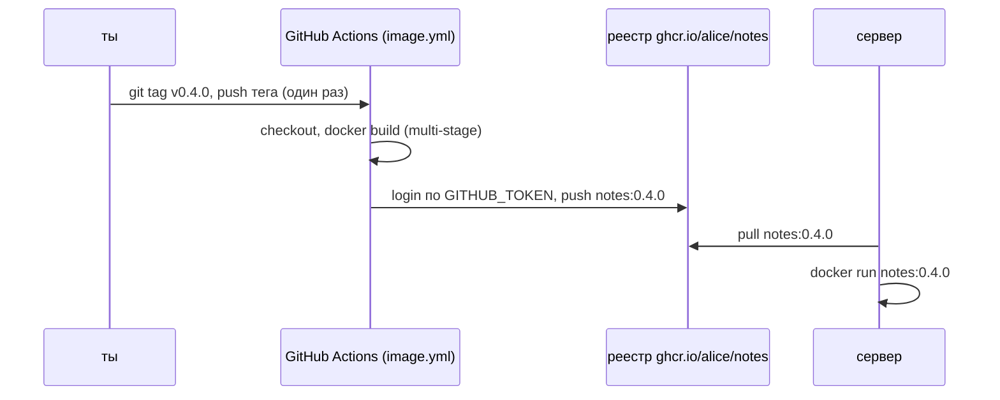
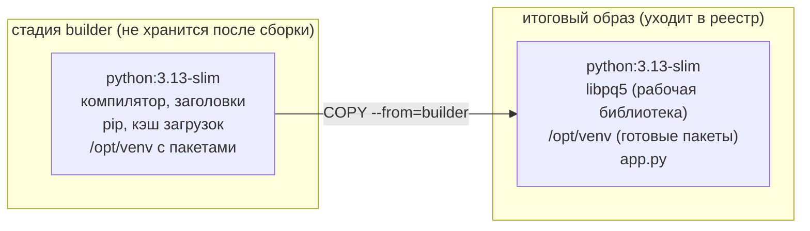
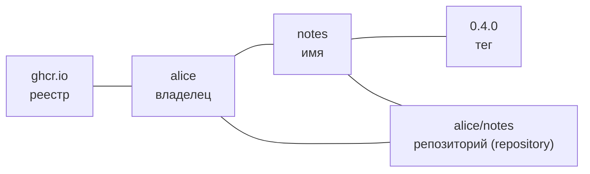
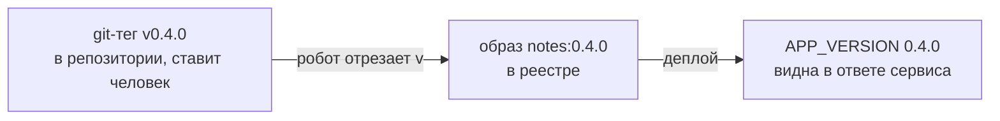

## Зачем это нужно

Образ, который ты собрал на ноутбуке командой `docker build`, лежит только в локальном хранилище Docker на этом ноутбуке. Попробуй запустить его на сервере:

```text
$ docker run notes:0.4.0
Unable to find image 'notes:0.4.0' locally
docker: Error response from daemon: pull access denied for notes, repository does not exist or may require 'docker login'
```

Сервер поискал образ у себя, не нашёл, пошёл искать в интернете, и там такого нет. Образ с ноутбука серверу не виден, нужен общий склад. Он называется реестр образов (container registry): образ отправляют туда командой `docker push` и забирают командой `docker pull`. На работе релиз почти всегда выглядит одинаково: ставишь тег в git (метку на конкретном коммите, урок 3.5), робот в CI (автоматический запуск сборки на сервере GitHub, урок 3.3) собирает образ и кладёт в реестр, а сервер, где идёт деплой (выкладка новой версии), берёт его оттуда; в теме 5 эту роль возьмёт Kubernetes.

Второй вопрос: что лежит внутри образа. Если в нём остался компилятор (программа, которая превращает исходный код в машинные команды; при запуске она не нужна), образ в разы тяжелее и содержит лишние пакеты с уязвимостями. Это лечит multi-stage сборка: собираем в одном образе, а в итоговый берём только результат.

Третий вопрос: что именно запустится по имени `notes:0.4.0`. Имя с тегом можно перепривязать к другому содержимому, и два сервера получат разный код. От этого защищает digest, отпечаток содержимого образа (строка вида `sha256:ad4a4a65...`). В уроке ты увидишь это своими глазами.

Шаг проекта: `Dockerfile` «Заметок» становится multi-stage, а workflow (описание действий робота в GitHub Actions) `image.yml` по git-тегу `v0.4.0` публикует образ `ghcr.io/<user>/notes:0.4.0`.

## Что нужно знать

- [Урок 3.3: GitHub Actions и CI](../03-git-ci/03-actions-ci.md): workflow, `on` (когда запускать), `steps` (шаги), `secrets` (хранилище паролей), `permissions` (какие права получает запуск).
- [Урок 3.5: релизный поток](../03-git-ci/05-release-flow.md): теги `vX.Y.Z` и запуск workflow по тегу.
- [Урок 4.2: Dockerfile](02-dockerfile.md): слои (порции файлов, из которых состоит образ), кэш, `USER 10001`, `HEALTHCHECK`, `.dockerignore`.
- [Урок 4.4: PostgreSQL](04-sql-postgres-basics.md) и [урок 4.5: Compose](05-compose-postgres.md): приложение v4 ставит `psycopg` (Python-библиотека для связи с PostgreSQL) из `requirements.txt` (файл со списком нужных Python-пакетов).
- [Урок 4.6: nginx и TLS в Compose](06-compose-nginx-tls.md): стек, который мы теперь упаковываем в реестр.

Перед началом в `~/notes` должны лежать `app.py` версии v4, `requirements.txt` (в нём строка `psycopg[binary]>=3.2,<4`), `.dockerignore` и `Dockerfile` из урока 4.2. Docker должен работать: проверь `docker version`.

## Картина целиком

Реестр хранит готовые образы и отдаёт их по имени и тегу. Сборка (`docker build`) идёт отдельно: в ней есть компилятор и pip, нужные только для сборки, а в образ должно попасть только то, что нужно для запуска.

- образ: слои плюс описание, что запускать;
- реестр: склад образов, откуда их забирают серверы;
- тег (`0.4.0`): метка версии, а отпечаток, по которому можно проверить, что содержимое не подменили, это digest.

Путь образа от твоего кода до сервера:



А так устроена multi-stage сборка внутри одной команды `docker build`:



За урок ты разберёшь каждую часть этих схем: из чего состоит образ, как работает multi-stage, что такое тег и digest, как реестр принимает образы, как в него входят по паролю и как CI по тегу сам публикует образ.

## Теория

### Образ изнутри: слои, конфиг и манифест

Все остальные понятия урока (digest, push, размер, multi-stage) опираются на то, из чего состоит образ. Начнём с того, из каких частей он состоит.

Из урока 4.2 ты знаешь: каждая инструкция `RUN` и `COPY` в `Dockerfile` создаёт **слой** (layer), архив с файлами, которые добавились или изменились. Идентификатор слоя считается по содержимому: это хеш SHA256, длинная строка вида `sha256:ad4a4a65...`. Хеш работает как отпечаток: из любых данных получается строка одной длины, при малейшем изменении данных она меняется целиком, а восстановить данные из неё нельзя.

Образ состоит из трёх частей:

1. **Слои** (blobs): архивы с файлами.
2. **Конфиг** (config): маленький JSON с метаданными: `CMD`, `ENV`, `USER`, `EXPOSE`, `HEALTHCHECK` и список хешей слоёв.
3. **Манифест** (manifest): JSON-опись «конфиг такой-то, слои такие-то в таком порядке». Хеш этого JSON и есть **digest образа**.

Посмотрим, что происходит при правке. В образе 5 слоёв, `app.py` лежит в четвёртом, а пятый это `RUN groupadd ...`. Ты поменял одну строку в `app.py` и пересобрал. Новый хеш получат четвёртый и пятый слои. Конфиг тоже станет другим, потому что в нём записан список хешей слоёв, значит изменятся манифест и digest. Хеши первых трёх слоёв те же. Если бы изменился второй слой, пересобрались бы и все после него: каждый слой строится поверх предыдущего.

> **Прикинь сам:** образ из 5 слоёв, ты поменял `requirements.txt`, который копируется во второй слой. Сколько слоёв получит новый хеш?
{: .predict}

Четыре: второй и все после него. Только первый остаётся прежним. Конфиг, манифест и digest тоже новые.

Осторожно: путают размер образа на диске и размер того, что идёт по сети. Слои по сети передаются сжатыми, поэтому в `docker image ls` две колонки: `DISK USAGE` (занято на диске после распаковки) и `CONTENT SIZE` (сжатое содержимое). Дальше «размер» это первая колонка, `SIZE` в `--format`.

> **Главное:** образ это слои плюс конфиг плюс манифест, а digest это хеш манифеста: изменился слой, изменился digest.
{: .key}

> **Проверь понимание:** ты поменял одну строку в `app.py` и пересобрал образ. Что из этого уйдёт по сети при `docker push`: все слои, один слой или ничего?

<details markdown="1">
<summary>Ответ</summary>

Уйдут слой с `app.py`, слои после него (в нашем Dockerfile это ещё `RUN groupadd ...`), новый конфиг и манифест. Слои с Python и `psycopg` реестр уже знает по хешу и ответит «Layer already exists», они повторно не передаются.

</details>

Чтобы понять, откуда в образе берётся «лишнее», нужно знать, как ставятся пакеты Python.

### Пакеты Python, колесо и компилятор: откуда в образе берётся «лишнее»

Пакет Python (например, `psycopg`) ставят командой `pip install`: pip это установщик пакетов, список нужных лежит в `requirements.txt`. Чаще всего pip скачивает **колесо** (wheel, файл `.whl`): готовую сборку, которую остаётся распаковать. Но если колеса под твою систему нет, некоторые пакеты собираются на месте из исходников на C. Тогда нужен компилятор `gcc` и заголовочные файлы (описания функций системных библиотек, как `libpq-dev`), и они остаются в слое образа навсегда.

Осторожно: `pip install` не всегда просто скачивает готовое. Строка `Building wheel for ...` в его выводе значит, что идёт компиляция, а `Downloading ...-manylinux...whl` значит, что скачано готовое колесо и компилятор не нужен.

> **Главное:** колесо это готовая сборка пакета; если колеса нет, pip компилирует на месте и оставляет в образе тяжёлый компилятор.
{: .key}

Чтобы компилятор не попадал в итоговый образ, нужен multi-stage.

### Multi-stage: собираем в одном образе, запускаем в другом

В обычном `Dockerfile` всё, что ты поставил командой `RUN`, остаётся в образе навсегда: удалить файл следующим слоем нельзя, он сохранится в предыдущем (урок 4.2). Multi-stage решает это одним файлом: сборка идёт в одной стадии, а в итоговый образ переезжает только готовый результат.

**Как устроено.**

1. В `Dockerfile` несколько строк `FROM`. Каждая начинает новую **стадию** (stage) с чистого образа. Стадию можно назвать: `FROM python:3.13-slim AS builder`.
2. Стадия `builder` делает грязную работу: ставит компилятор, создаёт виртуальное окружение и устанавливает в него пакеты. **Виртуальное окружение** (virtual environment, venv) это обычный каталог со ссылками на интерпретатор Python и установленными пакетами. Создаётся командой `python -m venv /opt/venv`. Скрипты внутри хранят абсолютный путь (`/opt/venv/bin/python`), поэтому путь в обеих стадиях должен совпадать, как и базовый образ с версией Python: иначе ссылки поведут в пустоту.
3. Последняя стадия начинает с чистого образа и берёт из `builder` только нужное: `COPY --from=builder /opt/venv /opt/venv`. Слои `builder` в итоговый образ не входят, они остаются в кэше сборки на твоей машине.
4. Итоговым образом считается **последняя** стадия: именно её ты получишь под тегом `-t`.

Переменная `PATH` (список каталогов, где оболочка ищет команды) нужна, чтобы `python` находился в venv: `ENV PATH="/opt/venv/bin:$PATH"` ставит этот каталог первым. `ENV` относится к стадии, где написан, поэтому во второй стадии её задают заново: стадии ничего не наследуют, кроме скопированного через `COPY --from`.

Теперь на числах. Нужны два опыта, потому что выгода зависит от проекта.

Опыт 1: наш проект, где компилировать нечего (`psycopg[binary]` ставится готовым колесом). Одностадийный `notes:single` весит **250MB**, multi-stage `notes:multi` **254MB**: на четыре мегабайта **больше**. В multi-stage к системному Python добавляется отдельный каталог venv с собственной копией `pip`, а выбрасывать нечего. Вывод: multi-stage сам ничего не «сжимает», он только не пускает в итог то, чего там быть не должно. На проекте без компиляции выигрыша по размеру нет: multi-stage окупается, когда есть что оставить за бортом.

Опыт 2: зависимость, которую надо компилировать. Возьмём `psycopg[c]`: в квадратных скобках (extras) выбирают вариант пакета, `[c]` собирается из исходников, а `[binary]` приходит готовым колесом. Одностадийный образ с `gcc`, `libc6-dev` и `libpq-dev` весит **538MB**. В multi-stage те же `gcc` и заголовки стоят в `builder`, а в итоговую стадию ставится только рабочая библиотека `libpq5`: **245MB**. Разница почти 300 мегабайт и нет компилятора в итоговом образе:

```text
одностадийный, размеры слоёв (docker history):
   43.7MB  сам Python
  222MB    apt-get install gcc libc6-dev libpq-dev     <- компилятор навсегда в образе
   28.9MB  pip install psycopg[c]
итого 538MB

multi-stage: слой с компилятором остался в builder, в итог не попал
итого 245MB
```

> **Прикинь сам:** в проекте, где компилировать нечего, multi-stage дал 254 МБ против 250 МБ. Стоит ли оставлять его или вернуть одну стадию?
{: .predict}

Оставить стоит, но не ради размера. Четыре мегабайта разницы не страшны, а при первой же зависимости на C итоговый образ останется чистым: компилятор туда не попадёт. Выбор делаем по тому, что может появиться, а не по текущим цифрам.

Осторожно, два заблуждения. «Multi-stage это оптимизация размера»: на деле это про то, **что** попадает в итоговый образ. «Удалю компилятор в конце командой `RUN apt-get purge`»: слой с установкой уже создан и хранится, удаление добавит ещё один слой, размер не уменьшится.

> **Главное:** multi-stage решает, что попадёт в итоговый образ: в итоговую стадию копируют только готовый результат через `COPY --from=builder`.
{: .key}

> **Проверь понимание:** в итоговой стадии ты забыл `ENV PATH="/opt/venv/bin:$PATH"`. Какая ошибка будет при запуске и почему сборка её не покажет?

<details markdown="1">
<summary>Ответ</summary>

Сборка пройдёт, потому что `COPY --from` выполнился. Но `python` найдётся уже не в venv, а в системном Python образа (`/usr/local/bin/python`), где нет `psycopg`. Приложение упадёт с `ModuleNotFoundError: No module named 'psycopg'`, но только при `STORE=postgres`: в режиме `STORE=file` драйвер не импортируется (так устроен `app.py` v4), и ошибку можно не заметить до запуска с базой. Поэтому образ проверяют с `STORE=postgres`, а не только по `healthz`.

</details>

Теперь научимся называть образ так, чтобы его можно было найти.

### Имя образа: реестр, репозиторий, тег

`ghcr.io/alice/notes:0.4.0` читается слева направо, от общего к частному: реестр, владелец, проект, тег.



Правила, которые важно знать:

- Если реестр не указан, Docker подставляет Docker Hub: `nginx:1.30` на самом деле `docker.io/library/nginx:1.30`.
- Если тег не указан, подставляется `latest`. В курсе `latest` **не используется**: по нему нельзя сказать, какая версия запущена, и нельзя откатиться на «предыдущий latest».
- Имя репозитория пишется **строчными** буквами: `Alice/notes` Docker отвергнет.
- В одном репозитории живёт много тегов: `0.4.0`, `0.4.1`, `0.4.0-rc1`.

**Тег** (tag) это метка на образе в реестре: запись «имя тега → digest манифеста». Метку можно снять и повесить на другой образ, поэтому `nginx:1.30` сегодня и через полгода это, возможно, разные образы (в новом исправлены уязвимости). **Digest** это хеш манифеста, с которым ты познакомился выше. Если содержимое изменилось, это уже другой digest. Ссылка по digest выглядит так: `ghcr.io/alice/notes@sha256:ad4a4a65...545db`, вместо `:` стоит `@`.

Реальный прогон: один образ, два имени, потом метку перевешивают.

```text
docker tag notes:multi notes:0.4.0-rc1
docker tag notes:single notes:test
notes:0.4.0-rc1  ad4a4a6560c4     <- ID одинаковый у multi и 0.4.0-rc1:
notes:multi      ad4a4a6560c4        это один и тот же образ с двумя именами
notes:single     45928148a107
notes:test       45928148a107

docker tag notes:multi notes:test          <- перевесили метку
notes:test       ad4a4a6560c4      <- теперь test указывает на другой образ
```

Образ `45928148a107` не изменился и не исчез: у него осталось имя `single`. Изменилась только запись «`test` → …».

Тот же приём в реестре. Я отправил в реестр `alice/notes:0.4.0-rc1` и получил digest `sha256:ad4a4a65...545db`. Потом повесил тег `0.4.0-rc1` на другой образ (одностадийный) и отправил снова. Реестр принял без возражений и теперь на вопрос «что за `0.4.0-rc1`» отвечает `sha256:45928148...d69d`. Старый образ остался в реестре, его можно скачать по digest: `docker pull localhost:5001/alice/notes@sha256:ad4a4a65...`. Тем, кто скачал тег вчера, об этом никто не сообщил.

> **Прикинь сам:** в `compose.yml` написано `image: nginx`. Какой тег получишь и почему через год это может сломать запуск?
{: .predict}

Тег `latest`, то есть то, что в Docker Hub считается «последним» в момент скачивания. Через год это будет другая мажорная версия, возможно с несовместимыми настройками, а в отчёте об аварии не будет записано, какая именно. Правильно писать точный тег: `nginx:1.30`.

Осторожно: «тег `0.4.0` значит версия 0.4.0 навсегда». Это договорённость, реестр не мешает перезаписать тег. Поэтому релиз фиксируют по digest (`@sha256:...`) или договариваются, что релизные теги не перезаписываются (immutable tags, «неизменяемые теги»: в некоторых реестрах, например ECR и Harbor, есть настройка, запрещающая перезапись; в GitHub Container Registry её нет).

> **Главное:** имя образа читается как реестр, владелец, проект, тег, а тег это перепривязываемая метка, не гарантия содержимого.
{: .key}

> **Проверь понимание:** ты запушил `notes:0.4.0`, потом нашёл баг, поправил код и запушил снова `notes:0.4.0`. Что запустит сервер, который скачал этот тег вчера?

<details markdown="1">
<summary>Ответ</summary>

Пока он не сделает `docker pull` заново, продолжит работать старый образ: локальное имя указывает на него. После нового `pull` под тем же именем окажется другой образ, и два сервера с «одной версией» запустят разный код. Баг чинят новой версией `0.4.1`, а не перезаписью тега.

</details>

Теперь посмотрим, что за сервер хранит эти образы.

### Реестр: обычный веб-сервер для образов

Реестр это HTTP-сервер с известным набором адресов (API версии 2, поэтому пути начинаются с `/v2/`). Он хранит слои и манифесты и отдаёт их тем, кто пришёл с правильным именем и, если нужно, паролем. Каждая команда Docker превращается в запросы:

- `docker push`: для каждого слоя спрашивает «у тебя есть слой с таким хешем?». Если нет, загружает. В конце отправляет манифест и привязывает к нему тег. Уже имеющиеся слои повторно не передаются.
- `docker pull`: запрашивает манифест по тегу, из него узнаёт список слоёв и докачивает те, которых нет локально.

Поэтому `pull` быстрый, если большая часть слоёв уже есть, а `push` новой версии отправляет только изменившееся. Реестром может быть любой сервер, который говорит на этом протоколе: Docker Hub, ghcr.io, Yandex Container Registry, Harbor у себя в компании и простой образ `registry:2`, который мы используем для тренировки.

С реестром можно поговорить обычным `curl`. Реестр `registry:2` на порту 5001 с паролем, после того как я отправил образ:

```text
$ curl -s -u alice:secret123 http://127.0.0.1:5001/v2/_catalog
{"repositories":["alice/notes"]}
$ curl -s -u alice:secret123 http://127.0.0.1:5001/v2/alice/notes/tags/list
{"name":"alice/notes","tags":["0.4.0","0.4.0-rc1"]}
$ curl -s -i http://127.0.0.1:5001/v2/_catalog | head -4
HTTP/1.1 401 Unauthorized
Content-Type: application/json; charset=utf-8
Docker-Distribution-Api-Version: registry/2.0
Www-Authenticate: Basic realm="registry"
```

`/v2/_catalog` это «какие репозитории у тебя есть», `/v2/alice/notes/tags/list` это «какие теги в репозитории `alice/notes`». Без пароля реестр отвечает `401 Unauthorized`, а заголовок `Www-Authenticate` говорит, какой способ входа нужен (Basic: логин и пароль). Пароль в `curl` задаёт ключ `-u логин:пароль`.

> **Прикинь сам:** в реестре лежит предыдущая версия образа из 10 слоёв, ты изменил один слой в середине, а слоёв после него три. Сколько слоёв уйдёт по сети при `docker push`?
{: .predict}

Четыре: изменённый и три после него (они зависят от него и получили новые хеши), плюс новый манифест. Остальные шесть реестр уже знает.

Осторожно: «реестр и Docker Hub это одно». Docker Hub это один из реестров и реестр по умолчанию. И ещё: `docker login` ничего не «открывает», а только запоминает пароль для одного адреса реестра.

> **Главное:** реестр это HTTP-сервер: слои хранятся по хешу, push отправляет только недостающее, pull докачивает недостающее.
{: .key}

Чтобы писать в реестр, нужно войти в него.

### Вход в реестр: docker login, токены и `GITHUB_TOKEN`

Логин и пароль реестр получает в HTTP-заголовке каждого запроса. Команда `docker login <реестр> -u <логин> --password-stdin` проверяет пару запросом к реестру и, если всё хорошо, **запоминает** её в файле `~/.docker/config.json` как строку `логин:пароль` в кодировке base64. Base64 это не шифрование, а способ записать текст другими символами: любой, кто видит файл, одной командой получает пароль обратно.

Так выглядит вход на Linux (в контейнере с Docker CLI, без менеджера паролей):

```text
$ echo secret123 | docker login localhost:5001 -u alice --password-stdin
Login Succeeded

WARNING! Your credentials are stored unencrypted in '/root/.docker/config.json'.
Configure a credential helper to remove this warning. See
https://docs.docker.com/go/credential-store/

$ cat /root/.docker/config.json
{
	"auths": {
		"localhost:5001": {
			"auth": "YWxpY2U6c2VjcmV0MTIz"
		}
	}
}
$ echo YWxpY2U6c2VjcmV0MTIz | base64 -d
alice:secret123
```

Флаг `--password-stdin` говорит «читай пароль из стандартного ввода», так он не попадает в список процессов, куда попал бы при `-p секрет`. Но строка с `echo secret123` остаётся в истории команд оболочки: пароль здесь учебный, поэтому можно. С настоящим паролем читай его без эха: `read -rs P; printf %s "$P" | docker login ... --password-stdin` (так сделано в задании 3). Предупреждение `WARNING` честное: на Mac и в Windows Docker хранит пароль в системной связке ключей, а на Linux по умолчанию открытым текстом. Поэтому на общем сервере после работы делают `docker logout`.

В ghcr.io пароль от аккаунта GitHub не подходит, нужен **токен** (token): длинная случайная строка, которая работает как пароль, но выдана под конкретную задачу и её можно отозвать. Бывает два вида:

- **Личный токен** (PAT, personal access token): ты создаёшь его в настройках GitHub с нужными правами (scope), для образов это `write:packages`. Живёт долго, привязан к тебе, утечка опасна.
- **`GITHUB_TOKEN`**: GitHub создаёт его на один запуск workflow (напоминание из урока 3.4). Он действует только на один репозиторий и только с теми правами, которые перечислены в `permissions:` файла workflow. Чтобы он мог писать пакеты, нужно `permissions: packages: write`; без этого сборка пройдёт, а `push` упадёт с `denied`.

> **Прикинь сам:** личный токен лежал в `~/.docker/config.json` на общем сервере, и ты понял, что его мог прочитать кто-то чужой. Что делаешь первым: `docker logout`, смену пароля на GitHub или отзыв токена в настройках?
{: .predict}

Первым отзываю токен в настройках GitHub: пока он не отозван, им можно пользоваться откуда угодно, а `docker logout` стирает только локальную запись. Потом выпускаю новый токен, смотрю журнал использования (кто и когда им пользовался), делаю `docker logout` и убираю токен из истории команд. Пароль от GitHub менять не обязательно: он не утёк, утёк токен. Срок жизни токена защитой не считается.

Осторожно: «`denied` значит неверный пароль». Это может быть и верный пароль без права записи, и чужой владелец, и имя с заглавной буквой. Разные причины дают разные тексты, в «Сломай и почини» их разберём.

> **Главное:** для ghcr.io нужен токен, а не пароль; `GITHUB_TOKEN` живёт один запуск, ограничен `permissions:` и не привязан к человеку; утёкший токен сначала отзывают.
{: .key}

> **Проверь понимание:** чем `GITHUB_TOKEN` в workflow лучше личного токена, лежащего в secrets?

<details markdown="1">
<summary>Ответ</summary>

Он создаётся на время одного запуска, ограничен правами из `permissions:` и одним репозиторием, не привязан к человеку. Личный токен живёт месяцы, обычно шире по правам, а при уходе владельца из команды пайплайн ломается.

</details>

Теперь про сам ghcr.io.

### ghcr.io: реестр GitHub

ghcr.io это реестр контейнеров GitHub (GitHub Container Registry): образы живут рядом с кодом, под тем же аккаунтом, правами и CI. Образ хранится как **пакет** (package) владельца: `ghcr.io/alice/notes` это пакет `notes` пользователя или организации `alice`. Что нужно знать:

- Имя владельца в адресе пишется строчными буквами, даже если в GitHub он `Alice`.
- **Новый пакет создаётся приватным.** Приватный образ тянется только по паролю. Чтобы его мог забрать кто угодно, в том числе кластер kind в теме 5 без секретов, пакет один раз делают публичным: GitHub, профиль, Packages, `notes`, Package settings, Change visibility. Видимость пакета не зависит от видимости репозитория: репозиторий может быть публичным, а образ приватным. Приватный образ и `imagePullSecrets` (секрет с паролем для скачивания) разберём в теме 5.
- Пакет привязан к репозиторию или к владельцу. Если пакет создан вручную под личным токеном, а потом им начинает пользоваться workflow, репозиторию нужно дать доступ в настройках пакета (Manage Actions access, роль Write).

Что видит незалогиненный пользователь, когда просит образ, которого нет или который приватный, я проверил на настоящем ghcr.io чтением (`pull`, ничего не отправлялось):

```text
$ docker pull ghcr.io/distinguished-sre/notes:0.4.0
Error response from daemon: error from registry: denied
```

ghcr.io **не различает** «пакета нет» и «пакет приватный»: оба случая дают `denied`, чтобы нельзя было угадывать чужие приватные имена. В старых версиях Docker тот же ответ печатался как `pull access denied for ..., repository does not exist or may require 'docker login'`.

**В продакшене** к одному ghcr.io обычно не ограничиваются:

- у публичных реестров есть лимиты на анонимные `pull` (у Docker Hub они зависят от тарифа и меняются), поэтому сборки на общих раннерах иногда падают с `toomanyrequests`; лечат входом по токену или зеркалом (своей копией часто нужных образов);
- внутри компании ставят собственный реестр, например Harbor или Nexus: он кэширует чужие образы, умеет запрет перезаписи тегов и сканирование;
- старые теги копятся и занимают место, поэтому настраивают правила очистки (в `registry:2` удалённые слои освобождает сборка мусора, garbage collection). Типичная политика хранения: держать последние 10 тегов, релизные `X.Y.Z` не удалять никогда, кандидатов `-rc` и сборки веток стирать через 30 дней;
- реестр может быть недоступен, и от этого зависит, упадёт ли деплой. Если образ уже скачан на узел, контейнер запустится из локальной копии. Если узел новый и образа на нём нет, получишь `ImagePullBackOff` (Kubernetes пытается скачать образ снова и снова). Лечат зеркалом: pull-through кэшем, который отдаёт уже скачанные образы, даже если оригинал недоступен;
- следующий шаг по безопасности: подпись образа (cosign): по ней сервер может проверить, что образ собран вашим CI, а не подменён.

> **Главное:** ghcr.io хранит образ как пакет владельца, имя пишется строчными буквами, новый пакет приватный, а `denied` не различает «нет» и «закрыт».
{: .key}

Теперь решим, на что ссылаться при деплое.

### Как выбрать, на что ссылаться при деплое: тег или digest

Тег можно перепривязать, поэтому возникает практичный вопрос: что писать в конфигах развёртывания, чтобы результат был предсказуемым и при этом удобным для людей. Есть три уровня строгости:

1. **Плавающий тег** (`notes:0`, `nginx:1.30`): обещает «любая версия из этой линии». Патчи приходят сами, но содержимое меняется без твоего участия.
2. **Точный тег** (`notes:0.4.0`): по договорённости не перезаписывается. Читается человеком, хорош для разговоров и отката.
3. **Digest** (`notes@sha256:ad4a4a65...`): содержимое зафиксировано, подмена невозможна.

Курс берёт такую практику: в CI публикуют точные теги, развёртывание идёт по ним. Если нужна строгая гарантия (продакшн под требованиями безопасности), добавляют digest, чаще всего автоматически: CI после `push` сам записывает digest в манифест развёртывания.

Из вывода `docker push` ты берёшь строку `0.4.0-rc1: digest: sha256:ad4a4a65...545db size: 856`. Людям в чате пишешь `notes:0.4.0-rc1`. В файле развёртывания на проде пишешь `ghcr.io/alice/notes:0.4.0-rc1@sha256:ad4a4a65...545db`: Docker берёт образ по digest, а тег остаётся подсказкой читателю. Если кто-то перезапишет тег, развёртывание продолжит брать проверенный образ.

> **Прикинь сам:** в репозитории встречаются `nginx:1.30`, `nginx:1.30.2` и `nginx@sha256:...`. Тебе нужны патчи безопасности без ручной работы, но не смена версии. Какую ссылку берёшь и что придётся делать с остальными?
{: .predict}

`nginx:1.30`: тег линии получает исправления сам. Точную `1.30.2` придётся обновлять руками при каждом патче, а digest ещё и перепроверять. Цена плавающего тега в том, что завтрашнее содержимое ты не знаешь заранее.

Осторожно: digest защищает от подмены образа под тем же именем, но не от уязвимостей внутри образа. Проверка содержимого это отдельная тема ([урок 4.8](08-image-security.md)).

> **Главное:** плавающий тег удобен, точный тег читается человеком, digest защищает от подмены, и в строгих местах пишут тег и digest вместе.
{: .key}

> **Проверь понимание:** в ссылке `notes:0.4.0@sha256:aaa...` тег перевесили на другой образ, а digest остался прежним. Какой образ скачает Docker?

<details markdown="1">
<summary>Ответ</summary>

Тот, что по digest `aaa...`: когда указаны оба, Docker ориентируется на digest, а тег служит подсказкой для человека. Поэтому пара «тег плюс digest» безопасна: подмена тега ничего не меняет, а читатель файла через полгода видит понятное `0.4.0`.

</details>

Теперь посмотрим, как робот публикует образ.

### CI по тегу: как робот публикует образ

Если образы собирают руками на ноутбуках, они получаются разными: у одного другая версия Docker, у другого забыт `git pull`. Робот в CI собирает всегда одинаково, а человек только ставит тег.

Workflow из урока 3.3 запускается по событию. Здесь это `push` тега: строка `tags: ['v*']` означает «любой тег, начинающийся на `v`». Когда ты делаешь `git push origin v0.4.0`, GitHub запускает workflow и записывает имя тега в переменную `GITHUB_REF_NAME` (значение `v0.4.0`). Образ должен называться `0.4.0`, без буквы `v`, поэтому шаг вычисляет имя тремя приёмами bash:

- `${GITHUB_REF_NAME#v}`: **отрезать `v` в начале**. Конструкция `${ПЕРЕМЕННАЯ#шаблон}` убирает шаблон с начала значения: из `v0.4.0` получается `0.4.0`.
- `${GITHUB_REPOSITORY,,}`: **перевести в строчные**. `GITHUB_REPOSITORY` это `владелец/репозиторий`, например `Alice/Notes`, получится `alice/notes`.
- `>> "$GITHUB_OUTPUT"`: **передать значение следующим шагам**. `GITHUB_OUTPUT` это путь к специальному файлу, строки `имя=значение` из него становятся выходами шага (`steps.<id>.outputs.имя`).

Шаг вычисления, прогнанный в bash 5 (в Ubuntu 24.04), как на раннере GitHub:

```text
$ export GITHUB_REPOSITORY=Alice/Notes GITHUB_REF_NAME=v0.4.0 GITHUB_OUTPUT=/tmp/o
$ echo "image=ghcr.io/${GITHUB_REPOSITORY,,}" >> "$GITHUB_OUTPUT"
$ echo "version=${GITHUB_REF_NAME#v}" >> "$GITHUB_OUTPUT"
$ cat /tmp/o
image=ghcr.io/alice/notes
version=0.4.0
```

Тег образа `ghcr.io/alice/notes:0.4.0` вычислен из git-тега без участия человека. Ошибку «в git `v0.4.1`, а образ `0.4.0`» здесь допустить невозможно.

Почему не вставить `${{ github.ref_name }}` прямо в команду: подстановка `${{ ... }}` вставляется в текст скрипта до запуска (урок 3.4 объясняет, чем это опасно), а переменную окружения bash читает уже во время выполнения. Поэтому берём `GITHUB_REF_NAME` из окружения.

> **Прикинь сам:** ты запушил три тега: `v1.2.3`, `v1.2.3-rc1` и `1.2.4`. Для скольких из них сработает `tags: ['v*']` и какие теги образа получатся?
{: .predict}

Для двух. `v1.2.3` даст образ `1.2.3`, `v1.2.3-rc1` даст `1.2.3-rc1` (срез убирает только первую `v`). Тег `1.2.4` не начинается на `v`, workflow не запустится, образа не будет.

Осторожно: «образ собирается при каждом коммите». Нет, только при push тега `v*`. И ещё: `git tag` создаёт тег только локально, на GitHub он попадает после `git push origin v0.4.0`.

> **Главное:** workflow по тегу `v*` вычисляет тег образа из git-тега, и git-тег остаётся единственной правдой о версии.
{: .key}

Сборка в CI долгая, если не использовать кэш. Разберём его.

### Кэш сборки: почему одна и та же сборка то за секунды, то за минуты

Большинство шагов сборки при очередном коммите дают тот же результат, что вчера: скачивать пакеты заново незачем. Кэш даёт Docker право не повторять шаг, если ничего не изменилось. Устроено так:

1. Для каждой инструкции `Dockerfile` Docker считает ключ: текст инструкции плюс хеши файлов, которые она берёт (для `COPY` это содержимое файлов).
2. Если слой с таким ключом уже есть в кэше, инструкция не выполняется, слой берётся готовым (в выводе сборки пометка `CACHED`).
3. Как только одна инструкция вышла из кэша, **все инструкции ниже пересобираются**, даже если сами не менялись: их результат зависел от предыдущего слоя.

Поэтому редкое лежит выше, частое ниже: сначала `COPY requirements.txt` и установка пакетов (меняется раз в неделю), потом `COPY app.py` (меняется каждый коммит). В multi-stage правило то же, только действует в каждой стадии отдельно. Ты поменял строку в `app.py`: стадия `builder` от него не зависит, её слои `CACHED`, в итоговой стадии `COPY --from=builder` тоже из кэша, а `COPY app.py .` и всё ниже (`RUN groupadd ...`) выполняются заново. Сборка занимает секунды.

**Почему в CI кэша нет.** Раннер GitHub Actions при каждом запуске это новая чистая виртуальная машина: локального кэша слоёв на ней нет, и пакеты скачиваются заново даже когда `requirements.txt` не менялся. Лечится выносом кэша в общее хранилище: у `build-push-action` есть `cache-from` и `cache-to`, например `type=gha`. Для релизных сборок по тегу это не критично, для сборки на каждый коммит важно.

> **Прикинь сам:** в `Dockerfile` 8 инструкций, изменилась четвёртая. Сколько инструкций возьмут слой из кэша?
{: .predict}

Три: первая, вторая и третья. Четвёртая и все ниже неё пересоберутся.

Осторожно: пустые строки и комментарии в `Dockerfile` ключ не меняют, а изменённый текст инструкции меняет. И `--no-cache-dir` у `pip` не отключает кэш Docker: это разные кэши, первый просто не оставляет в образе скачанные архивы.

> **Главное:** кэш работает по цепочке: изменилась инструкция, пересобирается всё ниже, поэтому редко меняющееся ставят выше.
{: .key}

Дальше про то, что в образ класть нельзя.

### Секреты и слои: что нельзя класть в образ

Образ уходит в реестр, и всё, что попало в слой, увидят все, у кого есть доступ к образу. В том числе то, что ты «удалил».

Слой неизменяем и хранится целиком. Если на одном шаге ты скопировал файл с паролем (`COPY`), а на следующем удалил его (`RUN rm`), появится ещё один слой «файл удалён», а слой с паролем останется: его достанет `docker save` или скачивание слоя из реестра. С `ENV` иначе: значение записывается в конфиг образа, и `docker inspect` с `docker history` покажут его всем. У `ARG` ещё иначе: в `docker inspect` его нет, но подставленное значение видно в `docker history` внутри команды `RUN`, где оно использовалось. Секрет нельзя передавать ни одним из трёх способов.

Что делать вместо этого:

- секреты приложения (пароль базы, токены) передавать при запуске: файлом из тома или менеджером секретов (в теме 9 это Vault и Kubernetes Secrets); переменные окружения при запуске допустимы как компромисс, но они видны в `docker inspect` контейнера;
- секрет, нужный именно на время сборки (токен закрытого репозитория пакетов), передавать через `RUN --mount=type=secret,id=имя ...`: файл виден только этому шагу и в слой не попадает;
- в `.dockerignore` держать `.env`, `.git` и всё, что не должно попасть в контекст сборки (урок 4.2).

Multi-stage помогает вторым способом: секрет можно использовать в `builder`, который в итоговый образ не входит. Но слои `builder` остаются в кэше твоей машины и уходят в реестр, если запушить его отдельно. Надёжное правило: секретов в слоях нет вообще.

> **Прикинь сам:** на шаге 3 ты скопировал `.env`, на шаге 4 выполнил `RUN rm .env`. Сколько слоёв образа содержат пароль и кто его достанет?
{: .predict}

Один слой, шага 3: он неизменяем, а `rm` лишь добавляет слой с пометкой «удалено». Пароль достанет любой, кто скачал образ.

> **Главное:** всё, что попало в слой, остаётся в образе навсегда: секреты передают при запуске или через `--mount=type=secret`.
{: .key}

> **Проверь понимание:** в `Dockerfile` есть `ARG DB_PASSWORD` и `RUN ./init.sh $DB_PASSWORD`, пароль передан через `docker build --build-arg`. Виден ли он в готовом образе и где именно?

<details markdown="1">
<summary>Ответ</summary>

Виден. В `docker inspect` образа его нет, зато `docker history` покажет команду `RUN` вместе с подставленным паролем. Передавать надо при запуске, а на время сборки использовать `RUN --mount=type=secret`. Если пароль уже уехал в реестр, его считают скомпрометированным и меняют.

</details>

Дальше про версии и откат.

### Версии образов и релизы: semver, кандидаты и откат

Тег образа должен рассказать человеку, что внутри, и позволять вернуться назад. В курсе используется семантическое версионирование (semver): три числа `МАЖОР.МИНОР.ПАТЧ`. Мажор растёт, когда ломается совместимость, минор при новой возможности, патч при исправлении ошибки. `0.4.0` читается: «нулевая, то есть пока не стабильная, линия, четвёртое расширение, без патчей». Суффикс `-rc1` (release candidate, кандидат в релиз) означает «почти готово, проверьте»: `0.4.0-rc1` идёт перед `0.4.0`.

Связь трёх названий одной версии, которую курс держит неизменной:



Откат тогда прост: если `0.4.1` сломан, разворачиваешь `0.4.0` из реестра. Он не изменён, потому что теги не перезаписывают. Вышла `0.4.0`, через день нашли баг. Неправильно: исправить код и заново запушить `v0.4.0` (git не позволит, тег уже есть, а если принудительно, реестр получит другой образ под тем же именем). Правильно: исправить, поставить `v0.4.1`, робот выпустит `notes:0.4.1`. Кто хочет, обновится, кто нет, останется на `0.4.0`.

> **Прикинь сам:** вышли `0.4.0` и `0.4.1`, вторая сломана, ты починил код. Какой git-тег ставишь для исправленной версии и почему не `v0.4.1`?
{: .predict}

`v0.4.2`: тег `v0.4.1` уже указывает на сломанный коммит, его не перезаписывают. Номера дешёвые, потерянное доверие к тегам нет.

Осторожно: «тег `latest` удобен, он всегда последний». Два сервера, скачавшие `latest` в разное время, получат разный код, и в отчёте об инциденте не будет записано, какой именно.

> **Главное:** версию образа задаёт git-тег `vX.Y.Z`, тег образа без буквы `v`, а перезаписывать выпущенный тег нельзя: выпускают новую версию.
{: .key}

Осталась последняя неприятность: архитектура процессора.

### Платформы: почему образ с Mac иногда не запускается на сервере

Самая частая «загадочная» ошибка после первого push: образ собран на ноутбуке, а на сервере контейнер сразу умирает. Программа внутри образа (в том числе сам интерпретатор Python) скомпилирована под определённый тип процессора. У процессоров разные наборы команд, их называют архитектурами. Две главные: `amd64` (обычные серверы и старые Mac) и `arm64` (Mac на Apple Silicon, часть облачных серверов). Поэтому у образа есть **платформа** (platform): `linux/arm64` или `linux/amd64`.

Образ, собранный на Mac с Apple Silicon, будет `linux/arm64`. Запусти его на сервере `amd64`, и процесс упадёт с `exec format error`: процессор не понимает команды чужой архитектуры. Решений два. Собирать там, где будет запуск: **робот в CI работает на `amd64`**, поэтому образы из GitHub Actions подходят серверам. Либо собирать сразу под обе платформы (`docker buildx build --platform linux/amd64,linux/arm64`): тогда под одним тегом лежит **индекс** (index, старое название manifest list), опись манифестов для разных процессоров, и каждая машина скачивает свою сборку.

Образ из этого урока, собранный на Mac, в реестре выглядит так (`docker buildx imagetools inspect`, главное):

```text
Name:      localhost:5001/alice/notes:0.4.0-rc1
MediaType: application/vnd.oci.image.index.v1+json
Manifests:
  Platform:    linux/arm64          <- сборка для нашего Mac
  Platform:    unknown/unknown      <- аттестация, не образ
```

Платформа одна, `arm64`: сервер на `amd64` не найдёт подходящего манифеста. Это одна из причин, почему релизы курса собирает workflow в GitHub Actions, а не ноутбук.

<details markdown="1">
<summary>Для любопытных: что лежит в индексе и что такое unknown/unknown</summary>

Вот что на самом деле лежит в реестре после отправки образа `notes`. Запрос к реестру вернул такой JSON, оставлено главное:

```text
{
  "mediaType": "application/vnd.oci.image.index.v1+json",     <- это индекс
  "manifests": [
    { "digest": "sha256:7dd15a63...3263c", "size": 1813,
      "platform": { "architecture": "arm64", "os": "linux" } }, <- сборка для arm64
    { "digest": "sha256:f94057a3...d7d09", "size": 564 }         <- вспомогательная запись
  ]
}
```

Первая запись ведёт на манифест образа для `arm64`. Вторая это аттестация (запись о том, чем и откуда собран образ): у неё нет платформы, и `imagetools inspect` подписывает её `unknown/unknown`. Это не ошибка. Хеш всего JSON (`sha256:ad4a4a65...545db`) это digest, который мы увидим в выводе `docker push`. На Linux-сервере с `amd64` в первой записи будет `amd64`.

</details>

> **Прикинь сам:** образ собран на Mac с Apple Silicon, а нужен ещё и сервер `amd64`. Сколько платформ перечисляешь в `--platform`?
{: .predict}

Две: `linux/amd64,linux/arm64`. Тогда в индексе будут два манифеста, и Docker на каждой машине выберет свой.

Осторожно: «образ переносим на любую машину». Образ переносим между машинами **одной** архитектуры: различия ОС убрали контейнеры, различия процессоров нет.

> **Главное:** образ переносим между машинами одной архитектуры; для серверов собирают под `linux/amd64` в CI или через `--platform`.
{: .key}

> **Проверь понимание:** коллега на Mac с Apple Silicon вручную запушил `notes:0.4.0`, а сервер на `amd64` падает с `exec format error`. Как исправить, не меняя код?

<details markdown="1">
<summary>Ответ</summary>

Собрать образ под нужную платформу: запустить сборку в CI (`amd64`) или на Mac выполнить `docker buildx build --platform linux/amd64 ...`. Ручной push лучше вообще заменить релизом по тегу через workflow, тогда результат не зависит от ноутбука. Тег `0.4.0` при этом не перезаписывают, а выпускают `0.4.1`.

</details>

## Практика

Все команды из `~/notes`. Имена в примерах твоего репозитория: образ `notes`, GitHub-логин `alice` (подставь свой, строчными). Числа (размеры, ID, digest) у тебя будут другими, важны совпадения и направление.

**Честно про стенд.** В ghcr.io (реестр GitHub: GitHub это сервис, где хранятся git-репозитории и работает CI) при подготовке урока ничего не публиковалось. Все команды работы с реестром (`login`, `push`, `pull`, теги, digest, ошибки `denied`) прогнаны на настоящем реестре, но локальном: официальный образ `registry:2` с паролем, запущенный в контейнере. Он говорит на том же протоколе, что и ghcr.io. Отличается адрес (`localhost:5001` вместо `ghcr.io`) и способ выдачи пароля. Шаги, которые возможны только на GitHub (запуск workflow, видимость пакета), помечены «не прогонялось».

### Подготовка: локальный реестр

**Цель:** поднять реестр `registry:2` с паролем: это тренажёр вместо ghcr.io для заданий 2 и 3.

Перед командой разберём её. `docker run -d --name t4-7-registry` запускает контейнер в фоне под именем. `-p 127.0.0.1:5001:5000` пробрасывает порт: реестр внутри слушает 5000, мы открываем его на порту 5001 хоста и только для себя (`127.0.0.1`). Порт 5001, а не 5000, потому что 5000 на Mac занят службой AirPlay. Три переменные `REGISTRY_AUTH...` включают проверку пароля из файла `htpasswd`. Файл готовит команда с `htpasswd`: он записывает логин и bcrypt-хеш пароля (bcrypt это способ хранить пароль так, чтобы его нельзя было прочитать обратно).

```bash
mkdir -p ~/reg-auth
docker run --rm --entrypoint htpasswd httpd:2 -Bbn alice secret123 > ~/reg-auth/htpasswd
docker run -d --name t4-7-registry -p 127.0.0.1:5001:5000 \
  -v ~/reg-auth:/auth:ro \
  -e REGISTRY_AUTH=htpasswd -e REGISTRY_AUTH_HTPASSWD_REALM=registry \
  -e REGISTRY_AUTH_HTPASSWD_PATH=/auth/htpasswd \
  registry:2
curl -s -o /dev/null -w '%{http_code}\n' http://127.0.0.1:5001/v2/
```

Разбор ключей: `--rm` удалит временный контейнер после команды, `--entrypoint htpasswd` заменяет команду запуска на утилиту `htpasswd`, флаги `-Bbn` значат: bcrypt (`B`), пароль из аргумента (`b`), печать на экран вместо записи в файл (`n`). `-v ~/reg-auth:/auth:ro` даёт контейнеру каталог с паролем только для чтения. `curl -s -o /dev/null -w '%{http_code}\n'` не печатает тело ответа, а выводит только код HTTP.

**Что должно получиться:**

```text
401
```

**Как читать вывод:** `401 Unauthorized` значит «реестр живой, но требует пароль». Именно это нам и нужно.

**Типичные ошибки:**

- `port is already allocated` или `address already in use`: порт 5001 занят: поменяй его слева в `-p 127.0.0.1:5002:5000` и дальше в адресах.
- `curl` возвращает `000`: контейнер ещё запускается, подожди секунду и повтори.

### Задание 1. Multi-stage и сравнение размера

**Цель:** переписать `Dockerfile` в multi-stage, проверить, что он работает, и увидеть, когда он уменьшает образ, а когда нет.

**Предскажи:** итоговый образ станет меньше или больше одностадийного? Останется ли в нём кэш pip (`/root/.cache`)?

<details markdown="1">
<summary>Ответ</summary>

Для нашего проекта размер почти не изменится (даже на несколько мегабайт вырастет: добавляется venv). Кэша pip нет ни в одном образе, потому что мы ставим с `--no-cache-dir`. Настоящая выгода multi-stage появится во втором шаге, где есть что выбросить.

</details>

**Шаги:**

1. Запомни размер текущего образа из урока 4.2. Пересобери его под тегом `single` и посмотри размер. Команда `docker image ls` со строкой `--format` печатает только выбранные поля; шаблон в двойных фигурных скобках это язык Go (`{{.Size}}` значит «поле Size»).

```bash
cd ~/notes
docker build -t notes:single .
docker image ls notes:single --format '{{.Tag}}: {{.Size}}'
```

**Что должно получиться:**

```text
single: 250MB
```

**Как читать вывод:** это размер образа на диске.

2. Замени `Dockerfile` целиком. Этот файл продолжает `Dockerfile` из урока 4.2 (пользователь 10001, `HEALTHCHECK`, порядок слоёв), меняется только способ установки пакетов:

```dockerfile
# Стадия 1: сборка зависимостей в виртуальное окружение
FROM python:3.13-slim AS builder
WORKDIR /build
# venv в /opt/venv: этот путь должен совпасть в обеих стадиях
RUN python -m venv /opt/venv
# Каталог с python из venv первым в PATH: pip ставит пакеты именно в venv
ENV PATH="/opt/venv/bin:$PATH"
# Сначала только зависимости: слой кэшируется, пока requirements.txt не менялся
COPY requirements.txt .
RUN pip install --no-cache-dir -r requirements.txt

# Стадия 2: итоговый образ, только venv и код
FROM python:3.13-slim
WORKDIR /app
# ENV не наследуется между стадиями: PATH задаём заново
ENV PATH="/opt/venv/bin:$PATH" \
    HOST=0.0.0.0 PORT=8080 NOTES_DATA=/data/notes.txt
# Из стадии builder берём только готовый venv
COPY --from=builder /opt/venv /opt/venv
COPY app.py .
# Пользователь и каталог данных создаются до USER (как в уроке 4.2)
RUN groupadd --gid 10001 notes \
 && useradd --uid 10001 --gid 10001 --no-create-home --shell /usr/sbin/nologin notes \
 && mkdir /data && chown 10001:10001 /data
USER 10001:10001
EXPOSE 8080
HEALTHCHECK --interval=10s --timeout=3s --start-period=5s --retries=3 \
  CMD python -c "import urllib.request;urllib.request.urlopen('http://127.0.0.1:8080/healthz')"
CMD ["python", "app.py"]
```

Разбор. Первый `FROM ... AS builder` называет стадию, чтобы на неё можно было сослаться. Первая стадия и вторая используют один и тот же базовый образ `python:3.13-slim`: так версия Python в них совпадает, и venv работает на новом месте. `COPY --from=builder /opt/venv /opt/venv` копирует не из твоей папки, а из готовой стадии `builder`. Всё, что не скопировано этой командой (кэш, рабочий каталог `/build`, файл `requirements.txt` в `/build`), в итоговый образ не попадает. Как и раньше, порядок «сначала `requirements.txt`, потом код» сохранён, поэтому правка `app.py` не пересобирает установку зависимостей.

3. Собери, сравни размер и проверь, что образ работает:

```bash
docker build -t notes:multi .
docker image ls notes --format '{{.Tag}}: {{.Size}}'
docker run --rm --entrypoint sh notes:multi -c 'id -u; ls /build 2>&1'
docker run --rm --user root --entrypoint sh notes:multi -c 'ls /root/.cache 2>&1'
docker run --rm --entrypoint python notes:multi -c 'import psycopg; print(psycopg.__version__)'
```

Разбор. `--entrypoint sh ... -c '...'` заменяет команду запуска на оболочку, которая выполняет строку после `-c`: так мы «заглядываем» в образ, не запуская приложение. `2>&1` добавляет сообщения об ошибках в обычный вывод, чтобы их было видно. `--user root` запускает от root: нужно, потому что без него мы работаем от `10001`, а `/root` для него закрыт. Последняя команда проверяет, что `psycopg` из скопированного venv найден.

**Что должно получиться:**

```text
multi: 254MB
single: 250MB
10001
ls: cannot access '/build': No such file or directory
ls: cannot access '/root/.cache': No such file or directory
3.3.6
```

**Как читать вывод:** `multi` не меньше `single`, и это нормально (см. теорию: «Опыт 1»). `10001` подтверждает, что процесс работает не от root. `No such file or directory` для `/build` доказывает: рабочий каталог стадии `builder` в итоговый образ не попал. Отсутствие `/root/.cache` значит, что кэша pip нет. Без `--user root` та же проверка выдала бы `Permission denied`: каталог `/root` закрыт для пользователя 10001, и ответ «нет кэша» получился бы неправдивым. Версия `psycopg` у тебя может быть новее, ограничение в `requirements.txt` `>=3.2,<4`.

4. Теперь проверь то, ради чего multi-stage придуман. Сохрани два Dockerfile в отдельные файлы (флаг `-f` выбирает файл вместо `Dockerfile`). В обоих ставится `psycopg[c]`: вариант, который собирается из исходников и требует компилятор. Это только опыт, `requirements.txt` проекта не меняется.

```bash
cat > Dockerfile.demo-single <<'EOF'
FROM python:3.13-slim
WORKDIR /app
# Компилятор, стандартная библиотека C и заголовки libpq нужны только на время сборки
RUN apt-get update \
 && apt-get install -y --no-install-recommends gcc libc6-dev libpq-dev \
 && rm -rf /var/lib/apt/lists/*
RUN pip install --no-cache-dir "psycopg[c]>=3.2,<4"
COPY app.py .
CMD ["python", "app.py"]
EOF

cat > Dockerfile.demo-multi <<'EOF'
FROM python:3.13-slim AS builder
WORKDIR /build
RUN apt-get update \
 && apt-get install -y --no-install-recommends gcc libc6-dev libpq-dev \
 && rm -rf /var/lib/apt/lists/*
RUN python -m venv /opt/venv
ENV PATH="/opt/venv/bin:$PATH"
RUN pip install --no-cache-dir "psycopg[c]>=3.2,<4"

FROM python:3.13-slim
WORKDIR /app
# На запуске нужна только сама библиотека libpq5, без gcc и заголовков
RUN apt-get update \
 && apt-get install -y --no-install-recommends libpq5 \
 && rm -rf /var/lib/apt/lists/*
ENV PATH="/opt/venv/bin:$PATH"
COPY --from=builder /opt/venv /opt/venv
COPY app.py .
CMD ["python", "app.py"]
EOF

docker build -f Dockerfile.demo-single -t notes-demo:single .
docker build -f Dockerfile.demo-multi -t notes-demo:multi .
docker image ls notes-demo --format '{{.Tag}}: {{.Size}}'
docker run --rm --entrypoint sh notes-demo:single -c 'gcc --version | head -1'
docker run --rm --entrypoint sh notes-demo:multi -c 'gcc --version'
docker history notes-demo:single --format '{{.Size}}   {{.CreatedBy}}' | cut -c1-70 | head -4
```

Разбор. `cut -c1-70` обрезает каждую строку до 70 символов, чтобы длинные команды не ломали вывод. `head -4` берёт первые четыре строки (самые новые слои).

**Что должно получиться:**

```text
multi: 245MB
single: 538MB
gcc (Debian 14.2.0-19) 14.2.0
sh: 1: gcc: not found
0B   CMD ["python" "app.py"]
24.6kB   COPY app.py . # buildkit
28.9MB   RUN /bin/sh -c pip install --no-cache-dir "p…
222MB   RUN /bin/sh -c apt-get update  && apt-get in…
```

**Как читать вывод:** разница в размере **почти 300 МБ**. В одностадийном образе `gcc` остался, в multi-stage его нет вовсе (`gcc: not found`): и меньше образ, и нет компилятора, которым мог бы воспользоваться атакующий. `docker history` показывает слои от новых к старым: слой с 222 МБ это установка компилятора и заголовков, самый «толстый». Так ищут причину, когда образ вдруг вырос (вопрос 6 внизу). Точные числа у тебя будут другими (другой процессор, свежий базовый образ).

> Не понимаешь, почему итоговый образ тяжелее ожидаемого? Вставь нейросети вывод `docker history` и спроси, какие слои лишние. Проверь ответ: нейросеть может предложить удалить слой, который нужен.
{: .ai}

5. Убери опытные образы и файлы:

```bash
docker rmi notes-demo:single notes-demo:multi
rm Dockerfile.demo-single Dockerfile.demo-multi
```

**Объясни себе:**

- Почему в итоговой стадии снова задан `ENV PATH`, ведь в `builder` он уже есть?
- Что будет с кэшем сборки, если поменять только `app.py`? А если добавить пакет в `requirements.txt`?

**Типичные ошибки:**

- `failed to compute cache key: "/requirements.txt": not found`: в `.dockerignore` попал `requirements.txt` или сборка идёт не из корня проекта: проверь `.dockerignore` и что команда запущена в `~/notes` с контекстом `.`.
- `exec: "python": executable file not found in $PATH`: путь к venv в `PATH` указан неверно (опечатка в `/opt/venv/bin`) или venv не скопирован: сверь `ENV PATH` и `COPY --from`.
- `ModuleNotFoundError: No module named 'psycopg'`: в итоговой стадии забыт `ENV PATH="/opt/venv/bin:$PATH"` (запускается системный Python) или venv создан не в `/opt/venv`: сверь пути в обеих стадиях.
- `fatal error: assert.h: No such file or directory` при `pip install "psycopg[c]"`: для компиляции не хватает заголовков стандартной библиотеки C, добавь `libc6-dev` в `apt-get install`. Эту ошибку я получил при подготовке урока: `gcc` и `libpq-dev` сами по себе недостаточны.

### Задание 2. Теги, digest и pull

**Цель:** увидеть на живом образе, что тег это подвижная метка, а digest нет.

**Предскажи:** если перепривязать тег `notes:test` к другому образу, изменится ли `IMAGE ID` у имени `notes:test`? А идентификатор самого образа?

<details markdown="1">
<summary>Ответ</summary>

У имени изменится: тег просто указывает на новый образ. Идентификатор самого образа не меняется никогда, потому что это хеш его содержимого. Старый образ остаётся, пока у него есть хоть одно имя.

</details>

**Шаги:**

1. Разбери команду. `docker tag ИСТОЧНИК НОВОЕ_ИМЯ` не копирует данные: она добавляет ещё одну запись «имя → образ». Поэтому и место на диске не растёт.

```bash
# Один образ, два имени: тег это просто ссылка
docker tag notes:multi notes:0.4.0-rc1
docker tag notes:single notes:test
docker image ls notes --format '{{.Repository}}:{{.Tag}} {{.ID}}'
echo ---
# Перепривязываем тег на другой образ
docker tag notes:multi notes:test
docker image ls notes --format '{{.Repository}}:{{.Tag}} {{.ID}}'
```

**Что должно получиться:**

```text
notes:0.4.0-rc1 ad4a4a6560c4
notes:multi ad4a4a6560c4
notes:single 45928148a107
notes:test 45928148a107
---
notes:0.4.0-rc1 ad4a4a6560c4
notes:multi ad4a4a6560c4
notes:single 45928148a107
notes:test ad4a4a6560c4
```

**Как читать вывод:** смотри на совпадения ID. Сначала `test` совпадал с `single`, потом с `multi`. Образ `45928148a107` никуда не делся, у него осталось имя `single`. ID и хеши у тебя будут другими. Если у тебя классический Docker без containerd-хранилища, ID будет короче и не равен digest манифеста; для задания это не важно.

2. Digest публичного образа. Команда `docker pull` качает образ по тегу, а `docker image inspect --format '{{json .RepoDigests}}'` печатает список его digest в виде JSON. В `RepoDigests` записаны адреса вида `репозиторий@digest`.

```bash
docker pull nginx:1.30
docker image inspect nginx:1.30 --format '{{json .RepoDigests}}'
```

**Что должно получиться:**

```text
["nginx@sha256:b972f831f200b19ef0767938224f9711e74cd783718738cd7405d5cabf75c442"]
```

**Как читать вывод:** после `@` стоит digest того образа, который сейчас за тегом `1.30`. Через полгода тег `1.30` может указывать на другой digest (патчи), а этот digest по-прежнему будет вести именно на образ, который скачал ты. Закрепить `nginx` в `compose.yml` навсегда можно так: `image: nginx:1.30@sha256:b972f8...` (тег для читателя, digest для Docker).

> Сравни свою ссылку с ответом нейросети: попроси объяснить разницу между `notes:1.30` и `notes@sha256:...`. Но проверь выводом `docker image ls --digests`: нейросеть любит путать digest образа и digest слоя.
{: .ai}

**Объясни себе:**

- Почему `docker tag` не увеличивает занятое место?
- Как бы ты зафиксировал `nginx` в `compose.yml`, чтобы он не менялся при новых патчах?

**Типичные ошибки:**

- `Error response from daemon: No such image: notes:0.4.0`: при `docker tag notes:0.4.0 ...` исходного тега нет: сначала `docker build -t notes:0.4.0 .` или сверь имя в `docker image ls notes`. Если то же имя дать `docker run`, Docker попробует скачать образ и ответит `pull access denied for notes, repository does not exist or may require 'docker login'`: причина та же.
- `invalid reference format: repository name (Alice/notes) must be lowercase`: в имени заглавные буквы (имя GitHub-пользователя `Alice`): пиши `alice`.

### Задание 3. Вручную запушить образ в реестр

**Цель:** пройти путь `login`, `tag`, `push`, `pull` руками, прежде чем автоматизировать. Делаем на локальном реестре из подготовки. Для ghcr.io шаги те же, меняется только адрес и пароль (см. ниже, не прогонялось).

**Предскажи:** что ответит `docker push`, если ты не выполнил `docker login`?

<details markdown="1">
<summary>Ответ</summary>

Ошибку авторизации: реестр не знает, кто ты. В нашем реестре это `no basic auth credentials`, в ghcr.io `unauthorized` или `denied`. В «Сломай и почини» тот же текст встретится в CI, причина там другая.

</details>

**Шаги:**

1. Проставь имя с адресом реестра и попробуй отправить без входа. Имя образа обязательно начинается с адреса реестра: так Docker понимает, куда отправлять.

```bash
docker tag notes:multi localhost:5001/alice/notes:0.4.0-rc1
docker push localhost:5001/alice/notes:0.4.0-rc1
```

**Что должно получиться:**

```text
The push refers to repository [localhost:5001/alice/notes]
push access denied, repository does not exist or may require authorization: authorization failed: no basic auth credentials
```

2. Войди. Пароль читаем без эха (`read -rs` не показывает набираемое и не пишет в историю): при вопросе введи `secret123`.

```bash
read -rs REG_PASS
echo "$REG_PASS" | docker login localhost:5001 -u alice --password-stdin
```

Разбор: `read -rs REG_PASS` кладёт введённое в переменную оболочки `REG_PASS`, `-r` отключает специальный смысл обратной косой, `-s` скрывает ввод.

**Что должно получиться:**

```text
Login Succeeded
```

Если ввести неправильный пароль:

```text
Error response from daemon: login attempt to http://localhost:5001/v2/ failed with status: 401 Unauthorized
```

3. Отправь образ:

```bash
docker push localhost:5001/alice/notes:0.4.0-rc1
```

**Что должно получиться:**

```text
The push refers to repository [localhost:5001/alice/notes]
6a89b58faff8: Pushed
360f9712cbdc: Pushed
...
0.4.0-rc1: digest: sha256:ad4a4a6560c49e796883bd80f7286e2ea38df9ea46ace97a4b987369c0d545db size: 856
```

В настоящем выводе строк `Pushed` девять (по числу слоёв, я показал две), они появляются по мере загрузки. Хеши слоёв и digest у тебя будут другими.

**Как читать вывод:** каждая строка `хеш: Pushed` это один слой. Последняя строка `0.4.0-rc1: digest: sha256:... size: 856` это итог: тег `0.4.0-rc1` теперь указывает на манифест с таким digest (`size` это размер манифеста в байтах, не всего образа). На Docker Desktop и в новых установках с хранилищем containerd digest совпадает с `ID` из задания 2: ID и digest манифеста там одно и то же значение. На Ubuntu с Docker из apt (классическое хранилище overlay2) `ID` это хеш конфига, а digest манифеста другой, поэтому «не совпало» здесь нормально, ты ничего не сломал. Свой digest ищи так: `docker image inspect localhost:5001/alice/notes:0.4.0-rc1 --format '{{.RepoDigests}}'`. Какое у тебя хранилище, покажет `docker info -f '{{.DriverStatus}}'`: строка с `io.containerd.snapshotter` значит containerd, `overlay2` значит классическое. Размеры 250/254 МБ и девять строк `Pushed` взяты на Docker Desktop (arm64): у тебя число слоёв и размеры будут другими. Если в реестре образ такой же уже лежал, вместо `Pushed` будет `Layer already exists`. Так реестр экономит трафик: слой, который у него уже есть, повторно не передаётся. Тот же вид у релиза в боевом реестре: `docker push ghcr.io/<user>/notes:0.4.0` печатает строки `Pushed` и `Layer already exists`, а в последней строке тег `0.4.0` и digest (отпечаток содержимого: по нему можно проверить, что на любом сервере запущен именно этот образ).

4. Удали локальную копию и подтяни из реестра, потом посмотри на реестр глазами `curl`:

```bash
docker rmi localhost:5001/alice/notes:0.4.0-rc1
docker pull localhost:5001/alice/notes:0.4.0-rc1
curl -s -u alice:secret123 http://127.0.0.1:5001/v2/alice/notes/tags/list
```

**Что должно получиться:**

```text
Untagged: localhost:5001/alice/notes:0.4.0-rc1
0.4.0-rc1: Pulling from alice/notes
Digest: sha256:ad4a4a6560c49e796883bd80f7286e2ea38df9ea46ace97a4b987369c0d545db
Status: Downloaded newer image for localhost:5001/alice/notes:0.4.0-rc1
{"name":"alice/notes","tags":["0.4.0-rc1"]}
```

**Как читать вывод:** `Untagged` значит, что удалено имя, а слои остались (они ещё нужны образу `notes:multi`). Поэтому `pull` даже не качал слои. `Digest:` в конце `pull` тот же, что в `push`: реестр отдал ровно то, что ему отправили.

5. Убедись, что тег можно перезаписать, и что старый образ остаётся достижим по digest. Это та самая ловушка из теории:

```bash
docker tag notes:single localhost:5001/alice/notes:0.4.0-rc1
docker push localhost:5001/alice/notes:0.4.0-rc1 | tail -1
docker pull localhost:5001/alice/notes@sha256:ad4a4a6560c49e796883bd80f7286e2ea38df9ea46ace97a4b987369c0d545db | tail -2
```

В последней команде подставь свой digest из шага 3.

**Что должно получиться:**

```text
0.4.0-rc1: digest: sha256:45928148a10769685f6539180b9118766989dea173afe454ffab638c8fd4d69d size: 856
Status: Downloaded newer image for localhost:5001/alice/notes@sha256:ad4a4a6560c49e796883bd80f7286e2ea38df9ea46ace97a4b987369c0d545db
localhost:5001/alice/notes@sha256:ad4a4a6560c49e796883bd80f7286e2ea38df9ea46ace97a4b987369c0d545db
```

Если такой образ у тебя уже загружен, вместо `Downloaded newer image` будет `Image is up to date`. Суть в другом: реестр принял перезапись тега без возражений (digest тега изменился на `45928148...`), а по старому digest образ по-прежнему доступен.

6. Выйди из реестра и убери пароль из переменной:

```bash
docker logout localhost:5001
unset REG_PASS
```

**То же для ghcr.io (не прогонялось: ghcr.io в подготовке урока не использовался).** Создай личный токен: GitHub, Settings, Developer settings, Personal access tokens (classic), scope `write:packages`. Дальше команды те же, меняется адрес и пароль:

```bash
read -rs GHCR_TOKEN
export GH_USER="<твой-github-логин-строчными>"
echo "$GHCR_TOKEN" | docker login ghcr.io -u "$GH_USER" --password-stdin
docker tag notes:multi ghcr.io/$GH_USER/notes:0.4.0-rc1
docker push ghcr.io/$GH_USER/notes:0.4.0-rc1
docker logout ghcr.io
unset GHCR_TOKEN
```

Ожидаемый результат: `Login Succeeded`, затем строки `Pushed` и `0.4.0-rc1: digest: sha256:... size: ...`, после чего пакет `notes` появится в профиле GitHub на вкладке Packages. Без токена и с неверным логином реестр ответит `denied` или `unauthorized`.

**Объясни себе:**

- Куда `docker login` записал пароль (на Linux и на Mac) и почему это важно помнить на общем сервере?
- Что такое `digest: sha256:...` в конце `push` и почему его стоит записывать при релизе?

**Типичные ошибки:**

- `push access denied, repository does not exist or may require authorization: authorization failed: no basic auth credentials`: не выполнен `docker login` для этого адреса.
- `Error response from daemon: login attempt to ... failed with status: 401 Unauthorized`: неверный логин или пароль (для ghcr.io: токен без нужного scope).
- `denied` при push в ghcr.io: токен без `write:packages`, пакет принадлежит другому владельцу или в имени заглавные буквы.
- `tag does not exist: localhost:5001/alice/notes:0.4.9`: ты пушишь тег, который не создан командой `docker tag` или `docker build -t`.
- `name unknown: repository name not known to registry`: опечатка в имени или пакет принадлежит другому владельцу.

### Задание 4. CI по тегу: image.yml

**Цель:** чтобы образ публиковал робот, а не человек: тег `vX.Y.Z` в git автоматически даёт образ `X.Y.Z`.

**Предскажи:** если в workflow не указать `permissions: packages: write`, упадёт ли сборка или только push?

<details markdown="1">
<summary>Ответ</summary>

Сборка пройдёт, упадёт именно push, с `denied`. Токену хватает прав читать код, но не писать пакеты.

</details>

**Шаги:**

1. Создай `.github/workflows/image.yml`. Синтаксис выражений GitHub Actions (двойные фигурные скобки) в файле обёрнут в raw, чтобы Jekyll его не трогал (файл ты копируешь без служебных строк `raw`):


```yaml
name: image

# Запуск только когда в репозиторий приходит тег, начинающийся на v
on:
  push:
    tags: ['v*']

# Минимум прав: читать код и писать пакеты
permissions:
  contents: read
  packages: write

jobs:
  image:
    runs-on: ubuntu-24.04
    steps:
      # Забираем код репозитория на раннер
      - uses: actions/checkout@v7.0.1

      # Готовим сборщик образов BuildKit
      - uses: docker/setup-buildx-action@v4.4.1

      # Входим в ghcr.io. github.actor это имя того, кто запустил workflow,
      # GITHUB_TOKEN это временный пароль на один запуск
      - uses: docker/login-action@v4.6.0
        with:
          registry: ghcr.io
          username: ${{ github.actor }}
          password: ${{ secrets.GITHUB_TOKEN }}

      # Тег образа = тег git без буквы v: v0.4.0 -> 0.4.0; имя в нижнем регистре
      - name: Вычислить имя образа
        id: meta
        run: |
          echo "image=ghcr.io/${GITHUB_REPOSITORY,,}" >> "$GITHUB_OUTPUT"
          echo "version=${GITHUB_REF_NAME#v}" >> "$GITHUB_OUTPUT"

      # Собираем по Dockerfile из корня и сразу отправляем в реестр
      - uses: docker/build-push-action@v7.4.0
        with:
          context: .
          push: true
          tags: ${{ steps.meta.outputs.image }}:${{ steps.meta.outputs.version }}
```


Разбор по блокам. `on: push: tags: ['v*']` запускает workflow только по тегу. `permissions` даёт токену чтение кода и запись пакетов, больше ничего. Шаг `checkout` берёт код. `setup-buildx-action` включает BuildKit, который умеет собирать и кэшировать. `login-action` выполняет то же самое, что твой `docker login`, только пароль берёт из `GITHUB_TOKEN`. Шаг `meta` (`id: meta`) вычисляет имя и версию (разобрано в теории). `build-push-action` делает `docker build` и `docker push` за один шаг: `context: .` это каталог с `Dockerfile`, `push: true` включает отправку, `tags` собирает итоговое имя из выходов шага `meta`: `ghcr.io/alice/notes:0.4.0`. Версии действий здесь записаны точным тегом (`v7.0.1`, не `v7`): это уже лучше, чем плавающий `v7`, но тег в чужом репозитории автор может передвинуть на другой код, то есть он изменяем (так же, как тег образа). В боевых репозиториях действие закрепляют по хешу коммита (SHA, 40 символов): хеш передвинуть нельзя. Версию оставляют в комментарии, чтобы человек понимал, что за код:

```yaml
      # Закрепление по SHA: код действия зафиксирован, комментарий подсказывает версию
      - uses: docker/build-push-action@<40-символьный-sha-коммита> # v7.4.0
```

SHA конкретного релиза берут на странице Releases действия (у релиза указан коммит). Обновлять хеши вручную неудобно, поэтому подключают Dependabot: в `.github/dependabot.yml` добавляют `package-ecosystem: github-actions`, и он сам присылает PR с новым SHA и обновлённым комментарием. В этом учебном файле мы упрощаем и ставим теги, чтобы пример читался легко.

Про кэш сборки. В облачном раннере каждый запуск начинается с пустой машины, поэтому слои без кэша собираются заново. Если нужно ускорить, к `build-push-action` добавляют `cache-from: type=gha` и `cache-to: type=gha,mode=max` (кэш в хранилище GitHub Actions, лимит 10 ГБ на репозиторий; `mode=max` сохраняет и слои промежуточных стадий) или `type=registry` (кэш лежит в реестре отдельным тегом).

2. Файл проверен линтером `actionlint` (он не запускает workflow, а читает синтаксис и типичные ошибки). Проверь и ты:

```bash
docker run --rm -v "$PWD/.github/workflows/image.yml:/image.yml" rhysd/actionlint:1.7.12 /image.yml && echo "actionlint: замечаний нет"
```

**Что должно получиться:**

```text
actionlint: замечаний нет
```

3. Закоммить, запушь ветку, открой PR и влей его (процесс из урока 3.2). Workflow по тегу сам ничего не запустит, пока нет тега.

**Что должно получиться (не прогонялось: нужен GitHub):** файл `.github/workflows/image.yml` в `main`, во вкладке Actions нет красных ошибок конфигурации.

**Объясни себе:**

- Зачем `${GITHUB_REPOSITORY,,}` и что было бы при `Alice/notes`?
- Почему тег образа не выбирается вручную, а берётся из `GITHUB_REF_NAME`?

**Типичные ошибки:**

- `Invalid workflow file: .github/workflows/image.yml#L14`: сломан отступ YAML: сверь отступы с примером, в YAML только пробелы.
- `Unable to resolve action docker/login-action@v4.99.0, unable to find version v4.99.0`: такого тега у действия нет (опечатка в номере): открой страницу действия на GitHub, вкладка Releases, и возьми существующую версию, в курсе `v4.6.0`.
- `repository name must be lowercase`: имя репозитория с заглавными в тегах образа: используй `${GITHUB_REPOSITORY,,}`.

### Задание 5. Шаг проекта: релиз 0.4.0

**Цель:** выпустить `v0.4.0`: multi-stage `Dockerfile`, `image.yml`, образ `ghcr.io/<user>/notes:0.4.0`. Состояние проекта после задания: app v4, образ 0.4.0, git-тег v0.4.0.

**Предскажи:** сколько тегов будет в пакете после релиза `v0.4.0`, если раньше ты пушил `0.4.0-rc1` руками?

<details markdown="1">
<summary>Ответ</summary>

Два тега в одном пакете: `0.4.0-rc1` (ручной) и `0.4.0` (от CI). Это разные теги, «рабочим» считается только тот, что от тега git. `rc1` можно удалить в настройках пакета.

</details>

**Шаги:**

1. Убедись, что `Dockerfile` (задание 1) и `image.yml` (задание 4) в `main`:

```bash
cd ~/notes
git switch main && git pull
git log --oneline -3
```

2. Поставь аннотированный тег (тег с сообщением) и отправь его. `git tag -a v0.4.0 -m "..."` создаёт тег локально, `git push origin v0.4.0` отправляет его на GitHub, и именно этот push запускает workflow:

```bash
git tag -a v0.4.0 -m "Заметки 0.4.0: multi-stage образ, публикация в ghcr.io"
git push origin v0.4.0
```

3. Дождись зелёного запуска во вкладке Actions (workflow `image`), потом открой пакет и сделай его публичным (Package settings, Change visibility, Public). Осторожно: смена видимости на публичную необратима не всегда, проверь в настройках пакета, но рассчитывай, что назад не вернёшь. Убедись, что в образе нет секретов, прежде чем нажимать.
4. После `docker logout` проверь, что образ тянется без пароля, и запусти его. `-e STORE=file` включает хранение в файле, `-p 127.0.0.1:8080:8080` открывает порт только на своей машине, `--rm` удалит контейнер после остановки. 

**Этот шаг идёт одним из двух путей.** Нужен аккаунт GitHub и успешный запуск workflow; без них иди по пути localhost:5001 (он ниже). ghcr.io в этом уроке необязателен: все приёмы работы с реестром ты уже отработал на локальном.

Путь ghcr.io. Переменная `GH_USER` задавалась только в необязательном блоке задания 3, в новом окне терминала она пуста, поэтому задай её заново и проверь:

```bash
export GH_USER="<твой-github-логин-строчными>"
: "${GH_USER:?задай GH_USER}"
docker pull ghcr.io/$GH_USER/notes:0.4.0
docker run -d --name notes-r --rm -e STORE=file -p 127.0.0.1:8080:8080 ghcr.io/$GH_USER/notes:0.4.0
sleep 12
curl -s http://127.0.0.1:8080/healthz
docker ps --format '{{.Names}} {{.Status}}'
docker stop notes-r
```

Путь localhost:5001 (без GitHub). Образ `notes:multi` из задания 1 кладёшь в локальный реестр под именем `0.4.0`, удаляешь локальную копию, тянешь обратно и запускаешь. Если ты делал `docker logout` в задании 3, сначала войди снова (пароль `secret123`), иначе `push` ответит `no basic auth credentials`:

```bash
docker login localhost:5001 -u alice
docker tag notes:multi localhost:5001/alice/notes:0.4.0
docker push localhost:5001/alice/notes:0.4.0
docker image rm localhost:5001/alice/notes:0.4.0
docker pull localhost:5001/alice/notes:0.4.0
docker run -d --name notes-r --rm -e STORE=file -p 127.0.0.1:8080:8080 localhost:5001/alice/notes:0.4.0
sleep 12
curl -s http://127.0.0.1:8080/healthz
docker ps --format '{{.Names}} {{.Status}}'
docker inspect -f '{{.Config.User}}' localhost:5001/alice/notes:0.4.0
docker stop notes-r
```

Последняя `inspect` печатает `10001`: образ из реестра работает не от root.

**Что должно получиться.** Шаги 1 - 3 и `pull` из ghcr.io не прогонялись (нужен GitHub). Запуск образа из реестра я прогнал на локальном реестре, с тем же образом:

```text
ok
notes-r Up 12 seconds (healthy)
```

**Как читать вывод:** `ok` это ответ `/healthz`. `(healthy)` в статусе значит, что встроенная проверка `HEALTHCHECK` из `Dockerfile` (урок 4.2) успешно прошла. Пауза `sleep 12` нужна, чтобы Docker успел выполнить первую проверку (интервал 10 секунд). Если статус `(health: starting)`, подожди ещё немного.

Эталон файлов: [project/notes в репозитории курса](https://github.com/distinguished-sre/learning/tree/main/devops/project/notes).

5. Убери за собой тренировочный стенд:

```bash
docker rm -f t4-7-registry
rm -rf ~/reg-auth
docker logout localhost:5001
docker image rm notes:single notes:multi notes:test notes:0.4.0-rc1 \
  localhost:5001/alice/notes:0.4.0-rc1 localhost:5001/alice/notes:0.4.0 \
  localhost:5001/alice/notes@sha256:ad4a4a6560c49e796883bd80f7286e2ea38df9ea46ace97a4b987369c0d545db \
  nginx:1.30 httpd:2 registry:2 notes-demo:single notes-demo:multi
docker image prune -f
```

Вместо длинного значения после `@` подставь свой digest из задания 3. Если образы в этой команде уже удалены, `docker` просто напишет об этом.

**Объясни себе:**

- Как по образу в реестре понять, из какого коммита он собран? (Подсказка: тег git указывает на коммит.)
- Что произойдёт, если сделать `git push origin v0.4.0` ещё раз с другого коммита?

**Типичные ошибки:**

- `error: src refspec v0.4.0 does not match any`: тег не создан локально: сначала `git tag -a`.
- `! [rejected] v0.4.0 -> v0.4.0 (already exists)`: тег уже есть на сервере: новый релиз делай под `v0.4.1`, тег не перезаписывай.
- `Error response from daemon: error from registry: denied` при `pull` из ghcr.io (в старых Docker: `pull access denied for ghcr.io/alice/notes, repository does not exist or may require 'docker login'`): пакет ещё приватный или опечатка в имени: сделай его публичным и проверь имя.
- `denied: permission_denied: write_package` при `push` из workflow: пакет не связан с репозиторием, из которого идёт сборка. Либо в `Dockerfile` добавь метку `LABEL org.opencontainers.image.source="https://github.com/<user>/notes"` (GitHub по ней связывает пакет с репозиторием), либо в настройках пакета выдай репозиторию доступ (Manage Actions access, роль Write). И проверь, что в workflow есть `permissions: packages: write`.

## Сломай и почини

Запусти сломанный сценарий и найди причину сам, не читая скрипт до конца диагностики. Это только тренировка: на работе чужой скрипт сначала открывают и читают, а потом запускают. Прочитай его после того, как нашёл причину. Скрипт правит только файл `.github/workflows/image.yml` в `~/notes`, поэтому `sudo` не нужен (под `sudo` скрипт откажется запускаться):

```bash
D=$(mktemp -d)
curl -fsSL -o "$D/break-4.7.sh" https://raw.githubusercontent.com/distinguished-sre/learning/main/devops/project/notes/break/4.7/break.sh
bash "$D/break-4.7.sh" 1
```

Переменная `D` живёт только в этом окне терминала. Вместо `1` можно `2` или `3`, вернуть всё как было: `bash "$D/break-4.7.sh" fix`. После поломки закоммить изменение и запушь новый тег `v0.4.1`, чтобы workflow запустился (для проверки локально смотри `git diff`, для реестра нужен GitHub).

Проверка исправления: по `v0.4.x` собирается образ и он тянется по тегу без ошибок.

### Симптом

Сценарий 1: workflow `image` красный, в шаге push сообщение `denied: permission_denied: write_package`. Сценарий 2: образ есть в реестре, но тег не совпадает с git-тегом релиза (в реестре `0.4.0`, а вышел `v0.4.1`). Сценарий 3: сборка падает на `COPY`, файлов «нет», хотя они в репозитории (`"/requirements.txt": not found`).

### Гипотезы

Что может дать `denied` при push: нет права `packages: write`, неверный токен, пакет принадлежит другому владельцу, имя в верхнем регистре. Что может дать несовпадение тега: тег зашит в workflow вручную, берётся не та переменная, забыт срез `v`. Что может дать `COPY failed`: неверный `context`, файл в `.dockerignore`, workflow запущен из подкаталога.

### Проверки

```bash
# Права токена в workflow и вычисленные теги смотри в логе шага
grep -n 'permissions' -A3 .github/workflows/image.yml
grep -n 'context\|tags:' .github/workflows/image.yml
# Что реально лежит в реестре (GH_USER задай явно: export GH_USER=<логин строчными>)
: "${GH_USER:?задай GH_USER}"
docker buildx imagetools inspect ghcr.io/$GH_USER/notes:0.4.1 | head -5
git tag --list 'v0.4*'
```

Первая команда показывает блок `permissions` с тремя строками после него, вторая печатает строки с `context` и `tags:` и их номера. Третья спрашивает реестр, есть ли тег `0.4.1` (`imagetools inspect` читает манифест, не скачивая образ). Четвёртая перечисляет git-теги `v0.4*`.

### Исправление

<details markdown="1">
<summary>Разбор трёх сценариев</summary>

1. `denied: permission_denied`. В `image.yml` нет `permissions: packages: write` (скрипт заменил её на `read`). Возможен и другой вариант: в настройках репозитория, Actions, General, Workflow permissions стоит read-only, или пакет привязан к другому репозиторию. Верни `packages: write` на уровне job или файла и перезапусти workflow. Если пакет уже создан вручную под личным токеном, в Package settings дай репозиторию `notes` роль Write в разделе Manage Actions access. Чтобы пакет сам привязывался к репозиторию, добавь в образ метку `org.opencontainers.image.source=https://github.com/<владелец>/notes` (`LABEL` в `Dockerfile` или параметр `labels` у `build-push-action`). Без привязки и без роли Write push падает с `permission_denied: write_package`.
2. Тег не совпал с git-тегом. Вместо жёсткого `...:0.4.0` бери `${{ steps.meta.outputs.version }}`, вычисленное из `${GITHUB_REF_NAME#v}`. Признак: в Actions успешный запуск, а образа нужной версии нет. Чини workflow, ставь новый тег `v0.4.2` (тег `v0.4.1` уже указывает на ошибочный коммит, его не перезаписывают), а неверный образ удали в настройках пакета.
3. Неверный `context`. В `build-push-action` стоит `context: ./app`, а `Dockerfile` и `requirements.txt` лежат в корне. Верни `context: .` и проверь `.dockerignore`: в нём не должно быть `requirements.txt` и `app.py`.

</details>

Скрипт проверен на копии файла `image.yml`: каждый сценарий применяется и повторный запуск ничего не меняет, `fix` возвращает файл к исходному побайтно, двойной `fix` безопасен. Сам workflow на GitHub не запускался.

## ИИ в помощь

Нейросеть хорошо разбирает вывод `docker history` и ошибки `denied`, но не видит твой реестр и права токена. Общие правила: [ИИ-помощник](../../load-tester/ai.md).

**Задача:** разобрать, почему образ получился тяжёлым.

```text
Вот вывод docker history для моего образа: <вставь>.
Какие слои самые тяжёлые и что из них можно убрать? Объясни, как multi-stage поможет.
Не предлагай ничего, чего не видно в выводе.
```
{: .wrap}

**Проверь ответ:** пересобери и сравни `docker image ls` до и после. Типичная ошибка нейросети: совет удалить пакет, нужный при запуске.

**Задача:** понять ошибку `denied` при push.

```text
При docker push в ghcr.io получаю: denied: permission_denied. Вот мой workflow (без секретов): <вставь>.
Назови три причины по убыванию вероятности и как проверить каждую.
```
{: .wrap}

**Проверь ответ:** проверь `permissions: packages: write`, регистр букв в имени владельца и видимость пакета. Типичная ошибка нейросети: сразу советовать выпустить личный токен с широкими правами.

**Задача:** составить план отката релиза.

```text
Релиз notes:0.4.1 сломан, предыдущий 0.4.0. Образы публикует CI по тегу. Предложи порядок отката и новый тег, не перезаписывая старые.
```
{: .wrap}

**Проверь ответ:** сверь с разделом про версии: выпущенный тег не перезаписывается. Типичная ошибка нейросети: предложить заново запушить `v0.4.0`.

## Словарик урока

| Термин | Простыми словами |
|---|---|
| Реестр (registry) | Веб-сервер, который хранит образы и отдаёт их по имени и тегу: Docker Hub, ghcr.io, `registry:2` |
| Репозиторий образа | Все версии (теги) одного образа в реестре, например `alice/notes` |
| Слой (layer) | Архив с файлами, которые добавила или изменила одна инструкция `Dockerfile` |
| Манифест (manifest) | JSON-опись образа: какой конфиг и какие слои. Хеш манифеста это digest образа |
| Индекс (index) | Опись манифестов для разных процессоров (`arm64`, `amd64`) под одним тегом |
| Хеш SHA256 | Отпечаток данных: строка фиксированной длины, меняется при любом изменении данных |
| Тег (tag) | Подвижная метка на образе в реестре (`0.4.0`), её можно перевесить на другой образ |
| Digest | Неизменяемый отпечаток образа, `sha256:...`. Ссылка `имя@digest` всегда ведёт на одни и те же байты |
| Multi-stage сборка | `Dockerfile` с несколькими `FROM`: собираем в одной стадии, в итоговый образ копируем только результат |
| Стадия (stage) | Часть `Dockerfile` от одного `FROM` до следующего, у неё чистый базовый образ |
| Виртуальное окружение (venv) | Каталог с ссылками на Python и установленными пакетами; переносить его можно только туда, где лежит тот же Python |
| Платформа (amd64, arm64) | Тип процессора и ОС, под которые собран образ; `amd64` это обычные серверы, `arm64` это Mac на Apple Silicon и часть облачных машин |
| Аттестация (attestation) | Запись о том, чем и откуда собран образ, хранится рядом с ним в реестре |
| Деплой (deploy) | Выкладка новой версии программы на сервер, где она работает для пользователей |
| ghcr.io | Реестр образов GitHub (GitHub Container Registry), привязан к аккаунту и репозиториям |
| Workflow | Файл `.github/workflows/*.yml` с описанием, что GitHub Actions делает по событию |
| `COPY --from` | Копирование файлов из другой стадии сборки |
| Токен | Длинная случайная строка, работающая как пароль с ограниченными правами, который можно отозвать |
| PAT | Личный токен доступа GitHub, живёт долго и привязан к человеку |
| `GITHUB_TOKEN` | Временный токен, который GitHub выдаёт на один запуск workflow |
| `permissions` | Блок в workflow, который перечисляет права `GITHUB_TOKEN` |
| `docker login` | Проверяет пароль и запоминает его для адреса реестра в `~/.docker/config.json` |
| Immutable tags | Договорённость (или настройка реестра), что готовый тег релиза нельзя перезаписать |
| Колесо (wheel) | Готовая сборка Python-пакета (`.whl`): `pip` просто распаковывает её, компилятор не нужен |
| Компилятор (`gcc`) | Программа, превращающая исходный код на C в машинные команды; нужна при сборке, не при запуске |
| Заголовочные файлы | Описания функций системных библиотек, нужные компилятору (пакеты вида `libpq-dev`) |
| Плавающий и точный тег | Плавающий (`nginx:1.30`) со временем меняет содержимое, точный (`notes:0.4.0`) по договорённости не меняется |
| CI (робот) | Автоматический сборщик, который запускается сам по событию в репозитории |
| `GITHUB_REF_NAME` | Переменная в workflow: имя ветки или тега, вызвавшего запуск (`v0.4.0`) |

## Вопросы с собеседований

Раздел для повторения: ответь вслух, потом открой ответ. Вопросы с пометкой «часто» задают почти на каждом собеседовании по теме урока: начни с них. Короткие вопросы с пометкой «на скорость» тренируй на время: ответ за 30 секунд.



## Проверено на версиях

Проверено 2026-09-30 на Mac (arm64), Docker Desktop:

- Docker Engine: 29.6.2, Buildx: v0.35.0-desktop.2.
- python: `python:3.13-slim` (Python 3.13.15), psycopg 3.3.6 (`psycopg[binary]` и `psycopg[c]`).
- Локальный реестр: `registry:2` (registry 2.8.3) с паролем из `httpd:2` (`htpasswd`). Прогнаны `push`, `pull`, перезапись тега, `pull` по digest, `curl` к `/v2/`, запуск образа из реестра с `HEALTHCHECK`. Вывод `docker login` с предупреждением на Linux получен в контейнере `docker:cli`.
- `image.yml`: `rhysd/actionlint:1.7.12`, замечаний нет; шаг вычисления имени прогнан в bash 5 (Ubuntu 24.04). Версии `actions/checkout` v7.0.1, `docker/setup-buildx-action` v4.4.1, `docker/login-action` v4.6.0, `docker/build-push-action` v7.4.0 сверены с последними релизами.
- nginx: `nginx:1.30` (digest из задания 2).
- Скрипт `break/4.7/break.sh`: `shellcheck` без замечаний, все сценарии и `fix` прогнаны на копии `image.yml`.
- Не прогонялось: push и pull в настоящий ghcr.io (кроме анонимного pull, вернувшего `denied`), запуск workflow на GitHub, `git tag` и `git push` тега, смена видимости пакета, настройка Manage Actions access. Настоящий Docker Engine на Linux и Ubuntu 26.04 не проверялись: числа размеров и формат ID зависят от хранилища образов.
- Не воспроизводилось: ошибка `exec format error` на чужой архитектуре (описана по документации), сборка под `--platform`.
- ghcr.io: интерфейс настроек пакета меняется, проверь актуальную версию на странице проекта.

## Итог урока: ты умеешь

- [ ] умею переписать `Dockerfile` в multi-stage и объяснить, что остаётся в итоговом образе
- [ ] умею сравнить размер образов и найти толстый слой командой `docker history`
- [ ] умею отличать тег от digest и знаю, почему тег релиза не перезаписывают
- [ ] умею войти в реестр токеном через `--password-stdin` и запушить образ
- [ ] умею написать workflow, который по тегу `v*` публикует образ с тегом без буквы `v`
- [ ] умею разобрать `denied` при push в реестр
- [ ] умею выпустить релиз `v0.4.0` и проверить, что образ тянется из публичного пакета

**Дальше:** [Урок 4.8: Безопасность образов: Trivy, Hadolint, SBOM](08-image-security.md)
