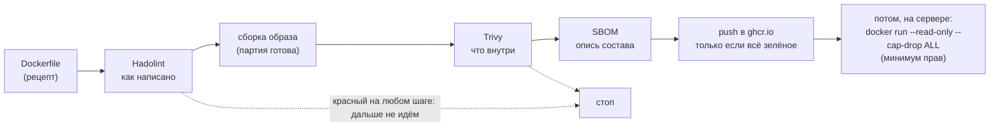
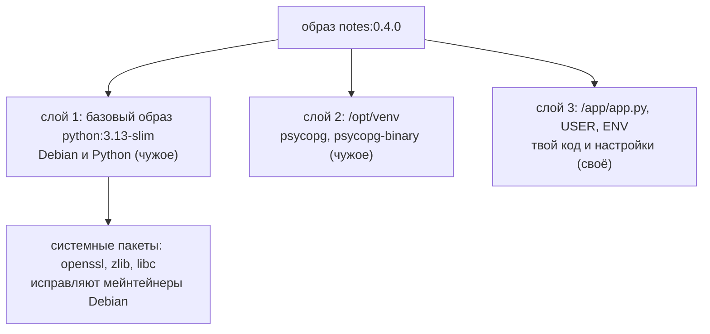
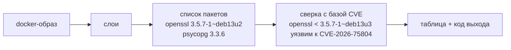
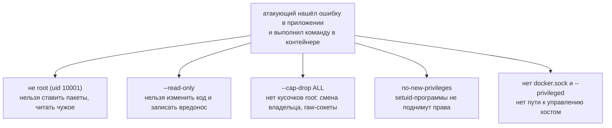
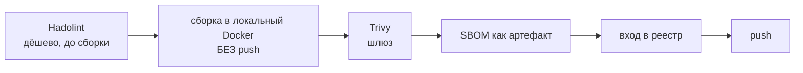
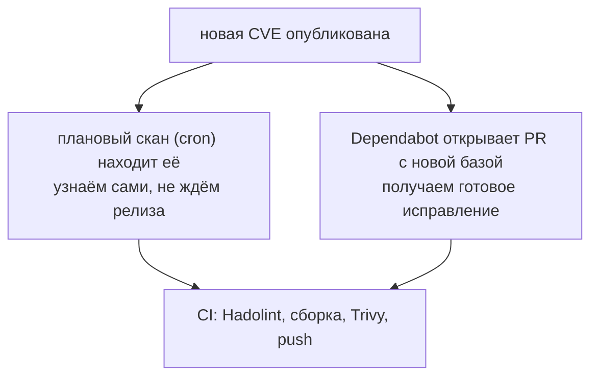

## Зачем это нужно

Представь, что 1 октября ты проверил образ `notes:0.4.0` и в отчёте было чисто. 1 ноября ты проверяешь тот же образ, ничего не меняя, и видишь серьёзную находку уровня HIGH в системной библиотеке `libc6`:

```text
1 октября:  notes:0.4.0 - проблем не найдено
1 ноября:   notes:0.4.0 - найдена 1 серьёзная проблема (HIGH): библиотека libc6
```

Код тот же, образ тот же, а отчёт другой. За месяц в чужой библиотеке нашли ошибку, и о ней появилась публичная запись, CVE. Образ не меняется после сборки, поэтому он «постарел» сам. Это и есть уязвимость (vulnerability): ошибка в программе, которой можно воспользоваться для атаки; CVE это номер её публичной записи. Выходит, что одной проверки перед первым релизом мало, и вручную за всем не уследишь. Поэтому проверка должна быть автоматической: перед каждой выкладкой её делает робот в CI (автоматический сборщик из [урока 3.3](../03-git-ci/03-actions-ci.md)), а красный результат останавливает релиз.

В уроке ты познакомишься с тремя инструментами: Trivy ищет известные уязвимости в готовом образе, Hadolint проверяет, как написан Dockerfile, а SBOM отвечает на вопрос «что у нас внутри». Отдельно научишься запускать контейнер с минимумом прав, чтобы взлом приложения не давал атакующему лишнего. Эти темы часто спрашивают на собеседованиях: «что делаешь, если сканер нашёл CRITICAL», «что такое SBOM», «почему нельзя запускать от root».

## Что нужно знать

- [Урок 1.3: пользователи и права](../01-linux/03-users-permissions.md): у каждого процесса есть владелец (uid, числовой номер пользователя), а root (uid 0, администратор) может всё.
- [Урок 1.4: процессы и сигналы](../01-linux/04-processes-signals.md): контейнер - это обычный процесс, а первый процесс (PID 1) получает сигналы остановки.
- [Урок 3.4: качество и безопасность в CI](../03-git-ci/04-quality-security-ci.md): там ты уже запускал `trivy fs` по репозиторию и слышал про идею shift-left (проверять как можно раньше).
- [Урок 4.2: Dockerfile](02-dockerfile.md): слои, `USER 10001:10001`, `HEALTHCHECK`, exec-форма `CMD`.
- [Урок 4.3: тома и сети](03-storage-networks.md): именованный том `notes-data`, смонтированный в `/data`.
- [Урок 4.7: multi-stage, теги и ghcr.io](07-images-registry.md): образ `notes:0.4.0` и workflow `image.yml`, который мы сейчас расширяем.

Все инструменты урока (Trivy, Hadolint) запускаются как контейнеры из готовых образов, ставить их на компьютер не нужно. Ставится только `jq` (разбирает JSON в задании 3): `sudo apt-get install -y jq` на Ubuntu.

## Картина целиком

Представь, что ты открываешь магазин и продаёшь готовую еду, упакованную на фабрике. Как убедиться, что продукт безопасен? Одной проверки мало, нужны четыре, и каждая ловит своё:

- **Проверка рецепта до производства.** Технолог читает рецептуру: «мясо не должно храниться при комнатной температуре». Это **Hadolint**: он читает Dockerfile и находит плохие привычки до сборки.
- **Лаборатория проверяет готовый продукт.** По составу и срокам: «в этой партии просроченная добавка». Это **Trivy**: он берёт собранный образ и сверяет его пакеты со списком известных уязвимостей.
- **Состав на упаковке.** Если завтра объявят «мука такого-то поставщика опасна», по этикеткам за минуту видно, какие продукты затронуты. Это **SBOM** (Software Bill of Materials, опись состава образа).
- **Правила хранения.** Даже безопасный продукт можно испортить на солнце. С контейнером так же: его запускают с минимумом прав, чтобы после взлома атакующий мало что мог.

И над всем этим стоит **шлюз** (gate, проходная): со склада продукт не выпускают, пока проверки не зелёные. В CI это порядок «сборка, проверка, и только потом публикация».

Схема того, что ты соберёшь к концу урока:



Дальше по порядку: откуда в образе берутся уязвимости, как их ищет Trivy, что проверяет Hadolint, что такое SBOM, как урезать права контейнера и как встроить всё это в CI.

Шаг проекта: в репозитории `~/notes` появятся `.hadolint.yaml` (настройки Hadolint) и `.trivyignore.yaml` (список уязвимостей, которые осознанно не чиним, с причиной), а в `image.yml` из [урока 4.7](07-images-registry.md) добавятся шаги Hadolint, Trivy и SBOM перед публикацией.

## Теория

### Откуда берутся уязвимости в образе

Если думать, что образ - это «мой код», непонятно, почему сканер ругается на `openssl`, которого в твоём репозитории нет. Из [урока 4.2](02-dockerfile.md) ты знаешь, что образ состоит из слоёв, и в этих слоях три источника файлов:



Несколько слов, которые здесь встречаются. **Пакет** (package) - программа или библиотека, которую ставят одной командой: в Debian это `apt` (`openssl 3.5.7`), в Python - `pip` (`psycopg 3.3.6`). **Зависимость** (dependency) - пакет, без которого работает твой код; у `psycopg` есть свои зависимости, у тех свои, и всё оказывается в образе, хотя в `requirements.txt` одна строка. **Мейнтейнер** (maintainer) - человек или команда, которая сопровождает пакет в дистрибутиве и выпускает исправления. Больше всего находок обычно в базовом образе: там сотни системных пакетов, и исправляют их не ты, а мейнтейнеры Debian.

**Как называют уязвимость.** Найденную ошибку регистрируют в публичном списке и дают ей номер **CVE** (Common Vulnerabilities and Exposures) вида `CVE-2026-75804`: год и порядковый номер. У GitHub есть свой список с номерами `GHSA-...`, по смыслу то же самое.

**Как оценивают серьёзность.** Шкала **CVSS** даёт балл от 0 до 10, а по нему получают уровень: LOW (низкий), MEDIUM (средний), HIGH (от 7), CRITICAL (от 9). CRITICAL обычно значит «можно удалённо выполнить чужой код без пароля».

CVSS оценивает худший случай для компонента вообще. Достижима ли уязвимость именно в твоём приложении, балл не говорит: эту часть оценивает человек.

Посмотрим на строку настоящего скана образа этого урока (числа у тебя будут другими):

```text
Library   Vulnerability    Severity  Status  Installed Version  Fixed Version
openssl   CVE-2026-75804   HIGH      fixed   3.5.7-1~deb13u2    3.5.7-1~deb13u3
```

В образе стоит пакет `openssl` версии `3.5.7-1~deb13u2`. Уязвимость исправлена в `3.5.7-1~deb13u3`, и статус `fixed` значит «исправление существует». Версии Trivy сравнивает сам, по правилам менеджера пакетов, тебе достаточно увидеть, что в `Fixed Version` стоит версия новее установленной. Для Debian-версии `3.5.7-1~deb13u2` полезно знать, что `3.5.7` это версия самой программы, `1` номер сборки, а `u2` номер поправки безопасности Debian: поэтому `u3` новее `u2`, и нам не хватает ровно одной поправки. Цифры самой программы не показывают, исправлено ли: Debian часто переносит исправление в старую версию, меняя только суффикс. Сравнивать версии на глаз опасно (`1.10` новее `1.9`, хотя выглядит наоборот).

Чтобы закрыть находку, достаточно обновить пакет, то есть пересобрать образ на свежей базе: `docker build --pull` (флаг `--pull` заставляет Docker заново проверить базовый образ, а не брать старый из локального кэша; для надёжности добавляют `--no-cache`).

Если колонка `Fixed Version` пустая, а статус `affected` или `will_not_fix`, исправления пока нет, и сделать с пакетом нечего. Это принципиально: находка с исправлением - задача для тебя, находка без исправления - предмет для решения («принимаем риск» или «меняем базу»).

> **Прикинь сам:** в отчёте 6 находок HIGH, у 4 из них заполнен `Fixed Version`. Сколько из них ты чинишь первым делом и чем?
{: .predict}

Четыре, и одним действием: пересобираешь образ на свежей базе с `--pull`. Остальные две требуют отдельного решения: исправления нет, значит смотришь, достижим ли уязвимый код, и записываешь исключение с причиной и сроком.

**Образ неизменяем.** Слои собранного образа только читаются (иммутабельность, immutability). Отсюда следствие: ты собрал образ месяц назад, ничего не трогал, а сегодня скан красный. Ошибку не «занесли», в публичный список добавили новую запись, а в образе всё те же старые пакеты. Поэтому сканируют не только при сборке, но и по расписанию уже опубликованные образы.

Осторожно: красный скан не равен взлому, а чистый не равен безопасности.

- «Есть CVE, значит нас взломают». Не всегда. Часть находок не достижима: библиотека лежит в образе, но приложение её не вызывает (в нашем скане `CVE-2026-84782` касается протокола DTLS, а «Заметки» его не используют).
- «Мой код чистый, значит образ безопасен». Образ состоит из чужого кода больше чем на 95%.
- «Нет находок, значит безопасно». Сканер знает только опубликованные уязвимости. Неизвестные ему ошибки (0-day, логика твоего кода, секрет в переменной) он не увидит.

> **Главное:** уязвимости приходят из чужих слоёв (базовый образ и библиотеки), а образ неизменяем, поэтому «новые» находки в старом образе появляются при росте базы CVE, и чинят их пересборкой на свежей базе.
{: .key}

> **Проверь понимание:** ты собрал образ месяц назад, код не менялся, а сегодняшний скан показал новый CRITICAL. Как это возможно и что делать?

<details markdown="1">
<summary>Ответ</summary>

Кода не менялось, но выросла база знаний об уязвимостях: CVE опубликовали уже после сборки, а образ неизменяем, поэтому находка сидит в старых слоях. Действие: посмотреть колонку `Fixed Version`. Если исправление есть, пересобрать образ на свежей базе (`docker build --pull`) и просканировать снова. Если исправления ещё нет, оценить, достижим ли уязвимый код, и записать исключение с обоснованием и сроком пересмотра.

</details>

### Пакет, дистрибутив и мейнтейнер: кто отвечает за то, что внутри

Когда сканер показывает `openssl`, нужно понять, кто это чинит: ты, кто-то другой или никто. От ответа зависит действие.

1. Debian - это дистрибутив (distribution): набор из ядра, программ и библиотек, который кто-то собрал и поддерживает. Его команда (мейнтейнеры) выбирает версии и отвечает за исправления.
2. Когда в программе находят уязвимость, мейнтейнер готовит исправленный пакет с новой версией.
3. Базовый образ `python:3.13-slim` периодически пересобирается с уже исправленными пакетами.
4. Твой образ содержит слой с пакетами на момент твоей сборки. Пока ты не пересоберёшь и не выложишь заново, в нём остаётся то, что было тогда.

Вот как это выглядит на деле. Ты собрал образ 1 сентября, `openssl` версии `3.5.7-1~deb13u2`. 15 сентября опубликовали уязвимость, исправленную в `3.5.7-1~deb13u3`. Образ тот же, но Trivy теперь показывает `HIGH`. Пересобираешь с `--pull`, и если на базовом образе уже выложено исправление `u3`, проблема уходит без единой правки кода.

> **Прикинь сам:** образ собран 1 сентября, исправление `openssl` вышло 15-го, а пересобрал ты его 1 октября. Сколько дней в нём стояла уязвимая версия после выхода исправления?
{: .predict}

Шестнадцать дней (с 15 сентября по 1 октября): образ сам не обновляется, пока его не соберут заново на свежей базе.

Осторожно: «нашли уязвимость, значит мой код плох». Чаще дыра в чужом пакете, а твоё действие - обновление, не переписывание. И второе заблуждение: «раз образ не менялся, он безопасен»: безопасность образа со временем падает сама.

> **Главное:** исправления готовит мейнтейнер дистрибутива, а твоё действие - пересборка образа на свежей базе.
{: .key}

> **Проверь понимание:** образ не пересобирали три месяца, сканер нашёл 5 новых HIGH. Что делаешь первым?

<details markdown="1">
<summary>Ответ</summary>

Виноват не код, а возраст образа. Первым делом пересобрать образ на свежем базовом образе (`--pull`) и сканировать снова. Если находки остались, смотреть, есть ли у них исправление в колонке `Fixed Version`.

</details>

### Trivy: сканер образов

Проверить руками сотни пакетов по сотням тысяч записей невозможно. Trivy (проект компании Aqua Security, курс использует v0.74.0) делает это за десятки секунд и одинаково каждый раз. Как и любой сканер, он знает только то, что есть в его списке.

**Как устроено, по шагам.**

1. **Скачивает базу уязвимостей** (vulnerability database): свежий список CVE в удобном для машины виде. Делает это при первом запуске и потом обновляет, файлы хранит в кэше.
2. **Распаковывает слои образа** и определяет операционную систему по файлу `/etc/os-release` (например Debian 13.7).
3. **Ищет списки установленных пакетов.** У Debian это файл `/var/lib/dpkg/status`, у Python - каталоги `*.dist-info`. Каждый пакет - пара «имя и версия».
4. **Сверяет каждую пару с базой:** есть ли для этой версии известная уязвимость и в какой версии она исправлена.
5. **Печатает таблицу** и завершается с кодом выхода.



> **Прикинь сам:** откуда Trivy знает про уязвимость в `openssl`, если он образ даже не запускает?
{: .predict}

Он читает файлы образа: находит `openssl` и его версию в списке пакетов и сверяет пару «имя и версия» с базой CVE. Запуск и «взлом» для этого не нужны, поэтому скан быстрый и безопасный, но находит только то, что уже есть в базе.

**Флаги, которые ты будешь использовать.**

- `--severity HIGH,CRITICAL` - показать только серьёзные находки. Низкие и средние тоже существуют, но по ним обычно не блокируют выкладку.
- `--ignore-unfixed` - скрыть находки, для которых нет исправленной версии. С ними ты сделать ничего не можешь, а блокировать релиз из-за этого бессмысленно. Такие находки смотрят отдельно.
- `--exit-code 1` - вернуть код выхода 1, если что-то найдено. **Код выхода** (exit code) - число, которое программа отдаёт системе при завершении: 0 значит «успех», любое другое «ошибка» ([урок 1.6](../01-linux/06-bash-basics.md) про `$?`). **Без этого флага Trivy всегда завершается с 0, даже если нашёл сто CRITICAL**, и CI считает шаг успешным. Флаг превращает скан в шлюз.
- `--format table|json|cyclonedx|spdx-json` - формат вывода: таблица для человека, остальные для машин и для SBOM.
- `trivy config` - другой режим: проверка **конфигурации** (Dockerfile, манифесты Kubernetes, Terraform) на плохие настройки вроде запуска от root. `trivy fs` из [урока 3.4](../03-git-ci/04-quality-security-ci.md) смотрит файлы репозитория, `trivy image` смотрит собранный образ.

**Как запускать.** Ставить Trivy на хост не нужно: есть официальный образ `aquasec/trivy:0.74.0`. Ему нужно два разрешения. Первое: доступ к Docker, чтобы достать твой образ из локального хранилища. Для этого внутрь контейнера пробрасывают сокет Docker `/var/run/docker.sock` (файл, через который клиент разговаривает с демоном Docker). Второе: каталог для кэша базы, иначе она будет скачиваться при каждом запуске.

Здесь есть противоречие с [уроком 4.1](01-containers-idea.md), где говорилось «не пробрасывай docker.sock в контейнеры»: доступ к сокету равен root на хосте. Правило остаётся верным для приложений. Мы даём сокет проверенному инструменту на своей учебной машине и на одноразовом CI-раннере, который удаляется после запуска. В рабочем кластере с чужими нагрузками так не делают: сканируют образы в реестре.

Осторожно: «зелёный Trivy значит, что образ безопасен». Код выхода 0 значит только «Trivy отработал без ошибок» (без `--exit-code 1` он всегда 0). Пустая таблица не значит «безопасно», а `--ignore-unfixed` не прячет проблему навсегда: когда исправление выйдет, находка появится снова.

> **Главное:** Trivy читает файлы образа и сверяет пакеты с базой CVE; шлюзом он становится только с `--exit-code 1`.
{: .key}

**Исключения делают явно.** Иногда находка есть, исправления нет, а выкладку блокировать нельзя. Тогда в файл `.trivyignore.yaml` записывают исключение с тремя вещами: номер уязвимости, причина (`statement`) и срок (`expired_at`). Когда срок проходит, Trivy перестаёт исключение учитывать, находка возвращается в отчёт, и кто-то обязан снова принять решение (мы это проверим руками). Молчаливое «добавлю в игнор, чтобы позеленело» без причины и срока - худшее, что можно сделать: через полгода никто не вспомнит, почему.

> **Проверь понимание:** пайплайн зелёный, хотя в логе Trivy видна таблица с CRITICAL. Какая ошибка в настройке?

<details markdown="1">
<summary>Ответ</summary>

Не указан `--exit-code 1`: по умолчанию Trivy печатает находки, но завершается с кодом 0, и CI считает шаг успешным. Нужно `--exit-code 1 --severity HIGH,CRITICAL`, а шум сокращать через `--ignore-unfixed`.

</details>

### Hadolint: линтер Dockerfile

Trivy смотрит на результат, но есть проблемы, которые видны только в рецепте: Dockerfile без `USER`, установка без очистки кэша, `ADD` вместо `COPY`. Они не всегда дают уязвимость, но делают образ больше, сборку хрупче, а запуск опаснее. Такие вещи ищет **линтер** (linter) - программа, которая читает исходный файл и ищет в нём плохие приёмы по списку правил, ничего не выполняя.

Hadolint (Haskell Dockerfile Linter, курс использует v2.15.1) разбирает Dockerfile на инструкции и проверяет каждую по правилам. У каждого правила есть код: `DL3008` (DL от Dockerfile Linter) и текст. Для команд внутри `RUN` он вызывает ещё ShellCheck (проверка shell-скриптов), его правила начинаются с `SC`. У находки есть уровень: `error`, `warning`, `info`, `style`.

Правила, которые встретишь в этом уроке:

| Код | О чём | Почему плохо |
| --- | --- | --- |
| DL3006 | у `FROM` нет тега | `python` значит «какой-то самый свежий», завтра сборка даст другое |
| DL3008 | `apt-get install` без версий пакетов | сборка не воспроизводится, пакет завтра будет другим |
| DL3009, DL3015 | не очищены списки apt, нет `--no-install-recommends` | образ раздувается лишними файлами |
| DL3013, DL3042 | pip без версий, без `--no-cache-dir` | то же плюс кэш в слое |
| DL3020 | `ADD` вместо `COPY` | `ADD` умеет скачивать по ссылкам и распаковывать архивы, это лишняя магия |
| DL3025 | `CMD python app.py` без квадратных скобок | shell-форма, см. ниже |
| DL3002 | последний `USER` - root | контейнер работает от root |

**Про DL3025 подробнее**, потому что она касается сигналов из [урока 1.4](../01-linux/04-processes-signals.md). У `CMD` две формы. Exec-форма: `CMD ["python", "app.py"]` (список в квадратных скобках): Docker запускает `python` напрямую, он становится PID 1 и сам получает `SIGTERM` при `docker stop`. Shell-форма: `CMD python app.py`: Docker запускает `/bin/sh -c "python app.py"`, и PID 1 - оболочка, которая сигнал дальше **может не передать** (некоторые оболочки при одной команде заменяют себя ею, но рассчитывать на это нельзя). Тогда `docker stop` ждёт 10 секунд и убивает контейнер `SIGKILL`, без корректного завершения. То же относится к `CMD` внутри `HEALTHCHECK`: shell-форма - лишний запуск оболочки на каждую проверку.

**Исключения правил и файл `.hadolint.yaml`.** Иногда правило приходится отключить осознанно. Например, `DL3008` требует закрепить версию каждого apt-пакета, а старые версии из репозитория Debian исчезают: сборка сломается без единого изменения в коде. Отключение записывают в `.hadolint.yaml` с комментарием «почему», а не молча в командной строке: файл лежит в репозитории, проходит ревью и переживёт того, кто его написал. Ещё один полезный ключ: `failure-threshold: warning` говорит «падать на warning и error, не падать на info и style».

**Разделение труда.**

| Инструмент | Что читает | Когда | Пример находки |
| --- | --- | --- | --- |
| Hadolint | Dockerfile (рецепт) | до сборки, секунды | `ADD` вместо `COPY`, shell-форма `CMD` |
| `trivy config` | Dockerfile, манифесты Kubernetes, Terraform | до сборки | `USER root`, правило DS-0002 |
| `trivy image` | собранный образ (результат) | после сборки | уязвимый `openssl` |

Уязвимость в `openssl` не видна в Dockerfile, а `USER root` не видна в списке пакетов. Поэтому нужны оба вида проверок. Hadolint и `trivy config` частично пересекаются (оба ловят root), и это нормально.

> **Прикинь сам:** в Dockerfile 20 инструкций, и в двух есть нарушения правил записи (например `ADD` вместо `COPY`). Сколько из них найдёт Trivy по пакетам образа?
{: .predict}

Скорее ни одного: Trivy смотрит на пакеты, а правила записи ловит Hadolint.

Осторожно: чистый отчёт Hadolint говорит только о том, что Dockerfile написан по правилам, а не о безопасности образа. И отсутствие `USER` Hadolint по умолчанию не ловит (DL3002 срабатывает на явное `USER root`), зато `trivy config` ловит оба случая.

> **Главное:** Hadolint читает рецепт (Dockerfile) до сборки, Trivy читает результат (образ) после сборки, и нужны оба.
{: .key}

> **Проверь понимание:** зачем и Hadolint, и Trivy, если оба «что-то сканируют»?

<details markdown="1">
<summary>Ответ</summary>

Hadolint читает исходник (Dockerfile) и находит плохие практики до сборки. Trivy читает результат (слои образа) и находит уязвимые пакеты, о которых Dockerfile не говорит. Один без другого оставляет слепую зону.

</details>

### SBOM: опись образа

Представь: в понедельник объявили уязвимость в библиотеке `zlib`, которая сидит почти везде. У вас 40 образов. Как узнать, в каких она есть? Пересобирать и сканировать всё долго, а часть образов собрана год назад из исходников, которых уже нет. В декабре 2021 года так было с уязвимостью Log4Shell (`CVE-2021-44228`) в Java-библиотеке `log4j`: компании неделями выясняли, где она у них используется.

**SBOM** (Software Bill of Materials, спецификация программных компонентов) - этикетка образа в машиночитаемом виде: список всех пакетов, версии, лицензии и откуда они взяты. Есть два распространённых формата, **CycloneDX** и **SPDX**: обычные JSON-файлы. Trivy получает их из образа через `--format cyclonedx` или `--format spdx-json`. В CycloneDX главное - массив `components`, у каждого компонента имя, версия, тип и **purl** (package URL, единый формат ссылки на пакет).

Настоящий кусок SBOM образа этого урока (пакет `zlib1g`):

```json
{
  "name": "zlib1g",
  "version": "1:1.3.dfsg+really1.3.1-1+b1",
  "type": "library",
  "purl": "pkg:deb/debian/zlib1g@1.3.dfsg%2Breally1.3.1-1%2Bb1?arch=arm64&distro=debian-13.7&epoch=1",
  "licenses": [{ "license": { "id": "Zlib" } }]
}
```

`name` и `version` - что за пакет. `purl` начинается с `pkg:deb/debian/` (пакет менеджера `deb`, дистрибутив Debian), у Python-пакетов будет `pkg:pypi/`. `licenses` - лицензия (для юристов и аудиторов).

Ответ на понедельничный вопрос про `zlib` - это поиск по файлам, без пересборки. Если SBOM каждого релиза лежит рядом с образом, `jq` (программа для разбора JSON, [урок 1.2](../01-linux/02-text-pipes.md)) находит нужное в одну команду:

```bash
jq -r '.components[] | select(.name | test("zlib")) | "\(.name) \(.version)"' sbom.cdx.json
```

`jq -r` печатает строки без кавычек; `.components[]` берёт каждый компонент; `select(.name | test("zlib"))` оставляет те, у которых в имени есть `zlib`; `"\(.name) \(.version)"` печатает имя и версию.

По описи можно просканировать состав **без самого образа**: `trivy sbom sbom.cdx.json`. Опись хранят как артефакт релиза рядом с образом. Подпись образа (cosign) и provenance (происхождение сборки) - следующие шаги той же цепочки поставки (supply chain), они разбираются в [теме 9](../09-secrets-gitops/index.md).

> **Прикинь сам:** у вас 40 образов, объявили CVE в `zlib`, у каждого релиза есть SBOM. Сколько образов придётся пересобрать, чтобы выяснить, какие затронуты?
{: .predict}

Ни одного: достаточно поискать `zlib` по описям командой `jq` или `grep`. Пересобирать придётся только затронутые, и уже ради исправления.

Осторожно: SBOM - не отчёт об уязвимостях, а список состава; уязвимости из него получают, сверяя список с базой. И SBOM не равен Dockerfile: Dockerfile описывает, как собирать, а SBOM - что получилось, включая зависимости зависимостей.

> **Главное:** SBOM (CycloneDX или SPDX) - JSON с составом образа, по нему ищут затронутые образы без пересборки.
{: .key}

> **Проверь понимание:** в понедельник объявили CVE в `zlib`. Как за 5 минут найти, какие из 40 образов затронуты?

<details markdown="1">
<summary>Ответ</summary>

Если для каждого релиза сохранён SBOM, ищем `zlib` по всем описям (`grep` или `jq`), а не пересобираем и сканируем 40 образов. Затем `trivy sbom` по найденным файлам подтверждает версию, и пересборка запускается только для затронутых.

</details>

### Минимум прав при запуске

Уязвимость в приложении даёт атакующему возможность выполнить команды **от имени процесса приложения**. Насколько это плохо, зависит от того, что этому процессу разрешено. Контейнер работает на общем ядре с хостом, а изоляция (namespaces, [урок 4.1](01-containers-idea.md)) не абсолютная. Поэтому защиту строят слоями: слои не отменяют взлом, они ограничивают, что злоумышленник сможет сделать после него. Пять защит на `docker run`:

1. **Не root.** В образе есть `USER 10001:10001` ([урок 4.2](02-dockerfile.md)): процесс работает под обычным uid, а не под 0. Проверка: `docker run --rm notes:0.4.0 id`. Это самая дешёвая и самая важная защита.
2. **`--read-only`.** Корневая файловая система контейнера (`/app`, `/usr`, `/etc`) становится только для чтения: атакующий не может подменить `app.py`. Приложению нужно писать данные и временные файлы, поэтому для этого явно дают отдельные места: том (`-v notes-data:/data`) и `--tmpfs /tmp`. `tmpfs` - каталог в оперативной памяти, он исчезает вместе с контейнером.
3. **`--cap-drop ALL`.** **Capabilities** (возможности) - «права root, нарезанные на кусочки»: ядро Linux делит полномочия root на десятки отдельных, например `CHOWN` (менять владельца файлов), `NET_BIND_SERVICE` (слушать порты меньше 1024), `SYS_ADMIN` (почти всё остальное). Docker по умолчанию оставляет процессам контейнера около 14 из них, `--cap-drop ALL` убирает все, а нужную можно вернуть точечно: `--cap-add NET_BIND_SERVICE`.
4. **`--security-opt no-new-privileges`.** Файлы с особым битом **setuid** запускаются с правами владельца файла (обычно root): так устроены `su`, `passwd`, `mount`. Если в такой программе найдут ошибку, обычный процесс поднимется до root. Флаг запрещает процессу и его потомкам получать больше прав через setuid.
5. **Не `--privileged` и не docker.sock внутрь.** `--privileged` снимает почти всю изоляцию, а сокет Docker даёт управление демоном, то есть root на хосте ([урок 4.1](01-containers-idea.md)).



Для не-root процесса главное - обнулить «потолок» capabilities (`CapBnd`): тогда через capabilities права вернуть нельзя, пока контейнер не перезапущен с другими флагами.

<details markdown="1">
<summary>Для любопытных: маски CapEff и CapBnd и опыт с портом 80</summary>

Мы сравнили запуск с защитой и без. `CapEff` (effective, действующие права процесса) у процесса под uid 10001 нулевой уже по умолчанию, а различается `CapBnd` (bounding set, «потолок»: то, что процесс вообще мог бы получить):

```text
запуск                     CapEff             CapBnd
обычный, uid 10001         0000000000000000   00000000a80425fb
--cap-drop ALL, uid 10001  0000000000000000   0000000000000000
обычный, root (uid 0)      00000000a80425fb   00000000a80425fb
--cap-drop ALL, root       0000000000000000   0000000000000000
```

Значения в шестнадцатеричной записи: каждый бит - одна capability. `a80425fb` - набор Docker по умолчанию (14 штук), нули - пусто. Для root `--cap-drop ALL` меняет всё сразу.

Считают, что без `NET_BIND_SERVICE` приложение не сможет слушать порт 80. В Docker привязка к порту 80 удалась у всех четырёх вариантов, даже у не-root с `--cap-drop ALL`: внутри контейнера Docker ставит `net.ipv4.ip_unprivileged_port_start=0`, то есть «привилегированных» портов там нет. На обычном Linux-сервере порог 1024, и там порт 80 без прав не откроется. Поведение в других средах (Kubernetes) может отличаться.

В образе `python:3.13-slim` нашлось восемь setuid-программ (`su`, `mount`, `passwd`, `gpasswd`, `chsh`, `chfn`, `newgrp`, `umount`). Приложению они не нужны, но лежат в образе; `no-new-privileges` делает их безвредными для взломщика.

</details>

> **Прикинь сам:** приложение не root, но запущено без `--read-only`, а остальные защиты включены. Из пяти защит сколько работает и что осталось незакрытым?
{: .predict}

Работают четыре: не root, `--cap-drop ALL`, `no-new-privileges`, нет `docker.sock` и `--privileged`. Не закрыто одно: атакующий может писать в файловую систему контейнера, например подменить `app.py` до перезапуска.

Осторожно: «одной защиты из пяти хватит». И «я не root в образе, значит `--cap-drop` не нужен»: это ещё один слой на случай, если кто-то запустит образ с `-u 0`. Третье заблуждение: «`--read-only` сломает приложение». Ломает только то, что пишет в неожиданные места: ошибка `Read-only file system` показывает, куда именно, и ты даёшь этому пути том или `tmpfs`, а защиту не снимаешь.

> **Главное:** права урезают пять защит на `docker run`: не root, `--read-only`, `--cap-drop ALL`, `no-new-privileges`, без `--privileged` и `docker.sock`. Они не отменяют друг друга, а работают слоями.
{: .key}

> **Проверь понимание:** приложение запущено с `--read-only` и отвечает 500, в логе `OSError: [Errno 30] Read-only file system`. Что делать: снять `--read-only`?

<details markdown="1">
<summary>Ответ</summary>

Нет. Найти, куда приложение пишет (`docker logs`, путь в сообщении об ошибке), и дать только этот путь: том для данных или `--tmpfs` для временных файлов. Защита остаётся, добавляется узкое исключение.

</details>

### Шлюз в CI: порядок шагов и что делать с красным

Все проверки выше - вручную. Настоящая защита начинается, когда их делает автомат и **не даёт** плохому образу уехать в реестр. Это **шлюз** (gate): шаг пайплайна, который останавливает дальнейшие шаги при красном результате. Порядок шагов имеет значение: если сначала `docker push`, а потом скан, образ уже опубликован, его успеют скачать, и красный CI ничего не отменит.



Ключевое слово - «без push»: `docker/build-push-action` с `load: true` и `push: false` кладёт образ в локальный Docker раннера, Trivy сканирует его оттуда, а публикуется он последним шагом.

**Важно: сканировать надо тот же образ, который публикуешь.** Если после скана запустить вторую сборку, это будет новый образ: база могла обновиться, и проверен один артефакт, а опубликован другой. Поэтому в нашем `image.yml` образ собирается один раз, Trivy сканирует его из локального Docker, и `docker push` отправляет тот же образ.

Образ можно передать между задачами CI через файл (`docker save` и `trivy image --input`), а для сборки под несколько платформ сразу `load: true` не подходит: тогда образ сначала пушат в служебный тег и сканируют из реестра.

В CI база уязвимостей скачивается заново на каждом чистом раннере, поэтому каталог `~/.cache/trivy` кэшируют шагом `actions/cache`, а запасное зеркало базы задают флагом `--db-repository` (если реестр отвечает `TOOMANYREQUESTS`).

**Что делать, когда шлюз красный.** Красный шлюз - не сбой, а сообщение «посмотри».

1. **Открой таблицу и найди `Fixed Version`.** Есть исправление - иди к шагу 2. Нет - к шагу 4.
2. **Пересобери на свежей базе:** `docker build --pull`. Если мейнтейнеры образа `python` уже выпустили обновление, находка исчезнет.
3. **Если база ещё не обновлена**, а исправление уже есть в репозитории Debian, добавь в итоговую стадию Dockerfile `apt-get upgrade`. Цена: сборка перестаёт быть строго воспроизводимой (завтра обновится другое), зато закрыто окно между выходом исправления и пересборкой базового образа. Hadolint на такую команду ругается правилом DL3005 (`Do not use apt-get upgrade or dist-upgrade`, уровень warning; здесь не проверялось, Hadolint локально не запускался). Если в `.hadolint.yaml` стоит `failure-threshold: warning`, шаг упадёт, поэтому DL3005 придётся осознанно добавить в `ignored` с комментарием причины. Это временная мера: основной путь остаётся «пересобрать базу».
4. **Исправления нет или оно не про нас:** оцени, вызывается ли уязвимый код, и запиши исключение в `.trivyignore.yaml` с причиной и сроком пересмотра. Это последний вариант, а не первый.
5. **Профилактика:** при закреплённой версии базы бот вроде Dependabot сам открывает Pull Request при выходе нового тега или digest, а плановый скан (cron в CI) находит новые CVE в уже опубликованных образах.

> **Прикинь сам:** у шлюза в CI 12 находок HIGH, из них 9 с `Fixed Version`. Какой флаг уберёт из блокирующих 3 находки без исправления, и сколько останется блокировать?
{: .predict}

Флаг `--ignore-unfixed`: он скроет 3 находки без исправления, и блокировать будут 9, которые можно закрыть пересборкой на свежей базе.

Осторожно: «заигнорю, чтобы пайплайн позеленел» без причины и срока. И наоборот: «блокируем всё, включая LOW и находки без исправления», и через неделю все отключают шлюз, потому что он мешает. Хороший шлюз узкий: `HIGH,CRITICAL`, `--ignore-unfixed`, исключения с датой.

> **Главное:** сначала Hadolint, потом сборка без push, потом Trivy как шлюз по тому же образу и только потом вход в реестр и push.
{: .key}

> **Проверь понимание:** в CI шаг Trivy красный, а исправленной версии в таблице нет. Что делаешь?

<details markdown="1">
<summary>Ответ</summary>

Не отключаю шаг и не игнорирую молча. Оцениваю, достижим ли уязвимый код из нашего приложения. Если нет или риск приемлем, записываю CVE в `.trivyignore.yaml` с причиной и датой пересмотра (`expired_at`), после которой находка вернётся в отчёт. Если риск неприемлем, меняю базовый образ или смягчаю запуском (`--read-only`, минимум прав, сеть).

</details>

### Базовый образ: с чего начинается риск

Больше всего находок приходит из базового образа (строки после `FROM`, [урок 4.2](02-dockerfile.md)). Чем больше в нём пакетов, тем больше шансов, что в каком-то найдётся уязвимость. Выбор базы - самое дешёвое решение по безопасности: один раз выбрал, и не надо потом разбирать сотни находок. Для Python типичны четыре семейства баз:

- **Полный образ** (`python:3.13`): Debian с компиляторами, git и сотнями утилит. Удобно собирать, но находок много.
- **Slim** (`python:3.13-slim`): тот же Debian без лишнего. Пакетов около сотни (у нас 87), находок заметно меньше. Наш выбор в курсе.
- **Alpine** (`python:3.13-alpine`): другой дистрибутив, очень маленький, вместо стандартной библиотеки `glibc` использует `musl`. Находок ещё меньше, но у части Python-пакетов с готовыми бинарными сборками (те самые `psycopg[binary]`) бывают проблемы совместимости.
- **Distroless**: образы без оболочки и менеджера пакетов, только программа и её библиотеки. Атаковать почти нечего, но и отлаживать внутри нечем: нет ни `sh`, ни `ls`. В курсе не используется, но на собеседованиях о нём спрашивают.

В нашем образе 87 пакетов Debian, из них скан выделил `openssl` (в трёх видах: `libssl3t64`, `openssl`, `openssl-provider-legacy`). «Заметкам» нужна только библиотека, `openssl` как утилита не нужна, но лежит рядом. Поэтому в [уроке 4.7](07-images-registry.md) мы разделили образ на две стадии: компиляторы остались в стадии сборки и в итоговый образ не попали.

> **Прикинь сам:** в `python:3.13` сотни пакетов, в `slim` 87. Если на пакет в среднем приходится одна находка в год, сколько примерно находок за год можно «не получить», перейдя на `slim` с образа в 400 пакетов?
{: .predict}

Около 300: разница в числе пакетов. Конечно, это грубая прикидка, но она показывает идею: поверхность атаки уменьшается без единой правки кода приложения.

Осторожно: «Alpine всегда безопаснее» - он меньше, но сканер у него тоже находит уязвимости, а совместимость хуже. «`latest` свежее, значит лучше» - тег `latest` меняется без предупреждения, вчерашнюю сборку воспроизвести нельзя. «Закреплю тег и забуду» - закреплённый `python:3.9.5-slim` не получает обновлений вообще, поэтому закреплённая база требует регулярной пересборки.

> **Главное:** база определяет большую часть находок: меньше пакетов, меньше риска, но тег нужно обновлять вручную или ботом.
{: .key}

> **Проверь понимание:** зачем в multi-stage-сборке из урока 4.7 итоговый образ строят с нуля на `python:3.13-slim`, а не берут стадию сборки целиком?

<details markdown="1">
<summary>Ответ</summary>

В стадии сборки лежат компиляторы, заголовочные файлы и кэши: они нужны только для установки пакетов. Каждый лишний пакет - это дополнительная строка в отчёте сканера и дополнительная поверхность для атаки. В итоговый образ переносят только готовое виртуальное окружение и код.

</details>

### Слои и что в них остаётся: секреты и история

Самая неприятная ошибка с образами не связана ни с какой CVE: секрет остаётся в слое, даже если его «удалили» следующей командой. Подробно это разобрано в [уроке 4.7](07-images-registry.md) (раздел про секреты и слои): `RUN rm` добавляет новый слой, а слой с файлом остаётся, `ENV` и `ARG` видны в `docker history`. Здесь только то, чего там не было: как найти секрет в уже готовом образе.

- `docker history --no-trunc notes:0.4.0` печатает все инструкции, из которых собран образ, вместе со значениями `ENV` и подставленными `ARG`. Пароль, токен или ключ здесь означают скомпрометированный образ.
- Файл из `COPY` история не покажет: его достают из самого слоя (`docker save` и распаковка архива либо утилита `dive`).
- Trivy при сканировании ещё и ищет секреты по шаблонам (ключи облаков, токены): в логе была строка `Secret scanning is enabled`. Часть секретов он не распознаёт, дисциплину это не заменяет.

Если секрет нашёлся в опубликованном образе, удалить образ из реестра недостаточно: его уже могли скачать. Секрет считают утёкшим и меняют.

> **Прикинь сам:** `COPY .env` в слое 1, `RUN rm .env` в слое 2. Сколько слоёв содержат пароль?
{: .predict}

Один (первый): слой неизменяем, а `rm` добавляет слой с пометкой, что файла нет.

Осторожно: «секрет в `ARG`, а не в `ENV`, поэтому безопасно» - `ARG` остаётся в `docker history` по тексту `RUN`. «`.dockerignore` не нужен» - он не даёт `COPY . .` захватить `.env` и `.git`: это первая линия защиты от случайных секретов.

> **Главное:** секрет, попавший в слой, остаётся в образе навсегда, а `.dockerignore` - первая линия защиты.
{: .key}

> **Проверь понимание:** в Dockerfile есть `COPY .env /app/` и следом `RUN rm /app/.env`. Утёк ли пароль и как его достанут?

<details markdown="1">
<summary>Ответ</summary>

Да. `RUN rm` создаёт новый слой, а слой с `COPY` остаётся в образе: его достанут через `docker save` и распаковку слоёв или утилитой `dive`. `docker history` файл не покажет, но и без него утечка есть. Правильно: не копировать файл вообще, передавать секрет при запуске или использовать `RUN --mount=type=secret`. Если образ уже опубликован, пароль считают утёкшим и заменяют.

</details>

### Приоритеты: какие находки чинить первыми

Через месяц работы у тебя будут десятки находок в разных образах. Если считать каждую срочной, команда выгорит и перестанет смотреть отчёты. Нужны способы отличить «горит» от «подождёт». Приоритет складывается из трёх вопросов:

1. **Есть ли исправление** (`Fixed Version`). Если есть, чини первым делом: это дешёвая победа. Без исправления можно только смягчить.
2. **Достижим ли уязвимый код.** DTLS-уязвимость в `openssl` не задевает приложение, которое DTLS не включает. Это решает человек, знающий приложение.
3. **Где работает контейнер.** Сервис, открытый в интернет, важнее внутреннего инструмента. Контейнер с урезанными правами (`--read-only`, без capabilities) хуже поддаётся эксплуатации.

Уровень CVSS остаётся первым приближением: CRITICAL и HIGH разбираем всегда, MEDIUM и LOW пачкой по расписанию. И ещё одно: есть публичный список уязвимостей, которые уже взламывают на практике (его ведёт агентство CISA, он называется KEV). Находка из такого списка идёт вне очереди, даже если у неё формально MEDIUM.

<details markdown="1">
<summary>Для любопытных: одинаковый HIGH, разные решения (openssl и pip)</summary>

В нашем скане шесть находок в `openssl` (три пакета, две CVE) имеют HIGH и статус `fixed`: пересборка на свежей базе или `apt-get upgrade` закрывает все шесть. Две находки в `pip` (`msgpack`, `setuptools`) тоже HIGH, но лежат во вложенных копиях библиотек внутри `pip`, который нужен при сборке, а не при работе сервиса. Исправление у авторов есть, но в наш образ оно не доехало: оно придёт с новым `pip`. Пути по порядку: свежая база или свежий `pip` в самом образе (команда в задании 5; `pip install -U pip` в стадии `builder` системный `pip` итогового образа не обновит, потому что итоговая стадия копирует только виртуальное окружение). Исключение в `.trivyignore.yaml` с причиной и сроком идёт последним.

</details>

> **Прикинь сам:** находок 40: 5 HIGH с исправлением и 35 MEDIUM. С каких начать и сколько это от общего числа?
{: .predict}

С 5 HIGH, у которых есть `Fixed Version`: это 12,5% находок, зато максимум эффекта за минимум усилий. MEDIUM идут пачкой по расписанию.

Осторожно: «чем выше балл CVSS, тем срочнее». CRITICAL в пакете, который приложение не вызывает, может подождать, а MEDIUM из списка KEV - нет. И «исключил один раз, больше не думаю»: поэтому у исключения есть срок (две-четыре недели, ставь сам), и вопрос возвращается.

> **Главное:** сначала чини то, у чего есть исправление и что достижимо в твоём приложении; место запуска и список «уже взламывают» поднимают срочность.
{: .key}

> **Проверь понимание:** две находки с одинаковым HIGH: в `openssl` (есть исправление) и во вложенной библиотеке `pip` (исправление есть у авторов, но в образ не доехало). Что делаешь с каждой?

<details markdown="1">
<summary>Ответ</summary>

`openssl`: пересобираю на свежей базе (`docker build --pull`) или добавляю `apt-get upgrade` в итоговую стадию и проверяю повторным сканом. Библиотека в `pip`: сначала пробую свежую базу или свежий `pip` в итоговой стадии. Если не вышло, оцениваю достижимость (в работе сервиса не участвует), записываю исключение в `.trivyignore.yaml` с причиной и сроком и жду обновления базы.

</details>

### Плановый скан и обновление базы

Скан в CI проверяет образ один раз, в момент сборки. Но новые CVE появляются позже. Образ, опубликованный три недели назад и работающий на сервере, может стать уязвимым, а CI за это время не запускался ни разу. Два механизма, которые обычно ставят вместе:

- **Плановый скан** (scheduled scan): задача CI запускается по расписанию (`on: schedule` с выражением cron, например «каждый понедельник в 6 утра»), скачивает опубликованный образ из реестра и сканирует его свежей базой. Красный результат превращается в уведомление или задачу.
- **Обновление базы.** Если тег плавающий (`python:3.13-slim`), по расписанию CI пересобирает образ с `--pull` и сканирует его: свежая база подтягивается сама. Если версия или digest закреплены (`python:3.13.15-slim`), бот вроде Dependabot открывает Pull Request, когда выходит новая версия. **Dependabot предлагает сменить тег или digest на новый, но не пересобирает образ, когда под тем же тегом вышел патч**: для плавающего `python:3.13-slim` он в лучшем случае предложит следующую версию (например, `3.14`), а свежую базу под тем же тегом дают только `--pull` и плановый скан. Для закреплённой базы нужен файл `.github/dependabot.yml`:

```yaml
version: 2
updates:
  - package-ecosystem: docker      # следит за FROM в Dockerfile
    directory: /
    schedule:
      interval: weekly
  - package-ecosystem: github-actions   # и за версиями действий в workflow
    directory: /
    schedule:
      interval: weekly
```



Закреплять версию и не обновлять - тоже ловушка: закрепление делает сборку воспроизводимой, но само уязвимости не лечит, лечит обновление. Бот и плановая пересборка как раз и нужны, чтобы закреплённая база не застаревала.

**Что остаётся на этапе выполнения.** Скан находит известное в образе, но не следит за тем, что делает контейнер уже запущенным. Для этого есть отдельный слой: инструменты вроде Falco замечают подозрительное поведение процессов (например, запуск оболочки внутри контейнера), в Kubernetes политики допуска (admission) не пускают на кластер поды без урезанных прав, а образы подписывают (cosign), чтобы запускать только свои. В курсе эти слои разбираются в теме 9, а здесь важно помнить: проверка при сборке и защита во время работы дополняют друг друга.

> **Прикинь сам:** образ опубликован 21 день назад, CI не запускался. Сколько новых CVE ты увидишь без планового скана?
{: .predict}

Ни одной: скан в CI проверяет образ только в момент сборки, а новые CVE за 21 день существуют, но ты о них не узнаёшь. Нужен запуск по расписанию.

Осторожно: «у нас есть скан в CI, значит образы в продакшене проверены» - проверены в день сборки, а не сегодня. И «плановый скан сам всё исправит» - он только сообщает, исправляет человек пересборкой.

> **Главное:** плановый скан по cron и бот-обновление закреплённой базы (Dependabot) закрывают дыру между релизами.
{: .key}

> **Проверь понимание:** в Dockerfile `FROM python:3.13-slim` (плавающий тег). Поможет ли здесь Dependabot и что поможет?

<details markdown="1">
<summary>Ответ</summary>

Dependabot здесь поможет мало: он предложит PR только на смену тега (например, на следующий минорный), а патч под тем же тегом `python:3.13-slim` не подтянет. Поможет плановая пересборка с `--pull` по расписанию плюс скан Trivy опубликованных образов. Если хочешь воспроизводимости и PR от бота, закрепи версию (`python:3.13.15-slim`) или digest.

</details>

### Podman и Kubernetes: те же защиты

Podman (проект Red Hat) - замена Docker без постоянного демона и с rootless-режимом по умолчанию; команды почти те же, образы совместимы, Trivy и Hadolint работают так же (в курсе не запускался).

**Те же защиты в Kubernetes.** Флаги `docker run` из этого урока в кластере превращаются в поля `securityContext` пода (тема 5):

| Docker | Kubernetes |
|---|---|
| `--user 10001` | `runAsUser: 10001`, `runAsNonRoot: true` |
| `--read-only` | `readOnlyRootFilesystem: true` |
| `--cap-drop ALL` | `capabilities: {drop: ["ALL"]}` |
| `--security-opt no-new-privileges` | `allowPrivilegeEscalation: false` |

## Практика

Рабочий каталог для экспериментов: `~/lab48`, проект `~/notes` трогаем только в последнем задании. Нужен собранный образ `notes:0.4.0` из [урока 4.7](07-images-registry.md). Если его нет: `cd ~/notes && docker build -t notes:0.4.0 .`.

Важно про выводы в уроке: они получены на реальном запуске 30 сентября 2026. Пакеты, номера CVE и их количество **у тебя будут другими**: база уязвимостей обновляется каждый день. Ориентируйся на форму отчёта и на смысл колонок, а не на конкретные числа.

### Задание 1. Читаем отчёт Trivy

**Цель:** просканировать образ, отличить критичное от шума и найти, что можно исправить.

**Предскажи:** (1) у `python:3.9.5-slim` (образ, собранный в 2021 году) будет больше или меньше находок HIGH и CRITICAL, чем у `notes:0.4.0`? (2) какой код выхода вернёт Trivy без `--exit-code`?

<details markdown="1">
<summary>Ответ</summary>

(1) Заметно больше: база устарела, а после неё вышли сотни исправлений. (2) 0: без `--exit-code` Trivy не считает находки ошибкой.

</details>

**Шаги:**

1. Подготовь каталог и каталог для кэша базы уязвимостей (чтобы не качать её при каждом запуске). `mkdir -p` создаёт каталоги, и не жалуется, если они уже есть; `~` - твой домашний каталог:

```bash
mkdir -p ~/lab48 ~/.cache/trivy
cd ~/lab48
```

2. Просканируй свой образ. Сначала разбор команды:

- `docker run --rm` - запустить контейнер и удалить его после завершения;
- `-v /var/run/docker.sock:/var/run/docker.sock` - пробросить в контейнер сокет Docker, чтобы Trivy достал образ (о рисках сказано в теории);
- `-v ~/.cache/trivy:/root/.cache/trivy` - подключить каталог кэша: путь слева на твоём компьютере, справа внутри контейнера;
- `aquasec/trivy:0.74.0` - образ Trivy с закреплённой версией;
- `image --severity HIGH,CRITICAL --ignore-unfixed notes:0.4.0` - сама команда Trivy: просканировать образ, показать только HIGH и CRITICAL и только с доступным исправлением;
- `echo "код выхода: $?"` - `$?` хранит код выхода предыдущей команды.

Первый запуск скачает базу уязвимостей (около 120 МБ, минута-две), а кэш вырастет: в него ещё попадают слои сканируемых образов, и за урок он может занять гигабайт и больше (в конце удалим).

```bash
docker run --rm \
  -v /var/run/docker.sock:/var/run/docker.sock \
  -v ~/.cache/trivy:/root/.cache/trivy \
  aquasec/trivy:0.74.0 image --severity HIGH,CRITICAL --ignore-unfixed notes:0.4.0
echo "код выхода: $?"
```

Сначала Trivy пишет служебные строки (при первом запуске о скачивании базы):

```text
2026-09-30T12:12:37Z	INFO	[vulndb] Need to update DB
2026-09-30T12:12:37Z	INFO	[vulndb] Downloading vulnerability DB...
2026-09-30T12:13:45Z	INFO	[secret] Secret scanning is enabled
2026-09-30T12:13:47Z	INFO	Detected OS	family="debian" version="13.7"
2026-09-30T12:13:47Z	INFO	[debian] Detecting vulnerabilities...	os_version="13" pkg_num=87
```

Потом сводка (строки с `0` находок сокращены):

```text
Report Summary

┌────────────────────────────────────────────────┬────────────┬─────────────────┬─────────┐
│                     Target                     │    Type    │ Vulnerabilities │ Secrets │
├────────────────────────────────────────────────┼────────────┼─────────────────┼─────────┤
│ notes:0.4.0 (debian 13.7)                      │   debian   │        6        │    -    │
├────────────────────────────────────────────────┼────────────┼─────────────────┼─────────┤
│ Python                                         │ python-pkg │        2        │    -    │
├────────────────────────────────────────────────┼────────────┼─────────────────┼─────────┤
│ opt/venv/lib/python3.13/site-packages/...      │ python-pkg │        0        │    -    │
└────────────────────────────────────────────────┴────────────┴─────────────────┴─────────┘
```

Затем таблица по системным пакетам (колонка `Title` сокращена, в терминале она шире):

```text
notes:0.4.0 (debian 13.7)
=========================
Total: 6 (HIGH: 6, CRITICAL: 0)

┌─────────────────────────┬────────────────┬──────────┬────────┬───────────────────┬─────────────────┐
│         Library         │ Vulnerability  │ Severity │ Status │ Installed Version │  Fixed Version  │
├─────────────────────────┼────────────────┼──────────┼────────┼───────────────────┼─────────────────┤
│ libssl3t64              │ CVE-2026-75804 │ HIGH     │ fixed  │ 3.5.7-1~deb13u2   │ 3.5.7-1~deb13u3 │
│                         │ CVE-2026-84782 │          │        │                   │                 │
├─────────────────────────┼────────────────┤          │        │                   │                 │
│ openssl                 │ CVE-2026-75804 │          │        │                   │                 │
│                         │ CVE-2026-84782 │          │        │                   │                 │
├─────────────────────────┼────────────────┤          │        │                   │                 │
│ openssl-provider-legacy │ CVE-2026-75804 │          │        │                   │                 │
│                         │ CVE-2026-84782 │          │        │                   │                 │
└─────────────────────────┴────────────────┴──────────┴────────┴───────────────────┴─────────────────┘

Python (python-pkg)
===================
Total: 2 (HIGH: 2, CRITICAL: 0)

│ msgpack    │ GHSA-6v7p-g79w-8964 │ HIGH │ fixed │ 1.1.2  │ 1.2.1  │
│ setuptools │ CVE-2025-47273      │ HIGH │ fixed │ 70.3.0 │ 78.1.1 │
```

И последняя строка от `echo`:

```text
код выхода: 0
```

**Как читать вывод:**

- `Report Summary` - сводка «что просканировано»: операционная система образа (`debian 13.7`, по ней выбирается набор пакетов) и каждый найденный список Python-пакетов. `-` в колонке `Secrets` значит «не проверялось в этой сводке».
- `Total: 6 (HIGH: 6, CRITICAL: 0)` - итог по разделу. Одну и ту же уязвимость Trivy показывает отдельной строкой для каждого пакета, где она нашлась: здесь три пакета из одной сборки `openssl` и по две уязвимости, поэтому 3 × 2 = 6.
- `Library` - пакет; `Vulnerability` - номер CVE (или `GHSA-` у GitHub); `Severity` - уровень; `Status: fixed` - исправление есть.
- `Installed Version` против `Fixed Version` - что стоит и с какой версии исправлено. Если они разные и статус `fixed`, лечение - обновить пакет, то есть пересобрать образ на свежей базе.
- Раздел `Python` - это не твой код, а копии библиотек, вложенные в сам `pip` (`msgpack` и `setuptools` перечислены в файле `pip/_vendor/vendor.txt`). Опасность у них ограниченная: `pip` нужен при сборке, а не при работе сервиса.
- Строка `WARN Using severities from other vendors` в логе значит, что для части записей уровень взят не из Debian, а из другого источника: обычная информационная строка.
- Код выхода 0 при шести HIGH: Trivy не считает находки ошибкой без `--exit-code`.

3. Сравни со старым образом и проверь код выхода шлюза (`--exit-code 1`). Здесь уровень только `CRITICAL`, флаг `--exit-code 1` включает «шлюз»:

```bash
docker pull python:3.9.5-slim
docker run --rm \
  -v /var/run/docker.sock:/var/run/docker.sock \
  -v ~/.cache/trivy:/root/.cache/trivy \
  aquasec/trivy:0.74.0 image --severity CRITICAL --exit-code 1 --ignore-unfixed python:3.9.5-slim
echo "код выхода: $?"
```

Вывод (сокращённо):

```text
2026-09-30T12:14:04Z	INFO	Detected OS	family="debian" version="10.10"
2026-09-30T12:14:04Z	WARN	This OS version is no longer supported by the distribution	family="debian" version="10.10"
2026-09-30T12:14:04Z	WARN	The vulnerability detection may be insufficient because security updates are not provided

python:3.9.5-slim (debian 10.10)
================================
Total: 21 (CRITICAL: 21)

┌──────────────┬────────────────┬──────────┬────────┬───────────────────┬─────────────────────────┐
│   Library    │ Vulnerability  │ Severity │ Status │ Installed Version │      Fixed Version      │
├──────────────┼────────────────┼──────────┼────────┼───────────────────┼─────────────────────────┤
│ dpkg         │ CVE-2022-1664  │ CRITICAL │ fixed  │ 1.19.7            │ 1.19.8                  │
├──────────────┼────────────────┼──────────┼────────┼───────────────────┼─────────────────────────┤
│ libc-bin     │ CVE-2021-33574 │          │        │ 2.28-10           │ 2.28-10+deb10u2         │
│              │ CVE-2021-35942 │          │        │                   │                         │
│              │ CVE-2022-23218 │          │        │                   │                         │
...
```

```text
код выхода: 1
```

**Как читать вывод:** у старого образа 21 CRITICAL против нуля у свежего. Debian 10 (`buster`) давно снят с поддержки, и Trivy честно предупреждает: «исправления безопасности для этой версии не выходят, обнаружение может быть неполным». Это ещё одна причина обновлять базу: со временем не только копятся уязвимости, но и перестаёт выходить исправление. Код выхода 1: теперь скан работает как шлюз, CI на этом шаге остановился бы.

> Вставь нейросети таблицу Trivy (без секретов) и попроси сгруппировать находки по пакетам и по тому, есть ли исправление. Проверь ответ: сравни число находок с исходной таблицей, нейросеть любит терять строки.
{: .ai}

**Объясни себе:** чем `Installed Version` отличается от `Fixed Version` и что из этого делать? Почему `--ignore-unfixed` уместен в шлюзе CI? Почему скан `notes:0.4.0` через месяц может дать другой результат?

**Типичные ошибки:**

- `permission denied while trying to connect to the Docker daemon socket`: пользователь не в группе `docker` ([урок 4.1](01-containers-idea.md)): либо запускай через `sudo`, либо добавь себя в группу и перезайди. Помни: группа `docker` по сути равна root на этой машине (кто может запускать контейнеры, тот может смонтировать в контейнер любой каталог хоста), а безопаснее rootless-режим Docker.
- `FATAL Fatal error init error: DB error: failed to download vulnerability DB`: нет доступа к интернету или скачивание прервано: повтори, проверь прокси и DNS. Если в тексте есть `TOOMANYREQUESTS`, сработал лимит запросов к реестру, откуда Trivy берёт базу: подожди или укажи зеркало флагом `--db-repository public.ecr.aws/aquasecurity/trivy-db`. В CI кэшируй каталог `~/.cache/trivy`, чтобы не качать базу при каждом запуске.
- `unable to find the specified image "notes:0.4.0" in ["docker" "containerd" "podman" "remote"]`: образа нет локально: собери его (`docker build -t notes:0.4.0 ~/notes`).

### Задание 2. Hadolint: находим ошибки в Dockerfile

**Цель:** прогнать линтер по плохому Dockerfile, исправить замечания и отключить одно правило осознанно.

**Предскажи:** какие плохие практики ты бы нашёл в этом Dockerfile за 30 секунд? Сколько из них увидит Trivy по собранному образу?

<details markdown="1">
<summary>Ответ</summary>

Нет тега у `FROM`, `apt-get install` без `--no-install-recommends` и без очистки кэша, `pip install` без версии и `--no-cache-dir`, `ADD` вместо `COPY`, `CMD` в shell-форме, нет `USER`. Trivy по образу увидит только последствия в виде уязвимых пакетов (и то не тех, что связаны со стилем), но не сами практики: он не читает Dockerfile.

</details>

**Шаги:**

1. Создай намеренно плохой файл. Команда `cat > файл <<'EOF' ... EOF` записывает всё между `EOF` в файл (кавычки вокруг `'EOF'` нужны, чтобы оболочка ничего не подставляла внутрь):

```bash
cd ~/lab48
cat > Dockerfile.bad <<'EOF'
FROM python
RUN apt-get update && apt-get install -y curl
RUN pip install flask
ADD app.py /app/app.py
WORKDIR /app
CMD python app.py
EOF
```

2. Запусти линтер. Разбор: `docker run --rm -i hadolint/hadolint:v2.15.1` запускает контейнер Hadolint, `-i` оставляет его стандартный ввод открытым, а `< Dockerfile.bad` отдаёт содержимое файла на этот ввод. Без `-i` контейнер получил бы пустой ввод. Здесь нужен не `-v` с файлом, а именно ввод: так же работает шаг в CI.

```bash
docker run --rm -i hadolint/hadolint:v2.15.1 < Dockerfile.bad
echo "код выхода: $?"
```

Результат (в терминале `warning` и `error` подсвечены цветом):

```text
-:1 DL3006 warning: Always tag the version of an image explicitly
-:2 DL3008 warning: Pin versions in apt get install. Instead of `apt-get install <package>` use `apt-get install <package>=<version>`
-:2 DL3015 info: Avoid additional packages by specifying `--no-install-recommends`
-:2 DL3009 info: Delete the apt lists (/var/lib/apt/lists) after installing something
-:3 DL3042 warning: Avoid use of cache directory with pip. Use `pip install --no-cache-dir <package>`
-:3 DL3013 warning: Pin versions in pip. Instead of `pip install <package>` use `pip install <package>==<version>` or `pip install --requirement <requirements file>`
-:4 DL3020 error: Use COPY instead of ADD for files and folders
-:6 DL3025 warning: Use arguments JSON notation for CMD and ENTRYPOINT arguments
код выхода: 1
```

**Как читать вывод:** `-:2` - «файл `-` (стандартный ввод), строка 2»; `DL3008` - код правила (ищи его в списке правил Hadolint); дальше уровень и объяснение. Каждая строка Dockerfile, кроме `WORKDIR`, получила замечание. Код выхода 1: даже `info` по умолчанию считается провалом (это можно поменять, ниже). Точный набор правил и формулировки зависят от версии Hadolint, ориентируйся на код правила и смысл.

> Если непонятно, как исправить замечание Hadolint, попроси нейросеть переписать только проблемную инструкцию и объяснить правило. Проверь ответ: прогони `hadolint` по новому файлу, нейросеть может предложить версии пакетов, которых нет.
{: .ai}

3. Исправь: закрепи тег базы, добавь `--no-install-recommends`, очисти кэш apt в том же `RUN`, `--no-cache-dir` у pip и версию `flask`, замени `ADD` на `COPY`, добавь `USER`, `CMD` в exec-форму. Файл получится таким (комментарий объясняет, почему версия `curl` не закреплена; `curl` здесь нужен для `HEALTHCHECK`, порт 8080 берём по условию урока):

```dockerfile
FROM python:3.13-slim
# Версию curl закреплять не будем: в Debian она меняется с каждым обновлением (DL3008 отключено в .hadolint.yaml)
RUN apt-get update \
    && apt-get install -y --no-install-recommends curl \
    && rm -rf /var/lib/apt/lists/*
RUN pip install --no-cache-dir flask==3.1.3
WORKDIR /app
COPY app.py /app/app.py
USER 10001:10001
HEALTHCHECK --interval=30s --timeout=3s CMD ["curl", "-fsS", "http://127.0.0.1:8080/healthz"]
CMD ["python", "app.py"]
```

Разбор: `python:3.13-slim` - закреплённый тег (DL3006). `&&` связывает команды в один `RUN`, а `\` переносит строку: получается один слой. `rm -rf /var/lib/apt/lists/*` удаляет списки пакетов, которые нужны были только на время установки. `COPY` копирует файл, ничего больше. `USER 10001:10001` - работать от обычного пользователя. `CMD [...]` в квадратных скобках - exec-форма. `HEALTHCHECK` тоже в exec-форме: так Docker не запускает лишнюю оболочку на каждую проверку. Версия `flask==3.1.3` взята актуальная на дату урока (в `3.1.0` есть CVE, исправленная в `3.1.1`). Закрепление версии даёт воспроизводимую сборку, но уязвимости не лечит: старую версию нужно обновлять, этим занимается бот вроде Dependabot (см. теорию, «Плановый скан и обновление базы»).

Сохрани его как `Dockerfile.good` (снова через `cat > Dockerfile.good <<'EOF'`, вставив содержимое выше и закончив строкой `EOF`). Затем прогони линтер без конфигурации:

```bash
docker run --rm -i hadolint/hadolint:v2.15.1 < Dockerfile.good
echo "код выхода: $?"
```

```text
-:3 DL3008 warning: Pin versions in apt get install. Instead of `apt-get install <package>` use `apt-get install <package>=<version>`
код выхода: 1
```

Осталось одно замечание. Закрепить версию `curl` в Debian мы не хотим (старые версии из репозитория исчезают), это осознанное исключение. Создай `.hadolint.yaml` и запиши там правило с причиной:

```yaml
# Правила, отключённые осознанно. Каждое с причиной.
ignored:
  # DL3008: закрепление версий apt-пакетов. В python:3.13-slim (Debian) старые версии
  # быстро исчезают из репозитория, сборка ломалась бы без изменений в коде.
  # Вместо этого базу обновляем пересборкой с --pull (или ботом, если тег закреплён), а состав проверяет Trivy.
  - DL3008
```

Разбор файла: строки с `#` - комментарии (они для людей). `ignored:` - список правил, которые линтер пропускает; `- DL3008` - один элемент списка (дефис и пробел).

4. Проверь исправленный файл. Hadolint ищет конфиг в нескольких местах, в том числе `/.config/hadolint.yaml` внутри контейнера, поэтому наш файл монтируем туда (`-v файл:путь-в-контейнере`), а `$PWD` - текущий каталог:

```bash
docker run --rm -i -v "$PWD/.hadolint.yaml:/.config/hadolint.yaml" \
  hadolint/hadolint:v2.15.1 < Dockerfile.good
echo "код выхода: $?"
```

```text
код выхода: 0
```

**Как читать вывод:** пустой вывод и код 0 значат «замечаний нет». Отсутствие строк - нормальный признак успеха для линтеров: они говорят, только когда есть что сказать.

**Объясни себе:** почему `rm -rf /var/lib/apt/lists/*` стоит в том же `RUN`, что и `install`? (подсказка: слои из [урока 4.2](02-dockerfile.md): удаление в отдельном `RUN` создаёт новый слой, а старый со списками остаётся в образе). Чем плох `CMD python app.py` (shell-форма)? (подсказка: PID 1 и сигналы, [урок 1.4](../01-linux/04-processes-signals.md)). Почему исключение лежит в файле с комментарием, а не в аргументе командной строки?

**Типичные ошибки:**

- Пустой вывод там, где ждёшь замечания, или `hadolint: ... requires input`: не указан `-i` или нет `< файл`, Hadolint не получил Dockerfile: команда должна быть `docker run --rm -i ... < Dockerfile.bad`.
- `-:1 DL3006 warning: Always tag the version of an image explicitly`: у `FROM` нет тега: укажи `python:3.13-slim`.
- `.hadolint.yaml` игнорируется, DL3008 остаётся: файл не смонтирован туда, где его ищет Hadolint: смонтируй в `/.config/hadolint.yaml` или передай `-c` с путём внутри контейнера.
- Ошибка `no such file or directory` для `.hadolint.yaml`: ты запустил команду не из `~/lab48`, а `$PWD` указывает на другой каталог: `cd ~/lab48`.

### Задание 3. SBOM: получаем опись образа

**Цель:** получить SBOM образа `notes:0.4.0`, найти в нём пакеты и просканировать опись без образа.

**Предскажи:** сколько компонентов будет в SBOM: несколько штук или больше сотни? Хранит ли SBOM твой `app.py`?

<details markdown="1">
<summary>Ответ</summary>

Больше сотни: почти все компоненты это системные пакеты Debian и зависимости pip. Твой `app.py` - это просто файл, а не пакет, в описи его нет. Есть сам образ как контейнер-компонент верхнего уровня.

</details>

**Шаги:**

1. Получи опись в формате CycloneDX. Флаг `-q` (quiet) выключает служебные строки в консоли, а `>` перенаправляет вывод (то есть саму опись) в файл:

```bash
cd ~/lab48
docker run --rm \
  -v /var/run/docker.sock:/var/run/docker.sock \
  -v ~/.cache/trivy:/root/.cache/trivy \
  aquasec/trivy:0.74.0 image -q --format cyclonedx notes:0.4.0 > sbom.cdx.json
ls -l sbom.cdx.json
```

```text
-rw-r--r--  1 ubuntu  ubuntu  230215 Sep 30 15:15 sbom.cdx.json
```

Размер около 230 КБ, у тебя чуть отличается. Разбирать JSON дальше будет `jq`; если его нет, он ставится в «Что нужно знать».

2. Посмотри общие сведения и посчитай компоненты по типам. Разбор: `jq -r '.bomFormat, .specVersion'` печатает два поля; в `.components | length` - число элементов массива; в `.components[].purl | split("/")[0]` берётся часть purl до первой `/`, то есть менеджер пакетов; `sort | uniq -c` считает одинаковые строки.

```bash
jq -r '.bomFormat, .specVersion, (.components | length)' sbom.cdx.json
jq -r '.components[].purl // empty | split("/")[0]' sbom.cdx.json | sort | uniq -c
```

```text
CycloneDX
1.7
128
  87 pkg:deb
  40 pkg:pypi
```

**Как читать вывод:** формат CycloneDX версии спецификации 1.7, 128 компонентов: 87 пакетов Debian, 40 Python-пакетов и сам образ как один компонент типа `container`. Сорок Python-пакетов - это не только `psycopg`, но и всё, что лежит в `pip` (вложенные библиотеки).

3. Найди конкретные пакеты (как «понедельничный» поиск `zlib`):

```bash
jq -r '.components[] | select(.name | test("zlib|openssl|psycopg")) | "\(.name) \(.version)"' sbom.cdx.json
```

```text
openssl-provider-legacy 3.5.7-1~deb13u2
openssl 3.5.7-1~deb13u2
zlib1g 1:1.3.dfsg+really1.3.1-1+b1
psycopg-binary 3.3.6
psycopg 3.3.6
```

4. Просканируй опись, не трогая образ. Каталог с файлом монтируем в `/w`, путь в команде - внутри контейнера:

```bash
docker run --rm -v "$PWD:/w" -v ~/.cache/trivy:/root/.cache/trivy \
  aquasec/trivy:0.74.0 sbom -q --severity HIGH,CRITICAL --ignore-unfixed /w/sbom.cdx.json
```

Trivy найдёт те же 6 + 2 находки, что и при скане образа (в заголовке цель называется `/w/sbom.cdx.json (debian 13.7)`).

**Как читать вывод:** результат совпадает со сканом образа: опись содержит всё нужное для сверки с базой уязвимостей, поэтому образ уже не нужен. Так проверяют старые релизы, когда самих образов давно нет.

**Объясни себе:** зачем хранить SBOM рядом с образом, если его можно получить из образа в любой момент? (подсказка: образ из реестра могут удалить, а опись останется).

**Типичные ошибки:**

- `jq: command not found`: не установлен `jq`: `sudo apt-get install -y jq`.
- `parse error: Invalid numeric literal`: в файл попали служебные строки Trivy: добавь `-q` и убедись, что перенаправляешь только стандартный вывод (`>`, не `&>`).
- `sbom.cdx.json` пустой: образа `notes:0.4.0` нет локально: собери его.

### Задание 4. Запуск с минимумом прав

**Цель:** запустить `notes:0.4.0` под `--read-only`, `--cap-drop ALL` и `no-new-privileges` и убедиться, что приложение работает, а запись вне разрешённых мест блокируется.

**Предскажи:** (1) от какого пользователя работает процесс в контейнере? (2) запись в `/app/x` в режиме `--read-only` пройдёт? (3) а в `/tmp` без `--tmpfs`?

<details markdown="1">
<summary>Ответ</summary>

(1) От uid 10001, как задано `USER` в Dockerfile. (2) Нет: корневая ФС только для чтения. (3) Тоже нет, `/tmp` часть корневой ФС; нужен `--tmpfs /tmp`. В нашем запуске `--tmpfs` будет, поэтому `/tmp` записать получится.

</details>

**Шаги:**

1. Проверь пользователя в образе. Команда `id` печатает uid, gid и группы; `docker run --rm образ команда` запускает её вместо обычного `CMD`:

```bash
docker run --rm notes:0.4.0 id
```

```text
uid=10001 gid=10001 groups=10001
```

2. Запусти ограниченный контейнер. Разбор флагов: `-d` (в фоне), `--name notes-hard` (имя), `--read-only` (корень только для чтения), `--tmpfs /tmp` (память под `/tmp`), `--cap-drop ALL` (убрать все capabilities), `--security-opt no-new-privileges` (запрет поднятия прав), `-v notes-data:/data` (том для данных из [урока 4.3](03-storage-networks.md)), `-p 127.0.0.1:8080:8080` (порт наружу только на localhost). Если порт 8080 занят Compose-стеком из урока 4.6, сначала `docker compose down`.

```bash
docker run -d --name notes-hard \
  --read-only \
  --tmpfs /tmp \
  --cap-drop ALL \
  --security-opt no-new-privileges \
  -v notes-data:/data \
  -p 127.0.0.1:8080:8080 \
  notes:0.4.0
sleep 3
curl -fsS http://127.0.0.1:8080/healthz
```

Первая строка вывода `docker run` - длинный ID контейнера (у тебя другой), потом ответ приложения:

```text
ok
```

3. Проверь запись в запрещённое и в разрешённое место. `docker exec контейнер команда` запускает команду внутри работающего контейнера, `python -c "..."` - однострочная программа на Python:

```bash
docker exec notes-hard python -c "open('/app/x','w')"
docker exec notes-hard python -c "open('/tmp/x','w'); print('tmp ok')"
curl -fsS -X POST -d '{"text":"проверка"}' http://127.0.0.1:8080/notes
```

```text
Traceback (most recent call last):
  File "<string>", line 1, in <module>
    open('/app/x','w')
    ~~~~^^^^^^^^^^^^^^
OSError: [Errno 30] Read-only file system: '/app/x'
tmp ok
{"id": 1}
```

`{"id": 1}` - заметка сохранена в `/data` (у тебя `id` может быть больше, если в томе `notes-data` уже были заметки).

4. Посмотри, какие права остались у процесса, и убери контейнер. `/proc/1/status` - файл ядра с описанием процесса PID 1, строки `Cap...` - его capabilities, `NoNewPrivs` - флаг запрета повышения:

```bash
docker exec notes-hard grep -E 'Cap(Eff|Bnd)|NoNewPrivs' /proc/1/status
docker rm -f notes-hard
```

```text
CapEff:	0000000000000000
CapBnd:	0000000000000000
NoNewPrivs:	1
```

**Как читать вывод:** `uid=10001` - процесс не root. Ошибка `Read-only file system` на `/app/x` - защита сработала; `tmp ok` - в `tmpfs` писать можно, `{"id": 1}` - приложение сохраняет заметки в смонтированный том. Нули в `CapEff` и `CapBnd` - у процесса нет ни одной capability и получить их неоткуда. `NoNewPrivs: 1` - запрет повышения прав включён.

**Объясни себе:** почему `CapEff` нулевой и приложение всё равно слушает порт 8080? (подсказка: порт 8080 больше 1024, а в Docker «привилегированных» портов нет вообще, мы это проверили в теории). Что изменилось бы для порта 80 в Docker? (ничего.) А на обычном сервере без контейнера? Зачем нужен `no-new-privileges`, если процесс и так не root? (подсказка: в образе восемь setuid-программ).

**Типичные ошибки:**

- В логе и в ответе `POST /notes` ошибка `{"error": "storage"}` и `OSError: [Errno 30] Read-only file system: '/data/notes.txt'`: том не смонтирован, `/data` часть корневой ФС: добавь `-v notes-data:/data`. Обрати внимание: приложение не падает, а отвечает 500 (посмотри `docker logs notes-hard`).
- `PermissionError: [Errno 13] Permission denied: '/data/notes.txt'`: том создан от root: владелец каталога должен быть 10001 ([урок 4.3](03-storage-networks.md)).
- `Error response from daemon: Conflict. The container name "/notes-hard" is already in use`: остался старый контейнер: `docker rm -f notes-hard`.
- `Bind for 127.0.0.1:8080 failed: port is already allocated`: порт занят Compose-стеком из урока 4.6: `docker compose down`.

### Задание 5. Шаг проекта: проверки образа в CI

**Цель:** добавить в `image.yml` проверки Hadolint, Trivy и SBOM так, чтобы образ с серьёзными уязвимостями или замечаниями Dockerfile не попадал в ghcr.io.

**Предскажи:** в каком порядке должны идти шаги: сборка, скан, push? Что произойдёт, если сначала сделать push?

<details markdown="1">
<summary>Ответ</summary>

Hadolint (до сборки, дёшево), сборка в локальный Docker без push, скан, и только затем push. Если push первым, уязвимый образ уже опубликован, и красный CI ничего не отменит: его успеют скачать.

</details>

**Шаги:**

1. В `~/notes` создай `.hadolint.yaml` для проекта. В Dockerfile «Заметок» нет `apt-get`, поэтому правило `DL3008` не нужно (исключения без причины - мусор). Полезное для проекта: `failure-threshold: warning` (падать на `warning` и `error`, а на рекомендации `info` и `style` нет):

```yaml
# Правила Hadolint для проекта «Заметки».
# Падаем на warning и error; info и style только подсказывают.
failure-threshold: warning
# Исключения добавлять сюда списком ignored: с причиной в комментарии, например:
# ignored:
#   # DL3008: причина, почему отключаем
#   - DL3008
```

2. Прогони Hadolint по своему Dockerfile из урока 4.7 (тот же запуск, что будет в CI):

```bash
cd ~/notes
docker run --rm -i -v "$PWD/.hadolint.yaml:/.config/hadolint.yaml" hadolint/hadolint:v2.15.1 < Dockerfile
echo "hadolint: $?"
```

Скорее всего, ты увидишь одну строку:

```text
-:27 DL3025 warning: Use arguments JSON notation for CMD and ENTRYPOINT arguments
hadolint: 1
```

Номер строки у тебя может отличаться: он зависит от комментариев в Dockerfile.

Это находка в нашем же Dockerfile из уроков 4.2 и 4.7: `HEALTHCHECK ... CMD python -c "..."` записан в shell-форме. Исправь на exec-форму: команда и аргументы списком в квадратных скобках, внутренние кавычки остаются:

```dockerfile
HEALTHCHECK --interval=10s --timeout=3s --start-period=5s --retries=3 \
  CMD ["python", "-c", "import urllib.request;urllib.request.urlopen('http://127.0.0.1:8080/healthz')"]
```

Замени эти две строки в `Dockerfile` и повтори проверку:

```text
hadolint: 0
```

3. Проверь шлюз Trivy локально (те же флаги, что будут в CI) на образе, собранном из исправленного Dockerfile:

```bash
docker build -t notes:0.4.0 .
docker run --rm \
  -v /var/run/docker.sock:/var/run/docker.sock \
  -v ~/.cache/trivy:/root/.cache/trivy \
  aquasec/trivy:0.74.0 image --severity HIGH,CRITICAL --ignore-unfixed --exit-code 1 notes:0.4.0
echo "trivy: $?"
```

На нашем запуске шлюз оказался **красным**: те же `openssl` (6 находок) и две находки внутри `pip`, `trivy: 1`. Это не ошибка урока, а как раз то, ради чего шлюз существует. Если у тебя чисто, переходи к шагу 6. Если красно, иди по списку из теории («Что делать, когда шлюз красный»):

- Сначала `docker build --pull -t notes:0.4.0 .` и скан заново. У нас базовый образ ещё не был обновлён, `--pull` не помог.
- Исправление в Debian уже вышло (`Fixed Version` заполнена), поэтому добавь в **итоговую** стадию `Dockerfile` (после второго `FROM`, перед `WORKDIR`) обновление пакетов:

```dockerfile
FROM python:3.13-slim
# Обновляем системные пакеты: закрываем уязвимости, исправленные позже сборки базового образа
RUN apt-get update \
    && apt-get upgrade -y --no-install-recommends \
    && rm -rf /var/lib/apt/lists/*
WORKDIR /app
```

Hadolint ругается на `apt-get upgrade` правилом DL3005 (уровень warning; по памяти, здесь Hadolint с этой строкой не прогонялся). Так как в `.hadolint.yaml` может стоять `failure-threshold: warning`, добавь это правило в `ignored` вместе с причиной:

```yaml
ignored:
  # DL3005: apt-get upgrade в итоговой стадии. Временная мера, пока в базовом образе нет
  # исправленных пакетов; уберём, когда база обновится и скан станет чистым без неё.
  - DL3005
```

Пересобери и просканируй ещё раз. На нашем запуске остались только две находки, обе внутри `pip` (`msgpack` и `setuptools` из вложенных библиотек):

```text
Total: 2 (HIGH: 2, CRITICAL: 0)
```

4. Для этих двух находок исправление у авторов вложенных библиотек есть (`Fixed Version` заполнена), но в наш образ оно не доехало: библиотеки вложены в `pip` базового образа. Пути по порядку: свежая база (`docker build --pull`) или свежий `pip`. Обрати внимание: `pip install -U pip` в стадии `builder` системный `pip` итогового образа **не обновит**, потому что итоговая стадия копирует только виртуальное окружение, а `pip` базы остаётся прежним. Поэтому либо убери `pip` из итоговой стадии, либо поставь свежий в ней самой. Команда запускается до `USER`, а путь к интерпретатору пишется полностью, потому что `PATH` ставит виртуальное окружение первым и без полного пути обновился бы не тот `pip`:

```dockerfile
# hadolint ignore=DL3013
RUN /usr/local/bin/python -m pip install --no-cache-dir -U pip
```

Комментарий `# hadolint ignore=DL3013` перед строкой выключает правило «закрепляй версию pip» только для неё: нам нужен как раз самый свежий `pip`, и закрепление версии лишь вернуло бы старый.

Проверь версию: `docker run --rm --entrypoint /usr/local/bin/python notes:0.4.0 -m pip --version`, затем повтори скан. Этот путь в нашем прогоне не проверялся (Docker и Trivy для него были недоступны), поэтому смотри на результат своего скана. Исключение в `.trivyignore.yaml` - **последний** вариант, когда ничего из перечисленного не подошло или выкладку нельзя задерживать. Создай `.trivyignore.yaml` (**свои** номера бери из своей таблицы, у тебя они другие; срок поставь на пару недель вперёд; дату возьми командой `date -d '+14 days' +%F` (Linux) или `date -v+14d +%F` (macOS)):

```yaml
# Исключения Trivy: каждое с причиной и сроком пересмотра.
vulnerabilities:
  - id: GHSA-6v7p-g79w-8964
    statement: "msgpack вложен в pip, нужен только при сборке; исправление есть у авторов, ждём новый pip в базовом образе"
    expired_at: 2026-11-09  # пример: две недели от 26.10.2026; поставь дату через две недели от сегодня
  - id: CVE-2025-47273
    statement: "setuptools вложен в pip, нужен только при сборке; исправление есть у авторов, ждём новый pip в базовом образе"
    expired_at: 2026-11-09  # пример: две недели от 26.10.2026; поставь дату через две недели от сегодня
```

Разбор ключей: `id` - номер из колонки `Vulnerability`; `statement` - причина словами (её увидит следующий, кто откроет файл); `expired_at` - дата, после которой Trivy перестаёт учитывать исключение и находка возвращается. Мы проверили именно это: с датой в прошлом находки снова оказались в отчёте и `Total` вернулся к прежнему числу.

Проверь скан с исключениями (файл монтируем в `/.trivyignore.yaml`, путь указываем флагом `--ignorefile`):

```bash
docker run --rm \
  -v /var/run/docker.sock:/var/run/docker.sock \
  -v ~/.cache/trivy:/root/.cache/trivy \
  -v "$PWD/.trivyignore.yaml:/.trivyignore.yaml" \
  aquasec/trivy:0.74.0 image --ignorefile /.trivyignore.yaml \
  --severity HIGH,CRITICAL --ignore-unfixed --exit-code 1 notes:0.4.0
echo "trivy: $?"
```

```text
trivy: 0
```

В сводке во всех строках стоит `0` находок. Если у тебя чисто без исключений, файл всё равно создай с пустым списком (`vulnerabilities: []`): Trivy принимает его, а CI ниже смонтирует его без ошибки.

5. Замени `.github/workflows/image.yml` (версии действий из курса; шаги логина и сборки остались из урока 4.7, добавлены проверки). Разбор нового: шаг `Hadolint` читает `Dockerfile` через `< Dockerfile`, как ты делал локально; `load: true` кладёт собранный образ в Docker раннера, `push: false` не публикует; Trivy получает сокет Docker, исключения и `--exit-code 1`; SBOM сохраняется в файл и загружается как артефакт запуска; шаги `login` и `Push` идут последними. Файл целиком. Версии действий записаны тегами - это упрощение для учебного файла: тег можно переставить на другой коммит, поэтому в рабочем репозитории действия закрепляют по SHA коммита, например `uses: actions/checkout@<40-символьный-sha> # v7.0.1`, а версию в комментарии обновляет Dependabot (`package-ecosystem: github-actions`). Также упрощение: кэш базы Trivy на раннере не сохраняется (в рабочем CI каталог `~/.cache/trivy` кэшируют шагом `actions/cache`, а запасной источник базы задают флагом `--db-repository`, если реестр отвечает `TOOMANYREQUESTS`).


```yaml
name: image

on:
  push:
    tags: ['v*']

permissions:
  contents: read
  packages: write

jobs:
  image:
    runs-on: ubuntu-24.04
    steps:
      - uses: actions/checkout@v7.0.1

      # Имя образа в нижнем регистре; версия = тег git без буквы v: v0.4.0 -> 0.4.0
      - name: Имя и версия образа
        run: |
          echo "IMAGE=ghcr.io/${GITHUB_REPOSITORY,,}" >> "$GITHUB_ENV"
          echo "VERSION=${GITHUB_REF_NAME#v}" >> "$GITHUB_ENV"

      # 1. Линтер Dockerfile: падает при замечаниях, до сборки
      - name: Hadolint
        run: docker run --rm -i -v "$PWD/.hadolint.yaml:/.config/hadolint.yaml" hadolint/hadolint:v2.15.1 < Dockerfile

      - uses: docker/setup-buildx-action@v4.4.1

      # 2. Сборка в локальный Docker (push: false), чтобы просканировать до публикации.
      #    Сканируем и потом публикуем именно этот образ (второй build не делаем).
      #    load: true не работает для multi-platform: там нужен staging-тег и promote по digest.
      - name: Сборка (без push)
        uses: docker/build-push-action@v7.4.0
        with:
          context: .
          load: true
          push: false
          tags: ${{ env.IMAGE }}:${{ env.VERSION }}

      # 3. Шлюз: HIGH и CRITICAL с доступным исправлением останавливают релиз.
      #    Исключения берутся из .trivyignore.yaml (с причиной и сроком).
      - name: Trivy - уязвимости
        run: |
          docker run --rm \
            -v /var/run/docker.sock:/var/run/docker.sock \
            -v "$PWD/.trivyignore.yaml:/.trivyignore.yaml" \
            aquasec/trivy:0.74.0 image --ignorefile /.trivyignore.yaml \
            --severity HIGH,CRITICAL --ignore-unfixed --exit-code 1 \
            "$IMAGE:$VERSION"

      # 4. Опись состава образа как артефакт релиза
      - name: SBOM
        run: |
          docker run --rm \
            -v /var/run/docker.sock:/var/run/docker.sock \
            aquasec/trivy:0.74.0 image -q --format cyclonedx \
            "$IMAGE:$VERSION" > sbom.cdx.json

      - uses: actions/upload-artifact@v7.0.1
        with:
          name: sbom-${{ env.VERSION }}
          path: sbom.cdx.json

      # 5. Публикация только после зелёных проверок
      - uses: docker/login-action@v4.6.0
        with:
          registry: ghcr.io
          username: ${{ github.actor }}
          password: ${{ secrets.GITHUB_TOKEN }}

      - name: Push
        run: docker push "$IMAGE:$VERSION"
```


Шаг `Push` отправляет тот самый образ, который проверил Trivy: повторной сборки нет, поэтому сканируется и публикуется один артефакт. Если бы после скана стоял второй `build-push-action`, это была бы новая сборка с возможно другой базой и кэшем.

Имя образа берётся из `${GITHUB_REPOSITORY,,}`: запятые приводят его к строчным буквам, как в [уроке 4.7](07-images-registry.md), иначе владелец `Alice` даст ошибку `must be lowercase`.

Заметь имя шага `Trivy - уязвимости` без двоеточия внутри: запись `name: Trivy: уязвимости` в YAML не разбирается («mapping values are not allowed»), потому что второе двоеточие с пробелом считается началом нового значения.

6. Подключи Dependabot: бота, который сам присылает Pull Request, когда выходит новая версия того, что закреплено в репозитории. Создай `.github/dependabot.yml` с файлом из теории (раздел «Плановый скан и обновление базы»):

```bash
mkdir -p .github
cat > .github/dependabot.yml <<'EOF'
version: 2
updates:
  - package-ecosystem: docker
    directory: /
    schedule:
      interval: weekly
  - package-ecosystem: github-actions
    directory: /
    schedule:
      interval: weekly
EOF
```

После слияния в `main` во вкладке Insights, Dependency graph, Dependabot видно, что бот включился, а его Pull Request появятся во вкладке Pull Requests репозитория (первый обычно в течение недели). Версии действий в `image.yml` закреплены точными тегами, так что бот предложит обновления. Для `FROM python:3.13-slim` с плавающим тегом он может ничего не предложить: тут помогает плановая пересборка с `--pull`.

7. Закоммить через ветку и Pull Request (процесс из [урока 3.2](../03-git-ci/02-remotes-workflow.md)):

```bash
git checkout -b ci/image-scan
git add .hadolint.yaml .trivyignore.yaml Dockerfile .github/workflows/image.yml .github/dependabot.yml
git commit -m "ci: hadolint, trivy image и SBOM в image.yml"
git push -u origin ci/image-scan
```

Слей Pull Request, затем выпусти проверочный релиз по правилам [урока 3.5](../03-git-ci/05-release-flow.md) и следи за вкладкой Actions. Если тег `v0.4.0` уже опубликован в ghcr.io, образ иммутабелен: используй следующий патч-тег (`v0.4.1`), а не перезаписывай старый.

**Что должно получиться:** локально `hadolint: 0` и `trivy: 0`; в Actions шаги по порядку зелёные, в артефактах запуска есть `sbom-0.4.1` (или твоя версия), образ появился в ghcr.io только после зелёного Trivy.

```text
✓ Hadolint
✓ Сборка (без push)
✓ Trivy - уязвимости
✓ SBOM
✓ Push
```

**Как читать вывод:** галочки идут сверху вниз в порядке шагов. Если красный крестик на Trivy, шаги ниже (`SBOM`, `Push`) не запускаются: GitHub Actions по умолчанию останавливает задачу на первой ошибке. Образа в реестре при этом нет. Сам workflow в Actions в этом уроке не запускался (проверен только синтаксис), локальные шаги 2-4 запускались.

**Объясни себе:** почему в `permissions` остались только `contents: read` и `packages: write`? Что теряется, если убрать `--ignore-unfixed`? Чем проверка Trivy в этом workflow отличается от `trivy fs` из [урока 3.4](../03-git-ci/04-quality-security-ci.md)?

**Типичные ошибки:**

- `Error: Unable to resolve action docker/build-push-action@v7.4.0`: опечатка в версии действия: сверь с разделом «Проверено на версиях».
- `denied: permission_denied: write_package`: нет `packages: write` в `permissions` (см. [урок 4.7](07-images-registry.md)).
- Пустой вывод Hadolint или сообщение про отсутствие ввода: не указан `-i` при передаче Dockerfile через stdin: нужен `docker run --rm -i`.
- `Error: Process completed with exit code 1` на шаге Trivy: это не сбой, а сработавший шлюз: смотри таблицу выше в логе и иди по списку «Что делать, когда шлюз красный».
- `mount ... /.trivyignore.yaml: no such file` или `not a directory`: файл `.trivyignore.yaml` не закоммичен, Docker создал вместо него каталог: добавь файл в репозиторий (`git add .trivyignore.yaml`).
- `yaml: mapping values are not allowed in this context` в workflow: двоеточие внутри `name:` без кавычек: убери его или возьми имя в кавычки.

## Сломай и почини

Скачай сценарии и запусти один. Не читай скрипт, пока не нашёл причину: цель в том, чтобы найти её по симптомам. Это только тренировка, на работе чужой скрипт сначала читают, а потом запускают. Понадобятся образ `notes:0.4.0` и проект `~/notes` из урока 4.7. Скрипт работает без `sudo`, создаёт только образ `notes:break-1`, контейнер `notes-break-2` и файлы в `~/lab48/break`.

```bash
D=$(mktemp -d)
curl -fsSL -o "$D/break-4.8.sh" https://raw.githubusercontent.com/distinguished-sre/learning/main/devops/project/notes/break/4.8/break.sh
bash "$D/break-4.8.sh" 1
```

Переменная `D` живёт только в этом окне терминала. Вместо `1` можно взять `2` или `3`. Вернуть всё как было: `bash "$D/break-4.8.sh" fix`.

### Симптом

Скрипт печатает, какой контейнер, образ или файл подготовлен. Возможные симптомы (по одному за запуск):

1. Шлюз Trivy красный по образу `notes:break-1`: CRITICAL в базовом образе.
2. Контейнер `notes-break-2` работает, но `POST /notes` отвечает 500 `{"error": "storage"}`, в логе `Read-only file system`.
3. Hadolint и `trivy config` ругаются на запуск от root в файле `~/lab48/break/scenario3/Dockerfile`.

### Гипотезы

Запиши до проверок, что из следующего может быть причиной:

- уязвим базовый образ, а Dockerfile ни при чём;
- приложение пишет в место, которое закрыто `--read-only`;
- в Dockerfile стоит `USER root` или нет `USER`;
- ошибка в сети или в самом приложении (отбрасываем: симптом другой).

### Проверки

```bash
# Сценарий 1: что показывает скан и какой у уязвимости статус исправления
docker run --rm -v /var/run/docker.sock:/var/run/docker.sock -v ~/.cache/trivy:/root/.cache/trivy \
  aquasec/trivy:0.74.0 image --severity CRITICAL notes:break-1

# Сценарий 2: что пишет приложение и с какими флагами запущен контейнер
docker logs notes-break-2
docker inspect notes-break-2 | jq '.[0] | {ro: .HostConfig.ReadonlyRootfs, user: .Config.User, mounts: .Mounts}'

# Сценарий 3: что скажут линтеры про Dockerfile
docker run --rm -i hadolint/hadolint:v2.15.1 < ~/lab48/break/scenario3/Dockerfile
docker run --rm -v ~/lab48/break/scenario3:/w aquasec/trivy:0.74.0 config /w
```

### Исправление

<details markdown="1">
<summary>Разбор сценариев</summary>

**1. CRITICAL в базе.** В таблице Trivy в заголовке `debian 10.10`, а колонка `Fixed Version` заполнена: исправления есть, но база старая (образ `python:3.9.5-slim` 2021 года). Открой `~/lab48/break/scenario1/Dockerfile` и замени обе строки `FROM python:3.9.5-slim` на `FROM python:3.13-slim`, затем пересобери: `docker build --pull -f ~/lab48/break/scenario1/Dockerfile -t notes:break-1 ~/notes` и просканируй снова, CRITICAL исчезнут. Если бы исправления не было (пустой `Fixed Version`, `Status: affected`), оценил бы, вызывается ли уязвимый код, и внёс исключение в `.trivyignore.yaml` с причиной и датой пересмотра. Профилактика: Dependabot для Dockerfile и регулярный скан по расписанию.

**2. `Read-only file system`.** В `docker logs` строка `ошибка хранилища: [Errno 30] Read-only file system: '/data/notes.txt'` называет путь, а в `docker inspect` видно `ro: true` и пустые `mounts`. Не снимай `--read-only`: замени контейнер на такой же, но с томом для этого пути: `docker rm -f notes-break-2`, затем запуск как в задании 4 (`-v notes-data:/data --tmpfs /tmp`). Проверка: повтор `POST /notes` отвечает `201`.

**3. Root.** Hadolint показал `DL3002 warning: Last USER should not be root`, а `trivy config` показал `DS-0002 (HIGH): Last USER command in Dockerfile should not be 'root'`. Замени в Dockerfile строку `USER root` на `USER 10001:10001` (каталог данных `/data` уже принадлежит этому uid, урок 4.2). Повтори оба линтера: чисто. Отдельно запомни: если строки `USER` нет совсем, Hadolint промолчит, а `trivy config` всё равно предупредит.

**Убрать всё:** `bash "$D/break-4.8.sh" fix`.

</details>

### Уборка после урока

Тренировочные файлы, кэш Trivy и образы. Trivy запускался в контейнере от root, поэтому файлы кэша принадлежат root и обычный `rm` ответит `Permission denied`: каталог кэша удаляем с `sudo`.

```bash
rm -rf ~/lab48
sudo rm -rf ~/.cache/trivy
docker rm -f notes-break-2
docker volume rm notes-data
docker rmi python:3.9.5-slim notes:break-1 hadolint/hadolint:v2.15.1 aquasec/trivy:0.74.0
```

Если какой-то объект уже удалён, Docker напишет об этом и продолжит со следующим. Том `notes-data` удаляй, только если в нём нет заметок, которые тебе нужны. Образ `notes:0.4.0` оставь: он нужен дальше.

## ИИ в помощь

Нейросеть хорошо объясняет отчёты сканеров и правила линтера, но не знает, достижим ли уязвимый код в твоём приложении. Общие правила: [ИИ-помощник](../../load-tester/ai.md).

**Задача:** разобрать отчёт Trivy.

```text
Вот таблица Trivy для моего образа (без секретов): <вставь>.
Сгруппируй находки по пакетам, отметь, где есть Fixed Version, и предложи порядок исправления.
Не придумывай CVE и версии, которых нет в таблице.
```
{: .wrap}

**Проверь ответ:** сверь каждую строку с исходной таблицей и пересобери образ с `--pull`. Типичная ошибка нейросети: объявить уязвимость критичной без учёта того, что уязвимый код не вызывается.

**Задача:** исправить замечания Hadolint.

```text
Вот мой Dockerfile и вывод hadolint: <вставь>.
Перепиши Dockerfile так, чтобы убрать замечания, и объясни каждое правило.
```
{: .wrap}

**Проверь ответ:** запусти `hadolint` и `docker build` по результату. Типичная ошибка нейросети: закрепить версию пакета, которой нет в репозитории Debian.

**Задача:** оценить права запуска.

```text
Вот моя команда docker run: <вставь>.
Какие защиты из списка (не root, read-only, cap-drop, no-new-privileges) уже есть, а каких нет? Что может сломаться при включении?
```
{: .wrap}

**Проверь ответ:** запусти контейнер с новыми флагами и посмотри `docker logs`. Типичная ошибка нейросети: советовать `--privileged` для «упрощения».

## Словарик урока

| Термин | Простыми словами |
| --- | --- |
| CVE | Публичный номер известной уязвимости, например `CVE-2026-75804` |
| GHSA | Такой же номер из списка GitHub (`GHSA-...`) |
| CVSS | Оценка серьёзности уязвимости от 0 до 10, из неё получают уровни LOW, MEDIUM, HIGH, CRITICAL |
| Fixed Version | Версия пакета, в которой уязвимость уже исправлена |
| Дистрибутив | Собранный набор ядра, программ и библиотек (Debian); его команда выпускает исправленные пакеты |
| Пакет | Программа или библиотека в готовом для установки виде, с номером версии |
| Мейнтейнер | Человек или команда, которая сопровождает пакет и выпускает исправления |
| Иммутабельность | Свойство образа не меняться после сборки: старая находка остаётся в нём навсегда |
| Trivy | Сканер: находит в образе пакеты и сверяет их с базой уязвимостей; ещё проверяет конфигурации |
| База уязвимостей | Список известных CVE в машинном виде, Trivy скачивает и кэширует его |
| Код выхода | Число, с которым программа завершается: 0 успех, иначе ошибка; на него смотрит CI |
| Шлюз (gate) | Шаг CI, который останавливает выкладку при красном результате |
| `--ignore-unfixed` | Флаг Trivy: скрыть находки, для которых ещё нет исправления |
| `.trivyignore.yaml` | Файл исключений Trivy: номер уязвимости, причина, срок пересмотра |
| Линтер | Программа, которая читает исходный файл и ищет плохие приёмы, ничего не запуская |
| Hadolint | Линтер для Dockerfile, правила с кодами `DL....` |
| `.hadolint.yaml` | Настройки Hadolint: исключённые правила (с причиной) и порог падения |
| SBOM | Опись состава образа: пакеты, версии, лицензии |
| CycloneDX, SPDX | Два стандартных формата SBOM |
| purl | Единый формат ссылки на пакет, например `pkg:pypi/psycopg@3.3.6` |
| Capabilities | «Кусочки» прав root: смена владельца, привязка низких портов и другие |
| `--cap-drop ALL` | Убрать все capabilities у процесса контейнера |
| `--read-only` | Корневая файловая система контейнера только для чтения |
| `--tmpfs` | Каталог в оперативной памяти для временных файлов, исчезает с контейнером |
| setuid | Особый бит файла: программа работает с правами владельца (обычно root) |
| `no-new-privileges` | Запрет получать больше прав через setuid |
| Rootless | Режим, где контейнеры работают не от root хоста (у Podman по умолчанию) |
| Podman | Альтернатива Docker без постоянного демона |
| Supply chain | Цепочка поставки: всё, из чего и как собран и доставлен образ |

## Вопросы с собеседований

Раздел для повторения: ответь вслух, потом открой ответ. Вопросы с пометкой «часто» задают почти на каждом собеседовании по теме урока: начни с них. Короткие вопросы с пометкой «на скорость» тренируй на время: ответ за 30 секунд.



## Проверено на версиях

Прогонялось 30 сентября 2026 на Docker Desktop (Docker Engine 29.6.2, Apple Silicon), образ собран из эталонного `app.py` v4 и Dockerfile из урока 4.7:

- Trivy: v0.74.0 (образ `aquasec/trivy:0.74.0`): `image`, `config`, `sbom`, `--format cyclonedx`, `--ignorefile` с `expired_at` (прогнано, выводы в уроке настоящие). Набор CVE в них соответствует базе на день прогона, у тебя он будет другим
- Hadolint: v2.15.1 (образ `hadolint/hadolint:v2.15.1`): все выводы настоящие, цвета в терминале не показаны
- Docker Engine: 29.6.2 (запуск с `--read-only`, `--tmpfs`, `--cap-drop ALL`, `no-new-privileges` прогнан)
- Python: 3.13 (`python:3.13-slim`, Debian 13.7), Python 3.9.5 у старого образа
- actions/checkout v7.0.1, docker/setup-buildx-action v4.4.1, docker/build-push-action v7.4.0, docker/login-action v4.6.0, actions/upload-artifact v7.0.1: версии сверены с последними релизами на GitHub на 30.09.2026
- `image.yml`: проверен `actionlint` 1.7.12 (запуск в GitHub Actions не проверялся)
- `break.sh` для урока: прогнан в Docker, `shellcheck` без замечаний
- Podman: не прогонялось, версия не закреплена

## Итог урока: ты умеешь

- [ ] умею просканировать образ Trivy и прочитать таблицу: пакет, серьёзность, исправленная версия
- [ ] умею превратить скан в шлюз CI через `--exit-code 1`, `--severity` и `--ignore-unfixed`
- [ ] умею оформить исключение Trivy с причиной и сроком в `.trivyignore.yaml`
- [ ] умею проверить Dockerfile Hadolint и оформить исключение в `.hadolint.yaml` с причиной
- [ ] умею получить SBOM (CycloneDX), найти в нём пакет через `jq` и объяснить, зачем его хранить
- [ ] умею запустить контейнер с `--read-only`, `--tmpfs`, `--cap-drop ALL` и `no-new-privileges`
- [ ] умею расположить шаги в `image.yml` так, чтобы push шёл только после сканирования
- [ ] умею объяснить, чем Podman отличается от Docker (daemonless, rootless)

**Дальше:** [Урок 4.9: отладка контейнеров и уборка диска](09-docker-troubleshooting.md)
