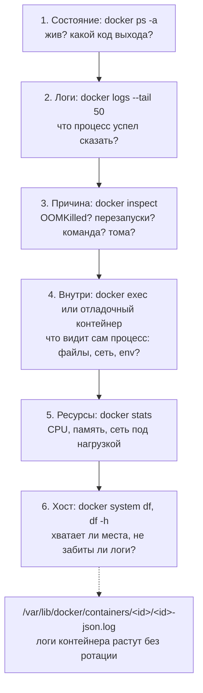
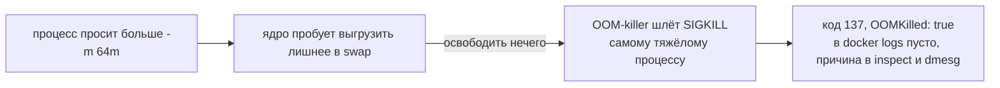
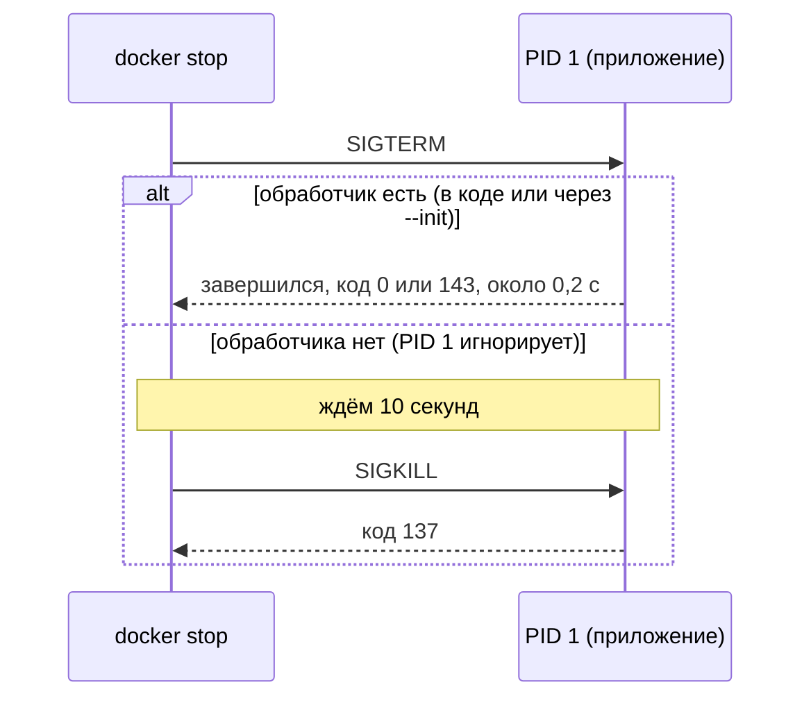
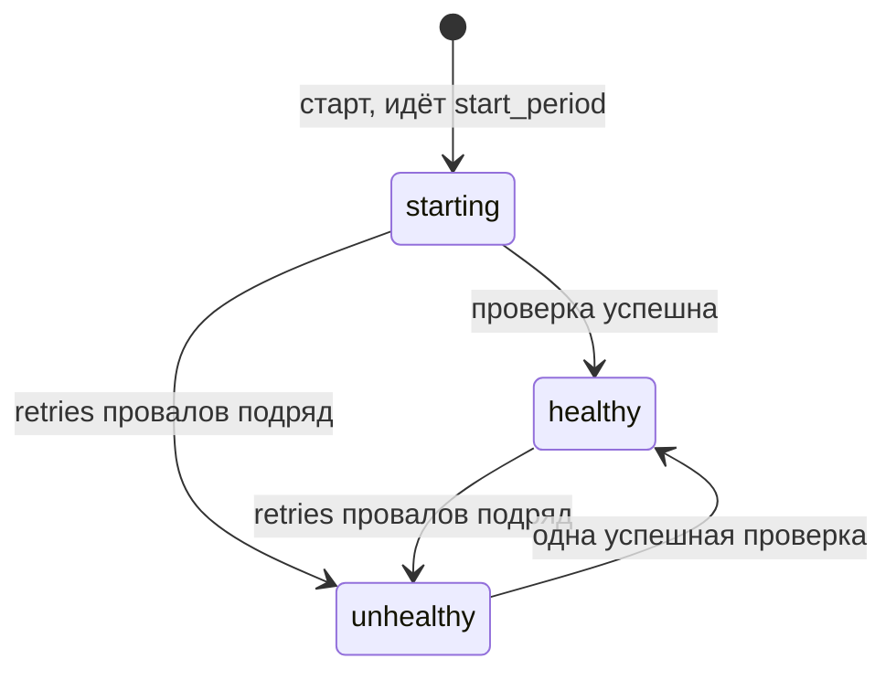

## Зачем это нужно

Три часа ночи. Сервис «Заметки» то отвечает, то нет. `docker ps` показывает, что контейнер работает, но время работы подозрительно маленькое: `Up 2 seconds`. В `docker logs` чисто. Вот как выглядела память этого контейнера за ночь (код выхода это число, с которым завершился процесс; 137 значит 128 плюс сигнал 9, то есть процесс убит снаружи; лимит памяти это потолок, выше которого Docker контейнеру занять не даёт; `docker inspect` это команда, которая печатает все настройки и состояние контейнера):

<div class="viz" data-viz="chart" data-type="line" data-title="Память контейнера notes за ночь (схема, не измерение)" data-x="02:30,02:35,02:40,02:45,02:50,02:55,03:00,03:05,03:10,03:15,03:20,03:25,03:30" data-series='[{"name":"память notes","values":[21,29,37,45,54,63,22,30,38,47,56,63,23]},{"name":"лимит -m 64m","values":[64,64,64,64,64,64,64,64,64,64,64,64,64]}]' data-x-label="Время ночью" data-y-label="Память" data-unit="МиБ" data-explain="Схема, а не измерение. Приложение медленно копит память и упирается в потолок 64 МиБ. Ядро убивает процесс, политика перезапуска поднимает контейнер заново, и память падает почти до начала. В 02:55 и 03:25 контейнер умирал с кодом 137, а в логах перед этим пусто."></div>

Память растёт ровными ступенями, каждый раз упирается в линию лимита и резко падает: контейнер убили, и он поднялся заново. Такая «пила» говорит, что дело не в случайном сбое, а в нехватке памяти. Как это проверить по шагам, разберём ниже. А пока важно одно: по таким следам причина находится за минуты, если знаешь, куда смотреть, и за часы, если перезапускать «на удачу».

Вторая типичная беда любого Docker-хоста: диск заполнился логами и старыми образами, а сервис умер с ошибкой `no space left on device` («на устройстве не осталось места»). Тут снова нужны следы, а не догадки.

На собеседованиях «контейнер в Exited, твои действия» и «диск полный, а `du` показывает мало» спрашивают почти всегда. В этом уроке ты воспроизведёшь настоящие поломки (нехватка памяти, занятый порт, DNS-ошибка, перезапуски по кругу, раздутые логи) и научишься идти от следа к причине по короткому порядку действий.

## Что нужно знать

- [Урок 1.4: процессы и сигналы](../01-linux/04-processes-signals.md): что такое процесс и PID, сигнал (короткое сообщение процессу от системы) SIGTERM («заверши работу») и SIGKILL («умри сейчас»), код выхода 128 + номер сигнала.
- [Урок 1.5: диск, память, CPU](../01-linux/05-disk-memory-cpu.md): `df` и `du`, OOM-killer (механизм ядра, который убивает процесс, когда память кончилась), cgroup (механизм ядра, задающий процессу потолок памяти и CPU, то есть процессора), демонстрационный эндпоинт `/leak` (адрес приложения, который намеренно занимает память).
- [Урок 1.6: основы Bash](../01-linux/06-bash-basics.md): `Makefile` (файл с именованными наборами команд), TAB в рецептах (строки с командами начинаются с символа табуляции), переменные, `test_app.py`.
- [Урок 4.2: Dockerfile](02-dockerfile.md): образ, слои, пользователь 10001, `CMD` в exec-форме и shell-форме.
- [Урок 4.3: тома и сети](03-storage-networks.md): именованные тома и пользовательские сети.
- [Урок 4.5: Compose и PostgreSQL](05-compose-postgres.md): стек `notes` + `db`, том `pgdata` (именованный том Docker, где PostgreSQL хранит данные, чтобы они пережили пересоздание контейнера).
- [Урок 4.6: nginx и TLS в Compose](06-compose-nginx-tls.md): сервис `proxy`, ротация логов (ограничение размера файлов логов, чтобы они не заполнили диск) `x-logging`.
- [Урок 4.7: образы и реестр](07-images-registry.md): образ `notes:0.4.0`, multi-stage `Dockerfile`.

## Картина целиком

Диагностика контейнера идёт по ступеням лестницы: у каждой своя команда и свой вопрос. Сначала смотрим, жив ли контейнер, потом что он сказал, потом почему остановился, потом что видно изнутри, как он нагружает ресурсы и хватает ли места на хосте. Начинать с конфигов и догадок не нужно: каждая ступень дешёвая и отсекает часть причин.

Контейнер для этой задачи - обычный процесс Linux, которому ядро дало четыре вещи: свой взгляд на файлы и сеть, лимит ресурсов, файлы из слоёв образа и канал для сообщений (stdout, стандартный поток вывода). Сломаться он может ровно тремя путями: процесс завершился сам (код выхода), ядро его убило (сигнал, чаще всего за память) или ему не хватило чего-то снаружи (порт, имя, место на диске).



За урок ты пройдёшь каждую ступень на живых поломках, научишься убирать диск так, чтобы не потерять данные, и в конце соберёшь проверки урока в `Makefile`: его цели станут короткими командами для сборки и запуска стека.

## Теория

### Что мы диагностируем: процесс, код выхода и сигнал

Слова «контейнер упал» ничего не говорят. Упасть может только процесс внутри, а у процесса есть точная «причина смерти». Без этого понятия не прочитать ни одну диагностику.

1. **Процесс** (process) - запущенная программа с номером PID. В контейнере главный процесс, тот, что запустила команда `CMD`, получает PID 1. Когда он завершается, контейнер останавливается: контейнер живёт ровно столько, сколько его PID 1.
2. **Код выхода** (exit code) - число от 0 до 255, которое процесс отдаёт системе при завершении. 0 значит «всё хорошо», остальное «что-то не так».
3. **Сигнал** (signal) - короткое сообщение процессу от ядра или другого процесса. Два нужны всегда: SIGTERM (номер 15, «заверши работу», процесс может успеть прибраться) и SIGKILL (номер 9, «умри немедленно», перехватить нельзя). Подробнее в [уроке 1.4](../01-linux/04-processes-signals.md).
4. Если процесс убит сигналом, код выхода равен `128 + номер сигнала`. Это правило оболочки, его использует и Docker.

Считаем: SIGKILL - сигнал 9, код `128 + 9 = 137`. SIGTERM - 15, код `128 + 15 = 143`. Увидел 137: процесс не «сломался», его убили. Осталось выяснить кто.

> **Прикинь сам:** контейнер завершился с кодом 139. Каким сигналом убит процесс?
{: .predict}

Номер сигнала 139 - 128 = 11. Это SIGSEGV («обратился к чужой памяти»), ошибка самой программы, а не нехватка памяти и не `docker stop`.

Осторожно: «код 0 - это всегда хорошо». Для сервиса нет: он должен работать вечно, и `Exited (0)` у веб-приложения значит, что оно тихо завершилось, и это странно.

> **Главное:** «упал контейнер» значит «завершился главный процесс»; код выхода (128 плюс номер сигнала) показывает, как именно.
{: .key}

> **Проверь понимание:** почему после `docker stop` контейнер остановился, хотя ты «не убивал» его?

<details markdown="1">
<summary>Ответ</summary>

Docker послал главному процессу (PID 1) сигнал SIGTERM. Процесс получил его и завершился, а раз контейнер живёт, пока живёт PID 1, остановился и контейнер.

</details>

Дальше посмотрим, из чего состоит контейнер как процесс.

### Контейнер глазами диагноста: четыре вещи от ядра

Все команды урока понятнее, если помнить, что контейнера как «маленькой машины» нет. Есть обычный процесс, которому ядро Linux выдало четыре вещи.

1. **Изоляция (namespaces).** Ядро показывает процессу свой набор файлов, свою сеть и свой список процессов. Внутри контейнера `python app.py` думает, что он PID 1 и в системе больше никого нет. С хоста тот же процесс виден под обычным номером.
2. **Лимиты (cgroups).** Ядро считает, сколько памяти и процессора занимает группа процессов, и не даёт занять больше заданного. Превысил потолок памяти - ядро убивает процесс (`OOMKilled`).
3. **Файлы из слоёв и слой записи.** Образ только для чтения. Поверх него Docker кладёт тонкий слой, куда контейнер пишет свои изменения (слой записи, writable layer). Контейнер удалили - слой удалился вместе с ним. Тома (volumes) живут отдельно и остаются, поэтому данные базы хранят в томе.
4. **Вывод.** Всё, что процесс печатает в stdout и stderr, Docker записывает в файл на хосте. Это единственный «журнал», за который отвечает платформа.

Так что контейнер не отдельная виртуальная машина: ядро у него общее с хостом. Поэтому взломанный контейнер опаснее, чем взломанная ВМ, а нехватка памяти выглядит как убийство процесса ядром хоста.

Пример: ты зашёл в `notes` через `docker exec`, создал `/tmp/x` и вышел. Пока контейнер работает, файл на месте. Выполнил `docker rm -f notes` и создал контейнер заново из того же образа: файла нет. Данные в томе `/data` остались, он подключён снаружи. Правило: всё, что должно пережить контейнер, лежит в томе, остальное считай одноразовым.

> **Прикинь сам:** контейнер писал по 1 МБ в `/tmp` (слой записи) и в `/data` (том). Ты пересоздал контейнер командой `up --force-recreate`. Сколько мегабайт данных осталось?
{: .predict}

1 МБ, из тома. Файл из `/tmp` лежал в слое записи и удалился вместе со старым контейнером.

Осторожно: «зашёл в контейнер и поправил файл - значит починил». Правка в слое записи пропадёт при пересоздании. Чини образ и конфигурацию, а не сам контейнер.

> **Главное:** контейнер - обычный процесс с изоляцией, лимитами и тонким слоем записи, а не маленькая виртуальная машина.
{: .key}

> **Проверь понимание:** ты поправил конфиг прямо внутри работающего контейнера, а после `docker compose up -d --force-recreate` правка пропала. Почему и как сделать правильно?

<details markdown="1">
<summary>Ответ</summary>

Правка лежала в слое записи, а при пересоздании контейнер удаляется вместе с ним и создаётся заново из неизменного образа. Чтобы правка жила, измени файл на хосте и смонтируй его в контейнер (bind mount) либо измени образ.

</details>

Теперь научимся идти к причине по порядку.

### Лестница диагностики и статусы в `docker ps -a`

Первая ошибка новичка - сразу лезть в конфиги. Порядок экономит время: каждая ступень дешёвая и отсекает половину причин.

| Ступень | Команда | Вопрос |
|---|---|---|
| 1. Состояние | `docker ps -a` | жив ли контейнер, какой код выхода |
| 2. Логи | `docker logs --tail 50 <имя>` | что он успел сказать перед смертью |
| 3. Причина | `docker inspect <имя>` | OOM, перезапуски, команда, смонтированные тома |
| 4. Внутри | `docker exec -it <имя> sh` | что видит процесс: файлы, сеть, переменные |
| 5. Ресурсы | `docker stats --no-stream` | CPU, память, сеть |
| 6. Хост | `docker system df`, `df -h` | не кончилось ли место |

Ключ `-a` в `docker ps -a` значит «all»: показывать и остановленные контейнеры (без него видны только работающие). В колонке STATUS бывают такие значения:

- `Up 2 seconds (health: starting)`: работает, проверка здоровья (`HEALTHCHECK`, [урок 4.2](02-dockerfile.md)) ещё не ответила; затем `(healthy)` или `(unhealthy)`.
- `Exited (137) 3 seconds ago`: остановился, в скобках код выхода.
- `Restarting (3) 2 seconds ago`: падает, и политика перезапуска снова его поднимает; в скобках код последнего падения.
- `Created`: контейнер создан, но процесс не стартовал (например, не нашлась команда или занят порт).

Реальный вывод, когда контейнер падает по кругу:

```text
NAMES     STATUS
loop      Restarting (3) 2 seconds ago
```

`Restarting` говорит, что контейнер перезапускают снова и снова, а `(3)` - что процесс каждый раз завершается с кодом 3. Уже ясно: смотреть логи и код 3, а не «почему Docker не работает».

Те же шаги есть в Kubernetes ([тема 5](../05-kubernetes/01-why-k8s-cluster.md)), только команды другие:

| Docker | Kubernetes | Что показывает |
|---|---|---|
| `docker ps -a` | `kubectl get pods` | состояние и число перезапусков |
| `docker logs --tail 50 имя` | `kubectl logs --tail=50 под` | вывод процесса |
| логи прошлого запуска | `kubectl logs --previous под` | что процесс сказал перед последним падением |
| `docker inspect` (код, `OOMKilled`) | `kubectl describe pod под` (блок Last State) | причина последней остановки |
| `HEALTHCHECK` | пробы (probes) readiness и liveness | жив и готов ли сервис |
| `docker events` | `kubectl get events` | что происходило с объектом |
| `journalctl -u docker` | `journalctl -u kubelet` | логи самого демона или агента узла, не контейнера |

Логика одна: состояние, логи, причина, внутри, ресурсы.

> **Прикинь сам:** на хосте 5 контейнеров: 2 работают, 3 упали. Сколько строк покажет `docker ps` и сколько `docker ps -a`?
{: .predict}

Две и пять: без `-a` остановленные контейнеры не видны.

Осторожно: статус `Up` не значит «сервис работает». Процесс жив, но приложение может отдавать 500. Поэтому рядом смотрят `health`.

> **Главное:** идём по лестнице от дешёвого к дорогому: состояние, логи, причина (`inspect`), внутри (`exec`), ресурсы (`stats`), хост.
{: .key}

> **Проверь понимание:** контейнер `Up (healthy)`, но пользователи жалуются на ошибки 500. С какой ступени продолжишь?

<details markdown="1">
<summary>Ответ</summary>

Со ступени 2: `docker logs --tail 50` покажет, что приложение пишет об ошибках. Состояние и здоровье уже в порядке, значит дело в самом приложении или в том, с чем оно говорит (база, соседний сервис). Дальше `exec` и проверка соединений изнутри.

</details>

Теперь научимся читать сами сообщения об ошибках.

### Как читать сообщение об ошибке Docker: справа налево

Сообщения Docker длинные, но устроены одинаково: в начале «кто сообщает», в конце причина. Слева направо теряешься в идентификаторах, справа налево причина находится за секунды.

1. Клиент `docker` просит демона `dockerd` (фоновую службу Docker) что-то сделать. Если демон отказал, клиент печатает `Error response from daemon:` и дальше текст демона.
2. Демон просит исполнителя `runc` запустить процесс. Ошибка оттуда попадает в текст фрагментами `OCI runtime create failed`, `exec:` или `failed to set up container networking`.
3. В самом конце стоит первоисточник от ядра, файловой системы или сети: `permission denied`, `executable file not found in $PATH`, `Bind for ... failed: port is already allocated`, `no such host`.
4. Середину из идентификаторов (`6047ed...`), путей и номеров пропускай: они нужны для поиска в журнале, а не для понимания.

Пример: `docker: Error response from daemon: ... Bind for 127.0.0.1:8080 failed: port is already allocated`. С конца: `port is already allocated` - порт занят. Перед ним `Bind for 127.0.0.1:8080 failed` - какой именно адрес и порт. `Error response from daemon` - отказал сам демон, это не ошибка синтаксиса. Вывод: искать, кто держит 8080, а не перечитывать команду.

Второй пример: `exec: "nosuchcmd": executable file not found in $PATH`. Причина - `not found in $PATH` (команды нет среди каталогов, где система ищет программы), в кавычках имя команды. Вместе с кодом выхода 127 из таблицы ниже это опечатка или программа, которой нет в образе.

Иногда после причины стоит служебное `: unknown` (`...not found in $PATH: unknown`). Это не причина, она перед ним.

> **Прикинь сам:** ты запускаешь `docker run -p 8080:8080 notes:0.4.0` и получаешь `...Bind for 0.0.0.0:8080 failed: port is already allocated`. Какой номер порта нужно искать у соседей и сколько программ могут занимать его одновременно?
{: .predict}

Порт 8080, и занимать его одновременно может только одна программа.

Осторожно: «`Error response from daemon` значит, что Docker сломан». Нет, это просто «ответ демона на твой запрос». Если сломан сам демон, будет `Cannot connect to the Docker daemon at unix:///var/run/docker.sock`: клиент не достучался до службы.

> **Главное:** сообщение читают с конца: причина стоит последней, а `Error response from daemon` лишь говорит, кто сообщает.
{: .key}

> **Проверь понимание:** `Cannot connect to the Docker daemon` и `port is already allocated`. Какое из них говорит о проблеме с самой службой Docker?

<details markdown="1">
<summary>Ответ</summary>

Первое: клиент вообще не соединился с демоном (служба не запущена или нет прав на сокет). Второе пришло от работающего демона: он получил запрос, но порт занят.

</details>

Следующая улика после текста ошибки - код выхода.

### Коды выхода: таблица и как их получать

Код выхода - самая дешёвая улика: он показывает класс проблемы ещё до чтения логов.

| Код | Смысл | Откуда берётся |
|---|---|---|
| 0 | штатное завершение | для сервиса это тоже странно: он должен работать вечно |
| 1 | ошибка приложения | необработанное исключение, читай логи |
| 125 | сам `docker run` не смог запуститься | неверный флаг, порт занят, ошибка демона |
| 126 | команда найдена, но не исполняется | нет права `x`, это не программа |
| 127 | команда не найдена | опечатка в `CMD`, нет бинарника в образе |
| 137 | 128 + 9: SIGKILL | OOM-killer, `docker kill`, `docker stop` не дождался |
| 143 | 128 + 15: SIGTERM | процесс убит сигналом SIGTERM, а не завершился сам |

Тонкость про 143. Наше приложение из [урока 1.4](../01-linux/04-processes-signals.md) перехватывает SIGTERM, печатает `shutting down` и выходит с кодом **0**, а не 143. 143 увидишь у программы, которая SIGTERM не перехватывает и умирает от него.

Реальные результаты двух «ошибок запуска». `alpine:3.22` - маленький образ Linux, `nosuchcmd` - несуществующая команда, `/etc/hostname` - обычный текстовый файл, не программа:

```text
$ docker run --name c127 alpine:3.22 nosuchcmd; echo "exit=$?"
docker: Error response from daemon: ... exec: "nosuchcmd": executable file not found in $PATH
exit=127
$ docker run --name c126 alpine:3.22 /etc/hostname; echo "exit=$?"
docker: Error response from daemon: ... exec: "/etc/hostname": permission denied
exit=126
```

`$?` - код выхода последней команды. 127 значит «не найдено», 126 - «нельзя исполнить». Оба контейнера остались в статусе `Created`: процесс не стартовал.

> **Прикинь сам:** `docker run` вернул код 125, а контейнер при этом не создан. Что это за класс проблемы: ошибка приложения или ошибка запуска?
{: .predict}

Ошибка запуска: код 125 выдаёт сам `docker run` (флаг, порт, демон), а приложение даже не стартовало.

Осторожно: «137 - это всегда нехватка памяти». Нет, 137 значит только «убит SIGKILL». Кто послал сигнал, покажет раздел про OOM и про `docker events` ниже.

> **Главное:** 1 - ошибка приложения, 125 - ошибка `docker run`, 126 - не исполняется, 127 - не найдено, 137 - SIGKILL, 143 - SIGTERM.
{: .key}

> **Проверь понимание:** `docker run alpine:3.22 python app.py` вернул 127. Что случилось и как поправить?

<details markdown="1">
<summary>Ответ</summary>

В образе `alpine:3.22` нет программы `python`, поэтому «команда не найдена». Нужен образ с Python (например, `notes:0.4.0`) или другая команда.

</details>

Теперь посмотрим, где процесс оставляет свои сообщения.

### Логи: что такое stdout и почему `docker logs` бывает пуст

У контейнера нет окна, куда приложение могло бы «показать» сообщение. Нужен единый канал, откуда платформа заберёт всё, что программа сказала.

1. У процесса два стандартных выходных потока: **stdout** (обычные сообщения) и **stderr** (ошибки). Терминал показывает оба.
2. Docker подключается к обоим потокам главного процесса и пишет всё в файл на хосте. По умолчанию это драйвер логов `json-file`: каждая строка оборачивается в JSON с временем и именем потока.
3. `docker logs <имя>` читает этот файл. Полезные ключи: `--tail 50` (последние 50 строк), `--since 10m` (за последние 10 минут), `-f` (следить), `-t` (добавить время).

Так выглядит одна строка в файле (реальная, из контейнера, напечатавшего «строка лога для проверки»):

```text
{"log":"строка лога для проверки\n","stream":"stdout","time":"2026-09-30T12:16:32.044359379Z"}
```

Поле `log` - сама строка, `stream` - откуда она пришла, `time` - время. Эта строка занимает около 116 байт, из них около 70 байт обвязка JSON. Поэтому файл лога заметно больше текста (задание 3 это измерит).

Приложения «Заметки» пишут в консоль, а не в файл: так их вывод попадает в `docker logs` сам.

Другие драйверы логов: `local` (компактный формат с ротацией по умолчанию), `journald` (в журнал systemd) и драйверы отправки в систему сбора (`fluentd`, `gelf`). Для долгого хранения логи отправляют туда, потому что файлы с ротацией стирают старое ([тема 8](../08-observability/index.md)). Если сломался сам демон, а не контейнер, его логи читают с хоста: `sudo journalctl -u docker --since "1 hour ago"`.

> **Прикинь сам:** приложение напечатало 1000 коротких строк. Файл `json-file` получится меньше, равен или больше суммарной длины самого текста и почему?
{: .predict}

Больше: каждую строку Docker оборачивает в JSON с полями `stream` и `time`, и обвязка в нашем примере весит больше самого текста.

Осторожно: «`docker logs` пуст, значит приложение молчит». Не всегда: либо процесс погиб раньше первой строки (его убило ядро за память), либо пишет не в stdout, а в файл внутри контейнера.

> **Главное:** Docker читает только stdout и stderr главного процесса, поэтому приложение должно писать в консоль.
{: .key}

> **Проверь понимание:** `docker logs` пуст, а контейнер `Exited (1)`. Какие две причины самые вероятные?

<details markdown="1">
<summary>Ответ</summary>

Первая: процесс упал раньше, чем успел напечатать. Тогда смотри код выхода и запусти образ с другой командой: `docker run --rm -it --entrypoint sh <образ>`.
Вторая: приложение пишет логи в файл, а не в stdout. Тогда читай файл через `docker exec` или `docker cp`, а в образе перенаправь лог в stdout.

</details>

Дальше узнаем, где Docker хранит всё остальное о контейнере.

### `docker inspect`: паспорт контейнера

Всё, что Docker знает о контейнере (состояние, лимиты, команда, тома, причина смерти), лежит в одном JSON. Логи рассказывают, что сказало приложение, а `inspect` - что с ним сделала платформа.

`docker inspect <имя>` печатает JSON на сотни строк. Читать всё не нужно: поля достают шаблоном `--format` (`-f`), в нём `.State.ExitCode` значит «поле ExitCode внутри блока State». Другой способ: конвейер в `jq` (разбор JSON), например `docker inspect имя | jq '.[0].State'`.

| Поле | Что значит |
|---|---|
| `.State.Status` | `running`, `exited`, `restarting` и т. п. |
| `.State.ExitCode` | код выхода последнего завершения |
| `.State.OOMKilled` | `true`, если убило ядро за превышение лимита памяти |
| `.RestartCount` | сколько раз политика перезапускала контейнер |
| `.HostConfig.Memory` | лимит памяти в байтах (0 значит «без лимита») |
| `.LogPath` | путь к файлу логов на хосте |
| `.Mounts` | какие тома и каталоги подключены |
| `.Config.Cmd`, `.Config.User` | команда запуска и пользователь |

Блок `State` реального контейнера, убитого за память (значения сокращены):

```text
{
  "Status": "exited",
  "OOMKilled": true,
  "ExitCode": 137,
  "StartedAt": "2026-09-30T12:14:13.82010026Z",
  "FinishedAt": "2026-09-30T12:14:16.168988845Z"
}
```

Читаем: остановился (`exited`), код 137, `OOMKilled: true` отвечает на главный вопрос «кто убил»: ядро, за превышение лимита. По времени контейнер прожил около трёх секунд.

> **Прикинь сам:** в `inspect` у контейнера `HostConfig.Memory` равно `0`, а `OOMKilled` равно `false`. Задан ли лимит памяти и мог ли ядро убить этот контейнер за превышение лимита?
{: .predict}

Лимит не задан: 0 значит «без лимита». Убить за превышение лимита контейнера ядро не могло. Если контейнер всё же умер от SIGKILL, ищи другую причину (внешний сигнал или нехватка памяти на всём хосте).

Осторожно: «`OOMKilled: false` значит, что память ни при чём». Не совсем: после автоматического перезапуска Docker обнуляет это поле (увидим в практике). Проверяй ещё `RestartCount` и события.

> **Главное:** `inspect` показывает состояние, код выхода, `OOMKilled`, число перезапусков, лимиты и тома; поля достают шаблоном `--format`.
{: .key}

> **Проверь понимание:** контейнер в статусе `Exited (1)`. Каким полем проверишь, не убило ли его ядро, и каким - сколько раз его уже перезапускали?

<details markdown="1">
<summary>Ответ</summary>

`.State.OOMKilled` отвечает, убило ли ядро за память, `.RestartCount` - сколько раз перезапускала политика. Код 1 говорит скорее об ошибке приложения, но `OOMKilled` всё равно стоит проверить.

</details>

Иногда причину видно только изнутри.

### `docker exec`, отладочный контейнер и лимиты имён

Иногда причину видно только изнутри: есть ли файл, резолвится ли имя, слушает ли порт.

1. `docker exec <имя> <команда>` запускает второй процесс в тех же «стенах» (namespaces) и с теми же лимитами (cgroup), что и главный. Ключи `-it` подключают клавиатуру и терминал: `docker exec -it имя sh`.
2. Наш образ на основе `python:3.13-slim` минимален: нет `curl` и нет `ps`. Зато есть Python, им можно проверять сеть.
3. Когда внутри нет ничего (distroless-образы: в них только программа и её библиотеки, без оболочки и утилит), запускают **отладочный контейнер**: чужой образ с нужными инструментами, подключённый к сети (`--network container:<имя>`) или списку процессов (`--pid container:<имя>`) целевого контейнера.

Реальный пример: проверяем здоровье изнутри без `curl`.

```text
$ docker exec web1 python -c "import urllib.request;print(urllib.request.urlopen('http://127.0.0.1:8080/healthz').read())"
b'ok'
$ docker exec web1 ps
OCI runtime exec failed: exec failed: unable to start container process: exec: "ps": executable file not found in $PATH: unknown
$ docker run --rm --pid container:web1 alpine:3.22 ps
PID   USER     TIME  COMMAND
    1 10001     0:00 python app.py
   29 root      0:00 ps
```

`b'ok'` - ответ `/healthz` (буква `b` значит «байты»). `docker exec` запускает программу напрямую, без оболочки, поэтому вместо `sh: ps: not found` приходит ошибка runc: `ps` в образе нет. Отладочный контейнер `alpine:3.22` с `--pid container:web1` видит процессы «Заметок»: `python app.py` под пользователем 10001 с PID 1.

> **Прикинь сам:** в отладочном контейнере с `--pid container:web1` ты запускаешь `ps`. Какой PID будет у `python app.py` и под каким пользователем он работает?
{: .predict}

PID 1 и пользователь 10001: это главный процесс контейнера `web1`, он работает не от root ([урок 4.2](02-dockerfile.md)).

Осторожно: изменения слоя записи пропадают при пересоздании контейнера. Через `exec` смотрят и проверяют, а чинят образ и конфигурацию.

> **Главное:** `exec` запускает второй процесс в тех же стенах, а отладочный контейнер приносит нужные инструменты и делит среду.
{: .key}

> **Проверь понимание:** зачем отладочному контейнеру ключ `--network container:web1`, если можно запустить `curl` с хоста?

<details markdown="1">
<summary>Ответ</summary>

Так ты проверяешь именно то, что видит приложение: контейнер делит с `web1` одну сетевую среду, а порт может быть не опубликован наружу. `127.0.0.1` в отладочном контейнере - тот же `127.0.0.1`, что у приложения.

</details>

Теперь про самую частую причину тихой смерти: память.

### Память: лимит cgroup, swap и OOMKilled

Лимит памяти защищает соседей: один жадный контейнер не должен съесть весь хост. Но сам контейнер при превышении умирает мгновенно и без предупреждения.

1. Флаг `-m 64m` (или `mem_limit` в Compose) записывает в **cgroup** контейнера лимит 64 МиБ ([урок 1.5](../01-linux/05-disk-memory-cpu.md)).
2. Когда процессы группы просят больше, ядро сначала пробует выгрузить лишнее в swap (область подкачки на диске), если она разрешена.
3. Если освободить нечего, включается **OOM-killer** (Out Of Memory killer): когда места нет, ядро выбирает самый тяжёлый процесс группы и убивает его сигналом SIGKILL. Код выхода 137, поле `OOMKilled` становится `true`.
4. Процесс не успевает ничего написать: SIGKILL не перехватить. Поэтому в `docker logs` причины нет, она есть в `inspect`, в `docker events` и в журнале ядра (`sudo dmesg`).

Правило такое: если процесс просит больше, чем осталось до лимита, и освободить нечего, ядро убивает его. Свободная память хоста значения не имеет: проверяется лимит группы.

Флаг `-m 64m` по умолчанию разрешает ещё столько же swap (всего 128 МиБ), если swap на машине есть. Поэтому один запрос на 100 МиБ мог бы «пролезть». Чтобы поведение не зависело от машины, добавляют `--memory-swap 64m` (память вместе со swap равна лимиту, значит swap не используется). Запрос `/leak?mb=100` при лимите 64 МиБ даст в `dmesg`:

```text
[ 2775.517744] python invoked oom-killer: gfp_mask=0xcc0(GFP_KERNEL), order=0, oom_score_adj=0
[ 2775.517882] oom-kill:constraint=CONSTRAINT_MEMCG,...,task=python,pid=157205,uid=10001
[ 2775.517914] Memory cgroup out of memory: Killed process 157205 (python) total-vm:210136kB, anon-rss:64464kB, file-rss:8828kB, shmem-rss:0kB, UID:10001
```

Это реальные строки журнала ядра, убрана только длинная часть с идентификаторами. `oom-killer` вызван; `constraint=CONSTRAINT_MEMCG` значит «убийство по лимиту cgroup, а не из-за нехватки памяти всего хоста»; `anon-rss:64464kB` - около 63 МиБ занятой памяти в момент смерти, то есть упёрлись в потолок.



Если при запуске с лимитом Docker пишет `WARNING: Your kernel does not support swap limit capabilities or the cgroup is not mounted. Memory limited without swap.`, значит учёт swap на хосте выключен, и `--memory-swap` не действует. На старых системах с cgroup v1 его включают параметром ядра `swapaccount=1`; на cgroup v2 учёт swap обычно уже есть. Это объясняет, почему на одной машине запрос на 100 МБ даёт `leaked total 100 MB`, а на другой убийство: поведение зависит от настроек хоста.

> **Прикинь сам:** контейнер умер, в `docker logs` пусто, код выхода 137, а `docker inspect` показывает `OOMKilled: true`. Кто его убил и где это видно, кроме `inspect`?
{: .predict}

Убило ядро по лимиту памяти cgroup, сигналом SIGKILL: процесс не успел ничего написать, поэтому в логах пусто. Следы остаются в `docker events` (событие `oom`) и в журнале ядра (`sudo dmesg -T`, строка `Killed process`).

Осторожно: «свободной памяти на хосте много, значит OOM невозможен». Возможен: лимит контейнера и память хоста - разные величины. И ещё: «политика `restart` починила проблему». Она только скрывает её: контейнер поднялся, но `RestartCount` растёт.

> **Главное:** при превышении лимита ядро убивает процесс без предупреждения; в `docker logs` это не видно, видно в `inspect` и `dmesg`.
{: .key}

> **Проверь понимание:** контейнер упёрся в лимит 64 МиБ, ты поднял лимит до 512 МиБ, а через сутки картина «пилой» повторилась. Что это значит и что делать дальше?

<details markdown="1">
<summary>Ответ</summary>

Скорее всего это утечка: память растёт без нагрузки, и больший лимит лишь отодвигает убийство. Смотри `docker stats` во времени и ищи источник роста в приложении. Поднимать лимит осознанно можно, только если реальная потребность выше.

</details>

Чтобы увидеть приближение к лимиту, смотрим `stats`.

### `docker stats`: ресурсы под нагрузкой

`inspect` говорит, какой лимит задан, но не говорит, сколько контейнер использует прямо сейчас. Для этого нужна «приборная панель» в реальном времени.

1. `docker stats` раз в секунду опрашивает cgroup каждого контейнера. Ключ `--no-stream` печатает один снимок и выходит (удобно в скриптах).
2. `CPU %` - доля процессорного времени. 100% - одно ядро полностью; на многоядерной машине бывает и 250%.
3. `MEM USAGE / LIMIT` - занято и предел. Если лимит не задан, вместо него вся память хоста, а не настоящий потолок.
4. `MEM %` - доля от предела. Около 100% при заданном `-m` значит, что `OOMKilled` близко.
5. `NET I/O` и `BLOCK I/O` - сколько данных прошло по сети и диску с момента старта (сумма, а не скорость). `PIDS` - число процессов и потоков.

Пример строки: `notes   0.3%   61.2MiB / 64MiB   95.6%   1.2kB / 800B   ...   4`. Процессор почти не нагружен, память занята на 95,6% лимита. Это тревожный признак: при росте на 3 МиБ ядро убьёт процесс. Проценты важнее абсолютных: 61 МиБ без лимита не проблема, а при лимите 64 МиБ проблема. Единицы: `MiB` (мебибайты, 1024 × 1024 байт) чуть больше `MB`, поэтому 64 MiB - около 67 МБ.

> **Прикинь сам:** на 4-ядерной машине контейнер показывает `CPU %` равным 250%. Сколько ядер он занимает?
{: .predict}

Два с половиной ядра: 100% соответствует одному ядру.

Осторожно: «высокий CPU значит, что приложение зависло». Нет, может обрабатываться запрос. Смотри динамику: если процессор на 100% минуту без запросов, ищи цикл.

> **Главное:** `docker stats` показывает потребление сейчас; без лимита в `LIMIT` стоит вся память хоста, а не потолок контейнера.
{: .key}

> **Проверь понимание:** у контейнера задан `-m 64m`, и `MEM %` держится на 100%. Что будет дальше и кто убьёт процесс?

<details markdown="1">
<summary>Ответ</summary>

Процесс скоро запросит ещё и упрётся в потолок: OOM-killer ядра пришлёт SIGKILL, код 137, `OOMKilled: true`. Это не Docker, а ядро по лимиту cgroup. Пока не убили, ищи источник роста.

</details>

Теперь поговорим об остановке контейнера.

### Остановка: `docker stop`, PID 1 и код 137

«Деплой висит десять секунд, потом код 137» - классическая проблема. Она объясняется одним правилом про PID 1.

1. `docker stop` шлёт главному процессу SIGTERM и ждёт 10 секунд (меняется ключом `-t`).
2. Если процесс завершился, всё хорошо. Иначе Docker шлёт SIGKILL, и код выхода 137.
3. Особенность **PID 1**: ядро не применяет к нему действия по умолчанию. Обычная программа умирает от SIGTERM, а PID 1 нет, пока программа сама не установила обработчик сигнала. «Заметки» установили его в [уроке 1.4](../01-linux/04-processes-signals.md), поэтому останавливаются быстро.
4. **Форма записи `CMD`** ([урок 4.2](02-dockerfile.md)). Exec-форма `CMD ["python", "app.py"]` запускает Python напрямую, он получает PID 1 и сигнал. Shell-форма `CMD python app.py` запускает `/bin/sh -c "python app.py"`: PID 1 оболочка, и она сигнал Python может не передать. При exec-форме сигнал до Python дойдёт, но Python как PID 1 без обработчика его проигнорирует: нужен обработчик в коде или `--init` (п. 5).
5. Выход для программ без обработчика: ключ `--init` (в Compose `init: true`). Docker запускает крошечный `init`-процесс, он становится PID 1, получает SIGTERM и пересылает его настоящему процессу.

Реальные замеры (`time` показывает, сколько ждал `docker stop`):

| Запуск | Время `docker stop` | Код выхода |
|---|---|---|
| `notes:0.4.0`, exec-форма | 0.22 с | 0 |
| `sh -c 'python app.py; true'` (shell-форма) | 10.15 с | 137 |
| `alpine:3.22 sleep 300` | 10.12 с | 137 |
| `--init alpine:3.22 sleep 300` | 0.17 с | 143 |
| `docker kill` для любого контейнера | сразу | 137 |

В строке про shell-форму `; true` добавлено, чтобы оболочка не подменила себя процессом `python`: некоторые оболочки при единственной команде заменяют себя ею (exec). Читаем: «Заметки» обрабатывают SIGTERM и выходят с 0; `sleep` без обработчика как PID 1 игнорирует SIGTERM, ждёт десять секунд и получает 137; с `--init` SIGTERM доходит до `sleep`, тот умирает от сигнала, код 143.



Exec-форма нужна, но её одной недостаточно: она доставляет сигнал программе, но сам обработчик (в коде или через `--init`) она не создаёт.

Если остановка заняла ровно 10 секунд, SIGTERM не сработал.

> **Прикинь сам:** процесс не реагирует на SIGTERM, и ты запускаешь `docker stop -t 3`. Сколько секунд пройдёт до SIGKILL?
{: .predict}

Три секунды, потом SIGKILL и код 137.

Осторожно: «`docker stop` - то же самое, что `docker kill`». Нет, `stop` вежливый, `kill` сразу SIGKILL.

> **Главное:** exec-форма `CMD` необходима, но не достаточна: PID 1 не умирает от SIGTERM сам, нужен обработчик в коде или `--init`.
{: .key}

> **Проверь понимание:** `docker stop` работает 10 секунд и заканчивается кодом 137, `OOMKilled: false`. Что делать?

<details markdown="1">
<summary>Ответ</summary>

SIGTERM не дошёл или приложение его игнорирует, и Docker добил процесс через 10 секунд. Проверь форму `CMD` (нужна exec-форма), затем добавь обработчик SIGTERM в код или запуск с `--init`. Увеличение `stop_grace_period` причину не лечит.

</details>

Теперь про сеть и порты.

### Сеть и порты: `port is already allocated` и `no such host`

Две самые частые «ошибки запуска»: порт занят и имя не находится. Причина видна в тексте, если уметь его читать.

Порт - номер «двери» на машине (0-65535); одну дверь может занимать только одна программа. Ключ `-p 127.0.0.1:8080:8080` значит «порт 8080 хоста, только с этой машины, перенаправь на порт 8080 контейнера». Если 8080 уже занят (другим контейнером или программой), `docker run` завершается кодом 125 с `port is already allocated`.

Имена: внутри пользовательской сети Docker есть свой DNS ([урок 4.3](03-storage-networks.md)), который по имени сервиса (`db`, `notes`) возвращает адрес контейнера. Нет такого имени - получишь `no such host` (для образа в реестре) или `Name or service not known` (внутри приложения).

Реальные сообщения:

```text
docker: Error response from daemon: failed to set up container networking: driver failed programming external connectivity on endpoint web2 (6047ed...): Bind for 127.0.0.1:8080 failed: port is already allocated

Error response from daemon: failed to resolve reference "registry.example.invalid/notes:0.4.0": failed to do request: Head "https://registry.example.invalid/v2/notes/manifests/0.4.0": dial tcp: lookup registry.example.invalid on 192.168.65.7:53: no such host
```

Первое: `Bind for 127.0.0.1:8080 failed`, причина после последнего двоеточия. Кто занял, найдёшь так: `docker ps --filter publish=8080`. Второе: `lookup ... no such host` - ответ DNS-сервера `192.168.65.7:53` (у тебя адрес другой) «такого имени не знаю». Опечатка в имени реестра или нет доступа к DNS. Слово `denied` в другой ошибке (`error from registry: denied`) значит другое: имя найдено, но реестр отказал в доступе.

Внутри приложения: «Заметки» v4 с `STORE=postgres` и несуществующим хостом `db` пишут `failed to resolve host 'db': [Errno -2] Name or service not known`, отдают `/readyz` с кодом 503 и `/notes` с 500. Контейнер при этом `Up`, а работать не может.

> **Прикинь сам:** ты запустил два контейнера с одинаковым `-p 127.0.0.1:8080:8080` подряд. Сколько из них запустится и какой будет код выхода у второго?
{: .predict}

Запустится один, второй вернёт код 125 с `port is already allocated`.

Осторожно: `no such host` и `connection refused` (уроки 2.2 и 2.5) - разное: в первом имя не превратилось в адрес, во втором адрес есть, но по нему никто не слушает.

> **Главное:** `port is already allocated` значит занят порт, `no such host` значит имя не превратилось в адрес; это разные классы проблем.
{: .key}

> **Проверь понимание:** приложение в контейнере пишет `Name or service not known` про хост `db`, хотя контейнер `db` запущен. Что проверишь первым?

<details markdown="1">
<summary>Ответ</summary>

Что оба контейнера в одной пользовательской сети: DNS по имени работает только внутри неё (`docker network inspect`, поле `Containers`). Затем проверь написание имени в `DATABASE_URL`. В сети по умолчанию (`bridge`) имена не резолвятся.

</details>

Теперь научимся проверять здоровье сервиса.

### Healthcheck: как Docker решает, что сервис здоров

Статус `Up` говорит только «процесс жив». Приложение при этом может не отвечать: завис, потерял базу, не закончило запуск. Без проверки здоровья Docker и Compose не отличат «жив и работает» от «жив, но бесполезен». Docker сам по статусу `unhealthy` контейнер не перезапускает: это делает оркестратор или ты.

1. В образе или в `compose.yml` описана команда проверки ([урок 4.2](02-dockerfile.md)), например запрос к `/healthz`. Код выхода 0 значит «здоров», 1 «нездоров».
2. Первые `start_period` секунд провалы не считаются. Статус в это время `starting`.
3. Каждые `interval` секунд Docker запускает проверку внутри контейнера и ждёт не дольше `timeout`.
4. После `retries` неудач подряд статус становится `unhealthy`. Одна успешная проверка возвращает `healthy`.
5. Результаты лежат в `docker inspect` в блоке `.State.Health`: статус, счётчик неудач и журнал с выводом команды.

Пример: контейнер показывает `Up 2 minutes (unhealthy)`. Ты выполняешь `docker inspect --format '{{json .State.Health}}' имя` и видишь в журнале `connection refused`. Процесс жив, но порт приложения никто не слушает: смотри логи и проверь, тот ли порт указан в проверке. Если в журнале `timeout`, приложение отвечает слишком медленно.



> **Прикинь сам:** `interval` 10 с и `retries` 3. Через сколько секунд сбоев статус станет `unhealthy`?
{: .predict}

Примерно через 30 секунд (3 провала по 10 с), если нет `start_period`.

Осторожно: «`unhealthy` значит, что контейнер упал». Нет, он работает, просто проверка не проходит. Вторая ошибка: проверка, которая всегда зелёная (`exit 0`) и создаёт ложное спокойствие.

> **Главное:** `Up` значит только «процесс жив», `healthy` значит, что проверка проходит, а `unhealthy` не значит «упал».
{: .key}

> **Проверь понимание:** контейнер в статусе `(health: starting)` уже пять минут, хотя `start_period` 30 секунд. Что это значит?

<details markdown="1">
<summary>Ответ</summary>

Статус `starting` держится, пока нет ни одной успешной проверки и не набрано `retries` провалов подряд. Пять минут значит, что проверки идут редко (большой `interval`), каждая долго ждёт ответа (большой `timeout`) или задано много `retries`. Смотри `.State.Health.Log` в `docker inspect`: там видно, когда и с каким результатом проходили проверки.

</details>

Теперь про перезапуски.

### Перезапуски: политика `restart` и цикл падений

Docker умеет сам поднимать упавший контейнер. Это удобно, но легко прячет проблему.

Флаг `--restart` (или `restart:` в Compose) задаёт политику: `no` (по умолчанию), `on-failure` (только при ненулевом коде), `always` и `unless-stopped` (всегда, кроме случая, когда ты сам остановил). Между попытками Docker выдерживает растущую паузу. Каждая попытка увеличивает `RestartCount`.

Реальный контейнер, который печатает `boot`, потом `fatal: config missing` и выходит с кодом 3:

```text
NAMES     STATUS
loop      Restarting (3) 2 seconds ago
restarts=6 exit=3 status=restarting
```

Через шесть секунд счётчик уже 6. Формула: `Restarting` и маленький код (1-3) - падает само приложение, читай логи; `Restarting (137)` и растущий счётчик - часто память, при этом логи пусты.

> **Прикинь сам:** `RestartCount` равен 6 и растёт, код каждый раз 3. Сколько раз контейнер упал сам?
{: .predict}

Минимум 6 раз: это цикл падений приложения.

Осторожно: «контейнер `Up`, значит всё в порядке». Посмотри на время в статусе: `Up 2 seconds` через минуту после старта означает, что он падает и поднимается.

> **Главное:** политика `restart` прячет проблему: смотри счётчик, код выхода и время `Up`.
{: .key}

> **Проверь понимание:** контейнер в `Restarting (137)`, а `docker logs` пуст. Какая первая гипотеза и чем её проверишь?

<details markdown="1">
<summary>Ответ</summary>

137 с пустыми логами - SIGKILL без прощания, чаще всего OOM. Проверяю `docker inspect -f '{{.HostConfig.Memory}}'` (есть ли лимит), `docker stats` (близко ли к потолку) и `docker events --filter event=oom`, потому что `OOMKilled` после перезапуска обнуляется.

</details>

Теперь поговорим о диске.

### Куда уходит диск Docker

Диск - единственный ресурс, который кончается тихо и вдруг, и тогда падает всё сразу: сборки, `pull`, запись в базу.

Docker хранит всё в `/var/lib/docker`. Главные потребители:

- **образы** (images): неиспользуемые теги и образы без имени, которые остаются после сборок без `-t`. Образ без тега (dangling) в выводе выглядит как `<none>` или `<untagged>`, искать его надёжнее через `docker images --filter dangling=true`. Слои образов общие: два образа с одной базой делят её на диске.
- **контейнеры**: у каждого свой слой записи; остановленный контейнер продолжает занимать место.
- **тома** (volumes): данные, самое ценное.
- **кэш сборки** (build cache): промежуточные результаты `docker build`.
- **логи**: файл `/var/lib/docker/containers/<id>/<id>-json.log`. Драйвер `json-file` без ротации не ограничивает размер, и главное: **`docker system df` логи не учитывает**.

Реальный вывод `docker system df` (числа у тебя будут другие):

```text
TYPE            TOTAL     ACTIVE    SIZE      RECLAIMABLE
Images          3         2         269.3MB   2.198MB (0%)
Containers      2         1         20.98MB   20.98MB (99%)
Local Volumes   1         0         28B       28B (100%)
Build Cache     15        0         141.4MB   40.96kB
```

`TOTAL` - сколько объектов, `ACTIVE` - сколько сейчас используется, `SIZE` - общий размер, `RECLAIMABLE` - сколько можно освободить. Контейнеров 2, работает 1, второй остановленный весит около 21 МБ и удаляется без потерь. Но строка про тома `28B (100%)` тоже «можно освободить», хотя это единственные данные: для томов `RECLAIMABLE` значит лишь «сейчас к ним не подключён ни один контейнер», а не «они не нужны».

**Ошибка `no space left on device`.** Она бывает в трёх местах: при `docker pull` (`write .../tmp/GetImageBlob...: no space left on device`), при `docker build` (на шаге `RUN`) и внутри приложения (`dd: error writing '/data/f': No space left on device`). Во всех случаях сначала `df -h`, потом `docker system df`, потом размер логов.

**Логи и ротация.** `--log-opt max-size=1m --log-opt max-file=3` значит «не более трёх файлов по 1 МБ, старые затирай». В Compose это ключ `logging` ([урок 4.6](06-compose-nginx-tls.md)), для всех новых контейнеров сразу - файл `/etc/docker/daemon.json` (ключ `log-opts`, потом `sudo systemctl restart docker`; без `live-restore` перезапуск останавливает контейнеры, поэтому на проде делай это в окно обслуживания). Опции действуют только на контейнеры, созданные после этого.

**Уборка по уровням риска.**

| Команда | Что удаляет | Риск |
|---|---|---|
| `docker container prune` | остановленные контейнеры | низкий |
| `docker image prune` | образы без тега (dangling) | низкий |
| `docker builder prune` | кэш сборки | низкий |
| `docker image prune -a` | все образы, которые не использует ни один контейнер | средний: придётся скачивать заново |
| `docker system prune` | контейнеры, сети, образы без тега, кэш | средний |
| `docker system prune -a --volumes` | всё выше, неиспользуемые образы и анонимные тома | средний-высокий |
| `docker volume prune -a` | все неиспользуемые тома, в том числе именованные | **высокий: потеря данных БД** |
| `docker compose down -v` | контейнеры стека и его тома | **высокий** |

Про тома поведение зависит от версии. В Docker 29 `docker volume prune` и `docker system prune --volumes` удаляют только **анонимные** тома (созданные без имени), а именованный `pgdata` остаётся: так написано в документации Docker CLI. Именованные удаляют `volume prune -a` и `compose down -v`. В старых версиях (до 23) `--volumes` удалял и именованные. Не полагайся на память: смотри `docker volume ls` до и после.

Ограничивать уборку лучше фильтрами: `--filter until=24h` (старше суток) или `--filter label=...` (только с меткой). На общем сервере и CI-раннере (машина, на которой запускаются чужие сборки) без фильтров не чисти: можно удалить чужое.

> **Прикинь сам:** для контейнера задано `max-size=1m` и `max-file=3`. Какой максимальный объём логов он займёт на диске?
{: .predict}

Около 3 МБ: три файла по 1 МБ.

Осторожно: «`du` по `/var/lib/docker` покажет всё». `df` (занято файловой системой) и `du` (занимают видимые файлы) расходятся в трёх случаях: файл удалили, но его держит открытым процесс (место освободится после закрытия, `lsof +L1` покажет `(deleted)`), кончились inodes (`df -i`, [урок 1.5](../01-linux/05-disk-memory-cpu.md)), или данные лежат на другом разделе.

> **Главное:** место уходит на образы, контейнеры, тома, кэш и логи; чистить нужно от безопасного к опасному и с фильтрами, а тома не трогать.
{: .key}

> **Проверь понимание:** `df -h` показывает `/var` на 100%, а `docker system df` почти пуст. Куда смотреть?

<details markdown="1">
<summary>Ответ</summary>

`docker system df` не считает логи. Смотри `sudo sh -c 'du -h /var/lib/docker/containers/*/*-json.log' | sort -h | tail`. Если и там пусто, ищи удалённые, но открытые файлы (`sudo lsof +L1`), inodes (`df -i`) и другие каталоги на этом разделе.

</details>

Дальше разберём, какие следы оставляет убитый процесс.

### Следы убийства: `docker events` и журнал ядра

Когда контейнер убило ядро, в `docker logs` об этом ни слова: процесс не успел ничего сказать. Но следы остались в двух местах.

1. `docker events` печатает поток событий демона: `create`, `start`, `die`, `oom`, `kill`, `stop`, `destroy`. Работает в реальном времени, поэтому запусти в одном окне, а поломку воспроизводи в другом. Ключи `--since 10m` и `--until 0s` ограничивают окно: без `--until` команда ждёт новых событий и не завершается.
2. Событие `oom` означает, что ядро сообщило Docker об убийстве по лимиту памяти. Событие `die` с `exitCode=137` идёт следом.
3. Журнал ядра читается командой `sudo dmesg -T` (ключ `-T` переводит время в понятный вид). Ищи `oom-killer` и `Killed process`: там указаны процесс, его размер и `CONSTRAINT_MEMCG`.
4. Сопоставь: время `die` в `docker events` совпало со временем `Killed process` в `dmesg` - причина установлена.

Пример: контейнер падает раз в несколько минут с кодом 137, `docker logs` пуст. Ты запускаешь `docker events --since 1h --until 0s --filter event=oom` и видишь события `oom` для `notes` в 12:14 и 12:19. `sudo dmesg -T | grep -i 'killed process'` показывает те же времена: убит `python`, занявший около 64 МБ. Вывод: лимит мал или в приложении утечка. Чинишь причину, а не перезапускаешь.

Убийц у кода 137 три: `docker stop`/`docker kill` (событие `kill`, `stop` после 10 секунд), OOM (в том числе после перезапуска, когда `OOMKilled` уже обнулён) и внешний процесс (оркестратор, скрипт, systemd).

> **Прикинь сам:** `ExitCode` 137, `OOMKilled: false`, лог пуст. Сколько возможных убийц у такого контейнера и в каком порядке их проверять?
{: .predict}

Три: остановка (`kill` и 10-секундное ожидание в `docker events`), OOM после перезапуска (`events` с `oom`, `dmesg`) и внешняя система. Сначала дешёвые: события и журнал ядра.

Осторожно: «нет событий `oom`, значит память ни при чём». Поток событий Docker не хранится: он показывает только то, что произошло, пока ты смотрел или пока демон работал. Для прошлого есть `RestartCount` и журнал ядра. И `dmesg` на хосте Docker Desktop (Mac, Windows) находится внутри виртуальной машины, а не на самом компьютере.

> **Главное:** `docker events` и `dmesg -T` сопоставляют по времени: `die` и `Killed process` называют убийцу.
{: .key}

> **Проверь понимание:** в `docker logs` пусто, `ExitCode` равен 137, `OOMKilled: false`. Какие два шага сделаешь, прежде чем винить память?

<details markdown="1">
<summary>Ответ</summary>

Первый: проверить, не остановил ли контейнер `docker stop` или `docker kill` (событие `kill` в `docker events`; остановка ровно за 10 секунд говорит о недошедшем SIGTERM). Второй: посмотреть `dmesg` на `oom-killer`, потому что `OOMKilled` после перезапуска обнуляется. Только если нет ни того, ни другого, искать сигнал от внешней системы (оркестратор, скрипт, systemd).

</details>

Остаётся записать команды урока короткими именами.

### Makefile: короткие имена для команд

К концу темы 4 у тебя десяток длинных команд: собрать образ, поднять стек, посмотреть логи, прогнать тесты, убрать за собой. Держать их в голове неудобно, а новичок в команде их не знает. `make` позволяет записать команды один раз и запускать короткими именами. Цели Makefile запускают команды урока короткими именами.

1. Файл называется `Makefile` и лежит в каталоге проекта. Запуск: `make имя`.
2. Файл состоит из правил: **цель** (имя), двоеточие, строки **рецепта** (команды). Каждая строка рецепта обязана начинаться с символа табуляции (TAB), а не с пробелов, иначе ошибка `missing separator`.
3. Если после двоеточия перечислены другие цели, `make` сначала выполнит их: `test: lint` значит «перед `test` проверь синтаксис».
4. Строка `.PHONY: build up down` говорит, что эти имена - команды, а не файлы. Без неё, если в каталоге появится файл `build`, `make build` решит, что «цель уже готова», и ничего не сделает.
5. Переменные вида `IMAGE := notes:0.4.0` пишут один раз и подставляют как `$(IMAGE)`.

Минимальный пример (полный `Makefile` проекта соберёшь в задании 6; отступ в рецепте - TAB):

```text
IMAGE := notes:0.4.0

.PHONY: build lint test
build:
	docker build -t $(IMAGE) .
lint:
	python3 -m py_compile app.py test_app.py
test: lint
	python3 -m unittest -v
```

`build:` объявляет цель с командой сборки и подставленным `$(IMAGE)`. `test: lint` значит: `make test` сначала вызовет `lint`, затем выполнит тесты.

> **Прикинь сам:** в `Makefile` 10 целей, в `.PHONY` указаны не все, и в каталоге появился файл `build`. Что ответит `make build`?
{: .predict}

`make: 'build' is up to date.` и ничего не сделает: файл с таким именем считается результатом.

Осторожно: пробелы вместо TAB - редактор молча заменил табуляцию, и `make` отвечает `*** missing separator. Stop.`. И ещё: `make` не «умный», он просто запускает те же команды, что ты набрал бы руками.

> **Главное:** `make` запускает рецепты (с табуляцией!) и зависимости, а `.PHONY` говорит, что цели - команды, а не файлы.
{: .key}

> **Проверь понимание:** `make up` отвечает `Makefile:5: *** missing separator. Stop.`. Что проверишь в пятой строке?

<details markdown="1">
<summary>Ответ</summary>

Что строка рецепта начинается с символа табуляции, а не с пробелов. Это самая частая причина: редактор заменил TAB на пробелы. Используй `cat -A Makefile`: табуляция показывается как `^I`.

</details>

## Практика

Все команды выполняются на твоём Docker-хосте (Ubuntu из урока 4.1). Образ `notes:0.4.0` из уроков 4.2 и 4.7 должен существовать: проверь `docker image ls notes`. Если его нет, собери в `~/notes`: `docker build -t notes:0.4.0 .`.

### Задание 1. OOM: ловим убийство за память

**Цель:** отличить OOM-kill от других причин кода 137 и увидеть его в `inspect`, событиях и журнале ядра.

**Предскажи:** контейнер `notes:0.4.0` с лимитом 64 МБ просят удержать 100 МБ через `/leak?mb=100`. Что вернёт `curl`, какой будет код выхода и значение `OOMKilled`?

<details markdown="1">
<summary>Ответ</summary>

`curl` получит обрыв соединения (`Empty reply from server`), процесс умрёт с кодом 137, `OOMKilled` будет `true`.

</details>

**Шаги**

1. Останови стек Compose, если он занимает 8080 (`docker compose down` в `~/notes`). Запусти контейнер только с файловым хранилищем и лимитом. Разбор команды: `-d` в фоне, `--name t-oom` имя, `-e STORE=file` хранить заметки в файле, а не в базе, `-m 64m` лимит памяти 64 МБ, `--memory-swap 64m` общий предел памяти вместе со swap (значит swap не используется), `-p 127.0.0.1:8081:8080` порт 8081 хоста только с этой машины на порт 8080 контейнера:

```bash
docker run -d --name t-oom -e STORE=file -m 64m --memory-swap 64m -p 127.0.0.1:8081:8080 notes:0.4.0
```

2. Проверь, что контейнер живой, и посмотри потребление. `docker stats --no-stream` печатает один снимок ресурсов (без ключа обновляется бесконечно):

```bash
sleep 2
docker stats --no-stream t-oom
curl -s http://127.0.0.1:8081/healthz; echo
```

3. Вызови демонстрационный эндпоинт (в реальном сервисе его бы не было). `-sS` значит «без прогресс-бара, но ошибки показать»:

```bash
curl -sS "http://127.0.0.1:8081/leak?mb=100"
```

4. Найди причину. Разбор: `--filter name=t-oom` оставляет строки с этим именем, `--format` задаёт вид; в `inspect -f` поля из таблицы теории:


```bash
docker ps -a --filter name=t-oom --format '{{.Status}}'
docker inspect -f 'exit={{.State.ExitCode}} oom={{.State.OOMKilled}} mem={{.HostConfig.Memory}}' t-oom
docker logs --tail 5 t-oom
```


**Что должно получиться** (реальный прогон; идентификаторы и время у тебя другие)

```text
CONTAINER ID   NAME      CPU %     MEM USAGE / LIMIT   MEM %     NET I/O       BLOCK I/O   PIDS
c571c174645a   t-oom     0.01%     14.88MiB / 64MiB    23.25%    736B / 126B   0B / 0B     1
ok
curl: (52) Empty reply from server
Exited (137) 1 second ago
exit=137 oom=true mem=67108864
2026-09-30 12:14:33,560 INFO started host=0.0.0.0 port=8080
```

**Как читать вывод:** в `stats` до удара процесс занимал 14.88 МБ из 64 (`MEM %` 23). `curl: (52) Empty reply from server` значит: соединение принято и оборвано без ответа, то есть процесс умер, не успев ответить. `Exited (137)` плюс `oom=true` это диагноз «убито за память». `mem=67108864` это 64 × 1024 × 1024 байт, то есть ровно 64 МБ. В `docker logs` только строка старта: приложение не успело написать ничего про смерть, причины в его логах нет, а в `inspect` есть.

5. Спроси ядро и Docker. `docker events` показывает события демона; `--since 2m` за последние 2 минуты, фильтры оставляют только смерть и OOM. `sudo dmesg` это журнал ядра (на Ubuntu без `sudo` нельзя):

```bash
docker events --since 2m --until 0s --filter container=t-oom --filter event=oom --filter event=die
sudo dmesg | grep -i -E "oom|killed process" | tail -5
```

```text
2026-09-30T12:14:36.493623882Z container oom c571c174645a... (image=notes:0.4.0, name=t-oom)
2026-09-30T12:14:36.662828048Z container die c571c174645a... (execDuration=3, exitCode=137, image=notes:0.4.0, name=t-oom)
[ 2775.517914] Memory cgroup out of memory: Killed process 157205 (python) total-vm:210136kB, anon-rss:64464kB, ...
```

Событие `oom` и следом `die` с `exitCode=137` подтверждают причину независимо от `inspect`.

6. Теперь добавь политику перезапуска и увидь, как она скрывает проблему. Ключ `--restart unless-stopped` описан в теории:

```bash
docker rm -f t-oom
docker run -d --name t-oom2 -e STORE=file -m 64m --memory-swap 64m --restart unless-stopped -p 127.0.0.1:8082:8080 notes:0.4.0
sleep 2
curl -sS "http://127.0.0.1:8082/leak?mb=100"
sleep 3
docker ps --filter name=t-oom2 --format 'table {{.Names}}\t{{.Status}}'
docker inspect -f 'oom={{.State.OOMKilled}} restarts={{.RestartCount}} status={{.State.Status}}' t-oom2
```

```text
curl: (52) Empty reply from server
NAMES     STATUS
t-oom2    Up 2 seconds (health: starting)
oom=false restarts=1 status=running
```

**Как читать вывод:** контейнер снова `Up`, но `Up 2 seconds` спустя пару секунд после запроса говорит, что он только что перезапущен. `restarts=1`. А `oom=false`: Docker сбросил поле для новой жизни контейнера. Поэтому при разборе инцидента с `restart`-политикой не ограничивайся `OOMKilled`, смотри `RestartCount` и `docker events`. Повтори `curl`, счётчик станет 2. В `docker logs t-oom2` будет строка `started` на каждый запуск, но не будет ни слова о причине.

**Объясни себе**

- Почему в логах нет причины смерти, а в `inspect`, `events` и `dmesg` есть?
- Что в реальном инциденте делать первым: поднять лимит или искать утечку? (Подсказка: смотри `docker stats` во времени, растёт ли память без нагрузки.)
- Почему без `--memory-swap 64m` запрос мог вернуть `leaked total 100 MB`?

**Типичные ошибки**

- `leaked total 100 MB` и контейнер жив: на машине включён swap, а `-m 64m` разрешает ещё 64 МБ swap. Добавь `--memory-swap 64m`, пересоздай контейнер (лимиты меняются только при пересоздании). Так бывает на Docker Desktop: там swap включён по умолчанию.
- `curl: (7) Failed to connect to 127.0.0.1 port 8081`: контейнер уже упал или порт не опубликован. Смотри `docker ps -a`.
- `Bind for 127.0.0.1:8081 failed: port is already allocated`: порт занят старым `t-oom`. Удали: `docker rm -f t-oom`.
- `WARNING: Your kernel does not support swap limit capabilities or the cgroup is not mounted. Memory limited without swap.`: на хосте не включён учёт swap, поэтому `--memory-swap` не действует. Это тот же случай, что и `leaked total 100 MB`. На cgroup v1 включают параметр ядра `swapaccount=1`, на cgroup v2 учёт swap обычно уже есть; проверь `docker info`.

Уборка: `docker rm -f t-oom t-oom2`.

### Задание 2. Коды выхода, остановка, порт и DNS

**Цель:** вызвать каждую типичную ошибку запуска и по тексту понять причину.

**Предскажи:** какой код выхода вернёт `docker run alpine:3.22 nosuchcmd`, и в каком статусе останется контейнер?

<details markdown="1">
<summary>Ответ</summary>

Код 127 («команда не найдена»), контейнер в статусе `Created`: процесс так и не стартовал.

</details>

**Шаги**

Перед началом освободи порт 8080 для шага 3: останови стек (`docker compose down` в `~/notes`) и проверь, что команда ничего не печатает:

```bash
ss -ltn | grep 8080
```

1. Три ошибки запуска (`$?` печатает код выхода последней команды, `;` разделяет команды):

```bash
docker run --foo alpine:3.22 true; echo "exit=$?"
docker run --name c127 alpine:3.22 nosuchcmd; echo "exit=$?"
docker run --name c126 alpine:3.22 /etc/hostname; echo "exit=$?"
docker run --name c1 notes:0.4.0 python -c 'import nosuchmod'; echo "exit=$?"
docker ps -a --format 'table {{.Names}}\t{{.Command}}\t{{.Status}}'
```

**Что должно получиться** (реальный вывод; длинные хвосты сообщений сокращены)

```text
unknown flag: --foo
...
exit=125
docker: Error response from daemon: ... exec: "nosuchcmd": executable file not found in $PATH
exit=127
docker: Error response from daemon: ... exec: "/etc/hostname": permission denied
exit=126
Traceback (most recent call last):
  File "<string>", line 1, in <module>
    import nosuchmod
ModuleNotFoundError: No module named 'nosuchmod'
exit=1
NAMES     COMMAND                  STATUS
c1        "python -c 'import n…"   Exited (1) Less than a second ago
c126      "/etc/hostname"          Created
c127      "nosuchcmd"              Created
```

**Как читать вывод:** 125, потому что ошибся сам `docker run` (флаг); 127 и 126 потому что не нашлась или не запустилась команда, при этом контейнеры `Created`; 1 потому что программа стартовала и упала на собственной ошибке (Python показывает `Traceback`, читай последнюю строку). Это четыре разных класса проблемы за четыре секунды.

> Получил странный код выхода и не знаешь, что он значит? Вставь нейросети команду `docker run` и код, она подскажет класс проблемы. Проверь ответ по таблице кодов в уроке: нейросеть любит путать 125, 126 и 127.
{: .ai}

2. Остановка. Сравни `docker stop` для приложения, которое умеет SIGTERM, и для `sleep`. `time` покажет длительность:

```bash
docker run -d --name s1 notes:0.4.0
time docker stop s1
docker inspect -f 'exit={{.State.ExitCode}} oom={{.State.OOMKilled}}' s1
docker run -d --name s3 alpine:3.22 sleep 300
time docker stop s3
docker run -d --init --name s4 alpine:3.22 sleep 300
time docker stop s4
docker inspect -f 'exit={{.State.ExitCode}}' s3 s4
```

**Что должно получиться** (значения из таблицы замеров в теории; `real` у тебя немного другие)

```text
s1: real 0m0.22s, exit=0 oom=false
s3: real 0m10.12s
s4: real 0m0.17s
exit=137 (s3), exit=143 (s4)
```

**Как читать:** `s1` останавливается за доли секунды с кодом 0: приложение обработало SIGTERM (в его логах `shutting down` и `stopped`). У `s3` `sleep` как PID 1 сигнал игнорирует, поэтому ровно 10 секунд и код 137. У `s4` с `--init` сигнал дошёл, поэтому быстро и код 143. Если остановка заняла ровно 10 секунд, SIGTERM не сработал.

Теперь shell-форма: PID 1 здесь оболочка `sh`, и `; true` не даёт ей подменить себя процессом `sleep`. Затем тот же `sleep` без `; true`:

```bash
docker run -d --name s2 alpine:3.22 sh -c 'sleep 300; true'
time docker stop s2
docker inspect -f 'exit={{.State.ExitCode}}' s2
docker run -d --name s5 alpine:3.22 sh -c 'sleep 300'
time docker stop s5
docker inspect -f 'exit={{.State.ExitCode}}' s5
```

**Что должно получиться** (оценка по таблице теории, на этих двух командах отдельного замера не было)

```text
real    0m10.15s
exit=137
real    0m10.12s
exit=137
```

**Как читать:** в обоих случаях ровно 10 секунд и код 137. В `s2` PID 1 оболочка без обработчика SIGTERM: сигнал не дошёл до `sleep`. В `s5` оболочка (busybox ash) при единственной команде делает exec и сама заменяется на `sleep`, тот становится PID 1 и тоже игнорирует SIGTERM, поэтому результат тот же. Вывод: форма записи сама не лечит, нужен обработчик или `--init`.

3. Порт занят:

```bash
docker run -d --name web1 -p 127.0.0.1:8080:8080 notes:0.4.0
docker run -d --name web2 -p 127.0.0.1:8080:8080 notes:0.4.0; echo "exit=$?"
docker ps --filter publish=8080 --format '{{.Names}}'
```

```text
docker: Error response from daemon: failed to set up container networking: driver failed programming external connectivity on endpoint web2 (6047ed...): Bind for 127.0.0.1:8080 failed: port is already allocated
exit=125
web1
```

Причина после последнего двоеточия, а виновника назвала третья команда: `web1`.

4. Имя не находится:

```bash
docker pull registry.example.invalid/notes:0.4.0; echo "exit=$?"
```

```text
Error response from daemon: failed to resolve reference "registry.example.invalid/notes:0.4.0": failed to do request: Head "https://registry.example.invalid/v2/notes/manifests/0.4.0": dial tcp: lookup registry.example.invalid on 192.168.65.7:53: no such host
exit=1
```

(Домен `.invalid` зарезервирован для примеров и никогда не существует.) Адрес DNS-сервера `192.168.65.7` у тебя другой.

5. Приложение без базы: `«Заметки»` v4 с `STORE=postgres` и хостом `db`, которого нет в сети:

```bash
docker run -d --name c-pg -e STORE=postgres -e DATABASE_URL=postgresql://notes:secret@db:5432/notes -p 127.0.0.1:8083:8080 notes:0.4.0
sleep 4
docker ps -a --filter name=c-pg --format '{{.Status}}'
curl -s -i http://127.0.0.1:8083/readyz | head -1
docker logs c-pg 2>&1 | tail -3
```

```text
Up 4 seconds (health: starting)
HTTP/1.1 503 Service Unavailable
2026-09-30 12:15:31,111 WARNING база пока недоступна: failed to resolve host 'db': [Errno -2] Name or service not known
2026-09-30 12:15:31,111 INFO started host=0.0.0.0 port=8080
2026-09-30 12:15:34,853 ERROR ошибка хранилища: failed to resolve host 'db': [Errno -2] Name or service not known
```

**Как читать вывод:** контейнер `Up`, но `/readyz` отвечает 503, а причина видна только в логах: имя `db` не резолвится, потому что контейнеры не в одной пользовательской сети (или базы нет). Статус `Up` ничего не гарантировал.

> Если не понимаешь, почему `/readyz` отвечает 503, вставь нейросети `docker logs --tail 50` (без секретов). Сверь ответ с `docker logs` и `docker network inspect`: нейросеть может увидеть причину там, где её нет.
{: .ai}

6. Цикл падений:

```bash
docker run -d --name loop --restart unless-stopped alpine:3.22 sh -c 'echo "boot"; echo "fatal: config missing" >&2; exit 3'
sleep 6
docker ps -a --filter name=loop --format 'table {{.Names}}\t{{.Status}}'
docker inspect -f 'restarts={{.RestartCount}} exit={{.State.ExitCode}} status={{.State.Status}}' loop
docker logs loop
```

```text
NAMES     STATUS
loop      Restarting (3) 2 seconds ago
restarts=6 exit=3 status=restarting
boot
boot
boot
boot
boot
boot
fatal: config missing
fatal: config missing
fatal: config missing
fatal: config missing
fatal: config missing
fatal: config missing
```

`sh -c '...'` запускает оболочку с командой из кавычек; `>&2` отправляет сообщение в stderr; `exit 3` завершает с кодом 3. Порядок строк в логе (сначала все `boot`) объясняется тем, что `docker logs` показывает потоки stdout и stderr по очереди. Число повторов у тебя зависит от времени.

**Объясни себе**

- Чем `Created` отличается от `Exited`?
- Почему `Up` не гарантирует, что приложение готово? Что рядом смотреть? (`health` и `/readyz`.)
- Что бы ты увидел, если бы у `loop` была политика `no`?

**Типичные ошибки**

- `Conflict. The container name "/web1" is already in use`: имя занято, контейнер остался с прошлого раза. `docker rm -f web1`.
- `cannot attach stdin to a TTY-enabled container because stdin is not a terminal`: команду с `-it` запустили не из терминала (скрипт). Убери `-t` или запускай из терминала.
- `time: command not found` в некоторых оболочках: выполни `bash -c 'time docker stop s3'`.

Уборка: `docker rm -f c1 c126 c127 s1 s2 s5 s3 s4 web1 web2 c-pg loop`.

### Задание 3. Логи, которые съедают диск

**Цель:** найти лог-файл контейнера, увидеть его рост и ограничить его.

**Предскажи:** контейнер печатает 200 тысяч строк. Где лежит их файл на хосте и сколько он весит примерно? Изменится ли размер после `docker restart`?

<details markdown="1">
<summary>Ответ</summary>

Файл `/var/lib/docker/containers/<id>/<id>-json.log`. Каждая строка оборачивается в JSON (см. пример в теории), поэтому файл заметно больше самого текста: десятки мегабайт, а не единицы. После `restart` тот же файл продолжает расти: лог живёт, пока контейнер не удалён.

</details>

**Шаги**

1. Контейнер без ротации. Команда внутри: `yes "текст"` бесконечно печатает строку, `head -n 200000` оставляет первые 200 тысяч, `sleep 300` держит контейнер живым. Драйвер логов проверяет `docker info --format '{{.LoggingDriver}}'` (должен быть `json-file`). `sudo ls -lh` показывает размер файла (без `sudo` каталог недоступен):

```bash
docker run -d --name t-log1 alpine:3.22 sh -c 'yes "строка лога для проверки" | head -n 200000; sleep 300'
sleep 4
sudo ls -lh "$(docker inspect -f '{{.LogPath}}' t-log1)"
```

2. Контейнер с ротацией: максимум 3 файла по 1 МБ. `dirname` берёт из пути каталог, чтобы показать все файлы:

```bash
docker run -d --name t-log2 \
  --log-opt max-size=1m --log-opt max-file=3 \
  alpine:3.22 sh -c 'yes "строка лога для проверки" | head -n 200000; sleep 300'
sleep 4
sudo ls -lh "$(dirname "$(docker inspect -f '{{.LogPath}}' t-log2)")"
```

3. Найди самые тяжёлые логи и сравни, сколько строк вернёт `docker logs` (`wc -l` считает строки):

```bash
sudo sh -c 'du -h /var/lib/docker/containers/*/*-json.log' | sort -h | tail -5
docker logs t-log1 | wc -l
docker logs t-log2 | wc -l
docker system df
```

**Что должно получиться** (реальный прогон, идентификаторы сокращены до `<id>`)

```text
-rw-r-----    1 root     root       22.1M Sep 30 12:16 /var/lib/docker/containers/<id>/<id>-json.log

-rw-r-----    1 root     root      156.2K Sep 30 12:16 <id2>-json.log
-rw-r-----    1 root     root      976.6K Sep 30 12:16 <id2>-json.log.1
-rw-r-----    1 root     root      976.6K Sep 30 12:16 <id2>-json.log.2
...
160.0K	/var/lib/docker/containers/<id2>/<id2>-json.log
22.1M	/var/lib/docker/containers/<id>/<id>-json.log
200000
18653
```

Каталог второго контейнера содержит ещё служебные файлы (`config.v2.json`, `hostconfig.json`): они не логи.

Этот вывод снят в busybox/dind на Mac, не на Ubuntu, и на Ubuntu не прогонялся. Формат GNU другой: `du -h` округлит до `22M`, `ls` покажет `977K` и владельца `root root` с другими пробелами. Смотри на порядок величин и число файлов, а не на точные цифры.

**Как читать вывод:** 200 тысяч коротких строк дали 22.1 МБ, потому что одна строка в файле занимает около 116 байт, из них около 70 байт обвязка JSON (поля `log`, `stream`, `time`), а сам текст 47 байт. Поэтому 200 тысяч строк это 200 000 × 116 байт, около 22 МиБ, а не пара мегабайт текста. У первого контейнера файл один и растёт без предела. У второго три файла: текущий `json.log` и два архивных `.1`, `.2` по 976.6 КБ (это 1 МБ в единицах, которые печатает `ls`). Всё лишнее стёрто: `docker logs t-log2` вернул 18 653 строки из 200 000. Это цена ротации: старые записи навсегда пропадают, поэтому важные логи нужно отправлять в систему сбора (тема 8).

4. Лог после `docker restart`: файл не пересоздаётся, а продолжается:

```bash
docker restart t-log1
sleep 4
sudo ls -lh "$(docker inspect -f '{{.LogPath}}' t-log1)"
```

```text
-rw-r-----    1 root     root       44.2M Sep 30 12:16 <id>-json.log
```

Размер удвоился: файл не пересоздан, а продолжен, а команда контейнера напечатала свои 200 тысяч строк ещё раз.

5. Удаление файла руками на живом контейнере (`rm` не освобождает место). Команды с `sudo` в этом шаге на Ubuntu не прогонялись, поэтому сверяй вывод по смыслу, а не по цифрам. Утилита `lsof` может быть не установлена: `sudo apt-get install -y lsof`.

```bash
LP=$(docker inspect -f '{{.LogPath}}' t-log1)
sudo rm "$LP"
sudo lsof +L1 | head -3
```

```text
COMMAND PID USER FD   TYPE DEVICE SIZE/OFF NLINK  NODE NAME
dockerd  26 root 30w   REG  254,1 46332544     0 26902 /var/lib/docker/containers/<id>/<id>-json.log (deleted)
```

`lsof +L1` показывает открытые файлы с числом ссылок меньше 1, то есть удалённые. Файл исчезает из каталога, но блоки диска освобождаются только тогда, когда закрыт последний дескриптор (открытое соединение процесса с файлом). Здесь `dockerd` всё ещё держит файл открытым, поэтому место занято. В колонке FD число перед буквой это номер дескриптора (`30w` значит 30, `w` значит открыт на запись), в колонке PID номер процесса `dockerd`. Освободить место можно двумя способами: обнулить удалённый файл через `/proc` или перезапустить контейнер.

```text
sudo truncate -s 0 /proc/<PID dockerd>/fd/<FD>
```

Подставь PID и FD из вывода `lsof` (для примера выше `/proc/26/fd/30`). Нужную строку найди по `<id>` своего контейнера в колонке NAME; если таких строк несколько, бери ту, где COMMAND равен `dockerd`. Второй способ: `docker restart t-log1`.

Безопаснее не удалять файл, а обнулять живой. На втором контейнере это делается так:

```bash
sudo truncate -s 0 "$(docker inspect -f '{{.LogPath}}' t-log2)"
```

`truncate -s 0` делает размер нулевым, а файл остаётся тем же, который Docker держит открытым.

**Объясни себе**

- Почему `docker logs` работает и после ротации, но видит только оставшиеся файлы?
- Как включить ту же ротацию для всех новых контейнеров? (Подсказка: `/etc/docker/daemon.json`, ключ `log-opts`, нужен `sudo systemctl restart docker` (останавливает контейнеры без `live-restore`); действует только на новые контейнеры.)
- Почему `docker system df` не показал эти 22 МБ?

**Типичные ошибки**

- `ls: cannot access '/var/lib/docker/containers/...': Permission denied`: каталог принадлежит root. Используй `sudo`.
- `unknown log opt 'max-size' for journald log driver`: драйвер логов не `json-file`. Проверь `docker info --format '{{.LoggingDriver}}'`.
- `du: cannot access '/var/lib/docker/containers/*/*-json.log': No such file or directory`: маску `*` раскрывает твоя оболочка (с твоими правами), а каталог `/var/lib/docker/containers` читает только root, поэтому `sudo du ...` не помогает. Запускай через `sudo sh -c 'du -h ...'`: тогда маску раскроет оболочка от root. Если и так пусто, контейнеров с логами нет.

Уборка: `docker rm -f t-log1 t-log2`.

### Задание 4. Безопасная уборка диска

**Цель:** освободить место, не потеряв тома с данными.

**Предскажи:** какая из команд `docker image prune`, `docker image prune -a`, `docker system prune --volumes` удалит образ `notes:0.4.0`, если запущен только стек PostgreSQL, а `notes` остановлен и его контейнера нет?

<details markdown="1">
<summary>Ответ</summary>

Только `image prune -a`: он удаляет все образы, которые не использует ни один контейнер. `image prune` без `-a` не тронет: у образа есть имя, он не «без имени». `system prune --volumes` без `-a` образ тоже оставит.

</details>

**Шаги**

1. Смотрим, что занимает место. `system df -v` (verbose) раскладывает по объектам, `head -30` берёт первые 30 строк:

```bash
docker system df
docker system df -v | head -30
```

2. Создай мусор. Сначала том с «данными» (его мы пытаемся не потерять) и остановленный контейнер с меткой `lesson=4.9`, записавший 20 МБ (`dd` копирует случайные байты в файл). Метка нужна, чтобы дальше чистить только свой мусор:

```bash
docker volume create pgdata-lab
docker run --rm -v pgdata-lab:/data alpine:3.22 sh -c 'echo "важная заметка" > /data/notes.txt'
docker run --label lesson=4.9 --name old1 alpine:3.22 sh -c 'dd if=/dev/urandom of=/big bs=1M count=20 2>/dev/null'
```

3. Теперь образ без имени: соберём после правки без ключа `-t` (так делает CI, когда не задан тег). Правку `app.py` потом откатываем:

```bash
cd ~/notes
echo "# правка" >> app.py
docker build --label lesson=4.9 . >/dev/null 2>&1
sed -i '$ d' app.py          # убрать добавленную строку (на macOS: sed -i '' '$ d' app.py)
docker image ls -a
docker images --filter dangling=true
```

```text
IMAGE              ID             DISK USAGE   CONTENT SIZE   EXTRA
alpine:3.22        5291449c3df7       13.4MB         4.21MB
notes:0.4.0        23216c74e72f        254MB         54.7MB
python:3.13-slim   7c61056e61ac        204MB         45.5MB
<untagged>         1ab3d8aa7390        254MB         54.7MB
```

**Как читать вывод:** `<untagged>` это образ без имени, наш мусор. Обычный `docker image ls` в Docker 29 такие образы скрывает, поэтому нужен ключ `-a` или фильтр `dangling=true`. Этот вывод снят при хранилище образов containerd. При классическом хранилище overlay2 вместо `<untagged>` будет `<none>`, колонок CONTENT SIZE и EXTRA не будет, а образ без имени всё так же найдёт `docker images --filter dangling=true`. Разберём `sed -i '$ d'`: `-i` правит файл на месте, `$` это «последняя строка», `d` это «удалить».

4. Сначала посмотри, что останавливалось: `docker ps -a` покажет `old1` в статусе `Exited` (и другие остановленные контейнеры, которые могут быть чужими, поэтому ниже уборка ограничена меткой). Затем убери только безопасное и только своё. Ключ `-f` значит «не переспрашивать», `--filter label=...` оставляет объекты с меткой, `--filter until=24h` объекты старше суток:

```bash
docker ps -a
docker container prune -f --filter label=lesson=4.9
docker image prune -f --filter label=lesson=4.9
docker builder prune -f --filter until=24h
docker system df
docker volume ls
```

Вывод `docker container prune`:

```text
Deleted Containers:
1f0c68160f8cd0e529ed3d2269300e55a2826dd3e6eef0714c994aeacd697cae

Total reclaimed space: 20.98MB
```

Вывод `docker image prune`:

```text
Deleted Images:
untagged: sha256:1ab3d8aa7390...
deleted: sha256:1ab3d8aa7390...
deleted: sha256:5c26c526d9c6...
deleted: sha256:2a2c9e94c87b...

Total reclaimed space: 44.9kB
```

`docker builder prune` на свежем стенде ничего не удалит и напечатает нулевой итог. `docker system df` после уборки смотри в блоке «Что должно получиться» ниже, а `docker volume ls` покажет `pgdata-lab` на месте.

**Как читать вывод:** `container prune` освободил 20.98 МБ (контейнер `old1`). А `image prune` освободил лишь 44.9 КБ, хотя образ весил 254 МБ по строке `DISK USAGE`. Дело в общих слоях: почти все слои этого образа те же, что у `notes:0.4.0`, они остались, удалились только уникальные 44.9 КБ. Поэтому «размер образа» и «сколько освободится» это разные числа. Тома `docker volume ls` остались на месте.

5. Настоящий риск это тома. Проверим на учебном томе с меткой, чтобы не задеть твои (`--label` добавляет метку, `--filter label=...` ограничивает уборку ими):

```bash
docker volume create --label lesson=4.9 scratch-data
docker run --rm -v scratch-data:/d alpine:3.22 sh -c 'echo hi > /d/f'
docker volume ls
docker volume prune -f --filter label=lesson=4.9
docker volume ls
docker volume prune -a -f --filter label=lesson=4.9
docker volume ls
```

```text
DRIVER    VOLUME NAME
local     pgdata-lab
local     scratch-data
Total reclaimed space: 0B
DRIVER    VOLUME NAME
local     pgdata-lab
local     scratch-data
Deleted Volumes:
scratch-data

Total reclaimed space: 3B
DRIVER    VOLUME NAME
local     pgdata-lab
```

**Как читать вывод:** первый `docker volume ls` показывает тома до уборки (анонимные тома, если они есть, видны по длинному имени из цифр и букв и без метки). Обычный `volume prune` без `-a` убирает только анонимные тома, поэтому именованные не тронул (`0B`). Тома удаляет только `-a`. Мы ограничили его фильтром по метке, и удалился один `scratch-data`. Без фильтра `docker volume prune -a` удалил бы и `pgdata-lab`, и **твой настоящий `notes_pgdata`**, если стек в этот момент остановлен: неиспользуемым считается любой том, к которому не подключён ни один контейнер (даже остановленный).

6. Ошибка, которую ты увидишь при попытке удалить образ:

```bash
docker run --name old2 alpine:3.22 true
docker rmi alpine:3.22
```

```text
Error response from daemon: conflict: unable to delete alpine:3.22 (must be forced) - container 1f0c68160f8c is using its referenced image 5291449c3df7
```

Остановленный контейнер держит образ: удали его (`docker rm old2`), тогда образ удалится.

**Что должно получиться:** после шагов 4 и 6 строка `Containers` в `docker system df` не нулевая: в ней остаётся контейнер `old2` из шага 6 и твои прочие контейнеры, а `RECLAIMABLE` по контейнерам близко к нулю. Пример реального вывода после всей уборки (числа у тебя другие):

```text
TYPE            TOTAL     ACTIVE    SIZE      RECLAIMABLE
Images          3         1         269.3MB   15.61MB (5%)
Containers      1         1         4.096kB   0B (0%)
Local Volumes   1         0         28B       28B (100%)
Build Cache     12        0         141.4MB   0B
```

**Объясни себе**

- Почему в колонке `Local Volumes` нельзя ориентироваться на `RECLAIMABLE`?
- Чем `docker system prune -a` хуже последовательности из трёх команд выше?
- Как часто и чем ты бы чистил CI-runner, а как прод?

**Типичные ошибки**

- `Total reclaimed space: 0B`: всё нужное используется или удалять нечего. Проверь `docker image ls -a`.
- `conflict: unable to delete ... (must be forced) - container ... is using its referenced image`: см. шаг 6.
- `no space left on device` во время самой сборки: чисти по ступеням выше, а если пусто, ищи логи (задание 3).
- `Error response from daemon: remove pgdata-lab: volume is in use`: том подключён к контейнеру. Сначала удали контейнер.

Уборка: `docker rm -f old1 old2; docker volume rm pgdata-lab`.

### Задание 5. `no space left on device`: вживую

**Цель:** увидеть саму ошибку и понять, в каком месте она возникает, не заполняя настоящий диск.

**Предскажи:** что произойдёт, если процесс в контейнере попробует записать 10 МБ на файловую систему размером 2 МБ?

<details markdown="1">
<summary>Ответ</summary>

Запись остановится на 2 МБ с ошибкой `No space left on device`; остальной хост это не затронет.

</details>

**Шаги**

`--tmpfs /data:rw,size=2m` подключает в контейнер маленький временный диск в памяти на 2 МБ по пути `/data`. `dd` пишет в него 10 блоков по 1 МБ:

```bash
docker run --rm --tmpfs /data:rw,size=2m alpine:3.22 sh -c 'dd if=/dev/zero of=/data/f bs=1M count=10; df -h /data'
```

```text
dd: error writing '/data/f': No space left on device
3+0 records in
2+0 records out
2097152 bytes (2.0MB) copied, 0.000705 seconds, 2.8GB/s
Filesystem                Size      Used Available Use% Mounted on
tmpfs                     2.0M      2.0M         0 100% /data
```

**Как читать вывод:** `2+0 records out` это два полных блока, третий не поместился. `Use% 100%`, `Available 0`. Тот же текст ошибки приложение получит, когда в разделе `/var/lib/docker` кончится место, только тогда пострадают все контейнеры сразу. Для `docker pull` на переполненном разделе вышло так (в проверочном стенде Docker был на разделе размером 120 МБ, поэтому путь в сообщении другой):

```text
write /mnt/small/root/tmp/GetImageBlob2810688906: no space left on device
```

У тебя вместо `/mnt/small/root` будет `/var/lib/docker`. Это временный файл, куда Docker скачивает слой, и он не поместился.

**Типичные ошибки**

- `dd: error writing ...: No space left on device` при работе приложения: место кончилось у самой файловой системы (том, `/data`), а не у хоста. Смотри `docker exec имя df -h`.
- В Docker Desktop диск виртуальной машины отдельный, `df -h` на хосте его не покажет: смотри `docker system df` и настройки Docker Desktop.

### Задание 6. Шаг проекта: Makefile для Docker

**Цель:** добавить в `~/notes/Makefile` цели для сборки и запуска, чтобы команды из уроков 4.5-4.8 запускались одним словом.

Состояние после урока: `Makefile` с целями `run`, `test`, `lint` (остаются из 1.6) и новыми `build`, `up`, `down`, `logs`, `ps`, `clean`, `prune-host`. Целей `infra-*` пока нет.

**Предскажи:** что сделает `make clean`, если в нём только `docker compose down --remove-orphans` без `-v`, и потеряется ли БД?

<details markdown="1">
<summary>Ответ</summary>

Контейнеры и сеть удалятся, том `pgdata` останется: без `-v` том `compose down` не трогает. БД не потеряется. Поэтому в `clean` мы осознанно не пишем `-v`, а уборку диска вынесли в отдельную цель `prune-host`.

</details>

**Шаги**

1. Открой `~/notes/Makefile` и приведи его к такому виду (в рецептах строго TAB, не пробелы, урок 1.6). Первая часть до `.PHONY` это твой прежний файл из 1.6 плюс две переменные:

```make
# Цели проекта "Заметки". Запуск: make <цель>
PYTHON ?= python3
PORT   ?= 8080
# файл данных для make run: в /tmp, чтобы не нужны были права на /var/lib/notes
NOTES_DATA ?= /tmp/notes-dev.txt

# Версия образа: та же, что тег релиза (урок 4.7)
VERSION := 0.4.0
IMAGE   := notes:$(VERSION)

.PHONY: run test lint build up down logs ps clean prune-host

# Запуск приложения локально, без контейнера
run:
	PORT=$(PORT) NOTES_DATA=$(NOTES_DATA) $(PYTHON) app.py

# Юнит-тесты
test:
	$(PYTHON) -m unittest -v

# Проверка синтаксиса (как в уроке 1.6)
lint:
	$(PYTHON) -m py_compile app.py test_app.py
	@echo "lint: синтаксис в порядке"

# Сборка образа с закреплённым тегом
build:
	docker build -t $(IMAGE) .

# Поднять стек Compose (notes, db, proxy) в фоне
up:
	docker compose up -d

# Остановить стек; тома с данными не трогаем
down:
	docker compose down

# Последние 50 строк логов и дальше в реальном времени
logs:
	docker compose logs --tail=50 -f

# Состояние сервисов и проверок здоровья
ps:
	docker compose ps

# Останавливает стек и удаляет его контейнеры и сеть; тома остаются
clean:
	docker compose down --remove-orphans

# ВНИМАНИЕ: чистит весь Docker-хост, а не только этот проект. Не запускай на общем сервере
# и CI-раннере. Фильтр until=24h оставляет всё моложе суток; тома не удаляются.
prune-host:
	docker container prune -f --filter "until=24h"
	docker image prune -f --filter "until=24h"
	docker builder prune -f --filter "until=24h"
```

Разбор новых частей. `VERSION := 0.4.0` это переменная, `:=` вычисляет её один раз; `IMAGE := notes:$(VERSION)` собирает из неё имя образа, поэтому версию меняют в одном месте. `.PHONY` перечисляет имена-действия: без него `make` решил бы, что `build` это файл, и, найдя в каталоге файл или каталог с таким именем, ответил бы `make: 'build' is up to date.` и ничего не запустил. Каждая строка с отступом-TAB это команда оболочки. `docker compose down --remove-orphans` дополнительно удаляет контейнеры, которых больше нет в `compose.yml`. Цели `prune` разобраны в задании 4: `-f` не переспрашивает, `until=24h` ограничивает уборку объектами старше суток. Ни в `clean`, ни в `prune-host` нет `-v` и `volume prune`: тома с данными эти цели не тронут. В этом учебном примере `up` не зависит от `build`: цель `build` собирает образ `notes:0.4.0`, а `compose up` собирает для стека свой образ с именем `notes-notes` (Compose даёт образу имя по проекту и сервису); слои общие, поэтому вторая сборка почти мгновенная.

2. Проверь:

```bash
make test
make lint
make build
make up
make ps
make clean
docker volume ls
```

3. Зафиксируй в git:

```bash
git add Makefile
git commit -m "Makefile: цели docker (build, up, down, logs, ps, clean, prune-host)"
```

**Что должно получиться** (реальный прогон; время и идентификаторы у тебя другие)

`make test`:

```text
python3 -m unittest -v
test_empty_body_is_400 (test_app.NotesTest.test_empty_body_is_400) ... ok
test_healthz (test_app.NotesTest.test_healthz) ... ok
test_method_not_allowed (test_app.NotesTest.test_method_not_allowed) ... ok
test_not_found (test_app.NotesTest.test_not_found) ... ok
test_post_and_get_note (test_app.NotesTest.test_post_and_get_note) ... ok
test_root (test_app.NotesTest.test_root) ... ok

----------------------------------------------------------------------
Ran 6 tests in 0.658s

OK
```

`make lint`:

```text
python3 -m py_compile app.py test_app.py
lint: синтаксис в порядке
```

`make up` (в терминале строки про сеть и том рисуются анимацией, у тебя они компактнее):

```text
 Network notes-net Created
 Volume notes_pgdata Created
 Container notes-db-1 Created
 Container notes-notes-1 Created
 Container notes-proxy-1 Created
 Container notes-db-1 Started
 Container notes-db-1 Healthy
 Container notes-notes-1 Started
 Container notes-proxy-1 Started
```

`make ps`:

```text
docker compose ps
NAME            IMAGE         COMMAND                  SERVICE   CREATED          STATUS                    PORTS
notes-db-1      postgres:18   "docker-entrypoint.s…"   db        21 seconds ago   Up 20 seconds (healthy)   5432/tcp
notes-notes-1   notes-notes   "python app.py"          notes     21 seconds ago   Up 15 seconds (healthy)   8080/tcp
notes-proxy-1   nginx:1.30    "/docker-entrypoint.…"   proxy     21 seconds ago   Up 15 seconds             0.0.0.0:80->80/tcp, [::]:80->80/tcp, 0.0.0.0:443->443/tcp, [::]:443->443/tcp
```

`make clean` (показаны последние строки) и `docker volume ls`:

```text
docker compose down --remove-orphans
 Container notes-db-1 Stopped
 Container notes-db-1 Removed
 Network notes-net Removed
DRIVER    VOLUME NAME
local     notes_pgdata
```

**Как читать вывод:** `make` печатает каждую команду перед выполнением (строка `python3 -m unittest -v`), кроме тех, что начинаются с `@` (как `@echo`). `make test` прогнал 6 тестов из урока 1.6. В `make ps` смотри колонку STATUS: `(healthy)` значит проверка здоровья прошла; у `proxy` её нет, поэтому просто `Up`. Порт `5432/tcp` у базы без стрелки: наружу он не опубликован, БД доступна только внутри сети `notes-net`. После `make clean` том `notes_pgdata` на месте. Цель `prune-host` в проверку не входит: она чистит весь хост. Число тестов зависит от твоей версии `test_app.py`.

**Объясни себе**

- Почему ни `clean`, ни `prune-host` не содержат `docker system prune -a --volumes` и `docker volume prune -a`, и почему `prune-host` нельзя запускать на общем сервере?
- Зачем `.PHONY`? Что случится, если в каталоге появится файл `build`?
- Почему `VERSION` вынесена в переменную, а не вписана в каждую цель?

**Типичные ошибки**

- `Makefile:12: *** missing separator.  Stop.`: в рецепте пробелы вместо TAB. Замени отступ на TAB.
- `make: *** No rule to make target 'clean'.  Stop.`: цель не добавлена или опечатка в имени.
- `docker: 'compose' is not a docker command`: не установлен плагин Compose v2 (урок 4.1).
- `make: 'build' is up to date.`: нет `.PHONY` и есть файл `build`.
- `make: *** [Makefile:40: logs] Error 130`: это не поломка: ты нажал Ctrl+C, чтобы выйти из `make logs`.

## Сломай и почини

Запусти скрипт и не читай его (это твоя тренировка диагностики). Скрипт создаёт всё в Docker и метит меткой `break=4.9`; реальный диск он не заполняет, объём «мусора» несколько сотен мегабайт. Запуск без `sudo`, от своего пользователя:

```bash
D=$(mktemp -d)
COMMIT=main   # упрощение: подставь 40-символьный хеш коммита, чтобы скрипт не менялся под ногами
curl -fsSL -o "$D/break-4.9.sh" "https://raw.githubusercontent.com/distinguished-sre/learning/$COMMIT/devops/project/notes/break/4.9/break.sh"
bash "$D/break-4.9.sh" 1
```

Это скрипт курса, поэтому здесь его можно запустить, не читая: прочитай его после диагностики. На работе чужой скрипт сначала читают, а потом запускают. Вместо `1` можно указать `2` или `3`. Когда закончишь, `bash "$D/break-4.9.sh" fix` вернёт всё как было (безопасен при повторном запуске); переменная `D` живёт только в этом окне терминала. Если не хочешь спойлеров, выбери номер случайно (`echo $((RANDOM % 3 + 1))`) и запусти с ним.

### Симптом

Сценарий 1: место на диске тает, а `docker system df` показывает почти пустые контейнеры. Виноват кто-то, кого этот отчёт не считает. Симптомы сценариев 2 и 3 ты увидишь в разборе ниже, если запустишь их.

### Гипотезы

- Диск забит логами контейнера без ротации.
- Диск забит старыми образами, кэшем сборки, остановленными контейнерами.
- Контейнер убивается по памяти (OOM-kill) и его перезапускает политика `restart`.

### Проверки

По ступеням лестницы из теории. Выполни те, что подходят к симптому:

```bash
df -h /var/lib/docker
df -i /var/lib/docker
docker system df
docker image ls -a
sudo sh -c 'du -h /var/lib/docker/containers/*/*-json.log' | sort -h | tail -3
docker ps -a --format 'table {{.Names}}\t{{.Status}}'
docker inspect -f '{{.Name}} oom={{.State.OOMKilled}} restarts={{.RestartCount}} mem={{.HostConfig.Memory}}' $(docker ps -aq)
docker events --since 5m --until 0s --filter event=oom
```

### Исправление

<details markdown="1">
<summary>Разбор трёх сценариев</summary>

**Симптомы сценариев 2 и 3.** Сценарий 2: `docker system df` показывает сотни мегабайт в образах и остановленных контейнерах, почти всё в колонке `RECLAIMABLE`; на настоящем сервере с таким мусором `docker build` и `docker pull` заканчивались бы `no space left on device`. Сценарий 3: `notes-api` то отвечает на `curl -sS --max-time 3 http://127.0.0.1:8090/healthz`, то нет, `docker ps` показывает подозрительно свежее время работы, а `docker logs` чист.

**1. Логи без ротации.** `docker system df` мало (строка `Containers` около 4 КБ), а `sudo sh -c 'du -h /var/lib/docker/containers/*/*-json.log'` показывает один файл на 445 МБ. Это контейнер `notes-worker`: он печатает миллионы строк с ошибкой. Починка: пересоздать контейнер с `--log-opt max-size=10m --log-opt max-file=3` (в Compose ключ `logging`, как в 4.6) или срочно обнулить файл `sudo truncate -s 0 <LogPath>` (не `rm`, задание 3). Постоянно: `log-opts` в `/etc/docker/daemon.json`. Ещё стоит найти, почему контейнер пишет так много (цикл ошибок): ротация иначе только скроет проблему.

**2. Мусор.** `docker system df` показывает в Images около 600 МБ (`RECLAIMABLE` 97%), `docker image ls -a` четыре образа `<untagged>`, `docker ps -a` три остановленных контейнера `notes-old-*`. Починка: `docker container prune -f`, `docker image prune -f`, `docker builder prune -f`, при необходимости `docker image prune -a` (понимая, что образы придётся скачать заново). Тома не трогать. Профилактика: чистка по расписанию, не хранить сотни тегов в CI.

**3. OOM-killed.** `docker inspect` покажет растущий `restarts` (`oom` после перезапуска может быть `false`, как в задании 1), `docker events --since 5m --until 0s --filter event=oom` покажет события, в `docker logs notes-api` только строки `started`, а `docker inspect -f '{{.HostConfig.Memory}}' notes-api` даст 50331648 (48 МБ). Кто-то вызывает `/leak`: это контейнер `notes-probe`, он раз в 2 секунды просит удержать ещё 10 МБ. Причина: рост памяти выше лимита, в реальной жизни это утечка. Починка: найти источник роста памяти в приложении; если лимит просто мал, поднять его осознанно, ориентируясь на `docker stats`. Не лечить отключением лимита.

Общий вывод: сначала измеряй (`df`, `system df`, `inspect`), потом удаляй.

</details>

## ИИ в помощь

Нейросеть хорошо переводит ошибки Docker и подсказывает, где искать причину, но не видит твой хост. Общие правила: [ИИ-помощник](../../load-tester/ai.md).

**Задача:** разобрать сообщение об ошибке.

```text
Вот ошибка Docker и команда, которую я запускал: <вставь без секретов>.
Прочитай сообщение справа налево, назови причину и три шага проверки по порядку (ps -a, logs, inspect).
Не предлагай удалить тома или образы.
```
{: .wrap}

**Проверь ответ:** выполни шаги по лестнице диагностики и сверь причину с логами. Типичная ошибка нейросети: советовать `docker system prune -a --volumes` при любом сбое.

**Задача:** понять причину падения по коду выхода. Нейросети отдавай только четыре поля `inspect` из команды ниже: полный `docker inspect` содержит переменные окружения с секретами, поэтому его целиком и `docker run -e ...` с реальными значениями в промпт не вставляй.

```text
Контейнер завершился с кодом 137, docker logs пуст, OOMKilled: false. Вот результат команды
docker inspect -f '{{.State.ExitCode}} {{.State.OOMKilled}} {{.RestartCount}} {{.HostConfig.Memory}}' имя: <вставь>.
Какие три причины возможны (остановка, OOM после перезапуска, внешний процесс) и как отличить их по docker events и dmesg?
```
{: .wrap}

**Проверь ответ:** проверь `docker events --since 1h --until 0s --filter event=oom` и `sudo dmesg -T`. Типичная ошибка нейросети: считать 137 всегда нехваткой памяти.

**Задача:** составить безопасный план уборки диска.

```text
Вот вывод docker system df и df -h: <вставь>.
Предложи порядок уборки от безопасных команд к опасным и отметь, что может удалить данные.
```
{: .wrap}

**Проверь ответ:** сверь с таблицей рисков уборки в уроке. Типичная ошибка нейросети: включить `volume prune -a` в первый же шаг.

## Словарик урока

| Термин | Простыми словами |
|---|---|
| код выхода (exit code) | число, которое процесс отдаёт при завершении: 0 значит успех, остальное ошибка; при смерти от сигнала равен 128 + номер сигнала |
| сигнал (signal) | короткое сообщение процессу; SIGTERM (15) просит завершиться, SIGKILL (9) убивает немедленно |
| PID 1 | главный процесс контейнера; когда он завершается, останавливается и контейнер |
| stdout, stderr | два стандартных потока вывода программы: обычные сообщения и ошибки; их собирает Docker |
| драйвер логов `json-file` | способ хранения логов по умолчанию: строки в JSON-файле на хосте |
| ротация логов | ограничение размера логов: старые файлы удаляются, хранится не более `max-file` по `max-size` |
| `docker inspect` | команда, печатающая JSON со всеми данными контейнера или образа |
| `--format` (`-f`) | шаблон Go для выбора полей из `inspect` |
| `docker exec` | запуск ещё одного процесса внутри работающего контейнера |
| отладочный контейнер | вспомогательный контейнер с инструментами, подключённый к сети или процессам целевого (`--network container:`, `--pid container:`) |
| cgroup | механизм ядра, ограничивающий ресурсы группы процессов (память, CPU) |
| лимит памяти (`-m`) | предел оперативной памяти контейнера; при превышении процесс убивает ядро |
| swap | область подкачки на диске, куда ядро выгружает память; `--memory-swap` задаёт общий предел памяти вместе с ней |
| OOM-killer, OOMKilled | механизм ядра, убивающий процесс при нехватке памяти; поле `OOMKilled: true` отмечает такую смерть |
| `docker events` | поток событий демона: старт, смерть (`die`), нехватка памяти (`oom`) |
| политика `restart` | правило автоматического перезапуска упавшего контейнера (`no`, `on-failure`, `always`, `unless-stopped`) |
| `RestartCount` | сколько раз контейнер перезапускали автоматически |
| `--init` | запуск крошечного `init`-процесса как PID 1, который передаёт сигналы настоящему процессу |
| exec-форма и shell-форма `CMD` | `["python","app.py"]` запускает программу напрямую, `python app.py` через оболочку `sh -c`, которая сигналы не передаёт |
| `port is already allocated` | ошибка: порт хоста уже занят другим контейнером или программой |
| `no such host` | ошибка DNS: имя не превратилось в адрес |
| образ без имени (`<none>`, `<untagged>`, dangling) | образ, у которого нет тега; остаётся после сборок без `-t`; искать так: `docker images --filter dangling=true` |
| слой записи (writable layer) | слой контейнера для изменений файлов; у остановленного контейнера остаётся на диске, удаляется вместе с контейнером |
| кэш сборки | промежуточные результаты `docker build`; убирается `docker builder prune` |
| `docker system df` | отчёт о месте под образы, контейнеры, тома и кэш; логи не считает |
| `RECLAIMABLE` | сколько можно освободить; для томов вводит в заблуждение |
| `prune` | группа команд уборки неиспользуемых объектов; именованные тома удаляет только `volume prune -a` и `compose down -v` |
| анонимный том | том, созданный без имени; в отличие от именованного, удаляется обычным `prune --volumes` |
| `no space left on device` | ошибка: на файловой системе не осталось места (или inodes) |
| `lsof +L1` | список открытых файлов, которые уже удалены; они держат место |
| distroless | образ без оболочки и менеджера пакетов: в нём только программа и её библиотеки |
| `truncate -s 0` | обнулить файл, не удаляя его |
| цель и рецепт (`make`) | цель это имя команды в `Makefile`, рецепт это строки под ней, которые начинаются с TAB |
| namespaces | изоляция файлов, сети и процессов контейнера |
| `docker stats` | показывает CPU, память, сеть и диск контейнеров в реальном времени |
| `.State.Health` | блок в `docker inspect` с результатами проверок healthcheck |
| `Error response from daemon` | начало ответа демона Docker: настоящая причина стоит в конце сообщения |
| `dmesg` | журнал ядра Linux: там видны убийства за память (`oom-killer`) |
| `Makefile` | файл с рецептами для `make` |
| `.PHONY` | строка, которая помечает цели-команды, не являющиеся файлами |

## Вопросы с собеседований

Раздел для повторения: ответь вслух, потом открой ответ. Вопросы с пометкой «часто» задают почти на каждом собеседовании по теме урока: начни с них. Короткие вопросы с пометкой «на скорость» тренируй на время: ответ за 30 секунд.



## Проверено на версиях

Проверено в изолированном Docker внутри контейнера `docker:dind` (Docker Engine 29.8.1, хранилище образов containerd, ядро Linux виртуальной машины Docker Desktop на Mac с ARM, cgroup v2; поэтому размеры и `dmesg` из этой среды):

- Docker Engine: 29.8.1, Docker Compose: v5.5.1. Прогнаны все задания 1-4 и 6 и три сценария скрипта поломок (включая повторный запуск и двойной `fix`).
- Образ «Заметок»: `notes:0.4.0`, собран из `project/notes/versions/v4.py` по multi-stage `Dockerfile` урока 4.7 (`psycopg[binary]>=3.2,<4`).
- Python в образе: 3.13.15 (`python:3.13-slim`), PostgreSQL 18.6 (`postgres:18`), nginx 1.30 (`nginx:1.30`), Alpine 3.22 (`alpine:3.22`).
- `make test`, `make lint`: GNU Make 4.4.1 и Python 3.14.7 (Alpine); `make build`, `make up`, `make ps`, `make clean` (в прогоне ещё с `prune`-командами, теперь они вынесены в `prune-host`, цель не прогонялась) прогнаны на полном стеке `notes` + `db` + `proxy` (самоподписанный сертификат из урока 4.6).
- Задание 5: `pull` при нехватке места воспроизведён во вспомогательном Docker на разделе 120 МБ; путь в сообщении отличается от стандартного `/var/lib/docker`.
- Выводы `ls`, `du`, `dmesg` сняты в busybox/dind на Mac, не на Ubuntu, и на Ubuntu не прогонялись; формат GNU отличается (см. пометки под выводами). Для shell-формы `s2` и `s5` в задании 2 значения `real` и коды оценочные по таблице теории, отдельного замера нет. Измерено: строка json-лога 116 байт (из них текст 47), 200000 строк = 22,1 МиБ.
- Не прогонялось: Ubuntu 24.04 и 26.04 с Docker из apt (в стенде другое ядро, `sudo` не использовался, вывод `dmesg` может отличаться), Docker Engine со старым хранилищем overlay2 (вывод `image ls` там другой, см. задание 4), Compose-вариант ротации логов (`logging`, синтаксис проверен на конфиге `compose.yml` и `docker compose up`).
- Найдено при проверке и исправлено в уроке: `python` в `Makefile` (в Ubuntu только `python3`), несуществующая цель `ruff check .` из `requirements-dev.txt` (в 1.6 `lint` вызывает `py_compile`), ошибочный вывод `Ran 9 tests`, `notes:0.4.0` в `docker compose ps` (Compose называет образ `notes-notes`), 143 у `docker stop` (приложение выходит с кодом 0), размер лога 2-3 МБ (на деле 22 МБ), поведение `prune --volumes` в Docker 29.

## Итог урока: ты умеешь

- [ ] умею по `docker ps -a` и коду выхода (0, 1, 125, 126, 127, 137, 143) определить класс проблемы
- [ ] умею отличить OOM-kill от других причин 137 через `docker inspect`, `docker events` и `dmesg`
- [ ] умею достать из `inspect` нужные поля шаблоном `--format`
- [ ] умею зайти в контейнер через `exec` или отладочный контейнер в его сети и списке процессов
- [ ] умею объяснить, почему `docker stop` висит 10 секунд и заканчивается кодом 137
- [ ] умею по тексту ошибки понять, занят порт (`port is already allocated`) или не найдено имя (`no such host`)
- [ ] умею найти лог-файл контейнера, включить ротацию `max-size` и `max-file` и срочно обнулить файл через `truncate`
- [ ] умею читать `docker system df` и чистить диск по уровням риска, не задев тома
- [ ] умею собрать `Makefile` с целями `run`, `test`, `lint`, `build`, `up`, `down`, `logs`, `ps`, `clean`, `prune-host`

**Дальше:** [Тема 5: Kubernetes и Helm](../05-kubernetes/index.md)
