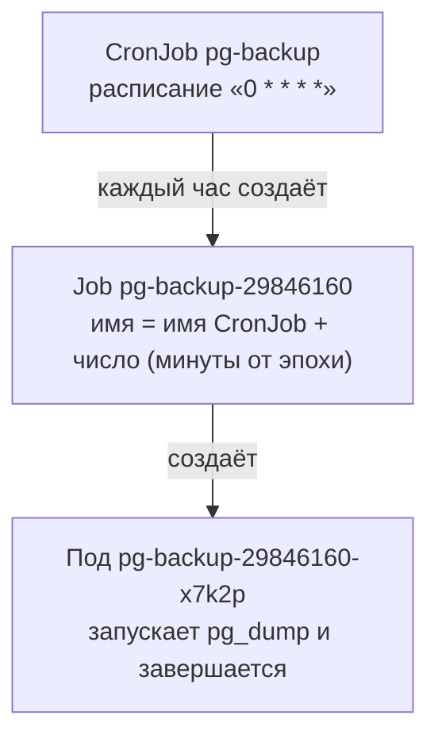
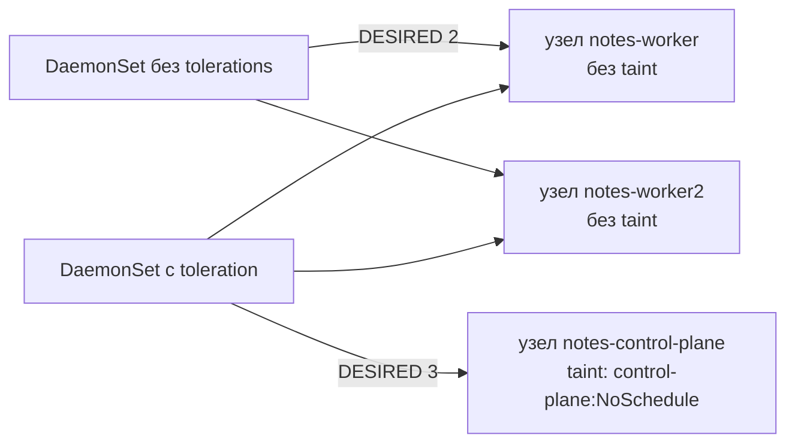
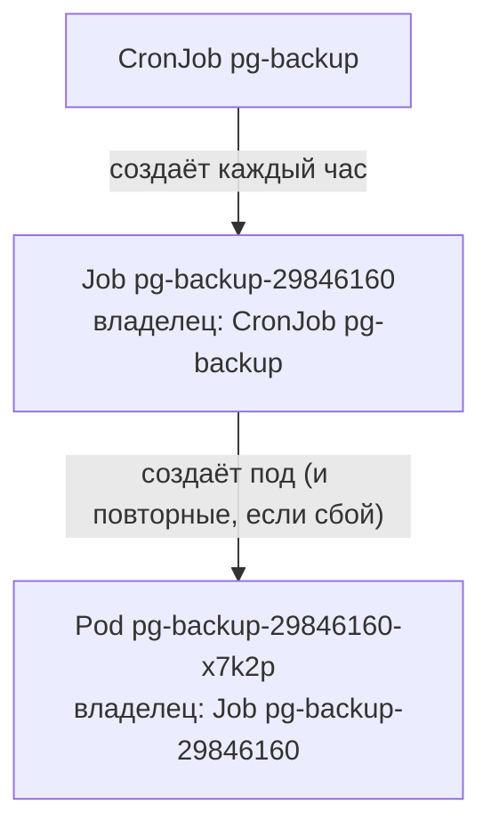

## Зачем это нужно

Не всё в кластере это сервер, который должен работать вечно. Миграция базы (изменение её структуры при выходе новой версии приложения: например, добавить в таблицу новую колонку), ночной бэкап (копия данных на случай потери), пересчёт отчёта запускаются, делают работу и заканчиваются. Если запихнуть такую задачу в Deployment, Kubernetes увидит, что программа завершилась, и запустит её снова, потом ещё раз, и так без конца: он для этого и создан, чтобы поддерживать работающее приложение. Выглядело бы это так:

```text
03:00  бэкап запустился и закончил работу
03:01  Kubernetes: «приложение остановилось, это непорядок», запускает снова
03:02  бэкап запустился и закончил работу
03:03  Kubernetes: запускает снова ... и так всю ночь
```

Для задач, которые должны выполниться один раз и остановиться, нужны другие объекты.

Есть и обратная задача: агент, который собирает логи (текстовые записи о работе программ) или метрики (числа о работе: сколько занято процессора и памяти), должен быть на каждом узле кластера ровно один. Deployment с тремя репликами этого не гарантирует: он может посадить все три копии на один узел, а на остальных не будет ни одной.

Для этих случаев в Kubernetes есть свои объекты:

- **Job** (задание): запусти задачу и доведи её до успешного конца;
- **CronJob** (периодическое задание): запускай Job по расписанию;
- **DaemonSet** (набор демонов): держи по одному поду на каждом узле.

На работе ты встретишь их в каждом кластере: бэкапы, миграции, очистка старых данных, node-exporter (программа, которая отдаёт числа о здоровье самого сервера: процессор, диск, память; подробно в [уроке 8.9](../08-observability/09-k8s-monitoring.md)), сборщики логов (агенты, которые забирают файлы логов с узла и отправляют в общее хранилище, [урок 8.7](../08-observability/07-logs-loki-alloy.md)). На собеседованиях спрашивают, чем Job отличается от Deployment и что делать, если ночной бэкап не сработал.

Шаг проекта: «Заметки» получают почасовой бэкап PostgreSQL (`k8s/base/60-pg-backup-cronjob.yaml`: CronJob `pg-backup` и том `pg-backups`). Примеры Job и DaemonSet лежат отдельно, в `k8s/examples/`, и в цепочку проекта не входят. Образ и приложение не меняются (`0.4.1`).

## Что нужно знать

- [Урок 5.2: Pod и Deployment](02-pods-deployments.md): что такое под и шаблон пода, поле `restartPolicy` (что делать, когда контейнер в поде завершился: перезапустить его всегда, только при ошибке или никогда), команды `kubectl get`, `describe`, `logs`.
- [Урок 5.5: StatefulSet и PVC](05-storage-statefulset-postgres.md): PostgreSQL работает как StatefulSet `postgres`, к нему ведёт Service `db`; PVC (PersistentVolumeClaim, заявка на диск) это способ получить хранилище для пода.
- [Урок 5.6: ConfigMap и Secret](06-config-secrets.md): Secret `notes-db` хранит пароль в ключе `POSTGRES_PASSWORD`, его можно подставить в переменную окружения.
- [Урок 5.7: пробы и ресурсы](07-probes-resources-rollouts.md): requests и limits, коды выхода (0 значит успех, 137 значит убит).
- [Урок 1.7: Bash в эксплуатации](../01-linux/07-bash-in-ops.md): расписание cron из пяти полей и бэкап-скрипт «Заметок»; здесь это же расписание переезжает в Kubernetes.

## Картина целиком

Три новых объекта и один знакомый отвечают на разные вопросы о работе, которую нужно сделать.

| Вопрос | Объект | Аналогия |
|---|---|---|
| Должно работать всегда, число копий задаю сам | Deployment (знакомый) | постоянный сотрудник на смене |
| Сделать один раз и закончить | Job | разовое поручение: не вышло, дают ещё несколько попыток |
| Делать это по расписанию | CronJob | «каждый час выдавай такое поручение» |
| Нужно по одному на каждом узле | DaemonSet | по одному поду на каждом узле, новый узел получает его сам |

За урок ты разберёшь, как Job следит за успехом и что делает при сбое, почему повторный запуск задачи должен быть безопасным, как читать расписание cron и что делает CronJob, если бэкап идёт дольше часа, как DaemonSet решает, на какие узлы сесть. Потом добавишь в проект бэкап и сломаешь его тремя способами.

## Теория

### Четыре вида работы: сервер, задача, расписание, агент

Работа в кластере бывает четырёх видов, и Kubernetes для каждого использует свою логику.

| Тип | Пример | Что должно быть верно всегда | Объект |
|---|---|---|---|
| сервер | сайт, API «Заметок» | всегда запущено, при падении перезапустить | Deployment |
| задача | миграция, бэкап | запустилась, закончилась с кодом 0, больше не трогать | Job |
| задача по расписанию | бэкап каждый час | как Job, только запуск по времени | CronJob |
| агент узла | сборщик логов, node-exporter | ровно один под на каждом узле | DaemonSet |

**Что было бы без этого.** Если запустить бэкап как Deployment, то, как только `pg_dump` завершится успешно, Kubernetes решит, что приложение «упало» (программа же остановилась), запустит его снова, и так каждые несколько секунд, с нарастающими паузами в `CrashLoopBackOff`. Это самая частая ошибка новичков: «мой бэкап постоянно перезапускается».

**Как отличить.** Задай себе вопрос: «Программа должна работать всегда или закончиться?». Всегда: Deployment. Закончиться один раз: Job. Закончиться по расписанию: CronJob. Нужна на каждом узле: DaemonSet.

> **Прикинь сам:** бэкап запущен как Deployment. `pg_dump` отработал за минуту и завершился с кодом 0. Что сделает Kubernetes?
{: .predict}

Решит, что приложение упало, и запустит его снова, потом ещё раз, с растущими паузами `CrashLoopBackOff`. Для задачи, которая должна закончиться, нужен Job.

Job не «Deployment с одним подом»: у них противоположные цели. Deployment хочет, чтобы под жил. Job хочет, чтобы под сделал работу и завершился успешно.

> **Главное:** сервер это Deployment, разовая задача это Job, задача по часам это CronJob, агент на каждом узле это DaemonSet.
{: .key}

Начнём с Job: как он повторяет попытки и когда сдаётся.

### Job: задача, которая должна завершиться успешно

Задача может упасть по причинам, от тебя не зависящим: узел перезагрузили, база не ответила, сеть моргнула. Хочется, чтобы кто-то автоматически повторил попытку, но не бесконечно, и в конце чётко сказал «получилось» или «не получилось». Это и делает Job.

Курьер получает заказ «отвезти посылку». Не доставил (никого нет дома): пробует ещё раз, потом ещё. После нескольких неудач возвращает заказ «не доставлено». Аналогия перестаёт работать в одном месте: курьер помнит, что он уже сделал, а вот запущенная заново программа может ничего не знать о том, что успела сделать предыдущая (об этом следующий раздел).

**Как устроено, по шагам.**

1. Ты создаёшь Job с шаблоном пода (как в Deployment, урок 5.2).
2. Контроллер Job создаёт под и следит за ним.
3. Под завершился с кодом 0: это успех, Job засчитывает его. Когда набрано нужное число успехов, Job получает состояние `Complete`, новых подов не создаёт.
4. Под завершился с ошибкой: Job создаёт новый под (это повторная попытка). Между попытками пауза растёт: 10 секунд, 20, 40 и так далее, потолок 6 минут (не путай с `CrashLoopBackOff` контейнера: там потолок 5 минут, это другой механизм, перезапуск контейнера внутри пода).
5. Когда неудач набралось больше, чем разрешено (`backoffLimit`), Job получает состояние `Failed` и сдаётся.

**Главные поля.**

| Поле | Что значит | По умолчанию |
|---|---|---|
| `completions` | сколько успешных завершений нужно | 1 |
| `parallelism` | сколько подов работают одновременно | 1 |
| `backoffLimit` | сколько повторных попыток разрешено после сбоя | 6 |
| `activeDeadlineSeconds` | жёсткий потолок времени на всё задание, потом Job убивается | нет |
| `ttlSecondsAfterFinished` | через сколько секунд после конца Job и его поды удалятся сами | не удаляются |

Job с `completions: 3` и `parallelism: 2` (например, надо обработать три файла). Kubernetes запускает сразу два пода (параллельно). Пусть первый завершился успешно: счётчик успехов 1 из 3, запускается третий под (тогда снова работают два). Потом завершается второй (2 из 3), а затем третий (3 из 3): Job `Complete`.

Теперь сбой. `backoffLimit: 2`, задача всегда падает. Считаем по попыткам:

| Попытка | Результат | Что дальше |
|---|---|---|
| 1 | ошибка | пауза 10 с |
| 2 | ошибка | пауза 20 с |
| 3 | ошибка | 3 неудачи больше, чем `backoffLimit: 2` |

Job получает статус `Failed` с причиной `BackoffLimitExceeded`. Итого три пода в статусе `Error`.

**`restartPolicy`.** У пода из Job обязателен `restartPolicy` со значением `Never` или `OnFailure`. Значение `Always`, которое подходит Deployment, запрещено: задача, которая должна закончиться, не должна перезапускаться вечно. Если поле пропустить, подставится именно `Always`, и API отклонит манифест: `spec.template.spec.restartPolicy: Unsupported value: "Always": supported values: "OnFailure", "Never"`.

- `Never`: при сбое остаётся упавший под и создаётся новый. Ты видишь несколько подов и можешь прочитать логи каждого.
- `OnFailure`: при сбое перезапускается контейнер в том же поде, растёт счётчик `RESTARTS`.

**Завершённые поды не удаляются.** Под со статусом `Completed` остаётся, чтобы ты мог прочитать `kubectl logs`. Без `ttlSecondsAfterFinished` они копятся, и через месяц в кластере сотни старых подов. Поэтому TTL ставят почти всегда.

> **Прикинь сам:** `completions: 1`, `backoffLimit: 2`, задача падает всегда. Сколько подов будет создано?
{: .predict}

Три: первый запуск и две повторные попытки. Потом Job получит состояние `Failed` с причиной `BackoffLimitExceeded`.

Осторожно: `backoffLimit: 2` это не «два пода». На самом деле это две **повторных** попытки, то есть всего три пода. Ещё путают статус `Completed` пода (он завершился) и статус `Complete` у самого Job (набрано нужное число успехов).

> **Главное:** Job довозит задачу до успеха с ограниченным числом повторов; `backoffLimit` считает повторные попытки, а завершённые поды без `ttlSecondsAfterFinished` копятся.
{: .key}

Повторные попытки безопасны только для задач, которые переживают повторный запуск. Это называется идемпотентностью.

### Идемпотентность: почему повторный запуск должен быть безопасным

Обычно Job выполняется один раз, но Kubernetes гарантирует «минимум один раз», а не «ровно один» (для Job; CronJob запускает «примерно по расписанию»: запуск может быть пропущен, а в редких случаях создаются два Job, поэтому нужен алерт на отсутствие успешного бэкапа): в редких случаях (сбой узла, гонка при удалении пода) задача может пойти дважды. Если узел, где работал под, вдруг перезагрузился, под пересоздаётся и задача идёт заново с начала, даже если в прошлый раз она успела сделать половину работы. Значит, задача должна выдерживать повторный запуск. Такое свойство называется **идемпотентностью** (idempotency): результат повторного выполнения тот же, что и однократного.

Лифт с кнопкой «вызвать». Нажми один раз или пять: лифт приедет один раз. Это идемпотентно. Кнопка «добавить в корзину ещё одну штуку» не идемпотентна: пять нажатий дают пять штук.

**Примеры.**

| Не идемпотентно | Идемпотентно |
|---|---|
| `mkdir /backups` (второй раз ошибка «уже существует») | `mkdir -p /backups` |
| `CREATE TABLE notes (...)` (второй раз ошибка) | `CREATE TABLE IF NOT EXISTS notes (...)` |
| `INSERT` строки «начальная запись» (появятся дубли) | вставка с проверкой «если такой ещё нет» |
| бэкап в файл `backup.dump` (перезаписывает) | файл с меткой времени `notes-20260930-103101.dump` |

Миграция добавляет колонку: `ALTER TABLE notes ADD COLUMN tag text`. Job упал сразу после этой команды, до записи «миграция выполнена». Kubernetes запускает Job заново, команда выполняется второй раз и падает: «колонка уже существует». Job теперь падает всегда, хотя работа сделана. Если написать `ADD COLUMN IF NOT EXISTS tag text`, повтор проходит без ошибки.

> **Прикинь сам:** миграция выполнила `ALTER TABLE ... ADD COLUMN tag text`, и Job упал до записи «готово». Что будет при повторе?
{: .predict}

Команда выполнится второй раз и упадёт с ошибкой «колонка уже существует», хотя работа сделана. С `ADD COLUMN IF NOT EXISTS` повтор пройдёт.

Идемпотентность нужна не только при сбоях. Она нужна и когда человек по ошибке запустил Job дважды, и когда CronJob запустил задачу поверх предыдущей.

> **Главное:** Kubernetes гарантирует запуск «минимум один раз», поэтому задача должна выдерживать повтор: `IF NOT EXISTS`, `mkdir -p`, имя файла с меткой времени.
{: .key}

Теперь научимся записывать расписание запуска.

### Расписание cron: пять полей

Чтобы запускать что-то периодически, нужен способ записать «каждый час» или «по понедельникам в 2:30». Для этого придумали формат cron, которому десятки лет. Kubernetes использует тот же, что и в [уроке 1.7](../01-linux/07-bash-in-ops.md).

Расписание это пять чисел через пробел, слева направо:

```text
┌───────────── минута (0-59)
│ ┌───────────── час (0-23)
│ │ ┌───────────── день месяца (1-31)
│ │ │ ┌───────────── месяц (1-12)
│ │ │ │ ┌───────────── день недели (0-6, 0 это воскресенье)
│ │ │ │ │
0 * * * *
```

Звёздочка `*` значит «любое значение». Запись `*/15` значит «каждые 15».

**Разобранные примеры.**

| Расписание | Читается как |
|---|---|
| `0 * * * *` | в 0 минут каждого часа: раз в час, ровно в начале часа |
| `*/15 * * * *` | каждые 15 минут |
| `30 2 * * *` | каждый день в 02:30 |
| `30 2 * * 1` | по понедельникам в 02:30 |
| `0 0 1 * *` | первого числа каждого месяца в полночь |
| `0 0 30 2 *` | 30 февраля в полночь (такой даты не бывает, запуск никогда не случится) |

Последняя строка интересна: с точки зрения формата она правильная, поэтому Kubernetes её примет без ошибки, но задача так никогда и не запустится. Такую ошибку ты увидишь в разделе «Сломай и почини».

**Часовой пояс.** По умолчанию расписание считается по времени контроллера Kubernetes, а в kind это UTC (всемирное время, Москва это UTC+3). Значит `0 3 * * *` сработает в 03:00 UTC, то есть в 06:00 по Москве. Чтобы указать свой пояс, есть поле `timeZone: "Europe/Moscow"`.

Частая ошибка: порядок полей (минута идёт первой, а не час) и то, что `0 * * * *` это «каждый час», а не «каждую минуту нулевого часа». Ошибка «звёздочка в первом поле»: `* 3 * * *` запустит задачу каждую минуту между 03:00 и 03:59, то есть 60 раз.

> **Прикинь сам:** что означает `30 2 * * 1` и когда это сработает в kind?
{: .predict}

Каждый понедельник в 02:30. В kind время UTC, то есть в 05:30 по Москве, если не задан `timeZone`.

> **Главное:** в cron пять полей: минута, час, день месяца, месяц, день недели; формат принимает даже невозможные даты вроде 30 февраля, и тогда запуска не будет.
{: .key}

Расписание хранит CronJob, и у него есть свои правила.

### CronJob: Job по расписанию

Чтобы бэкап шёл каждый час без человека. CronJob хранит расписание и шаблон Job.

Важная деталь: CronJob сам не запускает поды. Он в нужный момент создаёт объект Job, а Job уже создаёт под. Получается цепочка из трёх звеньев.



Отсюда важное следствие для диагностики: если бэкап не работает, смотреть надо на всех трёх уровнях. Есть ли новые Job? Если да, что с их подами? Если Job нет, то проблема в самом CronJob (расписание, пауза).

**Поля, которые определяют поведение.**

| Поле | Что делает |
|---|---|
| `schedule` | расписание в формате cron |
| `timeZone` | часовой пояс расписания |
| `concurrencyPolicy` | что делать, если пора запускаться, а прошлый запуск ещё идёт |
| `startingDeadlineSeconds` | насколько опоздавший запуск ещё считается допустимым |
| `suspend` | `true` ставит расписание на паузу, новые Job не создаются |
| `successfulJobsHistoryLimit` | сколько успешных Job хранить (по умолчанию 3) |
| `failedJobsHistoryLimit` | сколько упавших Job хранить (по умолчанию 1) |

**`concurrencyPolicy` на примере.** CronJob запускается каждый час, но конкретный бэкап идёт полтора часа (база выросла). В 10:00 запустился бэкап. В 11:00 пора запускать следующий, а предыдущий ещё идёт (до 11:30). Что делать?

- `Allow` (по умолчанию): запустить второй параллельно. Два `pg_dump` одновременно тормозят друг друга и базу.
- `Forbid`: пропустить запуск в 11:00 (в событиях появится `JobAlreadyActive`). Следующий запуск в 12:00 пройдёт.
- `Replace`: убить старый и запустить новый. Старый бэкап потерян, а новый в 11:00 может тоже не успеть.

Для бэкапа выбирают `Forbid`.

**Пропущенные запуски.** Допустим, кластер был выключен сутки. Пропущено 24 почасовых запуска. Догонять их пачкой не нужно, и CronJob этого не делает. Если пропущено меньше 100 запусков, стартует один Job за последнее пропущенное время. Если же пропущено больше 100 подряд, а `startingDeadlineSeconds` не задан, Job не создаётся совсем: в событиях CronJob появляется `FailedNeedsStart` с текстом «too many missed start times (> 100). Set or decrease .spec.startingDeadlineSeconds or check clock skew», и расписание придётся чинить руками. Если `startingDeadlineSeconds` задан, считаются только пропуски внутри этого окна, и такой ошибки нет. Поэтому окно для важных CronJob ставят осознанно: без него запуск может стартовать с большим опозданием.

**Ручной запуск.** Любой CronJob можно запустить сразу, не дожидаясь расписания: `kubectl create job --from=cronjob/pg-backup имя`. Это создаёт Job по шаблону CronJob. Так проверяют бэкап после правки, не ожидая час.

> **Прикинь сам:** CronJob запускается каждый час, бэкап идёт полтора часа, `concurrencyPolicy: Forbid`. Что будет в 11:00, если запуск был в 10:00?
{: .predict}

Запуск в 11:00 пропущен (в событиях `JobAlreadyActive`). Следующий пройдёт в 12:00, если к этому моменту предыдущий завершился.

`kubectl delete cronjob` удаляет не только расписание: вместе с ним удаляются и созданные им Job с подами (они принадлежат CronJob), в том числе идущий сейчас бэкап. И ещё: CronJob работает по времени контроллера, а не по часам твоего ноутбука.

> **Главное:** CronJob сам поды не запускает, он создаёт Job; для бэкапа выбирают `Forbid`, а `kubectl create job --from=cronjob/...` запускает задачу сразу.
{: .key}

С расписанием разобрались. Теперь о том, что должно работать на каждом узле.

### DaemonSet: по одному поду на каждый узел

У некоторых программ работа привязана к машине, а не к приложению. Сборщик логов читает файлы логов на узле. Node-exporter измеряет процессор и диск этого узла. Сетевой плагин настраивает сеть на этом узле. Такой агент должен быть на каждом узле ровно один, и когда в кластер добавляют новый узел, он должен появиться там без участия человека.

У DaemonSet нет поля `replicas`. Контроллер смотрит список узлов и для каждого подходящего узла создаёт один под (в поде контроллер прописывает `nodeAffinity` на имя этого узла, а привязывает под обычный планировщик). Узел удалили: под удаляется. Число подов, которые должны быть, это столбец `DESIRED` в `kubectl get ds`.

Примеры «жильцов»: сборщик логов Alloy или Fluent Bit ([урок 8.7](../08-observability/07-logs-loki-alloy.md)), node-exporter, сетевой плагин `kindnet` и `kube-proxy` (ты уже видел их в кластере kind в [уроке 5.1](01-why-k8s-cluster.md): по одному поду на узел, это и есть DaemonSet).

**Какие узлы «подходящие»: taints и tolerations.** Не на всех узлах можно запускать любые поды. Узлы control-plane (управляющий слой кластера) обычно помечены **taint** (тейнт, «клеймо», метка-отталкивание): `node-role.kubernetes.io/control-plane:NoSchedule`. Это значит: «обычные поды сюда не садятся».

Чтобы под всё же мог сесть на такой узел, ему нужен **toleration** (толерейшн, «допуск»): запись в спецификации пода, которая говорит «я терплю такой taint». Аналогия: на двери табличка «служебное помещение, посторонним нельзя» (taint), а у сотрудника пропуск (toleration).



Есть ещё `nodeSelector`: он не разрешает, а **требует**: «запусти только на узлах с меткой `disk=ssd`». Разница: toleration лишь снимает запрет, nodeSelector сужает выбор.

**Обновление DaemonSet.** Как и Deployment, он обновляется по частям (`RollingUpdate`), по умолчанию с `maxUnavailable: 1`: одновременно недоступен под только на одном узле.

> **Прикинь сам:** в кластере три узла: control-plane и два worker. Сколько подов будет у DaemonSet без tolerations?
{: .predict}

Два, на worker. На control-plane стоит taint `NoSchedule`, и `DESIRED` считается только по узлам, куда под допустим.

DaemonSet без tolerations на control-plane не садится, и это не ошибка, а штатное поведение. Если агенту там нужно быть (например, метрики с управляющих узлов), toleration добавляют сами. Ещё у агентов обязательно ставят `requests` и `limits`: агент есть на каждом узле, и если он без лимита съест память, пострадает весь узел.

> **Главное:** у DaemonSet нет `replicas`: по одному поду на подходящий узел; чтобы попасть на control-plane, нужен toleration.
{: .key}

Теперь соберём реальную задачу: бэкап PostgreSQL по расписанию.

### Бэкап PostgreSQL: pg_dump, том и почему «в том же кластере» это не бэкап

База данных с настоящими данными без бэкапа это вопрос времени, когда что-то случится: удалили том, ошиблись командой, диск умер. Бэкап нужен, и делать его должен не человек, а расписание.

`pg_dump` это программа, которая подключается к базе и записывает всё её содержимое в файл (дамп, dump). Ключ `-Fc` (формат custom) делает сжатый файл, который читает `pg_restore`. Он пригоден для выборочного восстановления. Обычный текстовый SQL-дамп (без `-Fc`) проще прочитать глазами, но он больше и восстанавливается только целиком.

Файл нужно куда-то положить так, чтобы он пережил под. Под с `pg_dump` завершится, а его файловая система исчезнет вместе с ним. Поэтому в CronJob подключают PVC `pg-backups`: отдельный том (заявку на диск, [урок 5.5](05-storage-statefulset-postgres.md)), который живёт независимо от пода.

**Одна особенность kind.** StorageClass `standard` в kind имеет режим `WaitForFirstConsumer` («жди первого потребителя»): том физически создаётся не когда ты создал PVC, а когда появляется первый под, который его использует. Так планировщик может сначала выбрать узел, а потом создать диск на нём. Поэтому свежий PVC показывает `Pending`. Это не поломка, а нормальное ожидание.

**Разобранный пример скрипта.**

```text
f=/backups/notes-$(date -u +%Y%m%d-%H%M%S).dump      имя с датой: каждый запуск свой файл
pg_dump -h db -U notes -d notes -Fc -f "$f"           -h db: хост (Service db), -U: пользователь,
                                                      -d: база, -Fc: сжатый формат, -f: куда писать
find /backups -name 'notes-*.dump' -mtime +7 -delete  удалить дампы старше 7 дней
```

`date -u +%Y%m%d-%H%M%S` печатает время в UTC вида `20260930-103101`. Первая строка делает скрипт идемпотентным (см. выше): повторный запуск не затрёт старый файл. Третья строка ограничивает рост тома.

> **Прикинь сам:** дамп пишется в файл `/backups/notes.dump` на PVC и каждый запуск его перезаписывает. Что плохо?
{: .predict}

Если запуск упадёт на середине, он затрёт последний хороший файл. Имя с датой и временем даёт каждому запуску свой файл.

Осторожно: копия в том же кластере это ещё не бэкап. Если исчезнет кластер (сломался узел с данными, удалили namespace, ошибка в облаке), пропадёт и база, и копии рядом с ней. Настоящий бэкап хранят снаружи: в другом кластере, в облачном хранилище, на другой площадке. В этом уроке мы делаем только первую часть цепочки (регулярное создание дампов), вынос копий наружу разбирает [урок 10.3](../10-capstone/03-backup-dr-capacity.md).

Ещё одна ловушка: дамп, который ни разу не пробовали восстановить, это не бэкап, а надежда. Мы хотя бы проверим, что файл читается.

> **Главное:** дамп кладут на том, переживающий под, с датой в имени; копия в том же кластере ещё не бэкап, а дамп без проверки восстановления лишь надежда.
{: .key}

Как Job узнаёт, что дамп удался? Через код выхода.

### Код выхода: как Job узнаёт, что задача удалась

Job не читает логи и не понимает, что сделала программа. Ему нужен один простой сигнал «получилось или нет». Без него нельзя было бы автоматически решать, повторять ли задачу.

Рабочий, закончив смену, говорит бригадиру одно слово: «ок» или «не ок». Подробности он записывает в журнал (это логи), но решение бригадир принимает по слову. Аналогия неточна тем, что у программы «не ок» бывает разных видов (числа 1, 2, 127 и другие), хотя для Job важно лишь «ноль или не ноль».

Любая программа в Linux при завершении возвращает системе число, **код выхода** (exit code, [урок 1.7](../01-linux/07-bash-in-ops.md)). `0` значит успех, всё остальное означает ошибку. Kubelet читает это число у главного процесса контейнера и записывает в статус пода: под завершается как `Completed` при `0` и как `Error` при любом другом. Контроллер Job смотрит на статус пода, а не внутрь программы.

Скрипт бэкапа выполняет две команды: `pg_dump ... > dump.sql`, потом `echo "готово"`. `pg_dump` не смог подключиться к базе и вернул 1. Но оболочка по умолчанию идёт дальше: `echo` выполнился успешно, и код выхода всего скрипта равен коду **последней** команды, то есть `0`. Job радостно объявляет `Complete`, а файла бэкапа нет. Поэтому в скриптах для Job первой строкой ставят `set -e` (остановиться на первой ошибке и вернуть её код). Для конвейеров вида `pg_dump | gzip` добавляют ещё `set -o pipefail`: без него код конвейера равен коду последней команды (`gzip`), и сбой `pg_dump` теряется.

> **Прикинь сам:** скрипт: `pg_dump ... > dump.sql`, затем `echo "готово"`. `pg_dump` упал. Какой статус у Job?
{: .predict}

`Complete`: код скрипта равен коду последней команды, то есть `0`, а бэкапа нет. Лечится `set -e` первой строкой.

Слово `error` в логах не проваливает Job: он смотрит только на код выхода. Программа может написать десять ошибок в лог и выйти с `0`, тогда Job успешен. И наоборот, молча выйти с `1` и провалиться. Поэтому проверять нужно код, а не текст.

> **Главное:** Job смотрит только на код выхода, а не на текст логов; в скриптах ставят `set -e` и, для конвейеров, `set -o pipefail`.
{: .key}

Теперь посмотрим, кто кого создал в цепочке CronJob, Job и под.

### Кто кого создал: цепочка CronJob, Job, под

Когда в кластере висит много подов с похожими именами вроде `pg-backup-29846160-x7k2p`, новичок не понимает, откуда они взялись и что можно удалять. Цепочка владельцев объясняет это.

Родословная: CronJob родитель, Job его ребёнок, под внук. Когда умирает родитель, по правилам кластера уходят и дети с внуками. Аналогия ломается в том, что это не наследство, а правило уборки: «удалил хозяина, удалил всё, что он создал».

Каждый созданный объект помнит, кто его создал, и если владельца больше нет, кластер убирает и зависимые объекты. Имя Job складывается из имени CronJob и числа (время запуска в минутах с 1970 года), имя пода из имени Job и случайного суффикса.



Число `29846160` в имени Job это минуты от начала 1970 года. Два соседних Job при расписании «раз в час» отличаются на 60 (`29846160` и `29846220`). Так по именам видно порядок запусков, не заглядывая в дату. Удалишь Job, пропадёт его под. Удалишь CronJob, пропадут все Job (и их поды), которые он ещё хранит.

<details markdown="1">
<summary>Для любопытных: как кластер хранит владельца</summary>

Запись о владельце лежит в поле `ownerReferences` (имя и вид того, кто создал объект), а сборщик мусора кластера периодически сверяет эти записи. Посмотреть владельца пода можно командой `kubectl -n notes get pod <имя> -o jsonpath='{.metadata.ownerReferences[0].name}'`: она вернёт имя Job.

</details>

> **Прикинь сам:** ты удалил под, который ещё работал в Job. Остановится ли бэкап?
{: .predict}

Нет, Job увидит, что успехов нет, и создаст новый под. Чтобы остановить, удаляй сам Job, а чтобы прекратить запуски по расписанию, ставь у CronJob `suspend: true` (пауза) или удали его.

> **Главное:** владельцы идут цепочкой CronJob, Job, под; удалишь владельца, уйдут и его потомки.
{: .key}

Как понять по статусу, что в этой цепочке сломалось?

### Как читать состояние Job и CronJob

Когда Job или CronJob ведёт себя не так, ответ почти всегда уже записан в статусе и событиях. Надо знать, какие поля смотреть.

Накладная у курьера: в ней отмечено, сколько попыток доставки сделано, когда, и почему не вышло. Курьера расспрашивать не нужно, достаточно прочитать накладную. Разница: накладную заполняет человек, а статус Kubernetes заполняет сам контроллер, поэтому ему можно верить.

Три места, где смотреть, по порядку:

1. `kubectl get job`: столбец `COMPLETIONS` вида `0/1` или `1/1` (успехов из нужных), `DURATION` (сколько шла задача). `1/1` значит «сделано».
2. `kubectl describe job`: строки `Pods Statuses` (сколько подов идёт, успешно и упало) и список событий внизу, где сказано, что случилось: создан под, `BackoffLimitExceeded`, `DeadlineExceeded`.
3. `kubectl logs` пода: что сказала сама программа. Если у Job несколько подов, логи читают у каждого: причина обычно в последнем упавшем.

Для CronJob добавляется четвёртое место: `kubectl get cronjob`, столбцы `SUSPEND` (стоит ли пауза), `ACTIVE` (сколько Job сейчас идёт) и `LAST SCHEDULE` (когда последний раз создавался Job).

Помнишь бэкап из начала урока? Вот как выглядят после успешного часа его CronJob, Job и под (`kubectl get cronjob,job,pod` выводит три таблицы подряд):

```text
$ kubectl get cronjob,job,pod -n notes
NAME                          SCHEDULE    SUSPEND   LAST SCHEDULE
cronjob.batch/pg-backup       0 * * * *   False     35m

NAME                                 STATUS     COMPLETIONS   DURATION
job.batch/pg-backup-29846160       Complete   1/1           24s

NAME                                 READY   STATUS      RESTARTS
pod/pg-backup-29846160-q7x4d       0/1     Completed   0
```

CronJob в начале часа создал Job, а тот запустил под, который отработал 24 секунды и остановился со статусом `Completed`. Заметь `READY 0/1`: для задачи это нормально, она не должна жить вечно.

Ты видишь `COMPLETIONS 0/1`, `DURATION 12m`, `describe` показывает `Pods Statuses: 1 Active`. Значит, Job не упал, а просто идёт уже 12 минут: смотрят логи пода (`kubectl logs -f`) и решают, ждать или нет. Если бы было `0 Active / 0 Succeeded / 3 Failed` и событие `BackoffLimitExceeded`, это сдавшийся Job: причина в логах упавших подов. Событие `DeadlineExceeded` значит, что сработал `activeDeadlineSeconds` и Job убит за превышение времени, хотя сама задача могла быть здорова: ей просто не хватило времени.

> **Прикинь сам:** `get cronjob` показывает свежий `LAST SCHEDULE`, а три последних Job в `0/1`. Что это значит?
{: .predict}

Расписание работает, Job создаются, но сами задачи не завершаются успехом. Смотри `describe job` и `logs` подов.

`LAST SCHEDULE` это не время последнего успешного бэкапа, а время последнего **запуска**. Успех или провал видно только у самого Job и его пода. Поэтому мониторят не «запускался ли», а «был ли успешный Job за последние сутки» (тема 8).

> **Главное:** смотри по порядку `get job`, `describe job` (Pods Statuses и события) и `logs` пода; `LAST SCHEDULE` это время запуска, а не успеха.
{: .key}

Одной задачей работа не всегда ограничивается: иногда её нужно разделить на части.

### Job с параллельной работой: очередь задач

Иногда работы много: обработать сто файлов, отправить тысячу писем. Одним подом долго, а сто подов сразу перегрузят базу или сеть. Хочется «по пять одновременно, пока не сделаем сто».

Касса в магазине: очередь из ста покупателей и пять открытых касс. Одновременно обслуживаются пять, как только одна освободилась, к ней подходит следующий. Оговорка: покупатели одинаковые, а вот задачи Job сами должны знать, какую часть работы брать, иначе все пять подов возьмут один и тот же файл.

Поля `completions: 100` и `parallelism: 5` говорят: «нужно 100 успешных подов, одновременно не больше 5». Job держит запущенными пять, при каждом успехе запускает следующий. Чтобы поды не делали одно и то же, используют `completionMode: Indexed`: каждому поду выдаётся номер от 0 до 99 в переменной окружения `JOB_COMPLETION_INDEX`, и программа по номеру берёт свою долю работы (например, файл номер N).

`completions: 6`, `parallelism: 3`, каждая задача идёт 10 секунд. Первые 10 секунд работают три пода (номера 0, 1, 2). Как только они завершились, стартуют 3, 4, 5. Всего 20 секунд вместо 60 при последовательной работе. Если один из подов упал, Job запустит замену с тем же номером, и это ещё одна причина писать идемпотентные задачи.

> **Прикинь сам:** `completions: 10`, `parallelism: 4`. Сколько подов работает одновременно в самом конце, когда осталось два невыполненных?
{: .predict}

Два: Job не создаёт подов больше, чем осталось до нужного числа успехов.

`parallelism` ускоряет не что угодно: ускоряет только независимую работу: если пять подов упираются в одну базу, они мешают друг другу.

> **Проверь понимание:** у Job `restartPolicy: OnFailure`, `backoffLimit: 2`, задача падает всегда. Сколько будет подов и что покажет `RESTARTS`?

<details markdown="1">
<summary>Ответ</summary>

Под один: при `OnFailure` контейнер перезапускается в том же поде, поэтому растёт `RESTARTS`, а не число подов. Когда набирается больше `backoffLimit` неудач, Job получает `Failed`, и под останавливается.

</details>

> **Главное:** `completions` задаёт нужное число успехов, `parallelism` потолок одновременных подов, а `completionMode: Indexed` даёт каждому поду номер для своей доли работы.
{: .key}

Остаётся собрать всё в одну таблицу выбора.

### Как выбрать объект под задачу

Соберём всё в одну таблицу.

| Задача | Объект | Почему |
|---|---|---|
| веб-сервис, API без состояния | Deployment | должен жить всегда, реплики взаимозаменяемы |
| база данных, брокер сообщений | StatefulSet | у каждой копии своё имя и диск |
| миграция схемы перед выкаткой | Job | выполнилась один раз и всё |
| бэкап, очистка, отчёт по времени | CronJob | Job, запускаемый по расписанию |
| сборщик логов, node-exporter | DaemonSet | по одному на каждый узел |

> **Прикинь сам:** миграцию схемы базы нужно выполнить один раз перед выкаткой. Какой объект выберешь?
{: .predict}

Job: он запустится один раз и ясно покажет результат. Запуск миграции в старте приложения даст гонку трёх реплик.

Осторожно: в старте приложения миграция гоняется в каждой реплике.

<details markdown="1">
<summary>Для любопытных: как обычно гарантируют порядок</summary>

Запустить Job вручную или в CI и дождаться `Complete` перед `kubectl apply` Deployment; использовать хук Helm перед обновлением релиза ([урок 5.9](09-helm.md)); положиться на блокировку в самой утилите миграций (Flyway и Alembic держат lock, вторая копия ждёт). Init-контейнер здесь не выручает: он снова выполняется в каждой реплике. Общее правило одно: миграция должна быть идемпотентной.

</details>

> **Главное:** по вопросу «должно ли работать всегда или закончиться» выбирай Deployment, StatefulSet, Job, CronJob или DaemonSet.
{: .key}

Теперь пора применить всё на проекте «Заметки».

## Практика

Вывод команд ниже собран по знанию формата, а не из твоего кластера: номера, имена подов и время у тебя будут другими, на это не обращай внимания, важна форма вывода.

Кластер kind `notes`, контекст `kind-notes`, namespace `notes` из [урока 5.1](01-why-k8s-cluster.md) уже работают, StatefulSet `postgres` и Secret `notes-db` из уроков 5.5 и 5.6 на месте. Проверь:

```bash
kubectl config use-context kind-notes
kubectl -n notes get statefulset postgres
```

```text
Switched to context "kind-notes".
NAME       READY   AGE
postgres   1/1     3d
```

Примеры для заданий 1 и 2 кладём в `~/notes/k8s/examples/`:

```bash
mkdir -p ~/notes/k8s/examples
```

### Задание 1. Разовый Job и его сбой

**Цель:** увидеть, как Job доводит задачу до успеха и что он делает при сбое.

**Предскажи:** запускаем Job, который печатает строку и завершается с кодом 0. Сколько подов будет у Job и в каком статусе они останутся? Потом запускаем Job, который завершается с `exit 1`, при `backoffLimit: 2`. Сколько подов создастся до того, как Job сдастся?

<details markdown="1">
<summary>Ответ</summary>

Успешный Job: один под в статусе `Completed`, он не удаляется, чтобы можно было прочитать логи. Упавший с `backoffLimit: 2`: первый запуск плюс две повторные попытки, то есть 3 пода в статусе `Error`, после чего Job получает условие `BackoffLimitExceeded`.

</details>

**Шаги:**

1. Создай файл `~/notes/k8s/examples/job-hello.yaml`. Это Job из образа `busybox` (маленький образ с базовыми командами), он печатает строку и через три секунды завершается:

```yaml
apiVersion: batch/v1
kind: Job
metadata:
  name: hello
  namespace: notes
spec:
  backoffLimit: 2
  ttlSecondsAfterFinished: 600   # через 10 минут Job уберётся сам
  template:
    spec:
      restartPolicy: Never       # для Job допустимы только Never и OnFailure
      containers:
        - name: hello
          image: busybox:1.37.0
          command: ["sh", "-c", "echo 'привет из Job'; sleep 3"]
```

Построчно: `kind: Job` и `apiVersion: batch/v1` (группа API для пакетных задач) выбирают тип объекта. `backoffLimit: 2` разрешает две повторные попытки. `ttlSecondsAfterFinished` удаляет Job через 600 секунд после конца. Секция `template` это шаблон пода, как в Deployment, но `restartPolicy` обязателен. `command` запускает оболочку `sh` с ключом `-c` («выполни эту строку»).

2. Запусти и дождись завершения. `kubectl wait --for=condition=complete` блокируется, пока Job не станет `Complete` (или не пройдёт таймаут); `-l job-name=hello` выбирает поды по метке, которую Job ставит на свои поды; `logs job/hello` показывает логи пода этого Job.

```bash
kubectl apply -f ~/notes/k8s/examples/job-hello.yaml
kubectl -n notes wait --for=condition=complete job/hello --timeout=60s
kubectl -n notes get pods -l job-name=hello
kubectl -n notes logs job/hello
```

**Что должно получиться** (имя пода у тебя будет другим):

```text
job.batch/hello condition met
NAME          READY   STATUS      RESTARTS   AGE
hello-x7k2p   0/1     Completed   0          8s
привет из Job
```

**Как читать вывод:** `condition met` значит, что Job дошёл до `Complete`. `READY 0/1` в подe `Completed` это нормально: контейнер завершился, готовым ему быть не нужно. `Completed` в столбце `STATUS` значит «завершился с кодом 0». Под остался, и `logs` показывает его вывод.

3. Теперь сломай задачу: второй Job, который всегда падает. Сначала создай файл:

```bash
cat > ~/notes/k8s/examples/job-fail.yaml <<'YAML'
apiVersion: batch/v1
kind: Job
metadata:
  name: hello-fail
  namespace: notes
spec:
  backoffLimit: 2
  ttlSecondsAfterFinished: 600
  template:
    spec:
      restartPolicy: Never
      containers:
        - name: hello
          image: busybox:1.37.0
          command: ["sh", "-c", "echo сбой; exit 1"]
YAML
```

`cat > файл <<'YAML' ... YAML` записывает всё между строками в файл (кавычки вокруг `YAML` отключают подстановки оболочки). Дальше применяй и жди состояния `failed` (Job сдался):

```bash
kubectl apply -f ~/notes/k8s/examples/job-fail.yaml
kubectl -n notes wait --for=condition=failed job/hello-fail --timeout=120s
kubectl -n notes get pods -l job-name=hello-fail
kubectl -n notes describe job hello-fail | tail -8
```

Ожидание занимает около 45 секунд: паузы между попытками 10 и 20 секунд плюс время самих запусков. Если повторяешь задание, сначала удали старый Job (`kubectl -n notes delete job hello-fail`), иначе получишь `AlreadyExists` или увидишь старые поды.

```text
job.batch/hello-fail condition met
NAME               READY   STATUS   RESTARTS   AGE
hello-fail-4tmqz   0/1     Error    0          44s
hello-fail-8d5vn   0/1     Error    0          31s
hello-fail-r2jwl   0/1     Error    0          11s
...
  Warning  BackoffLimitExceeded  ...  job-controller  Job has reached the specified backoff limit
```

**Как читать вывод:** три пода `Error`: первая попытка и две повторные, как мы и предсказали. Возраст в столбце `AGE` считается от создания пода до момента вывода, поэтому у самого раннего пода он самый большой (44, 31 и 11 секунд). В конце `describe` появляется событие `BackoffLimitExceeded`: Job сдался. Логи любого из подов покажут слово `сбой`.

**Объясни себе:**

- Почему под `Completed` не пропал и зачем он нужен?
- Почему при `restartPolicy: Never` у упавшего Job несколько подов, а при `OnFailure` был бы один под с растущим `RESTARTS`?
- Что изменится, если убрать `ttlSecondsAfterFinished`?

**Типичные ошибки:**

- `The Job "hello" is invalid: spec.template.spec.restartPolicy: Unsupported value: "Always": supported values: "OnFailure", "Never"`: у Job нельзя `Always`. Эту же ошибку получишь, если поле пропустить: API подставит `Always` сам и отклонит манифест. Поставь `Never` или `OnFailure`. На старых версиях при пропущенном поле встречался другой текст, `Required value: valid values: "OnFailure", "Never"`; смысл тот же.
- `error: timed out waiting for the condition on jobs/hello`: Job не дошёл до `Complete` за 60 секунд. Смотри `kubectl -n notes get pods` и `describe pod`: чаще всего образ не скачался (`ImagePullBackOff`).

### Задание 2. DaemonSet: по одному поду на узел

**Цель:** понять, как DaemonSet выбирает узлы, и добавить toleration для control-plane.

**Предскажи:** в кластере 3 узла (`notes-control-plane`, `notes-worker`, `notes-worker2`). Сколько подов создаст DaemonSet без tolerations? А с toleration на `node-role.kubernetes.io/control-plane`?

<details markdown="1">
<summary>Ответ</summary>

Без toleration 2 пода (только worker), с toleration 3 (и control-plane тоже).

</details>

**Шаги:**

1. Создай `~/notes/k8s/examples/daemonset-agent.yaml`. Это «агент», который раз в 30 секунд пишет в лог, на каком узле он работает:

```yaml
apiVersion: apps/v1
kind: DaemonSet
metadata:
  name: node-agent
  namespace: notes
spec:
  selector:
    matchLabels:
      app.kubernetes.io/name: node-agent
  template:
    metadata:
      labels:
        app.kubernetes.io/name: node-agent
    spec:
      terminationGracePeriodSeconds: 5   # sh не реагирует на SIGTERM, не ждём 30 секунд при удалении
      containers:
        - name: agent
          image: busybox:1.37.0
          env:
            - name: NODE_NAME            # имя узла, на котором запущен под
              valueFrom:
                fieldRef:
                  fieldPath: spec.nodeName
          command: ["sh", "-c", "while true; do echo \"агент на узле $NODE_NAME\"; sleep 30; done"]
          resources:
            requests:
              cpu: 10m
              memory: 16Mi
            limits:
              memory: 32Mi
```

Построчно: `selector.matchLabels` говорит, какие поды принадлежат этому DaemonSet, и обязан совпадать с метками в `template.metadata.labels`. Поля `replicas` нет. `valueFrom.fieldRef` подставляет в переменную значение поля самого пода: `spec.nodeName` это имя узла. Цикл `while true` печатает строку и спит 30 секунд, чтобы под не завершался. У агента есть `requests` и `limits` (урок 5.7). `terminationGracePeriodSeconds: 5` нужен, потому что `sh` в цикле не обрабатывает `SIGTERM`, и без него удаление пода шло бы все 30 секунд.

2. Примени и посмотри, куда сели поды. `-o wide` добавляет в таблицу столбцы `IP` и `NODE`; `rollout status ds/node-agent` ждёт, пока поды готовы.

```bash
kubectl apply -f ~/notes/k8s/examples/daemonset-agent.yaml
kubectl -n notes rollout status ds/node-agent
kubectl -n notes get ds node-agent
kubectl -n notes get pods -l app.kubernetes.io/name=node-agent -o wide
```

3. Добавь в файл `spec.template.spec` (на одном уровне с `containers`, то есть с тем же отступом, что у `containers:`) допуск для control-plane:

```yaml
      tolerations:
        - key: node-role.kubernetes.io/control-plane
          operator: Exists
          effect: NoSchedule
```

Построчно: `key` это имя taint, `operator: Exists` значит «taint с таким ключом, с любым значением», `effect: NoSchedule` это тип taint, к которому относится допуск.

4. Примени ещё раз, сравни и убери всё созданное. Последняя строка удаляет и Job из задания 1:

```bash
kubectl apply -f ~/notes/k8s/examples/daemonset-agent.yaml
kubectl -n notes rollout status ds/node-agent
kubectl -n notes get ds node-agent
kubectl -n notes delete ds node-agent
kubectl -n notes delete job hello hello-fail
```

**Что должно получиться** (после шага 2 и после шага 4; адреса и имена у тебя другие):

```text
NAME         DESIRED   CURRENT   READY   UP-TO-DATE   AVAILABLE   NODE SELECTOR   AGE
node-agent   2         2         2       2            2           <none>          20s
```

```text
NAME         DESIRED   CURRENT   READY   UP-TO-DATE   AVAILABLE   NODE SELECTOR   AGE
node-agent   3         3         3       3            3           <none>          70s
```

**Как читать вывод:** `DESIRED` это сколько подов должно быть (по числу подходящих узлов), `CURRENT` сколько создано, `READY` сколько готовы. Без toleration `DESIRED 2`: control-plane отвергает под. После добавления допуска стало `3`. В `get pods -o wide` в столбце `NODE` ты увидишь по одному поду на каждый узел.

Если у тебя в kind один узел (кластер создан своим конфигом), kind снимает с него taint, и `DESIRED` равен 1 в обоих случаях.

**Объясни себе:**

- Откуда у DaemonSet берётся число подов, если поля `replicas` нет?
- Чем `tolerations` отличается от `nodeSelector`: что один разрешает, а другой требует?
- Почему сборщик логов обязан иметь `requests` и `limits`, хотя он «просто агент»?

**Типичные ошибки:**

- `The DaemonSet "node-agent" is invalid: spec.template.metadata.labels: Invalid value: ...: selector does not match template labels`: метки шаблона не совпадают с `selector.matchLabels`. Приведи их к одному виду.
- `Error from server (BadRequest): error when creating "daemonset-agent.yaml": DaemonSet in version "v1" cannot be handled as a DaemonSet: strict decoding error: unknown field "spec.template.spec.containers[0].tolerations"`: `tolerations` вставлен внутрь контейнера. Он относится к поду, на уровень `containers`.

### Задание 3. Шаг проекта: бэкап PostgreSQL по расписанию

**Цель:** добавить в «Заметки» почасовой `pg_dump` в отдельный PVC, запустить его вручную и проверить, что дамп читается.

**Предскажи:** мы создаём PVC `pg-backups`, а CronJob монтирует его. Кластер kind использует StorageClass `standard` с режимом `WaitForFirstConsumer`. В каком статусе будет PVC сразу после `kubectl apply` и когда он станет `Bound`?

<details markdown="1">
<summary>Ответ</summary>

Сразу `Pending`: том не создаётся, пока нет пода, который его использует (так планировщик выбирает узел). Станет `Bound`, когда стартует первый под бэкапа, то есть после ручного запуска Job. Это нормально, а не поломка.

</details>

**Шаги:**

1. Создай `~/notes/k8s/base/60-pg-backup-cronjob.yaml` (два объекта в одном файле, разделённые строкой `---`):

```yaml
apiVersion: v1
kind: PersistentVolumeClaim
metadata:
  name: pg-backups
  namespace: notes
spec:
  accessModes: ["ReadWriteOnce"]     # том подключает один узел за раз
  resources:
    requests:
      storage: 1Gi
---
apiVersion: batch/v1
kind: CronJob
metadata:
  name: pg-backup
  namespace: notes
spec:
  schedule: "0 * * * *"              # каждый час в 00 минут, UTC
  concurrencyPolicy: Forbid          # два pg_dump одновременно не нужны
  startingDeadlineSeconds: 600       # запуск, опоздавший больше чем на 10 минут, пропускаем
  successfulJobsHistoryLimit: 3
  failedJobsHistoryLimit: 3
  jobTemplate:
    spec:
      backoffLimit: 2
      activeDeadlineSeconds: 900     # бэкап не должен идти дольше 15 минут
      template:
        spec:
          restartPolicy: Never
          containers:
            - name: pg-dump
              image: postgres:18.6   # мажорная версия клиента (18) совпадает с сервером
              resources:             # учебный минимум; на работе подбирают по измерению
                requests:
                  cpu: 50m
                  memory: 128Mi
                limits:
                  memory: 256Mi
              env:
                - name: PGPASSWORD   # переменная, которую pg_dump читает сам
                  valueFrom:
                    secretKeyRef:
                      name: notes-db
                      key: POSTGRES_PASSWORD
              command:
                - bash
                - -c
                - |
                  set -eo pipefail
                  f=/backups/notes-$(date -u +%Y%m%d-%H%M%S).dump
                  # пишем во временный файл, чтобы битый дамп не выглядел готовым
                  pg_dump -h db -U notes -d notes -Fc -f "$f.part"
                  pg_restore -l "$f.part" > /dev/null   # дамп читается?
                  mv "$f.part" "$f"
                  # старые удаляем только после успешного бэкапа и оставляем минимум 5 копий
                  ls -t /backups/notes-*.dump | tail -n +6 | xargs -r rm -f
                  ls -l /backups
              volumeMounts:
                - name: backups
                  mountPath: /backups
          volumes:
            - name: backups
              persistentVolumeClaim:
                claimName: pg-backups
```

Разбор: `jobTemplate` это шаблон Job, который CronJob создаёт каждый час; внутри него привычные `template` пода и поля Job. Пароль берётся из Secret `notes-db` (урок 5.6), а не пишется в манифест. `set -e` останавливает скрипт при первой ошибке (иначе упавший `pg_dump` выглядел бы как успех), `pipefail` ловит ошибку внутри конвейера. Оболочка здесь `bash`, а не `sh`: в образе postgres `sh` это `dash`, и `pipefail` в нём не гарантирован. Дамп сначала пишется в файл `.part`, проверяется `pg_restore -l` и только потом переименовывается: так недописанный файл не станет «последним бэкапом». Старые копии чистятся после успешной проверки, и всегда остаётся не меньше пяти. Это учебный минимум: настоящий бэкап ещё проверяют восстановлением ([урок 10.3](../10-capstone/03-backup-dr-capacity.md)). `-h db` это адрес по имени Service `db` из [урока 5.3](03-services-dns.md). Мажорная версия образа (`postgres:18.6`, то есть 18) совпадает с версией сервера: старый `pg_dump` отказывается работать с более новой базой.

2. Примени, проверь PVC, запусти бэкап вручную. `create job --from=cronjob/pg-backup` делает Job по шаблону CronJob прямо сейчас:

```bash
kubectl apply -f ~/notes/k8s/base/60-pg-backup-cronjob.yaml
kubectl -n notes get pvc pg-backups -o custom-columns=NAME:.metadata.name,STATUS:.status.phase,CAPACITY:.status.capacity.storage
kubectl -n notes create job --from=cronjob/pg-backup pg-backup-manual-1
kubectl -n notes wait --for=condition=complete job/pg-backup-manual-1 --timeout=300s
kubectl -n notes logs job/pg-backup-manual-1
kubectl -n notes get pvc pg-backups -o custom-columns=NAME:.metadata.name,STATUS:.status.phase,CAPACITY:.status.capacity.storage
```

3. Проверь, что дамп читается. Одноразовый под `pg-check` подключает тот же PVC и печатает оглавление самого свежего дампа. Разбор: `run ... --rm -i --restart=Never` запускает под, ждёт его конца и удаляет; `--overrides` это JSON, где мы добавляем том (обычными флагами `kubectl run` том подключить нельзя); `ls -t ... | head -1` выбирает самый новый файл (файлов со временем становится много); `pg_restore -l` печатает оглавление дампа, а не восстанавливает; `grep -e` (ключ можно повторять) оставляет из него только нужные строки. Полное восстановление с замером времени делает [урок 10.3](../10-capstone/03-backup-dr-capacity.md).

```bash
kubectl -n notes run pg-check --rm -i --restart=Never --image=postgres:18.6 \
  --overrides='{"spec":{"containers":[{"name":"pg-check","image":"postgres:18.6","command":["bash","-c","pg_restore -l \"$(ls -t /backups/notes-*.dump | head -1)\" | grep -e dbname -e Format -e Compression -e TABLE"],"volumeMounts":[{"name":"b","mountPath":"/backups"}]}],"volumes":[{"name":"b","persistentVolumeClaim":{"claimName":"pg-backups"}}]}}'
```

**Что должно получиться.** Статус тома сразу после `apply`, потом лог бэкапа, потом статус после запуска, потом оглавление дампа (числа и время у тебя другие):

```text
NAME         STATUS    CAPACITY
pg-backups   Pending   <none>
```

```text
total 4
-rw-r--r-- 1 root root 2785 Sep 30 12:28 notes-20260930-122819.dump
```

```text
NAME         STATUS   CAPACITY
pg-backups   Bound    1Gi
```

```text
;
;     dbname: notes
;     Compression: gzip
;     Format: CUSTOM
215; 1259 16385 TABLE public notes notes
```

**Как читать вывод:** `Pending` в самом начале это ожидание первого потребителя, а после Job тот же PVC `Bound`. В логе бэкапа видно каталог `/backups` и файл с датой в имени: значит `pg_dump` отработал. Размер файла зависит от содержимого базы. В оглавлении дампа важны строки: `dbname: notes` (снята копия нужной базы), `Format: CUSTOM` (наш `-Fc`), `Compression: gzip` (файл сжат). Последняя строка с `TABLE` это таблица `notes` (`grep` оставляет только эти строки, весь список записей длиннее). Последней строкой `kubectl` напишет `pod "pg-check" deleted`: одноразовый под убран. Если оглавление печатается, файл не битый.

Состояние проекта после урока: добавлен `k8s/base/60-pg-backup-cronjob.yaml`, в кластере CronJob `pg-backup` и PVC `pg-backups`, примеры в `k8s/examples/` вне цепочки. Образ и приложение не меняются (`0.4.1`). Долг: бэкапы лежат в том же кластере, что и база; потеря кластера убьёт и данные, и копии. Это закрывается выносом копий за пределы кластера ([урок 10.3](../10-capstone/03-backup-dr-capacity.md)).

```bash
cd ~/notes
git add k8s/base/60-pg-backup-cronjob.yaml k8s/examples/
git commit -m "k8s: почасовой pg_dump (CronJob pg-backup) и примеры Job/DaemonSet"
```

Проверка бэкапа сделана. Ручной Job больше не нужен, убери его, чтобы повтор задания не упал с `AlreadyExists`:

```bash
kubectl -n notes delete job pg-backup-manual-1
```

**Объясни себе:**

- Почему мажорная версия клиента в образе `postgres:18.6` должна совпадать с версией сервера?
- Что даёт `activeDeadlineSeconds` и что бы случилось, если БД зависла и `pg_dump` ждёт вечно?
- Почему копия в том же кластере это не настоящий бэкап?

**Типичные ошибки:**

- `error: timed out waiting for the condition on jobs/pg-backup-manual-1`: при первом запуске образ `postgres:18.6` (около 450 МБ) ещё скачивается, а ничего не сломано. Посмотри `kubectl -n notes get pods`: статус `ContainerCreating` или `ImagePullBackOff` значит «жди, образ тянется». Можно загрузить образ заранее: `kind load docker-image postgres:18.6 --name notes`.
- `Error from server (AlreadyExists): jobs.batch "pg-backup-manual-1" already exists`: ты повторяешь задание, старый Job на месте. Удали его: `kubectl -n notes delete job pg-backup-manual-1`.
- `pg_dump: error: connection to server at "db" (10.244.2.7), port 5432 failed: FATAL:  password authentication failed for user "notes"`: в Secret `notes-db` не тот пароль, что у базы. Сверь: `kubectl -n notes get secret notes-db -o jsonpath='{.data.POSTGRES_PASSWORD}' | base64 -d` (вывод не публикуй).
- `Error from server (BadRequest): container "pg-dump" in pod ... is waiting to start: CreateContainerConfigError`: в Secret нет ключа `POSTGRES_PASSWORD`. Добавь ключ и запусти Job заново.
- `pg_dump: error: could not translate host name "db" to address: Name or service not known`: Job запущен в другом namespace. Ресурсы должны быть в `notes`.

> Нейросеть может написать скрипт бэкапа, который «всегда успешен». Проверь код выхода сам: сломай pg_dump и убедись, что Job упал, а не показал Complete.
{: .ai}

## Сломай и почини

Скачай скрипт поломки и запусти один из сценариев (сам скрипт не читай, иначе теряется смысл упражнения). Он работает без sudo и меняет только CronJob `pg-backup` и DaemonSet `node-agent` в namespace `notes`:

```bash
curl -fsSL -o /tmp/break-5.8.sh https://raw.githubusercontent.com/distinguished-sre/learning/main/devops/project/notes/break/5.8/break.sh
echo "3e0ee114063a658e39475cd70e4bdd2a643df497b79ecb004fbfaec1b38a05c0  /tmp/break-5.8.sh" | shasum -a 256 -c
bash /tmp/break-5.8.sh 1
```

Строка с `shasum` сверяет контрольную сумму скачанного файла: если она не совпала, файл не тот, и запускать его не надо. На работе чужой скрипт сначала читают и только потом запускают. Здесь мы его не читаем лишь потому, что внутри ответ к упражнению; если контрольная сумма поменялась после обновления курса, прочитай скрипт после того, как разберёшь сценарий.

Сценарии `1`, `2`, `3`, номер передаётся аргументом. Вернуть рабочее состояние: `bash /tmp/break-5.8.sh fix`. Для сценариев 1 и 2 нужен CronJob из задания 3.

### Симптом

Тебе сообщили одно из трёх:

1. «Ночной бэкап не делается, новых файлов в `/backups` нет».
2. «Job упал, а что случилось, непонятно».
3. «Агент мониторинга есть на воркерах, но не на control-plane».

Начни с наблюдений: что показывает `kubectl -n notes get cronjob,job,ds,pods`.

### Гипотезы

Составь свой список причин до проверок: расписание и `suspend` у CronJob, пароль и сеть у Job, taint узла у DaemonSet.

### Проверки

```bash
kubectl -n notes get cronjob pg-backup -o wide
kubectl -n notes describe cronjob pg-backup | tail -15
kubectl -n notes get jobs,pods
kubectl -n notes logs '<под-упавшего-job>'
kubectl -n notes get ds
kubectl get nodes -o custom-columns=NAME:.metadata.name,TAINTS:.spec.taints
```

Как читать: если `SCHEDULE` необычный (например, `0 0 30 2 *`), а новых Job нет, проблема в расписании. Если `SUSPEND` равен `True`, CronJob стоит на паузе. Если Job создаются, а поды в `Error`, смотри `logs` пода: ошибка входа или сети означает, что дело в пароле или имени пользователя. Если у DaemonSet `DESIRED` меньше числа узлов, смотри taints узлов.

Разбор команд: `get cronjob -o wide` печатает расписание (`SCHEDULE`), паузу (`SUSPEND`), время последнего запуска (`LAST SCHEDULE`); `describe ... | tail -15` оставляет последние 15 строк, где события; `custom-columns` печатает свою таблицу: имя узла и его taints.

### Исправление

<details markdown="1">
<summary>Разбор трёх сценариев</summary>

**Сценарий 1: CronJob не запускается.** В `kubectl get cronjob pg-backup` столбец `SCHEDULE` показывает `0 0 30 2 *` (30 февраля), а новых Job нет. Расписание синтаксически верное, но такой даты не бывает, поэтому при `apply` ошибки нет, зато в `describe cronjob` внизу появляется Warning `InvalidSchedule`: `invalid schedule: 0 0 30 2 * : time difference between two schedules is less than 1 second` (у расписания нет следующей даты). Исправление: вернуть `schedule: "0 * * * *"` (`kubectl apply -f ~/notes/k8s/base/60-pg-backup-cronjob.yaml`), проверить `kubectl -n notes create job --from=cronjob/pg-backup check-1`. Урок: после правки расписания смотри `LAST SCHEDULE` на следующем запуске, а не радуйся отсутствию ошибки. Так же выглядит `suspend: true`, только он виден в столбце `SUSPEND`.

**Сценарий 2: Job упал по backoffLimit.** `kubectl get pods` показывает поды `Error`, `describe job` заканчивается `BackoffLimitExceeded`. `logs` пода: `pg_dump: error: connection to server at "db" (10.244.2.7), port 5432 failed: FATAL:  password authentication failed for user "notes_backup"`. Причина: бэкап ходит в базу под пользователем, которого нет (в жизни так бывает после переименования роли или ошибки в скрипте); при проверке пароля сервер не говорит, что роли нет, и отвечает так же, как на неверный пароль, поэтому сверяй имя после `-U` в скрипте и пароль в Secret. Исправление: вернуть верного пользователя в скрипте (`kubectl apply -f ~/notes/k8s/base/60-pg-backup-cronjob.yaml`), удалить упавший Job (`kubectl -n notes delete job <имя>`) и запустить заново из CronJob. Упавший Job сам не воскреснет: он остаётся в статусе Failed, пока его не удалить.

**Сценарий 3: DaemonSet не садится на control-plane.** `DESIRED 2`, а узлов 3. `kubectl get nodes -o custom-columns=...` показывает taint `node-role.kubernetes.io/control-plane:NoSchedule`. Исправление: добавить в шаблон DaemonSet `tolerations` для этого ключа (как в задании 2: `kubectl apply -f ~/notes/k8s/examples/daemonset-agent.yaml`, файл с допуском). Если агент там не нужен, ничего не чинить: это штатное поведение.

</details>

## ИИ в помощь

Нейросеть хорошо объясняет расписания cron и разбирает статусы Job, но не знает, какой часовой пояс у твоего кластера и что на самом деле случилось с подом. Общие правила: [ИИ-помощник](../../load-tester/ai.md).

**Задача:** проверить расписание CronJob до применения.

```text
Я учу Kubernetes. Вот расписание CronJob: <вставь пять полей>. Объясни по полям, когда оно сработает,
сколько раз в сутки и в каком часовом поясе, если timeZone не задан. Укажи, нет ли невозможной даты.
```
{: .wrap}

**Проверь ответ:** прочитай расписание сам по пяти полям и сравни. Типичная ошибка: нейросеть путает порядок полей или считает время по Москве, а не по UTC.

**Задача:** разобрать, почему Job не завершился успехом.

```text
Job миграции в статусе Failed. Вот вывод kubectl describe job и логи упавшего пода:
<вставь вывод без паролей>
Объясни причину (BackoffLimitExceeded, DeadlineExceeded или ошибка в скрипте) и дай три проверки от самой дешёвой.
```
{: .wrap}

**Проверь ответ:** сверь с событиями в `describe job` и кодом выхода пода. Типичная ошибка: нейросеть советует просто увеличить `backoffLimit`, не проверив, идемпотентна ли задача.

**Задача:** сделать скрипт для Job надёжным.

```text
Вот скрипт бэкапа для Job: <вставь скрипт без паролей>. Найди места, где ошибка может пройти незамеченной
(код выхода, конвейеры), и сделай запуск идемпотентным. Объясни каждую правку одной строкой.
```
{: .wrap}

**Проверь ответ:** убедись, что в скрипте есть `set -e`, а для конвейеров `set -o pipefail`, а имя файла содержит время. Типичная ошибка: нейросеть добавляет `|| true`, и сбой снова остаётся незамеченным.

## Словарик урока

| Термин | Простыми словами |
|---|---|
| Job | задание: запусти задачу и доведи до успешного завершения |
| CronJob | по расписанию создаёт Job |
| DaemonSet | держит по одному поду на каждом подходящем узле |
| `completions` | сколько успешных завершений нужно Job |
| `parallelism` | сколько подов Job работают одновременно |
| `backoffLimit` | сколько повторных попыток разрешено после сбоя |
| `activeDeadlineSeconds` | потолок времени на всё задание |
| `ttlSecondsAfterFinished` | через сколько секунд после конца Job удалится сам |
| `restartPolicy` | что делать с контейнером при завершении: у Job только `Never` или `OnFailure` |
| идемпотентность | безопасность повторного запуска: результат тот же, что и после одного |
| cron-расписание | пять полей: минута, час, день месяца, месяц, день недели |
| `concurrencyPolicy` | что делать, если новый запуск наступил, а старый ещё идёт |
| `startingDeadlineSeconds` | насколько опоздавший запуск ещё допустим |
| taint | метка на узле «обычные поды сюда не садятся» |
| toleration | допуск в поде: «я терплю такой taint» |
| `nodeSelector` | требование запускать под только на узлах с нужной меткой |
| `pg_dump` | программа, которая записывает содержимое базы PostgreSQL в файл |
| дамп (dump) | файл с копией данных базы |
| `WaitForFirstConsumer` | том создаётся только когда появится под, который его использует |
| Код выхода (exit code) | число, которое программа возвращает при завершении: `0` успех, остальное ошибка; по нему Job решает, повторять ли |
| `ownerReferences` | запись в объекте о том, кто его создал (CronJob для Job, Job для пода); по ней кластер удаляет зависимое вместе с владельцем |
| Миграция базы | изменение структуры базы (таблиц, колонок) при выходе новой версии приложения |
| `suspend` | поле CronJob: `true` ставит расписание на паузу, новые Job не создаются |

## Вопросы с собеседований

Раздел для повторения: ответь вслух, потом открой ответ. Короткие вопросы с пометкой `[на скорость]` тренируй на время: ответ за 30 секунд.



## Проверено на версиях

- Образ `postgres:18.6` (PostgreSQL 18.6, Docker на Mac): `pg_dump -Fc` и `pg_restore -l` на локальной базе; оглавление дампа в уроке настоящее (имя дампа и время у тебя другие).
- Манифесты Job, DaemonSet, CronJob и PVC: `kubeconform -strict` без замечаний.
- Скрипт `break/5.8/break.sh`: `shellcheck` без замечаний, логика проверена чтением, в кластере не запускался.

Не прогонялось в кластере kind: вывод `kubectl` (статусы подов, `DESIRED`, события Job, статусы PVC, паузы между попытками) сверен по знанию формата, значения `AGE`, имена подов и томов у тебя будут другими. Образ `busybox:1.37.0`.

## Итог урока: ты умеешь

- [ ] выбрать между Deployment, StatefulSet, Job, CronJob и DaemonSet под задачу
- [ ] написать Job с `backoffLimit`, `ttlSecondsAfterFinished` и понять, почему он упал
- [ ] читать расписание CronJob, задавать `timeZone` и `concurrencyPolicy`
- [ ] запустить CronJob вручную командой `kubectl create job --from=cronjob/...`
- [ ] добавить toleration в DaemonSet и объяснить, почему поды не сели на узел
- [ ] настроить почасовой `pg_dump` в PVC и проверить, что дамп читается
- [ ] объяснить, почему бэкап внутри того же кластера не решает проблему потери кластера

**Дальше:** [Урок 5.9: Helm](09-helm.md)
