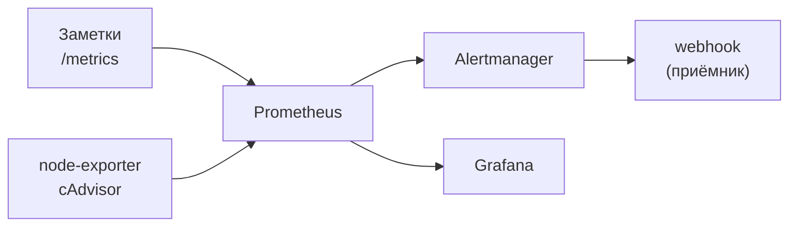

## Четыре дня, чтобы собрать рабочий набор SRE

**Слова, которые встретятся**

- **SLO** (Service Level Objective): цель по качеству сервиса, например «99,9% запросов без ошибок за 30 дней». **Бюджет ошибок**: сколько брака разрешено сверх этой цели.
- **Burn rate** (скорость сжигания бюджета ошибок): во сколько раз текущая доля ошибок больше допустимой по SLO. Подробно в [уроке 8.11](../08-observability/11-reliability-patterns-burn-rate.md).
- **Runbook** (инструкция для дежурного): что проверить и что сделать, когда сработал алерт.
- **Toil** (тягомотина): повторяющаяся ручная работа, которую можно поручить скрипту. Убирать её и значит заниматься SRE.
- **Inhibit** (подавление): правило Alertmanager «если уже горит серьёзный алерт, не присылай мелкий про то же самое».
- **Chaos drill** (учебная поломка): ты сам ломаешь стенд по плану, чтобы проверить, заметят ли это алерты и поможет ли runbook.
- **Shadow on-call**: ты сидишь рядом с дежурным и смотришь, как он работает, сам ничего не решая.
- **Учебный стенд**: набор сервисов для тренировки на одной машине.

SRE (Site Reliability Engineer, инженер по надёжности сервисов) следит, чтобы сервис работал стабильно, и делает это кодом и цифрами, а не ручной работой. За четыре дня ты соберёшь репозиторий `sre-bootstrap`: мониторинг и алерты, логи, Kubernetes, скрипты, пайплайн, бэкапы базы, runbook'и и разбор учебной аварии. Каждое задание заканчивается небольшим, но рабочим результатом: файлом или инструментом, которым можно пользоваться уже сегодня. Всё собранное работает как учебный стенд. Чем он отличается от настоящего продакшена, написано в подразделе «Чем стенд отличается от прода».

> **Что нужно пройти заранее:** весь курс, тема за темой. План не учит с нуля, а собирает пройденное в рабочие артефакты. Опорные темы: [4](../04-docker/index.md) (Compose), [5](../05-kubernetes/index.md) (Kubernetes, пробы, HPA, откат, вход через Gateway API), [8](../08-observability/index.md) (PromQL, SLO, burn rate, алерты; особенно [8.2](../08-observability/02-prometheus-basics.md), [8.5](../08-observability/05-alertmanager.md), [8.11](../08-observability/11-reliability-patterns-burn-rate.md)), [3](../03-git-ci/index.md) (CI/CD), [1](../01-linux/index.md) (bash-скрипты), [10](../10-capstone/index.md) (дежурство, постмортем, бэкап).
>
> **Чем отличается от [задания для инженера мониторинга](monitoring.md):** то задание проверяет один навык вглубь и занимает 12–16 часов. Этот план охватывает весь цикл эксплуатации: мониторинг, логи, Kubernetes, CI/CD, базы, инциденты и планирование мощностей.
>
> **Честно о том, чего в курсе нет:** ELK (Elasticsearch, Logstash, Kibana) и API-шлюз KrakenD в уроках не разбираются: курс учит логи на Loki и Alloy ([урок 8.7](../08-observability/07-logs-loki-alloy.md)), а вход в кластер на Gateway API ([урок 5.4](../05-kubernetes/04-ingress-gateway.md)). Здесь они стоят, потому что в вакансиях и на работе их встречают чаще всего, и ты увидишь второй способ решить ту же задачу. Задания 2.1 и 2.3 поэтому подробнее остальных: объяснения даны прямо в тексте.
>
> **Как проходить:** не подглядывая в ответы предыдущих тем. Если приходится возвращаться за каждой командой, вернись и закрепи соответствующую тему.

## Как устроен план

### Что получится за четыре дня

| День | Время | Что делаешь | Что остаётся в репозитории |
|------|-------|-------------|----------------------------|
| 1 | около 7 ч | метрики, цели по надёжности (SLO), алерты | стек мониторинга, правила, Alertmanager, дашборды |
| 2 | около 6,5 ч | логи, Kubernetes, шлюз | ELK, манифесты, лимит запросов на входе, KrakenD |
| 3 | около 6,5 ч | скрипты, база, пайплайн | скрипты, бэкап PostgreSQL, `.gitlab-ci.yml` |
| 4 | около 6 ч | инциденты, учебная авария, мощности | runbook'и, шаблон постмортема, отчёты |

Итого около 26 часов чистой работы. Закладывай до 32: настройка и поиск опечаток съедают время.

### Как стеки связаны между собой

Все стеки живут в одной Docker-сети `notes-net` (её создаёт основной стек «Заметок» из темы 4), поэтому обращаются друг к другу по именам сервисов.



Prometheus сам приходит за метриками к «Заметкам» и экспортёрам (экспортёр это программа, которая показывает метрики чужой системы), считает правила и отправляет сработавшие алерты в Alertmanager, а он рассылает уведомления. Grafana рисует графики по данным Prometheus. Логи (ELK), KrakenD и PostgreSQL подключаются к той же сети в днях 2 и 3.

### Чем стенд отличается от прода

В настоящем продакшене добавляется то, что мы здесь упрощаем:

- секреты лежат в хранилище (Vault, [тема 9](../09-secrets-gitops/index.md)), а не в `.env`;
- наружу всё закрыто TLS, а у сервисов есть аутентификация;
- сервисы не в одном экземпляре на одной машине, а с запасом (HA, high availability, «высокая доступность»);
- метрики и логи хранятся дольше и в отдельном месте, с учётом их размера;
- права выдаются по минимуму, а не root везде;
- у бэкапов есть копия вне машины и регулярная проверка восстановления.

### Подготовка (30 минут до старта)

```bash
# Рабочий репозиторий: он останется у тебя после плана
mkdir -p ~/sre-bootstrap/{monitoring,logging,kubernetes,cicd,database,incident,scripts}
cd ~/sre-bootstrap && git init

# Нужные пакеты (Ubuntu): jq разбирает JSON, bc считает дроби, psql и pg_dump нужны в дне 3
sudo apt install -y jq bc postgresql-client

# Проверка версий
docker --version            # 27 и новее
docker compose version      # v2 и новее
kubectl version --client    # той же минорной версии, что и кластер (1.35-1.37)
kind version                # свежий релиз, под версию узла твоего кластера; кластер kind из темы 5
jq --version
bc --version
psql --version
pg_dump --version
```

Должно получиться: у каждой команды выводится версия, ни одной ошибки `command not found`.

**Стек окружения:**

- Ubuntu 24.04 LTS (локально или ВМ). На всё одновременно нужно 16 ГБ RAM и больше; если памяти меньше, или возьми облачную ВМ, или запускай стеки по одному (в дне 2 показано, сколько занимает каждый).
- Docker 27+ и Compose v2.
- kubectl и kind, кластер `notes` из [урока 5.1](../05-kubernetes/01-why-k8s-cluster.md).
- Аккаунт GitLab (бесплатный тариф gitlab.com).
- Основной стек «Заметок» версии 0.5.0 или новее из [урока 8.2](../08-observability/02-prometheus-basics.md), запущенный из `~/notes` (достаточно сервисов `notes` и `db`, см. ниже). Без него сети `notes-net` нет, и мониторингу нечего измерять.
- Скрипты рассчитаны на Ubuntu 24.04 и bash 5. В macOS стоит bash 3.2 и другой `top`, поэтому там часть скриптов не заработает как написано.

### Стенд Compose и kind вместе не живут

Прокси основного стека «Заметок» ([урок 4.6](../04-docker/06-compose-nginx-tls.md)) занимает порты 80 и 443 хоста, а кластер kind из [урока 5.1](../05-kubernetes/01-why-k8s-cluster.md) пробрасывает те же порты. Если запущено и то и другое, `docker compose up -d` падает с `port is already allocated`, а `kind create cluster` не создаёт кластер. Поэтому:

- для дней 1 и 3 в `~/notes` поднимай только приложение и базу, без прокси: `docker compose up -d notes db`. Метрики Prometheus берёт по сети `notes-net`, порты хоста ему не нужны;
- перед `kind create cluster` проверь порты: `ss -tlnp | grep -E ':(80|443)\s' || echo "порты свободны"`. Если заняты прокси «Заметок»: `docker compose stop proxy` в `~/notes`;
- в дне 2 (Kubernetes) и в дне 4 кластер `notes` должен быть запущен, прокси Compose остановлен.

### Секреты: что в git, а что нет

Положи в `~/sre-bootstrap/.gitignore` с самого начала:

```text
.env
**/secrets/
*.pgpass
```

В репозитории хранятся только файлы-образцы: `.env.example` с пустыми значениями. Реальный `.env` остаётся на твоей машине. Если пароль всё же попал в коммит, его считают скомпрометированным и меняют: удаление коммита не поможет, копия остаётся в истории.

---

## Дни задания

Каждый день вынесен на отдельную страницу, чтобы её было удобно читать и копировать с неё команды.

1. [День 1. Мониторинг и цели по надёжности](sre-day1.md): Prometheus, Grafana, Alertmanager, SLO, алерты (около 7 ч).
2. [День 2. Логи, Kubernetes и API-шлюз](sre-day2.md): ELK, приёмы работы в Kubernetes, KrakenD (около 6,5 ч).
3. [День 3. Автоматизация, CI/CD и PostgreSQL](sre-day3.md): скрипты, бэкап базы, пайплайн GitLab CI (около 6,5 ч).
4. [День 4. Инциденты, учебные поломки и планирование ёмкости](sre-day4.md): runbook'и, постмортем, учебные аварии, мощности (около 6 ч).

---

## Итоговый чеклист

### Что должно лежать в репозитории

```text
~/sre-bootstrap/
├── .gitignore                        .env, секреты, бэкапы, отчёты
├── Makefile                          up-monitoring, up-logging, up-db, health-check, backup
├── monitoring/
│   ├── compose.yml                   Prometheus, Alertmanager, Grafana, node-exporter, cAdvisor, нагрузка
│   ├── .env.example                  образец, без значений
│   ├── slo-definitions.yml
│   ├── prometheus/
│   │   ├── prometheus.yml
│   │   ├── rules/                    slo_recording_rules.yml, slo_alerts.yml, basic_alerts.yml, postgresql_alerts.yml
│   │   └── tests/                    postgresql_test.yml (по желанию)
│   ├── alertmanager/alertmanager.yml
│   ├── grafana/                      provisioning/ и dashboards/
│   └── krakend/                      compose.yml, krakend.json
├── logging/
│   ├── compose.yml                   Elasticsearch, Logstash, Kibana, Filebeat, nginx
│   ├── logstash/pipeline/nginx.conf
│   └── filebeat/filebeat.yml
├── kubernetes/
│   ├── app-deployment.yml
│   ├── hpa.yml
│   └── demo-route.yml                HTTPRoute и лимит запросов
├── database/
│   ├── compose.yml, .env.example
│   └── init/01-schema.sql
├── scripts/                          health-report.sh, docker-cleanup.sh, check-services.sh, pg-backup.sh, pg-restore.sh
├── incident/                         runbook-*.md (семь), runbook-template.md, postmortem-template.md
└── (в репозитории приложения) .gitlab-ci.yml, Dockerfile, k8s/app-deployment.yml
```

### Проверь себя

- [ ] Объясняю разницу между SLI, SLO и бюджетом ошибок простыми словами.
- [ ] Знаю, зачем recording rules считаются раньше алертов и что будет, если их не делать.
- [ ] Объясняю, зачем в burn-rate алерте два окна (например, 5 минут и 1 час): длинное отсекает короткие всплески, короткое быстро сообщает, что проблема закончилась.
- [ ] Могу с нуля развернуть Prometheus и Grafana за 10–15 минут по своему `compose.yml`.
- [ ] Пишу на PromQL `rate`, `histogram_quantile`, `predict_linear`, `deriv`, подзапросы, и знаю, что `predict_linear` возвращает значение метрики, а не время.
- [ ] Отличаю `depends_on` от healthcheck в Compose: первое задаёт порядок запуска, второе проверяет готовность.
- [ ] Отличаю liveness от readiness-пробы и знаю, что будет, если они настроены неверно.
- [ ] Делаю откат выкладки в Kubernetes и читаю `kubectl rollout history`.
- [ ] Делаю бэкап PostgreSQL, восстанавливаю его в отдельную базу и сверяю данные.
- [ ] Знаю разницу между RPO и RTO и чего не даёт одиночный `pg_dump`.
- [ ] Провожу постмортем без обвинений и формулирую конкретные действия.
- [ ] Называю четыре золотых сигнала: задержка, трафик, ошибки, насыщение.

---

## Первая неделя на новом месте

Не неси на новое место готовый стенд и не предлагай ставить его: у команды уже что-то есть, и с этого надо начинать. Своё приносят, только если мониторинга нет совсем, и после договорённости с командой.

1. **Первые дни:** получи доступы, прочитай runbooks и последние три постмортема, понаблюдай за шумом алертов (какие срабатывают часто и никого не будят по делу), посиди рядом с дежурным (shadow on-call), составь карту «сервис и его владелец».
2. **Конец первой недели:** покажи, что понял: короткий список «что есть, что шумит, чего не хватает».
3. **Первый месяц:** улучши одну вещь вместе с командой, например убери самый шумный алерт или напиши недостающий runbook. Предложение должно опираться на то, что ты увидел, а не на то, что умеешь.
4. **Первый квартал:** если команда готова, договорись о первых SLO и политике бюджета ошибок, сделай первый отчёт о ёмкости.

---

## Проверено на версиях

Дата проверки страницы: 2026-10-26. Что делалось: разбор синтаксиса bash-скриптов (`bash -n`), разбор YAML и JSON из примеров, проверка ссылок на уроки курса. Что **не прогонялось**: запуск образов и всех стеков (Prometheus, Alertmanager, Grafana, Elastic, KrakenD, PostgreSQL, GitLab Runner), команды в кластере kind и Envoy Gateway, настоящая выкладка из GitLab CI. Теги образов сверены с Docker Hub и ghcr.io в день проверки, версии трёх инструментов обновлены до свежих (nginx, trivy, trufflehog, hadolint). Полного прогона всех заданий на чистой машине пока не было, поэтому строки «ожидаемый вывод» это ориентир, а не снимок: числа и порядок строк у тебя будут другие. Если команда на твоих версиях ведёт себя иначе, верь документации и своему выводу.

| Компонент | Версия в примерах |
|-----------|-------------------|
| Prometheus | 3.15.0 |
| Alertmanager | 0.34.1 |
| Grafana | 13.2.2 |
| node-exporter | 1.12.1 |
| cAdvisor | 0.60.6 |
| postgres-exporter | 0.17.1 |
| PostgreSQL | 16 |
| Elasticsearch, Logstash, Kibana, Filebeat | 8.17.4 |
| KrakenD | 2.10 |
| Envoy Gateway | 1.9.2 (как в уроке 5.4) |
| kind, образ узла | кластер `notes`, v1.36.4 |
| Docker, образы `docker` и `dind` в CI | 27.5.1 |
| nginx в Compose, Kubernetes и CI | 1.30-alpine |
| Trivy, TruffleHog, hadolint | 0.74.0, 3.99.7, v2.15.1 |
| go-httpbin | 2.18.3 |
