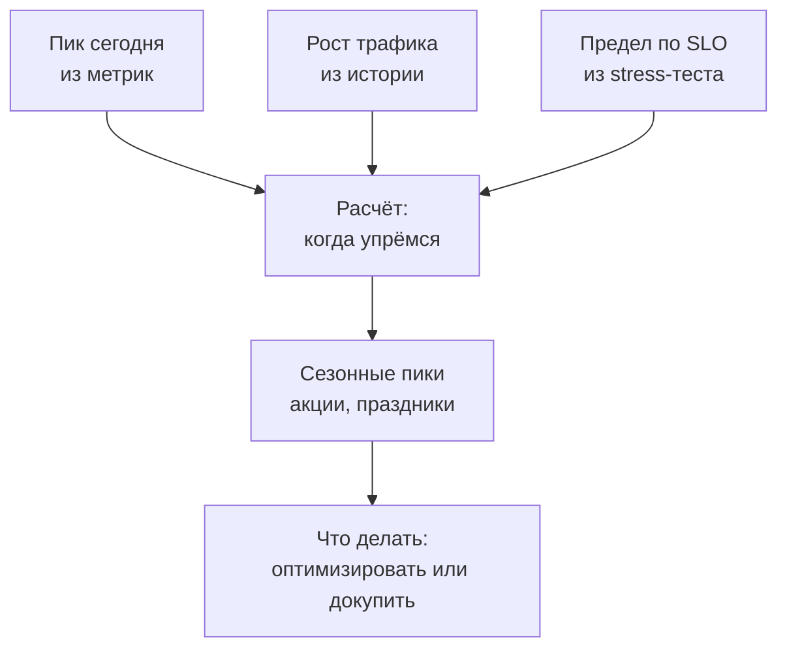
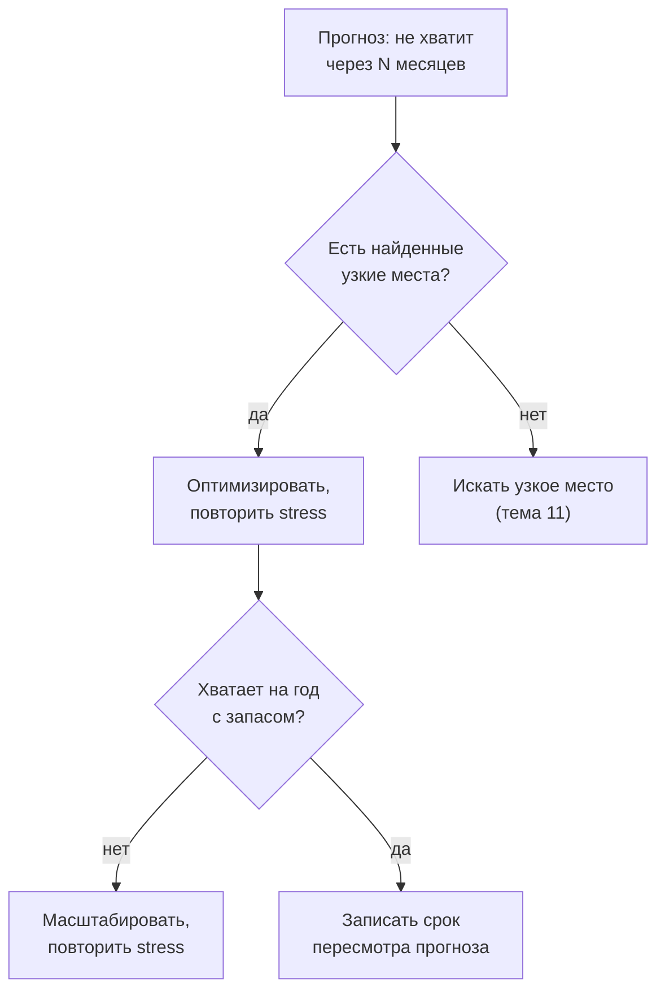

## Зачем это нужно

Рано или поздно звучит вопрос, после которого понятно, что «у нас всё хорошо» не ответ. Руководитель приносит план: в следующем квартале большая кампания, трафик вырастет. «Сколько мы выдержим через год и хватит ли?» Инженер говорит, что сейчас запас большой, руководитель спрашивает «насколько большой и до какого месяца?», и ответить нечем. Чтобы ответить, нужна картинка, где видно и сегодняшний пик, и предел:

<div class="viz" data-viz="hockey-stick" data-capacity="200" data-base="40" data-load="90" data-unit="RPS"></div>

Пик «Магазина» сейчас около 90 запросов в секунду (45% предела) при пределе 200. Подвигай нагрузку к пределу: запас в процентах выглядит большим, но задержка начинает расти задолго до самого предела, и именно поэтому вопрос «насколько хватит» нельзя решать на глаз.

Твой тест из [урока 12.1](01-report.md) ответил на вопрос «сколько выдерживаем сегодня»: около 200 запросов в секунду при p95 до 0,5 с. Теперь ответ нужен на год вперёд, перед распродажей и после неё.

Это называется **прогнозом ёмкости** (capacity planning): расчёт, когда нагрузка дорастёт до предела системы и сколько мощности нужно, чтобы этого не случилось. В него входят три числа: сколько трафика сегодня (пик), как быстро он растёт и где предел (из stress-теста). Остальное арифметика, но с ловушками: ошибка обходится либо лишними расходами, либо ночным инцидентом в самый неудобный день.

Шаг проекта: ты напишешь `~/perf-lab/12-process/capacity.py`, который по результатам ступенчатого прогона и допущениям о росте считает, когда «Магазин» упрётся в предел, и добавишь раздел «Прогноз ёмкости» в отчёт из урока 12.1. Это финальный шаг темы: измерили, зафиксировали в CI, прогнозируем.

## Что нужно знать

- Ёмкость, клюшка (hockey stick) и запас до предела: [урок 8.1](../08-perf-theory/01-latency-throughput.md) и [8.2](../08-perf-theory/02-queues-littles-law.md). Мы возьмём ёмкость из ступенчатого прогона.
- SLO и профиль нагрузки: [урок 8.4](../08-perf-theory/04-load-profile-slo.md). Предел всегда считается «по SLO», а не «до падения».
- Ступенчатый прогон и таблица результатов: [урок 12.1](01-report.md). Файлы `results/stress-*.json` оттуда нужны сейчас.
- Метрики и запросы Prometheus для реальной нагрузки: [урок 7.2](../07-observability/02-promql.md). Откуда брать «пик сегодня».
- Python и JSON: [тема 4](../04-python/index.md).

## Картина целиком

Прогноз ёмкости отвечает на три вопроса: когда пик дорастёт до «тесно», что будет в день акции и что делать: докупать мощность или убирать лишнюю работу (оптимизировать). «Тесно» наступает не на пределе, а заметно раньше, и резко ([урок 8.2](../08-perf-theory/02-queues-littles-law.md)): это главная ловушка прогноза.



Три входных числа сходятся в расчёт, потом корректируются на события и превращаются в решение.

## Теория

### Три входных числа

Прогноз стоит ровно столько, сколько стоят его числа. Откуда их брать и как они обманывают?

Первое число это пик сегодня. Не средний трафик за сутки, а максимум минутной нагрузки за каждый день, а из дневных максимумов за последние четыре недели берут высокий (например, 95-й) квантиль, чтобы отсечь одиночные выбросы. Среднее может быть 25 запросов в секунду, а вечером в час пик 90. Система ломается в пике, а не на среднем. Берут его из мониторинга ([урок 7.2](../07-observability/02-promql.md)). Запрос для Prometheus вынесен в блок ниже, читать его пока не обязательно.

<details markdown="1">
<summary>Как достать пик из Prometheus (для прода)</summary>

Сначала заведи правило записи (recording rule), которое считает скорость запросов: `sum(rate(http_requests_total[5m]))`, назови его, например, `shop:rps:5m`. Затем максимум за каждые сутки: `max_over_time(shop:rps:5m[1d])`. Дальше по этим дневным максимумам за четыре недели берут высокий квантиль (или максимум без явных выбросов). Квантиль самих минутных значений (`quantile_over_time(0.95, ...)`) пиком не является: он показывает, что трафик ниже этой цифры 95% времени, а нужен именно максимум дня. Для тренда есть `predict_linear`, но он продолжает прямую, а не кривую роста.

По умолчанию Prometheus хранит данные 15 суток, поэтому месячную историю нужно или держать дольше, или выгружать дневные максимумы в долгое хранилище. На учебном стенде бери то окно, которое показывает дашборд. Цифры урока (пик 90, рост 6% в месяц) условные.

</details>

Второе число это рост: процент в месяц по истории пиков за 6–12 месяцев или из бизнес-плана («заказов на 5–7% больше каждый месяц»). Рост считают линейно (каждый месяц прибавляется одно и то же число запросов) или сложным процентом (прибавляется одинаковая доля от текущего значения). Реальный трафик ближе ко второму: чем больше клиентов, тем больше новых приходит по рекомендациям.

Третье число это предел: ёмкость по SLO из stress-теста ([урок 12.1](01-report.md)), то есть последняя нагрузка, при которой p95 меньше 500 мс и ошибок меньше 1%. У «Магазина» это около 200 запросов в секунду. Это не точка отказа, а точка, где мы выходим за SLO: падает всё позже, но покупателю «медленно» уже плохо.

Соберём: пик 90 запросов в секунду, рост 6% в месяц, ёмкость 200. Загрузка сегодня 90 / 200 = 0,45, то есть 45%.

> **Прикинь сам:** среднесуточный трафик 30 запросов в секунду, пик в обеденный час 110, ёмкость 200. Какую загрузку считать сегодняшней?
{: .predict}

110 / 200 = 55%, потому что система упирается в предел в самые плотные минуты. Загрузка по среднему (15%) создаёт ложное чувство запаса.

Осторожно: путают единицы. Пик в пользователях в секунду, а ёмкость в HTTP-запросах: считай в одних. В сценарии пять запросов, поэтому 40 сценариев в секунду равны 200 запросам.

> **Главное:** прогноз строится на пике (не на среднем), темпе роста и пределе по SLO, и все три в одних единицах.
{: .key}

Предел 200 известен. Но работать на 100% нельзя, и тут нужен запас.

### Запас и рабочая граница

Предел 200 это потолок, а не цель. Любой всплеск, перезапуск одного сервера или медленная зависимость выбросят нас за SLO. Поэтому вводят **рабочую границу** (целевую загрузку): долю ёмкости, выше которой система считается «тесной» и мы начинаем действовать заранее.

Границу выбирают по трём причинам. Первая: колено кривой, после которого задержка растёт резко ([урок 8.2](../08-perf-theory/02-queues-littles-law.md)). Граница стоит до него. Вторая: отказ узла. Если экземпляров два и один упал, второй принимает весь трафик, а значит, каждый должен работать не выше 50%. Третья: внезапные всплески (рассылка, ошибка клиента, ретраи).

Обычно берут 60–70% для сервиса без резервирования и около 50% для пары с отказоустойчивостью. Для стенда возьмём 70%, и рабочая граница равна 200 · 0,7 = 140 запросов в секунду. «Тесно» наступает не на 200, а на 140.

<div class="viz" data-viz="proc-capacity" data-peak="90" data-capacity="200" data-growth="6" data-target="70" data-season="1" data-boost="0"></div>

Сплошная кривая это прогноз пика по месяцам, горизонтальные линии это граница и предел. Пик выходит из зелёной зоны на седьмом-восьмом месяце. Подвигай «границу загрузки»: она сдвигает решение на месяцы.

Сегодняшний пик 90 дорастёт до 140 (граница) через 7,6 месяца, а до 200 (предел) через 13,7. Значит, у нас 7-8 месяцев на действия, а не тринадцать. Закупки и решения занимают недели и месяцы, поэтому срок считают до границы.

> **Проверь понимание:** два экземпляра сервиса, каждый тянет 100 запросов в секунду по SLO. Трафик 120. Что случится, если один откажет?

<details markdown="1">
<summary>Ответ</summary>

Весь трафик ляжет на один экземпляр с пределом 100, а у нас 120: перегрузка, p95 уйдёт далеко за SLO. Поэтому для пары граница около 50%. Сейчас загрузка 60% от суммарной ёмкости, и запаса на отказ уже нет.

</details>

> **Главное:** срок на решение считают до рабочей границы, а не до предела: граница стоит до колена и оставляет запас на отказы и всплески.
{: .key}

Теперь вопрос, который стоит месяцев: как правильно продолжить рост вперёд?

### Как продолжить рост вперёд: линейно и сложным процентом

Чтобы узнать, когда пик дорастёт до границы, тренд продолжают вперёд (это называется экстраполяцией). Самое простое продолжение, линейное, ошибается для растущего бизнеса всегда в одну сторону: занижает рост, потому что новая нагрузка тоже приносит рост.

Продолжим рост 6% в месяц от пика 90. Сложным процентом каждый месяц умножаем на 1,06. Вот что получается по месяцам:

```text
месяц  пик, запр/с  загрузка
    0           90      45%
    3          107      54%
    6          128      64%
    9          152      76%  <- выше границы 70%
   12          181      91%
   18          257     128%
```

В таблице выше в первые три месяца пик растёт на 17 запросов (90 → 107), а в последние три месяца года на 29 (152 → 181): тренд ускоряется сам, поэтому интуиция «растёт понемногу» обманывает.

Откуда 181 через год: 1,06 умножаем на себя 12 раз (на калькуляторе), получаем 2,01, и 90 · 2,01 = 181. Линейно мы каждый месяц прибавляем 6% от исходных 90, то есть 5,4 запроса. Через 12 месяцев 90 + 12 · 5,4 = 155. Расхождение 26 запросов, около 17%. Границу 140 линейный расчёт пересекает через 9,3 месяца, сложный через 7,6. Линейный даёт оптимистичную оценку: кажется, что времени на 1,7 месяца больше, чем на самом деле.

Какой выбрать? Смотри на историю: если пики за год лежат на прямой, ближе линейный, если изгибаются вверх, сложный. Для планирования безопаснее сложный: он ошибается в сторону запаса.

<div class="viz" data-viz="proc-capacity" data-peak="100" data-capacity="200" data-growth="10" data-target="70" data-season="1" data-boost="0"></div>

Здесь другой пример: пик 100 и рост 10% в месяц, как в задании ниже. Нажми переключатель «сложный процент / линейно». Линейная кривая пересекает границу позже, и эти месяцы разницы и есть воображаемый запас.


> **Прикинь сам:** пик 100 запросов в секунду, рост 10% в месяц. Сколько будет через 6 месяцев линейным способом и сложным?
{: .predict}

Линейно: 100 + 6 · 10 = 160. Сложным процентом: 100 · 1,1⁶ = 177. Линейный занижает нагрузку на 17 запросов.

Осторожно: рост по короткому всплеску (два месяца подряд +15%) на год вперёд продолжать нельзя, это скачок, а не тренд.

> **Главное:** растущий трафик продолжают сложным процентом: линейный расчёт даёт больше времени, чем есть на самом деле.
{: .key}

Мы научились прогнозировать нагрузку. А что будет с задержкой на этой нагрузке?

### Ловушка: задержка не линейна

Самая опасная ошибка прогнозов: взять две точки, провести прямую и сказать «запаса много». Из [урока 8.2](../08-perf-theory/02-queues-littles-law.md) мы знаем, что задержка изгибается «клюшкой». 

Пока ресурсы свободны, запросы почти не ждут друг друга, и p95 растёт едва заметно. Когда загрузка приближается к 100%, образуется очередь, и ожидание в ней растёт взрывом. Поэтому задержку из спокойной зоны на высокую загрузку не продолжают, её меряют ступенчатым тестом.

Данные «Магазина» из урока 12.1. Прямая через две первые точки (50 запросов в секунду дают 62 мс, 100 дают 85 мс) обещает на 200 запросах около 131 мс. Измеренное значение 460 мс.

<div class="viz" data-viz="chart" data-type="line" data-x="50,100,150,175,198,215" data-x-label="Запросов в секунду" data-y-label="p95, мс" data-unit="мс" data-explain="Реальный p95 в середине нагрузки вдвое-втрое выше прямой по первым двум точкам, а у предела выше в 3-4 раза. Цель 500 мс достигается там, где прямая обещала бы большой запас." data-series='[{"name":"Измерено","values":[62,85,140,260,460,980]},{"name":"Прямая по первым двум точкам","values":[62,85,108,120,130,138]}]'></div>

Линия и кривая расходятся уже около 150 запросов в секунду, а у предела разница в несколько раз. По прямой на 215 запросах всё ещё 138 мс и «огромный запас», а на деле 980 мс.

То же как «клюшка» с запасом до предела (модель с ёмкостью 200):

<div class="viz" data-viz="hockey-stick" data-capacity="200" data-base="55" data-load="140" data-unit="запросов/с"></div>

На 140 запросах (70% предела) кривая модели уже начинает подниматься (около 180 мс против 55 в покое), а с 180 взмывает. Модель упрощённая: у неё предел это стена, к которой кривая подходит бесконечно близко, а наш предел по SLO измерен ступенчатым тестом. Нагрузка на виджете поставлена на рабочую границу 140, а не на сегодняшний пик 90: так наглядно видно колено.

> **Проверь понимание:** на 100 запросах в секунду p95 равен 85 мс, на 150 равен 140. Можно ли прикинуть p95 на 250, продолжив эту линию?

<details markdown="1">
<summary>Ответ</summary>

Нет: 250 выше ёмкости (200), там очередь растёт без предела, и по прямой вышло бы около 250 мс, а на деле секунды. Всё, что выше колена, надо мерить, а не вычислять по пологому участку.

</details>

Отсюда два правила. Ёмкость всегда измеряют по SLO, а не «до падения» и не «по прямой». Граница стоит до колена: у нас оно между 150 (140 мс) и 175 (260 мс), а предел по SLO на 198, поэтому 70% (140) выглядит разумно. Прогнозируют нагрузку, а задержку на этой нагрузке берут из измерения.

> **Главное:** нагрузку прогнозируют, задержку измеряют: прямая по спокойным точкам всегда обещает слишком много запаса.
{: .key}

Мы посчитали обычный рост. Но есть дни, когда трафик не растёт, а прыгает.

### Сезонность: пик акции

Бывают события, которые на день-два умножают трафик: распродажа, праздники, рассылка. Система должна пережить их, иначе вся работа за год пойдёт насмарку в самый важный день.

Пик события оценивают как множитель к обычному пику на тот момент. Источники множителя: прошлые события (в прошлую «Чёрную пятницу» было ×1,8 к обычному дню), планы маркетинга, оценки по аналогии. Для «Магазина» акция через месяц: пик через месяц 90 · 1,06 = 95, множитель 1,8, нагрузка акции около 172 запросов в секунду. Это 86% ёмкости, между границей (70%) и пределом: выдержим, но вплотную. Пик события берут с запасом: его проверяют spike-тестом на 1,3-1,5 от ожидаемого, заранее готовят и проверяют план деградации (какие тяжёлые функции отключить) и план временного расширения. Мощность под событие считают отдельно, со своим целевым порогом (`--event-target` в скрипте ниже): на пике события допускают загрузку выше обычной границы, но только после spike-теста.

> **Прикинь сам:** обычный пик 100, рост 5% в месяц, акция через 6 месяцев с множителем 2. Какой пик акции?
{: .predict}

Обычный пик через 6 месяцев: 100 · 1,05⁶ = 134. Пик акции 134 · 2 = 268 запросов в секунду. Множитель накладывается на выросший пик: от сегодняшнего вышло бы 200, и событие недооценили бы.

<div class="viz" data-viz="proc-capacity" data-peak="90" data-capacity="200" data-growth="6" data-target="70" data-season="1.8" data-season-month="1" data-boost="0"></div>

Фиолетовая отметка это пик акции в первый месяц на уровне 86% предела: выше границы, хотя обычный пик дойдёт до неё только на восьмом месяце. Подними «пик акции» до 2,5, и акция пробьёт предел: при большом множителе событие может определять нужную мощность.

Теперь посчитаем нужную ёмкость по шагам:

1. Сравним два пика: акции через месяц 172 и обычный через год 181. Берём большее, 181.
2. Делим на рабочую границу: 181 / 0,7 = 259 запросов в секунду.
3. Сравниваем с тем, что есть: 259 / 200 = 1,29. У нас 200, не хватает 29%.

Время события в году меняет требования, а не только размер.

> **Прикинь сам:** то же самое, но акция не через месяц, а через год, множитель 1,8. Какая ёмкость нужна?
{: .predict}

Пик акции 181 · 1,8 = 326, делим на 0,7 и получаем 466 запросов в секунду. Нужна ёмкость вдвое с лишним больше сегодняшней, а не 259.

Такое событие проверяют отдельным тестом, профилем spike из [урока 8.3](../08-perf-theory/03-test-types.md): резкий скачок отличается от плавного роста, пулы соединений и кэши не успевают подстроиться.

Осторожно, ошибка: решить, что акция разовая, и не считать под неё мощность. Её считают отдельно, как в шагах выше. Временная аренда мощности допустима, но заранее и после проверки тестом.

> **Главное:** пик акции это множитель к выросшему обычному пику; мощность под событие считают отдельно, и при большом множителе она может оказаться определяющей.
{: .key}

Прогноз показал, что не хватает. Что делать?

### Что покупать или оптимизировать

Прогноз показал, что мощности не хватит. Но решений больше, чем «купить серверов», и у каждого своя цена, срок и риск. Рычагов три.

- **Оптимизировать**, то есть убрать лишнюю работу. Индекс по `orders.user_id` и два запроса вместо 21 из [урока 12.1](01-report.md) вместе подняли ёмкость 200 → 290 запросов в секунду за один день работы. Самый дешёвый рычаг, если узкие места найдены ([тема 11](../11-bottlenecks/index.md)).
- **Вертикальное масштабирование**, то есть мощнее машина. Просто, но упирается в потолок самого большого инстанса, обычно требует перезапуска и не даёт отказоустойчивости. Для «Магазина» это лимит процессора контейнера с 1 до 2 (`cpus` в `compose.yaml`).
- **Горизонтальное**, то есть больше экземпляров. Даёт запас на отказ узла (на один экземпляр больше, чем нужно по нагрузке) и отказоустойчивость, но работает, пока не упёрлись в общее ограничение: одну базу или внешнюю оплату. Два экземпляра редко дают ровно ×2.

Порядок такой: сначала оптимизировать найденное, потом масштабировать остальное, и каждое решение проверять повторным stress-тестом: реальный прирост бывает любым, от +45% до нуля, если чинили не то место. Каждое решение стоит денег, поэтому цену сравнивают с ценой простоя. Прогноз пересматривают после каждого релиза и сверяют с фактом.

<details markdown="1">
<summary>Для любопытных: что ещё есть в арсенале</summary>

Автоскейлинг: число экземпляров растёт само по нагрузке, но в заданных пределах. Дорогой пик иногда проще срезать: отключить тяжёлые функции (load shedding) или спрятать их за флагом. Воркеры (`WEB_CONCURRENCY`) помогают, только если есть свободные ядра или сервис ждёт ввода-вывода. Эффект любого из этих приёмов измеряют повторным stress-тестом.

</details>



Прогноз запускает цикл «улучшить, измерить, пересчитать», а не покупку. Даже после оптимизации его пересчитывают: новая ёмкость сдвигает все сроки.

<div class="viz" data-viz="proc-capacity" data-peak="90" data-capacity="200" data-growth="6" data-target="70" data-season="1.8" data-season-month="1" data-boost="45"></div>

С приростом 45% ёмкость 290, граница 203. Обычный пик пересекает её уже после года, акция выходит из жёлтой зоны. При приросте 20% этого не хватает: подбери минимальный прирост, при котором год проходит без жёлтой зоны.

```text
| Вариант                          | Новая ёмкость | Хватает на год?    | Цена и срок            |
|----------------------------------|---------------|--------------------|------------------------|
| Ничего не делать                 | 200           | нет (нужно 259)    | -                      |
| Индекс + два запроса вместо 21 (вместе) | 290      | да, запас 12%      | 1 день работы          |
| Лимит процессора контейнера 1 -> 2 | не измерено | неизвестно         | 0,5 дня + stress-тест  |
| Второй экземпляр сервиса         | не измерено   | зависит от базы    | деньги + настройка     |
```

Выбор: индекс и два запроса вместо 21 (дёшево и проверено), затем повторный stress, затем пересмотр прогноза через квартал, остальное до фактов. Осторожно: мощность не покупают, пока не проверили, что ограничивает ёмкость. Если это база, лишние экземпляры сервиса не помогут и перегрузят её ещё сильнее.

> **Главное:** сначала оптимизация, потом масштабирование, и после каждого шага повторный stress-тест и пересчёт прогноза.
{: .key}

Остался вопрос: как не принять модель за обещание?

### Подводные камни прогноза

Перед тем как показывать прогноз, проверь его на ловушках. Стенд не равен проду: генератор на той же машине занижает ёмкость, меньший объём данных завышает ([отличия среды из урока 12.1](01-report.md)). Состав нагрузки меняется: ёмкость 200 измерена на профиле «покупка», а акция даёт больше заказов и меньше просмотров каталога. Заказ дороже, поэтому при тех же запросах нагрузка на базу выше, и прогноз лучше вести по ключевой операции (заказов в секунду).

Рост бывает не плавным: скачки от маркетинга, спады. Раз в квартал сравнивай предсказанный пик с реальным. Внешние зависимости (платёжный провайдер, почта) имеют свои лимиты ([урок 11.5](../11-bottlenecks/05-cache-dependencies.md)), и ёмкость системы равна ёмкости самого слабого звена. Объём данных, память при утечке ([урок 11.4](../11-bottlenecks/04-memory-soak.md)) и число соединений растут не вместе с нагрузкой и требуют отдельного тренда. Если истории мало (два месяца), честно называй диапазон («рост от 3 до 9% в месяц»), а не одну цифру.

Сложный процент годится на горизонт 6-12 месяцев: дальше реальный рост обычно выходит на плато и зависит от сезона. Ограничение бывает не по запросам, а по ресурсам: процессору, соединениям с базой, памяти, поэтому ёмкость смотрят по каждому ресурсу отдельно.

«Через 7,6 месяца» это не дата, а ориентир, поэтому сообщай диапазон: «через 6–9 месяцев в зависимости от темпа роста». Покажи три сценария (консервативный, ожидаемый, пессимистичный) и какое решение нужно в каждом.

<div class="viz" data-viz="flow" data-title="Проверка прогноза перед показом" data-steps='[{"title":"Единицы совпадают","text":"Пик и ёмкость в одних единицах: запросы в секунду или заказы в секунду."},{"title":"Пик, а не среднее","text":"Нагрузка взята по максимуму за характерный период."},{"title":"Предел по SLO","text":"Ёмкость измерена ступенчатым тестом, а не выведена по прямой."},{"title":"Рабочая граница","text":"Срок считается до границы, а не до 100%."},{"title":"Сезонные пики","text":"Акции и праздники добавлены множителем к выросшему пику."},{"title":"Диапазон сценариев","text":"Показаны три темпа роста, а не одна цифра."}]'></div>

Шесть пунктов по порядку, и каждый соответствует ловушке выше. Не прошёл хотя бы один: прогноз ещё не готов.

> **Проверь понимание:** прогноз построен по общему числу запросов в секунду, но акция сдвинет профиль в сторону заказов. Почему это риск и как его снизить?

<details markdown="1">
<summary>Ответ</summary>

Заказ дороже просмотра каталога (больше обращений к базе и оплате), поэтому при тех же запросах в секунду нагрузка выше, а ёмкость 200 измерена на другом профиле. Проверь ёмкость профилем, похожим на акционный (больше заказов, spike), и веди прогноз по заказам в секунду.

</details>

> **Главное:** прогноз это модель с допущениями: показывай диапазон и допущения вместе с цифрами.
{: .key}

Вернёмся к вопросу руководителя: «Сколько выдержим через год и хватит ли?» Теперь у тебя есть ответ с числами: граница через 7-8 месяцев, акция на 86% предела, индекс и устранение N+1 дают запас. Остаётся посчитать это скриптом.

## Практика

Файлы лежат в `~/perf-lab/12-process/`. Нагрузка идёт только на твой локальный стенд.

### 1. Данные: ступенчатый прогон

Если после [урока 12.1](01-report.md) в `~/perf-lab/results/` есть файлы `stress-10.json`, `stress-20.json` и так далее, переходи к шагу 2. Если нет, сначала верни стенд в исходное состояние (полный сброс из `~/learning/load-tester/project/shop`), потом запускай прогон:

```bash
cd ~/learning/load-tester/project/shop && cp .env.example .env && docker compose --profile monitoring down -v && docker compose --profile monitoring up -d --wait
curl -s -X POST localhost:8001/admin/config -H 'Content-Type: application/json' -d '{"delay_ms": 50, "fail_rate": 0}'
cd ~/perf-lab/12-process && ./stress.sh
ls ~/perf-lab/results/stress-*.json
```

Нагрузка идёт 10 минут, `stress.sh` из прошлого урока гонит ступени по минуте. Подробная процедура с проверками лежит в шаге 1 [урока 12.1](01-report.md). Ёмкость на чистом стенде будет другой (без кэша и индекса она заметно ниже 200, порядка 155 запросов в секунду): это нормально, форма расчёта та же. Числа урока (ёмкость 200, пик 90, прирост 45%) взяты со стенда после оптимизаций из 12.1, поэтому свои `--peak` и `--boost` бери так: пик возьми условный, например половину своей ёмкости, и подпиши его в отчёте как условный; прирост `--boost` бери из своего повторного замера после оптимизации (шаг 4), а не 45 из образца.

**Как читать вывод:** `ls` должен показать семь файлов `stress-10.json` ... `stress-50.json`. Если часть ступеней в уроке 12.1 помечена «замер недействителен», прогони их заново: `capacity.py` такие ступени пропустит.

**Типичные ошибки:** старые `stress-*.json` от другого состояния стенда (с индексом) дают завышенную ёмкость; `./stress.sh` не найден, если ты не в `12-process`.

### 2. Скрипт capacity.py

Создай `~/perf-lab/12-process/capacity.py`:

```python
"""Прогноз ёмкости: python3 capacity.py [--peak 90] [--growth 6] [--target 70]
   [--event-target 70] [--season 1.8] [--season-month 1] [--boost 0] [--capacity 200]
   [--pattern 'results/stress-*.json']"""
import argparse
import glob
import json
import math
import os
import re

HERE = os.path.dirname(os.path.abspath(__file__))
SLO_P95_MS = 500
SLO_ERRORS = 0.01

parser = argparse.ArgumentParser()
parser.add_argument("--peak", type=float, default=90, help="пик сегодня, запросов/с")
parser.add_argument("--growth", type=float, default=6, help="рост пика в месяц, %%")
parser.add_argument("--target", type=float, default=70, help="рабочая граница загрузки, %%")
parser.add_argument("--event-target", type=float, default=70,
                    help="допустимая загрузка на пике события, %%; поднимай выше границы только после spike-теста")
parser.add_argument("--season", type=float, default=1.8, help="во сколько раз акция выше обычного пика")
parser.add_argument("--season-month", type=int, default=1, help="через сколько месяцев акция")
parser.add_argument("--boost", type=float, default=0, help="прирост ёмкости от оптимизации, %%")
parser.add_argument("--capacity", type=float, help="ёмкость по SLO, запросов/с (если не брать из прогона)")
parser.add_argument("--pattern", default=os.path.join(HERE, "..", "results", "stress-*.json"))
args = parser.parse_args()


def metric(summary, name):
    item = summary["metrics"][name]
    return item.get("values", item)


def capacity_from_stress(pattern):
    """Ёмкость по SLO: запросов/с на последней ступени, где p95 и ошибки в норме.
    Ступени с пропущенными итерациями и с упавшим k6 (код не 0 и не 99) не считаются."""
    best = 0
    for path in sorted(glob.glob(pattern), key=lambda p: int(re.search(r"-(\d+)\.json$", p).group(1))):
        exit_path = path[:-len(".json")] + ".exit"
        if os.path.exists(exit_path) and open(exit_path).read().strip() not in ("0", "99"):
            continue  # k6 упал: сводка недействительна
        with open(path) as stream:
            summary = json.load(stream)
        if "dropped_iterations" in summary["metrics"] and metric(summary, "dropped_iterations")["count"] > 0:
            continue  # не хватило VU: заданный поток не получен, замер недействителен
        p95 = metric(summary, "http_req_duration")["p(95)"]
        failed = metric(summary, "http_req_failed")
        errors = failed.get("rate", failed.get("value", 0))
        if p95 < SLO_P95_MS and errors < SLO_ERRORS:
            best = metric(summary, "http_reqs")["rate"]
    return best


cap = args.capacity or round(capacity_from_stress(args.pattern), -1)
if not cap:
    raise SystemExit("нет ёмкости: запусти stress.sh или передай --capacity")
cap *= 1 + args.boost / 100
growth = args.growth / 100
border = cap * args.target / 100


def peak_at(month):
    return args.peak * (1 + growth) ** month


def month_reaching(level):
    if args.peak >= level:
        return 0.0
    return math.log(level / args.peak) / math.log(1 + growth)


def linear_month_reaching(level):
    step = args.peak * growth  # прирост в месяц, если считать от сегодняшнего пика равномерно
    return (level - args.peak) / step


print(f"ёмкость по SLO: {cap:.0f} запросов/с, рабочая граница {args.target:.0f}%: {border:.0f}")
print(f"пик сегодня {args.peak:.0f} запросов/с, рост {args.growth:.0f}% в месяц\n")
print("месяц  пик, запр/с  загрузка")
for month in (0, 3, 6, 9, 12, 18):
    value = peak_at(month)
    mark = "  <- выше границы" if value > border else ""
    print(f"{month:>5}  {value:>11.0f}  {value / cap:>7.0%}{mark}")

print(f"\nграницу {border:.0f} пик пересечёт через {month_reaching(border):.1f} мес. "
      f"(линейная прикидка: {linear_month_reaching(border):.1f})")
print(f"предел {cap:.0f} пик пересечёт через {month_reaching(cap):.1f} мес. "
      f"(линейная прикидка: {linear_month_reaching(cap):.1f})")

sale = peak_at(args.season_month) * args.season
print(f"\nпик акции через {args.season_month} мес.: {sale:.0f} запросов/с, это {sale / cap:.0%} ёмкости")
year = peak_at(12)
need_year = year / (args.target / 100)
need_sale = sale / (args.event_target / 100)
need = max(need_year, need_sale)
print(f"через год обычный пик {year:.0f}; чтобы держать границу {args.target:.0f}%, нужна ёмкость {need_year:.0f}")
print(f"акция {sale:.0f}; чтобы держать {args.event_target:.0f}% на пике события, нужна ёмкость {need_sale:.0f}")
print(f"нужно: {need:.0f}")
if need > cap:
    print(f"не хватает {need / cap - 1:.0%}: нужно оптимизировать или докупить мощность")
else:
    print(f"хватает с запасом {cap / need - 1:.0%}")
```

Разбор. `argparse` разбирает параметры командной строки: у каждого есть значение по умолчанию («Магазин»: пик 90, рост 6%, граница 70%, акция ×1,8 через месяц). `capacity_from_stress` читает сводки ступенчатого прогона, берёт **последнюю ступень, где p95 меньше 500 мс и ошибок меньше 1%**, и возвращает пропускную способность на ней. Это ёмкость по SLO. Если выше есть провальные ступени, а одна из них случайно уложилась в SLO, скрипт всё равно возьмёт её: при шуме ёмкость может получиться нелогичной, поэтому смотри таблицу ступеней глазами. `round(..., -1)` округляет до десятков (198 станет 200): точность прогноза всё равно не выше. `month_reaching` решает уравнение «пик · 1,06^m = уровень» через логарифм: `math.log(уровень / пик) / math.log(1,06)` даёт число месяцев. `linear_month_reaching` считает то же линейно, для сравнения. Недействительные замеры он пропускает: ступени, где k6 пропустил итерации (`dropped_iterations` больше нуля) или упал (файл `.exit` с кодом, не равным 0 и 99). Потом печатается таблица, пересечения, нагрузка акции и необходимая ёмкость. Для обычного пика она считается по рабочей границе (`--target`), для акции по `--event-target`, и берётся большее из двух. Допустимую загрузку на пике события по умолчанию оставили равной границе: поднимай её, только если проверил событие spike-тестом и готов план деградации.

```bash
cd ~/perf-lab/12-process && python3 capacity.py
```

```text
ёмкость по SLO: 200 запросов/с, рабочая граница 70%: 140
пик сегодня 90 запросов/с, рост 6% в месяц

месяц  пик, запр/с  загрузка
    0           90      45%
    3          107      54%
    6          128      64%
    9          152      76%  <- выше границы
   12          181      91%  <- выше границы
   18          257     128%  <- выше границы

границу 140 пик пересечёт через 7.6 мес. (линейная прикидка: 9.3)
предел 200 пик пересечёт через 13.7 мес. (линейная прикидка: 20.4)

пик акции через 1 мес.: 172 запросов/с, это 86% ёмкости
через год обычный пик 181; чтобы держать границу 70%, нужна ёмкость 259
акция 172; чтобы держать 70% на пике события, нужна ёмкость 246
нужно: 259
не хватает 29%: нужно оптимизировать или докупить мощность
```

**Как читать вывод:** первая строка это вход прогноза: откуда ёмкость (из твоего прогона) и где рабочая граница. Таблица показывает загрузку по месяцам: метка «выше границы» это точка, когда нужно уже действовать. Блок «пересечёт» самое важное: до **границы** 7,6 месяца, а не 13,7 до предела, и линейная прикидка оптимистичнее на 1,7 месяца. Блок акции показывает, что событие ближе к пределу, чем обычный рост. Последняя строка это вывод для решения: «нужно +29% ёмкости». Твои числа зависят от твоего прогона: форма будет той же. Если скрипт пишет «нет ёмкости», ступенчатый прогон не создал файлы или ни одна ступень не уложилась в SLO (проверь стенд и `.env`).

**Типичные ошибки:** единицы: пик посчитан в сценариях в секунду, а ёмкость в запросах (в сценарии их пять), и прогноз обещает пятикратный запас. Среднее вместо пика: дашборд показывает среднее за сутки, а брать надо максимум дня. `KeyError: 'http_req_duration'`: сводка не та, посмотри `jq '.metrics | keys' ~/perf-lab/results/stress-10.json`. `ModuleNotFoundError`: в этом скрипте только стандартная библиотека, ошибка значит опечатку в имени модуля. «нет ёмкости»: в `~/perf-lab/results/` нет файлов `stress-*.json` (запусти `./stress.sh`) или ни одна ступень не уложилась в SLO. Скрипт ищет `results/` рядом с собой, откуда его запускать, неважно; свои файлы укажи через `--pattern`, а известную ёмкость задай через `--capacity`.

### 3. Чувствительность: что если рост не 6%

Проверь три сценария роста и запиши результаты в таблицу:

```bash
python3 capacity.py --growth 3 | grep -E "^(границу|предел|пик акции|нужно|не хватает|хватает)"
python3 capacity.py --growth 6 | grep -E "^(границу|предел|пик акции|нужно|не хватает|хватает)"
python3 capacity.py --growth 9 | grep -E "^(границу|предел|пик акции|нужно|не хватает|хватает)"
```

`--season` и `--event-target` между прогонами не меняй: пик акции сам зависит от `--growth`, а `--event-target` оставь равным границе, пока событие не проверено spike-тестом. Проверь по таблице из урока 12.1 глазами, нет ли недействительных ступеней.

```text
границу 140 пик пересечёт через 14.9 мес. (линейная прикидка: 18.5)
предел 200 пик пересечёт через 27.0 мес. (линейная прикидка: 40.7)
пик акции через 1 мес.: 167 запросов/с, это 83% ёмкости
нужно: 238
не хватает 19%: нужно оптимизировать или докупить мощность
границу 140 пик пересечёт через 7.6 мес. (линейная прикидка: 9.3)
предел 200 пик пересечёт через 13.7 мес. (линейная прикидка: 20.4)
пик акции через 1 мес.: 172 запросов/с, это 86% ёмкости
нужно: 259
не хватает 29%: нужно оптимизировать или докупить мощность
границу 140 пик пересечёт через 5.1 мес. (линейная прикидка: 6.2)
предел 200 пик пересечёт через 9.3 мес. (линейная прикидка: 13.6)
пик акции через 1 мес.: 177 запросов/с, это 88% ёмкости
нужно: 362
не хватает 81%: нужно оптимизировать или докупить мощность
```

Разбор: три запуска идут для трёх темпов роста, `grep -E` оставляет пять нужных строк (граница, предел, пик акции, нужная ёмкость, вывод); первая пятёрка относится к 3%, вторая к 6%, третья к 9%. **Как читать вывод:** при любом темпе роста мощности через год не хватает, но срок от 5 до 15 месяцев и необходимый прирост от 19% до 81%. Вилка и есть настоящий результат прогноза: решение «оптимизируем сейчас» верно во всех трёх сценариях, а вот закупка зависит от того, какой сценарий реализуется.

### 4. Что даст оптимизация

Подставь ёмкость после индекса и устранения N+1 вместе (прирост 45% из [урока 12.1](01-report.md)):

```bash
python3 capacity.py --boost 45 | tail -8
```

```text
границу 203 пик пересечёт через 14.0 мес. (линейная прикидка: 20.9)
предел 290 пик пересечёт через 20.1 мес. (линейная прикидка: 37.0)

пик акции через 1 мес.: 172 запросов/с, это 59% ёмкости
через год обычный пик 181; чтобы держать границу 70%, нужна ёмкость 259
акция 172; чтобы держать 70% на пике события, нужна ёмкость 246
нужно: 259
хватает с запасом 12%
```

**Как читать вывод:** после индекса и устранения N+1 граница уходит за год, акция укладывается в 59% предела. Но это **расчёт**: прирост 45% измерен на стенде, а в проде мог быть другим. Проверь повторным stress-тестом: примени оптимизацию на стенде и снова запусти `./stress.sh`, затем `python3 capacity.py` без `--boost`: скрипт сам возьмёт новую ёмкость из результатов.

### 5. Раздел «Прогноз ёмкости» в отчёте

Открой отчёт `~/perf-lab/reports/2026-10-shop-purchase.md` из [урока 12.1](01-report.md) и добавь раздел 7.1 (после рекомендаций):

```markdown
### 7.1 Прогноз ёмкости на 12 месяцев

Допущения: пик сегодня 90 запросов/с (метрики за 4 недели), рост 6% в месяц (диапазон 3-9%),
ёмкость 200 запросов/с по SLO, рабочая граница 70% (140), акция через месяц с множителем 1,8.

| Сценарий роста | До границы (140) | До предела (200) | Пик акции | Нужная ёмкость на год |
|---|---|---|---|---|
| 3% в месяц | 14,9 мес. | 27 мес. | 167 (83%) | 238 (+19%) |
| 6% в месяц | 7,6 мес. | 13,7 мес. | 172 (86%) | 259 (+29%) |
| 9% в месяц | 5,1 мес. | 9,3 мес. | 177 (88%) | 362 (+81%) |

Вывод: без изменений граница 70% будет пройдена через 5-15 месяцев, акция через месяц займёт 86% предела.
После индекса по `orders.user_id` и устранения N+1 вместе (ёмкость 290, проверено на стенде) год проходит с запасом 12% при росте 6%.
Пересмотр прогноза: раз в квартал по фактическому пику.
```

Числа в таблице подставь из своих запусков `capacity.py` для трёх значений `--growth` (команда из шага 3): пик акции и нужная ёмкость считаются по-разному для каждого темпа. Раздел добавляет строку в «Итог» отчёта: «Запас на год: хватает при условии индекса». Закоммить:

```bash
cd ~/perf-lab && git add 12-process/capacity.py reports && git commit -m "12.3: прогноз ёмкости и раздел отчёта" && git push
```

**Типичные ошибки:** выдумывают рост «на глаз». Бери из мониторинга (максимумы по неделям за полгода) или из бизнес-плана и указывай источник в допущениях. Показывают одну цифру вместо вилки.

## Сломай и почини

**Поломка.** Коллега прислал прогноз: «Измерили p95 на 50 запросах: 62 мс, на 100: 85 мс. Задержка растёт линейно, на 200 будет около 130 мс, это в 4 раза лучше SLO. Рост трафика 6% в месяц считали прямой: за год 90 + 12 · 5,4 = 155 запросов, значит, запас есть, к акции готовы. Среднесуточный трафик 30, пик 90 из метрик взяли». Найди не меньше пяти ошибок и пересчитай.

<details markdown="1">
<summary>Разбор</summary>

Ошибки:

1. **Задержка экстраполирована по пологому участку.** Реальный p95 на 200 запросах 460 мс, а не 130 (клюшка). Ёмкость надо брать из ступенчатого теста по SLO.
2. **Нет рабочей границы.** Ёмкость принята за «можно работать до 200», а граница 70% (140) пересекается раньше.
3. **Рост линейный.** Сложный процент даёт 181 за год, а не 155: прогноз занижен на 17%.
4. **Нет сезонности.** Акция через месяц добавляет ×1,8, то есть 172 запроса, и это не учтено.
5. **Нет вилки.** Рост взят одной цифрой, вместо диапазона 3-9%.
6. **Два замера вместо ступенчатого теста,** отдельно не проверена ёмкость на нужной нагрузке.

Пик 90 коллега взял правильно: система упирается в пике, а не в среднем. Но источник и период (метрики за 4 недели) стоило записать в допущения.

Пересчёт: ёмкость по SLO 200, граница 140, пик через год 181, пик акции 172. Нужна ёмкость 259, не хватает 29%, и это нужно решать до акции. Запусти `python3 capacity.py`, чтобы убедиться.

</details>

> Сначала пересчитай прогноз в «Сломай и почини» вручную или скриптом `capacity.py`, и только потом сверь с нейросетью. Арифметика сложного процента у неё ошибается часто, поэтому каждое число проверяй.
{: .ai}

## ИИ в помощь

Нейросеть помогает продумать сценарии роста и объяснить метод руководителю, но считать за неё нельзя: арифметика и формулы у неё хромают. Общие правила: [ИИ-помощник](../ai.md).

**Задача:** проверить расчёт прогноза.

```text
Сервис «Магазин». Пик сегодня <вставь> запросов в секунду, рост <вставь>% в месяц (сложный процент),
ёмкость по SLO p95 < 500 мс: <вставь> запросов в секунду, рабочая граница 70% от ёмкости.
Через 12 месяцев запланирована акция с пиком в 1,8 раза выше обычного. Покажи формулу и расчёт по шагам:
пик через 12 месяцев, пик акции, нужная ёмкость с запасом и дефицит в процентах.
```
{: .wrap}

**Проверь ответ:** посчитай сам (`python3 -c "print(90 * 1.06 ** 12)"`) или запусти `capacity.py` с теми же числами. Типичные ошибки: линейный рост вместо сложного, забытая рабочая граница, пик перепутан со средним и ошибка в степени.

**Задача:** набросать вилку сценариев для руководителя.

```text
У меня результаты прогноза ёмкости для сервиса: рост 3%, 6% и 9% в месяц дают пик через год
<вставь три числа> запросов в секунду, ёмкость <вставь>. Напиши абзац для руководителя без жаргона:
что выбрать, чем рискуем и когда принимать решение. Используй только мои числа.
```
{: .wrap}

**Проверь ответ:** все числа в абзаце должны совпадать с твоей таблицей, а решение с датой должно следовать из расчёта. Типичная ошибка: уверенный вывод «запаса хватит», когда в худшем сценарии он не хватает.

## Словарик урока

| Термин | Простыми словами |
|---|---|
| Прогноз ёмкости (capacity planning) | Расчёт, когда нагрузка дорастёт до предела системы и сколько мощности нужно |
| Пик | Максимальная нагрузка за характерный период; считаем по нему, а не по среднему |
| Ёмкость по SLO | Нагрузка, при которой p95 и ошибки ещё в норме; её даёт ступенчатый тест |
| Рабочая граница (целевая загрузка) | Доля ёмкости (например, 70%), после которой система считается тесной и надо действовать |
| Запас (headroom) | Разница между ёмкостью и текущим пиком, лучше в процентах от ёмкости |
| Линейный рост | Каждый месяц прибавляется одно и то же число запросов |
| Сложный рост | Каждый месяц прибавляется один и тот же процент от текущего значения: растёт ускоряясь |
| Экстраполяция | Продолжение измеренного тренда за пределы измеренного |
| Сезонность, пик акции | Короткий всплеск, умножающий обычный пик; накладывается на выросший трафик |
| Масштабирование вертикальное | Мощнее машина: больше процессоров и памяти |
| Масштабирование горизонтальное | Больше экземпляров сервиса; упирается в общие ресурсы (база, оплата) |
| Оптимизация | Убрать лишнюю работу: индекс, кэш, меньше запросов; обычно самый дешёвый рычаг |
| Сценарии роста | Консервативный, ожидаемый, пессимистичный: диапазон, а не одна цифра |

## Вопросы с собеседований

Раздел для повторения: ответь вслух, потом открой ответ. Вопросы «на скорость» тренируй на время: ответ за 30 секунд.



## Проверено на версиях

Python 3.12+ (стандартная библиотека: `argparse`, `glob`, `json`, `math`, `os`, `re`), k6 2.3, стенд «Магазин» из `project/shop`, Prometheus 3.15 для запроса пика. Числа ёмкости и роста учебные: твои будут другими, важна последовательность расчёта. Запросы Prometheus в блоке про пик показаны как схема: имена правил и метрик подставь свои. Октябрь 2026.

## Итог урока: ты умеешь

- [ ] Назвать три входа прогноза (пик, рост, ёмкость по SLO) и откуда каждый берётся.
- [ ] Считать загрузку по пику, а не по среднему, в одинаковых единицах.
- [ ] Выбрать рабочую границу и объяснить, почему срок считается до неё, а не до предела.
- [ ] Продолжить рост сложным процентом и показать, чем линейный расчёт ошибается.
- [ ] Объяснить, почему задержку нельзя экстраполировать, и измерить ёмкость ступенчатым тестом.
- [ ] Учесть сезонный пик множителем к выросшему трафику.
- [ ] Сравнить варианты (оптимизация, вертикальное, горизонтальное масштабирование) и проверить выбор повторным тестом.
- [ ] Показать прогноз диапазоном сценариев с допущениями и добавить раздел в отчёт.

Это последний урок темы 12. Дальше: [тема 13, финал](../13-final/01-incident-under-load.md): разбор инцидента под нагрузкой, где пригодится всё пройденное.
