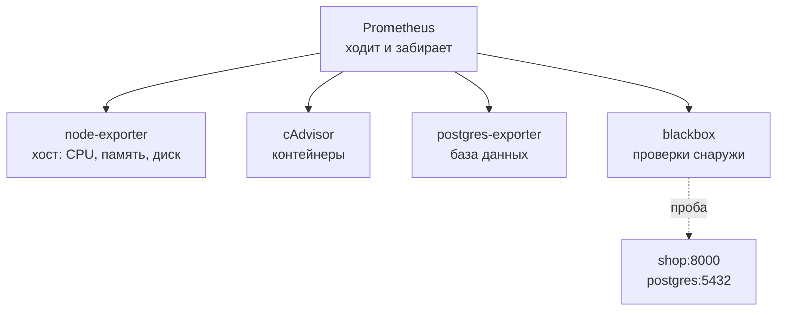
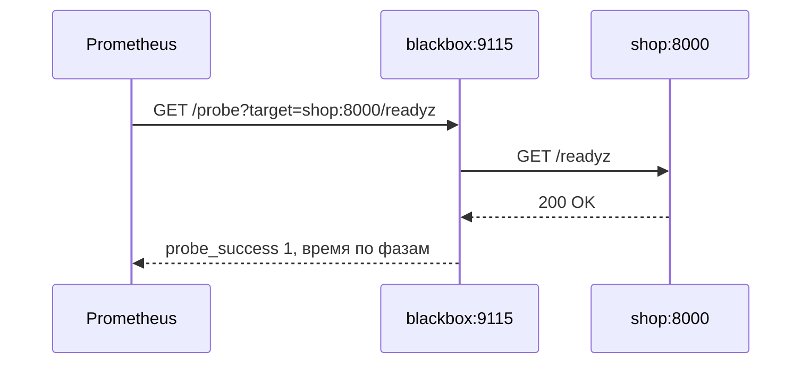
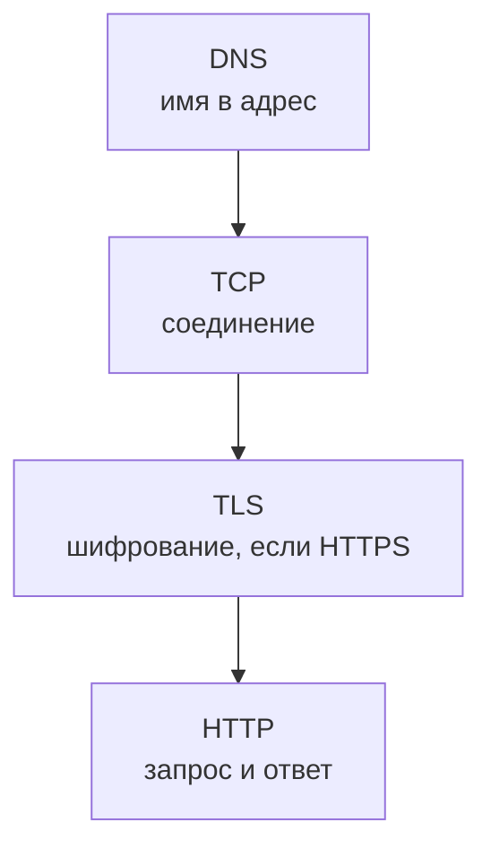

## Зачем это нужно

До сих пор мы смотрели на метрики, которые магазин рассказывает про себя: сколько запросов принял, сколько ошибок отдал. Но у магазина есть то, о чём он сам рассказать не может. Он не знает, что у машины кончилась память: к тому моменту его просто убьют.

Не знает, что его контейнер упёрся в потолок процессора. Не знает, что база тормозит из-за запроса без индекса (индекс это заранее построенный указатель: по значению он сразу находит нужную строку). А если магазин сломан настолько, что вообще не отвечает, он не расскажет ничего.

Есть и то, чего изнутри не увидеть вообще. Приложение не знает про сломанный DNS (систему, которая переводит имя сайта в адрес машины), про истёкший сертификат (электронный документ, который подтверждает, что сайт настоящий, и без которого браузер откажется открывать HTTPS), про порт, закрытый файрволом, и про ошибку балансировщика. До приложения такие запросы просто не доходят, и оно честно считает «ошибок 0%», пока покупатели не могут открыть сайт. Нужен второй взгляд, снаружи, глазами покупателя.

Этим занимаются две группы инструментов. **Экспортёры** (exporters) это переводчики: они спрашивают у хоста, контейнера или базы данных их внутренние показатели и выдают на `/metrics` в понятном Prometheus формате. А **blackbox-проверки** это покупатель-робот: он пробует открыть сайт снаружи и отмечает, получилось ли.

Шаг проекта: ты заводишь свои проверки снаружи. В `~/monitoring-lab/02-metrics/` появятся `blackbox.yml` и `prometheus.yml`, а на стенде запустятся два контейнера: blackbox-экспортёр и твой собственный Prometheus. Этот набор станет основой алертов на недоступность в теме 3.

## Что нужно знать

- [Урок 2.1](01-prometheus.md): цели, `up`, `/targets`, метки и counter с gauge.
- [Урок 2.2](02-promql.md): `rate`, `sum by`, деление, `avg_over_time`. Без них не прочитать ни одного графика сегодня.
- [Урок 1.1](../01-basics/01-signals.md): USE (использование, очереди, ошибки) для ресурсов.
- Запуск контейнеров, сеть Compose: [load-tester, урок 5.3](../../load-tester/05-docker/03-compose-shop.md) или [DevOps, тема 4](../../devops/04-docker/index.md).
- Запуск `docker run` и `curl`: [load-tester, урок 1.4](../../load-tester/01-linux/04-network-cli.md).

## Картина целиком

На стенде у Prometheus четыре источника, которых нет в самом магазине. Три смотрят изнутри на ресурсы, четвёртый снаружи на доступность:

| Кто | Что даёт | Адрес в сети стенда | `job` |
|---|---|---|---|
| node-exporter | хост: процессор, память, диск | `node-exporter:9100` | `node` |
| cAdvisor | контейнеры: процессор, память, лимиты | `cadvisor:8080` | `cadvisor` |
| postgres-exporter | база данных PostgreSQL | `postgres-exporter:9187` | `postgres` |
| blackbox | проверки снаружи, как покупатель | `blackbox:9115` | `blackbox-http`, `blackbox-tcp` (в твоём Prometheus) |



Пунктир на схеме показывает отличие: Prometheus спрашивает blackbox, а уже blackbox идёт на проверяемый адрес и приносит результат. Ниже разберём каждого.

## Теория

Карта урока. Сначала три экспортёра, которые смотрят изнутри: `node-exporter` рассказывает про хост (процессор, память, диск), `cAdvisor` про контейнеры и их лимиты, `postgres-exporter` про базу данных. Потом `blackbox`, который смотрит снаружи, как покупатель. Не запоминай все метрики: запомни, какой вопрос задаёт каждый экспортёр.

### Экспортёр: переводчик между системой и Prometheus

Когда у программы нет `/metrics` (у Linux, у PostgreSQL, у Docker), её нельзя научить отдавать метрики. Но можно поставить рядом маленькую программу, которая сама ходит за показателями и выдаёт на своём `/metrics`. Так устроен экспортёр.

Он не хранит историю: это делает Prometheus. Экспортёр отвечает только в момент запроса и показывает «как есть сейчас».

Поэтому экспортёры не требуют много ресурсов и безопасно дублируются. Записью занимается Prometheus.

На стенде три экспортёра: `node-exporter` (хост), `cadvisor` (контейнеры), `postgres-exporter` (база данных). Ещё Alertmanager и Alloy (о них позже, в темах 3 и 4) отдают собственные метрики сами. Все они перечислены в `prometheus.yml` и видны на странице Targets. В отличие от магазина и оплаты, порты экспортёров наружу, на твой хост, не опубликованы: смотреть их можно только изнутри сети Compose.

Поэтому `/metrics` экспортёров мы смотрим через контейнер Prometheus: в одной сети с ними и с `wget` внутри. Подробности про ключи `wget` и `-T` ниже, в типичных ошибках первой практики.

Все цели стенда видны на странице Status, Targets (`http://localhost:9090/targets`):

<div class="viz" data-viz="mon-targets" data-title='Prometheus: Status, Targets (всё в порядке)' data-targets='[{"job":"shop","endpoint":"http://shop:8000/metrics","state":"up","labels":{"instance":"shop:8000","job":"shop"},"last":"2.1s ago","duration":"9ms","error":""},{"job":"payment","endpoint":"http://payment:8001/metrics","state":"up","labels":{"instance":"payment:8001","job":"payment"},"last":"3.4s ago","duration":"4ms","error":""},{"job":"node","endpoint":"http://node-exporter:9100/metrics","state":"up","labels":{"instance":"node-exporter:9100","job":"node"},"last":"1.2s ago","duration":"21ms","error":""},{"job":"cadvisor","endpoint":"http://cadvisor:8080/metrics","state":"up","labels":{"instance":"cadvisor:8080","job":"cadvisor"},"last":"4.0s ago","duration":"46ms","error":""},{"job":"postgres","endpoint":"http://postgres-exporter:9187/metrics","state":"up","labels":{"instance":"postgres-exporter:9187","job":"postgres"},"last":"0.8s ago","duration":"14ms","error":""},{"job":"prometheus","endpoint":"http://prometheus:9090/metrics","state":"up","labels":{"instance":"prometheus:9090","job":"prometheus"},"last":"2.6s ago","duration":"5ms","error":""},{"job":"alertmanager","endpoint":"http://alertmanager:9093/metrics","state":"up","labels":{"instance":"alertmanager:9093","job":"alertmanager"},"last":"3.1s ago","duration":"3ms","error":""},{"job":"alloy","endpoint":"http://alloy:12345/metrics","state":"up","labels":{"instance":"alloy:12345","job":"alloy"},"last":"1.7s ago","duration":"8ms","error":""}]' data-explain='Восемь целей стенда: у каждой свой job, адрес внутри сети Docker и время последнего скрейпа.'></div>

Восемь целей, у каждой состояние и время последнего скрейпа: свежее значит, что сбор идёт. Сначала ищи красное состояние и текст в колонке ошибки: он быстрее всего показывает, какой экспортёр замолчал.

Осторожно: экспортёр это ещё один процесс со своими ошибками. «Нет метрик от node-exporter» может значить поломку не хоста, а самого экспортёра. Поэтому алерт «цель недоступна» нужен и для экспортёров тоже: у стенда он называется `ExporterDown` и покрывает `payment`, `node`, `cadvisor`, `postgres`, `alertmanager` и `alloy`.

> **Главное:** экспортёр это переводчик: отвечает только в момент запроса, историю хранит Prometheus; сам экспортёр тоже может сломаться, и за ним тоже нужен присмотр.
{: .key}

### node-exporter: хост, процессор, память, диск

Первое, что хочется знать о машине: хватает ли ей процессора, памяти и диска. Ответ даёт `node-exporter`. Метрики названы `node_*`. Мы будем читать их по методу USE из [урока 1.1](../01-basics/01-signals.md): для каждого ресурса смотрим использование (занято ли), очередь (ждёт ли кто-то) и ошибки.

**Процессор: занятость.** Метрика `node_cpu_seconds_total{mode, cpu}` это счётчик секунд, которые каждое ядро провело в каждом режиме. Главный для нас режим `idle`, простой (есть и другие, они в блоке «Для любопытных» ниже). Значит, `rate` по нему даёт «долю времени в секунду», то есть число от 0 до 1 на ядро.

Занятость процессора это единица минус доля простоя: `1 - avg(rate(node_cpu_seconds_total{mode="idle"}[1m]))`. Разберём числа: если ядро за минуту 6 секунд простаивало, `rate` покажет 6 / 60 = 0.1, занятость 1 − 0.1 = 0.9, то есть 90%. Так же написано в правиле `HostHighCpu` стенда: оно срабатывает при значении больше 0.9.

**Процессор: очередь.** Её показывает `node_load1`: сколько процессов в среднем за последнюю минуту работали или стояли в очереди на процессор. Само число бессмысленно без числа ядер: load 4 на четырёх ядрах нормально, а на одном это очередь из четырёх. Поэтому делят: `node_load1 / count(node_cpu_seconds_total{mode="idle"})`. Если результат устойчиво больше 1, процессам тесно.

**Память.** Метрики `node_memory_MemTotal_bytes` и `node_memory_MemAvailable_bytes`. Смотри на «доступно» (`MemAvailable`), а не на «свободно»: это сколько памяти реально можно получить, с учётом кеша файлов, который Linux отдаёт программам по первому требованию. Занятость памяти: `1 - node_memory_MemAvailable_bytes / node_memory_MemTotal_bytes`.

Очередь у памяти это своп: место на диске, куда система выгружает данные, когда оперативной памяти не хватает. Диск намного медленнее памяти, поэтому если `node_memory_SwapTotal_bytes - node_memory_SwapFree_bytes` растёт, системе не хватает оперативной памяти. Ошибка памяти это OOM (система убила процесс из-за нехватки памяти): её считает счётчик `node_vmstat_oom_kill`, любой прирост за последний час стоит разобрать.

**Диск: место.** Доля свободного места: `node_filesystem_avail_bytes{fstype!~"tmpfs|overlay|squashfs"} / node_filesystem_size_bytes{fstype!~"tmpfs|overlay|squashfs"}`. Фильтр `fstype!~` убирает служебные файловые системы (в памяти, слои контейнеров, образы), иначе они зашумят ответ.

**Диск: прогноз.** Хватит ли места надолго, покажет `predict_linear(node_filesystem_avail_bytes{fstype!~"tmpfs|overlay|squashfs"}[1h], 4*3600) < 0`: запрос продолжает тренд последнего часа на 4 часа вперёд и оставляет разделы, где места при таком темпе не останется.

**Диск: нагрузка.** `rate(node_disk_io_time_seconds_total[1m])` это доля времени, когда диск был занят хотя бы одним запросом. Значение около 1 у обычного диска означает предел.

<details markdown="1">
<summary>Для любопытных: режимы процессора, inodes, очередь диска и NVMe</summary>

- Режимы процессора. Кроме `idle`, у счётчика есть `user` (работа программ), `system` (работа ядра), `iowait` (ожидание диска), `steal` (время, которое у виртуальной машины забрал соседний гость). Если занятость высокая, посмотри `rate` по каждому режиму, чтобы понять, кто её создаёт.
- Свободная память. Linux занимает свободную память под кеш файлов и отдаёт его, как только понадобится программам, поэтому «свободно» почти всегда мало, и это нормально.
- Inodes. Место кончается и тогда, когда кончаются inodes (записи о файлах): `node_filesystem_files_free / node_filesystem_files`. Если близко к нулю, файлы создавать нельзя, хотя байты ещё есть.
- Очередь диска и NVMe. У SSD и NVMe картина мягче: они обслуживают много запросов параллельно, и при значении 1 запас ещё может быть. Поэтому смотри и очередь: `rate(node_disk_io_time_weighted_seconds_total[1m])` это среднее число запросов к диску, а задержку даёт `rate(node_disk_read_time_seconds_total[1m]) / rate(node_disk_reads_completed_total[1m])`.

</details>

> **Прикинь сам:** `node_load1` равен 6, ядер 4, а занятость процессора 40%. Всё ли в порядке?
{: .predict}

Нет, это подозрительно. Очередь больше числа ядер (6 / 4 = 1.5), а процессор при этом простаивает: значит, процессы ждут не процессор, а что-то другое, чаще всего диск. Смотри `iowait` (время ожидания диска, один из режимов процессора) и `node_disk_io_time_seconds_total`.

Для справки: на Mac с Docker Desktop контейнеры работают в виртуальной машине, и node-exporter показывает метрики этой машины, а не твоего Mac. Для учёбы этого достаточно, для выводов про железо нет.

> **Главное:** node-exporter даёт процессор, память, диск и сеть хоста; занятость процессора это `1 - avg(rate(idle))`, память смотрят по `MemAvailable`, а очередь по `node_load1` на число ядер.
{: .key}

### cAdvisor: контейнеры и их лимиты

На одной машине живёт много контейнеров, и у каждого ограничения: магазину выдан один процессор и 512 МБ памяти (в `compose.yaml`: `cpus: 1.0`, `mem_limit: 512m`). Хост может быть свободен, а контейнер упёрся в свой потолок. node-exporter видит только машину целиком, а cAdvisor считает каждый контейнер отдельно. Его метрики называются `container_*`, а контейнер определяется меткой `name`, например `name="shop-shop-1"`.

**Процессор.** `container_cpu_usage_seconds_total` это счётчик секунд работы. Скорость `rate(container_cpu_usage_seconds_total{name="shop-shop-1"}[1m])` это «сколько ядер использует контейнер»: 0.8 значит 80% одного ядра. Потолок задан в `container_spec_cpu_quota` и `container_spec_cpu_period`, их отношение это число ядер лимита (для магазина 1.0). Значит, занятость относительно лимита это использование, делённое на лимит.

**Троттлинг** (от английского throttling, «придушить»). Лимит процессора работает короткими периодами (обычно по 100 мс): когда контейнер хочет больше, чем ему положено, Linux притормаживает его до конца текущего периода. Контейнер при этом упирается в потолок: занятость на лимите, а запросы медленнее. Доля притормозивших периодов: `rate(container_cpu_cfs_throttled_periods_total[1m]) / rate(container_cpu_cfs_periods_total[1m])`. Если она заметно больше нуля, контейнеру тесно, и это частая скрытая причина медленных ответов.

**Память.** `container_memory_working_set_bytes` это память «в работе» (то, что система не может отобрать без последствий). Её делят на лимит `container_spec_memory_limit_bytes`: `container_memory_working_set_bytes{name="shop-shop-1"} / container_spec_memory_limit_bytes{name="shop-shop-1"}`. Когда доля подбирается к 1, контейнер убивает OOM (нехватка памяти), а счётчик `container_oom_events_total` это зафиксирует.

Разберём числа. Магазину выдан 1 ядро, и за минуту он работал 48 секунд: 48 / 60 = 0.8 ядра, 80% от лимита. Память: `working_set` равен 410 МБ, лимит 512 МБ, доля 410 / 512 = 0.8. Оба ресурса на 80%: запас есть, но небольшой.

<div class="viz" data-viz="mon-stat" data-title='Контейнер shop: три числа из примера' data-stats='[{"title":"Процессор от лимита","value":80,"unit":"%","color":"orange","spark":[77.0,79.0,74.0,82.0,81.0,82.0,76.0,76.0,74.0,76.0,74.0,80.0,77.0,81.0],"sub":"0.8 ядра из 1.0"},{"title":"Память от лимита","value":80,"unit":"%","color":"orange","spark":[78.0,79.0,80.0,79.0,79.0,79.0,80.0,80.0,79.0,80.0,80.0,79.0,79.0,79.0],"sub":"410 из 512 МБ"},{"title":"Троттлинг","value":0,"unit":"%","color":"green","spark":[0,0,0,0,0,0,0,0,0,0,0,0,0,0],"sub":"доля притормозивших периодов"}]' data-explain='Те же числа, что в абзаце, но как на табло: оранжевый значит «запас небольшой».'></div>

Две оранжевые карточки про небольшой запас, зелёная про отсутствие очереди. Сначала смотри на троттлинг: при нуле процессор ещё не мешает ответам.

> **Проверь понимание:** занятость процессора контейнера 0.98 ядра при лимите 1.0, а хост свободен на 70%. Где искать причину медленных ответов?

<details markdown="1">
<summary>Ответ</summary>

В лимите контейнера: он упёрся в свой процессор, хотя у хоста запас. Проверь троттлинг (`cfs_throttled_periods` к `cfs_periods`) и подумай, не поднять ли лимит.

</details>

Так выглядит контейнер, который упёрся в свой потолок, пока хост свободен (сценарий из практики 2):

<div class="viz" data-viz="mon-panel" data-title='Процессор: контейнер shop против хоста' data-query='rate(container_cpu_usage_seconds_total{name="shop-shop-1"}[1m]) / 1.0, 1 - avg(rate(node_cpu_seconds_total{mode="idle"}[1m])), доля троттлинга' data-x='["15:00","15:01","15:02","15:03","15:04","15:05","15:06","15:07","15:08","15:09","15:10","15:11","15:12","15:13","15:14","15:15","15:16","15:17","15:18","15:19"]' data-series='[{"name":"shop, % от лимита","values":[34.0,34.0,34.0,33.0,36.0,32.0,34.0,36.0,97.0,98.0,98.0,99.0,99.0,99.0,98.0,97.0,99.0,98.0,98.0,97.0],"color":"red"},{"name":"хост, % занятости","values":[18.0,19.0,16.0,18.0,16.0,19.0,17.0,17.0,32.0,33.0,29.0,29.0,33.0,30.0,30.0,31.0,31.0,32.0,31.0,31.0],"color":"blue"},{"name":"троттлинг, % периодов","values":[0,0,0,0,0,0,0,0,58.0,64.0,56.0,68.0,58.0,61.0,66.0,68.0,63.0,65.0,63.0,67.0],"color":"orange"}]' data-unit='%' data-thresholds='[{"value":100,"color":"red","label":"лимит контейнера"}]' data-annotations='[{"at":"15:08","text":"100 входов, 20 параллельно"}]' data-explain='Пачка входов упёрла магазин в его один процессор, а хост остался с запасом.'></div>

После отметки красная линия магазина прижата к лимиту (около 100%), синяя линия хоста поднялась только до 31%, а оранжевая показывает, что больше половины периодов контейнер притормаживали. Сначала смотри на красную и синюю линии вместе: по хосту одному беды не видно.

Подсказка: набор меток у cAdvisor зависит от системы. На части систем (например, Ubuntu с containerd и cgroup v2) метки `name` и `image` пустые, а контейнер виден только по метке `id` вида `/system.slice/docker-<длинный хеш>.scope`; на Docker Desktop (Mac, Windows) пустой может оказаться часть меток. Если запрос с `name="shop-shop-1"` ничего не вернул, действуй так:

1. Выполни `container_cpu_usage_seconds_total` без условий и посмотри, какие метки есть на самом деле.
2. Узнай полный идентификатор контейнера: `docker ps -q --no-trunc --filter name=shop-shop-1`.
3. Фильтруй по нему: `container_cpu_usage_seconds_total{id=~".*<идентификатор>.*"}`.
4. Если у запущенных через Compose контейнеров есть метка `container_label_com_docker_compose_service`, проще искать по ней: `{container_label_com_docker_compose_service="shop"}`.

> **Главное:** cAdvisor показывает процессор, память и троттлинг каждого контейнера относительно его лимита; хост свободен ещё не значит, что контейнеру хватает.
{: .key}

### postgres-exporter: что делает база

База данных это обычно самое узкое место магазина. Метрики `pg_*` собирает `postgres-exporter`, он подключается к PostgreSQL как обычный клиент и читает его служебные таблицы.

**Соединения.** `pg_stat_database_numbackends{datname="shop"}` показывает, сколько соединений сейчас открыто к базе `shop`. Потолок задан `max_connections` (на стенде 100), а магазин держит пул (набор заранее открытых соединений, которые приложение берёт и возвращает) до 5 соединений на процесс. Ещё одно соединение держит сам экспортёр, поэтому на стенде ты увидишь до 6, на простое иногда меньше. Если число подбирается к потолку, новые соединения начнут отказывать.

**Кеш.** База читает данные из памяти (быстро) или с диска (медленно). Доля чтений из памяти: `pg_stat_database_blks_hit / (pg_stat_database_blks_hit + pg_stat_database_blks_read)`, норма больше 0.99. Если число падает, данные перестают помещаться в память.

**Полное чтение таблицы.** Индекс работает как оглавление в книге: база идёт сразу к нужной строке и не листает все страницы. Когда подходящего индекса нет, она читает таблицу целиком, это называется seq scan (последовательное чтение). Счётчик `pg_stat_user_tables_seq_scan{relname="orders"}` растёт на каждое такое чтение. Для маленькой таблицы это нормально, для большой это красный флаг: запрос стоило бы ускорить индексом.

**Какие запросы тяжёлые.** Для этого есть расширение `pg_stat_statements`, оно включено на стенде: хранит, сколько раз вызван каждый запрос и сколько длился. Читается обычным SQL из `psql`, а не через метрики.

> **Прикинь сам:** `numbackends` вырос с 8 до 95 за минуту при `max_connections = 100`. Что делать в первую очередь?
{: .predict}

Выяснить, кто открывает соединения: вырос ли трафик, не утекают ли соединения в приложении (пул не возвращает), не зависли ли запросы. Поднимать `max_connections` как первую меру неправильно: это лечит симптом, а лишние соединения тратят память базы.

Осторожно: postgres-exporter показывает базу со стороны базы. Если приложение жалуется на «ожидание соединения», смотри и со стороны приложения: `shop_db_pool_waiting`. Сочетание «база не загружена, а очередь в пуле есть» значит, что узкое место в размере пула, а не в базе.

<div class="viz" data-viz="mon-panel" data-title='База спокойна, а очередь в пуле растёт' data-query='pg_stat_database_numbackends{datname="shop"} и shop_db_pool_waiting' data-x='["15:00","15:01","15:02","15:03","15:04","15:05","15:06","15:07","15:08","15:09","15:10","15:11","15:12","15:13","15:14","15:15","15:16","15:17","15:18","15:19"]' data-series='[{"name":"shop_db_pool_waiting","values":[0,0,0,0,0,0,2,4,5,7,6,8,7,6,5,7,6,6,5,6],"color":"red"},{"name":"pg_stat_database_numbackends","values":[6,6,6,6,6,6,6,6,6,6,6,6,6,6,6,6,6,6,6,6],"color":"blue"}]' data-unit='' data-annotations='[{"at":"15:06","text":"пик заказов"}]' data-explain='Соединений с базой ровно столько, сколько позволяет пул (5 магазина и одно экспортёра), а запросы магазина стоят в очереди.'></div>

Синяя линия ровная: база новых соединений не получает и не тормозит. Красная растёт: запросы магазина ждут свободного соединения внутри самого магазина. Первым смотри на то, что синяя линия никуда не делась, и делай вывод про размер пула, а не про базу.

> **Главное:** postgres-exporter даёт соединения, попадание в кеш и seq scan; тяжёлые запросы смотрят через `pg_stat_statements` в SQL.
{: .key}

### USE для ресурсов: сводная таблица

Три экспортёра покрывают ресурсы хоста, контейнеров и базы. По методу USE для каждого достаточно трёх вопросов: сколько занято, ждёт ли очередь, есть ли ошибки. Сведём ответы в таблицу: что смотрим и когда это беда.

| Ресурс | Что смотрим | В чём беда |
|---|---|---|
| Процессор хоста | занятость и очередь на ядро | занятость высокая и очередь растёт |
| Память хоста | занятая доля и своп | `MemAvailable` мало, своп растёт, прирост `node_vmstat_oom_kill` |
| Диск: нагрузка | доля занятого времени и очередь | около 1 и очередь растёт, есть ошибки ввода-вывода |
| Диск: место | свободное место и inodes | мало места или inodes, прогноз `predict_linear` меньше нуля |
| Процессор контейнера | ядра относительно лимита и троттлинг | у лимита и доля троттлинга растёт |
| Память контейнера | `working_set` относительно лимита | доля близка к 1, растёт `container_oom_events_total` |
| База | соединения относительно потолка и очередь в пуле | близко к `max_connections`, ожидание в пуле, растут взаимные блокировки или откаты транзакций |

Формулы по строкам:

- процессор хоста: `1 - avg(rate(node_cpu_seconds_total{mode="idle"}[1m]))` и `node_load1 / число ядер`;
- память хоста: `1 - node_memory_MemAvailable_bytes / node_memory_MemTotal_bytes`;
- диск, нагрузка: `rate(node_disk_io_time_seconds_total[1m])` и очередь `rate(node_disk_io_time_weighted_seconds_total[1m])` (блок «Для любопытных» выше);
- диск, место: `node_filesystem_avail_bytes{fstype!~"tmpfs|overlay|squashfs"} / node_filesystem_size_bytes{fstype!~"tmpfs|overlay|squashfs"}`;
- процессор контейнера: `rate(container_cpu_usage_seconds_total[1m]) / лимит` и доля троттлинга;
- память контейнера: `container_memory_working_set_bytes / container_spec_memory_limit_bytes`;
- база: `pg_stat_database_numbackends / max_connections`, `shop_db_pool_waiting`, а ошибки это `rate(pg_stat_database_deadlocks[5m])` (взаимные блокировки, когда две транзакции ждут друг друга) и `rate(pg_stat_database_xact_rollback[5m])` (откаты транзакций).

<div class="viz" data-viz="obs-use-board" data-scenario="bcrypt"></div>

На табло процессор упирается в потолок, и вместе с ним растёт очередь. Смотри на эти два числа вместе: по одному из них картину не прочитать.

Таблица пригодится как шпаргалка в дежурстве: прежде чем гадать, пройди по строкам и найди ту, где использование высокое, а очередь уже растёт.

Одна оговорка: высокое использование само по себе не авария. Процессор на 90% может быть нормой для пакетной задачи. Тревожный признак: использование высокое **и** очередь растёт, или есть ошибки.

> **Главное:** по USE для каждого ресурса проверяют использование, очередь и ошибки; опасна связка высокого использования с растущей очередью.
{: .key}

### Whitebox и blackbox: изнутри и снаружи

Есть два способа мониторить сервис. Первый: смотреть внутрь, когда сервис сам рассказывает о себе через метрики. Всё, что мы делали в 2.1 и 2.2, это он. Второй: не заглядывать внутрь, а обратиться к сервису так, как это сделал бы пользователь, и посмотреть, получилось ли.

По-английски первый способ зовут whitebox («прозрачный ящик», внутри всё видно), второй blackbox («чёрный ящик»). Эти слова встретятся в документации и на собеседованиях.

У каждого способа слепые зоны. Whitebox не увидит то, что случилось до сервиса: DNS не отвечает, сертификат истёк, файрвол закрыл порт, балансировщик отдаёт ошибку. Blackbox не объяснит причину: он скажет «не открывается», но не «почему». Поэтому нужны оба: blackbox поднимает тревогу, whitebox помогает найти причину.

Вот как это выглядит на графике (пример: ночью сломался сертификат).

<div class="viz" data-viz="chart" data-type="line" data-x="03:00,03:05,03:10,03:15,03:20,03:25,03:30" data-series='[{"name":"изнутри: приложение отвечает","values":[1,1,1,1,1,1,1],"unit":""},{"name":"снаружи: сайт открывается","values":[1,1,0,0,0,1,1],"unit":""}]' data-x-label="Время" data-y-label="1 = всё хорошо" data-unit="" data-explain="Приложение отвечает на /metrics, но покупатель с 03:10 до 03:25 сайт не открывает."></div>

Две линии показывают один и тот же сбой. Взгляд изнутри всё время равен 1: приложение отвечает. Проверка снаружи с 03:10 до 03:25 даёт 0: так выглядит сломанный сертификат или DNS. Один взгляд без другого эту аварию пропустил бы.

> **Проверь понимание:** сервис отдаёт метрики и показывает «ошибок 0%», но покупатели жалуются, что сайт недоступен. Какой вид мониторинга это поймает?

<details markdown="1">
<summary>Ответ</summary>

Blackbox: проба снаружи попадёт в то место, где запросы теряются до приложения (DNS, сертификат, балансировщик). Приложение не видит эти запросы, поэтому и «ошибок 0%».

</details>

> **Главное:** whitebox смотрит изнутри и объясняет причину, blackbox смотрит снаружи и ловит недоступность; нужны оба.
{: .key}

### blackbox_exporter: как он проверяет

`blackbox_exporter` это программа с необычным способом работы. Обычный экспортёр отдаёт одни и те же метрики, а blackbox делает проверку **по запросу**. Prometheus обращается к нему по адресу `/probe` и передаёт два параметра: `target` (что проверять) и `module` (как проверять). Экспортёр идёт на цель, проверяет и возвращает результат в формате метрик.



Prometheus сам на магазин не ходит: он просит blackbox, тот делает пробу, замеряет время и отдаёт числа как обычные метрики.

Пример: `http://blackbox:9115/probe?target=http://shop:8000/readyz&module=http_2xx`. «Сходи на `shop:8000/readyz` и проверь как HTTP-запрос, ждущий ответ 2xx». Модули описаны в конфиге `blackbox.yml`, там их пара: `http_2xx` (HTTP-запрос, успех при коде 2xx) и `tcp_connect` (только установить TCP-соединение).

Проверка проходит по шагам, как путь покупателя: найти адрес по имени (DNS), установить соединение (TCP), при HTTPS договориться о шифровании (TLS), отправить запрос и получить ответ (HTTP). Если на каком-то шаге не удалось, проба считается проваленной, а по метрикам видно, на каком.



Каждый шаг можно сломать независимо, и каждый занимает время: на графике видно, какой стал медленнее.

Разберём результат пробы:

```text
probe_success 1
probe_duration_seconds 0.012
probe_http_status_code 200
probe_http_duration_seconds{phase="resolve"} 0.001
probe_http_duration_seconds{phase="connect"} 0.001
probe_http_duration_seconds{phase="processing"} 0.009
```

`probe_success` главное: 1 проба прошла, 0 нет. `probe_duration_seconds` общее время. `probe_http_status_code` код ответа. А `probe_http_duration_seconds` по фазам: `resolve` (поиск адреса), `connect` (соединение), `tls` (шифрование), `processing` (сервер думает), `transfer` (передача ответа). В примере 12 мс, из них 9 мс «думает» сервер, и поиск адреса с соединением по 1 мс. Если «connect» вырос до секунды, проблема в сети, если «processing», то в самом сервере.

Для HTTPS добавляются `probe_http_ssl` (1, если соединение шло по TLS) и `probe_ssl_earliest_cert_expiry`: момент, когда истекает самый ранний сертификат в цепочке. Из него считают, сколько дней осталось: `(probe_ssl_earliest_cert_expiry - time()) / 86400`. Если осталось 14 дней, пора обновлять, при 3 днях это уже авария на подходе. Алерт на это пишут одним условием: `probe_ssl_earliest_cert_expiry - time() < 14*86400` (меньше 14 суток в секундах). На нашем стенде TLS нет, поэтому реальных значений ты не увидишь, но знать это надо.

> **Прикинь сам:** `probe_success 0`, `probe_http_status_code 404`. Это отказ сети или приложения?
{: .predict}

Приложения: сеть и соединение работают, сервер ответил, но такого адреса у него нет (404). Для модуля `http_2xx` это провал, потому что код не 2xx. Проверяй, правильный ли адрес в `target`.

Осторожно: проба сама создаёт запрос на цели. Поэтому проверяй только безопасные адреса: `GET` без побочных эффектов. Не отправляй пробой `POST /api/orders`: создашь заказы. Кроме того, не проверяй слишком часто: на проде проба раз в 15-30 секунд достаточна (5 секунд на стенде взяты для быстрой учёбы). И помни: blackbox видит сайт из той сети, где он запущен. Если он стоит рядом с магазином, он не поймает проблему, видную только из интернета (внешний DNS, провайдер), для этого нужна проба из другого места.

Пример на числах: если `probe_ssl_earliest_cert_expiry` равно 1 800 000 000, а `time()` сейчас 1 796 000 000, разность 4 000 000 секунд, то есть около 46 дней (делим на 86 400). Алерт на срок обычно ставят на 14 и на 7 дней, чтобы успеть обновить.

> **Главное:** blackbox проверяет цель по запросу `/probe?target=...&module=...`; главный результат `probe_success`, а время по фазам показывает, где проблема.
{: .key}

### Relabeling: как Prometheus ходит на blackbox

Обычно `targets` в конфиге это адреса, куда ходит Prometheus. Но в случае blackbox Prometheus должен ходить на **один** адрес (`blackbox:9115`), а то, что проверять, передавать параметром. Нужно разделить «куда стучаться» и «что проверять».

Сначала результат. Для каждой цели из списка Prometheus в итоге делает запрос `http://blackbox:9115/probe?module=http_2xx&target=<проверяемый адрес>`, а в базу пишет ряды, у которых в метке `instance` стоит проверяемый адрес, а не `blackbox:9115`. Один blackbox так проверяет много адресов, и на графиках каждый остаётся отдельной строкой.

Этого добиваются переписыванием меток, по-английски relabeling (слово встретится в конфиге): перед скрейпом Prometheus умеет менять служебные метки цели. Вот нужный фрагмент: одна цель и три правила (полный `prometheus.yml` ты соберёшь в практике 4):

```yaml
- job_name: blackbox-http
  metrics_path: /probe
  params:
    module: [http_2xx]
  static_configs:
    - targets: ["http://shop:8000/nope"]
  relabel_configs:
    - source_labels: [__address__]
      target_label: __param_target
    - source_labels: [__param_target]
      target_label: instance
    - target_label: __address__
      replacement: blackbox:9115
```

Разберём по строкам. `metrics_path: /probe` и `params` заставляют ходить на `/probe` с `module=http_2xx`. Дальше три правила по очереди.

1. Адрес цели (`__address__`, служебная метка с тем, что написано в `targets`) копируется в параметр `__param_target`: он и уйдёт в запрос как `target=...`.
2. То же значение копируется в обычную метку `instance`, чтобы на графике было видно, что проверялось, а не адрес blackbox.
3. Настоящий адрес для скрейпа (`__address__`) заменяется на `blackbox:9115`.

Метки, имя которых начинается с двойного подчёркивания (кроме `__name__`), служебные и после relabeling в базу не попадают.

Пройдём одну цель по правилам:

| Шаг | `__address__` | `__param_target` | `instance` |
|---|---|---|---|
| Как в `targets` | `http://shop:8000/nope` | нет | нет |
| Правило 1 | `http://shop:8000/nope` | `http://shop:8000/nope` | нет |
| Правило 2 | `http://shop:8000/nope` | `http://shop:8000/nope` | `http://shop:8000/nope` |
| Правило 3 | `blackbox:9115` | `http://shop:8000/nope` | `http://shop:8000/nope` |

К концу адрес для похода стал `blackbox:9115`, а проверяемый адрес живёт и в параметре, и в метке `instance`.

Итог для цели `http://shop:8000/nope`: запрос `http://blackbox:9115/probe?module=http_2xx&target=http://shop:8000/nope`, а в базе ряды с `instance="http://shop:8000/nope"`. Для TCP-проверок баз данных заводят второй `job` с `module: [tcp_connect]` и целями `postgres:5432`, `redis:6379`.

> **Прикинь сам:** без третьего правила (`replacement: blackbox:9115`) куда пойдёт Prometheus?
{: .predict}

Скрейпа не будет: в `__address__` остался бы весь адрес с протоколом и путём (`http://shop:8000/readyz`), а Prometheus не сможет сходить на такой «адрес», и цель покажет ошибку на странице Targets. Ходить нужно на `blackbox:9115`, поэтому третье правило обязательно.

Осторожно: больше всего ошибок в relabeling из-за порядка правил и опечаток в метках. Если все пробы по `instance` схлопнулись в один blackbox-адрес, значит, второе правило пропущено.

> **Главное:** relabeling переписывает цель: проверяемый адрес уходит в параметр `target`, а ходить Prometheus будет на адрес blackbox.
{: .key}

### Что проверять: /healthz, /readyz и пользовательский путь

Пробу можно направить на разные адреса, и результат будет значить разное. У магазина три адреса: `/healthz` (процесс жив), `/readyz` (процесс готов принимать запросы, проверил базу) и настоящий пользовательский путь вроде `/api/products`. Это три разных вопроса. Чем ближе проба к пользователю, тем честнее картина: процесс может быть жив, пока база недоступна.

`/healthz` ловит зависший процесс и годится для автоматического перезапуска. `/readyz` годится для балансировщика: пока не готов, трафик не получает. Для оповещения дежурного нужен пользовательский путь: именно он показывает, что покупатель видит, как у него.

Ограничения те же, что и выше: безопасный `GET`, без побочных эффектов, без авторизации по реальному паролю. И ещё: проба проверяет доступность, а не качество. Если страница открылась, а каталог пустой, `probe_success` будет 1. Для содержимого у blackbox есть проверка текста ответа (в модуле `fail_if_body_not_matches_regexp`, пример закомментирован в `blackbox.yml` ниже), но чаще эту задачу решают метриками приложения.

И последнее: что считать провалом. Один неудачный скрейп может быть случайностью. Поэтому смотрят долю за окно: `avg_over_time(probe_success[5m])` это доля успешных проб за 5 минут.

Значение 1 всё хорошо, 0.8 каждая пятая проба провалилась, 0 недоступно полностью. На такой доле строят алерты, чтобы случайный сбой не будил людей. Два варианта условия:

1. `avg_over_time(probe_success[5m]) < 0.8`: при пробе раз в 5 секунд алерт сработает, когда провалилась каждая пятая проба из 60, то есть примерно через минуту сплошного сбоя. Короткие провалы он терпит.
2. `probe_success == 0` с выдержкой `for: 2m` (правило срабатывает, только если условие держится две минуты подряд). Проще читать, но один успешный скрейп посреди сбоя сбрасывает отсчёт.

Выбор это компромисс между шумом и скоростью: чем больше окно или выдержка, тем меньше ложных тревог и тем позже ты узнаешь о настоящей аварии. Для нас подойдёт любой, главное выбрать осознанно.

> **Проверь понимание:** `avg_over_time(probe_success[5m])` равно 0.9, скрейп раз в 5 секунд. Сколько проб из 60 провалилось?

<details markdown="1">
<summary>Ответ</summary>

В окне 5 минут / 5 секунд = 60 проб, успешных 90%, то есть 54, провалилось 6.

</details>

> **Главное:** чем ближе проба к пути покупателя, тем честнее картина; проверяй безопасные `GET` и смотри долю успешных проб за окно, а не одну пробу.
{: .key}

## Практика

Работаем в `~/monitoring-lab/02-metrics/`. Стенд «Магазин» с профилем `monitoring` должен работать.

### 1. Экспортёры изнутри

Порты экспортёров наружу не опубликованы, поэтому заходим через контейнер Prometheus, у которого есть сеть и `wget`:

```bash
cd ~/learning/load-tester/project/shop
docker compose --profile monitoring exec -T prometheus wget -qO- http://node-exporter:9100/metrics | grep -E '^node_(load1|memory_MemAvailable_bytes) '
docker compose --profile monitoring exec -T prometheus wget -qO- http://cadvisor:8080/metrics | grep -E '^container_spec_memory_limit_bytes.*shop-shop-1'
docker compose --profile monitoring exec -T prometheus wget -qO- http://postgres-exporter:9187/metrics | grep -E '^pg_stat_database_numbackends.*shop'
```

`exec prometheus` выполняет команду внутри контейнера Prometheus, `wget -qO-` скачивает страницу и печатает её в вывод, `grep -E` оставляет нужные строки.

**Что должно получиться** (числа пример):

```text
node_load1 0.42
node_memory_MemAvailable_bytes 5.1e+09
container_spec_memory_limit_bytes{id="/docker/<хеш>",image="…",name="shop-shop-1"} 5.36870912e+08
pg_stat_database_numbackends{datid="16384",datname="shop"} 6
```

Это вид на cgroup v1 или Docker Desktop. На cgroup v2 (Ubuntu с containerd и многие новые системы) метки другие, и вместо третьей строки ты увидишь так:

```text
container_spec_memory_limit_bytes{id="/system.slice/docker-<хеш>.scope"} 5.36870912e+08
```

Метки `name` нет, поэтому `grep` по `shop-shop-1` вернёт пусто: тогда выведи все лимиты (`grep -E '^container_spec_memory_limit_bytes'`) и найди строку со значением `5.36870912e+08`.

**Как читать вывод:** `5.36870912e+08` это 536 870 912 байт, то есть 512 МБ: лимит памяти магазина из `compose.yaml`. Шесть соединений с базой `shop` (пять в пуле магазина и одно экспортёра) при потолке 100 это комфортно. Если вторая строка пустая, посмотри, какие метки есть на самом деле: так бывает на Docker Desktop и на Ubuntu с containerd, подсказка про метки есть в теории.

**Типичные ошибки:**

- `service "prometheus" is not running`: стенд запущен без профиля `monitoring`; добавь `--profile monitoring`.
- Строки заканчиваются лишним символом `\r` или команда ругается на терминал: забыт ключ `-T` после `exec`. Без него Docker выделяет терминал, и при пайпе в конце строк появляется `\r`.
- `wget: unrecognized option`: в контейнере урезанный `wget` из busybox (набора минимальных утилит), длинные ключи ему неизвестны; оставь короткие `-qO-`.
- `wget: bad address 'node-exporter:9100'`: опечатка в имени сервиса; имена: `node-exporter`, `cadvisor`, `postgres-exporter`.

### 2. USE под нагрузкой

Создадим одну нагрузку: пачку входов. Вход проверяет пароль через bcrypt (специально медленная функция хеширования паролей, на стенде `BCRYPT_ROUNDS=12`), поэтому каждый вход съедает заметное время процессора. Процесс магазина один (`WEB_CONCURRENCY=1`) с лимитом в одно ядро: больше ядра он не займёт, даже если хост свободен, и входы встают в очередь.

Пачку запускаем в фоне, через пять секунд снимаем запросы USE через `promq.sh` из прошлого урока, потом ждём конца пачки:

```bash
seq 1 300 | xargs -P 20 -I{} curl -s -o /dev/null localhost:8000/api/login \
  -H 'Content-Type: application/json' -d '{"email":"user0001@shop.lab","password":"password"}' &
sleep 5
cd ~/monitoring-lab/02-metrics
./promq.sh '1 - avg(rate(node_cpu_seconds_total{mode="idle"}[1m]))'
./promq.sh 'rate(container_cpu_usage_seconds_total{name="shop-shop-1"}[1m])'
./promq.sh 'rate(container_cpu_cfs_throttled_periods_total{name="shop-shop-1"}[1m]) / rate(container_cpu_cfs_periods_total{name="shop-shop-1"}[1m])'
./promq.sh 'container_memory_working_set_bytes{name="shop-shop-1"} / container_spec_memory_limit_bytes{name="shop-shop-1"}'
wait
```

`seq 1 300` печатает числа, `xargs -P 20` запускает команду для каждого, держа 20 запросов одновременно, а `&` отправляет всю пачку в фон. Запросы по порядку: занятость процессора хоста, ядра, занятые магазином, доля притормозивших периодов и доля памяти от лимита. `wait` ждёт, пока пачка закончится. Если ты запускал `traffic.sh` из урока 2.2 и он остановился с ошибкой 401 (токен живёт час), перезапусти его: он нужен только для фонового трафика и для этого урока необязателен.

**Что должно получиться** (числа пример, метки зависят от системы):

```text
 0.31
id=/docker/<хеш>,image=…,instance=cadvisor:8080,job=cadvisor,name=shop-shop-1 0.99
id=/docker/<хеш>,image=…,instance=cadvisor:8080,job=cadvisor,name=shop-shop-1 0.62
id=/docker/<хеш>,image=…,instance=cadvisor:8080,job=cadvisor,name=shop-shop-1 0.41
```

**Как читать вывод:** хост загружен примерно на 30%, а магазин использует почти всё своё ядро (0.99 при лимите 1.0), и больше половины периодов его притормаживали. Память на 41% от лимита: запас есть. Это тот самый случай, когда хост свободен, а контейнеру тесно: процессор контейнера упёрся в потолок. На cgroup v2 вместо `id=/docker/<хеш>` будет `id=/system.slice/docker-<хеш>.scope` и без `name`: запросы с `name=` вернут пусто, тогда замени условие по подсказке про метки cAdvisor в теории.

**Типичные ошибки:**

- Все запросы пустые сразу после запуска стенда: Prometheus ещё не собрал данные, повтори через 10-20 секунд.
- `jq: error` или пустой ответ у других команд урока: магазин не готов, проверь `curl localhost:8000/readyz`.
- Пачка закончилась раньше, чем ты снял запросы: увеличь `300` до `600`.

<details markdown="1">
<summary>Для любопытных: N+1, seq scan и pg_stat_statements</summary>

Поищем нагрузку на базу. Сначала войдём и запросим список заказов 200 раз:

```bash
TOKEN=$(curl -s localhost:8000/api/login -H 'Content-Type: application/json' \
  -d '{"email":"user0001@shop.lab","password":"password"}' | jq -r .token)
for i in $(seq 1 200); do curl -s -o /dev/null -H "Authorization: Bearer $TOKEN" localhost:8000/api/orders; done
~/monitoring-lab/02-metrics/promq.sh 'pg_stat_user_tables_seq_scan{relname="orders"}'
cd ~/learning/load-tester/project/shop
docker compose --profile monitoring exec -T prometheus wget -qO- http://postgres-exporter:9187/metrics | grep -E '^pg_stat_user_tables_seq_scan.*orders'
```

Счётчик `seq_scan` по `orders` растёт с каждым запросом списка (повтори последние команды после цикла и сравни). Индекса по `orders.user_id` на стенде нет намеренно, это заложенная поломка: индекс добавится позже, в курсе нагрузочного тестирования. Теперь самые тяжёлые запросы базы:

```bash
docker compose --profile monitoring exec -T postgres psql -U shop -d shop -c "select calls, round(total_exec_time::numeric) as total_ms, round(mean_exec_time::numeric,1) as mean_ms, left(query,50) from pg_stat_statements order by total_exec_time desc limit 3;"
```

`psql -c` выполняет один SQL-запрос, `pg_stat_statements` хранит статистику, а `order by total_exec_time desc` ставит наверх запросы, съевшие больше всего времени.

**Что должно получиться** (пример, числа накапливаются и у тебя будут другими):

```text
 calls | total_ms | mean_ms |                       left
-------+----------+---------+--------------------------------------------------
   200 |     3000 |    15.0 | SELECT id, status, total, created_at FROM orders W
  4000 |     1600 |     0.4 | SELECT oi.order_id, oi.product_id, p.name, oi.qty,
```

**Как читать вывод:** в первой строке сам список заказов: 200 вызовов по 15 мс, он читает таблицу целиком (seq scan) и поэтому съел больше всего времени. Во второй строке запрос за позициями заказов: вызовов 4000, то есть по 20 на каждый список, а каждый быстрый, 0.4 мс. Это N+1: один запрос списка и ещё N запросов по одному на каждую строку. Он не самый долгий по одному вызову, но по числу вызовов в двадцать раз больше, чем нужно, поэтому смотри в обе колонки, `calls` и `mean_ms`. Исправление включается в `.env` (`BUG_N_PLUS_ONE=0`) и перезапуском магазина.

Как это выглядит в трейсе. Трейс это путь одного запроса через систему, а span (спан) это один его отрезок, например один запрос к базе: полоска со временем начала и длиной. Подробно трейсы разберём в теме 4, а пока посмотри на форму.

<div class="viz" data-viz="mon-trace" data-title='Tempo: GET /api/orders с N+1' data-trace-id='f3d8cfa59e532830f2903597c5ebc80c' data-spans='[{"id":"r","parent":null,"service":"shop","name":"GET /api/orders","start":0,"dur":69,"status":"ok","attrs":{"http.method":"GET","http.route":"/api/orders","http.status_code":200}},{"id":"l","parent":"r","service":"shop","name":"SELECT","start":2,"dur":12,"status":"ok","attrs":{"db.system":"postgresql","db.statement":"SELECT id, status, total FROM orders WHERE user_id = $1 (seq scan)"}},{"id":"q1","parent":"r","service":"shop","name":"SELECT","start":16.0,"dur":2.2,"status":"ok","attrs":{"db.system":"postgresql","db.statement":"SELECT ... FROM order_items WHERE order_id = $1"}},{"id":"q2","parent":"r","service":"shop","name":"SELECT","start":18.6,"dur":2.2,"status":"ok","attrs":{"db.system":"postgresql","db.statement":"SELECT ... FROM order_items WHERE order_id = $1"}},{"id":"q3","parent":"r","service":"shop","name":"SELECT","start":21.2,"dur":2.2,"status":"ok","attrs":{"db.system":"postgresql","db.statement":"SELECT ... FROM order_items WHERE order_id = $1"}},{"id":"q4","parent":"r","service":"shop","name":"SELECT","start":23.8,"dur":2.2,"status":"ok","attrs":{"db.system":"postgresql","db.statement":"SELECT ... FROM order_items WHERE order_id = $1"}},{"id":"q5","parent":"r","service":"shop","name":"SELECT","start":26.4,"dur":2.2,"status":"ok","attrs":{"db.system":"postgresql","db.statement":"SELECT ... FROM order_items WHERE order_id = $1"}},{"id":"q6","parent":"r","service":"shop","name":"SELECT","start":29.0,"dur":2.2,"status":"ok","attrs":{"db.system":"postgresql","db.statement":"SELECT ... FROM order_items WHERE order_id = $1"}},{"id":"q7","parent":"r","service":"shop","name":"SELECT","start":31.6,"dur":2.2,"status":"ok","attrs":{"db.system":"postgresql","db.statement":"SELECT ... FROM order_items WHERE order_id = $1"}},{"id":"q8","parent":"r","service":"shop","name":"SELECT","start":34.2,"dur":2.2,"status":"ok","attrs":{"db.system":"postgresql","db.statement":"SELECT ... FROM order_items WHERE order_id = $1"}},{"id":"q9","parent":"r","service":"shop","name":"SELECT","start":36.8,"dur":2.2,"status":"ok","attrs":{"db.system":"postgresql","db.statement":"SELECT ... FROM order_items WHERE order_id = $1"}},{"id":"q10","parent":"r","service":"shop","name":"SELECT","start":39.4,"dur":2.2,"status":"ok","attrs":{"db.system":"postgresql","db.statement":"SELECT ... FROM order_items WHERE order_id = $1"}},{"id":"q11","parent":"r","service":"shop","name":"SELECT","start":42.0,"dur":2.2,"status":"ok","attrs":{"db.system":"postgresql","db.statement":"SELECT ... FROM order_items WHERE order_id = $1"}},{"id":"q12","parent":"r","service":"shop","name":"SELECT","start":44.6,"dur":2.2,"status":"ok","attrs":{"db.system":"postgresql","db.statement":"SELECT ... FROM order_items WHERE order_id = $1"}},{"id":"q13","parent":"r","service":"shop","name":"SELECT","start":47.2,"dur":2.2,"status":"ok","attrs":{"db.system":"postgresql","db.statement":"SELECT ... FROM order_items WHERE order_id = $1"}},{"id":"q14","parent":"r","service":"shop","name":"SELECT","start":49.8,"dur":2.2,"status":"ok","attrs":{"db.system":"postgresql","db.statement":"SELECT ... FROM order_items WHERE order_id = $1"}},{"id":"q15","parent":"r","service":"shop","name":"SELECT","start":52.4,"dur":2.2,"status":"ok","attrs":{"db.system":"postgresql","db.statement":"SELECT ... FROM order_items WHERE order_id = $1"}},{"id":"q16","parent":"r","service":"shop","name":"SELECT","start":55.0,"dur":2.2,"status":"ok","attrs":{"db.system":"postgresql","db.statement":"SELECT ... FROM order_items WHERE order_id = $1"}},{"id":"q17","parent":"r","service":"shop","name":"SELECT","start":57.6,"dur":2.2,"status":"ok","attrs":{"db.system":"postgresql","db.statement":"SELECT ... FROM order_items WHERE order_id = $1"}},{"id":"q18","parent":"r","service":"shop","name":"SELECT","start":60.2,"dur":2.2,"status":"ok","attrs":{"db.system":"postgresql","db.statement":"SELECT ... FROM order_items WHERE order_id = $1"}},{"id":"q19","parent":"r","service":"shop","name":"SELECT","start":62.8,"dur":2.2,"status":"ok","attrs":{"db.system":"postgresql","db.statement":"SELECT ... FROM order_items WHERE order_id = $1"}},{"id":"q20","parent":"r","service":"shop","name":"SELECT","start":65.4,"dur":2.2,"status":"ok","attrs":{"db.system":"postgresql","db.statement":"SELECT ... FROM order_items WHERE order_id = $1"}}]' data-focus='q7' data-explain='Один запрос списка заказов с чтением таблицы целиком, а за ним двадцать одинаковых коротких SELECT, по одному на заказ.' data-try='Посчитай одинаковые полоски после первого SELECT: их двадцать, каждая быстрая, а вместе они занимают большую часть 69 мс.'></div>

Лесенка из одинаковых коротких запросов подряд это почерк N+1.

</details>

> Если не понимаешь, какую строку метрик искать, опиши нейросети, что хочешь узнать, но имя метрики всё равно найди у себя в `/metrics`: нейросеть охотно выдумывает имена.
{: .ai}

### 3. blackbox отдельным контейнером

Blackbox на стенде нет, запустим его отдельным контейнером в сети стенда. Сначала конфиг `~/monitoring-lab/02-metrics/blackbox.yml`:

```yaml
modules:
  http_2xx:
    prober: http
    timeout: 5s
    http:
      method: GET
      valid_status_codes: []     # пусто значит любой 2xx
      preferred_ip_protocol: ip4
      # fail_if_body_not_matches_regexp: ["products"]   # раскомментируй, чтобы требовать слово в теле ответа
  tcp_connect:
    prober: tcp
    timeout: 5s
```

Два модуля: HTTP-проверка с ожиданием 2xx и просто соединение по TCP. Теперь узнай имя сети стенда и запусти контейнер:

```bash
docker network ls --filter name=shop
docker run -d --name blackbox --network shop_default -p 127.0.0.1:9115:9115 \
  -v ~/monitoring-lab/02-metrics/blackbox.yml:/config/blackbox.yml:ro \
  prom/blackbox-exporter:v0.28.0 --config.file=/config/blackbox.yml
```

Сеть Compose называется `<проект>_default`, у стенда проект `shop`, поэтому `shop_default`; если `docker network ls` показал другое имя, подставь его. `--network` подключает контейнер к сети, где видны имена `shop`, `payment`, `postgres`. `-p 127.0.0.1:9115:9115` публикует порт только на твой компьютер. `-v ...:ro` монтирует конфиг для чтения, а всё после имени образа это аргументы blackbox.

Теперь проба. Адрес цели резолвится **внутри** сети, поэтому `shop:8000` понятен blackbox, а твой `curl` лишь обращается к нему на 9115:

```bash
curl -s 'localhost:9115/probe?target=http://shop:8000/readyz&module=http_2xx' | grep -E '^probe_(success|duration_seconds|http_status_code)'
curl -s 'localhost:9115/probe?target=postgres:5432&module=tcp_connect' | grep -E '^probe_success'
curl -s 'localhost:9115/probe?target=http://shop:8000/nope&module=http_2xx' | grep -E '^probe_(success|http_status_code)'
```

Первая проба: готовность магазина, вторая: открыт ли порт базы, третья заведомо красная: адреса `/nope` у магазина нет.

**Что должно получиться** (пример):

```text
probe_duration_seconds 0.011
probe_http_status_code 200
probe_success 1
probe_success 1
probe_http_status_code 404
probe_success 0
```

**Как читать вывод:** первая проба зелёная (`success 1`, код 200, 11 мс), вторая зелёная: порт базы открыт. Третья красная: сервер ответил `404`, а модуль `http_2xx` ждал 2xx. Обрати внимание: это не сетевая проблема, сеть работает. Если проба упала не на HTTP, а раньше, кода ответа не будет вовсе.

Чтобы увидеть шаги пробы, добавь `&debug=true` в адрес: blackbox выведет журнал: поиск адреса, соединение, запрос и ответ.

**Типичные ошибки:**

- `docker: Error response from daemon: network shop_default not found`: стенд не запущен или сеть названа иначе; смотри `docker network ls`.
- `Conflict. The container name "/blackbox" is already in use`: контейнер остался с прошлого раза; `docker rm -f blackbox` и запусти заново.
- Контейнер сразу завершился (`docker ps` его не показывает): смотри причину в `docker logs blackbox`.
- В логе `permission denied` на `blackbox.yml`: дай файлу право чтения, `chmod a+r ~/monitoring-lab/02-metrics/blackbox.yml`.
- Все пробы дают `probe_success 0`: перепутано имя цели; `shop:8000` работает только внутри сети, а `localhost:8000` внутри контейнера blackbox указывает на него самого.

### 4. Свой Prometheus и relabeling

Prometheus стенда нельзя заставить ходить на blackbox без правки стенда: его конфиг смонтирован только для чтения, а перезагрузка по сети выключена. Поэтому поднимем **собственный** Prometheus в той же сети, с твоим конфигом. Файл `~/monitoring-lab/02-metrics/prometheus.yml`:

```yaml
global:
  scrape_interval: 5s
scrape_configs:
  - job_name: shop
    static_configs:
      - targets: ["shop:8000"]
  - job_name: blackbox-http
    metrics_path: /probe
    params:
      module: [http_2xx]
    static_configs:
      - targets:
          - http://shop:8000/readyz
          - http://shop:8000/api/products
          - http://payment:8001/healthz
          - http://shop:8000/nope
    relabel_configs:
      - source_labels: [__address__]
        target_label: __param_target
      - source_labels: [__param_target]
        target_label: instance
      - target_label: __address__
        replacement: blackbox:9115
  - job_name: blackbox-tcp
    metrics_path: /probe
    params:
      module: [tcp_connect]
    static_configs:
      - targets: ["postgres:5432", "redis:6379"]
    relabel_configs:
      - source_labels: [__address__]
        target_label: __param_target
      - source_labels: [__param_target]
        target_label: instance
      - target_label: __address__
        replacement: blackbox:9115
```

Задача `shop` скрейпит магазин напрямую, для сравнения с «настоящим» Prometheus. Две задачи `blackbox-*` это проверки через relabeling. Запусти и проверь файл:

```bash
docker run --rm -v ~/monitoring-lab/02-metrics:/work --entrypoint promtool \
  prom/prometheus:v3.15.0 check config /work/prometheus.yml
docker run -d --name lab-prometheus --network shop_default -p 127.0.0.1:9091:9090 \
  -v ~/monitoring-lab/02-metrics/prometheus.yml:/etc/prometheus/prometheus.yml:ro \
  prom/prometheus:v3.15.0
sleep 20
PROM=localhost:9091 ~/monitoring-lab/02-metrics/promq.sh 'probe_success'
```

Порт 9091 выбран, чтобы не конфликтовать с Prometheus стенда на 9090. Хранилище у этого контейнера временное: при удалении контейнера данные исчезнут. Скрипт `promq.sh` из урока 2.2 по умолчанию ходит на 9090, а адрес берёт из `PROM`, поэтому для 9091 её пишут перед командой (или открой `http://localhost:9091/query`).

**Что должно получиться** (пример):

```text
__name__=probe_success,instance=http://shop:8000/readyz,job=blackbox-http 1
__name__=probe_success,instance=http://shop:8000/api/products,job=blackbox-http 1
__name__=probe_success,instance=http://payment:8001/healthz,job=blackbox-http 1
__name__=probe_success,instance=http://shop:8000/nope,job=blackbox-http 0
__name__=probe_success,instance=postgres:5432,job=blackbox-tcp 1
__name__=probe_success,instance=redis:6379,job=blackbox-tcp 1
```

**Как читать вывод:** в твоём выводе к строкам добавятся служебные метки, главное смотри на `instance` и значение. В `instance` стоит проверяемый адрес, а не `blackbox:9115`: сработало второе правило relabeling. Пять проб зелёные, красная одна, заведомая `/nope`. Теперь доля за окно:

```promql
avg_over_time(probe_success[5m])
probe_http_duration_seconds{instance="http://shop:8000/readyz"}
```

Первый запрос даёт долю успешных проб, второй время по фазам пробы `/readyz`: `resolve`, `connect`, `processing`, `transfer`. Это именно то, что рисует «где потерялось время».

**Типичные ошибки:**

- `promtool` сообщает `yaml: unmarshal errors`: ошибка в отступах конфига.
- Все цели `blackbox` в состоянии `down` на странице `http://localhost:9091/targets`: Prometheus не нашёл `blackbox`; проверь, что контейнер запущен (`docker ps`) и подключён к `shop_default`.
- Пустой ответ сразу после запуска: подожди ещё один скрейп.

Контейнеры `lab-prometheus` и `blackbox` пока не убирай: на них построен следующий блок «Сломай и почини», очистка будет в его конце. Конфиги остаются в `~/monitoring-lab/02-metrics/`, зафиксируй их. Если `git -C ~/monitoring-lab status` отвечает ошибкой, папка ещё не репозиторий: сначала `git -C ~/monitoring-lab init -b main`. Потом: `cd ~/monitoring-lab && git add 02-metrics && git commit -m "Тема 2: blackbox и prometheus.yml"`.

> Конфиг, выданный нейросетью, проверь `promtool check config` до запуска: она часто путает порядок правил relabeling.
{: .ai}

## Сломай и почини

Коллега прислал обновлённый конфиг для проверок снаружи, ты подставляешь его в свой Prometheus, и что-то идёт не так.

### Симптом

Подменим конфиг на «обновлённый» (команда делает копию `prometheus-new.yml` и перезапускает твой Prometheus на ней):

```bash
docker rm -f lab-prometheus
sed '/job_name: blackbox-http/,/job_name: blackbox-tcp/ s/blackbox:9115/blackbox:9116/' ~/monitoring-lab/02-metrics/prometheus.yml > ~/monitoring-lab/02-metrics/prometheus-new.yml
docker run -d --name lab-prometheus --network shop_default -p 127.0.0.1:9091:9090 \
  -v ~/monitoring-lab/02-metrics/prometheus-new.yml:/etc/prometheus/prometheus.yml:ro \
  prom/prometheus:v3.15.0
sleep 20
PROM=localhost:9091 ~/monitoring-lab/02-metrics/promq.sh 'probe_success'
curl -s localhost:9091/api/v1/targets | jq -r '.data.activeTargets[] | "\(.labels.job)\t\(.health)\t\(.lastError)"'
```

**Что получится:** в `probe_success` остались только две строки, TCP-проверки базы и Redis. Проверок сайтов в выводе нет совсем.

### Гипотезы

Прежде чем читать дальше, запиши две-три свои версии, почему пропали именно ряды сайтов, а проверки TCP остались. Для каждой версии подумай, что бы тогда увидел в `probe_success`: пустоту, нули или ряды с чужой меткой.

### Проверки

Проверь контейнер: `docker ps --filter name=blackbox`. Он работает, и TCP-проверки через него идут, значит, blackbox жив. Если бы сайты были недоступны, проба отработала бы и дала `probe_success 0`, а не пустоту. Если бы потерялось правило с `instance`, ряды были бы, только с меткой `blackbox:9115`. Остаётся прочитать вывод `targets`: в какой колонке причина (`health` и `lastError`) и на какой адрес ходила задача `blackbox-http`.

### Исправление

<details markdown="1">
<summary>Разбор</summary>

Причина в адресе: в задаче `blackbox-http` третье правило relabeling теперь заменяет адрес на `blackbox:9116`, а blackbox слушает `9115`. В выводе `targets` у задачи `blackbox-http` состояние `down` и ошибка вида `dial tcp ...:9116: connect: connection refused`. Скрейп не удался, поэтому ряды `probe_*` не записались вовсе: график даёт «нет данных», а не ноль. Пустой график не значит «всё спокойно». `up{job="blackbox-http"}` показал бы `0`, и именно такое условие нужно в алерте.

Верни рабочий конфиг и проверь, что проверки сайтов снова на месте:

```bash
docker rm -f lab-prometheus
docker run -d --name lab-prometheus --network shop_default -p 127.0.0.1:9091:9090 \
  -v ~/monitoring-lab/02-metrics/prometheus.yml:/etc/prometheus/prometheus.yml:ro \
  prom/prometheus:v3.15.0
sleep 20
PROM=localhost:9091 ~/monitoring-lab/02-metrics/promq.sh 'probe_success'
rm ~/monitoring-lab/02-metrics/prometheus-new.yml
```

Должны вернуться шесть строк, как в практике 4.

Теперь убери стенд, чтобы не занимать порты:

```bash
docker rm -f lab-prometheus blackbox
```

</details>

### Второй случай: цель жива, а метрики нет

Бывает и иначе: экспортёр отвечает, `up` равен 1, а нужного ряда на графике нет. Так выглядит обновление экспортёра, после которого метрику переименовали или убрали. Проверь на cAdvisor двумя запросами:

```promql
up{job="cadvisor"}
absent(container_cpu_usage_seconds_total)
```

`up` равен 1, значит цель жива и скрейп проходит. `absent` вернёт 1, только если рядов с таким именем нет вообще ни с какими метками. Условие по метке `name` я не ставлю: на cgroup v2 или Docker Desktop её может не быть, и `absent` дал бы 1 на здоровом стенде. Вместе они дают диагноз: экспортёр работает, пропала именно метрика (или изменились её метки). Дальше открой `/metrics` экспортёра и найди, как она называется теперь. При `up` равном 0 причину ищи в самой цели, как в разборе выше.

## ИИ в помощь

Нейросеть хорошо объясняет чужой конфиг и проверяет relabeling, но не знает твоих имён сервисов и сети. Общие правила: [ИИ-помощник](../../load-tester/ai.md).

**Задача:** разобрать relabeling.

```text
Вот фрагмент prometheus.yml для blackbox_exporter (вставь свой relabel_configs). Объясни по шагам, что делает каждое правило и какой запрос в итоге получит blackbox_exporter для цели http://shop:8000/readyz.
```
{: .wrap}

**Проверь ответ:** итоговый запрос должен быть `/probe?module=http_2xx&target=http://shop:8000/readyz` на адрес `blackbox:9115`. Если нейросеть пишет, что Prometheus ходит на `shop:8000`, она ошиблась.

**Задача:** выбрать алерт по пробам.

```text
Метрика probe_success пишется каждые 5 секунд для 6 целей. Предложи условие алерта на недоступность одной цели, чтобы не будить людей из-за одного сбоя. Объясни выбор окна.
```
{: .wrap}

**Проверь ответ:** условие должно либо смотреть долю за окно (например `avg_over_time(probe_success[5m]) < 0.8`), либо требовать выдержку (`probe_success == 0` с `for: 2m`), а не срабатывать на одном скрейпе.

> Не принимай готовое: сначала назови порог сам, потом сравни.
{: .ai}

## Словарик урока

| Термин | Простыми словами |
|---|---|
| Экспортёр | Программа-переводчик: отдаёт метрики системы в формате Prometheus |
| node-exporter | Экспортёр хоста: процессор, память, диск, сеть |
| cAdvisor | Экспортёр контейнеров: процессор, память и лимиты |
| postgres-exporter | Экспортёр базы PostgreSQL |
| Троттлинг | Принудительное замедление контейнера, который упёрся в лимит процессора |
| Whitebox | Мониторинг изнутри: сервис сам отдаёт метрики |
| Blackbox | Мониторинг снаружи: проба обращается к сервису как пользователь |
| Проба (probe) | Одна проверка цели |
| `probe_success` | 1 проба прошла, 0 не прошла |
| Relabeling | Переписывание меток цели перед скрейпом |
| Модуль | Описание в `blackbox.yml`, как именно проверять |
| Пул соединений | Набор заранее открытых соединений с базой, которые приложение берёт и возвращает |
| Индекс | Указатель вроде оглавления книги: база сразу находит нужную строку |
| Seq scan | Чтение таблицы целиком, потому что подходящего индекса нет |
| OOM | Система убила процесс из-за нехватки памяти |

## Вопросы с собеседований

Раздел для повторения: ответь вслух, потом открой ответ. Короткие вопросы с пометкой `[на скорость]` тренируй на время: ответ за 30 секунд.



## Проверено на версиях

Стенд «Магазин» из `load-tester/project/shop`: node-exporter v1.12.1, cAdvisor v0.60.6, postgres-exporter v0.20.1, PostgreSQL 18.6, Prometheus 3.15, blackbox_exporter v0.28.0, `jq` 1.7. Октябрь 2026. Команды сверены с исходниками стенда и документацией, на живом стенде не запускались; `promtool check config`, `blackbox.yml` и запросы к `/probe` не проверялись. Числа и набор меток cAdvisor в выводах примерные.

## Итог урока: ты умеешь

- [ ] Объяснить, что такое экспортёр и чем он отличается от метрик самого приложения.
- [ ] Посчитать занятость процессора и памяти хоста по метрикам `node_*`.
- [ ] Прочитать лимиты, троттлинг и память контейнера по `container_*`.
- [ ] Найти соединения, попадание в кеш и полные чтения таблицы по `pg_*` и `pg_stat_statements`.
- [ ] Пройти по таблице USE и найти ресурс, где растёт очередь.
- [ ] Отличить whitebox от blackbox и сказать, что ловит каждый.
- [ ] Запустить blackbox_exporter отдельным контейнером и вызвать `/probe` через `curl`.
- [ ] Прочитать `probe_success` и время по фазам и посчитать долю за окно.
- [ ] Написать relabeling для цели `blackbox` и объяснить каждое правило.

## Где это применить

- [DevOps, урок 8.4: экспортёры и blackbox на «Заметках»](../../devops/08-observability/04-blackbox-exporters.md): те же экспортёры и пробы в Kubernetes, с проверкой снаружи для реального адреса.
- [load-tester, урок 7.4: экспортёры под нагрузкой](../../load-tester/07-observability/04-exporters.md): те же метрики хоста, контейнеров и базы во время нагрузочного теста.

Дальше: [урок 3.1. Grafana](../03-dashboards-alerts/01-grafana.md), где эти ряды станут панелями на экране.
