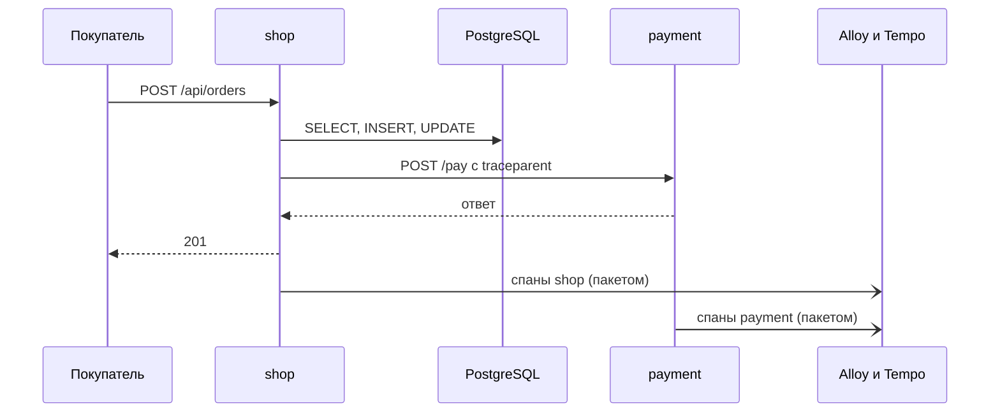
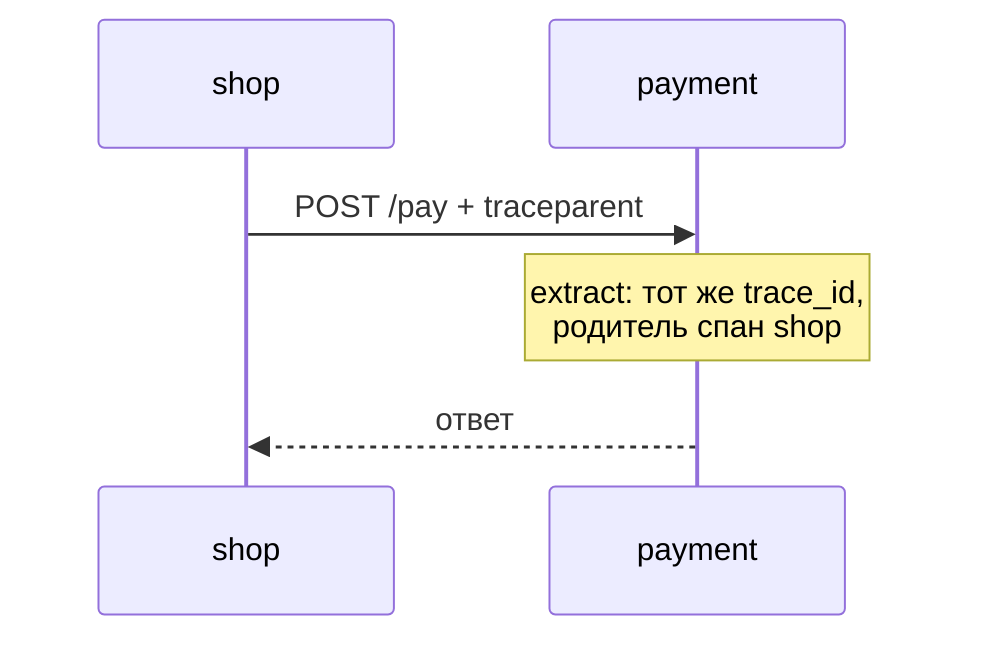
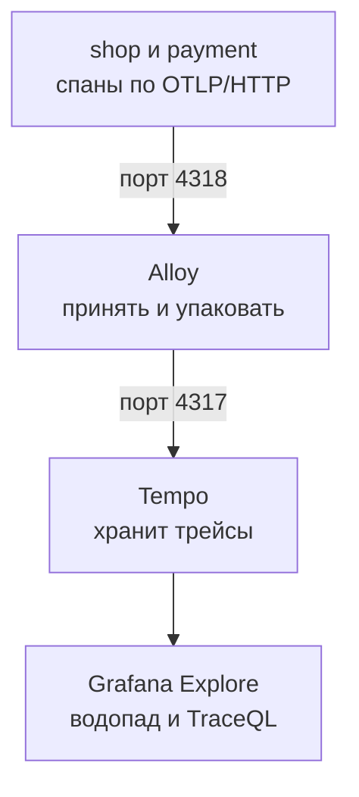
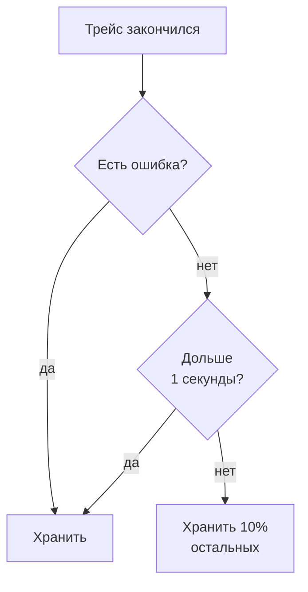

## Зачем это нужно

Тревога сработала, график показал `/api/orders`, лог назвал ошибку: `payment failed`. Хорошо, но у другого заказа лог пишет просто «запрос шёл 2 секунды» и никакой ошибки нет. Где ушли эти две секунды? Заказ сходил в Redis, четыре раза в PostgreSQL (проверка склада, запись заказа и его позиций, обновление остатков), потом вызвал сервис оплаты. Строка лога знает только итог: «всё заняло 2 секунды». Метрика знает ещё меньше.

Я столкнулся с этим на первой же распродаже, когда дежурил один. Заказы «тормозили», метрики показывали, что медленно, но не говорили где. Я полдня гадал между базой и оплатой, пока не получил картину одного запроса целиком. С тех пор я сторонник трейсов и сегодня покажу, как с ними работать.

```text
14:03:12  POST /api/orders  201  2050 мс
```

Одна строка: заказ создан, но шёл две секунды. Куда они делись, по ней не понять: тут записан только итог.

У каждого сервиса свои часы и свои записи, поэтому без общего номера непонятно, одно это событие или два. Помогает номер, который сервисы передают друг другу вместе с запросом: с ним записи складываются в одну линию.

Сегодня ты прочитаешь путь одного запроса «Магазина» через все его части, найдёшь медленный шаг и пройдёшь по всей цепочке «метрика, лог, трейс». Это последний урок темы про логи и трейсы. Дальше тема 5: инцидент целиком.

Шаг проекта: ты создаёшь в `~/monitoring-lab` файл `04-logs-traces/three-signals.md` с разбором одного медленного заказа: график, строка лога, `trace_id`, спан-виновник и что чинить.

## Что нужно знать

- Логи и `trace_id` в строке: [урок 4.1](01-logs.md). Из него ты помнишь `request_id` и то, что метрика отвечает «где», а лог «почему».
- Метрики и PromQL, `histogram_quantile`: [урок 2.2](../02-metrics/02-promql.md). Алерты, с которых начинается расследование: [урок 3.2](../03-dashboards-alerts/02-alerts.md).
- Три сигнала и «Магазин» на стенде: [урок 1.1](../01-basics/01-signals.md). Запросы по HTTP и заголовки: [load-tester, урок 1.4](../../load-tester/01-linux/04-network-cli.md).

## Картина целиком

Представь накладную, которая едет вместе с посылкой. На каждой остановке (склад, сортировка, доставка) в накладной ставят штамп: «пришла в 10:02, ушла в 10:09». В конце по накладной видно, где посылка пролежала дольше всего. Номер накладной один на весь путь, поэтому штампы разных складов собираются вместе. В сервисе штампы ставит программа, и делает она это тысячи раз в секунду, поэтому записи дорого хранить целиком.

В «Магазине» накладная это трейс, штамп это спан (отрезок времени), а склады это `shop`, PostgreSQL, Redis и сервис оплаты `payment`.



На схеме сплошные стрелки это сам запрос, а пунктирные отправка спанов в сторону: сервисы отдают их в фоне, чтобы не тормозить покупателя. Номер трейса `shop` передаёт в `payment` вместе с вызовом, поэтому спаны двух сервисов потом складываются в один трейс. Ниже разберём устройство по шагам и закончим связкой всех трёх сигналов.

## Теория

### Трейс и спан

Ты видишь в логе, что заказ шёл 94 миллисекунды. Это число ничего не говорит о том, на что ушло время. Я в такой ситуации всегда спрашиваю себя: «из чего оно сложилось?» Нужна раскладка: сколько заняла база, сколько оплата, сколько сам код `shop`. Для этого запрос делят на шаги и записывают время каждого.

**Спан** (span) это один отрезок работы со временем начала и конца: «SQL-запрос», «вызов оплаты», «обработка запроса». Например, «SQL-запрос» в «Магазине» это один спан на 30 мс.

**Трейс** (trace, трассировка) это набор спанов одного запроса, собранных в дерево. Один заказ в «Магазине» это один трейс (он ниже).

Верхний спан называется **корневым** (root): он охватывает весь запрос глазами покупателя, например `POST /api/orders` на 94 мс. У остальных есть **родитель**: спан, внутри которого они выполнялись (вызов оплаты шёл внутри заказа).

Картина по заказу «Магазина» (числа примерные):

```text
POST /api/orders                      94 мс  (корень, shop)
├─ SELECT / INSERT / UPDATE (SQL)     30 мс  (shop, PostgreSQL)
└─ POST                               58 мс  (клиент, shop -> payment)
   └─ POST /pay                       55 мс  (payment, сам сервис)
```

Прочитай строки сверху вниз: вложенность показывает, кто внутри кого. Корень шёл 94 мс. Из них 30 мс ушло на базу и 58 мс на вызов оплаты. Остаток 94 - 30 - 58 = 6 мс это время самого кода `shop` между вызовами. Его называют **собственным временем** (self time): спан минус то, что внутри детей. Ищи спан с самым большим собственным временем: он тратит время сам, а не ждёт детей. Корень длинный всегда, он не виновник. Дети могут идти параллельно, и тогда их время в сумме бывает больше родительского.

> **Прикинь сам:** корневой спан занял 200 мс, его единственный ребёнок «вызов оплаты» 190 мс. Где причина медленного ответа?
{: .predict}

В оплате, а не в корне. Корень всегда самый длинный: внутри него ждут дети. Не обвиняй самый длинный спан, ищи тот, у которого велико собственное время, то есть время тратится в нём самом, а не в вызовах дочерних.

Идентификаторы спанов и трейсов выглядят так же, как номера запросов, но устроены строже. Об этом дальше.

> **Главное:** трейс это дерево спанов одного запроса, а виновника ищут в спане, у которого много собственного времени.
{: .key}

### Идентификаторы и атрибуты спана

Как Tempo узнаёт, что три спана заказа это один запрос, а не три чужих? Каждому спану нужны номера: один общий на весь запрос, свой у каждого спана и ссылка на родителя. Возьмём трейс из прошлого раздела с реальными номерами (покороче не получится, формат фиксированный):

```text
trace_id 9c1d5a7e3b2f4c8d9e0a1b2c3d4e5f60

POST /api/orders   span_id 3f9a1c07d2e84b56   parent: нет (корень)
└─ POST            span_id b7ad6b7169203331   parent: 3f9a1c07d2e84b56
   └─ POST /pay    span_id 5e2c8a90f14d7b13   parent: b7ad6b7169203331
```

**`trace_id`** общий для всех трёх спанов: по нему Tempo понимает, что это один запрос, и по нему же ты потом открываешь трейс. Это длинная строка из цифр и букв a-f. **`span_id`** свой у каждого спана и короче. **`parent_span_id`** это `span_id` родителя: у корня его нет, а у остальных он указывает на спан, внутри которого шёл этот. Tempo сопоставляет номера и строит дерево, как ты только что его прочитал. Заметь, что `span_id` среднего спана `b7ad…` стоит в `parent` у нижнего: так оплата узнаёт, чей она ребёнок.

Кроме номеров, у спана есть имя (`POST /api/orders`), время начала, длительность и **атрибуты**: подробности в виде пар «ключ=значение», например `db.system="postgresql"`. Имя сервиса записано отдельно, в описании процесса (оно называется **ресурс**, поле `service.name`), и берётся из переменной `OTEL_SERVICE_NAME`. Без неё в Tempo будет `unknown_service`: трейс есть, а чей он, непонятно.

<details markdown="1">
<summary>Откуда Tempo знает имя сервиса</summary>

Ресурс это описание процесса, который создал спан: имя сервиса, версия, хост. Оно общее для всех спанов процесса, поэтому в TraceQL пишется с приставкой `resource.`, а атрибуты отдельного шага с приставкой `span.`. «Магазин» берёт `service.name` из `OTEL_SERVICE_NAME` (`shop` или `payment`). Если переменную не задать, имя будет вида `unknown_service` (в Python `unknown_service:python`).

</details>

<details markdown="1">
<summary>Для интервью: тип и статус спана</summary>

**Тип** (kind) показывает роль спана в разговоре двух сервисов: `SERVER` принял запрос снаружи, `CLIENT` отправил запрос дальше, `INTERNAL` работа внутри сервиса без обращений наружу. **Статус** бывает `UNSET` (ничего не сказано), `OK` и `ERROR`. Ответ `5xx` инструментация обычно помечает как `ERROR`, а успешный запрос остаётся `UNSET`, поэтому ошибочные спаны ищут через `status = error`, а не `status = ok`.

</details>

> **Прикинь сам:** в Tempo ты видишь спаны без имени сервиса, подписанные `unknown_service`. Что не настроено?
{: .predict}

Переменная `OTEL_SERVICE_NAME` у процесса. Исправляется в `compose.yaml` сервиса, после чего его пересоздают. В TraceQL такие спаны ищет `resource.service.name =~ "unknown_service.*"`.

Не путай `trace_id` и `request_id`: это разные номера. `request_id` это номер одного обращения к `shop`, а `trace_id` номер всего пути через `shop` и `payment`. В строке лога лежат оба, и каждый нужен для своего: по `request_id` находят строку по жалобе клиента, по `trace_id` открывают трейс.

> **Проверь понимание:** где в трейсе лежит имя сервиса: в атрибутах спана или ресурса?

<details markdown="1">
<summary>Ответ</summary>

В атрибутах ресурса: `resource.service.name`. Оно описывает процесс, который создал спан, и общее для всех его спанов. Поэтому в TraceQL оно пишется с приставкой `resource.`, а, скажем, `db.system` с приставкой `span.`.

</details>

> **Главное:** `trace_id` один на весь трейс, `span_id` у каждого спана свой, а имя сервиса живёт в атрибутах ресурса.
{: .key}

Номер у спана есть. Но как он попадёт из `shop` в `payment`, ведь это два разных процесса?

### traceparent: как номер едет между сервисами

`shop` и `payment` не делят память. Если `shop` просто вызовет `payment`, тот начнёт новый трейс с новым номером, и связь потеряется. Значит, номер нужно передать вместе с запросом. Эту роль играет HTTP-заголовок **`traceparent`** из стандарта W3C Trace Context.

```text
traceparent: 00-9c1d5a7e3b2f4c8d9e0a1b2c3d4e5f60-b7ad6b7169203331-01
```

Четыре части через дефис: версия формата (`00`), `trace_id`, `span_id` вызывающего спана (он станет родителем у спана на той стороне) и флаги (`01` значит «трейс сохраняем»). Библиотека вызывающей стороны кладёт заголовок в запрос (**inject**, вставка), а библиотека принимающей стороны достаёт его (**extract**, извлечение) и создаёт спан с тем же `trace_id`. На стенде это делают готовые инструментации: `httpx` в `shop` ставит заголовок, `fastapi` в `payment` читает.



Схема показывает мостик между процессами: один заголовок. Именно он делает два сервиса одним трейсом.

> **Прикинь сам:** самописный клиент вызывает `payment` и не кладёт `traceparent`. Что увидишь в Tempo?
{: .predict}

Два отдельных трейса вместо одного: `payment` не знает родителя и начинает свой. Поэтому первый вопрос при «трейс обрывается» звучит так: кто не передал заголовок? Типичный виновник это прокси или шлюз, который режет неизвестные заголовки.

`traceparent` доезжает не сам по себе. Каждый сервис на пути обязан его принять и передать дальше. Один пропущенный сервис разрывает цепочку.

<details markdown="1">
<summary>Через очередь сообщений</summary>

Заголовков HTTP у очереди нет, поэтому `traceparent` кладут в атрибуты самого сообщения. Отправитель записывает его при отправке, а получатель достаёт при чтении и создаёт свой спан с тем же `trace_id`. Если этого не сделать, трейс оборвётся на очереди, и обработка сообщения окажется отдельным трейсом. Если сообщение обрабатывается пачкой или позже, вместо родителя делают **span link**: ссылку из нового спана на исходный, трейсы остаются раздельными, но связанными. Отдельно есть **baggage**: пары «ключ=значение», которые едут вместе с трейсом по всей цепочке, но сами спанами не становятся. Он уходит во все вызовы, в том числе к чужим сервисам, поэтому секреты и персональные данные туда не кладут.

</details>

> **Главное:** `traceparent` несёт `trace_id` и родителя от сервиса к сервису, и без него вместо одного трейса получится несколько обрывков.
{: .key}

Теперь о том, чем спаны создаются и отправляются.

### OpenTelemetry и OTLP

Кто создаёт спаны и отправляет их? Это делает общий стандарт **OpenTelemetry** (сокращённо OTel): открытые правила того, как сервис создаёт и отправляет спаны. Код пишет в OTel, а куда уйдут данные, решают настройки. Формат, в котором спаны уходят из сервиса, называется **OTLP** (OpenTelemetry Protocol). Спан проходит четыре шага:

1. **Инструментация** создаёт спан в коде сервиса.
2. **SDK** (набор готового кода, который подключают к программе) копит спаны в памяти и решает, какие брать.
3. **Экспортёр** (exporter) отправляет спаны наружу по OTLP.
4. **Сборщик** (у нас Alloy) принимает их и передаёт в Tempo.

Есть два способа получить спан. **Автоинструментация** (auto-instrumentation) это готовая библиотека, которая сама оборачивает известные вызовы: входящий HTTP, SQL, Redis, исходящий запрос. Ты подключаешь её один раз, и спаны появляются без правок кода. В `payment` она подключена одной строкой, а в `shop` стоят инструментации `fastapi`, `httpx`, `psycopg` и `redis`.

**Ручной спан** разработчик ставит сам вокруг шага, о котором библиотека ничего не знает: расчёт скидки, ожидание соединения из пула, обработка сообщения из очереди. В `shop` так сделан спан `db.pool.getconn` (ожидание соединения из пула). На стенде спаны `GET`, `SELECT`, `POST` создаёт автоинструментация, а `db.pool.getconn` ручной. Вот заказ с ними:

<div class="viz" data-viz="mon-trace" data-title="Tempo: автоматические и ручной спан" data-trace-id="0e7b3c9a4d1f4a2b8c5e6f7a8b9c0d1e" data-focus="g3" data-explain="Спаны SELECT, INSERT, POST и POST /pay создала автоинструментация, выделенный db.pool.getconn добавлен вручную в коде." data-spans='[{"id":"r0","parent":null,"service":"shop","name":"POST /api/orders","start":0,"dur":92,"status":"ok","attrs":{"http.method":"POST","http.route":"/api/orders","http.status_code":201}},{"id":"g1","parent":"r0","service":"shop","name":"GET","start":1,"dur":1,"status":"ok","attrs":{"db.system":"redis"}},{"id":"g2","parent":"r0","service":"shop","name":"HGETALL DEL","start":3,"dur":1,"status":"ok","attrs":{"db.system":"redis"}},{"id":"g3","parent":"r0","service":"shop","name":"db.pool.getconn","start":5,"dur":1,"status":"ok"},{"id":"a4","parent":"r0","service":"shop","name":"SELECT","start":7,"dur":4,"status":"ok","attrs":{"db.system":"postgresql","db.name":"shop"}},{"id":"a5","parent":"r0","service":"shop","name":"INSERT","start":12,"dur":3,"status":"ok","attrs":{"db.system":"postgresql","db.name":"shop"}},{"id":"a5b","parent":"r0","service":"shop","name":"INSERT","start":16,"dur":2,"status":"ok","attrs":{"db.system":"postgresql","db.name":"shop"}},{"id":"a6","parent":"r0","service":"shop","name":"UPDATE","start":19,"dur":3,"status":"ok","attrs":{"db.system":"postgresql","db.name":"shop"}},{"id":"c1","parent":"r0","service":"shop","name":"POST","start":24,"dur":56,"status":"ok","attrs":{"http.method":"POST","http.url":"http://payment:8001/pay","http.status_code":200}},{"id":"p1","parent":"c1","service":"payment","name":"POST /pay","start":27,"dur":50,"status":"ok","attrs":{"http.route":"/pay","http.status_code":200}}]'></div>

Выделенный спан в 1 мс стоит первой полосой перед SQL (на успешном заказе перед ним только короткие обращения к Redis). Если пул переполнится, именно он станет длинным и покажет, что время ушло на ожидание соединения, а не на сам запрос.

<details markdown="1">
<summary>Для любопытных: как выглядит код</summary>

Автоинструментация в `payment` включается одной строкой:

```python
FastAPIInstrumentor.instrument_app(app, excluded_urls="healthz,metrics")
```

Ручной спан в `shop` оборачивает нужный шаг (`span` это обёртка над вызовом OTel «начни спан», она лежит в `shop/app/telemetry.py`):

```python
with span("db.pool.getconn"):
    conn = pool.getconn()
```

SDK и экспортёр в `shop` подключаются так:

```python
provider = TracerProvider(resource=Resource.create())
provider.add_span_processor(BatchSpanProcessor(OTLPSpanExporter()))
```

`TracerProvider` это сам SDK, а `BatchSpanProcessor` складывает спаны в очередь и отправляет пакетами из отдельного потока, поэтому запрос не ждёт отправки. По умолчанию пакет уходит раз в 5 секунд (настройка `OTEL_BSP_SCHEDULE_DELAY`). На стенде в `compose.yaml` стоит `OTEL_BSP_SCHEDULE_DELAY: "1000"`, то есть раз в секунду, чтобы трейсы появлялись быстрее. Имя сервиса, адрес сборщика и сэмплирование берутся из переменных `OTEL_*` в `compose.yaml`, в коде их нет.

</details>

OTLP ходит двумя путями: по HTTP (порт 4318) или по gRPC (порт 4317, быстрый двоичный способ вызова между программами). Сервисы стенда шлют по HTTP, подробности в практике 1. OTLP передаёт спаны в одном формате, поэтому сменить Tempo на другое хранилище можно без правок кода.

Если сборщик недоступен, экспорт молча падает по таймауту, а запросы идут как обычно: ошибки экспорта в лог на стенде не пишутся. Цена вопроса: при долгой недоступности часть спанов пропадёт.

> **Прикинь сам:** Alloy остановили на минуту. Замедлятся ли заказы?
{: .predict}

Нет: экспорт идёт в фоне и падает по таймауту, а запросы не ждут. Пострадают трейсы за эту минуту: они не дойдут.

Подключить трассировку к новому сервису можно тремя шагами: поставить библиотеки OpenTelemetry для языка и нужные инструментации, указать в переменных окружения имя сервиса, адрес сборщика и сэмплирование (`OTEL_SERVICE_NAME`, `OTEL_EXPORTER_OTLP_ENDPOINT`, `OTEL_TRACES_SAMPLER`), и убедиться, что заголовок `traceparent` передаётся дальше.

> **Прикинь сам:** разработчик хочет ручной спан на каждый из 5000 товаров в корзине внутри цикла. Хорошая ли идея?
{: .predict}

Нет: получится пять тысяч спанов на один запрос, трейс станет огромным и дорогим, а полезного в нём мало. Спан ставят на шаг, который можно назвать и про который хочется знать время, а детали (идентификатор заказа, число товаров) кладут в атрибуты спана. Имя спана делают коротким и постоянным, как `db.pool.getconn`, без номеров заказов внутри.

Ручной спан нужно закрывать: забытый незакрытый спан в Tempo не появится. В коде из блока выше это делает конструкция `with`, даже если внутри случилась ошибка.

> **Главное:** OpenTelemetry создаёт спаны (сама библиотека на границах HTTP, SQL, Redis или ты вручную на своём шаге), OTLP передаёт их в одном формате, а отправка идёт в фоне и не должна ломать то, что наблюдает.
{: .key}

Спаны созданы и отправлены. Куда они приходят?

### Alloy и Tempo: путь спанов

Alloy уже знаком по логам из урока 4.1: здесь он принимает спаны и отправляет их в Tempo. Сервисы шлют спаны по HTTP на порт 4318, а Alloy передаёт их в Tempo по gRPC на порт 4317. Как это настроено, смотри в практике 1.



На схеме добавляется ещё одно звено по сравнению с логами. Сервисам не нужно знать адрес хранилища, а в Alloy позже можно добавить фильтры или копию трейсов в другую систему без правки кода.

**Tempo** это хранилище трейсов от Grafana Labs. Как и Loki, он дёшев: не строит указатель по каждому значению атрибута. Следствие в том, что быстро Tempo находит трейс только по `trace_id`: прямое обращение к номеру. Поиск по другим условиям (имя сервиса, длительность, атрибуты) перебирает блоки, поэтому медленнее. Данные на стенде лежат в томе `tempo` 24 часа (срок задан в `monitoring/tempo/tempo.yaml`). Порт 3200 это адрес Tempo для Grafana и для тебя.

Сразу после заказа трейса в Tempo может ещё не быть: спаны уходят пакетом раз в секунду (на стенде так настроен `OTEL_BSP_SCHEDULE_DELAY`), а Tempo отдаёт их с задержкой на приём. Подожди 10-15 секунд, прежде чем решить, что трейсов нет.

Готовность Tempo проверяют запросом `curl -s localhost:3200/ready`, как в практике 1: Prometheus его не опрашивает.

> **Главное:** сервисы шлют спаны в Alloy, Alloy в Tempo, а искать быстро можно только по `trace_id`.
{: .key}

Трейс найден и открыт. Как читать его на экране?

### Водопад: как читать трейс

Дерево спанов рисуют **водопадом** (waterfall): строка на спан, горизонтальная ось это время от начала запроса, длина полосы это длительность, отступ показывает вложенность. Попробуй сам.

<div class="viz" data-viz="trace-waterfall" data-scenario="order"></div>

Начни со сценария «Заказ: всё хорошо»: корневая полоса охватывает остальные, SQL идёт друг за другом, оплата стоит одним блоком. Затем переключись на «Медленную оплату»: одна полоса занимает почти всю ширину, и виновник виден сразу. Это тот самый заказ на две секунды из начала урока: строка лога называла итог, а водопад показывает, на каком шаге он набрался. Я открываю водопад первым делом, ещё до чтения атрибутов: форма полос подсказывает причину быстрее любого текста.

Три типичные формы водопада стоит узнавать с одного взгляда. **Одна длинная полоса**: один спан занимает почти всё время, например `POST /pay` две секунды. Чинить нужно именно его. **Лесенка одинаковых коротких спанов**: десятки `SELECT` подряд это N+1 (запрос в цикле: один запрос за списком и по одному на каждый элемент). Каждый запрос быстр и в списке медленных запросов базы его нет, а в трейсе лесенка видна сразу. **Повторы подряд**: несколько одинаковых красных вызовов оплаты это ретраи (повторные попытки) без паузы. Метрики показали бы это как «запросов к оплате вчетверо больше, чем заказов» (до четырёх попыток на заказ), а трейс одного заказа показывает все попытки. Ретраи без паузы я видел чаще, чем просто медленную оплату.

<div class="viz" data-viz="trace-waterfall" data-scenario="retries"></div>

Здесь четыре красные попытки оплаты друг за другом. Переключись на «N+1: список заказов» и нажми «Свернуть повторы»: двадцать полос сложатся в одну с подписью `SELECT x20`.

Вот как это выглядит в Tempo при `fail_rate` 0,7, когда оплата отказывает:

<div class="viz" data-viz="mon-trace" data-title="Tempo: заказ с ретраями оплаты" data-trace-id="1b9e03a759aac23a9a22e050148a298c" data-focus="r0" data-explain="Четыре красные попытки оплаты друг за другом: каждая это пара POST и POST /pay." data-spans='[{"id":"r0","parent":null,"service":"shop","name":"POST /api/orders","start":0,"dur":212,"status":"error","attrs":{"http.method":"POST","http.route":"/api/orders","http.status_code":502}},{"id":"g1","parent":"r0","service":"shop","name":"GET","start":0,"dur":1,"status":"ok","attrs":{"db.system":"redis"}},{"id":"g2","parent":"r0","service":"shop","name":"HGETALL DEL","start":2,"dur":1,"status":"ok","attrs":{"db.system":"redis"}},{"id":"g3","parent":"r0","service":"shop","name":"db.pool.getconn","start":4,"dur":2,"status":"ok"},{"id":"g4","parent":"r0","service":"shop","name":"SELECT","start":7,"dur":3,"status":"ok","attrs":{"db.system":"postgresql","db.name":"shop"}},{"id":"g5","parent":"r0","service":"shop","name":"INSERT","start":11,"dur":2,"status":"ok","attrs":{"db.system":"postgresql","db.name":"shop"}},{"id":"g5b","parent":"r0","service":"shop","name":"INSERT","start":13,"dur":1,"status":"ok","attrs":{"db.system":"postgresql","db.name":"shop"}},{"id":"g6","parent":"r0","service":"shop","name":"UPDATE","start":15,"dur":1,"status":"ok","attrs":{"db.system":"postgresql","db.name":"shop"}},{"id":"r1","parent":"r0","service":"shop","name":"POST","start":16,"dur":46,"status":"error","attrs":{"http.method":"POST","http.url":"http://payment:8001/pay","http.status_code":500}},{"id":"p1","parent":"r1","service":"payment","name":"POST /pay","start":19,"dur":40,"status":"error","attrs":{"http.route":"/pay","http.status_code":500}},{"id":"r2","parent":"r0","service":"shop","name":"POST","start":65,"dur":46,"status":"error","attrs":{"http.method":"POST","http.url":"http://payment:8001/pay","http.status_code":500}},{"id":"p2","parent":"r2","service":"payment","name":"POST /pay","start":68,"dur":40,"status":"error","attrs":{"http.route":"/pay","http.status_code":500}},{"id":"r3","parent":"r0","service":"shop","name":"POST","start":114,"dur":46,"status":"error","attrs":{"http.method":"POST","http.url":"http://payment:8001/pay","http.status_code":500}},{"id":"p3","parent":"r3","service":"payment","name":"POST /pay","start":117,"dur":40,"status":"error","attrs":{"http.route":"/pay","http.status_code":500}},{"id":"r4","parent":"r0","service":"shop","name":"POST","start":163,"dur":46,"status":"error","attrs":{"http.method":"POST","http.url":"http://payment:8001/pay","http.status_code":500}},{"id":"p4","parent":"r4","service":"payment","name":"POST /pay","start":166,"dur":40,"status":"error","attrs":{"http.route":"/pay","http.status_code":500}},{"id":"g7","parent":"r0","service":"shop","name":"HINCRBY","start":209,"dur":3,"status":"ok","attrs":{"db.system":"redis"}}]'></div>

Посчитай красные пары `POST` и `POST /pay`: их четыре, это первая попытка и три повтора. Корень тоже красный, потому что после последнего отказа заказ вернул `502`.

> **Проверь понимание:** в трейсе заказа десять одинаковых коротких `SELECT` подряд, каждый по 2 мс. В списке медленных запросов базы ничего нет. Это ошибка мониторинга?

<details markdown="1">
<summary>Ответ</summary>

Нет, это N+1. Каждый запрос быстрый, поэтому медленных в базе нет, а вместе они дают заметное время и лишние обращения (и ещё нагрузку на пул соединений). Лесенка одинаковых спанов видна только в трейсе. Исправление: заменить запросы в цикле одним общим запросом.

</details>

> **Главное:** форма водопада подсказывает причину: длинная полоса значит медленный шаг, лесенка значит N+1, повторы значат ретраи.
{: .key}

Водопад открывают по номеру. А если номера нет?

### TraceQL: найти трейс без номера

Номера у тебя нет, а есть только описание: «заказ дольше секунды». Для этого есть **TraceQL**, язык запросов к трейсам. Он похож на LogQL и PromQL: в фигурных скобках условия на спан, справа от `|` функции.

```text
{ resource.service.name = "payment" }
```

Все спаны сервиса `payment`. Ещё три примера:

```text
{ name = "POST /api/orders" && duration > 1s }
{ resource.service.name = "shop" && status = error }
{ span.db.system = "postgresql" } | count() > 10
```

Первый находит заказы дольше секунды. Второй спаны с ошибкой в `shop`. Третий трейсы, где больше десяти SQL-спанов: так ловят лесенку N+1. Читай их по частям: `resource.` это атрибуты процесса, `span.` атрибуты шага, `name` имя спана, `duration` длительность, `&&` значит «и».

На выходе получаешь список трейсов с корневым именем и временем. Выбираешь самый длинный и сравниваешь с типичным: куда ушла разница?

> **Прикинь сам:** запрос `{ duration > 1s }` вернул 400 трейсов, а ты ищешь один заказ. Как сузить?
{: .predict}

Добавь имя и сервис: `{ resource.service.name = "shop" && name = "POST /api/orders" && duration > 1s }`. Чем больше точных условий, тем меньше блоков придётся перебирать. Лучше всего сработает связка по номеру из лога.

Осторожно: имена атрибутов бери из реального трейса, а не из головы. Ошибка в `span.db.system` даёт пустой список без подсказки. Открой любой трейс и посмотри, как атрибут записан в карточке спана.

> **Главное:** TraceQL ищет трейсы по условиям на спаны, а точнее всего поиск по `trace_id` из лога.
{: .key}

Хранить все трейсы дорого. Что с этим делают?

### Сэмплирование и цена трейсинга

Трейсы весят много: при 1000 запросов в секунду и 15 спанах на заказ выходит около 650 ГБ в сутки. Это порядок величины: Tempo хранит данные сжатыми, реальный объём ниже, и цифра показывает масштаб, а не норму. Столько диска всё равно никто не хочет отдавать, поэтому на проде хранят долю трейсов. Выбор доли называется **сэмплированием** (sampling). Это дёшево, но редкую ошибку можно пропустить: если сохранён каждый десятый трейс, она может в него не попасть. Поэтому я предпочитаю tail-сэмплирование: оно оставляет медленные и упавшие трейсы, а их я и ищу.

<details markdown="1">
<summary>Как получилось 650 ГБ</summary>

1000 запросов в секунду × 15 спанов = 15 000 спанов в секунду. Спан весит около 500 байт (имя, время, номера, атрибуты): 15 000 × 500 = 7,5 МБ в секунду. В сутках 86 400 секунд: 7,5 МБ × 86 400 ≈ 648 000 МБ, около 650 ГБ.

</details>

Есть два подхода. При **head-сэмплировании** (решение в начале) трейс берут или нет вслепую, в момент старта, например каждый десятый. При **tail-сэмплировании** (решение в конце) решают, когда трейс закончился, и сохраняют все с ошибками или длиннее секунды: в Alloy это отдельная настройка. Чтобы трейс не вышел рваным, остальные сервисы повторяют решение первого через флаг в `traceparent` (режим `parentbased`).

На практике tail-сэмплирование ведёт себя так:



Схема показывает правило: ошибки и медленные трейсы сохраняют все, а из обычных берут десятую часть (доля условная: её выбирают по тому, сколько места на диске готовы отдать под трейсы). Это те трейсы, ради которых трассировку и включают: при расследовании нужен именно сбойный запрос, а не случайный. Цена такая: сборщик держит все спаны трейса в памяти, пока трейс не закончится. Head проще и дешевле, tail удобнее для расследований.

<details markdown="1">
<summary>Tail-сэмплирование в кластере сборщиков</summary>

Все спаны одного трейса должны прийти на один экземпляр сборщика, иначе решение примут по обрывку. В кластере сборщиков перед ними ставят `loadbalancing` exporter, который направляет спаны по `trace_id` на один и тот же сборщик. Режим `parentbased` у сервисов работает отдельно: он только повторяет решение первого сервиса по флагу в `traceparent`.

</details>

На стенде хранится всё: `OTEL_TRACES_SAMPLER=parentbased_always_on` и `OTEL_TRACES_SAMPLER_ARG=1.0`. Для высокой нагрузки ставят `parentbased_traceidratio` с `0.1`: 10% трейсов.

> **Прикинь сам:** в метриках p95 заказов 1,2 с, а в Tempo при 10% видно всего три медленных трейса. Метрики врут?
{: .predict}

Нет. Счётчики Prometheus считают все запросы, а трейсы это выборка. Метрика отвечает «сколько», трейс «где».

Трейсы чуть нагружают сервис; при высокой нагрузке это видно по задержке.

> **Главное:** сэмплирование уменьшает число трейсов, но не метрик, а tail-режим сохраняет редкое: ошибки и медленное.
{: .key}

Теперь у нас есть все три сигнала. Остаётся связать их в одну цепочку.

### Связь трёх сигналов

Три сигнала хранятся в трёх системах и сами по себе не связаны. Склеивает их `trace_id` в строке лога: без него я бы по-прежнему гадал, какой лог к какому заказу относится. Вот цепочка целиком на нашем магазине:

<div class="viz" data-viz="flow" data-steps='[{"title":"Алерт и график","text":"Сработал `ShopHighLatencyP95`; на графике p95 `/api/orders` вырос с 0,1 до 2,4 секунды (квантиль считается по корзинам)."},{"title":"Метрика сужает","text":"`shop_payment_duration_seconds` выросла так же: время уходит в оплату, а не в базу."},{"title":"Лог называет запрос","text":"`{service=\"shop\"} | json | route=\"/api/orders\" | duration_ms > 1000` даёт строки с `request_id` и `trace_id`."},{"title":"Трейс показывает шаг","text":"Кнопка «Открыть трейс» из строки лога: одна длинная полоса `POST /pay` в сервисе `payment`."},{"title":"Решение","text":"Чинить оплату: она отвечает слишком долго. База и процессор магазина тут ни при чём."}]'></div>

Схема показывает порядок: метрика отвечает «где и когда», лог «какой запрос и какой номер», трейс «на каком шаге потеряно время». Каждый следующий сигнал уточняет предыдущий, а общие «ниточки» это время, метка `route` и `trace_id`. Grafana умеет это двумя кнопками: из лога в трейс и из трейса в лог.

<details markdown="1">
<summary>Как это настроено на стенде</summary>

Из лога в трейс: в источнике Loki настроено **производное поле** (derived field) с регулярным выражением `"trace_id":\s*"(\w+)"`. Оно вытаскивает номер из строки лога и рисует кнопку «Открыть трейс», которая открывает Tempo. Из трейса в лог: в источнике Tempo (в provisioning стенда ключ `tracesToLogsV2`, в интерфейсе «Trace to logs») из спана переходишь к логам `{service="shop"} |= "<trace_id>"` в окне минута до и минута после спана. Третья связь это общее время и метки, как в уроке 4.1.

Есть и четвёртый приём, **экземпляры** (exemplars): метрика хранит рядом с числом пример `trace_id` запроса, который попал в корзину гистограммы, и на графике появляются точки со ссылкой на трейс. На нашем стенде они не включены, но в боевых системах встречаются.

</details>

> **Прикинь сам:** почему `trace_id` кладут в лог полем, а не меткой Loki?
{: .predict}

Это идентификатор с миллионами значений: по правилу кардинальности из урока 4.1 метка раздула бы индекс. Поле в строке находится фильтром, а в Grafana из него делают кнопку.

Ссылка из лога в трейс работает, только если у запроса есть трейс. Строки `/healthz`, `/readyz` и `/metrics` трейсов не имеют, и поля `trace_id` в них нет: кнопки на них не будет.

> **Главное:** метрика показывает, где и когда, лог называет запрос, трейс показывает шаг, а `trace_id` в строке лога склеивает их.
{: .key}

Как эта цепочка работает в реальном инциденте, где на неё уходят минуты, разберёт [урок 5.1](../05-reliability/01-incidents.md).

Теория закончилась. Давай пройдём цепочку руками.

## Практика

Стенд «Магазин» поднят с профилем `monitoring`, Grafana открыта на `http://localhost:3000`. Нагрузку и поломки делай только на своём локальном стенде.

### 1. Убедись, что трейсы текут

```bash
cd ~/learning/load-tester/project/shop
docker compose --profile monitoring ps tempo alloy
curl -s localhost:3200/ready
```

`ps tempo alloy` показывает состояние двух сервисов, `/ready` спрашивает у Tempo порт 3200 «готов принимать данные».

**Что должно получиться** (пример):

```text
NAME             IMAGE                    COMMAND   SERVICE   CREATED         STATUS          PORTS
shop-alloy-1     grafana/alloy:v1.20.1    ...       alloy     2 minutes ago   Up 2 minutes    127.0.0.1:12345->12345/tcp
shop-tempo-1     grafana/tempo:2.10.8     ...       tempo     2 minutes ago   Up 2 minutes    127.0.0.1:3200->3200/tcp
ready
```

**Как читать вывод:** оба сервиса в статусе `Up`, Tempo отвечает `ready`. Сразу после запуска Tempo может ответить `Ingester not ready: waiting for 15s after being ready`: подожди 15 секунд.

**Типичные ошибки:**

- `curl: (7) Failed to connect to localhost port 3200`: стенд поднят без профиля `monitoring`. Выполни `docker compose --profile monitoring up -d --wait`.

<details markdown="1">
<summary>Как Alloy и Tempo устроены внутри</summary>

Читай, когда будешь искать, где рвётся цепочка. Для трейсов Alloy собирает цепочку из трёх блоков: приёмник OTLP на порту 4318 (`otelcol.receiver.otlp`), упаковщик (`otelcol.processor.batch`) и отправка на `tempo:4317` (`otelcol.exporter.otlp`). Выход одного блока подключён ко входу другого.

Портов два, потому что в цепочке две передачи, и каждая использует свой вариант OTLP. `shop` и `payment` шлют по HTTP на `http://alloy:4318` (адрес из `OTEL_EXPORTER_OTLP_ENDPOINT`): стенд использует Python-экспортёр для HTTP, и приёмник Alloy настроен только на HTTP. А Tempo принимает по gRPC на `4317`, поэтому Alloy переводит данные из одного варианта в другой. Порты не взаимозаменяемы: gRPC и HTTP говорят на разных «языках».

Если указать сервисам `http://alloy:4317`, заказы пойдут как обычно, но трейсов в Tempo не появится: сервис не достучится до приёмника, а его ошибки экспорта на стенде не пишутся в лог. Alloy при этом ничего не получит и ошибок не покажет: карточки на его экране (`http://localhost:12345`) зелёные, а в Explore по Tempo пусто. Поэтому при пустом Tempo сверь `OTEL_EXPORTER_OTLP_ENDPOINT` у сервиса: порт должен быть 4318.

Версию Tempo бери из `compose.yaml` стенда: там закреплена `grafana/tempo:2.10.8`.

</details>

### 2. Сделай заказ и найди его `trace_id`

```bash
TOKEN=$(curl -fsS localhost:8000/api/login -H 'Content-Type: application/json' \
  -d '{"email":"user0001@shop.lab","password":"password"}' | jq -r .token)
curl -s -o /dev/null -H "Authorization: Bearer $TOKEN" -H 'Content-Type: application/json' \
  localhost:8000/api/cart/items -d '{"product_id":7,"qty":1}'
curl -s -o /dev/null -w '%{http_code}\n' -X POST -H "Authorization: Bearer $TOKEN" localhost:8000/api/orders
docker compose logs shop --no-log-prefix | grep '"/api/orders"' | tail -n 1 | jq '{status, duration_ms, request_id, trace_id}'
```

Первая команда входит и сохраняет токен в переменную, вторая кладёт товар 7 в корзину, третья оформляет заказ и печатает код. Последняя берёт из логов `shop` свежую строку про `/api/orders` и показывает четыре поля.

**Что должно получиться** (пример; номера и время будут другими):

```json
{
  "status": 201,
  "duration_ms": 92.41,
  "request_id": "8d2f61c0a59e4b73a1f0c4e2b6d37a15",
  "trace_id": "0e7b3c9a4d1f4a2b8c5e6f7a8b9c0d1e"
}
```

**Как читать вывод:** `201` значит, что заказ создан. `trace_id` это 32 символа: скопируй его, он нужен дальше. Время около 90 мс похоже на «здоровый» заказ.

**Типичные ошибки:**

- `curl: (22) The requested URL returned error: 401` или `curl: (7) Failed to connect`, а затем пустой `echo $TOKEN`: стенд не запущен или email неверный. Проверь `curl -s localhost:8000/healthz`.
- Пустой вывод последней команды: строка ещё не появилась, подожди секунду и повтори.
- Код `400` вместо `201`: корзина пуста, повтори вторую команду.

### 3. Открой трейс в Grafana

Открой `http://localhost:3000/explore`, источник **Tempo**, тип запроса **TraceQL**, вставь `trace_id` из шага 2 в поле запроса и выполни. Если трейс «не найден», подожди 10-15 секунд.

**Что должно получиться:** водопад: корневой `POST /api/orders` около 90 мс, в самом начале команды Redis (`GET` сессии и пакет с корзиной, который может называться `HGETALL DEL`), затем `db.pool.getconn`, несколько `SELECT`/`INSERT`/`UPDATE`, потом `POST` к оплате и вложенный `POST /pay` из сервиса `payment`. После оплаты у здорового заказа спанов нет. Точный набор и названия у тебя могут отличаться.

Создай файл для ответов: `mkdir -p ~/monitoring-lab/04-logs-traces && touch ~/monitoring-lab/04-logs-traces/traces.md`. Ответь в нём письменно: сколько спанов и в скольких сервисах; какой спан самый длинный и какую долю корня он занимает; сколько заказ ждал соединения (`db.pool.getconn`); какой атрибут у `POST /pay` показывает адрес вызова.

**Как читать вывод:** корень длиннее суммы детей: в нём ещё время самого кода. Оплата около 50 мс это норма: заглушка отвечает за 50 мс.

Вот как выглядит здоровый заказ из шага 2 в Grafana:

<div class="viz" data-viz="mon-trace" data-title="Tempo: заказ, всё хорошо" data-trace-id="0e7b3c9a4d1f4a2b8c5e6f7a8b9c0d1e" data-focus="p1" data-explain="Корень POST /api/orders занимает 92 мс. Под ним Redis, пул, SQL и оплата." data-spans='[{"id":"r0","parent":null,"service":"shop","name":"POST /api/orders","start":0,"dur":92,"status":"ok","attrs":{"http.method":"POST","http.route":"/api/orders","http.status_code":201}},{"id":"g1","parent":"r0","service":"shop","name":"GET","start":1,"dur":1,"status":"ok","attrs":{"db.system":"redis"}},{"id":"g2","parent":"r0","service":"shop","name":"HGETALL DEL","start":3,"dur":1,"status":"ok","attrs":{"db.system":"redis"}},{"id":"g3","parent":"r0","service":"shop","name":"db.pool.getconn","start":5,"dur":1,"status":"ok"},{"id":"a4","parent":"r0","service":"shop","name":"SELECT","start":7,"dur":4,"status":"ok","attrs":{"db.system":"postgresql","db.name":"shop"}},{"id":"a5","parent":"r0","service":"shop","name":"INSERT","start":12,"dur":3,"status":"ok","attrs":{"db.system":"postgresql","db.name":"shop"}},{"id":"a5b","parent":"r0","service":"shop","name":"INSERT","start":16,"dur":2,"status":"ok","attrs":{"db.system":"postgresql","db.name":"shop"}},{"id":"a6","parent":"r0","service":"shop","name":"UPDATE","start":19,"dur":3,"status":"ok","attrs":{"db.system":"postgresql","db.name":"shop"}},{"id":"c1","parent":"r0","service":"shop","name":"POST","start":24,"dur":56,"status":"ok","attrs":{"http.method":"POST","http.url":"http://payment:8001/pay","http.status_code":200}},{"id":"p1","parent":"c1","service":"payment","name":"POST /pay","start":27,"dur":50,"status":"ok","attrs":{"http.route":"/pay","http.status_code":200}}]'></div>

Смотри на самую длинную полосу под корнем: это `POST /pay`, около 50 мс из 92, и она вложена в клиентский `POST` из `shop`. Остальное короткое: `db.pool.getconn` около 1 мс говорит, что соединение с базой было свободно.

**Типичные ошибки:**

- Трейс «не найден» через несколько секунд после заказа: Tempo отдаёт спаны с задержкой, подожди 10-15 секунд и повтори.
- Не тот `trace_id`: скопирован `request_id`. В строке лога это разные поля.
- На шаге 2 вместо `201` пришёл `401`: переменная `$TOKEN` пуста. Выполни вход ещё раз в том же терминале.

### 4. Из лога в трейс и обратно

В Explore выбери источник **Loki** и выполни запрос из урока 4.1:

```logql
{service="shop"} | json | route="/api/orders"
```

Раскрой любую строку: у поля `trace_id` будет кнопка **Открыть трейс**. Нажми её: откроется водопад. В водопаде раскрой любой спан и нажми кнопку перехода к логам: вернёшься к строкам лога этого запроса.

Вот как выглядят строки такого запроса:

<div class="viz" data-viz="mon-logs" data-title="Explore: Loki" data-query="{service=&quot;shop&quot;} | json | route=&quot;/api/orders&quot;" data-highlight="trace_id" data-explain="Каждая строка заказа несёт trace_id: по нему кнопка Открыть трейс ведёт в Tempo." data-lines='[{"ts":"2026-10-04 15:52:10.318","level":"info","labels":{"service":"shop","container":"shop-shop-1","level":"INFO"},"line":"{\"ts\": \"2026-10-04T12:52:10.318402+00:00\", \"level\": \"INFO\", \"msg\": \"Запрос завершён\", \"method\": \"POST\", \"route\": \"/api/orders\", \"path\": \"/api/orders\", \"status\": 201, \"duration_ms\": 92.4, \"request_id\": \"8d2f61c0a59e4b73a1f0c4e2b6d37a15\", \"trace_id\": \"0e7b3c9a4d1f4a2b8c5e6f7a8b9c0d1e\", \"user_id\": 1}"},{"ts":"2026-10-04 15:52:07.940","level":"info","labels":{"service":"shop","container":"shop-shop-1","level":"INFO"},"line":"{\"ts\": \"2026-10-04T12:52:07.940115+00:00\", \"level\": \"INFO\", \"msg\": \"Запрос завершён\", \"method\": \"POST\", \"route\": \"/api/orders\", \"path\": \"/api/orders\", \"status\": 201, \"duration_ms\": 88.7, \"request_id\": \"9250b9912ee91d6b46e23299459ecd6e\", \"trace_id\": \"ea850b5908187ec2bd2d7c3c36d9f0db\", \"user_id\": 1}"},{"ts":"2026-10-04 15:52:05.552","level":"info","labels":{"service":"shop","container":"shop-shop-1","level":"INFO"},"line":"{\"ts\": \"2026-10-04T12:52:05.552873+00:00\", \"level\": \"INFO\", \"msg\": \"Запрос завершён\", \"method\": \"POST\", \"route\": \"/api/orders\", \"path\": \"/api/orders\", \"status\": 201, \"duration_ms\": 95.1, \"request_id\": \"de2d91dc0a2580414e9a70f7dfc76af7\", \"trace_id\": \"2487e569037e7be270172e38df22004d\", \"user_id\": 1}"}]'></div>

Первым делом найди `trace_id` в любой строке: это 32 символа, и они совпадают с номером трейса сверху. Верхняя строка это тот самый заказ на 92 мс, как в шаге 2.

**Типичные ошибки:**

- У `trace_id` нет кнопки: строка старая (до включения трейсов) или у запроса нет трейса. Возьми свежую строку.
- Кнопка ведёт на пустую страницу: Tempo ещё не получил спаны, подожди 10-15 секунд.

### 5. Найди запрос TraceQL

Переключи Tempo на запрос TraceQL и выполни:

```text
{ resource.service.name = "payment" }
```

Теперь немного движения. Двадцать заказов подряд (в корзину кладём товар перед каждым):

```bash
for i in $(seq 1 20); do
  curl -s -o /dev/null -H "Authorization: Bearer $TOKEN" -H 'Content-Type: application/json' localhost:8000/api/cart/items -d '{"product_id":7,"qty":1}'
  curl -s -o /dev/null -X POST -H "Authorization: Bearer $TOKEN" localhost:8000/api/orders
done
```

Выполни `{ name = "POST /api/orders" && duration > 100ms }` и выбери самый длинный трейс. Сравни с типичным: куда ушла разница?

**Как читать вывод:** список отсортирован по времени, у каждого трейса видны корневое имя и длительность. Если список пуст, снизь порог до `duration > 50ms`: на здоровом стенде медленных заказов мало.

**Типичные ошибки:**

- Список пуст, хотя заказы шли: подожди 15 секунд, Tempo отдаёт спаны с задержкой, и снизь порог до `duration > 50ms`.
- Цикл из двадцати заказов вернул `401` или ничего не создал: `$TOKEN` пуст (новый терминал). Войди заново, как в шаге 2.

Вот как выглядит ответ на запрос `{ name = "POST /api/orders" && duration > 100ms }` после двадцати заказов:

<div class="viz" data-viz="mon-table" data-title="Tempo: результат TraceQL" data-query="{ name = &quot;POST /api/orders&quot; &amp;&amp; duration > 100ms }" data-explain="Список трейсов: у каждого номер, время начала, корневое имя и длительность." data-highlight-col="3" data-highlight-row="0" data-columns='["Trace ID","Start time","Name","Duration"]' data-rows='[["a41c7e90b3d2458f9e6a1c0b7d3f52e8","2026-10-04 15:55:18","shop POST /api/orders","184 ms"],["5be08d3a91c447f2a6d9e0c1b8a73f46","2026-10-04 15:55:07","shop POST /api/orders","131 ms"],["c7d92f1e08a64b35b4e1a9d6c3f07e82","2026-10-04 15:54:52","shop POST /api/orders","117 ms"],["29f6b4a0d3e1485c8a7b0e5c9d1f3a64","2026-10-04 15:54:33","shop POST /api/orders","108 ms"]]'></div>

Самый длинный трейс на 184 мс стоит первым, а типичный заказ около 90 мс в список не попал: порог 100 мс его отсёк. Открой первый и сравни его с трейсом из шага 3: разница обычно в одном-двух спанах.

Тот же поиск можно сделать без Grafana, прямо в API Tempo:

```bash
curl -sG localhost:3200/api/search --data-urlencode 'q={ name = "POST /api/orders" && duration > 100ms }' --data-urlencode limit=3 | jq '.traces[0]'
```

**Что должно получиться** (пример):

```json
{
  "traceID": "a41c7e90b3d2458f9e6a1c0b7d3f52e8",
  "rootServiceName": "shop",
  "rootTraceName": "POST /api/orders",
  "startTimeUnixNano": "1791118518204000000",
  "durationMs": 184
}
```

**Как читать вывод:** `traceID` вставь в Explore, `durationMs` это длина всего трейса, а время начала хранится в наносекундах от 1970 года. Если вместо трейса пришло `null`, под условие ничего не подошло: снизь порог или подожди 15 секунд.

### 6. Лесенка N+1

На стенде по умолчанию включён заложенный баг `BUG_N_PLUS_ONE=1`: список заказов делает отдельный запрос на каждый заказ.

```bash
curl -s -o /dev/null localhost:8000/api/orders -H "Authorization: Bearer $TOKEN"
```

В Tempo найди трейс запросом:

```text
{ span.db.system = "postgresql" } | count() > 10
```

**Что должно получиться:** трейс `GET /api/orders` с лесенкой одинаковых `SELECT`. При 20 заказах у пользователя их 21: один за списком и по одному на каждый заказ (сколько их будет у тебя, зависит от числа твоих заказов).

**Как читать вывод:** каждый `SELECT` быстрый, но их много. Это та форма водопада, которую метрики не показывают.

**Типичные ошибки:**

- Запрос вернул `401`, а трейса нет: `$TOKEN` пуст, потому что ты открыл новый терминал. Войди заново, как в шаге 2.
- Лесенки нет: баг `BUG_N_PLUS_ONE` выключен в `.env`, либо у пользователя мало заказов (для лесенки нужно не меньше десяти). Сделай ещё заказы из шага 5.
- В Tempo пусто через 15 секунд после запроса: проверь шаг 1 (`/ready` и карточки Alloy).

Вот как выглядит такой трейс:

<div class="viz" data-viz="mon-trace" data-title="Tempo: GET /api/orders, N+1" data-trace-id="414f30f20f4d1cedcb52caa35f464c81" data-focus="q1" data-explain="Один запрос списка заказов породил 21 SQL-запрос подряд: лесенка одинаковых коротких спанов." data-spans='[{"id":"r0","parent":null,"service":"shop","name":"GET /api/orders","start":0,"dur":69,"status":"ok","attrs":{"http.method":"GET","http.route":"/api/orders","http.status_code":200}},{"id":"a1","parent":"r0","service":"shop","name":"GET","start":1,"dur":1,"status":"ok","attrs":{"db.system":"redis"}},{"id":"a2","parent":"r0","service":"shop","name":"db.pool.getconn","start":3,"dur":1,"status":"ok"},{"id":"q0","parent":"r0","service":"shop","name":"SELECT","start":5,"dur":3,"status":"ok","attrs":{"db.system":"postgresql","db.name":"shop"}},{"id":"q1","parent":"r0","service":"shop","name":"SELECT","start":8,"dur":2,"status":"ok","attrs":{"db.system":"postgresql","db.name":"shop"}},{"id":"q2","parent":"r0","service":"shop","name":"SELECT","start":11,"dur":2,"status":"ok","attrs":{"db.system":"postgresql","db.name":"shop"}},{"id":"q3","parent":"r0","service":"shop","name":"SELECT","start":14,"dur":2,"status":"ok","attrs":{"db.system":"postgresql","db.name":"shop"}},{"id":"q4","parent":"r0","service":"shop","name":"SELECT","start":17,"dur":2,"status":"ok","attrs":{"db.system":"postgresql","db.name":"shop"}},{"id":"q5","parent":"r0","service":"shop","name":"SELECT","start":20,"dur":2,"status":"ok","attrs":{"db.system":"postgresql","db.name":"shop"}},{"id":"q6","parent":"r0","service":"shop","name":"SELECT","start":23,"dur":2,"status":"ok","attrs":{"db.system":"postgresql","db.name":"shop"}},{"id":"q7","parent":"r0","service":"shop","name":"SELECT","start":26,"dur":2,"status":"ok","attrs":{"db.system":"postgresql","db.name":"shop"}},{"id":"q8","parent":"r0","service":"shop","name":"SELECT","start":29,"dur":2,"status":"ok","attrs":{"db.system":"postgresql","db.name":"shop"}},{"id":"q9","parent":"r0","service":"shop","name":"SELECT","start":32,"dur":2,"status":"ok","attrs":{"db.system":"postgresql","db.name":"shop"}},{"id":"q10","parent":"r0","service":"shop","name":"SELECT","start":35,"dur":2,"status":"ok","attrs":{"db.system":"postgresql","db.name":"shop"}},{"id":"q11","parent":"r0","service":"shop","name":"SELECT","start":38,"dur":2,"status":"ok","attrs":{"db.system":"postgresql","db.name":"shop"}},{"id":"q12","parent":"r0","service":"shop","name":"SELECT","start":41,"dur":2,"status":"ok","attrs":{"db.system":"postgresql","db.name":"shop"}},{"id":"q13","parent":"r0","service":"shop","name":"SELECT","start":44,"dur":2,"status":"ok","attrs":{"db.system":"postgresql","db.name":"shop"}},{"id":"q14","parent":"r0","service":"shop","name":"SELECT","start":47,"dur":2,"status":"ok","attrs":{"db.system":"postgresql","db.name":"shop"}},{"id":"q15","parent":"r0","service":"shop","name":"SELECT","start":50,"dur":2,"status":"ok","attrs":{"db.system":"postgresql","db.name":"shop"}},{"id":"q16","parent":"r0","service":"shop","name":"SELECT","start":53,"dur":2,"status":"ok","attrs":{"db.system":"postgresql","db.name":"shop"}},{"id":"q17","parent":"r0","service":"shop","name":"SELECT","start":56,"dur":2,"status":"ok","attrs":{"db.system":"postgresql","db.name":"shop"}},{"id":"q18","parent":"r0","service":"shop","name":"SELECT","start":59,"dur":2,"status":"ok","attrs":{"db.system":"postgresql","db.name":"shop"}},{"id":"q19","parent":"r0","service":"shop","name":"SELECT","start":62,"dur":2,"status":"ok","attrs":{"db.system":"postgresql","db.name":"shop"}},{"id":"q20","parent":"r0","service":"shop","name":"SELECT","start":65,"dur":2,"status":"ok","attrs":{"db.system":"postgresql","db.name":"shop"}}]'></div>

Считай полосы: `SELECT` идёт 21 раз подряд, один за списком и по одному на каждый из двадцати заказов. Каждый стоит 2-3 мс, но вместе они занимают почти весь трейс, и это видно только здесь.

### 7. Собери всю цепочку и сохрани

Допиши в `~/monitoring-lab/04-logs-traces/traces.md` два запроса TraceQL из шагов 5 и 6. Файл `three-signals.md` с цепочкой «график, строка лога, `trace_id`, спан-виновник, что чинить» создашь после раздела «Сломай и почини». Сохрани файлы в историю:

```bash
cd ~/monitoring-lab
git add 04-logs-traces/traces.md
git commit -m "docs: трейсы Магазина и запросы TraceQL"
```

## Сломай и почини

Сломаем оплату и пройдём путь расследования целиком: график, лог, трейс. Сначала прочитай симптом и выпиши гипотезы, а проверки открывай потом.

### Симптом

Покупатели жалуются, что заказ оформляется очень долго. Ошибок нет, всё отвечает `201`. Ты делаешь оплату медленной:

```bash
curl -fsS localhost:8001/admin/config -H 'Content-Type: application/json' -d '{"delay_ms":2000,"fail_rate":0}'
for i in $(seq 1 6); do
  curl -s -o /dev/null -H "Authorization: Bearer $TOKEN" -H 'Content-Type: application/json' localhost:8000/api/cart/items -d '{"product_id":7,"qty":1}'
  curl -s -o /dev/null -w '%{http_code} %{time_total}\n' -X POST -H "Authorization: Bearer $TOKEN" localhost:8000/api/orders
done
```

Порт 8001 это сервис оплаты, `delay_ms` задерживает каждый ответ. Цикл шесть раз кладёт товар в корзину и оформляет заказ.

**Что получится** (пример): шесть строк вида `201 2.09`: коды успешные, время около двух секунд.

### Гипотезы

1. База данных тормозит.
2. Нехватка процессора у `shop`.
3. Внешняя часть пути, оплата, отвечает долго.
4. Закончились соединения в пуле базы.

### Проверки

Иди по цепочке сигналов, по одному шагу. Метрики смотри через 15-20 секунд после цикла из шести заказов: Prometheus опрашивает магазин раз в 5 секунд, и раньше в окне `[1m]` будет «No data» или старые значения.

1. **Метрика.** В Prometheus (`http://localhost:9090`) выполни `histogram_quantile(0.95, sum by (le) (rate(http_request_duration_seconds_bucket{route="/api/orders"}[1m])))` и `rate(shop_payment_duration_seconds_sum[1m]) / rate(shop_payment_duration_seconds_count[1m])`: p95 заказов около 2,4 секунды и среднее время оплаты около двух секунд. Значит, время уходит в оплату.
2. **Лог.** В Explore (Loki): `{service="shop"} | json | route="/api/orders" | duration_ms > 1000`. Строки идут с уровнем `WARNING` (запрос дольше секунды), без поля `error`. Возьми из любой `trace_id`.
3. **Трейс.** Нажми «Открыть трейс» или вставь `trace_id` в Tempo. Или найди без номера: `{ name = "POST /pay" && duration > 1s }`.

**Что получится** (пример): в водопаде одна длинная полоса `POST /pay` около 2 с в сервисе `payment`, а базовые `SELECT` и Redis короткие.

**Как читать вывод:** p95 получился 2,4 секунды, а не 2,1, потому что квантиль считается по корзинам гистограммы: самая подходящая корзина у заказов идёт от 1 до 2,5 секунды, и результат подтягивается к её верхней границе. Сначала метрика сузила виновного (оплата), потом лог дал конкретный запрос и номер, и наконец трейс показал шаг. Гипотезы 1, 2 и 4 отпали: SQL-спаны короткие, `db.pool.getconn` почти нулевой.

Вот как выглядят эти шаги у тебя на экране. Сначала метрики:

<div class="viz" data-viz="mon-panel" data-title="Заказы и оплата: время" data-query="p95 заказов и среднее время оплаты" data-unit="s" data-explain="Две линии идут вместе: оплата тянет за собой весь заказ." data-x='["12:30","12:31","12:32","12:33","12:34","12:35","12:36","12:37","12:38","12:39","12:40","12:41","12:42"]' data-series='[{"name":"p95 заказов","values":[0.11,0.1,0.12,0.11,0.1,2.38,2.41,2.4,2.39,2.43,2.4,0.12,0.11],"color":"orange"},{"name":"среднее время оплаты","values":[0.052,0.05,0.051,0.05,0.05,2.0,2.01,1.99,2.0,2.02,2.0,0.05,0.051],"color":"blue"}]' data-thresholds='[{"value":1,"color":"red","label":"порог 1 с"}]' data-annotations='[{"at":"12:35","text":"delay_ms=2000"},{"at":"12:41","text":"delay_ms=50"}]'></div>

Обе линии прыгают на первой отметке и возвращаются на второй: заказы до 2,4 секунды (так считает квантиль по корзинам), оплата до двух. Линия оплаты идёт вместе с линией заказов, и по этому совпадению видно, куда ушло время.

<div class="viz" data-viz="mon-stat" data-title="Отсев гипотез" data-explain="Четыре числа с дашборда во время сбоя: плохо только время." data-stats='[{"title":"p95 заказов","value":2.4,"unit":"s","color":"red","sub":"норма 0,11 с"},{"title":"Оплата, среднее","value":2.0,"unit":"s","color":"red","sub":"норма 0,05 с"},{"title":"Ждут соединение","value":0,"unit":"","color":"green","sub":"shop_db_pool_waiting"},{"title":"Доля 5xx","value":0,"unit":"%","color":"green"}]'></div>

Зелёные карточки закрывают гипотезы 1 и 4: очередь за соединением пуста, ошибок нет. Красные две сходятся на оплате, и дальше остаётся подтвердить это трейсом.

Вот как выглядит трейс одного из шести заказов:

<div class="viz" data-viz="mon-trace" data-title="Tempo: медленная оплата" data-trace-id="71bfc882b54bbe93dbaeb9ce80dc258a" data-focus="p1" data-explain="Один спан POST /pay занимает почти всю ширину трейса, остальное короткое." data-spans='[{"id":"r0","parent":null,"service":"shop","name":"POST /api/orders","start":0,"dur":2080,"status":"ok","attrs":{"http.method":"POST","http.route":"/api/orders","http.status_code":201}},{"id":"g1","parent":"r0","service":"shop","name":"GET","start":1,"dur":1,"status":"ok","attrs":{"db.system":"redis"}},{"id":"g2","parent":"r0","service":"shop","name":"HGETALL DEL","start":3,"dur":1,"status":"ok","attrs":{"db.system":"redis"}},{"id":"g3","parent":"r0","service":"shop","name":"db.pool.getconn","start":5,"dur":1,"status":"ok"},{"id":"a4","parent":"r0","service":"shop","name":"SELECT","start":7,"dur":4,"status":"ok","attrs":{"db.system":"postgresql","db.name":"shop"}},{"id":"a5","parent":"r0","service":"shop","name":"INSERT","start":12,"dur":3,"status":"ok","attrs":{"db.system":"postgresql","db.name":"shop"}},{"id":"a5b","parent":"r0","service":"shop","name":"INSERT","start":16,"dur":2,"status":"ok","attrs":{"db.system":"postgresql","db.name":"shop"}},{"id":"a6","parent":"r0","service":"shop","name":"UPDATE","start":19,"dur":3,"status":"ok","attrs":{"db.system":"postgresql","db.name":"shop"}},{"id":"c1","parent":"r0","service":"shop","name":"POST","start":24,"dur":2044,"status":"ok","attrs":{"http.method":"POST","http.url":"http://payment:8001/pay","http.status_code":200}},{"id":"p1","parent":"c1","service":"payment","name":"POST /pay","start":27,"dur":2038,"status":"ok","attrs":{"http.route":"/pay","http.status_code":200}}]'></div>

Первым делом найди самую длинную полосу: `POST /pay` в сервисе `payment` около 2 секунд из 2,08. Redis, SQL и `db.pool.getconn` те же, что в здоровом заказе, поэтому виновата оплата, а не база.

### Исправление

<details markdown="1">
<summary>Разбор</summary>

Верна гипотеза 3. Задержка целиком на стороне оплаты: один спан занимает почти всё время. База, процессор и пул соединений в порядке. Если бы метрика показала рост ожидания пула, а в трейсе был бы длинный `db.pool.getconn`, правдой была бы гипотеза 4. Так выглядит разница между «ждём чужой сервис» и «ждём соединение».

Верни оплату в норму и проверь, что трейс снова «здоровый»:

```bash
curl -fsS localhost:8001/admin/config -H 'Content-Type: application/json' -d '{"delay_ms":50,"fail_rate":0}'
```

Создай `~/monitoring-lab/04-logs-traces/three-signals.md` и запиши в него: график, строку лога (`request_id` и `trace_id`), спан-виновник `POST /pay` и вывод «чинить оплату: она отвечает две секунды, а не база». Что проверить ещё: таймаут вызова оплаты (по умолчанию 10 секунд, поэтому две секунды он не обрывает).

При отказах оплаты магазин повторяет вызов без паузы, и это умножает нагрузку на оплату (в этом разборе отказов не было, поэтому повторов в трейсе нет). Подробнее про повторы в [load-tester, уроке 11.5](../../load-tester/11-bottlenecks/05-cache-dependencies.md).

Отдельная поломка в запасе: `TRACING_ENABLED=0` для `shop` и `payment` (пересоздание командой `docker compose --profile monitoring up -d shop payment` с этой переменной). Заказы работают, а в логе нет поля `trace_id`, и поиск трейсов ничего не находит. Вернуть: пересоздать сервисы без переменной. Урок: трейсы включаются снаружи и не меняют логику, а если трейсов нет, проверяй по звеньям: включены ли они у сервиса, доходит ли порт 4318 до Alloy, принимает ли Tempo (`/ready`).

</details>

## ИИ в помощь

Нейросеть быстро объясняет водопад и пишет TraceQL, но обвиняет самый длинный спан и придумывает названия атрибутов. Общие правила: [ИИ-помощник](../../load-tester/ai.md).

**Задача:** прочитать трейс.

```text
Вот спаны одного заказа интернет-магазина (имя, сервис, длительность, родитель): POST /api/orders (shop, 2100 мс, корень); SELECT cart (shop, 3 мс, родитель корень); db.pool.getconn (shop, 1 мс, родитель корень); POST (shop, 2050 мс, родитель корень); POST /pay (payment, 2040 мс, родитель POST shop). Где потеряно время и что стоит проверить в первую очередь? Объясни, как ты считал собственное время каждого спана.
```
{: .wrap}

**Проверь ответ:** виновник должен быть назван `POST /pay` в `payment` (собственное время около 2040 мс), а не корень и не внешний `POST`: внутри них ждут дети. Типичная ошибка нейросети: считать виновником самый длинный спан, то есть корень.

**Задача:** написать TraceQL.

```text
Напиши запрос TraceQL: найти трейсы, где у спанов сервиса payment длительность больше 500 мс. Объясни каждое условие в фигурных скобках и скажи, чем resource.service.name отличается от span.http.method.
```
{: .wrap}

**Проверь ответ:** сверь с примерами в теории: `{ resource.service.name = "payment" && duration > 500ms }`. Проверь, что нейросеть различает атрибуты ресурса и спана, и открой реальный трейс: имена атрибутов бери из карточки спана, а не из ответа.

> Запрос TraceQL не находит трейсы? Скопируй запрос и список имён и атрибутов спанов из реального трейса, спроси нейросеть, где расхождение, и проверь по карточке спана в Grafana.
{: .ai}

## Словарик урока

| Термин | Простыми словами |
|---|---|
| Трейс (trace) | Все спаны одного запроса, собранные в дерево |
| Спан (span) | Один отрезок работы со временем начала и конца |
| Корневой спан | Верхний спан: весь запрос глазами покупателя |
| Собственное время (self time) | Время спана без времени его детей |
| `trace_id` и `span_id` | Номер трейса (общий для всех спанов) и номер отдельного спана |
| `traceparent` | HTTP-заголовок, который несёт `trace_id` и родителя между сервисами |
| OpenTelemetry (OTel) | Открытый стандарт библиотек и формата для спанов |
| OTLP | Формат передачи телеметрии: gRPC на 4317 и HTTP на 4318 |
| Инструментация | Готовая обёртка, которая сама создаёт спаны вокруг HTTP, SQL и Redis |
| Tempo | Хранилище трейсов, быстрое по `trace_id` |
| TraceQL | Язык запросов к трейсам: условия на спаны в `{}` |
| Сэмплирование | Выбор, какую долю трейсов хранить (head или tail) |
| Ручной спан | Спан, который разработчик ставит в коде вокруг своего шага, например `db.pool.getconn` |
| N+1 | Один запрос за списком и по одному на каждый элемент: лесенка в водопаде |

## Вопросы с собеседований

Раздел для повторения: ответь вслух, потом открой ответ. Короткие вопросы с пометкой `[на скорость]` тренируй на время: ответ за 30 секунд.



## Проверено на версиях

Стенд «Магазин» из `load-tester/project/shop`: Docker Compose v2, Prometheus 3.15, Grafana 13.2, Loki 3.7, Tempo 2.10, Alloy 1.20, OpenTelemetry Python SDK 1.45, `jq` 1.7. Октябрь 2026.

## Итог урока: ты умеешь

- [ ] Объяснить, что такое трейс и спан, и найти корень и собственное время спана.
- [ ] Прочитать `trace_id` и `span_id` и объяснить, как `traceparent` связывает `shop` и `payment`.
- [ ] Описать путь спана от сервиса через Alloy до Tempo и назвать порты 4317 и 4318.
- [ ] Узнать по форме водопада медленный шаг, N+1 и ретраи.
- [ ] Найти трейс запросом TraceQL и по `trace_id` из лога.
- [ ] Объяснить сэмплирование (head и tail) и почему при нём метрики не врут.
- [ ] Отличить спаны автоинструментации от ручного и сказать, когда нужен ручной.
- [ ] Пройти цепочку «график, строка лога, трейс» и назвать шаг, который нужно чинить.

## Где это применить

- [DevOps, урок 8.8: трейсинг](../../devops/08-observability/08-tracing.md): трейсы в приложении «Заметки», ручной спан через OTLP и `trace_id` в логах.
- [load-tester, урок 7.7: трейсы](../../load-tester/07-observability/07-traces.md): как читать водопад «Магазина» под нагрузкой и находить в нём медленную оплату.
- [load-tester, урок 11.5: кэш и внешние зависимости](../../load-tester/11-bottlenecks/05-cache-dependencies.md): ретраи и медленная оплата как узкое место, которое ты теперь узнаёшь в трейсе.
- [DevOps, тема 8 целиком](../../devops/08-observability/index.md): Kubernetes, service mesh и паттерны надёжности с burn rate.

Дальше: [урок 5.1. Инцидент: от алерта до восстановления](../05-reliability/01-incidents.md) в курсе «Мониторинг и SRE». Ты уже находишь причину по метрике, логу и трейсу, а там научишься вести весь инцидент: от первого алерта до восстановления и разбора. Прикладные курсы остаются рядом: [DevOps, тема 8](../../devops/08-observability/index.md) строит мониторинг проекта «Заметки», а [load-tester, тема 7](../../load-tester/07-observability/index.md) учит находить узкие места под нагрузкой.
